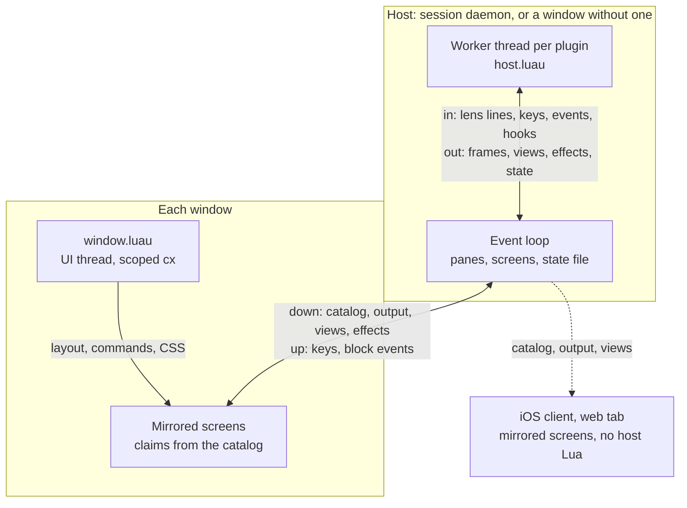

# 架构

一个插件最多包含两个部分，每个部分都在不同位置运行自己的 Luau VM。Host 端运行在窗格所在的位置，并负责所有必须同时存在于每个窗口中的内容；Window 端则在每个窗口内运行，改变该窗口的行为。本页将说明每个部分的运行位置、边界为何设在此处，以及块、Lens 和插件目录如何跨越这一边界。

## 两个部分

| | Host 端 | Window 端 |
| --- | --- | --- |
| 入口 | `host = "host.luau"` | `window = "window.luau"` |
| `tern.context` | `"host"` | `"window"` |
| 运行位置 | 会话守护进程，或在没有守护进程的情况下运行其窗格的窗口 | 这台机器上的每个 Tern 窗口 |
| 线程 | 每个插件一个工作线程 | 窗口的 UI 线程 |
| VM | 每个 host 上每个插件一个 | 每个窗口上每个插件一个 |
| 负责内容 | 块类型、命令 Lens、窗格钩子、`spawn` 过滤器、`tern.pane` | 命令、快捷键、覆盖项、路由、chrome 格式化器、Files 窗格按钮、`tern.css`、窗口事件、`cx.layout` |
| 每次调用预算 | 2 s | chrome 格式化器和 `available` 为 4 ms，其他所有操作为 50 ms |

manifest 至少声明一个入口；只包含一个部分的插件很常见。插件的两个部分共用其包目录和数据目录，但不共用 Lua 状态：它们运行在不同的 VM 中，通常也运行在不同进程中，并且只通过 Tern 在它们之间传递的内容（窗格、块、效果、文件）相互通信。

## 拆分的原因

Tern 的窗格以及每个窗格屏幕的权威副本都位于会话守护进程中。窗口连接到守护进程并镜像屏幕；窗口退出时，其窗格仍会继续运行。插件添加到窗格中的任何内容也必须位于这一侧，否则它会随着添加它的窗口消失，也永远无法到达其他窗口、iOS 客户端或 Web 标签页。这就是 Host 端。

UI 状态则不同：窗口的标签页、焦点、命令面板、按键映射、chrome 和样式表都属于该窗口，并在其 UI 线程上逐个事件地修改。修改这些状态的代码必须在该线程上、窗口内部运行，并直接访问其状态。这就是 Window 端；它会获得一个 `cx`，专门用于此类访问。

这种拆分是由上述两个事实决定的，而不是 API 选择的结果：Host 端代码从不接触窗口，Window 端代码也不拥有窗格内容。

## 每个部分的运行位置

| 情况 | Host 端 | Window 端 |
| --- | --- | --- |
| 连接到会话守护进程的桌面窗口 | 在守护进程中 | 在窗口中 |
| 在没有守护进程的情况下运行自身窗格的桌面窗口 | 在窗口进程中的工作线程上 | 在窗口中 |
| 连接到你的窗口的远程主机 | 在远程主机的守护进程中运行，从该主机的插件文件夹加载 | 你的 Window 端适用于你所有窗口中的每个窗格，包括远程窗格 |
| iOS 客户端 | 不运行（跳过 Host 入口） | 运行，由解释器执行 |
| Web 标签页 | 不运行（无 Lua） | 不运行（无 Lua） |

**守护进程。** 守护进程启动时会加载其所在机器上的插件，然后才恢复已保存的窗格，因此恢复的插件块能够找到自己的块类型。每个 Host 端都获得一个工作线程；守护进程的事件循环从不运行 Lua。它通过通道将 Lens 行、块输入和窗格事件交给工作线程，并在工作线程唤醒时应用其返回的内容（窗格字节、Lens 视图、效果、已保存状态）。事件循环只会在两个地方等待插件：`spawn` 过滤器（每个插件最多 50 ms，参见[Host 钩子与 Spawn 过滤器](../guides/hooks.md)），以及加载或重新加载时（每个工作线程都会报告其入口已运行；即将退出的工作线程最多有 3 s 来释放其块）。

**没有守护进程的窗口。** 当窗口运行自己的窗格时，它会从第一个窗格启动起就在自己的进程中运行同一个 Host 运行时，并使用相同的工作线程。对插件来说，唯一变化是“host”就是该窗口的进程。

**远程 host。** 远程 host 的守护进程会以该守护进程所运行的用户身份，从远程机器的插件文件夹加载该机器上的插件。它们的块和 Lens 会像该 host 的任何窗格一样显示在你的窗口中。你的 Window 端位于本地：它从你的插件文件夹运行，并能看到你所有窗口中的每个窗格，无论本地还是远程。应在要为其窗格提供服务的机器上安装 Host 端。

**iOS。** iOS 客户端会在解释器中运行来自其 Files 应用插件文件夹的 Window 端（参见[包与 manifest](packages.md#目录)），并跳过 Host 入口。它会显示其所连接 host 提供的块和 Lens 视图。

**Web 标签页。** Web 标签页完全不运行 Lua。不过，它仍会接收其唯一 host（即提供该页面的机器）的目录，因此能够打开相同的 Lens 块，并像其他任何副本一样显示相同的插件块和视图；样式来自该目录中插件 manifest 的 `styles`。只有由 Window 端添加的 `tern.css` 样式表不会在此处显示。

完整的情况说明请参见[支持矩阵](support-matrix.md)。

## Host 工作线程

每个带有 `host` 入口的 Host 端都会获得一个 OS 线程，线程名为 `plugin <id>`，由该线程持有插件的 VM。插件在 Host 端执行的所有操作都在该线程上运行：块处理器、Lens 处理器、钩子、定时器和进程回调。若插件陷入循环并耗尽其 2 s 时间预算，只会阻塞它自己的工作线程；其他插件和守护进程仍会继续运行。

处理器通过 `cx` 排队的工作（重新渲染、保存、退出、帧、效果、窗格写入）会在处理器返回后应用，而不会在处理器内部应用，因此不会在一个处理器中运行另一个处理器。

## Window VM 与 `cx`

Window 端在每个窗口的 UI 线程上运行，每个插件在每个窗口中有一个 VM。每个能够修改窗口的处理器都会收到一个作用域限定于本次调用的新 `cx`：处理器返回后，`cx`、`cx.session` 和 `cx.layout` 都会停止工作，之后再使用已保存的 `cx` 会触发错误。定时器、进程和 fetch 回调也会收到各自的新 `cx`。

当窗口处理器运行时，窗口的插件会暂时从窗口中移出。因此，从处理器内部调用内置功能（例如在 `new_tab` 的覆盖项中调用 `cx:command("new_tab")`，或在路由中调用 `cx:open`）时，运行的是 Tern 自身的行为，不会再次运行插件。参见[命令、按键与覆盖项](../guides/commands.md)。

## 块：程序为 Lua 的窗格

插件块是一种守护进程窗格，类似 shell，只是它的程序不是进程，而是 Lua 表。启动时，块会打开一个角色为 `plugin.<plugin>.<block>` 的屏幕 surface，并像普通程序一样使用 Tern Surface Protocol：每个处理器执行后，都会把一帧视图变更（如果标题有变化，还包括标题更新）写入窗格的输出。由于这些字节像任何程序的输出一样经过窗格：

- 所有连接到该会话的窗口都会镜像该块，iOS 和 Web 标签页也一样；
- 脚本可以读取它，而且守护进程的状态文件会像保存任何窗格一样保存它；
- 守护进程重启后，会根据该块上次由 `save` 返回的状态重新启动它，并使用空白屏幕。

输入则反向传递：按键和视图事件会通过窗格的连接到达块的工作线程。参见[块](../guides/blocks.md)。

## Lens：声明式认领，视图带外传递

命令 Lens 会读取 shell 命令的输出，并在其位置显示原生视图。与块不同，窗格输出属于 shell；窗格的每个副本（守护进程的屏幕、每个窗口的镜像、iOS、Web 标签页）都会解析相同的字节，并在命令启动时自行决定是否将输出变为 Lens 块。所有副本都必须得出相同决定，否则它们的屏幕就会对哪些块存在产生分歧。

只有 Host 端运行 Lua，因此这一决定不能依赖 Lua。命令是否获得插件 Lens，完全由 manifest 的 `match` glob 决定；所有副本都能从 host 的目录获取这些 glob。因此，Lens 的 `open` 处理器不能拒绝：等它在 host 上运行时，所有副本都已经打开了该块。应缩小 glob 的匹配范围。

视图也不能通过窗格输出传递：该数据流属于 shell，在块中以原始形式保存，并由所有副本共享。因此，host 会将捕获的行交给插件工作线程，再将生成的视图作为独立消息发送给每个副本；命令运行期间每个块最多每 250 ms 发送一次，命令结束时再发送一次。副本会保留该块，并在收到视图前显示原始输出；`nil` 视图会使原始输出继续显示。参见[命令 Lens](../guides/lenses.md)。

## 目录

每个 host 都会构建其插件目录，并发送给连接的每个窗口（每次重新加载后也会再次发送）。这是每个副本共享的唯一一份插件状态：

| 字段 | 用途 |
| --- | --- |
| 插件（各自包含 id、name、version、description、icon 和 status） | Preferences › Plugins、`tern plugin list`、问题提示 |
| 块类型（id、title、icon、`files`、`palette`） | “新建 *title* 块”命令面板条目、文件菜单中的“用 *title* 打开”、窗格标题和图标 |
| Lens 规则（id、`match` globs） | 每个副本上的 Lens 命令认领规则 |
| 合并后的 manifest `styles` | 窗口中的远程 host 插件样式；Web 标签页中提供页面的 host 样式 |
| 问题 | 不可用作插件的文件夹及原因 |
| `jit` | host 是否使用原生代码生成运行 Luau |

只有 Ready 插件会认领命令、提供块类型或贡献样式。有关状态以及新目录如何传送到窗口，请参见[生命周期与重新加载](lifecycle.md)。

## 数据流

## 所有权

| 对象 | 所有者 | 所在位置 | 保留情况 |
| --- | --- | --- | --- |
| 块类型定义 | Host 端 | 工作线程 VM | 直到重新加载 |
| 正在运行的块及其 Lua 状态 | Host 端 | 守护进程窗格 + 工作线程 VM | 通过 `save` 跨越重新加载和守护进程重启 |
| Lens 命令认领 | manifest | 每个副本上的目录 | 直到 manifest 发生变化 |
| Lens 捕获状态 | Host 端 | 工作线程 VM；每个插件最近 256 个捕获 | 按需从块的原始输出重建 |
| Lens 视图 | Host 端 | 每个副本的 Lens 块 | 由 host 发送 |
| 窗格钩子和 `spawn` 过滤器 | Host 端 | 工作线程 VM | 直到重新加载 |
| 命令、快捷键、覆盖项、路由、格式化器 | Window 端 | 窗口 VM | 直到重新加载 |
| 插件样式表 | Window 运行时（本地）、窗口（远程 host 的样式表） | 窗口的样式层叠 | 重新加载时重新添加 |
| `tern.kv` 数据 | 每个 VM | `<state>/plugin-data/<id>/kv.json` | 经历上述所有变化后仍保留 |

## 相关页面

- [包与 manifest](packages.md)：包的布局和命名。
- [生命周期与重新加载](lifecycle.md)：加载、重新加载和重启。
- [运行时、预算与 JIT](runtime.md)：每个部分运行的 VM。
- [信任与安全](security.md)：每个部分可以访问的内容。
