# 状态栏、Toast 与浮层

Chrome 类用于框定视图，而非承载视图内容：沿边缘排列的 `status` 条及其 `seg` 段、短暂显示的 `toast` 通知，以及悬浮在视图上方的玻璃质感 `overlay` 面板（弹出菜单、选择器、对话框、抽屉）。

| 种类 | 构造方式 | 绘制内容 |
| --- | --- | --- |
| [`status`](#status) | `tern.ui.node("status", …)` | 高 24 px 的条带，包含左右两组段；空间狭窄时会移除低优先级段 |
| [`seg`](#seg) | `tern.ui.node("seg", …)` | 一个状态段：图标、文本片段、色调，可选点击操作 |
| [`toast`](#toast) | `tern.ui.node("toast", …)` | 窗口 toast 图层中的通知；节点本身不绘制内容 |
| [`overlay`](#overlay) | `tern.ui.node("overlay", …)` | 视图上的玻璃卡片，可居中或锚定，也可设为模态 |

这些 kind 都没有专用构造器；请使用 [`tern.ui.node`](../reference/ui.md#node)。

## `status`

高 24 px，呈现工具包状态栏的样式：11.5 px 的 `--t3` 文本、顶部一条 `--l1` 细线，以及页面填充色（`var(--sf-status-bg, var(--page))`），除非设置了 `transparent`。它负责排列自己的子节点：每个子节点都会进入左侧组，只有 `side = "right"` 的 `seg` 会进入右侧组（推至右边缘）。各组内的子节点保持原有顺序。

**适配宽度。** Tern 会在绘制条带时、条带或其段发生变化时，以及所属区域宽度改变时测量条带。当各段宽度总和超过行宽时，它会隐藏优先级最低的 `seg`（`.sf-drop`）。优先级相同时，先移除离所属边缘最远的段（两侧从边缘向内交错：左侧第 1 个、右侧第 1 个、左侧第 2 个、右侧第 2 个……并先移除其中较靠后的段，所以完全平局时先移除右侧的段）。带有 `min = { w = … }` 的 `seg` 只按其最小宽度计入，并会用省略号截断至该宽度（`.shrinks`），而不是被移除。最后剩下的段始终保留并会截断。非 `seg` 子节点不会被移除或缩小。

**构造方式：** `tern.ui.node("status", { … }, { segs… })`。

| 属性 | 类型 | 默认值 | 含义 |
| --- | --- | --- | --- |
| `transparent` | boolean | `false` | 不填充背景：条带显示其后方内容（`.transparent`） |
| `aria` | string | `"Status"` | 组的无障碍名称（`aria-label`） |

通用属性的用法与其他节点相同（参见 [元素](index.md)）。

**子节点：** 由条带负责放置：`side = "right"` 的 `seg` 放入右侧组，其余子节点放入左侧组。

**事件：** 自身不产生事件；`actions` 的用法与其他节点相同。

**样式：**

```html
<div class="sf sf-status" data-id="dock.bar" role="group" aria-label="Status">
	<div class="sf-st-row">
		<div class="sf-st-l"><div class="sf sf-seg" …>…</div></div>
		<div class="sf-st-r"><div class="sf sf-seg" …>…</div></div>
	</div>
</div>
```

| 目标 | 选择器 |
| --- | --- |
| 节点 | `.sf-status` |
| 无填充 | `.sf-status.transparent` |
| 内边距中的行 | `.sf-st-row`（内部实现，可能变化） |
| 左侧组 | `.sf-st-l`（内部实现，可能变化） |
| 右侧组 | `.sf-st-r`（内部实现，可能变化） |
| 包含截断段的组（只有这样的组会让出宽度；另一组会保留完整段） | `.sf-st-l.shrinks`、`.sf-st-r.shrinks`（内部实现，可能变化） |

在条带或其祖先上设置 `--sf-status-bg`，即可更改其填充色，而无需覆盖 `background`。

## `seg`

一个状态段：包含图标、文本片段和色调，高 20 px，两侧内边距为 6 px，圆角为 5 px。设置 `actions.click`（或 `dblclick`）后会添加 `.sf-act`，悬停时显示填充色（`--l1`，文本为 `--t1`）。子节点（例如小型 `meter`）显示在图标和文本之间；没有子节点时，其容器会隐藏。位于 `status` 之外的 `seg` 会独立绘制为一个段。

**构造方式：** `tern.ui.node("seg", { text = "main", icon = "branch" })`。

| 属性 | 类型 | 默认值 | 含义 |
| --- | --- | --- | --- |
| `text` | string | `""` | 纯文本（未提供 `spans` 时使用） |
| `spans` | spans | none | 带样式的文本；优先于 `text` |
| `icon` | string | none | 图标名称（名称见[数据](data.md#icon)）。未知名称不会显示图标 |
| `tone` | string | none | `neutral`、`accent`、`info`、`success`、`warning`、`error`、`pending`、`muted`、`user`：为图标着色（`--tc`），并将文本提升为 `--t2`。`neutral` 不为图标着色 |
| `side` | `"right"` | left | 在 `status` 中放入右侧组 |
| `priority` | number | `0` | 条带较窄时的移除顺序：数值越低越先移除 |
| `min` | `{ w = extent }` | none | 截断至此宽度，而不是移除。可用 `"20ch"`（单元格）或行宽的比例（`0.3`）。此处会忽略 `"Nlines"`。对 `seg` 而言，`min.w` 不是 CSS `min-width`：条带适配逻辑会应用该值，最后留下的段仍会截断至小于该值 |
| `actions` | `{ click?, dblclick?, menu? }` | none | 通用操作：点击会发送 `action` 事件 |

若 `icon` 未设置，`role` 为 `omp.status.<icon>` 时也会选择相应图标；这是为 omp 提供的行为。

**子节点：** 按顺序绘制在 `.sf-seg-k` 容器中，位置介于图标和文本之间。

**事件：** 自身不产生事件；`actions` 会像其他节点一样发送 `action` 事件（`{ev = "action", id, act}`）。

**样式：**

```html
<div class="sf sf-seg sf-act" data-id="dock.bar.branch" data-tone="accent">
	<span class="sf-seg-ic"><svg class="ico">…</svg></span>
	<span class="sf-seg-k sf-hidden"></span>
	<span class="sf-seg-t">main</span>
</div>
```

| 目标 | 选择器 |
| --- | --- |
| 节点 | `.sf-seg` |
| 可点击 | `.sf-seg.sf-act` |
| 带色调 | `.sf-seg[data-tone='warning']` |
| 因空间不足而移除 | `.sf-seg.sf-drop`（`display: none`） |
| 正在截断 | `.sf-seg.shrinks` |
| 图标容器 | `.sf-seg-ic`（12 px，内部实现，可能变化） |
| 子节点容器 | `.sf-seg-k`（内部实现，可能变化） |
| 文本 | `.sf-seg-t`（省略号、等宽数字，内部实现，可能变化） |

```lua
local ui = tern.ui

local function bar(state)
	return ui.node("status", { key = "bar" }, {
		ui.node("seg", { key = "branch", icon = "branch", text = state.branch, priority = 3 }),
		ui.node("seg", {
			key = "path",
			spans = { ui.span(state.path, "path") },
			min = { w = "12ch" },
			priority = 5,
		}),
		ui.node("seg", {
			key = "errors",
			side = "right",
			icon = "warn",
			tone = state.errors > 0 and "error" or "neutral",
			text = tostring(state.errors),
			priority = 4,
			actions = { click = "show-errors" },
		}),
		ui.node("seg", { key = "clock", side = "right", text = state.clock, priority = 1 }),
	})
end

return { dock = ui.col({ bar(state) }) }
```

窗格变窄时，`clock` 会先消失，然后是 `branch`；`path` 会先截断至 12 个单元格，之后 `errors` 才会被移除。

<figure class="tn-figure">
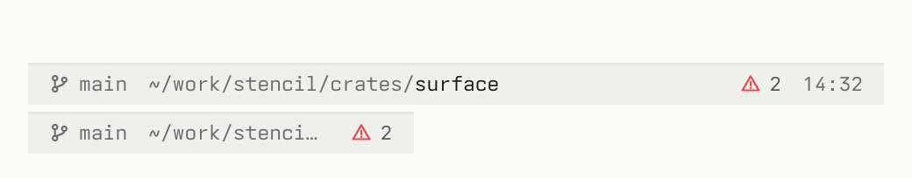
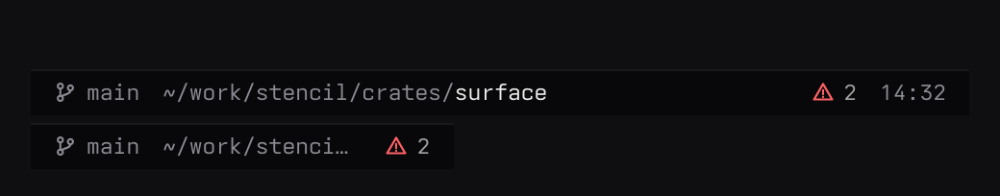
<figcaption>上方的状态栏设置了 <code>errors = 2</code>；下方是同一状态栏，宽度限制为 dock 的 45%（<code>max = { w = 0.45 }</code>）：<code>clock</code> 已移除，<code>path</code> 已截断。</figcaption>
</figure>

## `toast`

短暂显示的通知。节点自身的元素为空且隐藏（`.sf-toast { display: none }`、`aria-hidden`）；Tern 通过工具包的 toast 图层显示通知：玻璃质感通知，圆角 12 px，固定在窗口底部中央（距底部 28 px），宽度适配文本，并在超过 560 px（或窗口宽度减去 32 px）时换行。它位于 `<body>` 下，而不是你的 surface 中。当 dock 中有内容显示在屏幕上（例如编辑器）时，toast 会改为显示在其上方 12 px 处，因此不会遮挡输入区。在手机上，toast 会改为显示在顶部栏下方。节点首次绘制时会显示通知；每当其 `text`、`sub`、`tone` 或 `ttl` 改变时也会再次显示。其他属性变化不会让通知重新显示；节点滚出长记录再滚回来也不会。整个窗口同一时间只显示一个 toast，因此新通知（无论来自你还是 Tern）都会就地替换当前通知：快速连续更新的 toast 会直接更改文本，不会再次播放进入动画。成功通知会停留 2.2 秒，信息和错误通知会停留 5.2 秒，然后淡出 260 ms；`ttl` 可以让通知更早消失（淡出 200 ms；启用减少动态效果时立即消失）。移除节点会同时移除仍在显示的 toast，无论它是否已滚出记录；稍后以相同 id 添加的节点属于新 toast，即使属性相同也会显示。

若要在不保留节点的情况下从处理器显示通知，请使用 `cx:toast`（参见 [Host API](../reference/api-host.md)）。

**构造方式：** `tern.ui.node("toast", { text = "Saved", tone = "success" })`。

| 属性 | 类型 | 默认值 | 含义 |
| --- | --- | --- | --- |
| `text` | string | `""` | 通知内容 |
| `sub` | string | `""` | 文本后的等宽字体详情：仅显示第一行，最多 120 个字符；为空时隐藏 |
| `tone` | string | success | `error` → 错误通知（警告图标、`--bad` 边框、`role="alert"`）；`info` 或 `accent` → 信息通知（信息图标、强调色）；其他值 → 成功通知（勾号图标） |
| `ttl` | number (ms) | none | 在此毫秒数后关闭（截断小数；忽略负数）。只能缩短显示时间；超过 2.2 秒 / 5.2 秒后通知已经消失 |

**子节点：** 无（会忽略）。

**事件：** 无。

**样式：**

```html
<!-- the node, in your surface -->
<div class="sf sf-toast" data-id="main.saved" data-tone="error" aria-hidden="true"></div>
<!-- what shows, under <body> -->
<div class="toast err" role="alert" aria-live="assertive">
	<svg class="ico" aria-hidden="true">…</svg><span>Save failed</span><span class="mono">disk full</span>
</div>
```

| 目标 | 选择器 |
| --- | --- |
| 节点（始终隐藏） | `.sf-toast` |
| 显示的通知 | 工具包的 `.toast`、`.toast.info`、`.toast.err`（位于你的 surface 之外） |

通知位于你的区域之外，因此作用域限定为 `[data-surface='plugin.<plugin>.<block>']` 的样式表无法作用于它。请将其外观视为 Tern 的样式。

```lua
local ui = tern.ui
-- show a toast while state.notice is set; bump state.notice_n to re-show the
-- same text (a new key is a new node, which shows on its first draw)
local main = { ui.text(state.body) }
if state.notice then
	table.insert(main, ui.node("toast", {
		key = "notice" .. state.notice_n,
		text = state.notice,
		sub = state.detail,
		tone = state.failed and "error" or "success",
		ttl = 1500,
	}))
end
return { main = ui.col(main) }
```

当 `state.notice = "Save failed"`、`state.failed = true` 且 `state.detail = "disk full: /Users/me/notes"` 时，通知会显示在窗口底部：

<figure class="tn-figure">
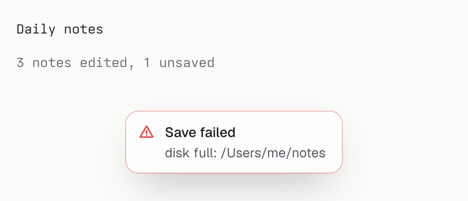
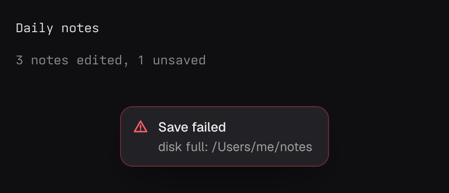
</figure>


## `overlay`

位于 `layer` 区域中的悬浮玻璃卡片：弹出菜单、选择器、对话框、全屏抽屉，或停靠在 layer 边缘的抽屉或侧边面板（[侧边面板与抽屉](#侧边面板与抽屉)）。节点元素覆盖整个 layer，但允许指针事件穿过；其中可放置可选的暗色背景遮罩（设置 `modal` 时显示）和卡片。
卡片可带标题行（`head`，可包含 `icon`、弱化显示的 `meta` 和 `end` 控件，与 [`card`](layout.md#card) 的标题行类似）、可滚动并承载子节点的主体，以及可选的页脚栏（`foot`），用于放置抽屉中的按钮。卡片会以短暂的弹出动画出现（缩放和淡入，220 ms）；停靠的卡片则从边缘滑入，同时背景遮罩淡入。启用减少动态效果时，卡片和背景遮罩都保持静止（`.sf-still`）。

将 overlay 放入视图的 `layer`：

```lua
return { main = …, layer = ui.col({ ui.node("overlay", { … }, { … }) }) }
```

**位置（`anchor`）。**

| `anchor` | 类名 | 位置 |
| --- | --- | --- |
| 未提供、`"center"`、任意未知值 | `.at-center` | 在 layer 中居中（内边距 12 px） |
| `"top"` | `.at-top` | 水平居中，距顶部 40 px |
| `"bottom"` | `.at-bottom` | 水平居中，距底部 16 px |
| `{ node = id, side = "below" \| "above" }` | `.at-node` | 位于节点 `id` 的元素旁，与其左对齐，相距 4 px，放在 `side` 指定的一侧（默认 below） |
| `{ caret = id }` | `.at-caret` | 显示在 editor/input `id` 的插入光标下方，并向左偏移 10 px，使行文本与输入文本对齐 |
| 任意值，且 `side = "right"` 或 `"left"` | `.at-side.side-right`、`.side-left` | 停靠在对应边缘的全高侧边面板，宽度由 `size` 决定（[侧边面板与抽屉](#侧边面板与抽屉)） |
| 任意值，且 `side = "bottom"` | `.at-side.side-bottom` | 沿底边显示的抽屉，宽度占满，高度由 `size` 决定，并带有拖柄 |

每次更新后都会重新放置节点和插入光标锚点（锚点可能移动）：若首选侧有足够空间，或该侧空间不少于另一侧，卡片就放在首选侧；否则会翻转（最终显示在上方时添加 `.above`），并限制在 layer 内侧 8 px 的范围内；空间不足时会设置 `max-height`（主体可滚动）。锚点尚未绘制时，卡片会隐藏（`.lost`）；若插入光标锚点指定的节点不是 `editor` 或 `input`，也视为未绘制。`id` 是完整节点 id（`main.draft`）。

**尺寸（`size`）。** `sm` 为宽 320 px，`md` 为宽 480 px，`lg` 为宽 720 px（均不会宽于 layer）；`full` 则填满 layer，四周留 8 px 内缩，并使用 `--r-panel` 圆角。默认值：节点和插入光标锚点使用 `sm`，其他情况使用 `md`。未知值回退到默认值。对于停靠的 overlay，`size` 表示侧边面板宽度或抽屉高度，也可以使用 layer 的比例（见[侧边面板与抽屉](#侧边面板与抽屉)）。

**覆盖视图。** 当 layer 中有 `modal` 或 `full` overlay（或 `picker`）时，Tern 会为 `main` 和 `dock` 区域添加 `.sf-covered`：其中的所有动画都会暂停（`animation-play-state: paused`），使暗色及模糊背景下方的画面保持原样。面板关闭后会移除该类。

**按键。** Overlay 不会接收键盘输入。按键会继续传给块的 `key` 处理器，因此要根据自己的状态路由按键（例如，状态中存在打开的对话框时，让 ↑/↓/Enter/Escape 操作该对话框）。`modal` 背景遮罩会拦截指针：点击遮罩不会触及下方内容，也不会发送事件，因此应通过 Escape 或 overlay 内部的按钮关闭它。omp 的只读面板抽屉（`role` 为 `omp.overlay.report`、`.context`、`.usage`、`.sessionInfo`、`.jobs`、`.hotkeys`、`.btwHistory`、`.spotlight`）是例外：按下其背景遮罩会为程序输入 Escape，从而关闭面板，效果与点击 Tern 自有弹出菜单之外的区域相同。

**构造方式：** `tern.ui.node("overlay", { head = …, anchor = …, size = …, modal = … }, children)`。

| 属性 | 类型 | 默认值 | 含义 |
| --- | --- | --- | --- |
| `anchor` | `"center"`、`"top"`、`"bottom"`、`{node, side?}`、`{caret}` | `"center"` | 位置，见上文 |
| `side` | `"right"`、`"left"`、`"bottom"` | none | 将卡片停靠到 layer 边缘：全高侧边面板（`right`、`left`）或抽屉（`bottom`）。优先于 `anchor`；其他值不会停靠 |
| `variant` | `"edge"`、`"inset"` | `"edge"` | 设置 `side` 时：贴合边缘，或与边缘相距 8 px 并带圆角。未设置 `side` 时忽略；未知值按 `edge` 处理 |
| `size` | `"sm"`、`"md"`、`"lg"`、`"full"`，或 (0, 1] 范围内的数字 | 锚定时为 `sm`，否则为 `md` | 卡片宽度或全屏抽屉。设置 `side` 时表示侧边面板宽度或抽屉高度；`"full"` 按 `md` 处理；数字表示 layer 的比例，且仅在设置 `side` 时生效 |
| `modal` | boolean | `false` | 显示暗色背景遮罩（`--dim`）并拦截指针；设置 `aria-modal="true"`；覆盖 `main`/`dock` |
| `head` | 文本（string 或 spans） | none | 标题行；文本为空或仅含空白时不显示标题行（`.nohead`） |
| `icon` | 图标名称 | none | 标题前显示的 16px `--t3` 图标；优先于 omp role 所指定的图标 |
| `meta` | 文本（string 或 spans） | none | 标题后的弱化文本 |
| `end` | 子节点的 id | none | 将该子节点绘制在标题行右端，而不是主体中：可用于关闭或设置 `button`、分段式 `tabs` |
| `foot` | 子节点的 id | none | 将该子节点绘制在主体下方的页脚栏中：用于抽屉操作，可放置一个 `row`，其中 `button` 的主要按钮排在最后 |
| `aria` | string | `head` 文本 | 卡片的无障碍名称（卡片上的 `aria-label`；作为通用属性时也会为节点设置标签） |

`role` 为 `omp.overlay.<name>` 时，会为 omp 面板抽屉添加标题图标；其他 role 不会显示图标，除非你设置 `icon`。与 card 一样，`end` 是 Luau 关键字（需写作 `["end"] = …`）；SDK 中 `end` 和 `foot` 接收节点，并将其作为键为 `end` 或 `foot` 的子节点添加。

**侧边面板尺寸。** 居中、顶部、底部、全屏或停靠的 overlay 都属于面板：标题行至少高 52 px，使用 `padding: 0 18px`；标题采用无衬线字体，字重、字号和行高为 `550 14px/1.3`，字距为 `-0.012em`；主体为一列，间距 16 px，使用 `padding: 16px 18px`。锚定到节点或插入光标的 overlay 属于弹出菜单，采用紧凑尺寸：主体为一列，间距 4 px、内边距 4 px。页脚栏（卡片上的 `foot` 类）固定在卡片底边，位于可滚动主体下方：使用 `padding: 9px 12px`，顶部有一条 `--l1` 细线，并以磨砂效果覆盖下方滚动内容，同时保留卡片底部圆角。omp 自有 overlay 保留其原有外观。

**子节点：** 按顺序绘制在卡片主体中，`end` 和 `foot` 子节点除外。卡片中的 `list` 会采用弹出菜单的行样式。

**事件：** 自身不产生事件；子节点会发送自己的事件（`select`、`activate`、`action` 等），而 `actions` 的用法与其他节点相同。

**样式：**

```html
<div class="sf sf-overlay sz-sm at-center modal" data-id="layer.confirm" data-role="notes.confirm">
	<div class="sf-ov-dim" aria-hidden="true"></div>
	<div class="sf-ov-card" role="dialog" aria-modal="true" aria-label="Delete 3 notes?">
		<div class="sf-ov-head">
			<span class="sf-ov-ic sf-hidden" aria-hidden="true"></span>
			<span class="sf-ov-title">Delete 3 notes?</span>
			<span class="sf-ov-meta"><!-- meta spans --></span>
			<div class="sf-ov-end"><!-- the end child --></div>
		</div>
		<div class="sf-ov-body">…children…</div>
		<div class="sf-ov-foot"><!-- the foot child --></div>
	</div>
</div>
```

| 目标 | 选择器 |
| --- | --- |
| 节点（覆盖整个 layer） | `.sf-overlay` |
| 锚点 | `.sf-overlay.at-center`、`.at-top`、`.at-bottom`、`.at-node`、`.at-caret` |
| 尺寸 | `.sf-overlay.sz-sm`、`.sz-md`、`.sz-lg`、`.sz-full`；比例值不对应类名 |
| 停靠 overlay 及其边缘 | `.sf-overlay.at-side`、`.side-right`、`.side-left`、`.side-bottom` |
| 内缩（停靠时） | `.sf-overlay.inset` |
| 模态 | `.sf-overlay.modal` |
| 背景遮罩 | `.sf-ov-dim`（内部实现，可能变化） |
| 卡片 | `.sf-ov-card`（内部实现，可能变化） |
| 翻转到锚点上方的卡片 | `.sf-ov-card.above` |
| 锚点消失后隐藏的卡片 | `.sf-ov-card.lost` |
| 无标题的卡片 | `.sf-ov-card.nohead` |
| 带页脚的卡片 | `.sf-ov-card.foot` |
| 标题行 | `.sf-ov-head`、`.sf-ov-ic`、`.sf-ov-title`、`.sf-ov-meta`、`.sf-ov-end`（内部实现，可能变化） |
| 主体 | `.sf-ov-body`（内部实现，可能变化） |
| 页脚栏 | `.sf-ov-foot`（内部实现，可能变化） |
| 抽屉拖柄 | `.sf-overlay.side-bottom > .sf-ov-card::before`（内部实现，可能变化） |
| 抽屉下方的区域 | `.sf-main.sf-covered`、`.sf-dock.sf-covered` |

卡片采用玻璃质感样式：圆角 12 px，使用 `--pop-bg`，并应用 `backdrop-filter: blur(32px) saturate(190%)`、`--l2` 边框、顶部 `--glass-hi` 高光、边缘光 `::after`，以及 `[data-theme='dark']` 下更深的阴影。背景遮罩使用 `--dim`。停靠卡片的宽度（侧边面板）或高度（抽屉）由 `--ov-size` 决定；该值由尺寸类设置在 `.sf-overlay.at-side` 上，或在使用比例时设置在卡片上。参见[变量](../styles/variables.md)。

由按键驱动的确认对话框，按钮位于页脚中，并各自显示对应的按键：

```lua
local ui = tern.ui

local function view(state)
	local layer
	if state.confirm then
		layer = ui.col({
			ui.node("overlay", {
				key = "confirm",
				icon = "trash",
				head = { ui.span("Delete " .. #state.marked .. " notes?") },
				size = "sm",
				modal = true,
				foot = "layer.confirm.foot",
			}, {
				ui.text({ ui.span("This can't be undone.", "muted") }),
				ui.node("row", { key = "foot", gap = "sm", justify = "end" }, {
					ui.button("Cancel", { variant = "quiet", keys = { "esc" }, actions = { click = "cancel" } }),
					ui.button("Delete", { variant = "danger", keys = { "enter" }, actions = { click = "delete" } }),
				}),
			}),
		})
	end
	return { main = ui.col({ … }), layer = layer }
end

local function key(state, k)
	if not state.confirm then return false end
	if k.name == "escape" then state.confirm = false
	elseif k.name == "enter" then delete_marked(state); state.confirm = false
	else return false end
	return true
end
```

<figure class="tn-figure">
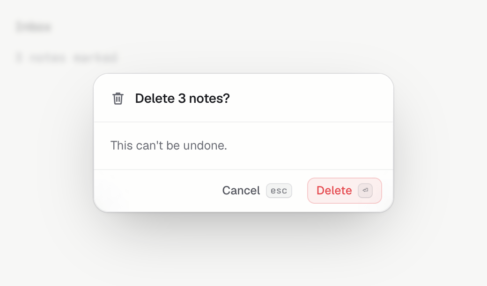
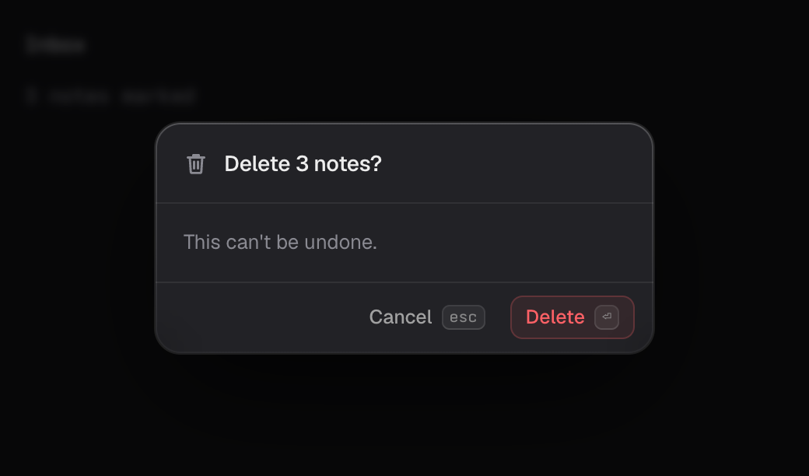
<figcaption>一个带有 <code>head</code>、<code>icon</code> 和 <code>foot</code> 的 <code>modal</code>、<code>sm</code> overlay：背景遮罩会使下方视图变暗。</figcaption>
</figure>

编辑器的插入光标处有一个补全弹出菜单；编辑器在 dock 中，键为 `draft`（`dock.draft`）。未设置 `size` 时使用 `sm`；没有 `head`，所以卡片只显示列表：

```lua
layer = ui.col({
	ui.node("overlay", { key = "complete", anchor = { caret = "dock.draft" } }, {
		ui.node("list", { key = "items", selected = "layer.complete.items.review" }, {
			ui.node("item", { key = "review", label = "/review", detail = "review the working tree" }),
			ui.node("item", { key = "revert", label = "/revert", detail = "undo the last edit" }),
			ui.node("item", { key = "rename", label = "/rename", detail = "rename the session" }),
		}),
	}),
})
```

<figure class="tn-figure">
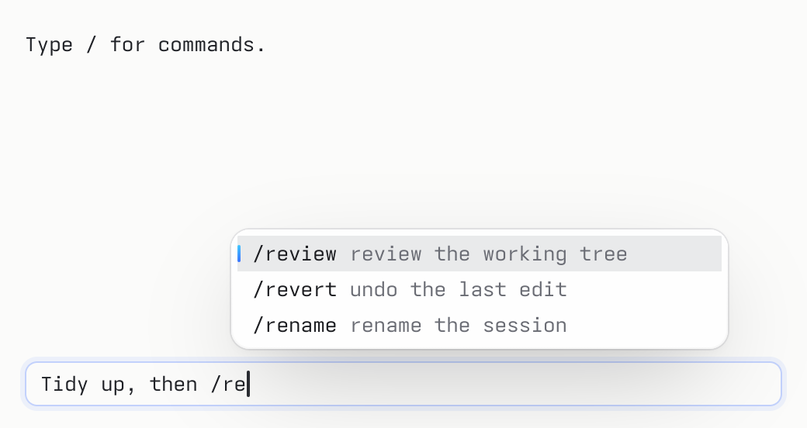
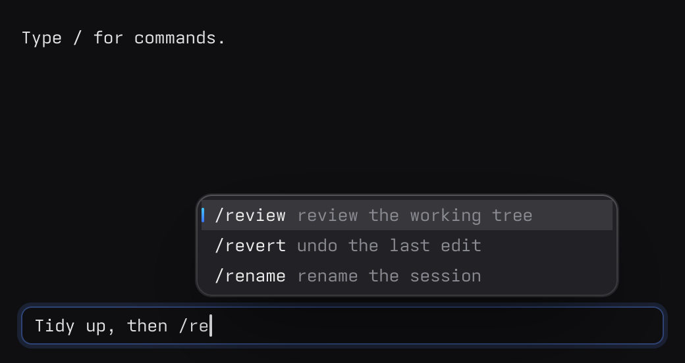
<figcaption>dock 中的编辑器上方比下方空间更大，因此卡片翻转到插入光标上方（<code>.above</code>）。</figcaption>
</figure>

`list` 和 `item` 见[列表](lists.md)，编辑器见[文本输入](input.md)，如何将样式表限定在你的块中见[视图样式](../styles/index.md)。

### 侧边面板与抽屉

`side` 会将 overlay 停靠到 layer 边缘，而不是让它悬浮。停靠在 `right` 或 `left` 的**侧边面板**是全高面板：顶部是带标题和 `end` 控件的标题行，主体在其下方滚动，底部是 `foot` 栏。适合用于与内容相邻的检查器、大纲或设置面板，这样视图内容仍然可见。停靠在 `bottom` 的**抽屉**附着于底边，顶部有圆角和拖柄：可用于日志、终端、预览，或从下方滑入的简短确认面板。Overlay 的其他行为保持不变：`head`、`icon`、`meta`、`end`、`foot`、`modal` 和 `aria` 的用法与居中抽屉相同，标题行和主体也采用抽屉尺寸。

卡片会从所在边缘滑入（320 ms，使用 `--out`）；设置 `modal` 时，背景遮罩会在其下方淡入、使视图变暗并拦截指针。未设置 `modal` 时，layer 的其他部分仍允许指针事件通过，因此侧边视图仍可操作。启用减少动态效果时，卡片和背景遮罩都保持静止（`.sf-still`）。

`variant` 决定外观：

| `variant` | 类名 | 外观 |
| --- | --- | --- |
| `"edge"`（默认） | 无 | 与边缘齐平：侧边面板为直角，抽屉顶部使用 `--r-panel` 圆角；开放侧边有一条 `--l2` 细线，并向内容投下柔和阴影 |
| `"inset"` | `.inset` | 与每个停靠边缘相距 8 px，四角均为 `--r-panel`（16 px）圆角，并带有 overlay 的边框、边缘光和阴影。内缩抽屉仍保留拖柄 |

`side` 优先于 `anchor`；未知的 `side` 不会停靠，卡片仍按 `anchor` 放置。移除 `side` 后，卡片会回到锚点位置。

**尺寸。** 侧边面板的 `size` 表示宽度，抽屉的 `size` 表示高度：可以指定名称，也可以指定 layer 的比例。

| `size` | 侧边面板（`left`、`right`）宽度 | 抽屉（`bottom`）高度 |
| --- | --- | --- |
| `"sm"` | 320 px | layer 的 33% |
| `"md"`（默认） | 400 px | layer 的 50% |
| `"lg"` | 560 px | layer 的 75% |
| (0, 1] 范围内的数字 | layer 宽度的对应比例 | layer 高度的对应比例 |

侧边面板不会比 layer 更宽。`"full"`、`0`、大于 1 的数字和未知值都会按 `"md"` 处理。

**按键。** 与所有 overlay 一样，它不会接收键盘输入。请在状态中记录打开的侧边面板或抽屉，通过 Escape 或其关闭按钮（`end` 子节点）将其关闭，并通过属性驱动其内容。其子节点会像其他 overlay 中的子节点一样发送事件。

所选服务的检查器侧边面板，以及日志抽屉：

```lua
local ui = tern.ui

local function view(state)
	local layer
	if state.inspecting then
		local svc = state.inspecting
		layer = ui.col({
			ui.node("overlay", {
				key = "inspect",
				side = "right",
				modal = true,
				head = "Inspector",
				["end"] = "layer.inspect.close",
				foot = "layer.inspect.foot",
			}, {
				ui.button("", { key = "close", icon = "x", size = "sm", variant = "quiet", title = "Close", actions = { click = "close" } }),
				ui.kv({ { "service", svc.name }, { "image", svc.image }, { "replicas", tostring(svc.replicas) } }),
				ui.node("row", { key = "foot", gap = "sm", justify = "end" }, {
					ui.button("Cancel", { variant = "quiet", keys = { "esc" }, actions = { click = "close" } }),
					ui.button("Apply", { variant = "primary", keys = { "enter" }, actions = { click = "apply" } }),
				}),
			}),
		})
	elseif state.logs then
		layer = ui.col({
			ui.node("overlay", {
				key = "logs",
				side = "bottom",
				size = 0.55,
				icon = "terminal",
				head = "Logs",
				meta = state.logs.service,
				["end"] = "layer.logs.close",
			}, {
				ui.button("", { key = "close", icon = "x", size = "sm", variant = "quiet", title = "Close", actions = { click = "close" } }),
				ui.node("ansi", { text = state.logs.text }),
			}),
		})
	end
	return { main = ui.col({ … }), layer = layer }
end
```

TSX 写法相同，其中 `end` 和 `foot` 接收节点：

```tsx
function Layer({ s }: { s: State }) {
   if (s.inspecting)
      return (
         <overlay key="inspect" side="right" modal head="Inspector"
            end={<button icon="x" size="sm" variant="quiet" title="Close" onClick={close} />}
            foot={
               <row gap="sm" justify="end">
                  <button variant="quiet" keys={['esc']} onClick={close}>Cancel</button>
                  <button variant="primary" keys={['enter']} onClick={apply}>Apply</button>
               </row>
            }>
            <kv items={[{ k: 'service', v: s.inspecting.name }, { k: 'replicas', v: String(s.inspecting.replicas) }]} />
         </overlay>
      );
   if (s.logs)
      return (
         <overlay key="logs" side="bottom" size={0.55} icon="terminal" head="Logs" meta={s.logs.service}
            end={<button icon="x" size="sm" variant="quiet" title="Close" onClick={close} />}>
            <ansi text={s.logs.text} />
         </overlay>
      );
   return null;
}
```

<figure class="tn-figure">
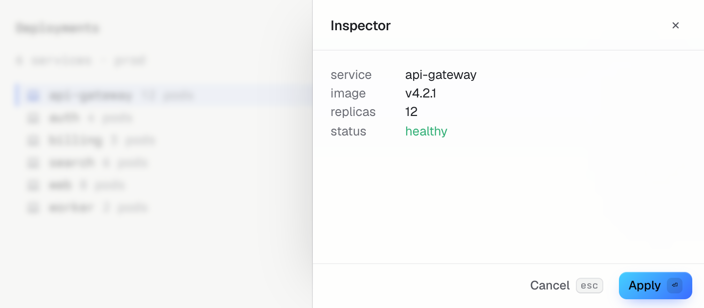
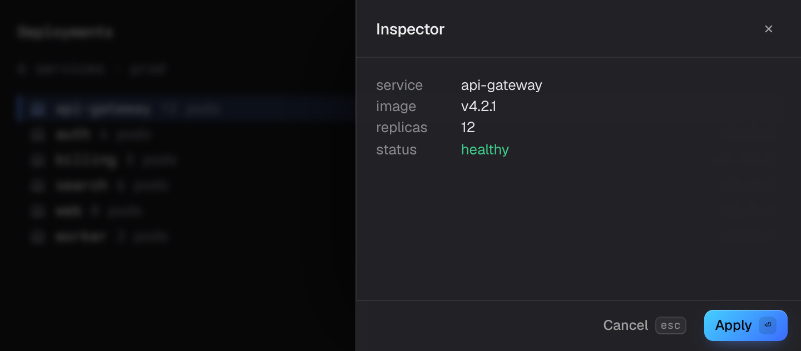
<figcaption>一个带 <code>modal</code> 和 <code>side: "right"</code> 的侧边面板：与边缘齐平，按钮位于 <code>foot</code> 中。</figcaption>
</figure>

<figure class="tn-figure">
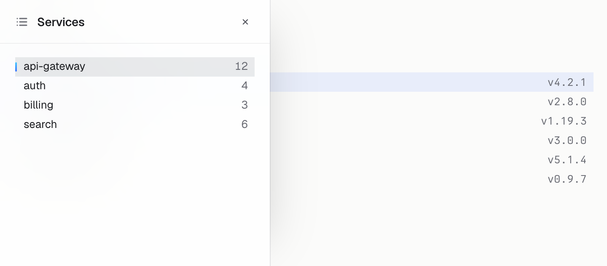
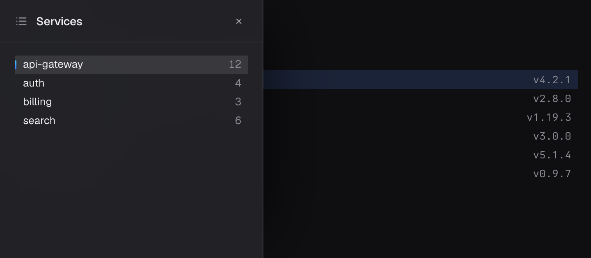
<figcaption>设置了 <code>side: "left"</code>、<code>size: "sm"</code>，且不是模态：旁边的视图仍可接收指针操作。</figcaption>
</figure>

<figure class="tn-figure">
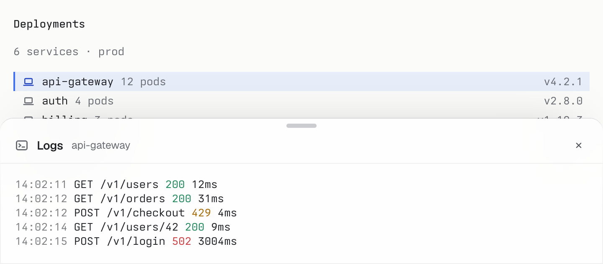
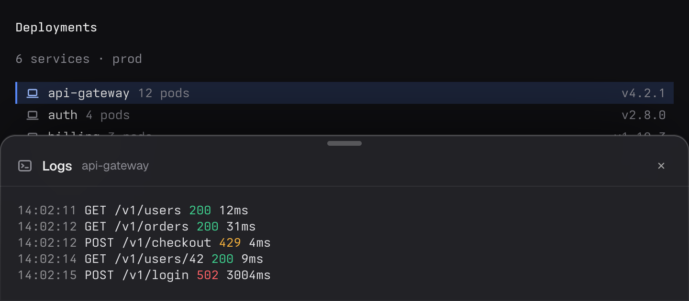
<figcaption>一个抽屉：设置 <code>side: "bottom"</code> 和 <code>size: 0.55</code>，高度为 layer 的 55%。</figcaption>
</figure>

<figure class="tn-figure">
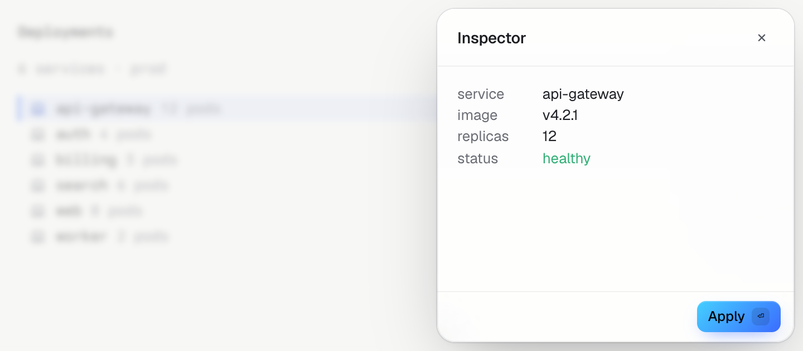
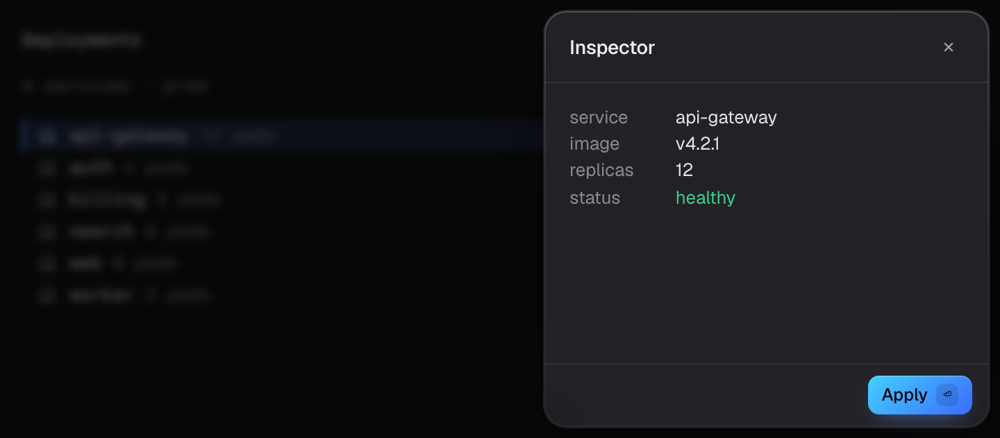
<figcaption>右侧面板设置了 <code>variant: "inset"</code>：它与边缘留有间距，并带有 overlay 的边缘光和阴影。</figcaption>
</figure>

<figure class="tn-figure">
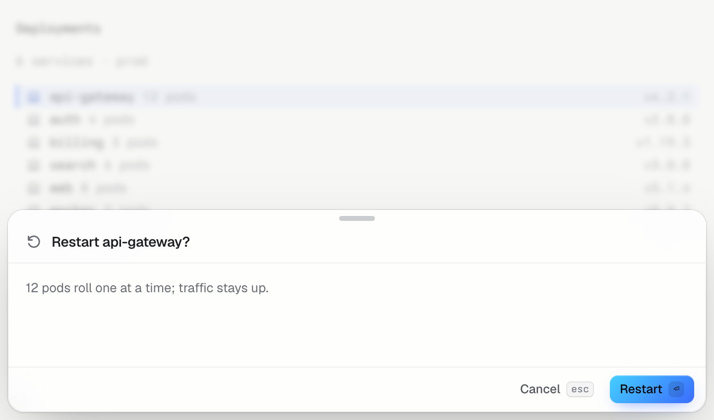
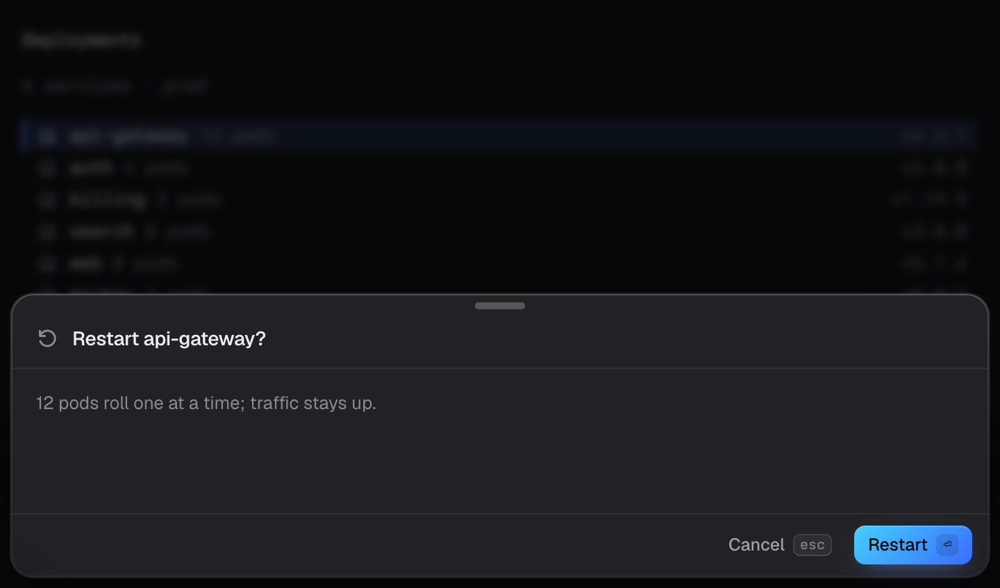
<figcaption>一个内缩的 <code>modal</code> 抽屉：确认面板从下方滑入。</figcaption>
</figure>

停靠 overlay 的标记结构与 overlay 本身相同，边缘信息由节点指定：

```html
<div class="sf sf-overlay sz-md at-side side-right modal" data-id="layer.inspect">
	<div class="sf-ov-dim" aria-hidden="true"></div>
	<div class="sf-ov-card foot" role="dialog" aria-modal="true" aria-label="Inspector">
		<div class="sf-ov-head">…</div>
		<div class="sf-ov-body">…children…</div>
		<div class="sf-ov-foot"><!-- the foot child --></div>
	</div>
</div>
```