# 数据

数据类 kind 用于展示结构化值：键值对、核心指标数字、表格、可展开树，以及其中的小型内联标记（徽章、键帽、图标、头像、图片）、可翻阅的幻灯片和文件：在 Tern 的媒体查看器中或作为附件。少量带标签的值用 `kv`，视图关注的少数数字用 `stats`，共享列的行用 `table`（可用 `selectable` 选择、排序，或用 `multi` 一次选择多行），用 `tree` 展示用户可展开和收起的嵌套项，用 `json` 将原始 JSON 值显示为可折叠树，在行、卡片和标题中使用 `badge`、`kbd`、`icon`，用 `avatar` 和 `avatars` 表示操作者，用 `carousel` 展示可翻阅的少量图片，用 `media` 按路径显示磁盘文件（或其 git 修订版），用 `attachment` 显示消息携带或撰写区即将发送的文件。

| 种类 | 构建器 | 绘制内容 |
| --- | --- | --- |
| [`kv`](#kv) | `tern.ui.kv(items)` | 对齐的键值网格，或一行内联的 `k v · k v` |
| [`stats`](#stats) | `tern.ui.stats(items)` | 平铺的统计卡条：标签、大号数值、次级行 |
| [`table`](#table) | `tern.ui.table(cols, rows)` | 列网格，窄时隐藏低优先级列；可排序表头；可选择或多选的行及选择栏；文本、徽章、按钮、迷你图和仪表单元格 |
| [`tree`](#tree) | `tern.ui.tree(nodes)` | 带引导线和旋转箭头的可展开树 |
| [`json`](#json) | `tern.ui.node("json", { value = … })` | 可折叠树形式的 JSON 值，带单行预览 |
| [`badge`](#badge) | `tern.ui.badge(text, tone)` | 按色调着色的胶囊标记 |
| [`kbd`](#kbd) | `tern.ui.node("kbd", { keys = … })` | 带平台字形的键帽（`⌃` `⇧` `⏎`） |
| [`icon`](#icon) | `tern.ui.node("icon", { name = … })` | Tern 图标集中的一个图标 |
| [`avatar`](#avatar) | `tern.ui.node("avatar", { text = … })` | 人员、机器人或服务提供方的标记：基于种子的渐变色首字母、着色圆角方块、图标或图片，并带状态点 |
| [`avatars`](#avatars) | `tern.ui.node("avatars", { items = … })` | 重叠头像堆叠，带 `+N` 溢出标记和低强调标签 |
| [`image`](#image) | `tern.ui.node("image", { blob = … })` | PNG、JPEG、GIF、WebP 或 SVG 图片（动画会播放），可在其上绘制子项；点击可缩放 |
| [`carousel`](#carousel) | `tern.ui.node("carousel", props, slides)` | 在轨道上横向滑动的幻灯片：窥视和计数器、箭头和圆点，或胶片条 |
| [`media`](#media) | `tern.ui.node("media", { path = … })` | 通过 Tern 媒体查看器按路径显示文件（或其 git 修订版）：图片和 SVG、3D 模型、PDF、视频、音频 |
| [`attachment`](#attachment) | `tern.ui.node("attachment", { name = … })` | 文件标记、缩略图块或带上传进度、错误和操作的编辑器胶囊 |

每种 kind 也接受通用 props（`id`、`role`、`tone`、`actions`、`min`/`max`、…）：参见[元素](index.md)。每个节点都是 `<tag class="sf sf-<kind>" data-id="<id>">`。稳定的样式钩子为 `.sf-<kind>`、`[data-id]`、`[data-role]`、`[data-tone]` 和区域的 `[data-surface]`。下文列出的内部类（`.sf-kv-k`、`.sf-tbl-c`、…）属于 Tern 的结构：文档列出它们供你设置样式，但它们是内部实现，可能随版本变化。样式表和层叠规则参见[设置视图样式](../styles/index.md)。

除 `image`（在图片上绘制子项）和 `carousel`（子项即其幻灯片）之外，这些 kind 都不绘制子项：`kv`、`stats`、`table`、`tree`、`json`、`badge`、`kbd`、`icon`、`avatar`、`avatars`、`media` 或 `attachment` 的子项都会被忽略。

## `kv`

键值对列表。默认的 `grid` 布局是两列网格：键使用低强调的 `--t3` 颜色且不换行；值可在任意位置换行（`white-space: pre-wrap`）。键列宽度等于源数据中最宽键的宽度，以终端单元格计（中文、日文或韩文等宽字符计两个；在 [sans 区域](../protocol/surfaces.md#打开与关闭)中则按绘制后的最宽键计），因此即使长列表只有部分挂载，值也能对齐。`inline` 布局将每对放在同一可换行行内：`key value · key value`，但一对内部不换行。

键和值是 span：字符串，或带样式 token 的 span 列表（参见[文本](text.md)）。

长网格布局的 `kv` 只挂载靠近可见区域的键值对；未挂载的键值对仍占据滚动高度。文本变化时，键值对会在原位更新。复制整个视图仍会包含所有键值对。

**构建方式：** `tern.ui.kv(items)`（参见 [UI 构建器](../reference/ui.md#kv)），或 `tern.ui.node("kv", { items = { { k = …, v = … } }, layout = "inline" })`。构建器没有 `layout` 参数：在其结果上设置 `node.p.layout = "inline"`，或使用 `tern.ui.node`。

| 属性 | 类型 | 默认值 | 含义 |
| --- | --- | --- | --- |
| `items` | `{ { k: Spans, v: Spans } }` | `{}` | 按顺序排列的键值对。位置即身份：键值对没有 id |
| `layout` | `"grid"` \| `"inline"` | `"grid"` | `"inline"` 绘制一行可换行内容；其他值均使用网格 |

**子项：** 无（忽略）。

**事件：** 本身没有事件；`actions` 与任意节点相同。

**样式：**

```html
<div class="sf sf-kv" data-id="…">            <!-- .inline with layout = "inline" -->
	<div class="sf-kv-item first">
		<span class="sf-kv-sep" aria-hidden="true">·</span>
		<div class="sf-kv-k">context</div>
		<div class="sf-kv-v">prod</div>
	</div>
	<div class="sf-kv-item">…</div>
</div>
```

| 目标 | 选择器 |
| --- | --- |
| 节点 | `.sf-kv` |
| 内联布局 | `.sf-kv.inline` |
| 一对键值 | `.sf-kv-item`（内部，可能变化；网格中是一行，使用 `.sf-kv` 的列） |
| 第一对键值 | `.sf-kv-item.first`（内部；其分隔符会隐藏） |
| 键 | `.sf-kv-k`（内部，可能变化） |
| 值 | `.sf-kv-v`（内部，可能变化） |
| 内联键值对之间的 `·` | `.sf-kv-sep`（内部；网格中为 `display: none`） |

网格设置 `column-gap: 14px` 和 `row-gap: 1px`。在会话记录中，Tern 会内联写入 `grid-template-columns`（最宽键的 px 宽度，接着是 `minmax(0, 1fr)`），因此更改键列的样式表需要使用 `!important` 或不同的 `column-gap`。键使用 `--t3`，内联分隔符使用 `--t4`（参见[变量](../styles/variables.md)）。

```lua
local ui = tern.ui

return ui.kv({
	{ "context", ui.span("prod", "error strong") },
	{ "namespace", "default" },
	{ "pods", ui.span("12 running", "success") },
})
```

内联摘要行：

```lua
local line = ui.kv({ { "branch", "main" }, { "ahead", "2" }, { "dirty", "yes" } })
line.p.layout = "inline"
return line
```

<figure class="tn-figure">
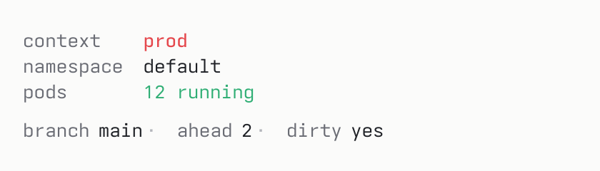
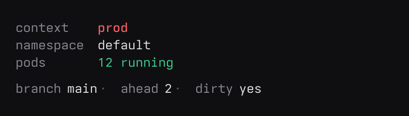
<figcaption>上方为网格布局，下方为内联布局。</figcaption>
</figure>

## `stats`

平铺的统计卡条：展示页面关注的少数数字，每项在大号数值上方有小标签，并可在下方显示次级行。卡条本身没有边框：它直接绘制在承载它的内容上，因此不会出现卡片套卡片的效果。卡片从头开始并排，每项采用自身宽度（14 个字符到 280px），彼此之间有细线；空间不足时会换到更多行，而不会被挤压。将它直接放在页面上、标题行下方，最多四项，绝不要放进卡片中（[设计视图](../guides/design.md#页面结构)）；更多数值请使用 [`kv`](#kv) 或 [`table`](#table)。

**构建方式：** `tern.ui.stats(items)`（参见 [UI 构建器](../reference/ui.md#stats)），或 `tern.ui.node("stats", { items = { { label = …, value = … } } })`。

| 属性 | 类型 | 默认值 | 含义 |
| --- | --- | --- | --- |
| `items` | `{ Stat }` | `{}` | 按顺序排列的卡片。位置即身份：卡片没有 id |

`Stat` 字段：

| 字段 | 类型 | 默认值 | 含义 |
| --- | --- | --- | --- |
| `label` | Spans | `""` | 数值所表示的内容（`Error rate`） |
| `value` | Spans | `""` | 数值及其单位（`0.42%`、`182 ms`） |
| `sub` | Spans | none | 数值下方一行：比较值或时间范围（`last 15 min`、`2 degraded`） |
| `tone` | tone | none | 对需要关注的值使用色调颜色（`--tc`）着色 |
| `title` | string | none | 卡片的工具提示 |

**子项：** 无（忽略）。

**事件：** 本身没有事件；`actions` 与任意节点相同（作用于整个卡条）。

复制视图时，卡片会写成一行，每项为 `label: value (sub)`，以 `  ·  ` 连接。

**样式：**

```html
<div class="sf sf-stats" data-id="main.overview" role="list">
	<div class="sf-stat" data-tone="warning" role="listitem" title="…">
		<div class="sf-stat-label">Error rate</div>
		<div class="sf-stat-value">0.42%</div>
		<div class="sf-stat-sub">last 15 min</div>   <!-- only with a sub -->
	</div>
	<div class="sf-stat" role="listitem">…</div>
</div>
```

| 目标 | 选择器 |
| --- | --- |
| 节点（卡条） | `.sf-stats` |
| 一张卡片 | `.sf-stat`（内部，可能变化） |
| 标签 / 数值 / 次级行 | `.sf-stat-label`、`.sf-stat-value`、`.sf-stat-sub`（内部，可能变化） |
| 带色调的卡片 | `.sf-stat[data-tone]`（内部；其数值使用 `--tc`） |

卡条是可换行的 flex 行，没有内边距、背景或环线，换行间距为 `12px`。卡片为 `min-width: 14ch`、`max-width: 280px`、`padding: 0 28px 0 16px`，左侧带 `--l2` 细线。卡条向左提前 17px（`margin-left: -17px`）并通过 `clip-path` 裁去，因此每行第一张卡片都与上方文本对齐，且不显示其细线。标签和次级行是 `--t3` 的 `12px/16px` sans 字体（标签字重 500），超出时以省略号截断；数值为 `--t1` 的 `550 22px/30px` sans 字体，使用等宽数字和 `-0.02em` 字距。

```lua
local ui = tern.ui

return ui.stats({
	{ label = "Services", value = "24", sub = "2 degraded" },
	{ label = "Error rate", value = "0.42%", tone = "warning", sub = "last 15 min" },
	{ label = "p95 latency", value = "182 ms" },
	{ label = "Deploys today", value = "7", sub = "1 rolled back" },
})
```

<figure class="tn-figure">
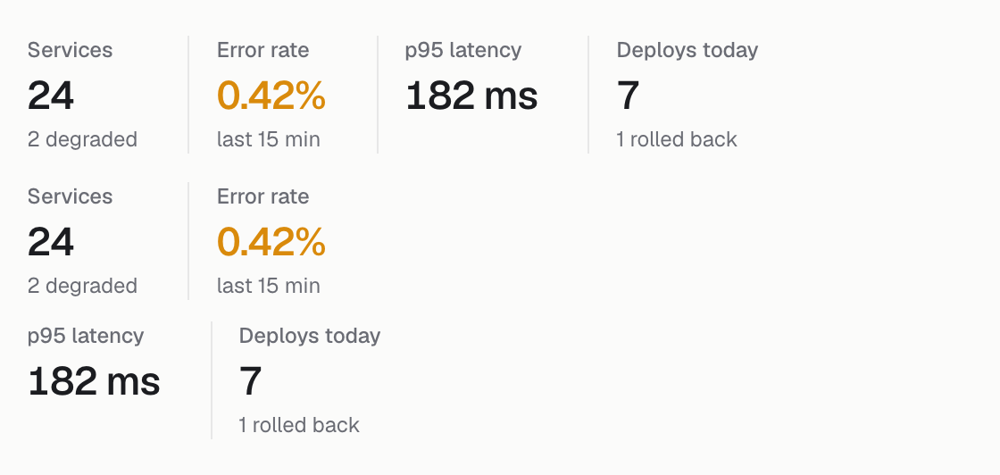
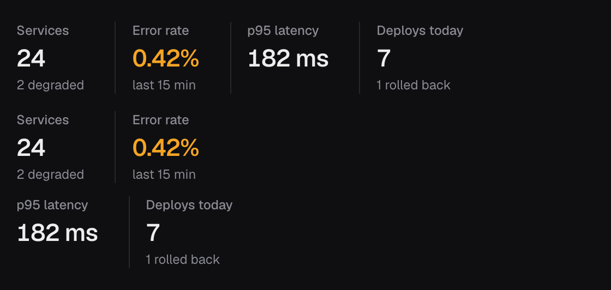
<figcaption>卡条在 560px 和 300px 宽度下的效果；放不下的卡片会换到第二行。</figcaption>
</figure>

## `table`

命名列下方的行网格，带小号 sans 表头和行间细线。行由 `id` 标识，因此单元格变化的行会原位更新，其他行保持挂载。使用 `selectable` 时，行可像原生应用表格一样选择；表头可排序，使用 `multi` 时用户可以一次选择多行进行操作；单元格可包含带状态点或图标的文本、徽章、小按钮、迷你图或仪表。单元格使用区域字体：在 [`font: "sans"`](../protocol/surfaces.md#打开与关闭) 区域中为 sans 字体，标记为 `mono` 的列除外。

**列宽。** Tern 会测量每列的自然宽度：最宽单元格的宽度（以该单元格字体的字符单元格计，中文、日文或韩文等宽字符计两个；仪表或 spark 单元格按 8 计，按钮单元格按标签加内边距计）加上 14px 单元格内边距，或按实际绘制的表头宽度，两者取较宽者。列宽超出表格宽度时，按 `priority` 从低到高隐藏列（未设置 priority 时为 `0`；相同则先隐藏最右列），直到剩余列适配，或只剩一列。此项测量中，`grow` 列最多按 24 个字符宽计：过长的 `grow` 列会截断其单元格，而不会挤掉其他列。剩余宽度按各 `grow` 列的份额比例分配；没有 `grow` 列时，表格保持自然宽度。显示列仍然溢出时，`grow` 列先让出宽度（每列最低到 24 个字符），之后所有列按比例缩小。表格调整大小时会重新计算。

**截断。** 单元格不会换行。宽度超过列宽时，按列的 `truncate` 方式以省略号截断：`end` 保留开头（`abcd…`，由 CSS `text-overflow` 实现），`start` 保留末尾（`…wxyz`），`middle` 保留两端（路径优先去掉目录）。

**单元格。** 单元格可以是 spans（字符串或 span 列表），也可以是以下结构之一：

| 单元格 | 绘制内容 |
| --- | --- |
| `{ text = …, dot = tone }` | 文本前有 6px 状态点，颜色为对应 tone |
| `{ text = …, icon = name, tone = tone }` | 文本前有 12px 图标，图标使用对应 tone 颜色（未指定 tone 时为 `--t3`） |
| `{ badge = { text, tone? } }` | 18px 高的 [`badge`](#badge) |
| `{ button = { text, act, … } }` | `size` 为 `sm` 的 [`button`](input.md#button) |
| `{ spark = { values, … } }` | 与文本等高的迷你图，绘制方式如 [`chart`](motion.md#chart) kind 的 `spark` |
| `{ meter = { … } }` | 横跨单元格的细条，props 的解释与 [`meter`](motion.md#meter) kind 相同 |

迷你图和仪表的自然宽度为 8 个字符单元格；在 `grow` 列中则与列同宽。悬停在带 `title` 的单元格上会显示标题。所有内容都适应行的固定高度，因此行高不会增长。

**可选择行。** 使用 `selectable = true` 时，行会响应指针：悬停时着为 `--l1` 并显示指针手形；点击发送 `select`，双击发送 `activate`，两者均以表格的 id 作为 `id`，以行的 `id` 作为 `item`。选择状态由你控制：将行 id 作为 `selected` 发回，行会显示强调色底色和左侧 2px 强调色条（效果如选中的 [`list`](lists.md#item) 行）。`selected` 变化时，只要表格在屏幕上，行就会滚动到视野内（最近的滚动容器移动）；如果表格已滚出视野，则不受影响，因此从别处设置选择状态不会把页面拉回表格。即使没有 `selectable`，`selected` 也会绘制选择效果，适用于只通过按键移动选择的场景。带 `disabled` 的行会变暗为 `--t4`，且不发送任何事件：没有 `select`、`activate` 或菜单。

**排序。** Tern 负责绘制，程序负责维护顺序：Tern 绝不会自行重排行。为列设置 `sortable = true`，并为表格设置 `sort = { col, dir }`。已排序列的表头会用强调色绘制箭头，`"desc"` 时向下，`"asc"` 时向上；其他可排序表头在悬停时显示淡色箭头。点击可排序表头时，会按该列排序：若当前已按它排序则切换方向，否则升序。箭头立即翻转，表格发送 `action` `sort`，并附带 `value = { col, dir }`。对行排序并发送排序结果，同时将 `sort` 设为对应值。只有当新 `sort` 与上次发送的值不同时，它才会覆盖用户的表头点击；因此只更改其他内容的帧会保留用户设置的箭头位置。

**多行选择。** 用户需要对多行执行同一操作时使用 `multi`：例如重启服务、删除分支、导出运行记录。单行详情窗格应使用 `selectable` / `selected`；两者可以组合（选中行为光标，已勾选行为集合）。`multi = true` 时，点击行会选中该行，若已选中则取消选择；Shift-点击会选中上次点击的行与当前行之间所有未禁用行。每次变化都会发送 `change`，其中 `value` 是按选择顺序排列的已选 id。禁用行不能通过点击或表头复选框选择。已选集合也由你控制：`picked` 用来设置它，和 `sort` 一样，只有在值不同于上次发送的值时才会覆盖用户操作（例如删除后发送）。双击仍发送 `activate`（第二次点击不影响勾选）；若表格同时设置 `selectable`，行点击会在 `change` 后发送 `select`。

外观由 `variant` 决定：

- `"check"`（默认）：开头有复选框列，表头复选框有三种状态（所有未禁用行都已选中时为选中；部分选中时显示短横；`picked` 中含有行列表中不存在的 id 时也显示短横），已选行使用强调色底色。点击表头复选框会选中所有未禁用行；若当前全部选中，则全部取消。
- `"bar"`：没有复选框。已选行使用强调色底色和左侧 2px 强调色条；已排序列的表头显示在强调色胶囊上，其整列带淡色底。适合由键盘操作的紧凑表格。

**选择栏。** 只要有已选行，最后一行下方就会显示工具栏：先是“*N* selected”，接着是 `hint`（低强调，位于点之后：程序处理的按键）、`bar` 按钮，以及末尾带 esc 键帽的 Clear。`bar` 按钮会发送 `action`，携带其 `act`，以及值为已选 id 的 `value`；Clear 会取消选择所有行并发送携带 `{}` 的 `change`。esc 键帽只是提示：按键会传给你的程序，由程序在 Esc 时清除 `picked`。

**行操作。** 按钮单元格的点击会发送带 `act` 和行 `item` 的 `action`，不会选择该行。行的 `menu` 列出右键操作，每项以相同方式发送，后接 Copy row（该行单元格以制表符分隔）。这些事件来自 table 节点，因此一个处理器即可服务所有行。

**时长。** 没有 elapsed 单元格：将时长写成文本（`4m 12s`），随着数值增长重新发送视图；差异视图只会更新变化的单元格。[`elapsed`](motion.md#elapsed) kind 用于表格之外。

**长表格。** 长表格只挂载靠近可见区域的行（行具有固定步幅：一行加 6px；sans 区域的一行是 18px）；未挂载的行仍占据滚动高度。复制整个视图仍会包含所有行。

**空表格。** 没有行时，`empty` 会以低强调样式显示在表头下方中央：说明为何没有内容（例如 “No services match this filter”）。

**构建方式：** `tern.ui.table(cols, rows, opts?)`，仪表单元格使用 `tern.ui.meter_cell` / `tern.ui.meter_parts_cell`（参见 [UI 构建器](../reference/ui.md#table)），或使用 `tern.ui.node("table", { cols = …, rows = … })`。以单元格列表形式传给构建器的行会获得 id `r0`、`r1`、…；若需可在重排后保持稳定、且可选择表格所必需的 id，请传 `{ id = …, cells = … }`。`opts` 接受 `selectable`、`selected` 和 `empty`；排序和多行选择需要使用节点形式。

| 属性 | 类型 | 默认值 | 含义 |
| --- | --- | --- | --- |
| `cols` | `{ Col }` | `{}` | 从左到右排列的列。没有 `id` 的条目会被跳过 |
| `rows` | `{ Row }` | `{}` | 从上到下排列的行。没有 `id` 或 id 已用过的行会被跳过 |
| `selectable` | boolean | `false` | 行响应点击：悬停底色、指针、点击发送 `select`，双击发送 `activate` |
| `selected` | string | none | 绘制为选中状态的行 `id`（class `sel`、`aria-selected="true"`）；表格显示时，值变化会将行滚动到视野内 |
| `empty` | Spans | none | 没有行时显示在中央的低强调内容 |
| `sort` | `{ col: string, dir: "asc" \| "desc" }` | none | 行排序依据的列，表头绘制对应箭头（非 `"desc"` 的 `dir` 按 `"asc"` 处理）。值变化时会覆盖用户最近一次表头点击 |
| `multi` | boolean | `false` | 一次选择多行：点击切换一行，Shift-点击选择范围，每次变化发送 `change` |
| `picked` | `{ string }` | `{}` | 已选行的 id（配合 `multi`）。行中不存在的 id 仍会保留并计数。值变化时会覆盖用户点击 |
| `variant` | `"check"` \| `"bar"` | `"check"` | 勾选和排序的外观（见下文）。其他值按 `"check"` 处理 |
| `bar` | `{ BarAction }` | `{}` | 选择栏中从左到右排列的按钮 |
| `hint` | Spans | none | 选择栏计数后方的低强调文本，例如程序处理的按键 |

`Col` 字段：

| 字段 | 类型 | 默认值 | 含义 |
| --- | --- | --- | --- |
| `id` | string | required | 该列在每行 `cells` 中对应单元格的键 |
| `head` | Spans | none | 表头文本。只有某列的 `head` 非空时，才会创建表头行 |
| `align` | `"start"` \| `"center"` \| `"end"` | `"start"` | 表头和单元格的文本对齐方式；数字用 `"end"`。其他值按 `"start"` 处理 |
| `truncate` | `"end"` \| `"start"` \| `"middle"` | `"end"` | 单元格无法容纳时，从何处截断 |
| `priority` | number | `0` | 表格过窄时，数值较低的列先隐藏。`grow` 列应设最高优先级，其次是数字列，迷你图和次要列最低 |
| `grow` | number | `0` | 剩余宽度的份额；`0` 或更低时不会扩展。通常只给一列（主要文本列）；给数字、迷你图、徽章或按钮列只会留下空隙。在网格（行 × 同类列）中，每个值列设为 `1`，行标签列不设 |
| `mono` | boolean | `false` | 用于 id、哈希、版本、大小、时间：sans 区域中的单元格使用 12.5px mono 字体（mono 区域本身已是该字体）。所有 `"end"` 列无论如何都会使用等宽数字 |
| `sortable` | boolean | `false` | 该列表头响应点击并发送 `action` `sort` |

`Row` 字段：

| 字段 | 类型 | 默认值 | 含义 |
| --- | --- | --- | --- |
| `id` | string | required | 行身份，在表格内唯一（显示为 `data-key`）；也是其事件的 `item` |
| `cells` | `{ [colId]: Cell }` | `{}` | 每个列 id 对应一个单元格：`Spans`、`TextCell`、`BadgeCell`、`ButtonCell`、`SparkCell` 或 `MeterCell`。缺少的单元格为空；不匹配任何列的键会被忽略 |
| `disabled` | boolean or string | `false` | 将行变暗为 `--t4`；不会发送事件，也没有菜单。字符串表示禁用原因，会作为行工具提示而非 `title` 显示 |
| `menu` | `{ string }` | none | 行的右键操作，每项作为带行 `item` 的 `action` 发送；之后是 Copy row |
| `title` | string | none | 行的工具提示 |

`TextCell` 结构为 `{ text = Spans, dot?, icon?, tone?, title? }`：

| 字段 | 类型 | 默认值 | 含义 |
| --- | --- | --- | --- |
| `text` | Spans | `""` | 单元格文本 |
| `dot` | tone | none | 文本前、对应 tone 颜色的 6px 圆点 |
| `icon` | icon name | none | 文本前的 12px [图标](#图标名称)（代替圆点） |
| `tone` | tone | none | 图标颜色；未指定时为 `--t3` |
| `title` | string | none | 单元格的工具提示 |

`BadgeCell` 结构为 `{ badge = { text, tone?, title? } }`：使用指定文本、tone 和工具提示的 [`badge`](#badge)，高 18px。

`ButtonCell` 结构为 `{ button = { text, act, icon?, keys?, variant?, disabled? } }`：`size = "sm"` 的 [`button`](input.md#button)。`act` 是点击发送的操作（未指定时为 `"click"`）；`icon`、`keys`、`variant` 和 `disabled` 的解释与 `button` kind 相同。

`BarAction` 结构为 `{ act, text?, icon?, keys?, variant?, disabled?, title? }`：选择栏中的 `size = "sm"` [`button`](input.md#button)。`act` 是点击发送的操作（未指定时为 `"click"`）；其余字段解释与 `button` kind 相同。禁用或忙碌的按钮不发送事件。

其他形状的单元格表格会绘制其 `text`（或其中唯一一个表格的 `text`）；数字和布尔值按原样绘制。

`SparkCell` 结构为 `{ spark = { values, tone?, min?, max?, title? } }`：

| 字段 | 类型 | 默认值 | 含义 |
| --- | --- | --- | --- |
| `values` | `{ number }` | `{}` | 数据点，按时间从旧到新排列 |
| `tone` | tone | `accent` | 线条颜色 |
| `min`, `max` | number | 数据范围 | 值域，使各行共享刻度 |
| `title` | string | none | 单元格的工具提示 |

`MeterCell` 结构为 `{ meter = { … } }`：

| 字段 | 类型 | 默认值 | 含义 |
| --- | --- | --- | --- |
| `value` | number | `parts` 总和，否则未知 | 填充比例，限制在 0–1。既没有 `value` 也没有 `parts` 时，进度条为空并标记 `.unknown` |
| `parts` | `{ { value, token, label?, hatch? } }` | none | 从左侧开始堆叠填充；各值限制到总和最多为 1。`token` 是主题颜色 token（`success`、`error`、`toolDiffAdded`、…），`label` 是工具提示中的部分名称，`hatch = true` 时显示条纹 |
| `thresholds` | `{ warn: number?, bad: number? }` | none | 达到或超过 `warn` 时设置 `data-level="warn"`，达到或超过 `bad` 时设置为 `"bad"`，并为填充着色 |
| `tone` | tone | none | 为填充着色，可为 `neutral`、`accent`、`info`、`success`、`warning`、`error`、`pending`、`muted`、`user`；其他值会被忽略 |
| `title` | string | 标记过的部分 | 工具提示；未指定时显示带标签部分及其占比（`used 42% · cache 8%`） |

**变体。**

| `variant` | 已选行 | 排序列 | 用途 |
| --- | --- | --- | --- |
| `"check"` | 开头有复选框列，表头复选框三态；已选行使用强调色底色 | 表头使用 `--t1` 和强调色箭头 | 大多数表格：选择状态可见且容易发现 |
| `"bar"` | 强调色底色和左侧 2px 强调色条；没有复选框 | 表头位于强调色胶囊中，整列淡淡着色 | 用户通过键盘操作的紧凑表格 |

**子项：** 无（忽略）。

**事件：** 启用 `selectable` 时，点击行（按钮单元格除外）和双击会发送：

```lua
{ ev = "select", id = "main.services", item = "api-gateway" }
{ ev = "activate", id = "main.services", item = "api-gateway" }
```

按钮单元格或行 `menu` 条目会发送：

```lua
{ ev = "action", id = "main.services", act = "promote", item = "api-gateway" }
```

点击 `sortable` 表头时，会按其请求的顺序发送：

```lua
{ ev = "action", id = "main.services", act = "sort", value = { col = "age", dir = "asc" } }
```

启用 `multi` 时，点击行、Shift-点击、表头复选框或 Clear 会发送已选项（按选择顺序排列；Clear 后为 `{}`）；`bar` 按钮会将其 `act` 与已选项一同发送：

```lua
{ ev = "change", id = "main.services", value = { "billing", "web" } }
{ ev = "action", id = "main.services", act = "restart", value = { "billing", "web" } }
```

`id` 是表格节点，`item` 是行的 `id`。禁用行不会发送 `select` 或 `activate`；禁用按钮单元格不发送事件。在同时启用 `selectable` 的 `multi` 表格中，行点击会在 `change` 后发送 `select`。surface 已关闭或以 [`listen:false`](../protocol/surfaces.md#打开与关闭) 打开时，表头、行、表头复选框和工具栏仍会绘制，但不会切换状态或发送事件。其他情况下，`actions` 与任意节点相同。

**键盘：** 行永远不会获取焦点；按键会传给你的程序，由程序通过 props 驱动表格：Space 用 `picked`（切换光标所在行），⌘A（全选）和 Esc（全不选）；↑/↓ 用 `selected` 移动光标行；排序按键用 `sort`。请在 `hint` 中列出这些按键，让用户知道如何操作。

**样式：**

```html
<div class="sf sf-table selectable" data-id="…">
	<div class="sf-tbl" role="table" aria-rowcount="3">
		<div class="sf-tbl-row head" role="row" aria-rowindex="1">
			<div class="sf-tbl-h" role="columnheader">Pod</div>
			<div class="sf-tbl-h ta-end" role="columnheader">CPU</div>
			<div class="sf-tbl-h off" role="columnheader">Memory</div>   <!-- hidden by priority -->
		</div>
		<div class="sf-tbl-body" role="rowgroup">
		<div class="sf-tbl-row sel" role="row" aria-rowindex="2" aria-selected="true" data-key="api">
			<div class="sf-tbl-c c-text" role="cell">
				<span class="sf-tbl-dot" data-tone="success"></span><span class="sf-tbl-t">api-7d9f</span>
			</div>
			<div class="sf-tbl-c ta-end mono" role="cell">120m</div>
			<div class="sf-tbl-c c-btn" role="cell">
				<button class="sf-button" data-variant="primary" data-size="sm" data-act="promote">…</button>
			</div>
			<div class="sf-tbl-c meter off" role="cell">
				<div class="sf-meter" data-style="bar" data-size="sm" data-level="warn" data-tone="…"
					role="meter" aria-valuemin="0" aria-valuemax="100" aria-valuenow="72" title="…">
					<div class="sf-mt-track"><div class="sf-mt-fill"></div></div>
				</div>
			</div>
		</div>
		<div class="sf-tbl-row last" role="row" aria-rowindex="3" data-key="worker">…</div>
		</div>
	</div>
	<div class="sf-tbl-probe" aria-hidden="true">…</div>   <!-- hidden, measured for sizing -->
</div>
```

带排序列的 `multi` 表格：

```html
<div class="sf sf-table multi" data-variant="check" data-id="…">
	<div class="sf-tbl" role="table" aria-multiselectable="true" aria-rowcount="5">
		<div class="sf-tbl-row head" role="row" aria-rowindex="1">
			<div class="sf-tbl-h c-check" role="columnheader">
				<span class="cbx mixed" role="checkbox" aria-checked="mixed" aria-label="Select all rows">…</span>
			</div>
			<div class="sf-tbl-h sortable sorted" role="columnheader" data-col="name" aria-sort="descending">
				<span class="sf-tbl-hw"><span class="sf-tbl-hl">Service</span><span class="sf-tbl-sort">…</span></span>
			</div>
			<div class="sf-tbl-h" role="columnheader" data-col="status">Status</div>
		</div>
		<div class="sf-tbl-body" role="rowgroup">
			<div class="sf-tbl-row picked" role="row" aria-selected="true" data-key="billing">
				<div class="sf-tbl-c c-check" role="cell"><span class="cbx on" role="checkbox" aria-checked="true">…</span></div>
				<div class="sf-tbl-c sorted" role="cell">billing</div>
				…
			</div>
		</div>
	</div>
	<div class="sf-tbl-probe" aria-hidden="true">…</div>
	<div class="sf-tbl-bar" role="toolbar" aria-label="Selection">
		<span class="sf-tbl-count">2 selected</span><span class="sf-tbl-sep">·</span><span class="sf-tbl-hint">…</span>
		<div class="sf-tbl-acts"><button class="sf-button" data-size="sm" data-act="restart">…</button></div>
		<button class="sf-button sf-tbl-clear" data-variant="quiet" data-size="sm" data-act="clear">Clear <span class="sf-kbd kbds">…</span></button>
	</div>
</div>
```

| 目标 | 选择器 |
| --- | --- |
| 节点 | `.sf-table` |
| 网格 | `.sf-tbl`（内部，可能变化） |
| 表头行 / 一行 | `.sf-tbl-row.head` / `.sf-tbl-row`（内部；行使用 `.sf-tbl` 的列） |
| 表头下方的行 | `.sf-tbl-body`（内部，可能变化） |
| 按 id 选择一行 | `.sf-tbl-row[data-key='api']`（内部） |
| 最后一行 | `.sf-tbl-row.last`（内部；其单元格不显示细线） |
| 表头单元格 / 单元格 | `.sf-tbl-h` / `.sf-tbl-c`（内部，可能变化） |
| 对齐的单元格 | `.ta-center`、`.ta-end`（内部） |
| 隐藏列 | `.sf-tbl-h.off`、`.sf-tbl-c.off`（内部；`display: none`） |
| 仪表单元格 | `.sf-tbl-c.meter`（内部）；其条为 `.sf-meter`、`.sf-mt-track`、`.sf-mt-fill`、`.sf-mt-part` |
| 仪表级别 / 色调 | `.sf-meter[data-level='warn' \| 'bad']`、`.sf-meter[data-tone]`、`.sf-meter.unknown` |
| 可选择表格 | `.sf-table.selectable` |
| 选中 / 禁用行 | `.sf-tbl-row.sel`（`[aria-selected='true']`）、`.sf-tbl-row.dis`（`[aria-disabled='true']`）（内部） |
| 多选表格 / 外观 | `.sf-table.multi`、`.sf-table[data-variant='check' \| 'bar']` |
| 可排序 / 已排序表头 | `.sf-tbl-h.sortable`、`.sf-tbl-h.sorted`（升序为 `.asc`；`[aria-sort]`） |
| 表头标签和箭头 | `.sf-tbl-hw`（标签和箭头；`bar` 中为胶囊）、`.sf-tbl-hl`、`.sf-tbl-sort`（内部，可能变化） |
| 已排序列的单元格 | `.sf-tbl-c.sorted`（内部） |
| 已勾选行 | `.sf-tbl-row.picked`（`[aria-selected='true']`）（内部） |
| 复选框列 | `.sf-tbl-h.c-check`、`.sf-tbl-c.c-check`；复选框为 kit 的 `.cbx`（`.on`、`.mixed`）（内部） |
| 选择栏 | `.sf-tbl-bar`（无已选项时为 `.sf-hidden`）：`.sf-tbl-count`、`.sf-tbl-sep`、`.sf-tbl-hint`、`.sf-tbl-acts .sf-button`、`.sf-tbl-clear`（内部，可能变化） |
| Mono 列单元格 | `.sf-tbl-c.mono`（内部） |
| 文本单元格 | `.sf-tbl-c.c-text`：其点为 `.sf-tbl-dot[data-tone]`，或图标 `.sf-tbl-ic[data-tone]`，后接文本 `.sf-tbl-t`（内部，可能变化） |
| 徽章、按钮、迷你图单元格 | `.sf-tbl-c.c-badge .sf-badge`、`.sf-tbl-c.c-btn .sf-button`、`.sf-tbl-c.c-spark .sf-chart`（内部，可能变化） |
| 空行 | `.sf-tbl-empty`（内部，可能变化；有行时为 `.sf-hidden`） |
| 宽度探测器 | `.sf-tbl-probe`（内部；永远不可见，不要为其设置样式） |

单元格为 `padding: 3px 7px`，带 `var(--l1)` 细线（`box-shadow: inset 0 -1px 0`）；表头单元格高 24px，使用 `--t3` 的 `500 11.5px` sans 字体，并带 `var(--l2)` 细线。网格两侧各比节点宽 7px，使单元格文本与周边文本对齐。列宽由 Tern 以内联 `grid-template-columns` 设置；谨慎修改单元格内边距，因为宽度计算假定每格内边距为 14px。`:nth-child` 等行选择器只会统计视口附近挂载的行；应改用 `[data-key]` 或 `.last`。选中行使用 10% 强调色底色（深色模式为 16%），左侧有 `inset 2px 0 0 var(--accent)` 强调色条（位于行上，因此隐藏列后仍存在）；可选择行悬停时为 `--l1`。已勾选行使用 8% 强调色底色（深色模式为 14%）；`--sf-sel` 可覆盖两种底色。`bar` 会在已选行左侧增加 `inset 2px 0 0 var(--accent)`。复选框列是在数据列前固定宽 30px 的轨道，因此优先级只会隐藏数据列。选择栏位于 `var(--l2)` 细线下方，使用 `500 12px` sans 字体，并以短暂淡入效果出现（减少动态效果时除外）。

```lua
local ui = tern.ui

local pods = {
	{ name = "api-7d9f8c6b5-x2kqp", cpu = 120, mem = 0.42 },
	{ name = "worker-5c8d7f9b4-m7lzt", cpu = 860, mem = 0.76 },
	{ name = "scheduler-6b9c4d8f7-qq8rn", cpu = 35, mem = 0.93 },
}
local rows = {}
for i, pod in pods do
	rows[i] = {
		id = pod.name,
		cells = {
			name = pod.name,
			cpu = string.format("%dm", pod.cpu),
			mem = { meter = {
				value = pod.mem,
				thresholds = { warn = 0.7, bad = 0.9 },
				title = string.format("%d%% of 2Gi", math.floor(pod.mem * 100)),
			} },
		},
	}
end
return ui.node("table", {
	cols = {
		{ id = "name", head = "Pod", grow = 1, truncate = "middle", priority = 3 },
		{ id = "cpu", head = "CPU", align = "end", priority = 1 },
		{ id = "mem", head = "Memory", grow = 1, priority = 2 },
	},
	rows = rows,
})
```

<figure class="tn-figure">
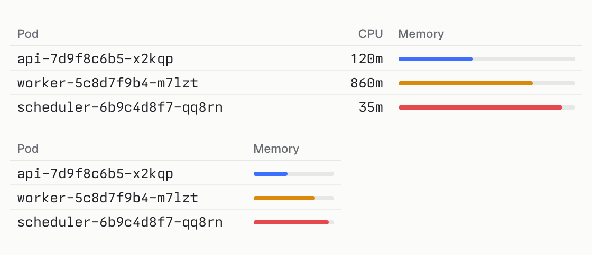
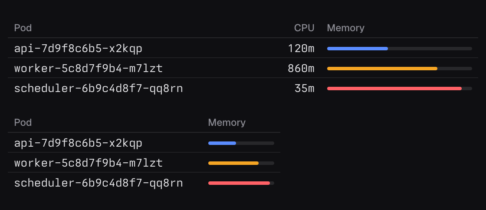
<figcaption>同一表格在 560px 和 300px 宽度下的效果：CPU（priority 1）最先隐藏。仪表条跨过 <code>warn</code> 和 <code>bad</code> 阈值。</figcaption>
</figure>

以下示例在以 `font = "sans"` 打开的 block 中展示可选择的服务表格及所有单元格类型。block 会在状态中保存选择，并通过 `key` 处理器中的 ↑/↓ 移动选择。旁边没有详情卡片时，每个 waiting 行都有 Promote 按钮，只有选中行的按钮为 `primary`（绑定 `p` 键），因此屏幕上始终只有一个 primary；若有详情卡片，primary 会移至卡片标题，行中则不再有 primary（[设计视图](../guides/design.md#表格)）：

```lua
local ui = tern.ui

local TONE = { live = "success", degraded = "warning", down = "error", waiting = "pending" }

local function services(state)
	local rows = {}
	for i, s in state.services do
		local promote = nil
		if s.state == "waiting" then
			promote = { text = "Promote", act = "promote" }
			if s.name == state.selected then
				promote.variant, promote.keys = "primary", { "p" }
			end
		end
		rows[i] = {
			id = s.name,
			menu = { "logs", "restart" },
			disabled = s.state == "down" and "Restarting" or nil,
			cells = {
				name = { text = s.name, dot = TONE[s.state] },
				state = { badge = { text = s.state, tone = TONE[s.state] } },
				version = s.version,
				p95 = s.p95 .. " ms",
				trend = { spark = { values = s.latency, min = 0 } },
				act = promote and { button = promote } or "",
			},
		}
	end
	return ui.node("table", {
		key = "services",
		selectable = true,
		selected = state.selected,
		empty = "No services",
		cols = {
			{ id = "name", head = "Service", grow = 1, truncate = "middle", priority = 9 },
			{ id = "state", head = "State", priority = 6 },
			{ id = "version", head = "Version", mono = true, priority = 2 },
			{ id = "p95", head = "p95", align = "end", mono = true, priority = 7 },
			{ id = "trend", head = "Latency", priority = 1 },
			{ id = "act", align = "end", priority = 8 },
		},
		rows = rows,
	})
end

-- event(state, ev, cx)
if ev.ev == "select" and ev.id == "main.services" then
	state.selected = ev.item
elseif ev.ev == "action" and ev.act == "promote" then
	promote(state, ev.item)
end
```

<figure class="tn-figure">
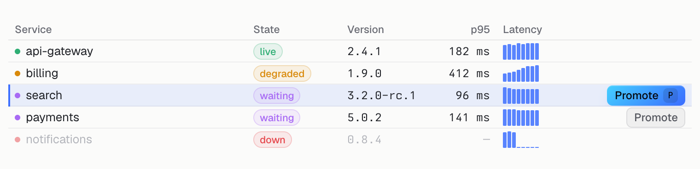
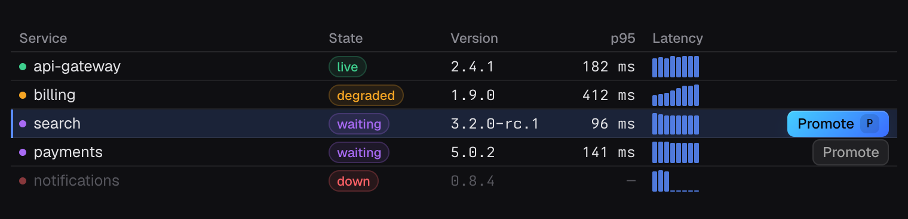
<figcaption>圆点、徽章、mono、迷你图和按钮单元格；waiting 行设置了 <code>selected</code>（其按钮是视图中唯一的 primary），另有一行设置了 <code>disabled</code>。</figcaption>
</figure>

下面的服务表格供用户排序，并一次重启或删除多项。程序会在状态中保存排序和已选项，自行对行排序，并在需要更改时将 `picked` 发回：

```lua
local ui = tern.ui

local function services(state)
	local rows = {}
	for i, s in state.services do
		rows[i] = {
			id = s.name,
			disabled = s.locked and "locked by a deploy" or nil,
			cells = {
				name = s.name,
				status = { text = s.status, dot = s.tone },
				age = s.age,
			},
		}
	end
	return ui.node("table", {
		key = "services",
		multi = true,
		picked = state.picked,
		sort = state.sort, -- { col = "name", dir = "desc" }
		bar = {
			{ act = "restart", text = "Restart", icon = "refresh" },
			{ act = "delete", text = "Delete", variant = "danger" },
		},
		cols = {
			{ id = "name", head = "Service", grow = 1, mono = true, sortable = true, priority = 9 },
			{ id = "status", head = "Status", sortable = true, priority = 5 },
			{ id = "age", head = "Updated", align = "end", mono = true, sortable = true, priority = 7 },
		},
		rows = rows,
	})
end

-- event(state, ev, cx)
if ev.ev == "action" and ev.act == "sort" then
	state.sort = ev.value -- then sort state.services by it
elseif ev.ev == "change" and ev.id == "main.services" then
	state.picked = ev.value
elseif ev.ev == "action" and ev.act == "restart" then
	restart(state, ev.value) -- keep or clear state.picked
end
```

TSX 中的相同示例（TypeScript SDK）：

```tsx
<table
   key="services"
   multi
   picked={picked}
   sort={sort}
   onChange={(ev) => setPicked(ev.value)}
   bar={[
      { act: 'restart', text: 'Restart', icon: 'refresh' },
      { act: 'delete', text: 'Delete', variant: 'danger' },
   ]}
   onAction={{
      sort: (ev) => setSort(ev.value),
      restart: (ev) => restart(ev.value),
      delete: (ev) => remove(ev.value),
   }}
   cols={[
      { id: 'name', head: 'Service', grow: 1, mono: true, sortable: true, priority: 9 },
      { id: 'status', head: 'Status', sortable: true, priority: 5 },
      { id: 'age', head: 'Updated', align: 'end', mono: true, sortable: true, priority: 7 },
   ]}
   rows={rows}
/>
```

<figure class="tn-figure">
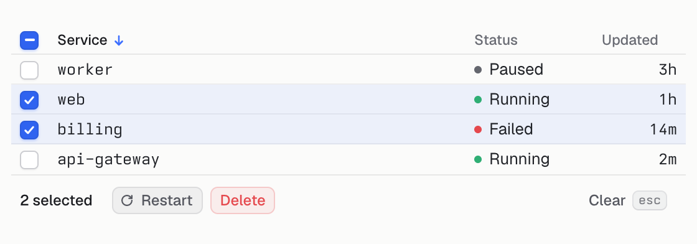
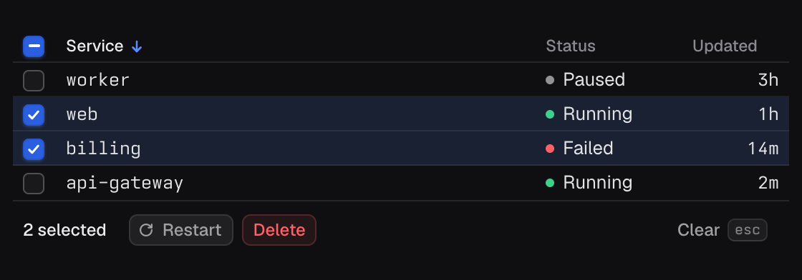
<figcaption><code>variant = "check"</code>：四行中选中两行，因此表头复选框显示混合状态；选择栏包含 <code>bar</code> 操作。</figcaption>
</figure>

<figure class="tn-figure">
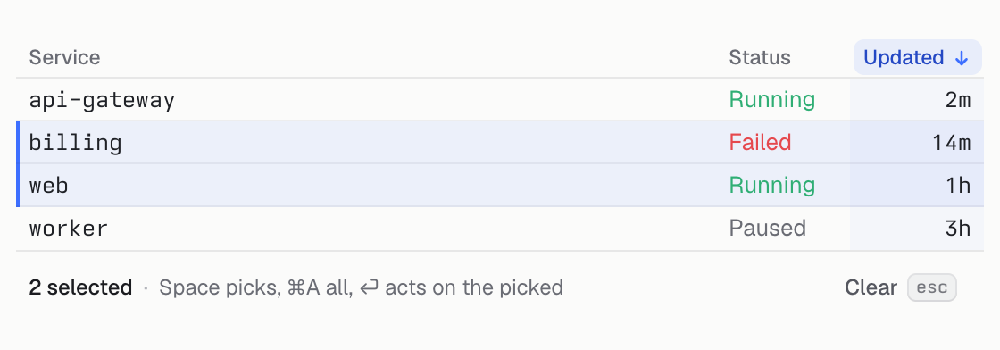
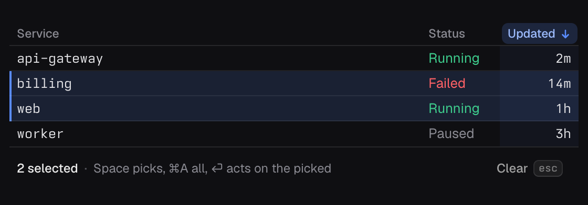
<figcaption><code>variant = "bar"</code> 的效果，配合 <code>hint</code> 列出程序处理的按键。</figcaption>
</figure>

<figure class="tn-figure">
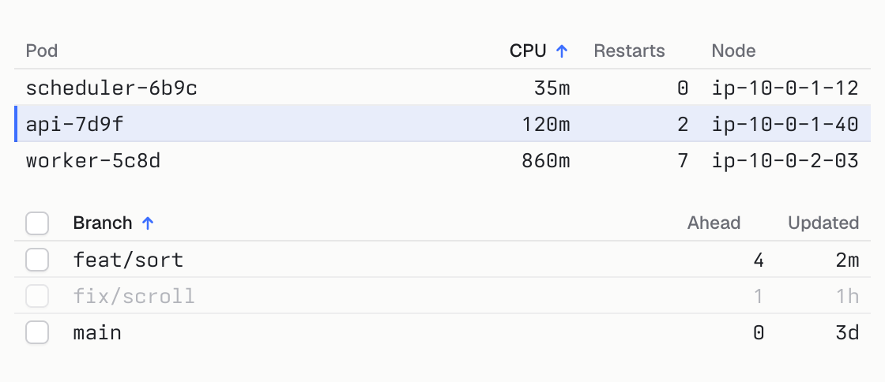
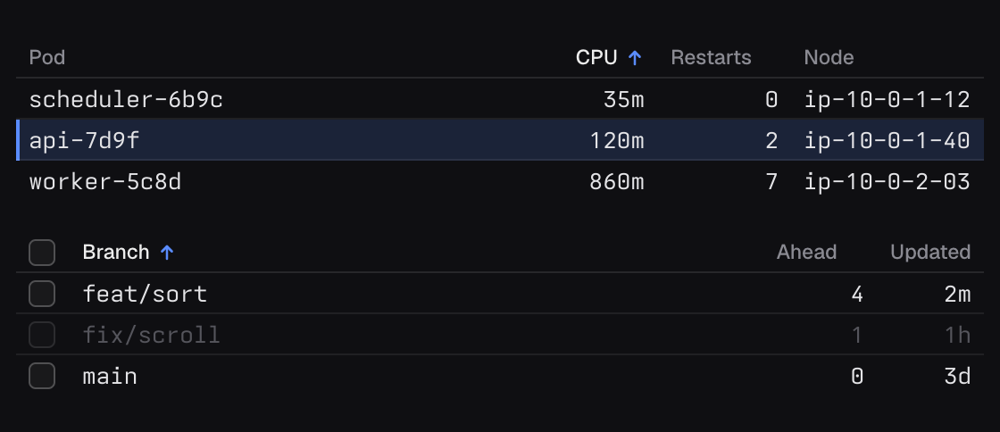
<figcaption>mono 区域中的升序排序；没有已选项的 <code>multi</code> 表格不显示工具栏。</figcaption>
</figure>

## `tree`

可展开树：每个项目占一行，每层缩进 14px，每个展开的父项下方有垂直引导线，项目展开或收起时箭头会旋转。子项以短暂的高度和透明度过渡效果折叠。没有子项的项目不显示箭头（但仍保留其空间，以便标签对齐）。

**展开和收起。** `open` 设置是否显示项目的子项（默认收起）。点击箭头会立即展开或收起该项，无需往返通信；Tern 会按项目 id 记住状态，直到你的视图为该项目发送一个*不同的* `open` 值：重新发送相同的 `open` 会保留用户选择；更改它则覆盖用户选择。项目 id 消失后，其本地状态也会被遗忘。只有箭头会切换状态；点击标签本身不会执行操作。

**长树。** 树以先序遍历的扁平行绘制已展开项（class `.windowed`），并只挂载靠近可见区域的行；未挂载项的展开/收起状态仍会保留。完整捕获时会绘制嵌套结构。

**构建方式：** `tern.ui.tree(nodes)`（参见 [UI 构建器](../reference/ui.md#tree)），或 `tern.ui.node("tree", { nodes = … })`。构建器按深度优先顺序分配 `t0`、`t1`、… 作为 id；在前面添加项目时 id 会移动，从而使记住的状态对应到其他项目。浏览期间若树会变化，请自行用稳定 id（路径、键）构造 props。

| 属性 | 类型 | 默认值 | 含义 |
| --- | --- | --- | --- |
| `nodes` | `{ TreeNode }` | `{}` | 顶层项目 |

`TreeNode` 字段：

| 字段 | 类型 | 默认值 | 含义 |
| --- | --- | --- | --- |
| `id` | string | required | 项目身份，在树中唯一。没有 id 或 id 已使用的项目及其子项都会被跳过 |
| `label` | Spans | empty | 行文本；超出时以省略号截断 |
| `icon` | string | none | 标签前显示的[图标名称](#图标名称)；未知名称会留下空的 14px 空位 |
| `open` | boolean | `false` | 是否显示子项（见上文） |
| `children` | `{ TreeNode }` | none | 嵌套项目；只有至少有一个有效子项时，该项目才是父项 |

**子项：** 无（忽略）；嵌套结构位于 `nodes` 中。

**事件：** 点击箭头会向 block 的 `event` 处理器发送 `toggle`：

```lua
{ ev = "toggle", id = "<tree node id>", key = "<item id>", collapsed = true }  -- collapsed = not open
```

若要在你自己的重新渲染之间保留选择，请从此事件保存状态并作为 `open` 发回。`actions` 与任意节点相同。

**样式：**

```html
<div class="sf sf-tree" role="tree" data-id="…">          <!-- .windowed when flattened -->
	<div class="sf-tree-node" role="treeitem" aria-level="1" aria-expanded="true" style="--d: 0">
		<div class="sf-tree-row">
			<button class="sf-tree-tw" data-key="src" title="Collapse" aria-label="Collapse"><svg class="ico">…</svg></button>
			<span class="sf-tree-ic" aria-hidden="true"><svg class="ico">…</svg></span>
			<div class="sf-tree-lbl">src</div>
		</div>
		<div class="sf-tree-kids" role="group">
			<div>
				<div class="sf-tree-node" role="treeitem" aria-level="2" style="--d: 1">
					<div class="sf-tree-row leaf">…</div>
					<div class="sf-tree-kids sf-hidden" role="group"><div></div></div>
				</div>
			</div>
		</div>
	</div>
</div>
```

| 目标 | 选择器 |
| --- | --- |
| 节点 | `.sf-tree` |
| 扁平（windowed）模式 | `.sf-tree.windowed` |
| 一个项目 | `.sf-tree-node`（内部，可能变化）；层级在 `--d` 中（顶层为 0） |
| 收起的项目 | `.sf-tree-node.shut`（内部） |
| 行 | `.sf-tree-row`（内部）；没有子项时为 `.sf-tree-row.leaf` |
| 箭头 | `.sf-tree-tw`（内部）；`[data-key]` 是项目 id |
| 图标 | `.sf-tree-ic`（内部；没有 `icon` 时为 `.sf-hidden`） |
| 标签 | `.sf-tree-lbl`（内部） |
| 子项组 | `.sf-tree-kids > div`（内部；其 `::before` 绘制引导线） |

行高为 `var(--sf-lh) + 6px`，圆角半径 5px，悬停时显示 `var(--l1)`；箭头为 `--t4`，图标为 `--t3`，引导线为 `--l2`。windowed 模式下，引导线是 `.sf-tree-row::before` 上的重复渐变。折叠、箭头旋转和行悬停过渡效果在 Tern 的减少动态效果设置（`.sf-still`）和 `prefers-reduced-motion` 下都会停止。

```lua
local ui = tern.ui

return ui.node("tree", {
	nodes = {
		{ id = "src", label = "src", icon = "folder", open = state.open["src"] ~= false, children = {
			{ id = "src/main.rs", label = "main.rs", icon = "file-code" },
			{ id = "src/lib.rs", label = ui.span("lib.rs", "muted"), icon = "file-code" },
			{ id = "src/kinds", label = "kinds", icon = "folder", open = state.open["src/kinds"], children = {
				{ id = "src/kinds/data.rs", label = "data.rs", icon = "file-code" },
			} },
		} },
		{ id = "Cargo.toml", label = "Cargo.toml", icon = "file" },
	},
})
```

<figure class="tn-figure">
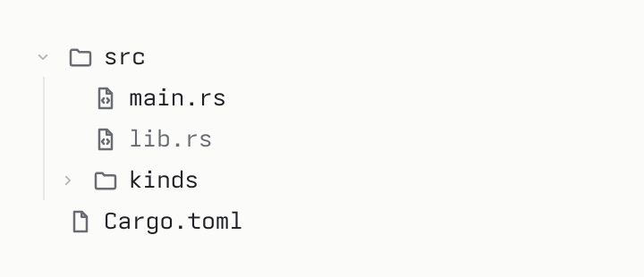
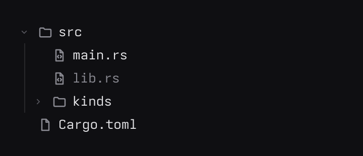
<figcaption>上方的树中，<code>src/kinds</code> 有一个子项但未设置 <code>open</code>，因此显示为收起状态。</figcaption>
</figure>

```lua
-- in the block definition
event = function(state, ev, cx)
	if ev.ev == "toggle" then
		state.open[ev.key] = not ev.collapsed
	end
end,
```

## `json`

原始 JSON 值，Tern 会像浏览器开发者工具展示对象那样，将它原生绘制为交互式树。直接发送值即可，无需据此构建 `tree`。

- **条目。** 每行对应值的顶层条目：根对象的键、根数组的项目；标量根值为一行。数组索引直接显示并右对齐（`0`，而不是 `[0]`）。
- **短容器保持完整。** 单行形式约 60 个字符以内的容器会显示在一行中：`0: [[3, "vt"], 98]`、`args: {stream: 0, lines: 70}`。
- **较大的容器可折叠**为单行预览，例如 `{name: "highlight_batch", ts: 62213.5, args: {…}}`，数组会显示长度，例如 `(30) [{…}, {…}, …]`，点击即可展开。
- **多行字符串**会展开为多行。
- **折叠状态为本地状态。** `open` 设置初始展开的容器层数：`0` 表示列出顶层条目并折叠其中所有容器；`1` 还会展开这些容器，以此类推。用户可以从该状态继续折叠和展开；不会发送事件。

**支持检查。** `json` 比 `tree` 新：请在 hello 回复的 `kinds`（SDK 中为 `supports("json")`）里检查是否支持；不支持时，从该值构建 `tree`。

**构建方式：** `tern.ui.node("json", { value = … })`；SDK 中可使用 Rust 的 `ui::json(value).open(1)`、Go 的 `ui.JSON{Value: v, Open: 1}`、Python 的 `ui.json(value, open=1)`、TypeScript 的 `ui.json({ value, open: 1 })`。纯文本回退方案会以 2 空格缩进输出美化格式的值。

| 属性 | 类型 | 默认值 | 含义 |
| --- | --- | --- | --- |
| `value` | any JSON value | `null` | 要绘制的值（对象、数组、字符串、数字、布尔值或 null） |
| `open` | integer ≥ 0 | `0` | 初始展开的容器层数 |

**子项：** 无（忽略）。

**事件：** 无。

```lua
return tern.ui.node("json", {
	value = { name = "highlight_batch", ts = 62213.5, args = { stream = 0, lines = 70 } },
	open = 1,
})
```

## `badge`

小型圆角胶囊，显示纯文本并按 tone 着色：文本使用 tone 颜色，背景是 10% 的 tone 色，环线为 22% 的 tone 色。没有 tone（或 tone 为 `neutral`）时显示灰色标记。它不会换行或缩小。

**构建方式：** `tern.ui.badge(text, tone)`（参见 [UI 构建器](../reference/ui.md#badge)），或 `tern.ui.node("badge", { text = …, tone = … })`。

| 属性 | 类型 | 默认值 | 含义 |
| --- | --- | --- | --- |
| `text` | string | `""` | 标签。仅纯文本：不读取 spans |
| `tone` | tone | none | 通用 prop：`neutral`、`accent`、`info`、`success`、`warning`、`error`、`pending`、`muted` 或 `user`；其他值会被忽略 |

**子项：** 无（忽略）。

**事件：** 本身没有事件；`actions` 与任意节点相同。

**样式：**

```html
<span class="sf sf-badge" data-id="…" data-tone="success">ok</span>
```

| 目标 | 选择器 |
| --- | --- |
| 节点 | `.sf-badge` |
| 带 tone 的标记 | `.sf-badge[data-tone='error']` |
| 没有 tone 的标记 | `.sf-badge:not([data-tone])` |

徽章高 18px，`padding: 0 7px`，使用 `500 11px` sans 字体，颜色来自 `--tc`（由 `[data-tone]` 规则设置的 tone 颜色；参见[变量](../styles/variables.md)）。中性外观使用 `--t2`、`--chip-bg` 和 `--l2`。

```lua
local ui = tern.ui

return ui.row({ ui.text("deploy"), ui.badge(ok and "passed" or "failed", ok and "success" or "error") })
```

先显示没有 tone 的徽章，再依次显示所有 tone：

```lua
local tones = { "neutral", "accent", "info", "success", "warning", "error", "pending", "muted", "user" }
local badges = { ui.node("badge", { text = "untoned" }) }
for _, tone in tones do
	table.insert(badges, ui.badge(tone, tone))
end
return ui.node("row", { gap = "sm", wrap = true }, badges)
```

<figure class="tn-figure">
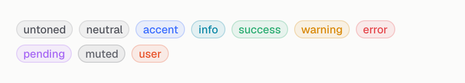
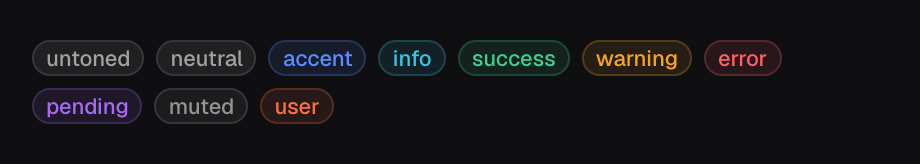
</figure>

## `kbd`

用键帽表示组合键，每个键使用一个 `.kbd`，彼此相隔 3px。修饰键和命名按键使用 macOS 字形；单字母和功能键会转换为大写；其他内容按原样显示。屏幕阅读器会读出按键名称（`Control O`）。

| 按键名称（任意大小写） | 键帽 | 读音 |
| --- | --- | --- |
| `ctrl`、`control` | `⌃` | Control |
| `alt`、`option`、`opt` | `⌥` | Option |
| `shift` | `⇧` | Shift |
| `cmd`、`command`、`meta`、`super`、`win` | `⌘` | Command |
| `enter`、`return` | `⏎` | Return |
| `esc`、`escape` | `esc` | Escape |
| `tab` | `⇥` | |
| `backspace` | `⌫` | |
| `delete`、`del` | `⌦` | |
| `space` | `space` | |
| `up`、`down`、`left`、`right` | `↑` `↓` `←` `→` | |
| `pageup`、`pagedown` | `⇞` `⇟` | |
| `home`、`end` | `↖` `↘` | |
| 一个字符（`o`、`/`） | 转换为大写（`O`、`/`） | |
| `f1`…`f24`（`f` 加数字） | `F1`…`F24` | |
| 其他内容（`fn`、`⌘`） | 按原样显示 | |

没有读音名称的行会按键帽内容朗读。所有平台使用相同字形。

**构建方式：** `tern.ui.node("kbd", { keys = { "ctrl", "o" } })`。没有专用构建器。

| 属性 | 类型 | 默认值 | 含义 |
| --- | --- | --- | --- |
| `keys` | `{ string }` | `{}` | 按顺序排列的按键名称；非字符串条目会被跳过 |
| `aria` | string | none | 通用 prop：`aria-label`。设置后，Tern 不会设置 `role="img"`，也不会设置朗读标签 |

**子项：** 无（忽略）。

**事件：** 本身没有事件；`actions` 与任意节点相同。键帽仅供展示：无论是否显示 `kbd`，按键都会到达 block 的 `key` 处理器。

**样式：**

```html
<span class="sf sf-kbd kbds" data-id="…" role="img" aria-label="Control O">
	<span class="kbd">⌃</span>
	<span class="kbd">O</span>
</span>
```

| 目标 | 选择器 |
| --- | --- |
| 节点 | `.sf-kbd` |
| 单个键帽 | `.sf-kbd .kbd`（Tern 的共享键帽 class；列表提示也使用它） |

键帽高 18px、最小宽 18px，使用 `--t2` 的 `500 10.5px` mono 字体，背景为 `--l1`，环线为 `--l2`。

```lua
local ui = tern.ui

return ui.row({ ui.node("kbd", { keys = { "cmd", "shift", "p" } }), ui.text(ui.span("command palette", "muted")) })
```

<figure class="tn-figure">
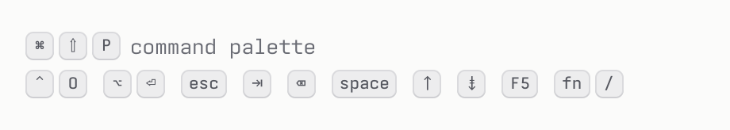
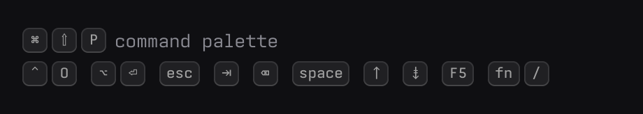
<figcaption>上方为示例，下方依次为 <code>ctrl o</code>、<code>alt enter</code>、<code>esc</code>、<code>tab</code>、<code>backspace</code>、<code>space</code>、<code>up</code>、<code>pagedown</code>、<code>f5</code> 和 <code>fn /</code>。</figcaption>
</figure>

## `icon`

Tern 图标集中的一个图标：16×16 的方框中放置 14px 图标，颜色为当前文本色；设置 `tone` 时则为 tone 颜色。大多数图标为描边样式；`logo`、`app-omp` 和 `slash` 为实心样式。未知名称会绘制空框。图标仅作装饰：除非传入 `aria`，Tern 会设置 `aria-hidden="true"`。

**构建方式：** `tern.ui.node("icon", { name = "folder" })`。没有专用构建器。相同名称也可用于 `tree` 项目的 `icon`、列表 `item` 的 `icon` 和其他 kind 的 `icon` props。

| 属性 | 类型 | 默认值 | 含义 |
| --- | --- | --- | --- |
| `name` | string | none | 图标名称或别名（见下文），区分大小写。最后一个 `.` 之前的内容会被丢弃，因此 `icon.folder` 和 `status.error` 可用 |
| `tone` | tone | none | 通用 prop；为图标着色 |
| `aria` | string | none | 通用 prop：`aria-label`。设置后，Tern 不会对屏幕阅读器隐藏图标 |

**子项：** 无（忽略）。

**事件：** 本身没有事件；`actions` 与任意节点相同（带 `click` action 的图标是紧凑按钮）。

**样式：**

```html
<span class="sf sf-icon" data-id="…" aria-hidden="true">
	<svg class="ico" aria-hidden="true">…</svg>
</span>
```

| 目标 | 选择器 |
| --- | --- |
| 节点 | `.sf-icon` |
| 带 tone | `.sf-icon[data-tone]`（颜色为 `var(--tc)`） |
| 图形 | `.sf-icon .ico` |

图标使用 `currentColor` 描边，因此可通过 `color` 改色；在节点和 `.ico` 上设置 `width`/`height` 可调整大小。

```lua
local ui = tern.ui

return ui.row({ ui.node("icon", { name = "branch", tone = "accent" }), ui.text("main") })
```

### 图标名称

Tern 内置以下 208 个图标：

| 分组 | 名称 |
| --- | --- |
| 应用与品牌 | `app-btop`、`app-bun`、`app-claude`、`app-codex`、`app-deno`、`app-docker`、`app-go`、`app-hammer`、`app-helix`、`app-hermes`、`app-htop`、`app-java`、`app-node`、`app-omp`、`app-python`、`app-ruby`、`app-rust`、`app-vim`、`logo`、`tern`、`pi-mark` |
| 箭头与导航 | `arrow-up`、`arrow-down`、`arrow-left`、`arrow-right`、`back`、`forward`、`chev`、`chev-r`、`chev-up`、`corner-down-right`、`expand`、`shrink`、`minimize`、`fit`、`zoom-in`、`zoom-out`、`more`、`grip`、`compass` |
| 状态与提醒 | `check`、`x`、`x-circle`、`warn`、`info`、`help`、`bell`、`shield`、`shield-alert`、`slash`、`slash-circle`、`lock`、`key`、`key-round`、`plus`、`minus`、`clock`、`timer` |
| 文件与文档 | `doc`、`file`、`file-code`、`file-image`、`file-pdf`、`file-plus`、`files`、`folder`、`folder-go`、`folder-minus`、`folder-open`、`folder-plus`、`markdown`、`note`、`clipboard`、`save`、`inbox`、`image`、`newspaper`、`trash` |
| 版本控制 | `branch`、`commit`、`merge`、`rebase`、`pull`、`push`、`fetch`、`stash`、`cherry`、`diff`、`unified`、`split`、`split-down`、`revert`、`history` |
| 播放与操作 | `play`、`pause`、`stop`、`rewind`、`fast-forward`、`frame-next`、`frame-prev`、`repeat`、`redo`、`undo`、`run`、`reel`、`mic`、`wave`、`vibrate`、`power`、`send`、`share`、`open`、`download`、`copy`、`scissors` |
| 文本与编辑 | `bold`、`italic`、`underline`、`type`、`align-left`、`align-center`、`align-right`、`align-justify`、`pen`、`eraser`、`wand`、`cursor`、`selection`、`path-insert`、`prompt`、`vector`、`blur`、`ink`、`palette` |
| 布局与窗口 | `columns`、`grid`、`sidebar`、`tabs-h`、`tabs-v`、`dock-up`、`dock-down`、`dock-left`、`dock-right`、`pip`、`pip-tl`、`pip-tr`、`pip-bl`、`pip-exit`、`layers`、`stack`、`kanban`、`canvas`、`diagram`、`flow`、`peek`、`tree`、`box`、`eye`、`eye-off` |
| 开发与系统 | `terminal`、`code`、`braces`、`binary`、`bug`、`cpu`、`database`、`server`、`laptop`、`monitor`、`gauge`、`activity`、`chart`、`plug`、`puzzle`、`wrench`、`gear`、`sliders`、`stethoscope`、`hash`、`tag`、`link`、`globe`、`broadcast`、`search`、`funnel`、`funnel-x`、`sort-x`、`swap`、`list`、`list-checks`、`pin`、`keyboard` |
| 人物与其他 | `user`、`users`、`message`、`brain`、`sparkle`、`lightbulb`、`bolt`、`flame`、`rocket`、`moon`、`sun`、`cart`、`footprints`、`scale`、`log-in`、`log-out` |

SDK 为除 `app-*` 以外的每个图标都提供名称；`app-*` 图标对应 Tern 认识的程序，请直接传入字符串（`"app-vim"`）。

<figure class="tn-figure">
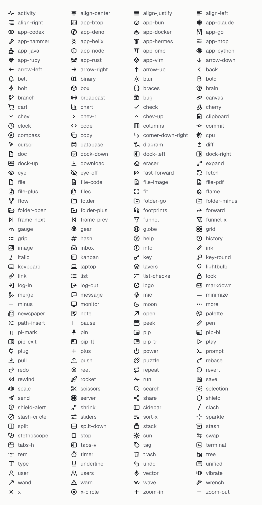
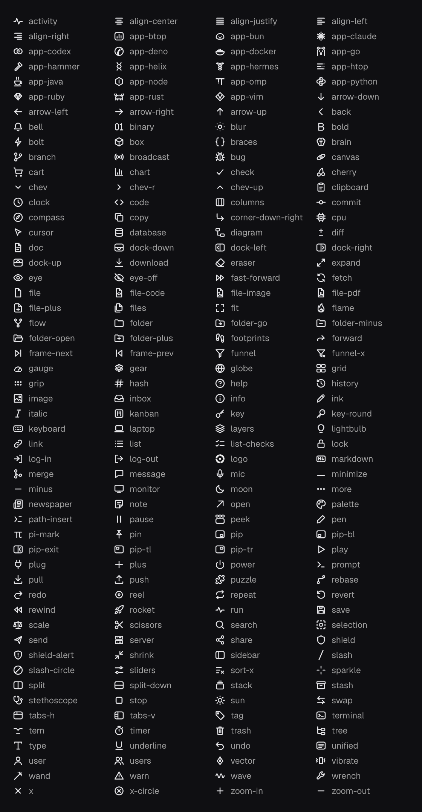
<figcaption>所有图标均作为 <code>icon</code> 节点，以当前文本颜色显示。</figcaption>
</figure>

此外还有一千多种实心文件和文件夹图形，供 Files 窗格按名称选择：来自 Material Icon Theme，命名为 `mi-` 加图标 id（`mi-rust`、`mi-typescript`、`mi-docker`、`mi-folder-src`、`mi-folder-src-open`）。

此外还有模型服务提供方的徽标，使用品牌色、当前文本色或两者（aiand 的箭头使用文本颜色，旁边配有红色条纹）：命名为 `provider-` 加提供方 id（`provider-anthropic`、`provider-openai`、`provider-llama-cpp`）。`provider:<id>` 按 omp 的提供方 id 原样命名：非字母数字字符会变成 `-`（`provider:llama.cpp` 对应 `provider-llama-cpp`）；没有自有徽标的提供方会显示其品牌徽标（`apple` → `provider-apple-intelligence`、`bedrock-mantle` → `provider-amazon-bedrock`、`cloudflare-workers-ai` → `provider-cloudflare-ai-gateway`）。Tern 没有徽标的提供方不会显示图标，因此选择器的 `mark` 会回退为首字母。

当没有图标名称匹配时，别名（omp 的符号名称和常见词语）会解析为图标；若名称本身是图标名，则优先匹配图标：

`success` → `check`，`done` → `check`，`error` → `x`，`failed` → `x`，`warning` → `warn`，`pending` → `clock`，`running` → `activity`，`aborted` → `stop`，`cancelled` → `stop`，`disabled` → `minus`，`model` → `sparkle`，`plan` → `list`，`goal` → `pin`，`loop` → `redo`，`git` → `branch`，`pr` → `merge`，`tokens` → `hash`，`speculation` → `selection`，`compaction` → `wand`，`context` → `layers`，`cost` → `hash`，`time` → `clock`，`omp` → `app-omp`，`hermes` → `app-hermes`，`agents` → `user`，`agent` → `user`，`job` → `run`，`cache` → `database`，`input` → `download`，`output` → `send`，`host` → `laptop`，`session` → `history`，`worktree` → `tree`，`bash` → `terminal`，`shell` → `terminal`，`python` → `app-python`，`edit` → `pen`，`write` → `pen`，`read` → `doc`，`web` → `globe`，`url` → `link`，`todo` → `list`，`task` → `layers`，`thinking` → `sparkle`，`settings` → `sliders`，`appearance` → `ink`，`interaction` → `keyboard`，`memory` → `brain`，`tools` → `wand`，`tasks` → `list`，`providers` → `server`，`plugins` → `box`，`advisor` → `sparkle`，`git-branch` → `branch`，`sparkles` → `sparkle`，`action` → `terminal`，`extension` → `puzzle`，`computer` → `monitor`，`stats` → `chart`，`news` → `newspaper`，`export` → `open`，`restart` → `revert`，`compress` → `shrink`，`handoff` → `forward`，`question` → `help`，`pencil` → `pen`，`folderMove` → `folder-go`，`folderPlus` → `folder-plus`，`folderMinus` → `folder-minus`，`hammer` → `app-hammer`，`prewalk` → `footprints`，`jobs` → `run`，`signIn` → `log-in`，`signOut` → `log-out`，`package` → `box`，`fast` → `bolt`，`voice` → `mic`，`rule` → `scale`，`skill` → `lightbulb`，`mcp` → `plug`，`path` → `folder`，`token_total` → `hash`，`time_spent` → `clock`。

## `avatar`

用于表示人员、机器人、组织、代码库或模型服务提供方的小型标记。默认的 `circle` 会在由 `seed` 确定的双色渐变背景上绘制 `text` 首字母（相同 seed 始终得到相同颜色；这些标记与 [`picker`](lists.md#picker) 绘制的完全一致，因此同一个人在 Tern 中的外观始终相同）。`square` 是带种子色调的圆角方块，首字母使用该色调的文字颜色：适合非人的对象（机器人、组织、代码库、CI）。两种样式都可用 `icon` 代替首字母（任意 Tern 图标，或在低强调底色上以自身颜色显示的 `provider:<id>` 徽标）；若提供 `blob` 图片，则会将其绘制在头像上。`status` tone 会在右下方添加小圆点，并以 surface 颜色描边，使其在头像上清晰可见。没有 `text`、`icon` 或 `blob` 时，会绘制低强调的人物图形。

请把它放在所表示名称之前，置于行、列表项或消息标题中；尺寸应与旁边文本匹配（正文旁用 `sm`，行中用 `md`，标题中用 `lg`）。不要把名称写在标记内：`text` 仅用于首字母和工具提示。要同时表示多个人，请使用 [`avatars`](#avatars)。

**构建方式：** `tern.ui.node("avatar", { text = "Cara Alvarez", seed = "cara@acme.dev", status = "success" })`。

| 属性 | 类型 | 默认值 | 含义 |
| --- | --- | --- | --- |
| `variant` | `"circle"` \| `"square"` | `"circle"` | 外观（见下文） |
| `text` | string | `""` | 标记所代表的名称：取前两个非空格字符作为首字母（圆形显示为大写，方形保持原样） |
| `seed` | string | `text` | 决定颜色；请传入稳定 id（电子邮件、仓库 slug），以便重命名后颜色保持不变 |
| `icon` | string | none | [图标名称](#图标名称)或 `provider:<id>`，用于替代首字母显示。未知名称会回退为首字母 |
| `blob` | string | none | 图片的 blob id（PNG、JPEG、GIF、WebP、SVG），会裁剪为头像；加载期间或缺失时显示首字母 |
| `size` | `"xs"` \| `"sm"` \| `"md"` \| `"lg"` | `"md"` | 16、20、28 或 36px 的正方形尺寸 |
| `status` | tone | none | 右下角的 tone 色圆点（`success` 表示在线、`warning` 表示离开、`error` 表示忙碌、`pending` 表示处理中、`accent`/`info`/`user` 表示强调；其他值为灰色） |
| `title` | string | `text` | 工具提示和可访问名称 |

**变体。**

| `variant` | 外观 | 用途 |
| --- | --- | --- |
| `circle` | 135° 双色渐变上的白色首字母；徽标或图标显示在低强调的 `--chip-bg` 底色上 | 人员和服务提供方 |
| `square` | 圆角为边长 30% 的圆角方块，按种子色调以 18% 着色，首字母使用 mono 字体及该色调的文字颜色 | 机器人、组织、代码库、服务 |

**子项：** 无（忽略）。

**事件：** 本身没有事件；`actions` 与任意节点相同。

**键盘：** 无；不接受焦点。发生变化时由程序更新 `status`、`text`、`blob`。

**样式：**

```html
<div class="sf sf-avatar circle s-md" data-id="main.me" role="img" aria-label="Sam Moss" title="Sam Moss">
	<span class="av-face" aria-hidden="true">Sa</span>     <!-- inline gradient; --av-h on a square -->
	<span class="av-dot" data-tone="success" aria-hidden="true"></span>   <!-- only with a status -->
</div>
```

| 目标 | 选择器 |
| --- | --- |
| 节点 | `.sf-avatar`（`.circle` / `.square`、`.s-xs` … `.s-lg`；圆形图标使用 `.logo`；无可显示内容时使用 `.blank`） |
| 头像主体 | `.sf-avatar .av-face`（内部，可能变化） |
| 状态点 | `.sf-avatar .av-dot[data-tone]`（内部） |
| 环线颜色 | `--av-ring`（默认 `--panel`）：将其设为头像所在的背景色 |

尺寸由节点上的 `--av`（边长）、`--av-fs`（首字母）和 `--av-dot` 决定。

```lua
local ui = tern.ui

ui.node("row", { gap = "sm", align = "center" }, {
	ui.node("avatar", { text = "Sam Moss", seed = user.email, size = "sm", status = user.online and "success" or nil }),
	ui.text(user.name),
})
ui.node("avatar", { variant = "square", text = "ci", seed = "acme/ci", title = "acme/ci" })
ui.node("avatar", { icon = "provider:anthropic", title = "Anthropic", size = "lg" })
```

TSX 中的相同示例（TypeScript SDK）：

```tsx
<row gap="sm" align="center">
   <avatar text="Sam Moss" seed={user.email} size="sm" status={user.online ? 'success' : undefined} />
   <text>{user.name}</text>
</row>
<avatar variant="square" text="ci" seed="acme/ci" title="acme/ci" />
<avatar icon="provider:anthropic" title="Anthropic" size="lg" />
```

<figure class="tn-figure">
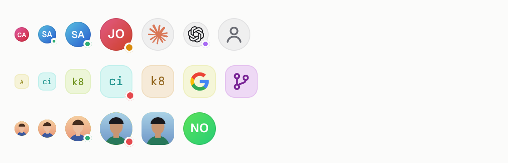
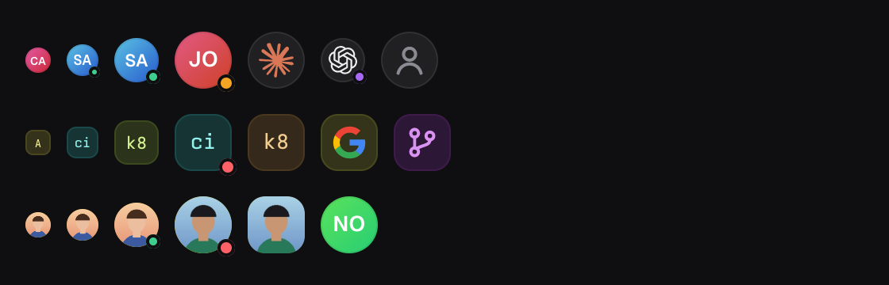
<figcaption>从 xs 到 lg 的圆形、方形和图片头像，包含首字母、徽标、图标和状态点。</figcaption>
</figure>


## `avatars`

重叠头像堆叠：用于表示参与评审的人员、一次运行中的代理或组织中的代码库。每个头像会覆盖前一个头像边长的 28%，并以 surface 颜色描边，保持边缘清晰。设置 `max` 后，超过前 `max` 个的头像会折叠为 `+N` 标记，其工具提示按行列出名称（只隐藏一个头像时会直接显示该头像，而非 `+1`）。堆叠后方的 `label` 以低强调样式说明内容（`7 reviewers`）。悬停某个头像时，它会浮到邻近头像上方并显示名称。`max` 建议设为 3–5。

**构建方式：** `tern.ui.node("avatars", { items = { { text = "Cara Alvarez" }, … }, max = 4, label = "7 reviewers" })`。

| 属性 | 类型 | 默认值 | 含义 |
| --- | --- | --- | --- |
| `items` | `{ Avatar }` | `{}` | 从前向后排列的头像：各项接受 [`avatar`](#avatar) props，但不接受 `size`（`variant`、`text`、`seed`、`icon`、`blob`、`status`、`title`）；堆叠时不绘制 `status` 圆点（会被下一个头像遮挡） |
| `max` | integer | all | 显示多少个头像后转为 `+N` 标记 |
| `size` | `"xs"` \| `"sm"` \| `"md"` \| `"lg"` | `"md"` | 所有头像的尺寸 |
| `label` | string | none | 堆叠后的低强调文字，也是组的可访问名称（未设置时使用连接起来的名称） |

**子项：** 无（忽略）。

**事件：** 本身没有事件；`actions` 与任意节点相同。

**键盘：** 无；不接受焦点。

**样式：**

```html
<div class="sf sf-avatars s-md" data-id="main.reviewers" role="group" aria-label="7 reviewers">
	<div class="av-stack">
		<span class="av circle s-md" role="img" aria-label="Cara Alvarez" title="Cara Alvarez">
			<span class="av-face" aria-hidden="true">Ca</span>
		</span>
		…
		<span class="av more s-md" title="Ada Lim&#10;Ben Ortiz&#10;Eve Park" aria-label="3 more: …"><span class="av-face" aria-hidden="true">+3</span></span>
	</div>
	<span class="av-label" aria-hidden="true">7 reviewers</span>
</div>
```

| 目标 | 选择器 |
| --- | --- |
| 节点 | `.sf-avatars`（`.s-xs` … `.s-lg`） |
| 单个头像 | `.sf-avatars .av`（内部，基于 `.sf-avatar` 构造，带 2px `--av-ring` 内边距） |
| 溢出标记 | `.sf-avatars .av.more`（内部） |
| 标签 | `.sf-avatars .av-label`（内部） |
| 环线颜色 | `--av-ring`（默认 `--panel`） |

```lua
local items = {}
for i, r in pr.reviewers do
	items[i] = { text = r.name, seed = r.email, status = r.approved and "success" or nil }
end
tern.ui.node("avatars", { items = items, max = 4, size = "md", label = #items .. " reviewers" })
```

TSX 中的相同示例（TypeScript SDK）：

```tsx
<avatars
   items={pr.reviewers.map((r) => ({ text: r.name, seed: r.email, status: r.approved ? 'success' : undefined }))}
   max={4}
   label={`${pr.reviewers.length} reviewers`}
/>
```

<figure class="tn-figure">
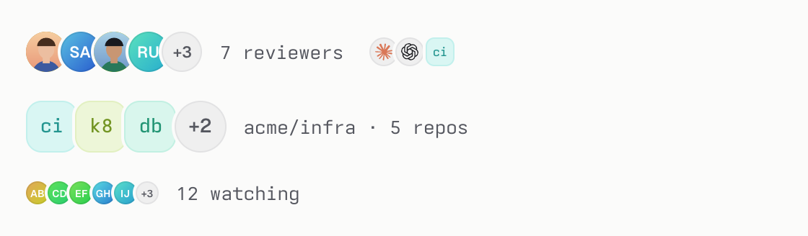
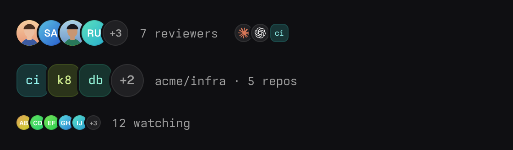
<figcaption>带溢出标记和标签的头像堆叠。</figcaption>
</figure>


## `image`

来自你发送的 blob 或 Tern 内置资源的图片。栅格 blob（PNG、JPEG、GIF、WebP，单边最多 4096 px）会在主线程之外解码，并以 6px 圆角和淡色 `--l1` 环线绘制。SVG blob（`image/svg+xml`，最大 256 KiB）会作为真正的 SVG 元素挂载，因此你的样式表可以为它设置样式和动画。

**尺寸。** `w`/`h` 以 px 给出自然尺寸（也决定宽高比）；只给其中一个时会根据解码后的比例补全；两者都未设置时使用解码尺寸。栅格图和 SVG 预览会等比例缩小，以适应可用宽高边界。`max.h` 限制高度（`"10lines"` 或 `"40ch"`；比例值会被忽略）；`max.w` 通过通用 props 限制宽度。

**适配和缩放。** 栅格像素总是居中放入该框，并由 `object-fit` 控制：`contain`（默认；声明尺寸或 CSS 尺寸与源比例不同时也不会拉伸）、`cover`（填满框并裁去溢出部分）、`fill`（拉伸至填满框）、`none`（使用解码后的尺寸，每个图片像素对应一个 CSS px，并裁剪至框内），或 `scale-down`（`none`，或尺寸更小时使用 `contain`）。`image-rendering: pixelated`（或 `crisp-edges`）会使用最近像素进行缩放，保持像素艺术的硬边缘；`auto`、`smooth` 和 `high-quality` 会平滑过滤。可在节点上同时设置两者，例如 `.sf-image[data-role='sprite'] { object-fit: cover; image-rendering: pixelated }`；不支持 `object-position`。

**动画。** 动态 GIF、APNG 或动态 WebP 会自动播放：每帧按照其延迟时间显示（延迟不超过 10 ms 时按 100 ms 播放，与浏览器一致），按文件的循环次数播放（若指定无限循环则一直播放），然后停留在最后一帧。图片首次绘制时开始播放，并使用窗口的动画时钟，因此时钟暂停时也会暂停；滚出视野后会跳过中间帧，返回时显示正确帧，不消耗帧资源。超过 1024 帧或解码像素总量超过 64 MiB 的动画会静止显示第一帧。

**子项。** 图片子项绘制在其上方的 `.sf-img-over` 图层中，该图层覆盖节点框：高度为图片高度，宽度为节点宽度。此图层是类似 `col` 的列，因此背景上的 sprite 应嵌套在 `image` 中，并通过 `row`/`col` 或自定义 CSS 定位；无需绝对定位。只有子项会接收指针：点击子项周围的图片仍会缩放，点击子项则不会。

```lua
-- an animated sprite standing at the bottom right of a background, its pixels scaled hard-edged
ui.node("image", { blob = state.meadow, alt = "Meadow", role = "meadow" }, {
	ui.node("col", { grow = 1 }),
	ui.node("row", { justify = "end" }, {
		ui.node("image", { blob = state.pikachu, alt = "Pikachu", role = "sprite", w = 96, h = 96 }),
	}),
})
-- your sheet: .sf-image[data-role='sprite'] { image-rendering: pixelated }
```

**缺失时。** 在 blob 到达前、解码期间，或 Tern 无法解码时，节点会显示虚线占位卡片，包含图片图标和 `alt`（或 “Image loading” / “Image unavailable”），并显示说明原因的工具提示：“The image data has not arrived”、“The image is loading” 或 “Not an image format Tern can show”（也包括超过 256 KiB 或没有尺寸的 SVG）。图片绘制后才到达的 blob 会在抵达后立即显示。窗格从未收到但该机器上 Tern 的 blob 缓存仍保存着的 id（发送给另一个窗格或 block，或重启前发送）会从缓存显示在所有展示该窗格的窗口中。

**缩放查看。** 点击已绘制的 blob 图片会在 Tern 图片查看器中打开，悬停时光标显示放大镜。若图片的父项包含其他 blob 图片（例如消息附件），查看器会从当前图片开始逐一浏览。查看器标题使用 `alt`（否则用 `title`）。节点若有自己的 `click` action，则改为执行该 action。`builtin` 图片永不缩放。

**SVG。** Tern 会绘制 `svg`、`g`、`defs`、`linearGradient`、`stop`、`path`、`circle`、`line`、`rect`、`mask` 和 `text` 元素；任何其他元素（`script`、`foreignObject`、`image`、`use`、`title`、…）都会连同其子树一起丢弃。属性按原样传递，因为 SVG 中没有内容会运行或加载：表现属性（`fill`、`font-family`、`letter-spacing`、…）可设置图形样式，而内联 `style`、事件处理器和外部 `url(…)` 引用不起作用。每个 `id` 和本地 `url(#id)` 都会按节点添加前缀，因此多个副本不会冲突；`class` 值会保留，因此 `.sf-image .my-class` 选择器可用；`tabindex` 会被丢弃，因此图形永远不会获取键盘焦点。根元素的 `width` 和 `height` 只提供自然尺寸，并且必须有 `viewBox`（或同时有两者）。

**Canvas。** `tern.canvas` 不接受 `image` 节点（`canvas kind "image" is not supported`）：图片只能用于 block 和 lens 视图。

**构建方式：** 在 block 处理器中使用 `cx:blob(bytes, mime)` 发送字节（参见 [Host API](../reference/api-host.md)），将返回的 id 保存在状态中，并绘制 `tern.ui.node("image", { blob = id, alt = … })`。没有专用构建器。

| 属性 | 类型 | 默认值 | 含义 |
| --- | --- | --- | --- |
| `blob` | string | none | blob id（`cx:blob` 返回的 SHA-256） |
| `builtin` | string | none | Tern 内置图片，代替 `blob` 绘制。唯一内置项为 `"omp"`（omp 的动态渐变标记） |
| `alt` | string | 屏幕阅读器读取为 `"Image"` | 可访问名称、占位文本和查看器标题 |
| `w`、`h` | number | 解码后的尺寸 | px 单位的自然宽高；忽略零或负值 |
| `max` | `{ w?, h? }` | none | 通用 prop；`h` 以 `"Nlines"` 或 `"Nch"` 为单位限制图片高度 |
| `title` | string | none | 通用 prop：工具提示。没有 `alt` 时，缩放查看器也会将其用作名称 |
| `href`、`path` | string | none | 供缩放查看器读取，可能会提供打开该文件或页面的选项（优先使用 `href`） |

**子项：** 任意节点，绘制在图片上方（见上文**子项**）。

**事件：** 本身没有事件。点击可缩放图片会执行 `zoom` action（显示查看器；block 不会收到事件）。你自己的 `actions` 与任意节点相同，并会在 `click` 操作上优先执行。

**样式：**

```html
<!-- raster -->
<div class="sf sf-image sf-zoom" data-id="…">
	
	<div class="sf-img-over">…children…</div>
</div>
<!-- SVG -->
<div class="sf sf-image sf-zoom" data-id="…">
	<svg class="sf-img-svg" role="img" aria-label="Build graph" viewBox="…">…</svg>
	<div class="sf-img-over">…children…</div>
</div>
<!-- missing or loading -->
<div class="sf sf-image missing" data-id="…">
	<div class="sf-img-card" role="img" aria-busy="true" title="The image is loading" aria-label="Build graph (image loading)">
		<span class="sf-img-ic"><svg class="ico">…</svg></span>
		<span class="sf-img-alt">Build graph</span>
	</div>
	<div class="sf-img-over">…children…</div>
</div>
```

| 目标 | 选择器 |
| --- | --- |
| 节点 | `.sf-image` |
| 可缩放 | `.sf-image.sf-zoom` |
| 未绘制（缺失、加载中、无法解码） | `.sf-image.missing` |
| 栅格帧 | `.sf-img-frame`（内部，可能变化） |
| 内联 SVG | `.sf-img-svg`（内部）及其中的自定义 class |
| 子项图层 | `.sf-img-over`（内部，可能变化） |
| 占位符 | `.sf-img-card`、`.sf-img-ic`、`.sf-img-alt`（内部，可能变化）；加载中为 `[aria-busy='true']` |

悬停时，图片帧的环线会变亮为 `--l3`；按下时不透明度降至 85%。占位卡片高 `2 × --sf-lh`，在 `--sf-shade` 上使用虚线 `--l3` 边框。

```lua
local ui = tern.ui

tern.block.define("graph", {
	init = function(cx, args, saved)
		return { chart = cx:blob(tern.fs.read("graph.png"), "image/png") }
	end,
	view = function(state, cx)
		return {
			main = ui.col({
				ui.text(ui.span("Build graph", "strong")),
				ui.node("image", { blob = state.chart, alt = "Build graph", w = 480, h = 240, max = { h = "10lines" } }),
				-- state.coverage: a blob id whose bytes were not sent yet
				ui.node("image", { blob = state.coverage, alt = "Coverage chart" }),
			}),
		}
	end,
})
```

<figure class="tn-figure">
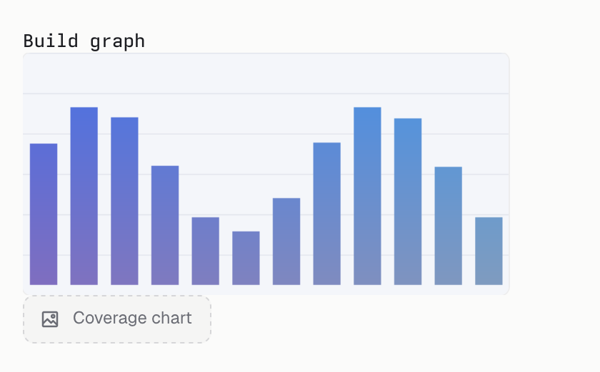
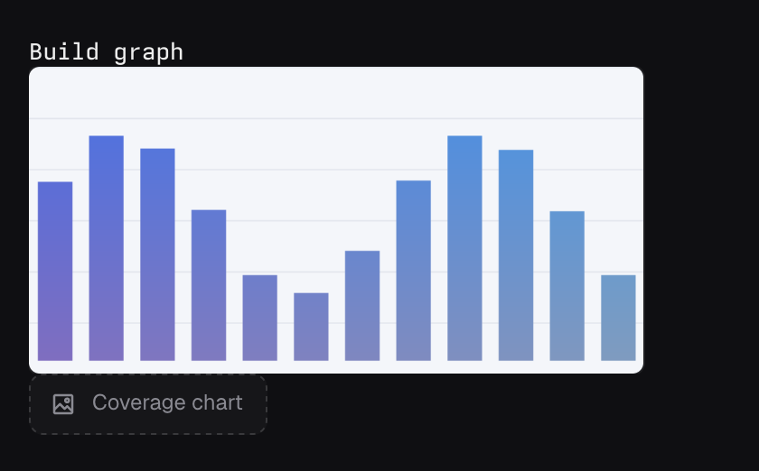
<figcaption>480×240 PNG 在 <code>max.h = "10lines"</code> 限制下缩小时保持宽高比；<code>state.coverage</code> 指向尚未到达的 blob，因此节点显示占位符。</figcaption>
</figure>

## `carousel`

幻灯片一次显示一张，位于可横向滑动的轨道上。适合用户逐张翻阅、而非并排阅读的少量同类内容：一次运行生成的截图、一组渲染结果或图表、供选择的备选设计。子项就是幻灯片：通常是 [`image`](#image) 节点，但也可以是任意节点（`card`、`md` 注释、`stats` 行）。超过十几张幻灯片或需要比较时，请改用 [`table`](#table)、[`list`](lists.md#list) 或卡片网格。

三种外观。默认的 `peek` 显示当前幻灯片，右侧边缘露出下一张，幻灯片上方叠加玻璃质感的 `2 / 5` 计数器，下方有标题行：幻灯片的 `title`（否则用 `alt`）和两个小型上一张/下一张按钮。它适合聊天或日志，露出的预览可传达“还有更多”，又不增加额外装饰。`arrows` 在幻灯片边缘叠加圆形玻璃箭头按钮，下方显示页码圆点，是常见的图库样式。`strip` 在幻灯片下方放置胶片式缩略图条：`image` 幻灯片显示按比例缩小的图片；其他幻灯片显示带图标的通用方块。当前缩略图带强调色环线。

导航在本地立即生效，类似 [`el`](el.md#el) 控件：点击箭头、标题行按钮、圆点、缩略图、露出的下一张，或在触控板上双指水平滑动，都会立即移动轨道（滑动 0.32 秒；Tern 或系统启用减少动态效果时直接切换），程序会收到带新索引的 `change`。用户选择的位置会保持不变，直到程序更改 `index`；程序的值优先。将 `change` 镜像到 `index` 的程序仍是状态所有者。没有 `loop` 时，到达两端会停止：端点处的箭头会淡出，标题行按钮会变暗。设置 `loop` 后，最后一张之后会回到第一张，第一张之前会跳到最后一张。

**构建方式：** `tern.ui.node("carousel", { variant = "arrows", index = 0 }, { …slides })`。

| 属性 | 类型 | 默认值 | 含义 |
| --- | --- | --- | --- |
| `index` | number | `0` | 要显示的幻灯片，从 0 开始。超过最后一张时显示最后一张。更改 `index` 会替换用户选择的位置 |
| `loop` | boolean | `false` | 越过任一端时循环回绕。关闭时到端点停止，并禁用对应按钮 |
| `variant` | `"peek"` \| `"arrows"` \| `"strip"` | `"peek"` | 外观（见下文）。其他值按 `peek` 处理 |
| `h` | number or string | `200`（px） | 幻灯片高度：数字表示 px，或使用 `"10lines"` / `"40ch"`，分别按 surface 行高和单元格宽度计算。所有幻灯片等高；图片铺满，其他内容位于带边距的内部并会裁剪 |

通用 props 也可用：`title`、`aria`、`tone`、`key`、`actions` 和 flex props。carousel 会填满分配给它的宽度。

每张幻灯片自己的 `title`（若未设置且为 `image`，则用其 `alt`）既是其标题（`peek`），也是屏幕阅读器识别圆点和缩略图的名称（“Slide 2: screenshot-2.png”）。

**变体。**

| `variant` | 外观 | 用途 |
| --- | --- | --- |
| `peek` | 当前幻灯片占宽度的 84%，下一张以半亮度从右侧露出（悬停时变亮，点击后进入；最后一张时前一张从左侧露出）；幻灯片右上角叠加玻璃质感的 mono 胶囊，显示 `2 / 5`；下方标题行以 `--t2` 显示标题，接着是 22px 上一张/下一张按钮 | 默认样式：用于聊天、日志或报告中的图片，露出的预览表明还有更多内容 |
| `arrows` | 幻灯片占满宽度；左右边缘叠加 30px 圆形玻璃箭头按钮（未启用 `loop` 时，端点箭头淡出）；非图片幻灯片的内容会避开按钮；下方居中显示页码圆点，当前项为较宽胶囊 | 逐张浏览的图库；幻灯片数量较少 |
| `strip` | 幻灯片占满宽度；下方有一行 44px 缩略图（均分宽度，单张最多 104px），其他项变暗，当前项带 `--accent` 环线；非图片幻灯片的方块显示文档图标 | 图片较多、需要预览后续内容的场景：渲染过程、帧、页面 |

**子项：** 按顺序排列的幻灯片。可以是任意 kind；`image` 幻灯片会铺满对应区域（`object-fit: cover`），并为 `strip` 提供缩略图。只有当前幻灯片接收指针（包括图片点击缩放）；点击其他幻灯片会将其切换为当前项。

**事件：** 用户切换时会发送：

```lua
{ ev = "change", id = "main.shots", value = 2 } -- the index now shown
```

切换到当前已显示的幻灯片、程序通过 `index` 完成的切换，或未启用 `loop` 时越过端点，都不会发送事件。surface 已关闭或以 [`listen:false`](../protocol/surfaces.md#打开与关闭) 打开时，carousel 会绘制，但不会移动或发送事件。

**键盘：** carousel 永远不会获取焦点。若要用键盘切换，请在程序中处理按键（←/→、Home/End）并设置 `index`；请使用[按键说明](../guides/design.md#按键图例)展示可用按键。

**手势：** 在幻灯片上双指水平滑动，会沿手指方向移动一张（手指向左：下一张），前提是该方向有幻灯片。手指移动时轨道会跟随（减少动态效果时除外）；取消滑动时会弹回原位。

**样式：**

```html
<div class="sf sf-carousel" data-id="main.shots" data-variant="peek" role="region" aria-roledescription="carousel">
	<div class="sf-carousel-stage" style="--sf-carousel-h: 200px">
		<div class="sf-carousel-view">
			<div class="sf-carousel-track" style="--sf-carousel-i: 1" aria-live="polite">
				<div class="sf-carousel-slide" role="group" aria-roledescription="slide" aria-label="1 of 5" aria-hidden="true">…</div>
				<div class="sf-carousel-slide on" role="group" aria-roledescription="slide" aria-label="2 of 5" aria-hidden="false">…</div>
				<div class="sf-carousel-slide peek" …>…</div>
				…
			</div>
		</div>
		<button class="sf-carousel-arrow prev" aria-label="Previous slide">…</button>
		<button class="sf-carousel-arrow next" aria-label="Next slide">…</button>
		<span class="sf-carousel-count" aria-hidden="true">2 / 5</span>
	</div>
	<div class="sf-carousel-foot">
		<span class="sf-carousel-cap">screenshot-2.png</span>
		<span class="sf-carousel-nav">
			<button class="sf-carousel-step prev" aria-label="Previous slide">…</button>
			<button class="sf-carousel-step next" aria-label="Next slide">…</button>
		</span>
	</div>
	<div class="sf-carousel-dots" role="group" aria-label="Slides">
		<button class="sf-carousel-dot" aria-label="Slide 1: screenshot-1.png"></button>
		<button class="sf-carousel-dot on" aria-current="true" …></button>
		…
	</div>
	<div class="sf-carousel-strip" role="group" aria-label="Slides">
		<button class="sf-carousel-thumb sf-thumb-ready" aria-label="Slide 1: screenshot-1.png">
			<span class="sf-carousel-ph" aria-hidden="true">…</span>
		</button>
		…
	</div>
</div>
```

每种变体都包含所有部分；各变体自己的样式规则由 `data-variant` 区分。

| 目标 | 选择器 |
| --- | --- |
| 节点 | `.sf-carousel` |
| 变体 | `.sf-carousel[data-variant='arrows']` |
| 幻灯片框（裁剪轨道） | `.sf-carousel-view` |
| 幻灯片 / 当前项 / 露出的项 | `.sf-carousel-slide`、`.sf-carousel-slide.on`、`.sf-carousel-slide.peek` |
| 箭头按钮（`arrows`） | `.sf-carousel-arrow.prev`、`.sf-carousel-arrow.next`（端点处为 `[disabled]`） |
| 计数器（`peek`） | `.sf-carousel-count` |
| 标题行、标题、切换按钮（`peek`） | `.sf-carousel-foot`、`.sf-carousel-cap`、`.sf-carousel-step` |
| 圆点（`arrows`） | `.sf-carousel-dots`、`.sf-carousel-dot`（`.on`） |
| 胶片条和缩略图（`strip`） | `.sf-carousel-strip`、`.sf-carousel-thumb`（`.on`；图片显示后为 `.sf-thumb-ready`） |
| 幻灯片高度、宽度、间距 | `--sf-carousel-h`、`--sf-carousel-w`（`peek` 为 `84%`，否则 `100%`）、`--sf-carousel-gap` |

标题使用区域字体（应用中为 sans，默认区域中为 mono）；计数器始终使用带等宽数字的 mono 字体。

```lua
local ui = tern.ui

local shots = {}
for i, shot in state.shots do
	shots[i] = ui.node("image", { blob = shot.blob, alt = shot.name, title = shot.name })
end

return ui.col({
	ui.node("carousel", { key = "shots", index = state.shot }, shots),
	ui.node("carousel", { variant = "strip", h = "12lines", loop = true }, shots),
})
```

程序同步该事件：

```lua
-- event(state, ev, cx)
if ev.ev == "change" and ev.id == "main.shots" then
	state.shot = ev.value
end
```

TSX 中的相同示例（TypeScript SDK）：

```tsx
<col>
   <carousel key="shots" index={shot} onChange={(ev) => setShot(ev.value)}>
      {shots.map((s) => <image blob={s.blob} alt={s.name} title={s.name} />)}
   </carousel>
   <carousel variant="strip" h="12lines" loop>
      {shots.map((s) => <image blob={s.blob} alt={s.name} title={s.name} />)}
   </carousel>
</col>
```

<figure class="tn-figure">
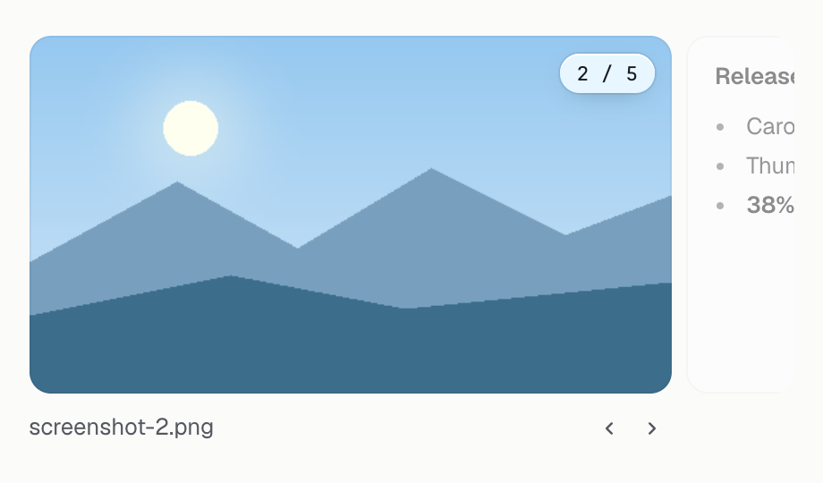
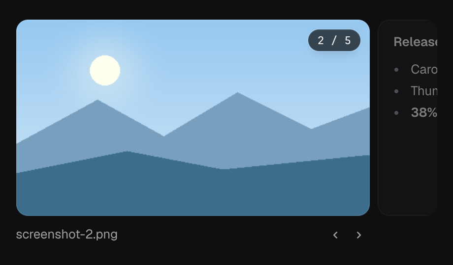
<figcaption>默认的 <code>peek</code> 外观：下一张幻灯片露出一角，计数器叠加在当前幻灯片上，下方的图注显示幻灯片的 <code>title</code>。</figcaption>
</figure>

<figure class="tn-figure">
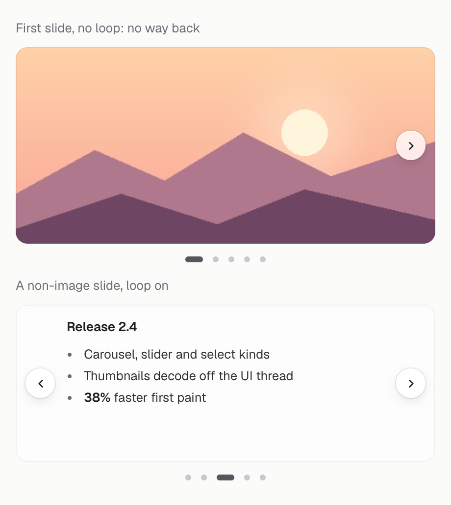
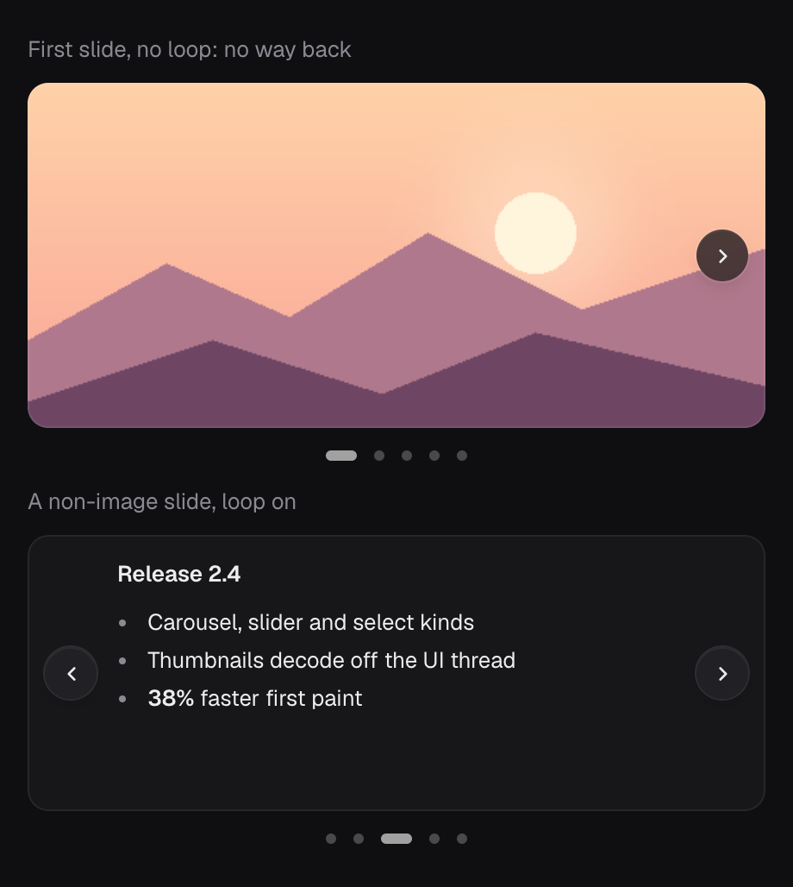
<figcaption><code>arrows</code> 外观：第一张幻灯片未启用 <code>loop</code> 时无法返回；启用 <code>loop</code> 后两个箭头都会保留。</figcaption>
</figure>

<figure class="tn-figure">
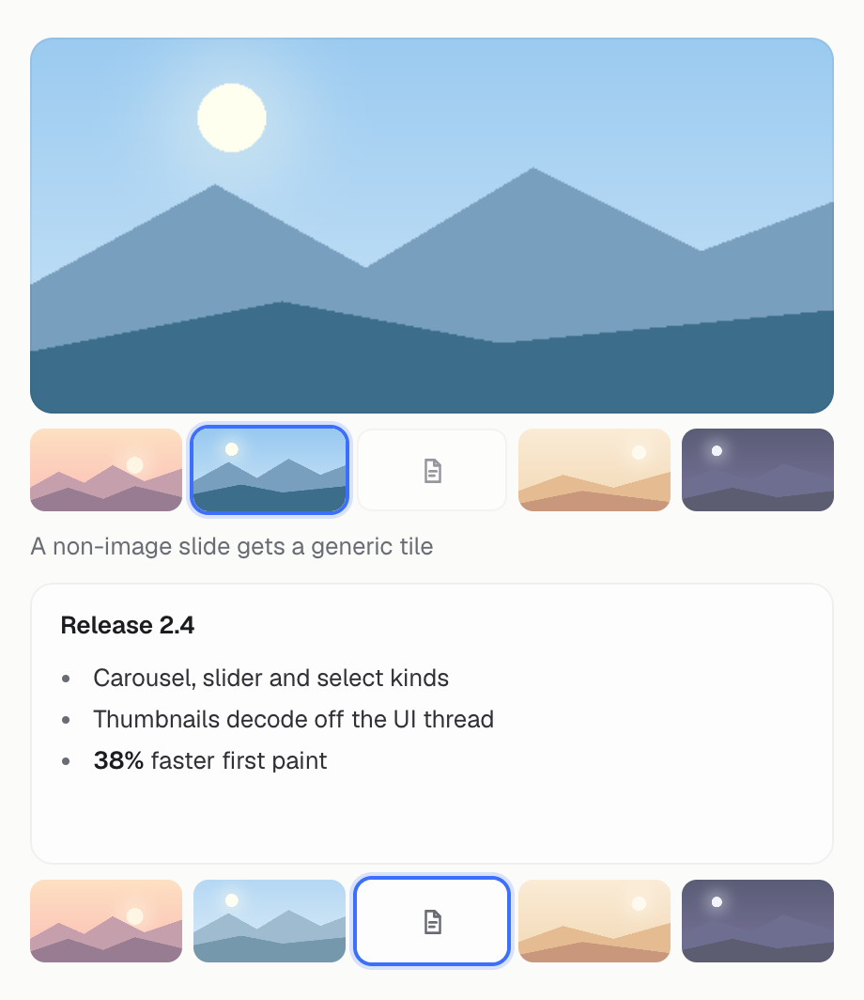
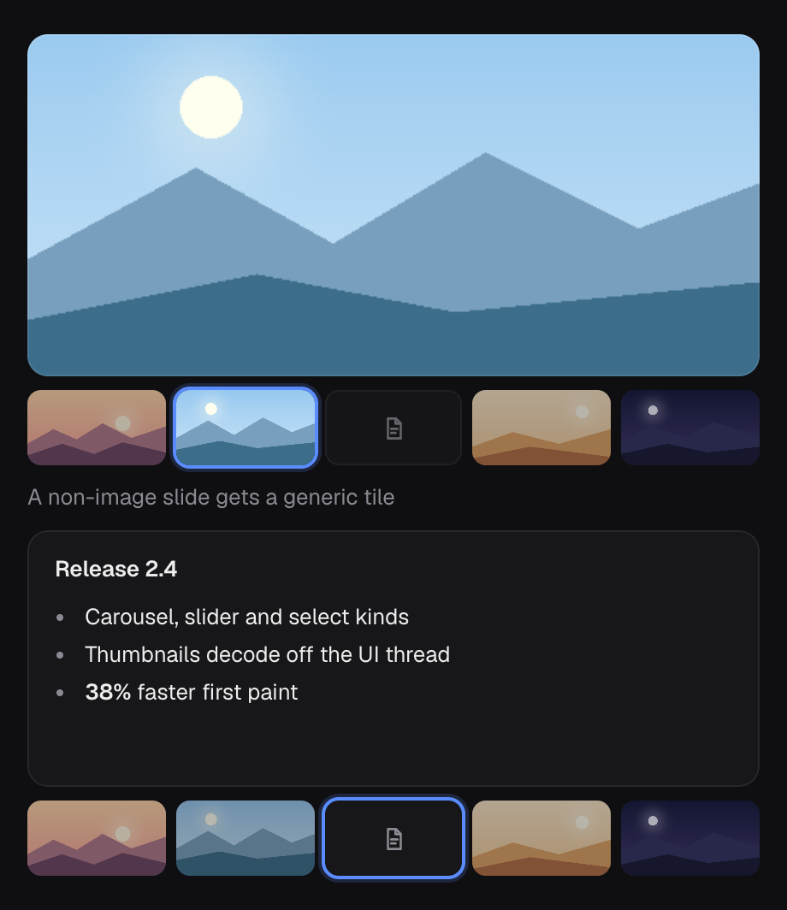
<figcaption><code>strip</code> 外观：<code>image</code> 幻灯片的缩略图使用其自身图片，其他幻灯片显示通用方块。</figcaption>
</figure>

<figure class="tn-figure">
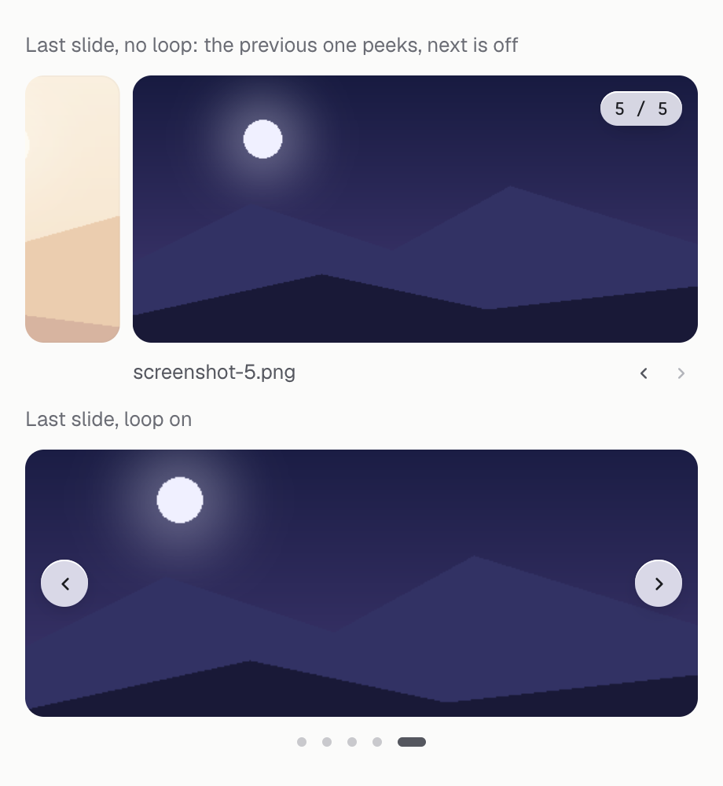
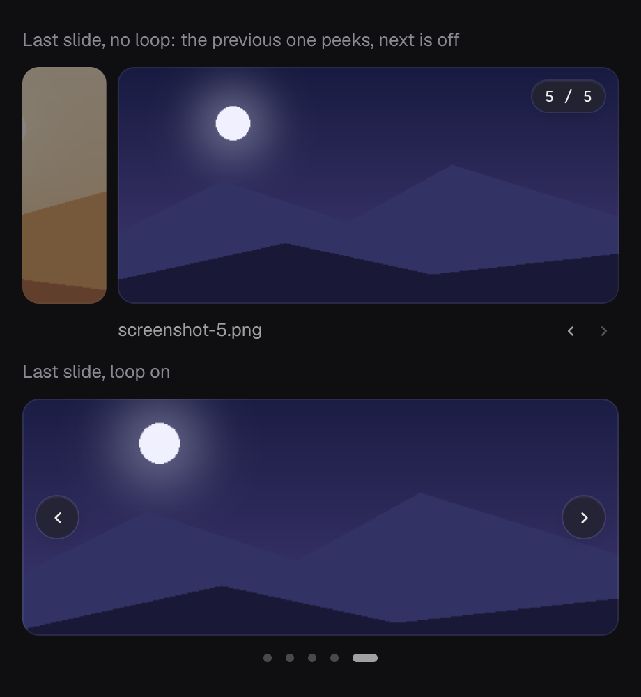
<figcaption>最后一张幻灯片：未启用 <code>loop</code> 时无法继续前进；启用后，下一张箭头会循环回到第一张。</figcaption>
</figure>

## `media`

由路径指定的文件；Tern 会读取它，并通过打开文件时使用的同一媒体查看器显示。只发送路径：字节由 Tern 自行加载。可用它显示程序写出的截图、工具读取的文件，或更改图片前后的对比；若图片只存在于程序内存中，则改为发送 [`image`](#image)。

**显示内容。** Tern 按文件内容而非扩展名分类，并通过媒体查看器绘制：栅格图片和 SVG（可缩放和平移，并有显示图片信息的 ⓘ 按钮）、3D 模型，以及由平台阅读器或播放器打开的 PDF、视频和音频。查看器上方的栏显示文件名（及其 `rev`），并包含查看器缩放菜单、ⓘ，以及图片专用的 Expand 按钮，可将其在 Tern 图片查看器中打开；双击图片也会打开。3D 模型的材质和纹理文件会从模型目录加载（设置 `rev` 时使用同一修订版）。其他文件会显示预览替代卡片：“No preview”（说明文件类型）、“Too large”（超过 64 MB；磁盘上的 PDF、视频和音频文件不受大小限制）、“Not found”（说明路径或修订版）、“LFS object not fetched”、“Not in a git repository”或“Can't read the file”（附原因）。

**文件位置。** `path` 可以是绝对路径，也可以相对于窗格工作目录（与 `open` action 解析路径的方式相同）。对于在其他机器上运行的程序（远程窗格，或通过 ssh 连接到已附加主机的 Shell），路径位于那台机器上，Tern 会像读取文件块那样从远端读取；远端的 PDF、视频或音频文件会先复制到本机，再交由平台阅读器或播放器打开。

**修订版。** 设置 `rev` 后，Tern 会显示 git 保存的版本，而非磁盘文件：对象为 `<rev>:<path relative to its repository root>`；`rev` 是 commit-ish（`HEAD`、sha、`main~2`），也可以是表示索引（stage 0）的 `:0`。仓库是包含该文件目录的仓库，并在文件所在机器上读取，因此 Git LFS 指针会从该机器的 LFS 存储解析。未设置 `rev` 时显示工作树文件。

**快照。** Tern 会在收到指定该文件的帧时读取图片、SVG 或模型，即使窗格不可见或节点位于会话记录很上方，并保留其字节。节点进入视野、滚回视野，或删除后以相同 `id` 和 `path` 重新添加时，Tern 会直接显示这些字节而不重新读取文件；因此程序在指定文件后立即删除或覆盖截图，仍会显示当时的内容。此快照会保留至 surface 结束。来自磁盘的文件（PDF、视频、音频）、`rev` 节点，以及 Tern 重启后恢复的会话记录，都会在显示时重新读取。`screen` surface 的节点不保留任何内容：每次都会重新读取文件。

**对比。** 同一 surface 中具有相同 `link` 的 `media` 节点会同步平移和缩放：放大前后对比图左侧的某个位置时，右侧也会移动到相同位置。

**尺寸。** 节点填满容器宽度。当父项按内容确定尺寸（例如聊天记录或卡片正文）时，节点高 20 行（`20 × --sf-lh`）。在有可用空间的 flex 列中（screen surface 的 `main`、通过 `min.h` 或样式表设置高度的 `col`），节点会扩展填满空间，并在列较矮时缩小至至少 6 行。`max.h` 和 `image` 一样限制高度（`"10lines"` 或 `"40ch"`）；设置上限后，6 行最小高度不再生效，因此 `max = { h = "4lines" }` 会得到 4 行高。`max.w` 限制宽度。在 `row` 中并排放置时，各节点平分宽度，高度使用默认值（或各自的 `max.h`）。

**回退。** Tern 会在 `hello` 回复的 `kinds` 中列出 `media`。发送节点前，使用 [Surface Protocol](../protocol/index.md) 的程序应检查支持情况（SDK 中为 `cx.supports("media")`）；否则应回退，例如将文件字节作为 blob 传给 `image`，或发送一行文字说明文件。

**Canvas。** `tern.canvas` 不接受 `media` 节点（`canvas kind "media" is not supported`）。

**构建方式：** `tern.ui.node("media", { path = "shots/home.png" })`。没有专用构建器。

| 属性 | 类型 | 默认值 | 含义 |
| --- | --- | --- | --- |
| `path` | string | required | 文件：绝对路径，或相对于窗格工作目录 |
| `rev` | string | none（磁盘文件） | 显示 git 对象 `<rev>:<path>`：commit-ish 或表示索引的 `:0` |
| `link` | string | none | 同一 surface 中 `link` 相同的节点会同步平移和缩放 |
| `max` | `{ w?, h? }` | none | 通用 prop；`h` 以 `"Nlines"` 或 `"Nch"` 为单位限制高度 |

**子项：** 无（忽略）。

**事件：** 此版本没有事件。查看器自身控件（缩放、平移、ⓘ 信息）属于 Tern，不会向程序发送信息。

**样式：**

```html
<div class="sf sf-media" data-id="…">
	<div class="tn-smedia-bar">…the file's name, its rev, the viewer's controls…</div>
	…Tern's media viewer…
</div>
```

| 目标 | 选择器 |
| --- | --- |
| 节点 | `.sf-media` |
| 由 `max.h` 限制高度 | `.sf-media.sf-clip` |

节点圆角半径为 6px，带淡色 `--l1` 环线，并会裁剪内部查看器。默认高度和最小高度分别由 `.sf-media` 上的 `height` 和 `min-height` 决定，因此样式表可以修改，例如 `.sf-media[data-role='shot'] { height: calc(12 * var(--sf-lh)) }`。

```lua
local ui = tern.ui

-- the same image before and after a change, side by side, panning together
ui.row({
	ui.node("media", { path = "assets/logo.png", rev = "HEAD", link = "logo" }),
	ui.node("media", { path = "assets/logo.png", link = "logo" }),
})
```

## `attachment`

一个文件：消息携带的文件，或撰写区即将发送的文件。提供 `name` 后，其他信息由 Tern 处理：扩展名（依次取自 `ext`、`name`、`mime`）决定文件类别和颜色（文档与 PDF 使用强调色、表格为绿色、代码为琥珀色、图片和媒体为橙色，其他为灰色）；`size` 以字节为单位，并显示为人类易读格式（`2.4 MB`）；图片的 `blob` 会成为缩略图。上传状态内置支持：`uploading` 或 `processing` 时，名称显示微光扫过的动画，进度线显示进度（`progress` 取值 0–1；未设置时进度线会持续扫过）；`error` 会为附件添加红色环线，显示你的 `error` 文本和重试按钮；`removable` 会添加 ×（忙碌时标题为 “Cancel upload”）。若要展示文件内容而非名称，请使用 [`media`](#media) 或 [`image`](#image)。

`variant` 有三种外观：

- **`chip`**（默认）用于消息和列表中的文件：36px 类型方块（显示文件类别颜色底上的扩展名，或图片缩略图）、名称和 mono 元信息行（“PDF · 2.4 MB”或自定义 `meta`），末尾为无底色操作图标。
- **`tile`** 用于以图片为主的托盘和图库：68px 缩略图（图片本身，否则为类别图标和扩展名），下方以 mono 字体显示名称，并从中间截断以保留扩展名（`homep…back.pdf`）。悬停时显示角上的 ×（出错时始终显示）；失败的 tile 悬停时可重试。tile 没有空间容纳其他 `actions`。
- **`pill`** 用于编辑器托盘：28px 胶囊，含文件类别图标、mono 名称（从中间截断）和 ×。

点击操作按钮会发送带有 `act` 的 `action`；`remove` 还会立即淡出附件，因此托盘会在程序响应前先更新（如果你更改 `state` 而不是移除节点，它会重新显示）。点击其他位置会像其他可打开节点一样打开 `href`（否则打开 `path`）：Tern 会打开相应 URL 或文件。两者均未设置时，主体不可点击。

**构建方式：** `tern.ui.node("attachment", { name = …, size = …, path = … })`。

| 属性 | 类型 | 默认值 | 含义 |
| --- | --- | --- | --- |
| `name` | string | `""` | 文件名，也是工具提示和可访问名称 |
| `variant` | `"chip"` \| `"tile"` \| `"pill"` | `"chip"` | 外观（见下文）。其他值按 `"chip"` 处理 |
| `ext` | string | 来自 `name`，否则来自 `mime` | 显示的扩展名，并用于识别文件类别（前导 `.` 会去掉） |
| `mime` | string | `""` | MIME 类型；扩展名未提供信息时据此识别类别（`image/*`、`audio/*`、`video/*`、`text/*`、`application/pdf`） |
| `size` | number | none | 字节数；默认元信息中以十进制单位显示（`2.4 MB`） |
| `meta` | string | `"EXT · size"` | chip 静止时的元信息行，替代默认内容 |
| `blob` | string | none | 图片 blob id（`b` 动词的 sha256）：图片文件的缩略图（chip 方块和 `tile`）。按 [`image`](#image) blob 解码；到达后显示 |
| `href` | string | none | 点击附件时打开 |
| `path` | string | none | 未设置 `href` 时，点击后打开的文件 |
| `state` | `"idle"` \| `"uploading"` \| `"processing"` \| `"error"` \| `"done"` | `"idle"` | 上传状态；忙碌状态会让名称显示微光扫过的动画并绘制进度线，`error` 状态会添加红色环线 |
| `progress` | number | none | 忙碌状态下的 0–1 进度（会被限制在范围内）；元信息显示 “Uploading · 62%”。未设置时进度线会持续扫过 |
| `error` | string | `"Upload failed"` | `error` 状态下元信息行和工具提示的后缀 |
| `removable` | boolean | `false` | 添加 × 并发送 `remove`（忙碌时标题为 “Cancel upload”） |
| `actions` | `{ { act: string, icon?: string, title?: string } }` | `{}` | × 前方按顺序排列的操作图标（适用于 `chip` 和 `pill`）：附件使用列表，而非通用的 `{ click, menu }` 表格。`icon` 是[图标名称](#图标名称)（默认使用 `act`），`title` 是工具提示和可访问名称（默认将 `act` 首字母大写）。若为 `error` 且未列出 `retry`，会自动添加该操作 |

**变体。**

| `variant` | 外观 | 用途 |
| --- | --- | --- |
| `chip` | 类型方块、名称、元信息行、操作图标 | 消息、列表和卡片中的文件 |
| `tile` | 68px 缩略图、下方名称、角上的 × | 图片托盘和图库 |
| `pill` | 28px 胶囊：图标、mono 名称、× | 编辑器的附件托盘 |

**子项：** 无（忽略）。

**事件：** 点击操作按钮会发送 `remove`（×）、`retry` 或你提供的 `actions` 项：

```lua
{ ev = "action", id = "main.report", act = "remove" }
```

surface 已关闭或以 [`listen:false`](../protocol/surfaces.md#打开与关闭) 打开时，附件仍会绘制，但不会发送事件；点击 remove 也不会淡出。

**键盘：** 附件永远不会获取焦点。由程序处理键盘选择（例如编辑器中 Backspace 删除最后一个 pill：移除该节点）。

**样式：**

```html
<div class="sf sf-attachment busy" data-id="…" data-variant="chip" data-state="uploading" data-type="sheet"
	role="group" aria-label="runs-2026-10.csv" aria-busy="true" title="runs-2026-10.csv">
	<div class="att-tile" aria-hidden="true"><span class="att-ext">CSV</span></div>
	<div class="att-body">
		<span class="att-name sf-fx-shimmer">runs-2026-10.csv</span>
		<span class="att-meta">Uploading · 62%</span>
	</div>
	<div class="att-acts">
		<button class="att-act" data-act="remove" title="Cancel upload" aria-label="Cancel upload">…</button>
	</div>
	<div class="att-bar" role="progressbar" aria-valuenow="62"><i></i></div>
</div>
```

`tile` 会将 `.att-name` 放在 `.att-tile` 下方，图标和扩展名位于 `.att-face` 中，× 作为 `button.att-act.att-x` 放在 tile 内；`pill` 由 `.att-ic`、`.att-name` 和 `.att-acts` 组成。

| 目标 | 选择器 |
| --- | --- |
| 节点 | `.sf-attachment` |
| 外观、状态、文件类别 | `.sf-attachment[data-variant]`、`[data-state]`、`[data-type]`（`image`、`pdf`、`sheet`、`code`、`archive`、`audio`、`video`、`doc` 或 `file`） |
| 可打开 / 忙碌 / 移除中 | `.sf-attachment.openable`（有 `href`/`path`）、`.busy`（uploading 或 processing）、`.removing`（remove 点击等待程序响应） |
| 类型方块或缩略图框 | `.att-tile`（内部；图片显示时为 `.sf-thumb-ready`，`img.sf-thumb` 为图片） |
| tile 主体、扩展名、pill 图标 | `.att-face`、`.att-ext`、`.att-ic`（内部，可能变化） |
| 名称和元信息 | `.att-body`、`.att-name`、`.att-meta`（内部，可能变化） |
| 操作按钮 | `.att-acts`、`.att-act[data-act]`（内部）；tile 角上的 × 为 `.att-x`，重试按钮为 `.att-retry` |
| 进度线 | `.att-bar > i`（内部；未设置 `progress` 时为 `.indeterminate`） |

`data-type` 设置 `--tc`，即文件类别颜色。`--att-bar` 是进度线颜色；processing 时使用 `--live`。

```lua
local ui = tern.ui

ui.node("attachment", { name = "homepage-feedback.pdf", size = 2400000, path = "/tmp/homepage-feedback.pdf",
	actions = { { act = "download", icon = "download", title = "Download" } } })
ui.node("attachment", { name = "runs-2026-10.csv", state = "uploading", progress = 0.62, removable = true })
-- a composer tray
ui.node("row", { gap = "sm", wrap = true }, {
	ui.node("attachment", { variant = "pill", name = "report.pdf", removable = true, key = "report" }),
	ui.node("attachment", { variant = "tile", name = "shot-1.png", blob = state.shot, removable = true }),
})
```

TSX 中的相同示例（TypeScript SDK）：

```tsx
<attachment name="homepage-feedback.pdf" size={2_400_000} path="/tmp/homepage-feedback.pdf"
   actions={[{ act: 'download', icon: 'download', title: 'Download' }]} />
<attachment name="runs-2026-10.csv" state="uploading" progress={0.62} removable
   onAction={{ remove: () => cancel('runs') }} />
<attachment variant="tile" name="spec.pdf" state="error" error="Too large" removable />
```

<figure class="tn-figure">
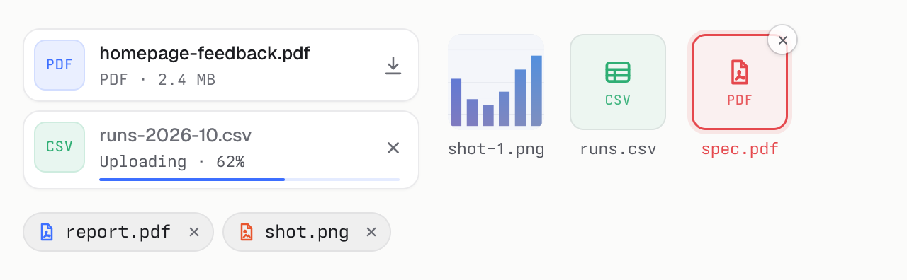
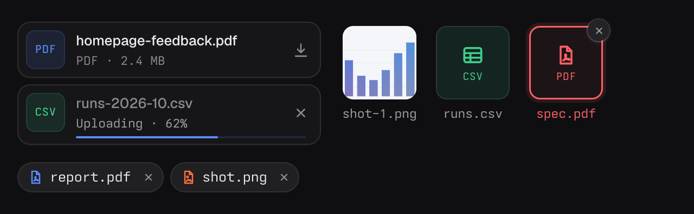
<figcaption>三种外观：chip、tile 和编辑器 pill。</figcaption>
</figure>

<figure class="tn-figure">
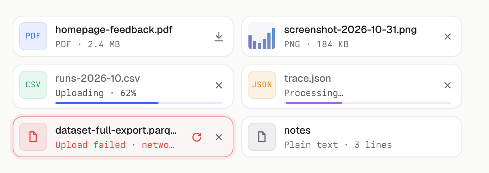
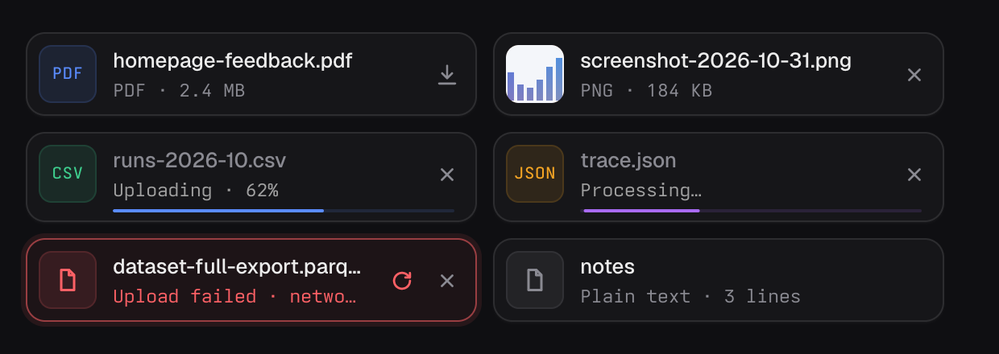
<figcaption>空闲、上传中、处理中和失败状态下的 chip；图片会在类型方块中显示缩略图。</figcaption>
</figure>

<figure class="tn-figure">
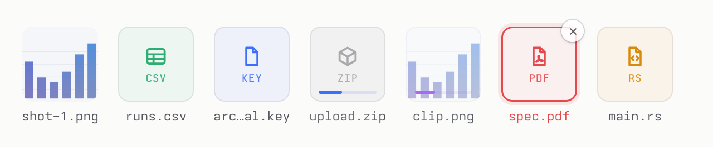
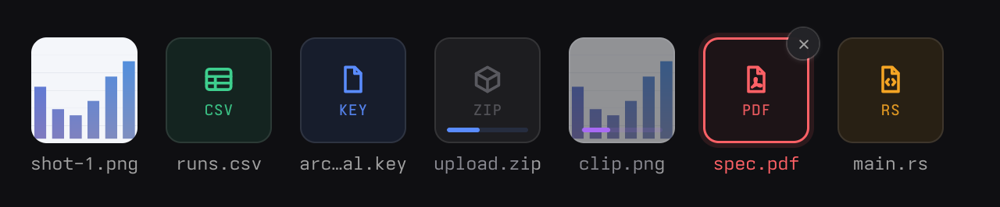
<figcaption>Tile：图片使用缩略图，其他文件使用类别图标和扩展名；名称从中间截断。</figcaption>
</figure>

<figure class="tn-figure">
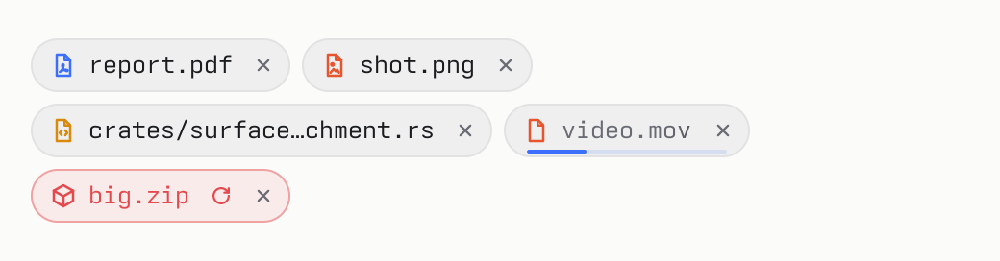
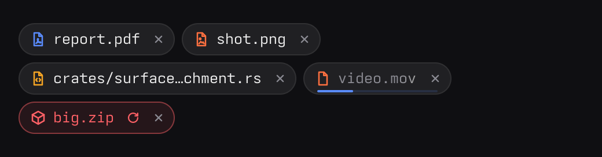
<figcaption>用于编辑器托盘的 pill。</figcaption>
</figure>

## 相关页面

- [元素](index.md)：通用 props、actions 和 kind 索引
- [动态效果](motion.md)：仪表单元格所用的 `meter` kind
- [列表](lists.md)：可选择行，以及使用 `avatar` 绘制标记的 `picker`
- [输入与按钮](input.md)：按钮单元格和选择栏操作所用的 `button`
- [UI 构建器](../reference/ui.md)：构建器的精确输出
- [设置视图样式](../styles/index.md)、[变量](../styles/variables.md)、[支持的 CSS](../styles/css.md)
