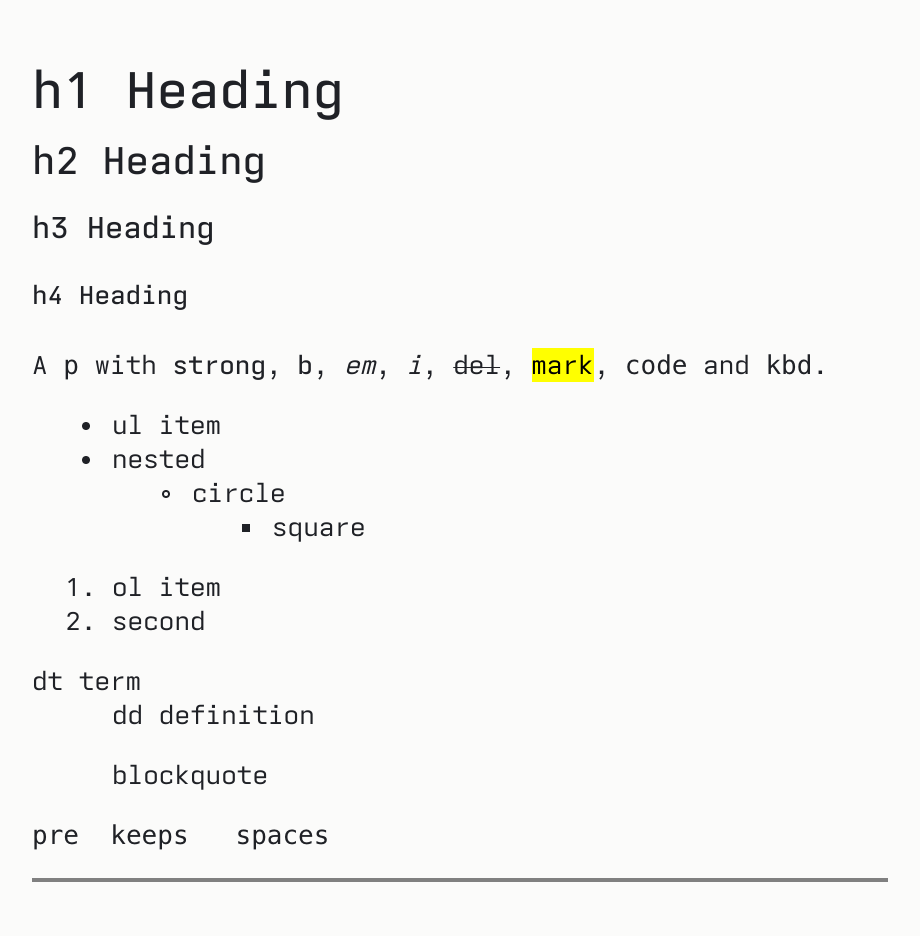
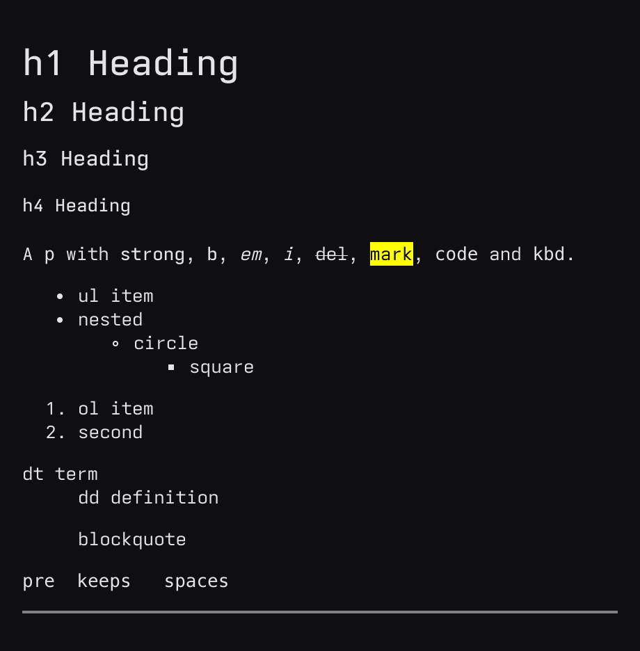
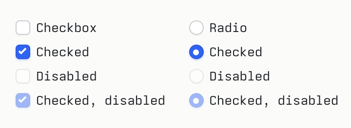
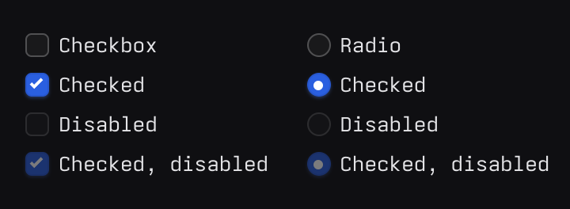
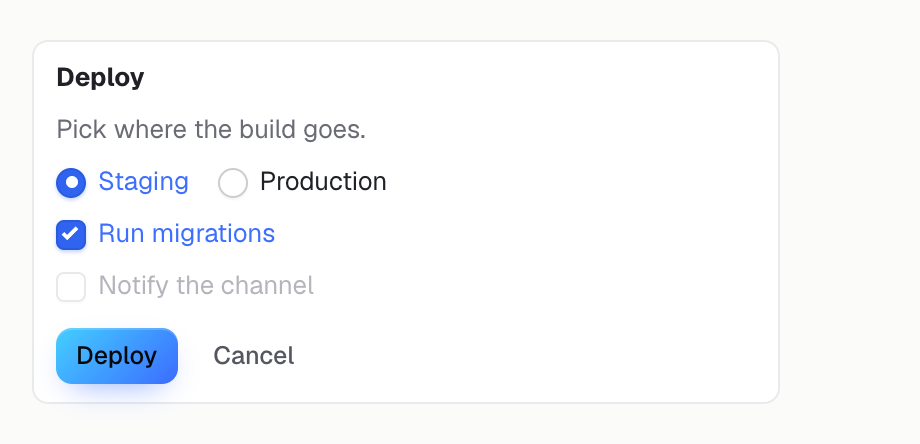
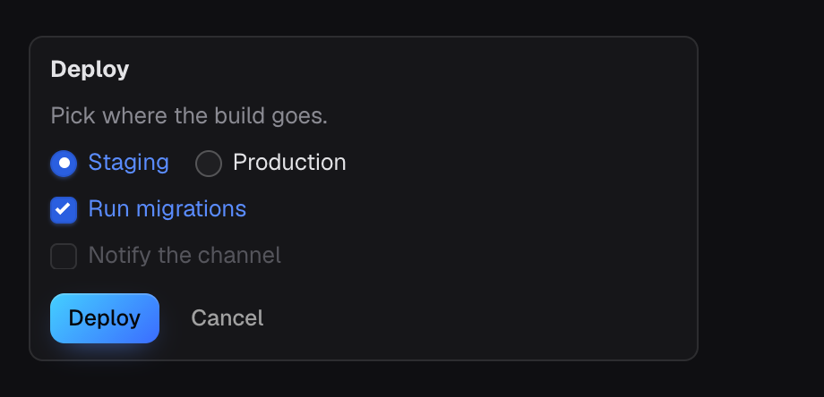
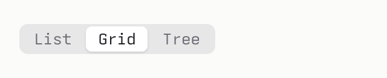
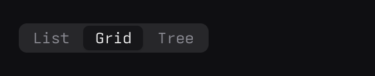
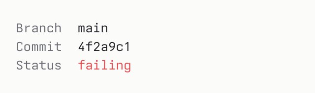
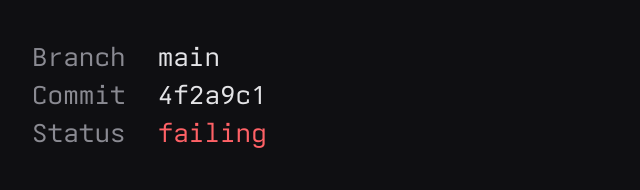

# HTML 元素

`el` 使用你自己的 CSS 绘制固定标签列表中的普通 HTML 元素。当没有其他类型能描述你想要的内容时，使用它：包含复选框和单选按钮的表单、自定义小部件、自己设计的网格。对于内置类型已能绘制的内容（列表、表格、键值对、徽章、按钮），优先使用该类型：它自带 Tern 的外观、键盘和复制行为（参见[设计视图](../guides/design.md#应该选择什么)）。

| 类型 | 构建器 | 绘制内容 |
| --- | --- | --- |
| [`el`](#el) | `tern.ui.el(tag, props?, children?)` 或 `tern.ui.node("el", { tag = … })` | 一个允许标签中的 HTML 元素、其 `text`，然后是子元素；`input` 绘制复选框或单选控件 |

## `el`

一个 `el` 就是一个元素：`<tag class="sf sf-el …your classes" data-id="<id>">`。除标签的用户代理默认样式（参见[标签](#标签)）、区域字体，以及标签、控件、按钮和表格的默认外观（参见[默认外观](#默认外观)）外，Tern 不会对它添加其他内容。其余一切都来自你的样式表。

**构建方式：** `tern.ui.el(tag, props, children)`（参见 [UI 构建器](../reference/ui.md#el)）。构建器会将 `props` 中除 `tag` 外的每个键复制到节点中，因此 `tern.ui.el("p", { text = "Hi" })` 会得到 `{k = "el", p = {tag = "p", text = "Hi"}}`。`tern.ui.node("el", { tag = "p", text = "Hi" })` 会构建相同的节点。

| 属性 | 类型 | 默认值 | 含义 |
| --- | --- | --- | --- |
| `tag` | 字符串 | `"div"` | 元素，必须是[允许的标签](#标签)之一。`form` 绘制为用于组合控件的 `div`；带有 `type` `checkbox` 或 `radio` 的 `input` 绘制为[控件](#控件)。任何其他标签（或其他类型的 `input`）都会绘制为 `div` 并报告错误（参见[未知标签](#未知标签)）。 |
| `class` | 字符串 | 无 | 供你的样式表使用、以空格分隔的类名。`sf` 和任何 `sf-*` 类都属于 Tern，会被丢弃。从 prop 中移除的类会在下一次更新时从元素中移除。 |
| `attrs` | 字符串 → 字符串、数字或布尔值的表 | 无 | 来自[允许列表](#属性)的额外属性：`data-*`、`aria-*`、`role`、`colspan`、`rowspan`。其他名称和其他值类型都会被忽略。 |
| `text` | 字符串 | `""` | 作为文本节点、在子元素**之前**绘制的纯文本。空字符串会将其移除。 |
| `type` | `"checkbox"` \| `"radio"` | 无 | 仅限 `input`：控件类型。 |
| `name` | 字符串 | 无 | 仅限 `input`：控件在所属表单 `values` 中的名称，以及其单选组名称。空字符串视为无名称。 |
| `value` | 字符串 | `"on"` | 仅限 `input`：它在 `change` 和 `values` 中报告的值。 |
| `checked` | 布尔值 | `false` | 仅限 `input`：你设置的选中状态（参见[本地状态与 `checked`](#本地状态与-checked)）。 |
| `disabled` | 布尔值 | `false` | 仅限 `input`：以暗淡样式绘制，不会切换，也不会计入 `values`。 |

所有[通用 prop](index.md)也适用。它们在 `el` 上的作用如下：

| 通用属性 | 对元素的作用 |
| --- | --- |
| `role` | `data-role="…"`，供你的选择器使用（不是 ARIA role；要设置该值请用 `attrs.role`） |
| `tone` | 对已知 tone 设置 `data-tone="…"`（`neutral`、`accent`、`info`、`success`、`warning`、`error`、`pending`、`muted`、`user`）；其他值不设置任何内容 |
| `mark` | `data-mark="…"` |
| `href` | `data-href="…"`：按住 ⌘ 并点击会打开它，行为与 `href` span 相同 |
| `title` | `title="…"`：悬停提示 |
| `hovercard` | 悬停时显示该节点树的浮动卡片，替代 `title` 提示 |
| `aria` | `aria-label="…"`：元素的可访问名称 |
| `hidden` | 添加 `.sf-hidden`（`display: none`） |
| `key` | 同级节点中的身份标识；控件的本地翻转状态由其父节点下的此 key 记忆，而非整个 surface 范围 |
| `actions` | 使元素成为点击目标；当它有 `click` 或 `dblclick` 时添加 `.sf-act` 和指针手势（参见[任意 `el` 上的操作](#任意-el-上的操作)） |
| `grow`、`shrink`、`basis`、`min`、`max` | 行内 flex 和尺寸样式，与任何节点上的效果相同 |

**子元素：**可以是任意 kind，按顺序绘制在 `text` 之后。`input` 和 `hr` 不绘制任何内容（其子元素会被忽略）。

**事件：**控件会发出 `change`（参见[`change` 事件](#change-事件)）；`actions` 会发出 `action`、`select` 和 `activate`，若位于 `form` 中则携带其 `values`。未知标签的 `error` 是协议通信：插件块的 `event` 处理器不会收到它。

### 标签

Tern 为每个标签创建的元素、其用户代理默认样式，以及辅助技术读取的 role。默认样式来自 Tern 的用户代理样式表（Chrome 子集）；文本继承区域字体（终端等宽字体，使用 `--sf-fs` 和行高 `--sf-lh`），因此 `em` 尺寸以该字体为基准。区域会按 UI 字体大小与 13 的比例缩放，因此 13px 会绘制为界面尺寸，其他长度也按比例缩放；`--sf-fs` 以这些单位读取终端字体大小（两者一致时为 13px）。Kit 的基础样式表（Tern 的窗口会加载它）将每个盒子设为 `box-sizing: border-box`，此外 Tern 还会为 `button` 和表格标签添加[默认外观](#默认外观)。

| 标签 | 绘制为 | display 值 | 用户代理的外边距、内边距和字体 | 角色 |
| --- | --- | --- | --- | --- |
| `div` | `div` | `block` | 无 | 通用元素 |
| `span` | `span` | `inline` | 无 | 通用元素 |
| `p` | `p` | `block` | 外边距 `1em 0` | 段落 |
| `section` | `section` | `block` | 无 | 命名时（`aria`、`title` 或 `aria-labelledby`）为区域，否则为通用元素 |
| `header` | `header` | `block` | 无 | 横幅；位于 `article`、`aside`、`main`、`nav` 或 `section` 内时为分区页首 |
| `footer` | `footer` | `block` | 无 | 内容信息；位于上述元素内时为分区页脚 |
| `nav` | `nav` | `block` | 无 | 导航 |
| `aside` | `aside` | `block` | 无 | 补充内容 |
| `main` | `main` | `block` | 无 | 主要内容 |
| `article` | `article` | `block` | 无 | 文章 |
| `figure` | `figure` | `block` | 外边距 `1em 40px` | 图示 |
| `blockquote` | `blockquote` | `block` | 外边距 `1em 40px` | 引用块 |
| `ul` | `ul` | `block` | 外边距 `1em 0`、`padding-left: 40px`、`disc` 项目符号（嵌套一层为 `circle`，两层为 `square`）；嵌套列表不再有垂直外边距 | 列表 |
| `ol` | `ol` | `block` | 外边距 `1em 0`、`padding-left: 40px`、`decimal` 数字 | 列表 |
| `li` | `li` | `list-item` | 无 | 列表项 |
| `dl` | `dl` | `block` | 外边距 `1em 0` | 描述列表 |
| `dt` | `dt` | `block` | 无 | 术语 |
| `dd` | `dd` | `block` | `margin-left: 40px` | 定义 |
| `h1` | `h1` | `block` | `2em`、粗体、外边距 `0.67em 0` | 标题 |
| `h2` | `h2` | `block` | `1.5em`、粗体、外边距 `0.83em 0` | 标题 |
| `h3` | `h3` | `block` | `1.17em`、粗体、外边距 `1em 0` | 标题 |
| `h4` | `h4` | `block` | 粗体、外边距 `1.33em 0` | 标题 |
| `pre` | `pre` | `block` | `white-space: pre`、外边距 `1em 0`、等宽字体 | 通用元素 |
| `code` | `code` | `inline` | 等宽字体 | 代码 |
| `kbd` | `kbd` | `inline` | 等宽字体 | 通用元素 |
| `strong`、`b` | `strong`、`b` | `inline` | `font-weight: bolder` | 通用元素 |
| `em`、`i` | `em`、`i` | `inline` | 斜体 | 通用元素 |
| `del` | `del` | `inline` | 删除线 | 内容删除 |
| `mark` | `mark` | `inline` | 黄色背景、黑色文本 | 标记 |
| `hr` | `hr` | `block` | 外边距 `0.5em auto`、1px 灰色内凹边框、无子元素 | 分隔线 |
| `table` | `table` | `table` | `border-collapse: collapse` 和等宽数字（Tern）、`box-sizing: border-box` | 表格 |
| `thead` | `thead` | `table-header-group` | `vertical-align: middle` | 行组 |
| `tbody` | `tbody` | `table-row-group` | `vertical-align: middle` | 行组 |
| `tr` | `tr` | `table-row` | 无 | 行 |
| `th` | `th` | `table-cell` | Tern：`500 11.5px/24px` 无衬线字体、`--t3`、左对齐、`padding: 0 7px` | 列标题（无法设置 `scope`，见注释） |
| `td` | `td` | `table-cell` | Tern：`padding: 3px 7px` | 单元格 |
| `label` | `label` | `inline-flex`（Tern） | `gap: 6px`、项目居中 | 通用元素；为其中的控件命名 |
| `button` | `button` | `inline-flex`（Tern） | `button` 类型的外观，见注释 | 按钮 |
| `form` | `div` | `block` | 无 | 通用元素 |
| `input` | `span` | `inline-block`（Tern） | 15px 控件，参见[默认外观](#默认外观) | 复选框或单选按钮 |

注释：

- **`form`** 绘制为普通 `div`。使其成为表单的是分组行为：其中的控件（不包括嵌套 `form` 中的控件）属于它的单选组，并计入其[`values`](#表单值)。
- **`input`** 永远不是文本字段：`type = "checkbox"` 或 `"radio"` 会绘制一个 `span` 控件。其他任何类型都会绘制一个空 `div`，并报告 `unknown el tag input type <type>`（缺少 `type` 时报告 `unknown el tag input`）。文本输入请使用[`input` kind](input.md)。
- **`button`** 是真正的 `button` 元素（button role，名称来自其内容），但除非为其设置 `actions`，否则不会执行任何操作。它开箱即用的外观与[`button` kind](input.md#button)相同，`primary`、`quiet`、`danger` 和 `sm` 类用于选择变体和尺寸（参见[默认外观](#默认外观)）。在表单外，请直接使用 `button` kind：它会添加图标、键帽、`busy` 和 `disabled` 原因。
- **表格部分**（`table`、`thead`、`tbody`、`tr`、`th`、`td`）会构建真实的表格布局。可通过 `attrs` 设置 `colspan` 和 `rowspan`。`scope` 不在允许列表中，因此所有 `th` 都会被读取为列标题。默认使用 Tern 的细线和标题字体。数据表请使用[`table` kind](data.md#table)，它会调整尺寸、选择、滚动和复制。
- **`hr`** 不接受子元素或 `text`。
- 不支持 `a`、`img`、`textarea` 或 `select`。链接使用通用 prop `href` 或 [`text` 节点](text.md)中的 `href` span；图片使用[`image` kind](data.md#image)。
- **在区域顶层**，`el` 是一个 flex 项目：`main` 是节点间距为 16px 的 flex 列，`ui.col` 也是 flex 列。此处的行内标签会拉伸至全宽（顶层 `mark` 会涂满整行），外边距不会折叠，`hr` 的 `auto` 左右外边距会使其自身宽度缩至零。像示例中那样，将元素放入一个容器 `el`（`div` 或 `form`）中，即可获得正常的块级流式布局。

文本标签仅使用上述默认样式，并置于一个 `div` 中：

<figure class="tn-figure">


<figcaption>使用终端字体的用户代理默认样式。在两种主题中，<code>mark</code> 都保持黄底黑字；除非你的样式表设置其他字体，否则 <code>code</code>、<code>kbd</code> 和 <code>pre</code> 不会改变字体。</figcaption>
</figure>


### 未知标签

列表之外的标签会绘制为 `div`（照常保留其类、属性、`text` 和子元素）；其他类型或缺少 `type` 的 `input` 会绘制为空 `div`（保留类和属性，不含 `text`，也没有子元素）。Tern 会发送 `{ev = "error", id, msg = "unknown el tag <tag>"}`（类型明确的 input 使用 `"unknown el tag input type <type>"`，未指定类型的使用 `"unknown el tag input"`），每个节点版本发送一次：重绘不会发送；节点发生变化后会再次发送。插件块处理器不会收到 `error` 事件；请检查标签列表，或使用[调试](../guides/debugging.md)中的工具监视 surface 通信。

### 更改 `tag`

不同的 `tag` 代表不同元素：Tern 会丢弃旧元素，并使用相同的 id、`text` 和子元素构建新元素。旧元素中存在的任何状态（悬停、正在运行的 CSS 过渡）都会重置。只更改类、属性和 `text` 时则会在原位置更新。

### 属性

`attrs` 用于在元素上设置属性。符合以下条件的名称才允许使用：

| 名称 | 允许条件 |
| --- | --- |
| `data-<x>` | `<x>` 必须是非空的小写 ASCII 字母、数字、`-` 或 `_` |
| `aria-<x>` | `<x>` 遵循相同规则 |
| `role` | 适用于除控件外的任何元素（控件的 role 为 `checkbox` 或 `radio`） |
| `aria-labelledby` | 适用于除控件外的任何元素（由 Tern 设置，参见[无障碍性](#无障碍性)） |
| `colspan`、`rowspan` | 始终允许 |

值可以是字符串、数字（写作 `2`、`1.5`）或布尔值（写作 `true`/`false`）；表、数组和 nil 会被忽略。下一次更新时会移除从 `attrs` 中删除的属性。

以下属性归 Tern 所有，`attrs` 永远无法设置：`data-id`、`data-role`、`data-tone`、`data-mark`、`data-href`、`data-scope`、`aria-label`、`aria-checked`。对于其中有对应项的属性，请使用通用 prop `role`、`tone`、`mark`、`href` 和 `aria`。其余属性（`id`、`style`、`onclick`、`href`、`src`、`type`、`title`、…）都会被忽略；`title` 有自己的通用 prop。

```lua
ui.el("td", {
	class = "num",
	attrs = { colspan = 2, ["data-col"] = "size", ["aria-sort"] = "descending" },
	text = "4.2 MB",
})
-- <td class="sf sf-el num" data-id="…" colspan="2" data-col="size" aria-sort="descending">4.2 MB</td>
```

### 子元素之前的文本

`text` 是一个文本节点，作为元素的第一个子节点，后面依次跟着子元素。它是节点的主要文本，因此 `splice` 操作会编辑它，`copy` 会优先读取它。若要设置文本某一部分的样式，请将该部分作为子元素：

```lua
ui.el("p", { class = "lead", text = "Deploy to " }, {
	ui.el("strong", { text = "production" }),
	ui.el("span", { text = "?" }),
})
-- <p class="sf sf-el lead">Deploy to <strong class="sf sf-el">production</strong><span class="sf sf-el">?</span></p>
```

`text` 是纯文本：不支持 span、tone 或链接。要使用带样式的文本片段，请将[`text` 节点](text.md)作为子元素。

### 控件

`tag = "input"` 且 `type = "checkbox"` 或 `type = "radio"` 时是一个控件。它绘制为空 `span`，具有 `role="checkbox"` 或 `role="radio"`、`aria-checked`、`aria-disabled`，并在适用时带有 `checked` 和 `disabled` 属性。它没有子元素，也没有 `text`；请将其标签放在同一个 `label` 中、紧邻控件。

**仅响应指针。**控件没有 `tabindex`，也不会获得焦点，因此点击控件不会夺走你的按键：方向键和 Space 仍会到达块的 `key` 处理器。如果需要键盘选择，请处理按键并自行设置 `checked`。

**点击行为。**

- 点击复选框会切换其状态。
- 点击单选按钮会选中它；发送其 `change` 时，同组的其他单选按钮会在下一次同步中取消选中。已选中的单选按钮再次点击仍保持选中（不会产生事件）。
- 点击 `label` 中其他位置会翻转其中第一个绘制出来的控件。点击标签内的控件只作用于该控件，因此含两个控件的标签只会翻转被点击的控件（若点击标签文本，则翻转第一个控件）。
- 点击禁用控件不会产生任何效果，即使它位于包含其他控件的标签中也是如此。若标签的第一个控件被禁用，点击该标签也不会产生效果。

翻转会立即显示，在你的代码运行之前生效；`change` 会在下一次同步时跟进。

**单选组。**单选按钮所属的组是与它有相同 `name` 的其他单选按钮：

| 单选按钮的位置 | 所属组 |
| --- | --- |
| 位于 `form` 内 | 最近的外层 `form` 中名称相同的单选按钮，不包括其内部嵌套 `form` 中的按钮 |
| 位于所有 `form` 外 | 视图文档中所有 `form` 外名称相同的单选按钮 |
| 没有 `name`（或 `name = ""`） | 不属于任何组：点击只会选中它 |

两个表单可以分别有一个 `size` 组；它们不会互相取消选中。

**不活动的控件。**只有在 surface 开启且其程序正在监听时，控件才会翻转。已关闭的 surface（块已结束，但视图仍在屏幕上）以及以 `listen:false` 打开的 surface 会保持控件的绘制状态，也不会发送任何内容。Lens 视图绘制在终端命令块内，该块属于已关闭的 surface，因此 Lens 视图中的控件也永远不会翻转：请改为给 Lens 视图设置 `actions`，它们会到达其 `event` 处理器。

### 本地状态与 `checked`

点击后的翻转是本地状态，会按同级节点中的 `key`（没有时按 id）记忆，方式与卡片折叠状态相同。在同一父节点下删除一个节点、再以新 id 和相同 key 添加节点，会保留翻转状态；在另一个父节点下使用相同 key 则拥有独立状态。你的 `checked` prop 始终是状态的所有者：

- **`checked` 发生变化时以它为准。**节点到达时，如果 `checked` 与上次绘制的值不同，Tern 会丢弃本地翻转状态并绘制你的值。以此方式将单选按钮设为 `true` 也会丢弃该组其他按钮的翻转状态，因此其他按钮会显示各自的 `checked` 值。
- **其他 prop 会保留翻转状态。**更新 `class`、`text` 或除 `checked` 外的任何内容时，用户的选择仍会显示在屏幕上。
- **镜像 `change` 以保持控制权。**将 `ev.checked`（或 `ev.values`）存入你的状态，并将其渲染为 `checked`。这样视图就会与用户所见一致，你之后的更改也会生效。

如果你从不镜像，用户的切换状态会在重绘后保留，直到你更改 `checked`。如果你渲染 `checked = state.x`，而 `state.x` 始终不变，将它重置为相同值不会有任何效果：要强制重置，请更改该值（或节点的 `key`）。

### `change` 事件

每次切换都会在下一次同步时发送：

```lua
{
	ev = "change",
	id = "<the control's id>",
	name = "size",        -- only when the control has a name
	value = "large",      -- its value ("on" by default)
	checked = true,       -- its new state
	values = { … },       -- only inside a form: the form's values after the flip
}
```

已选中的单选按钮会在事件发出前取消同组其他按钮的选中状态，因此 `values` 已显示新的选择。插件块会在 `event(state, ev, cx)` 中接收该事件。

### 表单值

`el` `form` 中节点发出的每个 `action`、`select`、`activate` 和 `change` 事件都会携带 `values`：当时表单中绘制出来的控件值，也包括用户的翻转。算法如下：

1. 取节点最近的外层 `form`（节点本身是 form 时则取该节点）。若节点位于所有表单之外，则没有 `values`。
2. 按文档顺序遍历表单子树，跳过嵌套表单及其所有内容。保留每个已启用且有 `name` 的控件。
3. 按 `name` 分组，顺序以每个名称首次出现的顺序为准。
4. 对每组：
   - 如果组内存在单选按钮，则取已选中单选按钮的 `value`；若没有选中项则为 `nil`（在线路上为 `null`）。该组中的复选框会被忽略。
   - 否则，若只有一个复选框，则取 `true` 或 `false`。
   - 否则，若有多个复选框，则取已选中项的 `value` 数组，并按文档顺序排列（没有选中项时为空数组）。

示例：

```lua
ui.el("form", {}, {
	ui.el("input", { type = "radio", name = "size", value = "s" }),
	ui.el("input", { type = "radio", name = "size", value = "l" }),
	ui.el("input", { type = "checkbox", name = "notify", checked = true }),
	ui.el("input", { type = "checkbox", name = "tags", value = "a", checked = true }),
	ui.el("input", { type = "checkbox", name = "tags", value = "b" }),
	ui.el("input", { type = "checkbox", name = "tags", value = "c", checked = true }),
	ui.el("input", { type = "checkbox", name = "off", checked = true, disabled = true }),
	ui.el("input", { type = "checkbox", checked = true }),
	ui.el("button", { text = "Go", actions = { click = "submit" } }),
})
```

点击 Go 会发送 `{ev = "action", act = "submit", values = {notify = true, tags = {"a", "c"}}}`（`size` 存在但值为 `nil`，因此 Lua 表中不会显示；`off` 被禁用，最后一个复选框没有名称）。用户点击 `l` 和 `b` 后，Go 会发送 `values = {size = "l", notify = true, tags = {"a", "b", "c"}}`。表单外的按钮不会发送 `values`。

### 任意 `el` 上的操作

`actions` 可用于任意 `el`，不只限于 `button`：`div` 行、`li`、`td` 都可以。`{click = "show"}` 会发送 `{ev = "action", id, act = "show"}`；若按下了修饰键则带有 `mods`，在表单中则带有 `values`。触发器包括 `click` 和 `dblclick`（每个对应一个操作 id），以及 `menu`（右键菜单的操作 id 列表；除非列表中包含 `copy`，否则会附加 Copy 项）；参见[视图](../guides/views.md)和[通用 prop](index.md)。Tern 将 `toggle`、`copy`、`open` 和 `zoom` 保留供自身使用（没有可折叠、打开或缩放的内容时，`toggle`、`open` 和 `zoom` 会作为 `action` 事件到达），并将 `select` 和 `activate` 作为各自独立的事件发送；请为你的操作选择其他名称。单独的操作适合使用[`button` kind](input.md#button)；在表单中，无论是它还是 `el` `button` 都会提交表单的 `values`。可点击的 `tr`（在其上设置 `actions`）默认会显示悬停色调和指针手势；对于数据，[可选择的 `table`](data.md#table) 会通过原生选择提供相同效果。

```lua
ui.el("li", { class = "file", text = path, actions = { click = "show", dblclick = "edit" } })
```

### 无障碍性

- 每个标签都有原生 role（参见[标签](#标签)）。`attrs.role` 会在除控件外的任何元素上将其覆盖为 ARIA role 名称。
- 通用 prop `aria` 会设置 `aria-label`，即元素名称。其他 `aria-*` 属性通过 `attrs` 设置（`aria-hidden`、`aria-describedby`、`aria-expanded`、…）。
- `label` 会获得一个由 surface 和其节点 id 派生的 `id`。如果 `label` 内的控件没有自己的 `aria`，它会获得指向最近外层 `label` 的 `aria-labelledby`，因此其名称来自标签文本。带有 `aria` 的控件则由该值命名。
- 要通过某个标签为其他元素命名，请设置 `attrs["aria-labelledby"]`；你无法读取自动生成的 `id`，因此除控件外的元素优先使用 `aria`。
- 控件翻转时会报告 `aria-checked` 和 `aria-disabled`。

### 默认外观

以下是 Tern 在你的样式应用之前的绘制效果。`button` 和表格默认样式的特异性等同于裸标签选择器（`button:where(.sf-el…)`；表格样式则没有特异性），且你的样式表在 Tern 之后加载，因此你的任何规则都会优先生效。

- `label`：`inline-flex`，项目居中，`gap: 6px`；除非其第一个控件被禁用，否则显示指针手势。
- 复选框：15×15px 的方形，圆角半径 4px，以 `--card` 着色（深色主题中有淡白色覆盖），带 1px `--l4` 内嵌边环，悬停时变为 `--t4`。选中时：背景为 `--accent-fill`，带有缩放进入的白色勾号。
- 单选按钮：样式相同，但为圆形，选中时带白点。
- 禁用状态：仅控件自身 `opacity: 0.45`；标签文本保持原样。启用的控件显示指针手势，禁用的控件显示箭头。
- 无焦点环：控件永远不会获得焦点。
- `button`：[`button` kind](input.md#button) 的 `md` 外观（28px、`500 12.5px` 无衬线字体、`--chip-bg` 上的 `--t2`、`--l2` 环、8px 圆角）。`primary` 类绘制渐变变体，`quiet` 为无底色变体，`danger` 为红色调，`sm` 为 22px 尺寸。设置 `click` 或 `dblclick` 操作时会显示指针手势。
- `table`：`border-collapse: collapse`，使用等宽数字。`th` 为 `500 11.5px/24px` 无衬线字体、`--t3`、左对齐、`padding: 0 7px`，下方为 `--l2` 细线；`td` 为 `padding: 3px 7px`，下方为 `--l1` 细线，最后一行除外。带有 `click` 操作的 `tr` 悬停时显示 `--l1` 色调，并显示指针手势。

其他标签只有其用户代理默认样式。

每个控件各自位于一个 `label` 中，表单使用两列网格布局；单元格示例如下：

```lua
ui.el("label", {}, {
	ui.el("input", { type = "checkbox", name = "b", checked = true }),
	ui.el("span", { text = "Checked" }),
})
```

<figure class="tn-figure">


<figcaption>没有自定义样式表时的复选框和单选按钮：未选中、已选中、禁用、已选中且禁用。</figcaption>
</figure>

### 样式设置

```html
<div class="sf-region sf-main" data-scope="…" data-surface="plugin.shop.order">
	<div class="sf sf-el order" data-id="f">            <!-- tag "form" -->
		<p class="sf sf-el" data-id="q">Pick a size</p>
		<label class="sf sf-el opt" data-id="s" id="…-s">
			<span class="sf sf-el" data-id="s.r" role="radio" aria-checked="true"
				checked aria-disabled="false" aria-labelledby="…-s"></span>
			<span class="sf sf-el" data-id="s.t">Small</span>
		</label>
		<button class="sf sf-el sf-act go" data-id="go" data-role="shop.submit">Order</button>
	</div>
</div>
```

| 目标 | 选择器 |
| --- | --- |
| 任意 `el` | `.sf-el` |
| 某个标签 | `p.sf-el`、`label.sf-el`、`button.sf-el`（`form` 是 `div.sf-el`） |
| 你的类 | `.order`、`.opt` |
| 按 id 或 role | `[data-id='go']`、`[data-role='shop.submit']` |
| 你的属性 | `[data-col='size']`、`[aria-sort]` |
| 控件 | `.sf-el[aria-checked]` |
| 复选框 / 单选按钮 | `[role='checkbox']`、`[role='radio']` |
| 已选中 | `:checked`（等同于 `[checked]`）或 `[aria-checked='true']` |
| 已禁用 | `:disabled`（等同于 `[disabled]`） |
| 可点击 | `.sf-act`（具有 `click` 或 `dblclick` 操作） |
| 隐藏 | `.sf-hidden` |
| 色调 | `[data-tone='warning']` |
| 仅限你的块 | 使用 `[data-surface='plugin.<plugin>.<block>']` 作为前缀 |

这些都是稳定的钩子：`.sf-el`、标签、你的类和属性、`[data-id]`、`[data-role]`、`[data-tone]`、`[data-mark]`、`[data-href]`，以及区域的 `[data-surface]`。标签自动生成的 `id` 不稳定：不要依据它进行选择。Tern 的样式表没有 `:has()`；如同下方示例，通过相邻兄弟选择器（`:checked + span`）根据已选中的控件为标签设置样式。参见[视图样式设置](../styles/index.md)、[CSS 变量](../styles/variables.md)和[支持的 CSS](../styles/css.md)。

## 示例：带样式的表单

插件 `deploy` 的块 `ask` 会询问部署目标和选项，并根据 manifest 设置样式。

`plugin.toml`：

```toml
schema = 1
id = "deploy"
name = "Deploy"
version = "0.1.0"
host = "host.luau"
styles = ["deploy.css"]

[[blocks]]
id = "ask"
title = "Deploy"
```

`host.luau`：

```lua
local ui = tern.ui

local function radio(state, value, label)
	return ui.el("label", { class = "opt" }, {
		ui.el("input", { type = "radio", name = "env", value = value, checked = state.env == value }),
		ui.el("span", { text = label }),
	})
end

local function check(state, name, label, disabled)
	return ui.el("label", { class = "opt" }, {
		ui.el("input", { type = "checkbox", name = name, checked = state[name], disabled = disabled }),
		ui.el("span", { text = label }),
	})
end

tern.block.define("ask", {
	font = "sans",
	init = function(_cx, _args, saved)
		return saved or { env = "staging", migrate = true, notify = false }
	end,
	view = function(state, _cx)
		return { main = ui.col({
			ui.el("form", { class = "deploy" }, {
				ui.el("h3", { text = "Deploy" }),
				ui.el("p", { class = "hint", text = "Pick where the build goes." }),
				ui.el("div", { class = "group", aria = "Environment", attrs = { role = "radiogroup" } }, {
					radio(state, "staging", "Staging"),
					radio(state, "production", "Production"),
				}),
				check(state, "migrate", "Run migrations"),
				check(state, "notify", "Notify the channel", state.env ~= "production"),
				ui.el("div", { class = "actions" }, {
					ui.el("button", { class = "primary", text = "Deploy", actions = { click = "deploy" } }),
					ui.el("button", { class = "quiet", text = "Cancel", actions = { click = "cancel" } }),
				}),
			}),
		}) }
	end,
	event = function(state, ev, cx)
		if ev.ev == "change" then
			-- mirror the flip so `checked` stays yours
			if ev.name == "env" then
				state.env = ev.value
			else
				state[ev.name] = ev.checked
			end
		elseif ev.ev == "action" and ev.act == "deploy" then
			local v = ev.values
			cx:toast("info", "Deploying to " .. v.env, v.migrate and "with migrations" or nil)
			cx:exit(0)
		elseif ev.ev == "action" and ev.act == "cancel" then
			cx:exit(1)
		end
	end,
})
```

禁用的复选框不会计入 `values`，因此选中 staging 时 `v.notify` 为 `nil`。

`deploy.css`：

```css
[data-surface='plugin.deploy.ask'] .deploy {
	display: flex;
	flex-direction: column;
	gap: 8px;
	max-width: calc(48 * var(--sf-cw, 8px));
	padding: 10px 12px;
	border-radius: 8px;
	background: var(--card);
	box-shadow: inset 0 0 0 1px var(--l2);
}

[data-surface='plugin.deploy.ask'] .deploy h3 {
	margin: 0;
	font-size: 13px;
}

[data-surface='plugin.deploy.ask'] .hint {
	margin: 0;
	color: var(--t3);
}

[data-surface='plugin.deploy.ask'] .group {
	display: flex;
	gap: 14px;
}

[data-surface='plugin.deploy.ask'] .opt :checked + span {
	color: var(--accent);
}

[data-surface='plugin.deploy.ask'] .opt [role='checkbox']:disabled + span {
	color: var(--t4);
}

[data-surface='plugin.deploy.ask'] .actions {
	display: flex;
	gap: 8px;
	margin-top: 4px;
}
```

`[data-surface='plugin.<plugin>.<block>']` 前缀会将规则限制在此块的区域；若没有此前缀，它们会影响所有具有相同类名的 surface。组名通过通用 prop `aria` 设置：`aria-label` 归 Tern 所有，因此 `attrs` 无法设置它。按钮无需额外规则：`primary` 和 `quiet` 会选择其[默认外观](#默认外观)，块上的 `font = "sans"` 会以 UI 字体绘制表单。

首次打开时（选中 staging、选中迁移选项、通知选项被禁用）：

<figure class="tn-figure">


</figure>

## 示例：分段控件

隐藏其方框、并将每个标签绘制为一个分段的单选按钮。点击分段任意位置都会翻转其单选按钮，因为点击标签会翻转其中的第一个控件，无论它是否隐藏。该方式适合属于表单 `values` 的选择；若要切换或筛选视图，[`tabs`](lists.md#tabs) 配合 `variant = "segmented"` 无需 CSS 就能绘制相同控件。

```lua
local ui = tern.ui

local function segmented(name, current, options)
	local segs = {}
	for _, o in ipairs(options) do
		segs[#segs + 1] = ui.el("label", { class = "seg" }, {
			ui.el("input", { type = "radio", name = name, value = o.value, checked = current == o.value }),
			ui.el("span", { text = o.label }),
		})
	end
	return ui.el("div", { class = "segs", aria = name, attrs = { role = "radiogroup" } }, segs)
end

-- in view:
segmented("view", state.view, {
	{ value = "list", label = "List" },
	{ value = "grid", label = "Grid" },
	{ value = "tree", label = "Tree" },
})

-- in event:
if ev.ev == "change" and ev.name == "view" then
	state.view = ev.value
end
```

在表单外，以 `view` 为名称的单选按钮会在整个视图中组成一个组；如果另一个 `view` 组已存在，请将该控件放入自己的 `ui.el("form", …)` 中。

```css
[data-surface='plugin.files.browse'] .segs {
	display: inline-flex;
	align-self: flex-start;
	padding: 2px;
	gap: 2px;
	border-radius: 7px;
	background: var(--l2);
}

[data-surface='plugin.files.browse'] .seg {
	gap: 0;
}

[data-surface='plugin.files.browse'] .seg [role='radio'] {
	display: none;
}

[data-surface='plugin.files.browse'] .seg span {
	padding: 2px 10px;
	border-radius: 5px;
	color: var(--t3);
}

[data-surface='plugin.files.browse'] .seg span:hover {
	color: var(--t1);
}

[data-surface='plugin.files.browse'] .seg :checked + span {
	background: var(--card);
	color: var(--t1);
	box-shadow: 0 1px 2px rgba(0, 0, 0, 0.12);
}
```

当控件位于 flex 列（`main`、`ui.col`）时，`align-self: flex-start` 会使其保持自身宽度，否则控件会被拉伸。

当 `state.view = "grid"` 时：

<figure class="tn-figure">


</figure>

## 示例：键值网格

将定义列表布局为两列网格，并为其中一个值设置色调。

```lua
local function grid(rows)
	local kids = {}
	for _, r in ipairs(rows) do
		kids[#kids + 1] = ui.el("dt", { text = r[1] })
		kids[#kids + 1] = ui.el("dd", { text = r[2], tone = r.tone, title = r.title })
	end
	return ui.el("dl", { class = "facts" }, kids)
end

grid({
	{ "Branch", "main" },
	{ "Commit", "4f2a9c1", title = "4f2a9c1e0b…" },
	{ "Status", "failing", tone = "error" },
})
```

```css
[data-surface='plugin.ci.run'] dl.facts {
	display: grid;
	grid-template-columns: max-content 1fr;
	gap: 2px 16px;
	margin: 0;
}

[data-surface='plugin.ci.run'] .facts dt {
	color: var(--t3);
}

[data-surface='plugin.ci.run'] .facts dd {
	margin: 0;
}

[data-surface='plugin.ci.run'] .facts dd[data-tone='error'] {
	color: var(--bad);
}
```

<figure class="tn-figure">


</figure>

若只需普通键值列表并采用 Tern 的外观和复制行为，使用[`kv` kind](data.md#kv)会更简洁。
