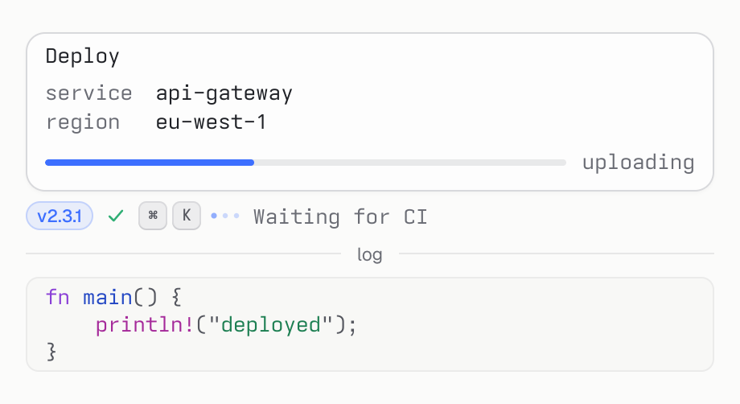
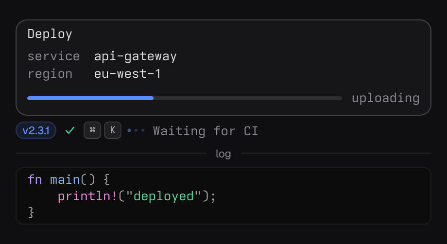
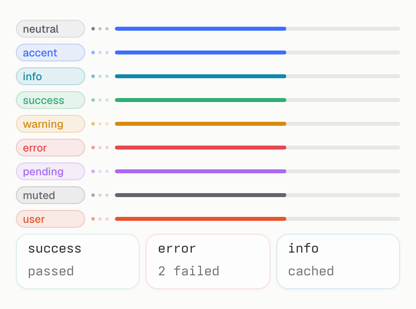
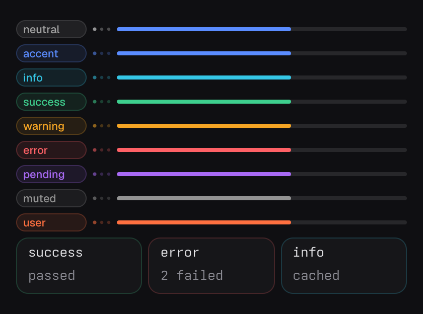

# 元素

视图由节点构成一棵树，每个节点都有一种 kind：`text`、`card`、`table`、`el` 等。Tern 会原生绘制每种 kind：负责布局节点、根据主题为其着色、添加动画并保存其视图状态；你的代码只需描述屏幕上要显示的内容。本部分介绍所有 kind：它们的 props、行为、发送的事件，以及样式表可以定位的元素和类。

**构建视图之前，请阅读[设计视图](../guides/design.md)：** 了解该选用哪种 kind、应用使用的无衬线字体、按钮、可选择表格、面板标题、四种状态，以及哪些做法应该避免。遵循指南的视图无需 CSS，也能呈现出 Tern 自有视图的风格。

```lua
type Node = {
	k: string,               -- the kind
	p: { [string]: any }?,   -- props
	c: { Node }?,            -- children
}
```
 
`tern.ui` 提供常见 kind 的构建器（参见 [UI 构建器](../reference/ui.md)），而 `tern.ui.node(kind, props, children)` 可以构建任意 kind：
 
```lua
local ui = tern.ui
ui.col({
	ui.card("Deploy", {
		ui.kv({ { "service", "api-gateway" }, { "region", "eu-west-1" } }),
		ui.progress(0.4, "uploading"),
	}),
	ui.row({
		ui.badge("v2.3.1", "accent"),
		ui.node("icon", { name = "success", tone = "success" }),
		ui.node("kbd", { keys = { "cmd", "K" } }),
		ui.node("spinner", { style = "dots", label = { ui.span("Waiting for CI", "muted") } }),
	}),
	ui.rule("log"),
	ui.code('fn main() {\n    println!("deployed");\n}', "rust"),
})
```
 

<figure class="tn-figure">


<figcaption>一次构建器调用创建了 11 种 kind：col、card、kv、progress、row、badge、icon、kbd、spinner、rule 和 code。</figcaption>
</figure>

视图如何显示在屏幕上、块节点的 id 和 key 如何工作，以及事件如何返回，参见[构建视图](../guides/views.md)和[块](../guides/blocks.md)。非插件程序可通过 [Surface Protocol](../protocol/index.md) 发送相同的节点。如何为这些页面所述内容设置样式，参见[设置视图样式](../styles/index.md)。

## 所有 kind

| 种类 | 页面 | 构建器 | 子节点 | 绘制内容 |
| --- | --- | --- | --- | --- |
| `col` | [布局](layout.md#col) | `col`、`lines` | 按顺序 | 垂直堆叠 |
| `row` | [布局](layout.md#row) | `row` | 按顺序 | 水平弹性行 |
| `card` | [布局](layout.md#card) | `card`、`diagnostic` | 由 card 放置 | 面板：标题行含图标、元信息和控件，下方是正文；可选择折叠 |
| `section` | [布局](layout.md#section) | `section` | 由 section 放置 | 更轻量、没有环形边框的可展开分组 |
| `rule` | [布局](layout.md#rule) | `rule` | `end` 子节点由 rule 放置 | 分隔细线、注释行，或固定的记录标记（检查点、加入、压缩） |
| `spacer` | [布局](layout.md#spacer) | `node` | 无 | 垂直留白 |
| `split` | [布局](layout.md#split) | `node` | 窗格按顺序排列 | 窗格并排或堆叠；用户可拖动它们之间的控点调整大小 |
| `scroll` | [布局](layout.md#scroll) | `node` | 按顺序 | 在边界内滚动显示子节点的容器；可选择保持滚动到末尾（日志、聊天） |
| `empty` | [布局](layout.md#empty) | `node` | 操作按顺序排列 | 空状态：图标、标题、一行弱化文字，以及用于填充内容的操作 |
| `text` | [文本与代码](text.md#text) | `text`、`overflow` | 无 | 带样式的 span，可换行或截断，也可选择标注来源 |
| `md` | [文本与代码](text.md#md) | `md` | 无 | Markdown |
| `code` | [文本与代码](text.md#code) | `code` | 无 | 高亮代码，可选择显示行号 |
| `diff` | [文本与代码](text.md#diff) | `diff` | 无 | 统一或并排显示的差异 |
| `ansi` | [文本与代码](text.md#ansi) | `ansi` | 无 | 接收转义序列的小型终端 |
| `rows` | [文本与代码](text.md#rows) | `node` | 无 | 预先渲染的 ANSI 行（迁移回退方案） |
| `math` | [文本与代码](text.md#math) | `node` | 无 | TeX 数学公式 |
| `kv` | [数据](data.md#kv) | `kv` | 无 | 对齐的键值列表 |
| `stats` | [数据](data.md#stats) | `stats` | 无 | 平铺的统计卡条：标签、值和次级说明 |
| `table` | [数据](data.md#table) | `table` | 无 | 表格，支持按优先级隐藏列、可排序表头、可选择或多选的行及选择栏；单元格可显示文本、徽章、按钮、迷你图和仪表 |
| `tree` | [数据](data.md#tree) | `tree`、`parse.json_tree` | 无 | 可展开的树 |
| `json` | [数据](data.md#json) | `node` | 无 | 可折叠树形结构中的 JSON 值 |
| `badge` | [数据](data.md#badge) | `badge` | 无 | 药丸形徽标 |
| `kbd` | [数据](data.md#kbd) | `node` | 无 | 按键帽 |
| `icon` | [数据](data.md#icon) | `node` | 无 | 命名图标 |
| `avatar` | [数据](data.md#avatar) | `node` | 无 | 人员、机器人或提供方的标记：初始字母显示在由种子生成的渐变背景上，也可以是染色圆角方块、图标或图片，并带状态点 |
| `avatars` | [数据](data.md#avatars) | `node` | 无 | 重叠排列的头像，带 `+N` 溢出徽标和弱化标签 |
| `image` | [数据](data.md#image) | `node` | 位于图片上方 | 来自 blob 的图片（动画会播放） |
| `media` | [数据](data.md#media) | `node` | 无 | 在 Tern 媒体查看器中按路径（或 git 修订版本）显示文件 |
| `carousel` | [数据](data.md#carousel) | `node` | 幻灯片按顺序排列，一次显示一张 | 在轨道上横向滑动的幻灯片：可显示预览和计数器、箭头和圆点，或胶片条 |
| `attachment` | [数据](data.md#attachment) | `node` | 无 | 文件徽标、缩略图，或带上传进度、错误状态和操作的编辑器药丸 |
| `list` | [列表、菜单与导航](lists.md#list) | `list` | 其 `item` | 可选择列表 |
| `item` | [列表、菜单与导航](lists.md#item) | `list` | 无 | 单个列表行 |
| `tabs` | [列表、菜单与导航](lists.md#tabs) | `node` | 无 | 带下划线或分段式标签栏 |
| `picker` | [列表、菜单与导航](lists.md#picker) | `node` | 预览 | 可搜索的选择器面板 |
| `menu` | [列表、菜单与导航](lists.md#menu) | `node` | 无 | 打开命令下拉菜单的按钮：菜单项可含图标、按键、勾选标记、单选组、子菜单和丰富的双行内容 |
| `menubar` | [列表、菜单与导航](lists.md#menubar) | `node` | 无 | 菜单标题组成的一行，每个标题下方都可打开菜单；可显示为低调的条带或浮动玻璃质感药丸 |
| `nav` | [列表、菜单与导航](lists.md#nav) | `node` | 无 | 导航药丸或链接；含子项的项目会打开菜单或丰富面板 |
| `breadcrumb` | [列表、菜单与导航](lists.md#breadcrumb) | `node` | 无 | 从根目录到当前位置的路径：带图标的尖括号分隔项，或等宽字体路径；较长的中间部分会折叠到“…”菜单中 |
| `pager` | [列表、菜单与导航](lists.md#pager) | `node` | 无 | 分页：带箭头的范围、编号页面或“显示更多”行 |
| `spinner` | [进度与动效](motion.md#spinner) | `node` | 无 | 活动指示器 |
| `shimmer` | [进度与动效](motion.md#shimmer) | `node` | 无 | 带流光效果的标签 |
| `skeleton` | [进度与动效](motion.md#skeleton) | `node` | 无 | 内容加载期间显示的占位图形（线条、头像、行、方块或块） |
| `elapsed` | [进度与动效](motion.md#elapsed) | `node` | 无 | 实时计时器 |
| `rate` | [进度与动效](motion.md#rate) | `node` | 无 | 在更新之间平滑变化的数字 |
| `progress` | [进度与动效](motion.md#progress) | `progress` | 无 | 进度条 |
| `meter` | [进度与动效](motion.md#meter) | `meter`、`test_summary` | 无 | 以条形、圆环或网格显示的值 |
| `chart` | [进度与动效](motion.md#chart) | `bars`、`spark` | 无 | 柱状图、迷你图、热力图、随时间变化的折线图或面积图（单系列或多系列），或份额环形图 |
| `effort` | [进度与动效](motion.md#effort) | `node` | 无 | 思考强度符号 |
| `editor` | [输入与按钮](input.md#editor) | `node` | 无 | 带光标的多行文本框 |
| `input` | [输入与按钮](input.md#input) | `node` | 无 | 单行文本框，可为纯文本或带边框，也可带图标、键帽、清除 ×、附加凹槽、按钮和步进器 |
| `button` | [输入与按钮](input.md#button) | `button` | 无 | 按钮：标签、图标、键帽、变体和尺寸 |
| `buttons` | [输入与按钮](input.md#buttons) | `node` | `button` 节点 | 作为一个控件绘制的按钮：可连接、拆分或置于工具栏凹槽中 |
| `select` | [输入与按钮](input.md#select) | `node` | 无 | 从菜单中选择值：字段、低调的触发器或可搜索的组合框 |
| `switch` | [输入与按钮](input.md#switch) | `node` | 无 | 开关设置：设置行、紧凑列表开关或 Off \| On 分段控件 |
| `slider` | [输入与按钮](input.md#slider) | `node` | 无 | 沿轨道拖动选择一个值或一个范围 |
| `otp` | [输入与按钮](input.md#otp) | `node` | 无 | 一次性验证码输入框，每个字符占一个格：独立格、连成一体的字段或下划线样式 |
| `calendar` | [输入与按钮](input.md#calendar) | `node` | 无 | 月历网格，或在周条旁显示预设项，用于选择某天或日期范围 |
| `date` | [输入与按钮](input.md#date) | `node` | 无 | 打开下方月历的日期字段 |
| `field` | [输入与按钮](input.md#field) | `node` | 控件按顺序排列 | 带标签的表单行：标签、控件、帮助文本或错误信息 |
| `status` | [状态栏、Toast 与浮层](chrome.md#status) | `node` | 其 `seg` | 状态栏条带 |
| `seg` | [状态栏、Toast 与浮层](chrome.md#seg) | `node` | 按顺序排列在图标与文本之间 | 状态栏片段 |
| `toast` | [状态栏、Toast 与浮层](chrome.md#toast) | `node` | 无 | 短暂提示 |
| `overlay` | [状态栏、Toast 与浮层](chrome.md#overlay) | `node` | 由 overlay 放置 | `layer` 中的浮动面板、对话框、侧边页或底部抽屉，带标题和页脚栏 |
| `tool` | [代理、聊天与任务 kind](work.md#tool) | `node` | 由 tool 放置 | 一次编码代理工具调用，或等待批准的工具调用 |
| `agent` | [代理、聊天与任务 kind](work.md#agent) | `node` | 由 agent 放置 | 单个子代理行 |
| `trace` | [代理、聊天与任务 kind](work.md#trace) | `node` | 与某行关联的内容显示在该行下方；其余内容作为正文 | 代理的步骤、思维链，或带来源的推理块 |
| `checklist` | [代理、聊天与任务 kind](work.md#checklist) | `node` | 无 | 待办列表 |
| `message` | [代理、聊天与任务 kind](work.md#message) | `node` | 其 `avatar` 子节点位于头像槽，其余内容作为正文 | 单条聊天消息：作者、时间、头像、正文、回应、悬停操作和状态行 |
| `suggestions` | [代理、聊天与任务 kind](work.md#suggestions) | `node` | 无 | 以药丸、编号行或小卡片显示的建议提示；点击会为该项发送 `activate` |
| `questions` | [代理、聊天与任务 kind](work.md#questions) | `node` | 问题的 `input` 以 `<id>.other` 为键 | 问卷：步骤、行内药丸或可折叠列表 |
| `stacktrace` | [代理、聊天与任务 kind](work.md#stacktrace) | `node` | 无 | 错误及其堆栈帧：高亮应用帧、折叠库帧、帧中的代码 |
| `block` | [代理、聊天与任务 kind](work.md#block) | Tern 自有 | 由 block 放置 | Shell 命令输出及其 Lens 视图 |
| `prefs` | [代理、聊天与任务 kind](work.md#prefs) | `node` | 按 role 放置 | 设置页面或面板 |
| `el` | [HTML 元素](el.md) | `el` | 按顺序排列（`input` 和 `hr` 无子节点） | 普通 HTML 元素，或复选框、单选框 |

“按顺序”表示 Tern 会依次在节点内绘制子节点。“由……放置”表示该 kind 会决定每个子节点的位置，例如 card 会将标题子节点放在标题行中。标记为“无”的 kind 会忽略子节点。

文本 kind（`text`、`md`、`code`、`ansi`、`math`、`editor`、`input`、`shimmer`、`el`）会将文本保存在 `text` prop 中。在块视图中，若 `text` prop 只在末尾增长，Tern 会将新增部分作为追加内容发送到 window，因此长输出的流式传输只需发送新字节（参见 [Host API](../reference/api-host.md#视图模型)）。

## 每个节点都可使用的 props

这些 props 适用于所有 kind，此外每种 kind 还有各自的 props。

| 属性 | 类型 | 效果 |
| --- | --- | --- |
| `key` | string | 块视图中同级节点的标识。重新排序后，它能让节点保留原来的 id。Tern 会在节点的同级节点之间按此 key 记住局部状态，而不是跨整个 surface 记忆：在同一父节点下删除一个节点，再添加一个具有新 id 和相同 key 的节点，会保留该状态。其他父节点下的相同 key 对应独立状态。不设置 key 时，局部状态使用节点的 id。同级节点的 key 重复会报错（`duplicate child key`） |
| `role` | string | 由你指定的名称，通过 `data-role` 暴露给 CSS。名称应使用插件 id 作为前缀（`myplugin.row`） |
| `tone` | `neutral`、`accent`、`info`、`success`、`warning`、`error`、`pending`、`muted`、`user` | 节点界面装饰的语义颜色（例如 card 的环形边框、badge 的药丸、spinner、progress 填充、list 行图标）。该值通过 `data-tone` 暴露，并将色调设为元素上的 `--tc`；其他值会被忽略 |
| `hidden` | boolean | 保留已挂载的节点，但不进行布局（类 `sf-hidden`、`display: none`）。比移除后再重新添加更省资源 |
| `mark` | `pick`、`drop` | 在节点上绘制临时选择标记，不改变其样式；通过 `data-mark` 暴露：`pick` 在节点左侧绘制强调色竖条，`drop` 则将其淡化。其他字符串只会设置该属性 |
| `actions` | `{click?, dblclick?, menu?}` | 指针操作的行为：`menu` 列出右键菜单提供的 actions；若未列出 `copy`，则会在其后添加 Copy。参见[操作与事件](../guides/views.md#操作与事件)。有 click 或 double-click action 的节点会获得 `sf-act` 类和指针手形光标 |
| `title` | string | 工具提示 |
| `hovercard` | node tree `{k, p?, c?}` | 内容更丰富的工具提示：使用不带 id 的节点树（任意 kind，通常是 `col`）绘制浮动的玻璃质感卡片；其中的 `id`/`key` 会被忽略。指针停留在节点上时（约 350 ms；刚显示过工具提示或卡片时为 200 ms），卡片会在节点下方打开（下方空间不足时则显示在上方），并保持在窗格内。指针停留在节点或卡片上时卡片会保持打开；离开、按下、按键或滚动时关闭（离开后有 150 ms 宽限时间）。卡片打开时会取代 `title` 工具提示。内容只有一个 `md` 的卡片是只读文本预览：宽 640 px，且指针事件会穿透，因此只有指针停留在节点上时才会保持打开；移到另一个下方有卡片的节点时，会切换卡片。设置新树即可更新卡片（Tern 会计算差异并保留未更改的部分）；设为 `null` 则移除卡片。卡片中的节点不能通过 ops 寻址。较旧版本的 Tern 会忽略此 prop，并显示 `title`。卡片也可以覆盖在节点的某一部分上：[`code`](text.md#code) 元素的 `folds[].hovercard` 会在被折叠的行上方打开卡片 |
| `aria` | string | 不显示文本的节点的可访问名称（`aria-label`）。此名称会取代该 kind 自带的名称（例如 `kbd` 的口述按键） |
| `href` | string | 节点的链接：按住 ⌘ 并点击可打开链接，`copy` 和 `open` actions 也会使用该链接。通过 `data-href` 暴露 |
| `grow`、`shrink` | number | 在 `row` 或 `col` 中的 flex-grow 和 flex-shrink |
| `basis` | number 或 `"content"` | Flex 基准尺寸：相对于父节点的比例（`0.5` 表示一半），或使用 `"content"` 取节点自身尺寸且不缩小 |
| `min`、`max` | `{w?, h?}` | 尺寸边界。每项可以是 `"<n>ch"`（字符单元格）、`"<n>lines"`（文本行），或相对于父节点的比例数值（`0.5` 表示一半）；负值和其他值会被忽略。单位不是像素，因此视图会随字体缩放。`max.h` 还会裁剪节点（类 `sf-clip`、`overflow: hidden`）；裁掉内容时还会添加 `sf-clipped` 类。在 omp 自有视图之外，末尾两行会淡出。`seg` 的 `min.w` 不会设置 CSS 边界，而是决定状态栏条带允许该片段截断到何种程度（[`seg`](chrome.md#seg)） |

各 kind 如何绘制 tone，可从 badge、spinner、progress 和 card 中看出：

```lua
local rows = {}
for _, tone in ipairs({ "neutral", "accent", "info", "success", "warning", "error", "pending", "muted", "user" }) do
	table.insert(rows, ui.row({
		ui.node("badge", { text = tone, tone = tone, min = { w = "9ch" } }),
		ui.node("spinner", { style = "dots", tone = tone }),
		ui.node("progress", { value = 0.6, tone = tone, grow = 1 }),
	}))
end
local function card(tone, note)
	local c = ui.card(tone, { ui.text({ ui.span(note, "muted") }) })
	c.p.tone, c.p.grow, c.p.basis = tone, 1, 0.3
	return c
end
table.insert(rows, ui.row({ card("success", "passed"), card("error", "2 failed"), card("info", "cached") }))
return ui.col(rows)
```
 
<figure class="tn-figure">


<figcaption><code>neutral</code> badge 是灰色标签，而 <code>neutral</code> progress 会用强调色填充。</figcaption>
</figure>

你自己的样式表也可以使用 tone 颜色：任何带 `tone` 的节点（包括 `el`）都会设置 `--tc`，因此 `color: var(--tc)` 会随之变化。

`collapsible` 和 `collapsed` 是 `card`、`section`（以及 tool 和 agent kind）的 props；参见[布局](layout.md#card)。

## 节点会变成什么

区域根节点下的每个节点都会成为 window 文档中的一个元素：

```html
<div class="sf sf-card" data-id="main.0" data-role="deploy.summary" data-tone="success">
	<!-- the kind's own parts, then its children -->
</div>
```

- 元素是 `div`。行内 kind（`badge`、`kbd`、`icon`、`spinner`、`shimmer`、`elapsed`、`rate`、`effort`）是 `span`。`el` 使用其 `tag`；但 `form` 或未知 tag 会变成 `div`，复选框或单选框 `input` 则会变成 `span`。
- 始终存在 `sf` 和 `sf-<kind>` 类。`data-id` 是节点的 id。某些 kind 会为元素添加自己的类和属性（例如 `kbd` 上的 `kbds` 和 `role="img"`，以及 `progress` 上的 `role="progressbar"`）。
- 通用 props 会添加 `data-role`、`data-tone`、`data-mark`、`data-href`、`title` 和 `aria-label`，以及 `sf-hidden`、`sf-act` 和 `sf-clip` 类。Flex 和尺寸 props 会成为元素的内联样式。
- 每种 kind 都会在内部构建自己的部分，并使用 `.sf-card-head` 等类。对应 kind 的页面会列出这些类。它们属于 Tern 的结构，可能随版本变化。尽可能按 kind、role、tone 和你自己的 `el` 类设置样式。

区域根节点（`main`、`dock`、`layer`）本身不会生成元素。它们的子节点会放入三个区域元素，每个区域对应一个元素：

```html
<div class="sf-region sf-main" data-scope="sf1" data-surface="plugin.deploy.status" data-role="deploy.main">
	<!-- the elements of main's children -->
</div>
```

- 包含 `sf-region` 类，以及 `sf-main`、`sf-dock` 或 `sf-layer` 之一，还会包含 Tern 自己添加的状态类（窗格不是当前输入目标时为 `sf-unfocused`；同时折叠 omp 编辑框时为 `sf-folded`；Markdown 标题保持正文大小时为 `sf-h-annotated`）。
- `data-scope` 是视图的作用域 token（`sf<N>`）。Tern 会将程序的样式表限制在带有此 token 的区域中。
- `data-surface` 是 surface 的 role：块对应 `plugin.<plugin>.<block>`。没有 role 的 surface 不会设置此属性。
- `data-role` 是区域根节点的 `role` prop。

所有可用钩子、层叠规则和示例，参见[设置视图样式](../styles/index.md)。

## 常见错误

Tern 收到每个节点时都会检查它。未知 kind、针对不存在节点的 op，或带有未知 tag 的 `el` 都会被拒绝或绘制为普通 `div`，并通过 `error` 事件报告。这些事件不会传递给块的 `event` 处理器，因为它只接收用户事件。因此，节点未显示时，可使用控制 socket 的 `tree` 命令列出块中的元素：`tree "[data-surface='plugin.<plugin>.<block>']"`（参见[调试](../guides/debugging.md)）。`tern.ui` 构建器会提前捕获大多数错误，并指出参数的路径。
