# 输入与按钮

有两种控件会绘制文本字段，字段中的文本由你的程序持有：`editor` 用于多行文本（撰写区、消息框、代码草稿），`input` 用于单行文本（筛选器、表单字段），还可以带图标、井槽、按钮和步进器。Tern 会绘制文本、插入光标、选区和装饰；它绝不会自行编辑文本。按键会传给你的程序，由你的程序通过新的 `text` 和 `cursor` 属性作出响应。`otp` 也会以相同方式绘制一次性验证码，每个字符占一个单元格。

其他控件保存的是值而非文本：`select` 从一组选项中选择一个值，`calendar` 和 `date` 选择某一天或一个日期范围，`slider` 沿轨道设置数值，`switch` 则打开或关闭某项设置。它们只能通过指针操作：点击后立即显示结果并发送事件，按键仍由你的程序接收，而你下一次发送的属性值会覆盖用户的选择。`button` 是它们旁边的操作控件：采用 Tern 自有的按钮外观，并带有表示同一操作快捷键的键帽；`buttons` 将多个按钮绘制成一个控件。`field` 则会在任一控件周围放上标签、帮助文本和错误信息。

| 类型 | 构建方式 | 绘制内容 |
| --- | --- | --- |
| [`editor`](#editor) | `tern.ui.node("editor", …)` | 多行字段：软换行、可选行数上限、代码高亮 |
| [`input`](#input) | `tern.ui.node("input", …)` | 单行字段，可横向滚动；可为纯文本，也可用图标、井槽、按钮和步进器装饰 |
| [`otp`](#otp) | `tern.ui.node("otp", …)` | 一次性验证码，每个字符一个单元格：独立单元格、连体字段或下划线样式 |
| [`select`](#select) | `tern.ui.node("select", …)` | 从菜单中选择的值：字段、低调触发器或可搜索的组合框 |
| [`calendar`](#calendar) | `tern.ui.node("calendar", …)` | 月历网格，或在周条带旁显示预设项，用于选择某一天或日期范围 |
| [`date`](#date) | `tern.ui.node("date", …)` | 日期字段，点击后会在下方打开月历 |
| [`slider`](#slider) | `tern.ui.node("slider", …)` | 沿轨道拖动设置一个值或一个范围 |
| [`switch`](#switch) | `tern.ui.node("switch", …)` | 开/关设置：设置行、紧凑开关或 Off \| On 分段控件 |
| [`button`](#button) | `tern.ui.button(text, props?)` | 按钮：标签、图标、键帽、变体和尺寸 |
| [`buttons`](#buttons) | `tern.ui.node("buttons", …, buttons)` | 绘制为一个控件的多个按钮：连体、分离或工具栏井槽样式 |
| [`field`](#field) | `tern.ui.node("field", …, controls)` | 带标签的表单行：标签、控件、帮助文本或错误信息 |

只有 `button` 有自己的构建函数；其他控件请使用 [`tern.ui.node`](../reference/ui.md#node)。`tern.canvas` 不支持这两种文本字段：kind 为 `editor` 或 `input`（或 `image`）的 canvas 节点会报错 `canvas kind "editor" is not supported`。请在块的视图中使用它们。

## 程序拥有文本

字段只是你状态的呈现。输入的内容不会改变字段，除非你的视图发送新的 `text`：

1. 当块的窗格获得焦点时，用户按下一个键。该按键会交给块的 `key` 处理器（参见 [块](../guides/blocks.md#按键与粘贴)），而不会作为 DOM 事件发给字段。
2. 处理器更改你的状态（插入字符、移动光标），然后返回。
3. 下一次调用 `view` 时，你返回带有新 `text` 和 `cursor` 的字段；Tern 会重绘发生变化的文本片段，并确保插入光标保持在视野内。

偏移量（`cursor`、`anchor`、`decor` 边界）使用 **UTF-16 代码单元**，与 JavaScript 字符串相同。在字符串按字节存储的 Luau 中，需要进行转换：ASCII 文本两种计数方式的偏移量相同；其他文本则按 UTF-16 单元计数（大于 `0xFFFF` 的 `utf8.codepoint` 计为 2）。位于代理对内部的偏移量会向下取整到它所拆分字符的开头；超出文本末尾的偏移量会钳制到末尾。

## 焦点与插入光标

插入光标是一条不占空间的 2 px 光束（`span.sf-caret`）。除 `readonly` 字段外，每个字段都会显示它，但颜色较暗（`opacity: 0.3`）；只有拥有 surface **焦点**的字段才会以全亮度闪烁（获得焦点的 `readonly` 字段也会显示插入光标）。焦点由 TSP 的 `focus` 帧操作表示（`["focus", id]` 或 `["focus", null]`）；它指定拥有插入光标和 IME 的节点。视图差异不会发送此操作，因此块需要通过原始操作设置焦点：

```lua
cx:frame({ { "focus", "main.query" } })
```

`id` 是视图中节点的 id（`main` 下以 `query` 为键的子节点，其 id 为 `main.query`；参见 [块](../guides/blocks.md)）。原始操作会绕过差异计算；焦点会保持不变，直到另一个 `focus` 操作对其进行更改。为字段指定稳定的 `key`，以免其 id 发生变化。字段获得焦点后，节点会添加 `.focused`（显示强调色环），插入光标也会闪烁；在减少动态效果、窗格隐藏或窗格未处于输入状态时，光标会保持静止（祖先节点上有 `.sf-still`、`.sf-paused`、`.sf-unfocused`）。

焦点只决定哪个字段显示活动插入光标。无论哪个字段有焦点，按键仍会交给你的 `key` 处理器；应根据自己的状态路由按键（将拥有焦点字段的 key 与其文本一同保存在状态中）。

在尚未获得焦点（且不是 `readonly`）的字段中单击主按钮，会发送 `focus` 事件，而不是放置插入光标：

```lua
ev = { ev = "focus", id = "main.query" }
```

收到事件后，将你自己的焦点移到该字段并发送 `focus` 操作，或者忽略它（模态覆盖层可能需要继续接收按键）。只有开启原生编辑（见下文）时，在已获得焦点的字段中单击才会放置插入光标；对于块，只有选择启用 `edit` 功能的块才会如此。

## 原生编辑、`edit` 与 `undo`

TSP 允许终端在绘制的文本上维护自己的选区（⇧ 加方向键、⌘A、⌘C、拖动），对选区执行编辑并以 `edit` 事件发送给程序（`{ev = "edit", id, from, to, text, cursor, len}`：用 `text` 替换 `from..to`，插入光标位于 `cursor`，`len` 是计算该事件时所依据的文本长度）；⌃Z 则作为 `undo` 事件发送（`{ev = "undo", id}`）。拼写检查器在 `typo` 装饰上打开的上下文菜单也会通过 `edit` 事件返回结果。

只有当程序的 `hello` 中列出了 `edit` 功能（要让 ⌃Z 生效，还需列出 `undo`）、字段没有设置 `mode` 且不是 `readonly`，并且用户已在 Settings › Terminal › Native composer editing 中开启此功能时，Tern 才会启用原生编辑。块的 `hello` 会在其定义的 `features` 中列出功能（[`BlockDef`](../reference/api-host.md#blockdef)）；如果没有列出这些功能（默认情况）：

- 所有按键（包括 ⇧-方向键、⌘A 和 ⌃Z）都会交给你的 `key` 处理器；
- 没有原生选区：你需要用 `anchor` 自行绘制选区；
- 不会收到 `edit` 或 `undo` 事件；在已获得焦点的字段中单击不会产生任何效果，`typo` 上下文菜单也不会提供拼写建议。

选择启用该功能的块会在其 `event` 处理器中应用 `edit` 事件：

```lua
tern.block.define("notes", {
	features = { "edit", "undo" },
	-- init, view, key …
	event = function(state, ev)
		if ev.ev == "edit" and ev.len == utf16_len(state.text) then
			state.text = splice16(state.text, ev.from, ev.to, ev.text)
			state.cursor = ev.cursor
		elseif ev.ev == "undo" then
			undo(state)
		end
	end,
})
```

（`utf16_len`、`splice16` 和 `undo` 由你实现：偏移量使用 UTF-16，见上文。）启用 `edit` 后，在已获得焦点的字段中单击会发送一个不替换任何内容、只移动插入光标的 `edit` 事件（`from == to`、`text = ""`）；拖动或双击、三击会进行选择；在绘制出的行之间按 ↑/↓，以及按 ⌘←/⌘→ 移到绘制行的行首或行尾，也会以移动插入光标的 `edit` 事件到达。当 Tern 显示选区时，输入、删除和剪切操作会用一个 `edit` 事件替换选区。其他所有输入仍会交给 `key`：没有选区时的输入和删除、在第一行按 ↑、在最后一行按 ↓，以及 Enter、Tab 和 Escape。

## IME

Tern 会在自己的隐藏文本区域中组合 IME 输入，并将组合窗口放置在获得焦点的字段的插入光标处（IME 会以插入光标元素作为定位参照），然后将组合完成的文本作为输入文本提交给程序。字段必须拥有 `focus`，组合窗口才会出现在其插入光标处。块的 `key` 处理器会像接收普通输入一样收到提交的文本：每个字符对应一个按键事件，每个事件都带有自己的 `text`。

## `editor`

这是一个多行字段。文本会软换行（`white-space: pre-wrap`，可在任意位置断行），因此长行不会横向滚动；`nowrap` 则会像终端行一样裁剪长行。未设置 `maxLines` 时，字段会随文本增长；设置 `maxLines = N` 后，字段会增长到 N 行，然后在内部滚动，并在每帧之后确保插入光标仍在视野内；`topline` 会将滚动控制权交给程序（指定行显示在顶部，插入光标不再改变滚动位置）。`gutter` 跨度（行号、标记）绘制在每行开头，`virt` 跨度（内嵌提示、诊断信息）绘制在每行末尾；它们会与文本一起布局，但不属于文本，因此 `cursor`、`decor` 和原生编辑都不会将它们纳入处理。设置 `lang` 后，文本会被视为代码：Tern 会在后台为其着色（编辑过的行会保留旧颜色，直到新颜色生成，因此输入时不会闪回纯文本），并为字段添加 `.code`。每个 surface 默认都使用等宽字体，因此 `lang` 只会改变颜色，不会改变字体。

**构建方式：** `tern.ui.node("editor", { text = …, cursor = … })`。

对于由程序管理的代码视口，发送完整文本，并按逻辑行索引 `gutter` 和 `virt`（每个条目是字符串或跨度数组）：

```lua
tern.ui.node("editor", {
	text = "local answer = 42\nprint(answer)\n",
	cursor = 6,
	lang = "lua",
	highlight = false,
	decor = { { from = 6, to = 12, s = "syntaxVariable" } },
	gutter = { "1 │ ", "2 │ ", "3 │ " },
	virt = { "  : number", "", "" },
	nowrap = true,
	maxLines = 2,
	topline = 1,
})
```

`topline` 从零开始计数；发送前请将从一开始计数的缓冲区行号转换为零基行号。省略 `topline` 并设置 `followCursor = false`，会保留现有滚动位置，但不会固定在某一行。`decor`、`gutter` 和 `virt` 中的颜色使用与普通文本相同的跨度标记。

| 属性 | 类型 | 默认值 | 含义 |
| --- | --- | --- | --- |
| `text` | string | `""` | 文本。主文本：如果差异仅为追加内容，则会发送 append 操作 |
| `cursor` | number (UTF-16) | 文本末尾 | 插入光标位置；会钳制到文本范围内 |
| `anchor` | number (UTF-16) or nil | nil | 选区锚点；选区范围为 `anchor`..`cursor`，顺序不限；两者相等或为 nil 时没有选区 |
| `decor` | `{ {from, to, s, fx?} }` | `{}` | 装饰：将 UTF-16 范围 `from`..`to` 应用跨度标记 `s`（以空格分隔，见 [文本](text.md)）；`fx` 是跨度效果（`shimmer`、`pulse`）。空范围会被忽略；重叠条目会按顺序合并标记。`typo` 用于标记拼写错误 |
| `ghost` | string | `""` | 在插入光标右侧紧接着以暗色绘制的内联补全后缀 |
| `placeholder` | string or spans | `""` | 当 `text` 为空（且没有 `ghost`）时显示的暗色文本；可用跨度标记设置样式（`em` 表示斜体）。其纯文本也会作为 `aria-placeholder` |
| `prompt` | spans | none | 第一行前的跨度（例如 `> `，Shell 提示符） |
| `mode` | string | none | vim 模式标签：在模式标记中显示（`title` 为 `Mode: <label>`），并在字段和标记上设置小写的 `data-mode`；同时关闭原生编辑。模式标记是中性色胶囊样式；`insert` 标记会着上强调色。所有模式下插入光标都保持为光束形态 |
| `lang` | string | none | 指定文本所用的代码语言：除非 `highlight` 为 false，否则会高亮；并添加 `.code` |
| `highlight` | boolean | `true` | 设为 false 可停用 Tern 语法高亮，改用程序提供的 `decor` 颜色，同时保留 `lang` 对应的代码呈现样式 |
| `readonly` | boolean | `false` | 不可编辑：除非字段有焦点，否则隐藏插入光标；使用默认光标；设置 `aria-readonly`；点击不发送 `focus` 事件；不启用原生编辑；不支持 `send` |
| `sendable` | boolean | `false` | 所有者接受对该字段执行原子 `send` 操作（参见[发送](../protocol/input.md#原生编辑)，并需启用 `send` hello 功能）。如果字段不是 `sendable: true`，或者处于 `readonly`、`disabled` 或 `hidden` 状态，Tern 会丢弃发给它的 `send`。插件块不会声明 `send`，因此在块中使用时无效 |
| `typeahead` | boolean | `false` | 暂时无法读取输入：启用此属性且字段有焦点时，Tern 会保留键入的文本，在插入光标处绘制（`span.sf-ed-ahead`），并在你清除此属性后将其作为输入写入 pty（参见 [预输入](../protocol/input.md#预输入)）。设置了 `mode` 或 `readonly` 时无效 |
| `maxLines` | number | none | 将高度限制为 N 行（`calc(N * var(--sf-lh))`）并在内部滚动；添加 `.capped`。设为 `0` 或不设置：不限制 |
| `nowrap` | boolean | `false` | 长行不会软换行，而是像终端行一样裁剪（`white-space: pre`）；添加 `.nowrap`。受行数限制的字段仍会垂直滚动 |
| `topline` | number (0-based line) | none | 由程序控制滚动：指定行显示在顶部，插入光标不再滚动字段。未设置时：Tern 会确保插入光标在视野内（设有 `maxLines` 时） |
| `followCursor` | boolean | `true` | 设为 false 后，插入光标移动时不改变滚动位置。无论此标记为何值，只要设置了 `topline`，就以它为准 |
| `gutter` | `{ TspText }` (one per line) | `{}` | 公用且不换行的侧栏列中的跨度；对齐到每个逻辑行的第一个视觉行，即使文本发生换行也如此（`span.sf-ed-gutter`、`aria-hidden`）。最宽条目决定列宽。不属于 `text`；缺少条目的行不会绘制任何内容 |
| `virt` | `{ TspText }` (one per line) | `{}` | 绘制在每行末尾的跨度（`span.sf-ed-virt`），用于内嵌提示和诊断信息；最后一行的条目也会绘制。不属于 `text`；缺少条目的行不会绘制任何内容 |
| `variant` | `"well"` \| `"field"` | 含 `buttons` 时为 `"field"`，否则为 `"well"` | `field` 会采用 kit 的文本字段外观为 editor 加框（参见 [附加控件](#附加控件)） |
| `buttons` | `{ Button }` | none | 显示在 editor 右下角的按钮；默认按钮为低调的圆角图标：用于提示输入框的 Attach 和 Send（参见 [附加控件](#附加控件)） |
| `aria` | string | `"Message"` | 无障碍名称（通用属性） |

通用属性（`role`、`tone`、`hidden`、`grow`、`min`、`max`、`actions`、…）与任何节点上的用法相同；参见 [元素](index.md)。

**子节点：** 无（忽略）。

**事件：** `focus`（在未获得焦点且可编辑的字段中单击时）。只有声明了相应 hello 功能的程序（块的 `features`）才会收到 `edit` 和 `undo`。`actions` 的用法与任何节点相同。

**样式：**

```html
<div class="sf sf-editor focused code" data-id="main.draft" role="textbox"
     aria-multiline="true" data-mode="insert">
	<div class="sf-ed-scroll">
		<div class="sf-ed-text">
			<span class="sf-ed-prompt">…</span>
			<span class="sf-ed-gutter" aria-hidden="true">12 </span>
			plain run
			<span class="sf-ed-sel"><span class="tk-keyword">sel</span></span>
			<span class="sf-t-accent">@file</span>
			<span class="sf-caret"></span>
			<span class="sf-ed-ghost">suggested suffix</span>
			rest of the text
			<span class="sf-ed-virt" aria-hidden="true">◀ hint</span>
		</div>
	</div>
	<span class="sf-ed-mode on" data-mode="insert" title="Mode: INSERT">INSERT</span>
</div>
```

当文本为空且没有 `ghost` 时，`span.sf-ed-ph` 会替代 ghost。IME 在已获得焦点的字段中进行组合时，带标记的文本会在插入光标处绘制到 `span.sf-ed-preedit`（带下划线）中，替代 ghost 和占位文本；插入光标位于其中输入法自身的光标位置。组合确认后，文本会作为输入提交给你。

| 目标 | 选择器 |
| --- | --- |
| 节点 | `.sf-editor` |
| 已获得焦点 | `.sf-editor.focused` |
| 只读 | `.sf-editor.readonly` |
| 文本为空 | `.sf-editor.empty` |
| 代码（`lang`） | `.sf-editor.code` |
| 高度受限（`maxLines`） | `.sf-editor.capped` |
| 从不换行（`nowrap`） | `.sf-editor.nowrap` |
| 正在显示原生选区 | `.sf-editor.selecting`（在块中仅限启用了 `edit` 功能时） |
| Vim 模式 | `.sf-editor[data-mode='normal']` |
| 滚动区 | `.sf-ed-scroll`（内部结构，可能变化） |
| 文本流 | `.sf-ed-text`（内部结构，可能变化） |
| 提示符 | `.sf-ed-prompt`（内部结构，可能变化） |
| 侧栏文本片段 | `.sf-ed-gutter`（内部结构，可能变化） |
| 行尾虚拟文本 | `.sf-ed-virt`（内部结构，可能变化） |
| 选中文本片段 | `.sf-ed-sel`（内部结构，可能变化） |
| 装饰文本片段 | `.sf-t-<token>`（稳定的标记类，参见 [文本](text.md)） |
| 高亮代码片段 | `.tk-<token>`（kit 高亮器） |
| 插入光标 | `.sf-caret`（内部结构，可能变化） |
| Ghost 后缀 | `.sf-ed-ghost`（内部结构，可能变化） |
| 占位文本 | `.sf-ed-ph`（内部结构，可能变化） |
| IME 组合文本 | `.sf-ed-preedit`（内部结构，可能变化） |
| 模式标记 | `.sf-ed-mode.on`、`.sf-ed-mode[data-mode='insert']`（内部结构，可能变化） |

稳定的样式钩子包括 `.sf-editor`、`[data-id]`、`[data-role]`、`[data-tone]` 和区域的 `[data-surface]`；上述内部类名属于 Tern 的结构。

外观：内边距 `6px 10px`、`--r-ctl` 圆角、顶部 `--l1` 细线；获得焦点时显示强调色环。文本颜色为 `var(--tv-fg, var(--t1))`；插入光标颜色为 `var(--tv-cur, var(--accent))`：在窗格中使用终端主题的光标颜色，而不是强调色；选区使用强调色，浅色主题为 20 % / 深色主题为 34 %；提示符使用 `--t3`；ghost 和占位文本使用 `--t4`。行高为 `--sf-lh`（参见[变量](../styles/variables.md)）。`.code` 字段看起来与其他字段相同：只改变颜色，不改变边框。

omp 的撰写区（位于 `omp.editor*` role 中的 editor）会内联绘制 Markdown（使用带有 `md-*` 跨度的 `.markdown`），并采用自己的 vim 外观：隐藏 `insert` 标记，`normal` 模式使用强调色着色，`visual` 模式使用警告色着色，且在 `normal` 和 `visual` 模式下使用块状插入光标。这些外观仅适用于此处，不会出现在插件视图中。

```lua
local ui = tern.ui

local function view(state)
	return {
		main = ui.col({ ui.text(state.sent or "") }),
		dock = ui.col({
			ui.node("editor", {
				key = "draft",
				text = state.draft,
				cursor = state.cursor,
				placeholder = "Write a note, Enter to save",
				prompt = { ui.span("› ", "muted") },
				maxLines = 6,
			}),
		}),
	}
end

local function key(state, k, cx)
	if k.name == "enter" and not k.shift then
		state.sent, state.draft, state.cursor = state.draft, "", 0
	elseif k.name == "backspace" and state.cursor > 0 then
		state.draft = state.draft:sub(1, state.cursor - 1) .. state.draft:sub(state.cursor + 1)
		state.cursor -= 1
	elseif k.name == "left" then
		state.cursor = math.max(0, state.cursor - 1)
	elseif k.name == "right" then
		state.cursor = math.min(#state.draft, state.cursor + 1)
	elseif k.text and not (k.ctrl or k.meta) then
		-- typed text, or a whole paste (name = "paste")
		state.draft = state.draft:sub(1, state.cursor) .. k.text .. state.draft:sub(state.cursor + 1)
		state.cursor += #k.text
	else
		return false
	end
end
```

第一次按键前，字段会显示提示符、低对比度的插入光标和占位文本：

<figure class="tn-figure">
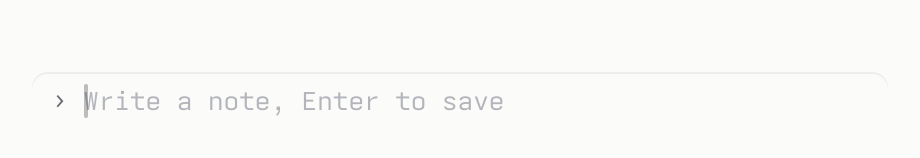
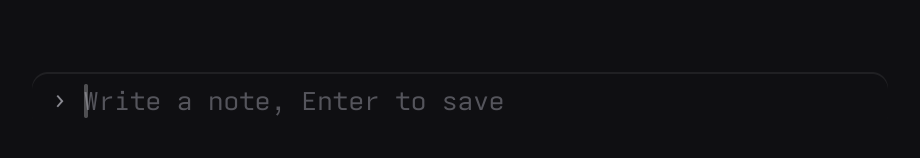
</figure>

这个示例将偏移量视为字节，这只适用于 ASCII 文本。字段绘制完成后，可以从任何能访问 `cx` 的处理器中为其设置焦点，例如在收到 `focus` 事件时：

```lua
event = function(state, ev, cx)
	if ev.ev == "focus" then
		cx:frame({ { "focus", ev.id } })
	end
end
```

字段获得焦点后，显示文本、装饰和插入光标处建议的补全文本：

```lua
ui.node("editor", {
	key = "draft",
	text = "Ship the notes after @review",
	cursor = 28,
	ghost = " signs off",
	decor = { { from = 21, to = 28, s = "accent" } },
	placeholder = "Write a note, Enter to save",
	prompt = { ui.span("› ", "muted") },
	maxLines = 6,
})
-- and once: cx:frame({ { "focus", "dock.draft" } })
```

<figure class="tn-figure">
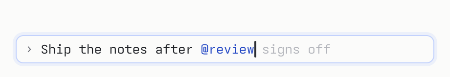
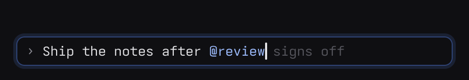
<figcaption>焦点环和全亮度插入光标由 focus 操作触发，而不是由某个属性触发。</figcaption>
</figure>

## `input`

这是一个位于着色井槽中的单行字段。它采用与 `editor` 相同的属性并绘制相同的 DOM，但有以下区别：

- 文本永不换行（`white-space: pre`）；字段会横向滚动（隐藏滚动条），并确保插入光标保持在视野内。
- `maxLines` 会被忽略。
- `aria-multiline="false"`；默认无障碍名称为 `placeholder`，未设置时为 `"Search"`。
- 高度为一行加 8 px（`calc(var(--sf-lh) + 8px)`），内边距为 `0 8px`，背景色为 `--l1`；获得焦点时背景会变透明，并显示强调色环。这就是 `well` 外观；[附加控件](#附加控件)（图标、清除 ×、井槽、按钮、步进器、密码字段）则会为字段加框。

**构建方式：** `tern.ui.node("input", { text = …, cursor = … })`。

| 属性 | 类型 | 默认值 | 含义 |
| --- | --- | --- | --- |
| `text`、`cursor`、`anchor`、`decor`、`ghost`、`placeholder`、`prompt`、`mode`、`lang`、`readonly`、`sendable` | 与 [`editor`](#editor) 相同 | | |
| `variant`、`icon`、`keys`、`mono`、`clear`、`prefix`、`suffix`、`unit`、`stepper`、`secret`、`reveal`、`buttons` | 参见[附加控件](#附加控件) | | |
| `aria` | string | `placeholder` 或 `"Search"`（`secret` 时为 `"Password"`） | 无障碍名称 |

一个空闲字段紧邻一个已获得焦点的字段；后者的选区由 `anchor` 绘制：

```lua
ui.col({
	ui.node("input", {
		key = "filter",
		placeholder = "Filter",
		prompt = { ui.span("/", "muted") },
	}),
	ui.node("input", {
		key = "query",
		text = "deploy logs",
		cursor = 6,
		anchor = 0,
		placeholder = "Filter",
		prompt = { ui.span("/", "muted") },
	}),
})
-- focused with cx:frame({ { "focus", "main.query" } })
```

<figure class="tn-figure">
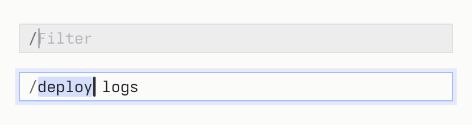
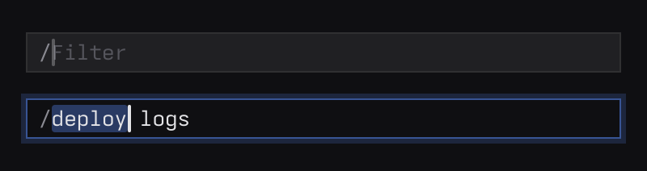
</figure>

**子节点：** 无（忽略）。

**事件：** 与 [`editor`](#editor) 相同；附加控件会发送 `action`（参见[附加控件](#附加控件)）。

**样式：**

```html
<div class="sf sf-input focused" data-id="main.filter" role="textbox"
     aria-multiline="false" aria-placeholder="Filter">
	<div class="sf-ed-scroll">
		<div class="sf-ed-text">abc<span class="sf-caret"></span></div>
	</div>
	<span class="sf-ed-mode"></span>
</div>
```

| 目标 | 选择器 |
| --- | --- |
| 节点 | `.sf-input` |
| 状态 | `.sf-input.focused`、`.readonly`、`.empty`、`.code`、`.selecting`、`[data-mode]` |
| 部件 | `.sf-ed-scroll`、`.sf-ed-text`、`.sf-ed-prompt`、`.sf-ed-sel`、`.sf-caret`、`.sf-ed-ghost`、`.sf-ed-ph`、`.sf-ed-preedit`、`.sf-ed-mode`（内部结构，可能变化） |

在列表上方放置筛选字段，并在列表中标记与查询匹配的内容：

```lua
local ui = tern.ui

local function view(state)
	return {
		main = ui.col({
			ui.node("input", {
				key = "filter",
				text = state.query,
				cursor = #state.query,
				placeholder = "Filter",
				prompt = { ui.span("/", "muted") },
			}),
			ui.node("list", { key = "rows", filter = state.query }, state.items),
		}),
	}
end
```

在样式表中重新设置字段的样式：

```css
[data-surface^='plugin.notes.'] .sf-input {
	background: transparent;
	box-shadow: inset 0 -1px 0 var(--l2);
	border-radius: 0;
}
[data-surface^='plugin.notes.'] .sf-input.focused {
	box-shadow: inset 0 -2px 0 var(--accent);
}
[data-surface^='plugin.notes.'] .sf-input .sf-caret {
	background: var(--accent);
}
```

<figure class="tn-figure">
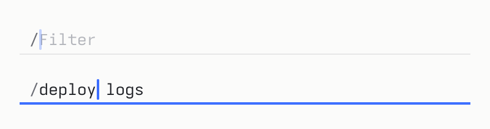
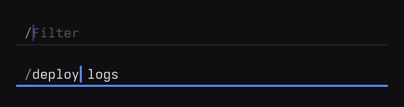
</figure>

第一条规则的优先级高于 Tern 的 `.sf-input.focused`（特异性相同，但样式表加载得更晚），因此它也会移除焦点环；`.focused` 规则会重新加上焦点提示。
### 附加控件

`input` 可以像普通字段一样在文本周围附加控件：前置图标、说明如何访问字段的键帽、清除 ×、用于固定值部分（`https://`、`.com`）的井槽、单位、⌃⌄ 步进器、附着在环上的按钮（例如 Send）以及密码字段的眼睛。使用这些附加控件，而不是自行拼出由图标、字段和按钮组成的 `row`：它们位于同一个边框内，在各种字号下都能对齐，并且执行操作时不会夺走程序对按键的接收权。

附加控件采用 Tern 的 **field** 外观，也就是 kit 的带框文本字段：30 px 高的井槽（`--well`），带细线边框和 8 px 圆角；字段获得焦点时，边框会变为更醒目的强调色环。只要使用任何附加控件，就会自动启用这种外观；你也可以用 `variant` 自行选择：

| `variant` | 外观 |
| --- | --- |
| `"well"`（没有附加控件时的默认值） | 上文的着色单行井槽：`--l1`，高度为一行加 8 px，只有获得焦点时才显示边框 |
| `"field"`（有附加控件时的默认值） | kit 的带框字段：30 px 高，使用 `--well`，带细线边框；获得焦点时显示强调色环和 3 px 光晕 |

未使用附加控件且未设置 `variant` 的字段会保持 `well` 外观。

在 sans 区域（`font: "sans"`）中，`field` 是应用自己的控件：其文本和占位文本会使用 kit 的 13 px UI 字体，而不是终端等宽字体；但对于机器值（URL、令牌、id），可使用 `mono: true` 保持等宽字体。字段只有获得焦点时才显示插入光标；空闲时从开头显示内容（长值只有在字段获得焦点时才会滚动到插入光标处），与 kit 字段的行为一致；`well` 外观则保留暗色的空闲插入光标和滚动行为。

**字段内部。** `icon` 会显示在文本前面（颜色为 `--t3`；获得焦点时为 `--t2`）。当字段处于空闲且内容为空时，`keys` 会在末尾绘制一个表示组合键的键帽（`["cmd","f"]` 显示为 ⌘F）；它用于说明如何访问字段，因此字段获得焦点或有文本后就会消失。`clear: true` 会在字段有文本且不是 `readonly` 时，在末尾绘制一个实心圆圈中的 ×；点击后会发送 `action` `clear`，由你的程序清空 `text`。`unit` 是显示在文本后的等宽单位词（`bytes`、`ms`、`MB`）。

**附着在边框上。** `prefix` 和 `suffix` 是淡色调的等宽井槽，与边框相连，并用细线与文本隔开：它们表示值中的固定部分，不属于 `text`。`stepper: true` 会在末尾附加一个 ⌃⌄ 分段控件；两个部分分别发送 `action` `inc` 和 `dec`，由你的程序设置新的 `text`。`buttons` 用于附加操作按钮：`default` 按钮是带细线的分段（显示图标或短词），`primary`、`quiet` 和 `danger` 则是嵌入边框内的小按钮（`input` 中为 22 px，`editor` 中为 24 px；其中可放置一个 `primary` Send 按钮）。每次点击都会发送 `action`，其值为按钮的 `act`；内置操作与其他指针操作一样执行，因此 `copy` 会复制字段文本（密码字段复制其实际文本，而非圆点）。

**密码字段。** `secret: true` 会为 `text` 的每个 UTF-16 单元绘制一个 `•`（BMP 之外的 emoji 占两个），因此 `cursor`、`anchor`、`decor` 和 `edit` 偏移量仍保持原有含义；同时会附加一个可就地显示文本的眼睛控件。该眼睛操作只影响本地状态，类似卡片的折叠：点击后立即切换，不发送事件，并根据同级节点中的 `key`（若没有则使用 id）记住状态。`reveal` 属性在发生变化时会重新接管状态：设置 `reveal: true` 可显示文本（例如“显示密码”设置），设置 `false` 可隐藏文本。密码字段永不高亮（忽略 `lang`），不显示 `ghost`；复制原生选区时会复制圆点，而不是实际文本；提前保留的输入（`typeahead`）也会以圆点显示。其默认无障碍名称为 `"Password"`。

`editor` 也接受 `variant` 和 `buttons`（用于提示输入框）：field 外观会为其加框，按钮位于右下角，默认使用低调的圆角图标。

从起始处开始的顺序为：`prefix`、`icon`、文本、`unit`、×、`keys`、vim 模式标记，然后是附加控件：`suffix`、眼睛、依次排列的 `buttons`、步进器。

```lua
local ui = tern.ui

local function view(state)
	return {
		main = ui.col({
			ui.node("input", {
				key = "find",
				text = state.query,
				cursor = #state.query,
				placeholder = "Find in table",
				icon = "search",
				keys = { "cmd", "f" },
				clear = true,
			}),
			ui.node("input", {
				key = "size",
				text = tostring(state.size),
				stepper = true,
				unit = "bytes",
			}),
			ui.node("input", {
				key = "token",
				text = state.token,
				secret = true,
				buttons = { { act = "copy", icon = "copy", title = "Copy token" } },
			}),
			ui.node("input", {
				key = "ask",
				text = state.draft,
				placeholder = "Ask anything…",
				buttons = { { act = "send", text = "Send", variant = "primary", keys = { "enter" } } },
			}),
		}),
	}
end

local function event(state, ev)
	if ev.ev == "action" and ev.act == "clear" then
		state.query = ""
	elseif ev.ev == "action" and ev.act == "inc" then
		state.size = state.size * 2
	elseif ev.ev == "action" and ev.act == "dec" then
		state.size = math.max(1, state.size // 2)
	elseif ev.ev == "action" and ev.act == "send" then
		send(state.draft)
	end
end
```

TypeScript SDK 中的相同示例（TSX）：

```tsx
<col>
   <input key="find" text={s.query} cursor={s.query.length} placeholder="Find in table"
          icon="search" keys={['cmd', 'f']} clear
          onAction={{ clear: () => { s.query = ''; render(); } }} />
   <input key="url" text={s.host} prefix="https://" suffix=".com" />
   <input key="size" text={String(s.size)} stepper unit="bytes"
          onAction={{ inc: () => step(2), dec: () => step(0.5) }} />
   <input key="token" text={s.token} secret
          buttons={[{ act: 'copy', icon: 'copy', title: 'Copy token' }]} />
   <input key="ask" text={s.draft} placeholder="Ask anything…"
          buttons={[{ act: 'send', text: 'Send', variant: 'primary', keys: ['enter'] }]}
          onAction={{ send: () => send(s.draft) }} />
</col>
```

<figure class="tn-figure">
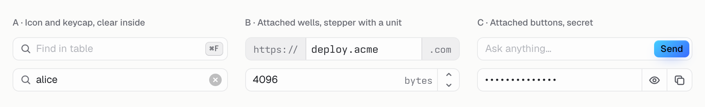
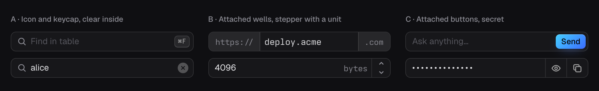
<figcaption>字段内部的控件（A）、附加井槽和步进器（B）、附加按钮和密码字段（C）；均位于 sans 区域中。</figcaption>
</figure>

<figure class="tn-figure">
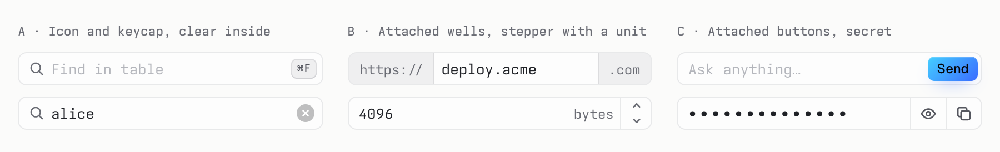
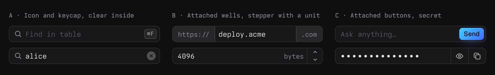
<figcaption>默认 mono 区域中的相同字段。</figcaption>
</figure>

<figure class="tn-figure">
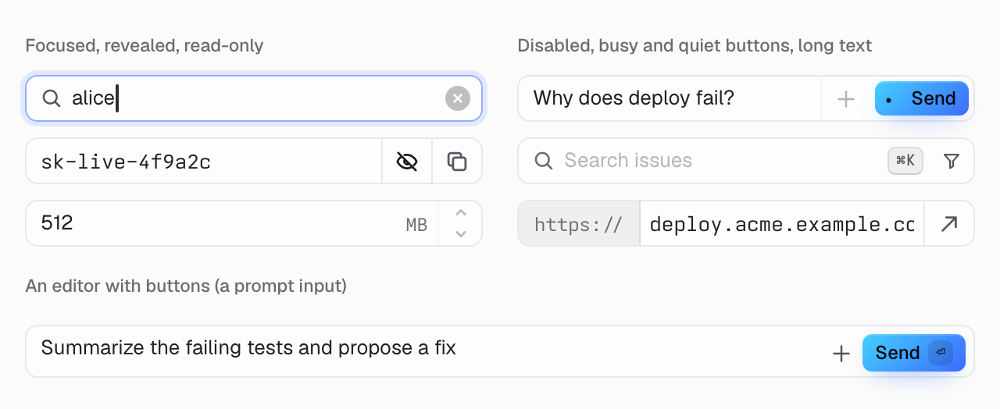
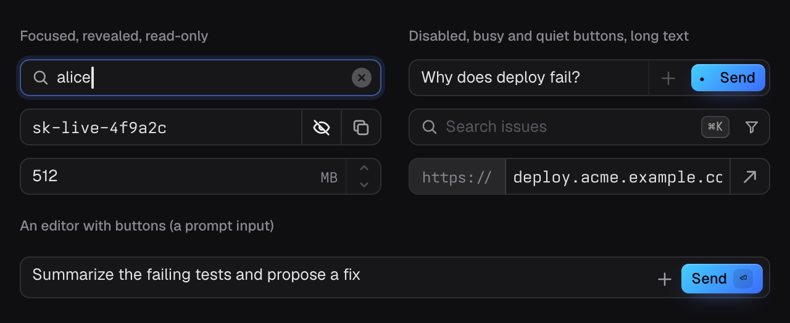
<figcaption>焦点、<code>reveal</code>、<code>readonly</code>、<code>mono</code>、禁用状态、忙碌与低调按钮，以及带 <code>buttons</code> 的 <code>editor</code>。</figcaption>
</figure>

**属性**（在 `input` 的属性基础上增加；`editor` 可使用 `variant` 和 `buttons`）：

| 属性 | 类型 | 默认值 | 含义 |
| --- | --- | --- | --- |
| `variant` | `"well"` \| `"field"` | 有任一附加控件时为 `"field"`，否则为 `"well"` | 外观；未知值会按默认值处理 |
| `icon` | string (icon name) | none | 前置图标；未知名称不绘制图标 |
| `keys` | string \| string[] (key names) | none | 字段处于空闲且内容为空时，在末尾显示表示组合键的一个键帽（`["cmd","f"]` 显示为 ⌘F） |
| `mono` | boolean | `false` | 在 sans 区域中，`field` 保持使用终端等宽字体绘制文本（例如 URL、令牌） |
| `clear` | boolean | `false` | 当文本非空且字段不是 `readonly` 时，在末尾显示圆圈中的 ×；发送 `action` `clear` |
| `prefix` | string | none | 文本前的等宽井槽，附着在边框上 |
| `suffix` | string | none | 文本后的等宽井槽，附着在边框上 |
| `unit` | string | none | 字段内部、文本后的等宽单位 |
| `stepper` | boolean | `false` | 附加 ⌃⌄ 分段控件；发送 `action` `inc` / `dec`；`readonly` 时显示为暗色且不可操作 |
| `secret` | boolean | `false` | 为 `text` 的每个 UTF-16 单元绘制一个 `•`，并附加可在本地显示文本的眼睛控件 |
| `reveal` | boolean | `false` | 密码字段的显示状态；此属性发生变化时优先于眼睛控件 |
| `buttons` | `Button[]` | none | 按顺序附加的按钮，排在眼睛之后、步进器之前 |

`Button`：

| 字段 | 类型 | 默认值 | 含义 |
| --- | --- | --- | --- |
| `act` | string | 必填 | 点击时发送的操作（`"copy"` 会复制文本；`"x=y"` 会发送 `act` `x` 和 `value` `y`）；没有此字段的条目会跳过 |
| `text` | string | none | 标签；不设置时按钮仅显示图标 |
| `icon` | string (icon name) | none | 前置图标 |
| `variant` | `"default"` \| `"primary"` \| `"quiet"` \| `"danger"` | `"default"` | `default`：附加的细线分段；其他值：采用 `button` kind 外观的嵌入式 `sm` 按钮（在 `editor` 中为 24 px） |
| `keys` | string[] | none | 标签之后的键帽（嵌入式按钮） |
| `title` | string | 标签和键帽 | 工具提示；也是仅显示图标的按钮的无障碍名称（若未设置则使用其 `act`） |
| `disabled` | boolean \| string | `false` | 显示为褪色且不可操作；字符串会作为工具提示中的禁用原因 |
| `busy` | boolean | `false` | 在图标位置显示加载指示器（嵌入式按钮），且不可操作 |

**事件：** 除了 [`editor`](#editor) 中的 `focus`、`edit` 和 `undo` 事件外：

| 事件 | 触发时机 | 负载 |
| --- | --- | --- |
| `action` `clear` | 点击 × 时 | `{ev = "action", id, act = "clear", mods?, values?}` |
| `action` `inc` / `dec` | 点击步进器的一侧时 | `{ev = "action", id, act = "inc"}` / `"dec"` |
| `action` `<act>` | 点击按钮时 | `{ev = "action", id, act, value?, mods?, values?}`；内置操作（`copy`、`open`、…）会像指针操作一样执行 |

这些操作都不会请求焦点或移动插入光标，眼睛控件也不会发送任何内容。surface 已关闭或以 `listen = false` 打开时，各部件仍会绘制，但不会发送事件，眼睛控件也不会切换。

**键盘模型。** 与 `button` 一样，附加控件只能通过指针操作：按键始终由你的程序接收。你需要自行绑定按键并驱动这些属性：⌘F 将焦点移到字段（`focus` 操作；`keys` 只显示键帽），Esc 像 `clear` 一样清空 `text`，↑/↓ 像 `inc`/`dec` 一样更改值，Enter 像 Send 按钮一样发送内容，“显示密码”快捷键则设置 `reveal`。

**样式：**

```html
<div class="sf sf-input focused" data-id="main.find" data-variant="field" role="textbox"
     aria-multiline="false" aria-placeholder="Find in table">
	<span class="sf-in-pre sf-in-well">https://</span>
	<span class="sf-in-ic" aria-hidden="true"><svg class="ico">…</svg></span>
	<div class="sf-ed-scroll"><div class="sf-ed-text">alice<span class="sf-caret"></span></div></div>
	<span class="sf-in-unit">bytes</span>
	<button class="sf-in-x sf-in-act" data-act="clear" aria-label="Clear" title="Clear"><svg class="ico">…</svg></button>
	<span class="sf-kbd kbds sf-in-keys" aria-hidden="true"><span class="kbd">⌘F</span></span>
	<span class="sf-ed-mode"></span>
	<span class="sf-in-end">
		<span class="sf-in-suf sf-in-well">.com</span>
		<button class="sf-in-seg sf-in-act sf-in-eye only-ic" aria-label="Show" aria-pressed="false"><svg class="ico">…</svg></button>
		<button class="sf-in-seg sf-in-act only-ic" data-act="copy" aria-label="Copy key" title="Copy key"><svg class="ico">…</svg></button>
		<button class="sf-button sf-in-btn sf-in-act" data-act="send" data-variant="primary" data-size="sm"><span class="sf-btn-label">Send</span></button>
		<span class="sf-in-step" role="group">
			<button class="sf-in-stepb sf-in-act" data-act="inc" aria-label="Increment"><svg class="ico">…</svg></button>
			<button class="sf-in-stepb sf-in-act" data-act="dec" aria-label="Decrement"><svg class="ico">…</svg></button>
		</span>
	</span>
</div>
```

只有对应属性启用了某个部件时，才会绘制该部件。

| 目标 | 选择器 |
| --- | --- |
| 外观 | `.sf-input[data-variant='field']`、`.sf-editor[data-variant='field']` |
| 状态 | `.sf-input.secret`、`.revealed`（显示文本的密码字段）、`.mono`，以及上文的 `.focused`、`.readonly`、`.empty` |
| 字段内部 | `.sf-in-ic`、`.sf-in-unit`、`.sf-in-x`、`.sf-in-keys` |
| 附加控件 | `.sf-in-well`（`.sf-in-pre`、`.sf-in-suf`）、`.sf-in-end`、`.sf-in-seg`（`.only-ic`、`.on`、`.disabled`、`.busy`）、`.sf-in-eye`、`.sf-in-btn`（一个 `.sf-button`）、`.sf-in-step`、`.sf-in-stepb` |
| 所有可执行操作的部件 | `.sf-in-act[data-act]` |
## `otp`

这是一种简短代码输入控件，每个字符占一个单元格：可用于登录验证码的六位数字、配对 PIN 或设备代码。每个字符各占一个单元格，组与组之间用短横线分隔；下一个按键将输入到的单元格会显示强调色环和闪烁的插入光标，让用户始终知道还需输入多少字符。对于长度固定的代码，请使用此控件；自由文本则使用 [`input`](#input)。

与视图中的其他字段一样，代码由你负责维护：按键会作为输入传给你的程序，由你通过 `text`（以及当插入光标不在文本末尾时的 `cursor`）作出响应。Tern 负责绘制，绝不编辑。单元格不会获取键盘焦点。

**构建方式：** `tern.ui.node("otp", { text = …, length = 6 })`。

| 属性 | 类型 | 默认值 | 含义 |
| --- | --- | --- | --- |
| `text` | string | `""` | 已输入的字符，每个单元格一个。超过 `length` 的字符不会绘制 |
| `length` | integer | `6` | 单元格数量，限制在 1–12 之间 |
| `group` | integer | `3` | 每组单元格数；组间用短横线（`.sf-otp-sep`）分隔。设为 `0` 或不小于 `length` 的值时，所有单元格绘制为一组 |
| `cursor` | integer \| `false` | `text` 的长度 | 活动单元格（从 0 开始）：显示强调色环；单元格为空时还会显示插入光标。会钳制到第一个空单元格；若等于 `length`（完整代码的默认值）、为负数或为 `false`，则不显示活动单元格 |
| `variant` | `"cells"` \| `"joined"` \| `"underline"` | `"cells"` | 外观（见下文）。其他值按 `cells` 处理 |
| `mask` | boolean \| string | `false` | 隐藏已输入内容：`true` 会在每个已填单元格中绘制圆点；字符串则绘制该字符串的第一个字符（`"*"`） |
| `state` | `"error"` \| `"success"` | none | `error` 会以 `--bad` 为单元格加环、为提示着色，并让代码抖动一次（减少动态效果时不抖动）；`success` 会以 `--ok` 为单元格加环。其他值按无状态处理 |
| `hint` | string | none | 单元格下方的低调文本行，12px `--t3`：代码发送到哪里、重新发送倒计时或错误信息。颜色会跟随状态 |
| `disabled` | boolean or string | `false` | 显示为暗色、没有活动单元格，点击不发送任何内容；类名为 `disabled`，`aria-disabled="true"` |

通用属性也可用：`title`、`aria`（组的名称；默认为 "One-time code"）、`tone` 和 flex 属性。代码控件会根据单元格确定自身尺寸，不会拉伸（`align-self: flex-start`）。

**变体。**

| `variant` | 外观 | 用途 |
| --- | --- | --- |
| `cells` | 独立的 34×40 瓷砖，背景为 `--card`，细线环为 `--l2`（填入内容后为 `--l3`），数字为 18px 等宽字体，组间以短横线分隔；活动单元格使用 1.5px 强调色环和 3px 强调色光晕 | 默认外观：登录验证码、PIN |
| `joined` | 每组为一个字段（`--card` 背景、`--l3` 边框），用 `--l2` 细线分隔为 38×38 单元格；活动单元格带强调色底纹 | 密集表单和面板；六个瓷砖分开显示会过于醒目时 |
| `underline` | 没有方框：数字显示在 2px 横线上方（`--l3`；已填单元格为 `--t4`；活动单元格为强调色），提示显示在下方 | 低调流程、引导页，或独立页面上的验证码 |

输入字符会在 .18 s 内升入单元格；悬停会加强单元格边框（或横线），按下后会沉至 96%。插入光标会像字段中的光标一样闪烁，并在减少动态效果、窗格暂停或未获得焦点时保持静止。每次 `state` 变为 `"error"` 时，代码都会抖动一次（.32 s，左右移动几个像素），减少动态效果时不抖动；要再次触发抖动，必须先设为其他状态（或无状态）。

**子节点：** 无（忽略）。

**事件：** 代码已启用且 surface 正在监听时，点击单元格会立即将插入光标移到该单元格，并发送：

```lua
{ ev = "action", id = "<the otp's id>", act = "focus", value = 2 }
```

`value` 是插入光标移到的单元格：通常是被点击的单元格；如果点击位置超出文本末尾，则是第一个空单元格（因此，即使代码尚未输完，点击最后一个单元格也表示“从这里输入”）。将焦点移到代码控件，并把 `cursor` 设为 `value`（也可以忽略此事件，例如模态覆盖层要继续接收按键时）。本地插入光标会保持原位，直到你下次更改 `text` 或 `cursor`；届时你的值会优先生效。代码已禁用、surface 已关闭或以 `listen = false` 打开时，不会发送事件，也不会移动插入光标。点击单元格的事件不会传递给代码控件周围的节点。

**键盘模型。** 所有按键都由你的程序负责；常见映射如下：

| 按键 | 操作 |
| --- | --- |
| 代码接受的字符 | 替换 `cursor` 处的字符（若位于末尾则追加），然后前移：设置 `text`；只有 `cursor` 不在文本末尾时才设置它 |
| Backspace | 删除插入光标前的字符（或当插入光标位于已填单元格上时删除其下方字符） |
| ← / → | 在文本范围内移动 `cursor` |
| 粘贴（带括号标记） | 取出接受的字符，最多 `length` 个，作为整个 `text` |
| Enter 或最后一个字符 | 提交；将 `state` 设为 `"error"` 并附上 `hint`，或设为 `"success"` |

用户再次输入时，立即清除 `state`。

**样式：**

```html
<div class="sf sf-otp" data-id="main.code" data-variant="cells" data-state="error"
	role="group" aria-label="One-time code" aria-invalid="true" aria-disabled="false">
	<div class="sf-otp-row">
		<div class="sf-otp-group">
			<span class="sf-otp-cell filled" role="button" aria-label="Character 1 of 6: 4"><span class="sf-otp-ch">4</span></span>
			<span class="sf-otp-cell filled" role="button" aria-label="Character 2 of 6: 8"><span class="sf-otp-ch">8</span></span>
			<span class="sf-otp-cell filled" role="button" aria-label="Character 3 of 6: 1"><span class="sf-otp-ch">1</span></span>
		</div>
		<span class="sf-otp-sep" aria-hidden="true"></span>
		<div class="sf-otp-group">
			<span class="sf-otp-cell on" role="button" aria-current="true" aria-label="Character 4 of 6"><i class="sf-otp-caret" aria-hidden="true"></i></span>
			<span class="sf-otp-cell" role="button" aria-label="Character 5 of 6"></span>
			<span class="sf-otp-cell" role="button" aria-label="Character 6 of 6"></span>
		</div>
	</div>
	<div class="sf-otp-hint">That code didn’t work. Try again.</div>
</div>
```

| 目标 | 选择器 |
| --- | --- |
| 节点 | `.sf-otp` |
| 变体 / 状态 | `.sf-otp[data-variant='joined']`、`.sf-otp[data-state='error']`（`[aria-invalid='true']`）、`[data-state='success']` |
| 已禁用 / 已填满 | `.sf-otp.disabled`（`[aria-disabled='true']`）、`.sf-otp.full`（所有单元格都已填入） |
| 组（连体字段） | `.sf-otp-group` |
| 单元格 | `.sf-otp-cell`；已填入为 `.filled`，活动单元格为 `.on`（`[aria-current='true']`） |
| 组间短横线 | `.sf-otp-sep` |
| 字符 / 遮罩圆点 / 插入光标 | `.sf-otp-ch`、`.sf-otp-dot`、`.sf-otp-caret`（内部结构，可能变化） |
| 下划线 | `.sf-otp[data-variant='underline'] .sf-otp-cell::after` |
| 提示 | `.sf-otp-hint` |

单元格使用 `box-shadow` 绘制边框（连体外观则应用于 `.sf-otp-group`）；所有区域（mono 或 sans）中的数字均使用 `500 18px` 等宽字体和等宽数字。被遮罩的单元格，其无障碍标签会显示“已填入”，而不是字符本身。

```lua
local ui = tern.ui

return ui.col({
	ui.text({ ui.span("Enter the code we sent to •••• 42", "muted") }),
	ui.node("otp", {
		key = "code",
		text = state.code,
		cursor = state.cursor,
		state = state.wrong and "error" or nil,
		hint = state.wrong and "That code didn’t work. Try again." or ("Resend in 0:" .. state.wait),
	}),
})
```

下面是相同的 TSX 示例，其中 `onAction` 会将操作映射到处理器：

```tsx
<col gap="sm">
   <text>Enter the code we sent to •••• 42</text>
   <otp
      key="code"
      text={s.code}
      cursor={s.cursor}
      state={s.wrong ? 'error' : undefined}
      hint={s.wrong ? 'That code didn’t work. Try again.' : `Resend in 0:${s.wait}`}
      onAction={{ focus: ev => { s.cursor = ev.value as number; render(); } }}
   />
</col>
```

<figure class="tn-figure">
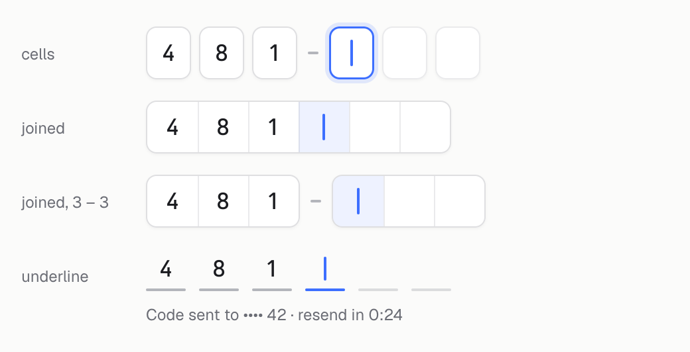
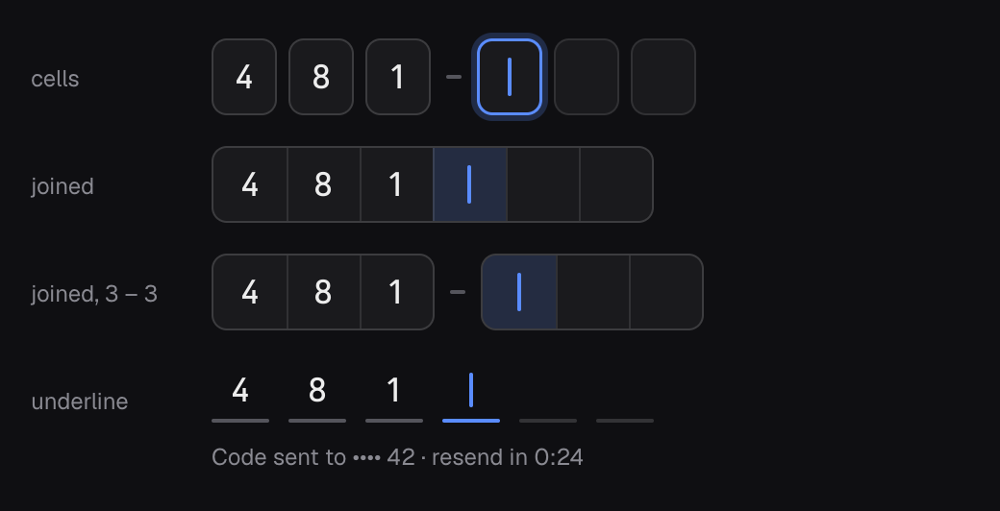
<figcaption>三种外观：<code>cells</code>、<code>joined</code>（一组，以及 3 – 3 两组）和带有 <code>hint</code> 的 <code>underline</code>。</figcaption>
</figure>

<figure class="tn-figure">
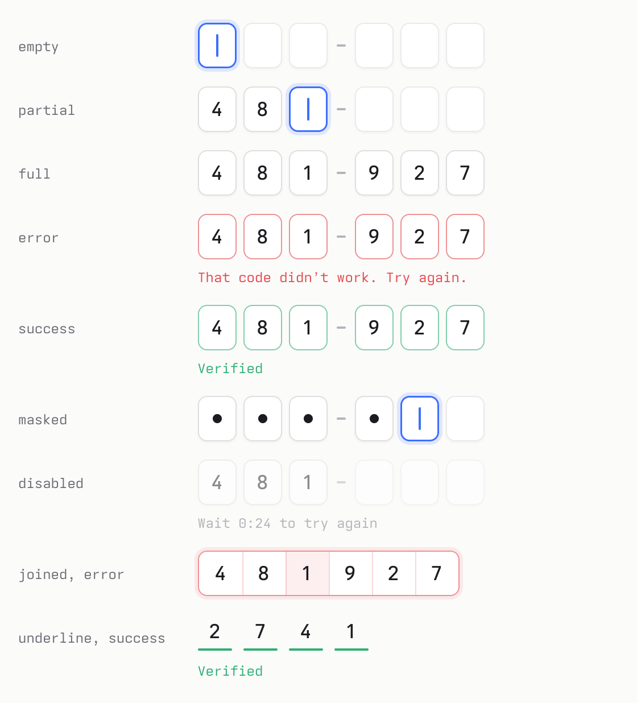
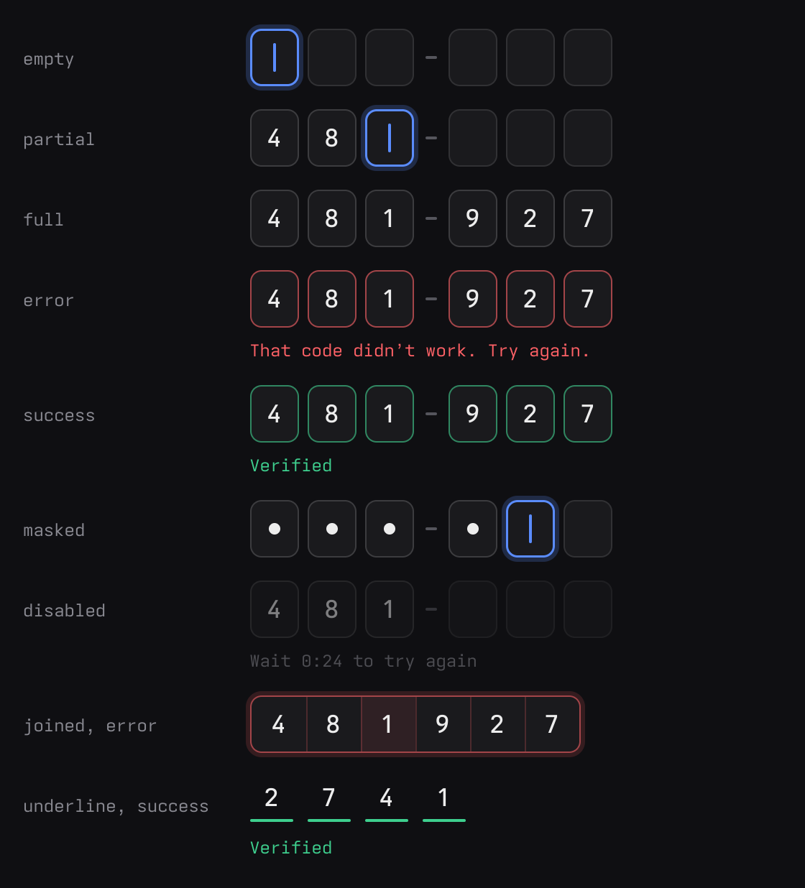
<figcaption>空白、部分输入、已填满、<code>error</code>、<code>success</code>、<code>mask</code>、<code>disabled</code> 状态，以及其他外观下的状态。</figcaption>
</figure>

## `select`

这是一个从菜单中选择值的控件，采用 kit 的 select 外观：触发器上显示当前选项，展开时会弹出半透明菜单，其中列出各选项，并在当前选项旁显示勾选标记。它适用于选择框、原生弹出按钮和组合框。每当分段选择控件要容纳超过三四个选项时，只要你需要从一组选项中选出一个值，就可以使用它：例如模型、区域、分支或排序方式。

通过 `variant` 可选择两种外观，另有一个控制行为的属性：

- **`field`**（默认值）是一个 30px 高的卡片式按钮，带细线边框、当前值和 V 形箭头，适用于表单和设置。菜单会在当前选项旁显示勾选标记，并在每个选项右侧以低调的等宽字体显示其 `detail`。
- **`quiet`** 不带边框：值前面可带低调的 `label`（例如 “Model  Sonnet 4.5”），整体放在悬停或菜单展开时才显示的胶囊上，适用于面板标题和工具栏。此样式的菜单不会用勾选标记，而是以强调色为当前选项着色。
- **`search = true`** 会让任一外观变为组合框。展开后，`field` 触发器会变成搜索行（搜索图标、带插入光标的 `query`，以及类似 `3 of 24` 的计数）；`quiet` 触发器则保留胶囊，搜索行位于菜单顶部。选项标签会像 `list` 标记 `filter` 一样标记查询命中项；`group` 名称会显示为分组标题。

在 `col` 中，select 保持 `align-self: flex-start`；无论区域使用 mono 还是 sans，它都使用 Tern 的 UI 字体（Geist）绘制；详细信息和计数使用等宽字体。菜单会在触发器下方 4px 处展开，位于节点内部，因此周围的卡片或行不会裁切它。布局完成后，如果窗格上方空间更大且菜单在下方无法完整显示，菜单会改为在触发器上方展开；如果菜单超出窗格范围，则会与触发器右边缘对齐。菜单一次最多显示约十行、每行 30px；更多选项会在菜单内部滚动，并确保高亮选项保持在视野内。

**构建方式：** `tern.ui.node("select", props)`。没有专用的构建函数。

**指针和按键。** 与 `el` 控件相同，select 不会获取焦点：按键会交给你的 `key` 处理器，由它通过属性驱动菜单。指针操作会立即生效，并随后通知你：

- 点击触发器会打开或关闭菜单，并发送 `toggle`；
- 点击某个选项会将其显示为当前值、关闭菜单；如果所选值不同于当前值，则发送 `change`，随后发送 `toggle`；
- 在已打开的菜单和触发器之外任意位置按下，会关闭菜单并发送 `toggle`（轻量关闭）。

只要节点仍在绘制，Tern 就会记住其打开状态和选中项，并在你传入的属性之上显示这些状态，直到你更改 `open` 或 `value`，使其与 Tern 最近绘制的值不同：将 `change` 同步到 `value`，将 `toggle` 同步到 `open`，即可继续由你控制状态。在已打开的组合框搜索行中单击不会关闭菜单（按键会在此处输入）。已禁用的 select，以及位于已关闭 surface 或以 `listen = false` 打开的 surface 上的任何 select，仍会绘制，但不会打开菜单或发送事件。

**在组合框中输入。** 搜索行是绘制出来的，而不是原生字段，其行为与 [`picker`](lists.md#picker) 的搜索行完全相同：你的 `key` 处理器负责维护查询及其插入光标，并通过 `query` 和 `cursor` 传回；你还要自行筛选 `options`（Tern 会标记相同的文本）。编辑查询时可参考 `input` kind 的[按键处理器](#input)；搜索行不提供 ⌘C、选区和 IME 组合输入。常见的键盘模型如下：

| 按键 | 关闭时 | 打开时 |
| --- | --- | --- |
| Enter、Space、↓ | `open = true`、`active = value` | Enter：`value = active`、`open = false` |
| ↑ / ↓ | | 在启用的选项之间移动 `active` |
| Escape | | `open = false`（组合框还会清除 `query`） |
| 文本、Backspace、← → | | 组合框：编辑 `query` 和 `cursor`、重新筛选 `options`，并将 `active` 设为第一个匹配项 |

| 属性 | 类型 | 默认值 | 含义 |
| --- | --- | --- | --- |
| `value` | string | none | 当前选项的 `value`。未设置时，触发器显示 `placeholder`。如果当前值不对应任何选项（例如列表被搜索进一步筛选），则会直接显示该值 |
| `options` | `{ string \| SelectOption }` | `{}` | 按顺序排列的选项。字符串表示值和标签都为该字符串的选项。`SelectOption` 定义见下文 |
| `variant` | `"field"` \| `"quiet"` | `"field"` | 外观（见上文）。其他值按 `field` 处理 |
| `label` | string | none | 触发器中显示在值前面的低调标签（例如 “Model”）；如果没有设置 `aria`，它也会作为组合框的无障碍名称 |
| `placeholder` | string | `"Select…"`；启用搜索时为 `"Search…"` | 未设置 `value` 时触发器显示的文本；未设置 `query` 时搜索行显示的文本 |
| `size` | `"sm"` \| `"md"` | `"md"` | `field`：30px（`sm` 为 26px）。`quiet`：28px（`sm` 为 22px）。`sm` 菜单的行高为 26px |
| `disabled` | boolean or string | `false` | 显示为暗色且不可操作：不会打开或发送事件；类名为 `disabled`，`aria-disabled="true"`。字符串表示禁用原因，会作为触发器的工具提示 |
| `open` | boolean | `false` | 菜单是否显示（由你驱动的键盘状态）。其变化会覆盖指针操作造成的打开或关闭状态 |
| `active` | string | 当前 `value` | 高亮选项的 `value`（键盘光标，类名为 `sel`）；变化时会滚动到视野内。若没有选项与此值匹配，则会忽略 |
| `search` | boolean | `false` | 是否启用组合框（见上文） |
| `query` | string | `""` | 绘制在搜索行中的文本；匹配项会在选项标签中标记 |
| `cursor` | number | `query` 的末尾 | `query` 中的插入光标位置，以 UTF-16 单元计数 |
| `total` | number | none | 整组选项的数量：设置 `query` 时，计数显示为 `<options shown> of <total>`；未设置时只显示数字 |
| `empty` | string | 设置 `query` 时为 `"No matches"`，否则为 `"No options"` | `options` 为空时菜单显示的文本 |

**`SelectOption`：**

| 字段 | 类型 | 默认值 | 含义 |
| --- | --- | --- | --- |
| `value` | string | 必填 | `value`、`active` 和 `change` 中传递的值。没有此字段的条目会跳过 |
| `label` | string | `value` | 选项及其成为当前项时触发器显示的文本 |
| `detail` | string | none | 选项右侧显示的低调等宽文本（`default`、`200k`、`$3 / $15`） |
| `icon` | icon name | none | 来自 [Tern 图标集](data.md#图标名称)的前置图标（供应商标志可用 `provider:anthropic`）；当前选项的图标也会显示在触发器前面 |
| `group` | string | none | 当一组连续选项的 `group` 相同时，在该组第一个选项上方绘制分组标题 |
| `disabled` | boolean | `false` | 显示为淡色，且无法被选中 |

通用属性也可用：`title`、`aria`（组合框的名称）、`key`、`tone`（为你的样式表设置 `--tc`）、`hidden` 和 flex 属性。

**变体。**

| `variant` | 触发器 | 菜单 | 用途 |
| --- | --- | --- | --- |
| `field` | kit 的 `.sel-btn`：`--card`（深色主题下为 `--raise`）背景和 `--l2` 细线边框；悬停时边框为 `--l3`；打开时为 55% 强调色边框和 3px 强调色光晕 | 半透明的 `.pop.sel-menu`：当前选项前有强调色勾选标记，详细信息使用等宽字体 | 表单、设置、对话框 |
| `quiet` | 无填充、无边框；`--t3` 标签后面的值字重为 500；悬停时为 `--l1`，打开及按下时为 `--l2` | 当前选项使用 `--accent-ink`，背景为 10% 强调色，不带勾选栏 | 面板标题、工具栏 |
| 任一变体，`search = true` | 打开时：`field` 变成位于强调色边框内的搜索行；`quiet` 保留胶囊 | `quiet`：搜索行位于菜单顶部，显示在 `--l1` 胶囊上 | 选项超过十几个，或需要通过搜索查找选项时 |

菜单会以 kit 的 `popIn` 效果弹出（.22s）；按下时触发器立即缩放到 98.5%；悬停和选中项的底色会在 .12–.15s 内淡入。启用 Tern 的减少动态效果（`.sf-still`）或系统级减少动态效果时，菜单会直接显示而不播放动画，插入光标也会停止闪烁。

**子节点：** 无（忽略）。

**事件：**

```lua
{ ev = "change", id = "<the select's id>", value = "haiku" }  -- an option was picked
{ ev = "toggle", id = "<the select's id>", open = true }      -- the pointer opened or closed the menu
```

只有当所选值与当前显示值不同时才会发送 `change`；选择任何选项都会关闭菜单，因此之后会跟着发送 `open = false` 的 `toggle`。与 card 的 `toggle` 不同，select 的 `toggle` 携带 `open`，而不是 `collapsed`。在 `el` 表单中，select 不会发送 `values`；请从自己的状态中读取它的值。

**样式：**

```html
<div class="sf sf-select open search" data-id="main.model" data-variant="field" data-size="md">
	<button class="sf-select-btn sel-btn" role="combobox" aria-haspopup="listbox" aria-expanded="false">
		<span class="sf-select-ic"><svg class="ico">…</svg></span>     <!-- the current option's icon -->
		<span class="sf-select-label">Model</span>
		<span class="sf-select-v v">Sonnet 4.5</span>                  <!-- .ph: the placeholder -->
		<svg class="ico sf-select-chev">…</svg>
	</button>
	<!-- a field combobox while open: the trigger is the search line -->
	<button class="sf-select-btn sel-btn searching" role="combobox" aria-expanded="true">
		<span class="sf-select-find-ic"><svg class="ico">…</svg></span>
		<span class="sf-select-field"><span class="sf-select-q">son</span><span class="sf-select-caret"></span></span>
		<span class="sf-select-count">3 of 24</span>
	</button>
	<div class="pop sel-menu sf-select-menu" role="listbox">       <!-- .up over the trigger, .end right-aligned -->
		<div class="sf-select-find">…the search line (quiet)…</div>
		<div class="sf-select-rows">
			<div class="mi-sec sf-select-group" role="presentation">Anthropic</div>
			<div class="mi sf-select-opt cur sel" role="option" aria-selected="true" data-i="0">
				<span class="mi-ck"><svg class="ico">…</svg></span>     <!-- field only -->
				<span class="sf-select-ic">…</span>
				<span class="sf-select-text"><mark class="sf-mark">Son</mark>net 4.5</span>
				<span class="sub">200k</span>
			</div>
			<div class="sf-select-empty">No matches</div>
		</div>
	</div>
</div>
```

| 目标 | 选择器 |
| --- | --- |
| 节点 | `.sf-select` |
| 外观 / 尺寸 | `.sf-select[data-variant='quiet']`、`[data-size='sm']` |
| 状态 | `.sf-select.open`、`.search`、`.disabled` |
| 触发器 | `.sf-select-btn`（打开时为 `[aria-expanded='true']`；作为搜索行时为 `.searching`） |
| 触发器部件 | `.sf-select-ic`、`.sf-select-label`、`.sf-select-v`（`.ph`）、`.sf-select-chev`（内部结构，可能变化） |
| 搜索行 | `.sf-select-find-ic`、`.sf-select-field`、`.sf-select-q`、`.sf-select-caret`、`.sf-select-ph`、`.sf-select-count`、`.sf-select-find`（内部结构，可能变化） |
| 菜单 | `.sf-select-menu`（`.up`、`.end`）、`.sf-select-rows` |
| 选项 | `.sf-select-opt`（`.cur` 为当前值、`.sel` 为活动选项、`.dis`） |
| 选项部件 | `.mi-ck`、`.sf-select-text`、`.sub`、`mark.sf-mark`（内部结构，可能变化） |
| 分组标题 / 空状态文本 | `.sf-select-group`、`.sf-select-empty` |

触发器和菜单会复用 kit 的类（`.sel-btn`、`.pop`、`.sel-menu`、`.mi`、`.mi-ck`、`.mi-sec`、`.sub`），因此外观与 Tern 自带的 select 一致；通过 `.sf-select…` 类重新设置样式时，其优先级高于 kit 的类。

面板标题中的模型选择器采用 `quiet` 外观，并由键盘驱动：

```lua
local ui = tern.ui

local MODELS = {
	{ value = "sonnet", label = "Sonnet 4.5", detail = "$3 / $15" },
	{ value = "opus", label = "Opus 4.1", detail = "$15 / $75" },
	{ value = "haiku", label = "Haiku 4.5", detail = "$1 / $5" },
}

local function view(state)
	return {
		main = ui.col({
			ui.node("card", { key = "review", head = "Review", ["end"] = "main.review.model" }, {
				ui.node("select", {
					key = "model",
					variant = "quiet",
					label = "Model",
					value = state.model,
					options = MODELS,
					open = state.open,
					active = state.active,
				}),
				ui.text("Reads the diff and leaves comments on the lines it would change."),
			}),
		}),
	}
end

local function index(value)
	for i, m in MODELS do
		if m.value == value then
			return i
		end
	end
	return 1
end

local function key(state, k, cx)
	if not state.open then
		if k.name == "enter" or k.name == "space" or k.name == "down" then
			state.open, state.active = true, state.model
		else
			return false
		end
	elseif k.name == "up" or k.name == "down" then
		local i = index(state.active) + (k.name == "down" and 1 or -1)
		state.active = MODELS[math.clamp(i, 1, #MODELS)].value
	elseif k.name == "enter" then
		state.model, state.open = state.active, false
	elseif k.name == "escape" then
		state.open = false
	else
		return false
	end
end

local function event(state, ev, cx)
	if ev.ev == "change" then
		state.model = ev.value
	elseif ev.ev == "toggle" then
		state.open, state.active = ev.open, state.model
	end
end
```

下面是 TypeScript SDK 中的组合框示例：程序负责筛选，Tern 负责标记匹配项：

```tsx
const shown = models.filter((m) => m.label.toLowerCase().includes(query.toLowerCase()))

<select
   variant="field"
   search
   value={model}
   options={shown.map((m) => ({ value: m.id, label: m.label, detail: m.context, group: m.provider }))}
   query={query}
   cursor={cursor}
   total={models.length}
   open={open}
   active={active}
   placeholder="Search models…"
   onChange={(ev) => setModel(ev.value)}
   onToggle={(ev) => setOpen(ev.open)}
/>
```

<figure class="tn-figure">
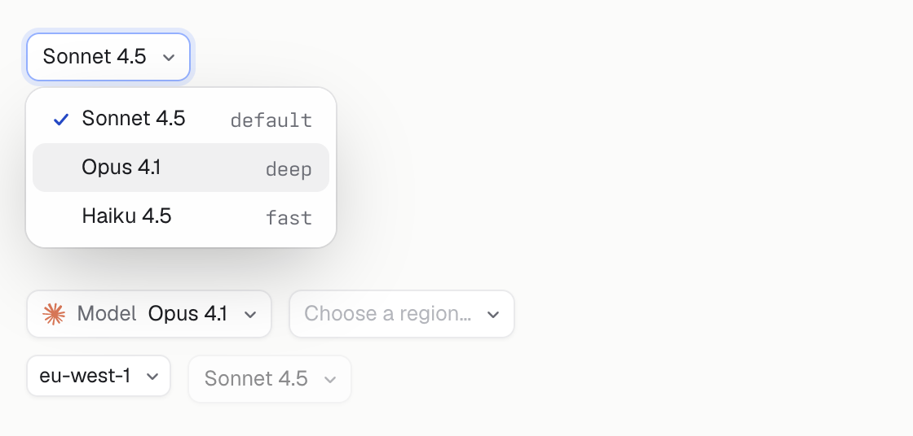
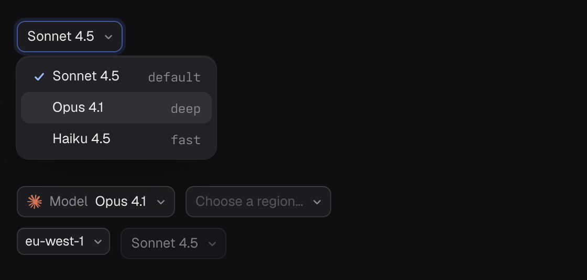
<figcaption><code>field</code> 外观：菜单打开时，<code>active</code> 指向 Opus；以及带 <code>label</code> 和图标的 select、<code>sm</code> 尺寸、占位文本和 <code>disabled</code> 状态。</figcaption>
</figure>


<figure class="tn-figure">
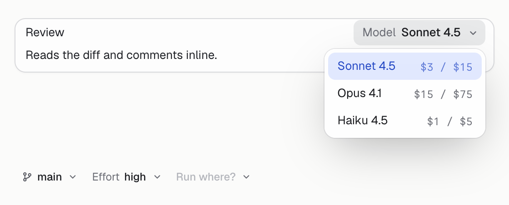
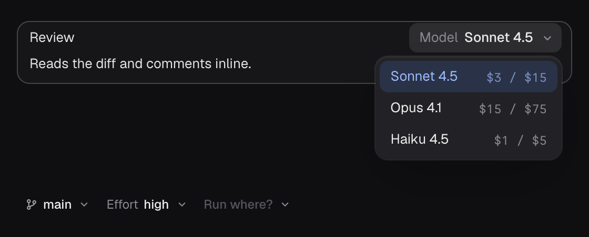
<figcaption>卡片标题中的 <code>quiet</code> 外观（菜单与触发器右边缘对齐），以及工具栏中的 <code>sm</code> 尺寸 quiet select。</figcaption>
</figure>

<figure class="tn-figure">
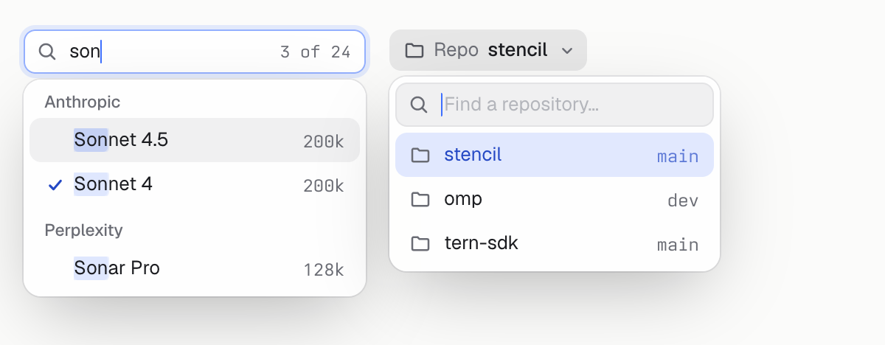
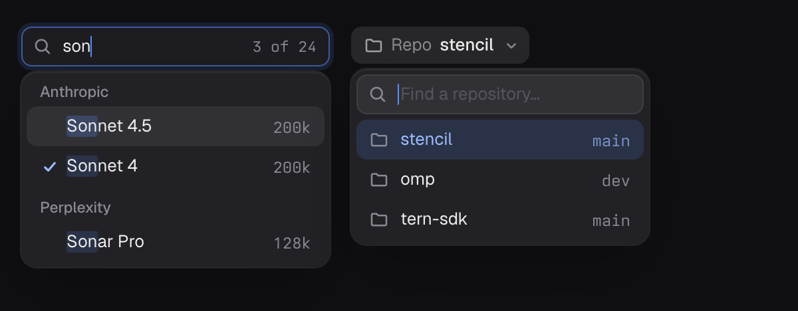
<figcaption>在 <code>field</code> 上设置 <code>search = true</code>（触发器变成搜索行），以及在 <code>quiet</code> select 上设置该属性（搜索行位于菜单顶部）。</figcaption>
</figure>

<figure class="tn-figure">
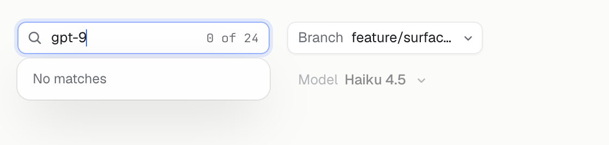
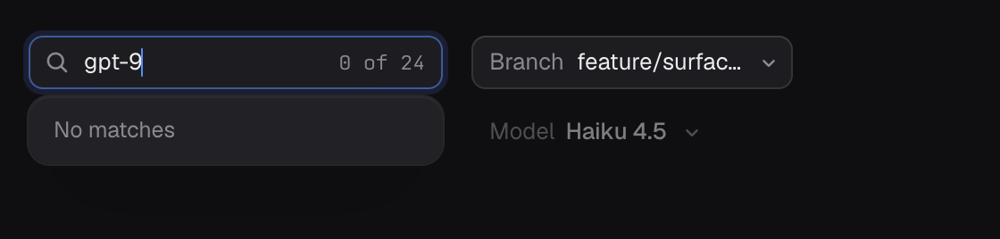
<figcaption>查询没有匹配项、长值被省略号截断，以及已禁用的 <code>quiet</code> select。</figcaption>
</figure>

## `calendar`

用于选择日期。默认的 `month` 变体是月历网格：星期字母、用强调色圆盘标出的已选日期、用两个圆盘和连接它们的着色带显示的日期范围、带环标记的今天、颜色较淡的周末、你标记日期下方的圆点，以及用于切换月份的 ‹ ›。`week` 变体适用于高度较小的窗格：预设项（“Today”、“Last 7 days”）排列在一列，旁边是一条包含七天的横列，日期范围在其中以底色标出。当日期选择本身就是视图内容时（例如日程安排、报告的时间范围），请使用 calendar；在表单中则使用 [`date`](#date) 字段，它会将相同的月历网格折叠到弹出层中。

所有数据都由你提供：发送 `value`（`"YYYY-MM-DD"` 格式的日期；或者当 `range = true` 时，发送 `[from, to]` 日期对），由 Tern 绘制。点击后会立即显示选择结果，并随后发送事件；你下次发送的 `value` 会覆盖用户的选择。日期范围需要按任意顺序点击两次：第一次点击后只显示一端，指针下方会预览范围色带；第二次点击后，会发送一条包含排序后两端的 `change` 事件。早于 `min` 或晚于 `max` 的日期会变暗且无法点击；如果某个月没有任何可选日期，‹ › 会阻止切换到该月。

日期采用用户日历中的日期，不包含时间或时区。`today` 默认为系统本地日期；如果你采用的“今天”定义不同（例如服务器所在时区或测试所需日期），请自行发送该值。

```lua
local ui = tern.ui

ui.node("row", { gap = "lg" }, {
	ui.node("calendar", {
		key = "trip",
		range = true,
		value = { "2026-10-12", "2026-10-16" },
		month = "2026-10",
	}),
	ui.node("calendar", {
		key = "deploy",
		value = "2026-10-21",
		min = "2026-10-06",
		max = "2026-10-27",
		weekStart = "sun",
		marks = { "2026-10-08", { date = "2026-10-14", tone = "warning" } },
		note = "Deploys run Tue–Thu · 3 scheduled",
	}),
})
```

TypeScript SDK 中的相同示例（TSX）：

```tsx
<row gap="lg">
   <calendar key="trip" range value={[from, to]} month="2026-10"
      onChange={(e) => setTrip(e.value)} />
   <calendar key="deploy" value={day} min="2026-10-06" max="2026-10-27"
      weekStart="sun" marks={deploys} note="Deploys run Tue–Thu · 3 scheduled"
      onChange={(e) => setDay(e.value)} />
</row>
```

<figure class="tn-figure">
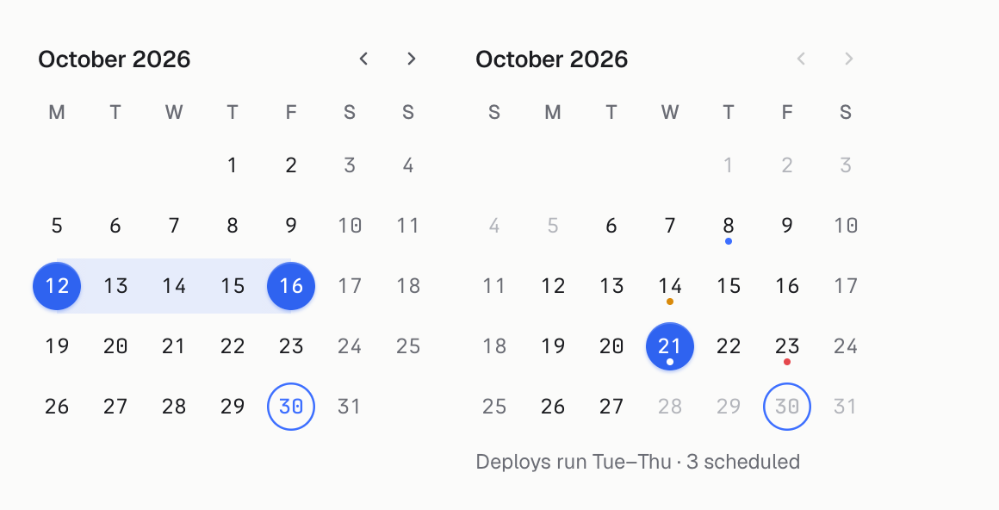
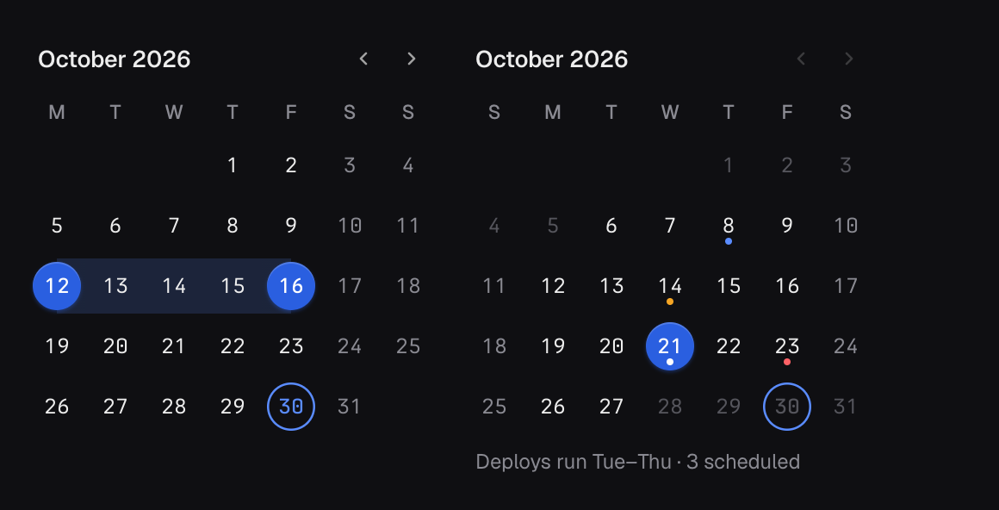
<figcaption>一个带有 today 标记的 <code>range</code>，以及一个使用 <code>min</code>、<code>max</code>、<code>marks</code>、<code>weekStart = "sun"</code> 和 <code>note</code> 的单日选择器。</figcaption>
</figure>

带有预设项的 `week` 变体：

```lua
ui.node("calendar", {
	key = "window",
	variant = "week",
	range = true,
	value = { "2026-10-24", "2026-10-30" },
	preset = "7d",
	presets = {
		{ id = "today", label = "Today" },
		{ id = "yesterday", label = "Yesterday" },
		{ id = "7d", label = "Last 7 days" },
		{ id = "30d", label = "Last 30 days" },
		{ id = "custom", label = "Custom…" },
	},
	note = "7 days · 1,284 runs",
})
```

相同的 TSX 示例：

```tsx
<calendar key="window" variant="week" range value={win} preset={preset}
   presets={PRESETS} note={`${days} days · ${runs} runs`}
   onSelect={(e) => applyPreset(e.item)} onChange={(e) => setWin(e.value)} />
```

<figure class="tn-figure">
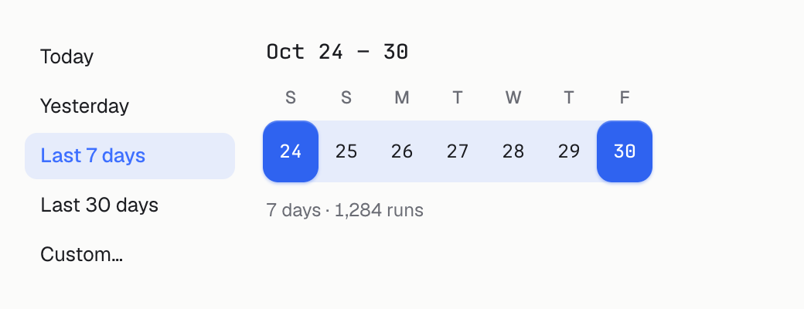
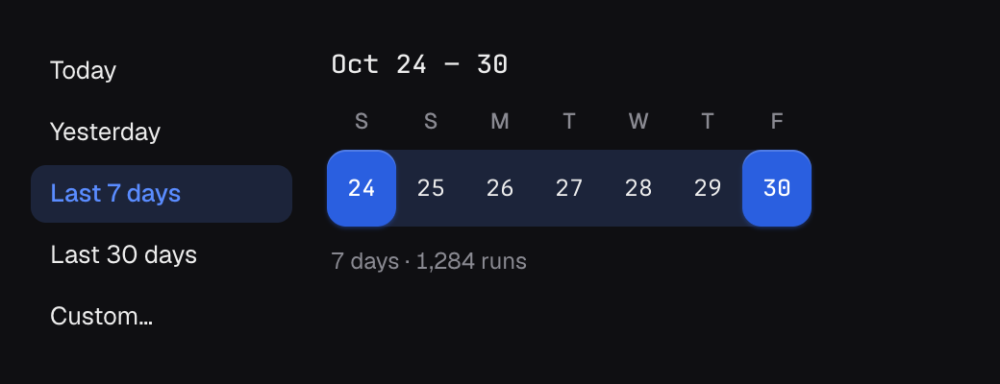
<figcaption><code>variant = "week"</code>：预设项列位于以范围结束日期为末尾的七日横列旁边。</figcaption>
</figure>

| 属性 | 类型 | 默认值 | 含义 |
| --- | --- | --- | --- |
| `variant` | `"month"` \| `"week"` | `"month"` | 月历网格，或在周横列旁显示预设项 |
| `value` | `string` \| `[string, string \| null]` | none | 所选日期：`"YYYY-MM-DD"` 格式的单日；或在启用 `range` 时使用 `[from, to]` 表示范围两端（顺序不限；`[from, null]` 表示正在等待选择范围的另一端）。发生变化时会覆盖用户的选择 |
| `range` | `boolean` | `false` | 选择日期范围（需点击两次），而非单个日期 |
| `month` | `string` | `value` 起始日期所在月份；若无则为 `today` 所在月份 | 显示的月份，格式为 `"YYYY-MM"`（仅适用于 `month` 变体）。‹ › 在本地切换月份；发生变化时会覆盖用户的选择 |
| `today` | `string` | 系统本地日期 | 用环标记为今天的日期，格式为 `"YYYY-MM-DD"` |
| `min` | `string` | none | 可选的最早日期；更早的日期会变暗且无法点击 |
| `max` | `string` | none | 可选的最晚日期 |
| `weekStart` | `"mon"` \| `"sun"` | `"mon"` | 月历网格中的第一列 |
| `marks` | `(string \| {date: string, tone?: string})[]` | `[]` | 带圆点标记的日期；圆点使用强调色或 [色调](../styles/index.md#色调) 对应的颜色 |
| `cursor` | `string` | none | 键盘焦点所在的日期，以焦点环显示 |
| `presets` | `{id: string, label?: string}[]` | `[]` | `week` 变体的预设项列（`label` 默认为 `id`）；不提供时隐藏该列 |
| `preset` | `string` | none | 当前预设项的 `id`。发生变化时会覆盖用户的选择 |
| `note` | `string` | none | 日期下方的低调文本行（例如计数或提示） |

| 变体 | 外观 | 用途 |
| --- | --- | --- |
| `month`（默认） | 标题、‹ ›、星期字母、包含七列的圆形日期网格 | 当月份本身就是视图时，选择单日或日期范围 |
| `week` | 预设项列；等宽字体的范围标题；以圆角方块显示的七天；范围部分带底色 | 高度较小的窗格中的报告或日志时间范围 |

**子节点：** 无（忽略）。

**事件：**

| 事件 | 负载 | 触发时机 |
| --- | --- | --- |
| `change` | `{ev = "change", id, value}`：`"YYYY-MM-DD"` 字符串；启用 `range` 时为已排序的 `[from, to]` | 用户选择某一天或点击日期范围的另一端 |
| `select` | `{ev = "select", id, item}`：预设项的 `id` | 用户选择预设项（`week`）。设置 `value`（以及 `preset`）以应用该预设项 |
| `action` | `{ev = "action", id, act = "month", value = "YYYY-MM"}` | 用户通过 ‹ › 切换到另一个月份。如果你会绘制 `marks`，请加载该月的标记；是否将此值同步到 `month` 则由你决定 |

在 `week` 变体中选择日期后，本地活动预设项也会被清除（因为此时范围由用户自行选择）；发送 `preset` 可重新设置它。

**键盘：** calendar 不会获取焦点；按键由你的程序负责，并通过属性驱动控件：用方向键移动 `cursor`（←→ 移动一天，↑↓ 移动一周），用 Page Up/Down 更改 `month`，按 Enter 时设置 `value`。对于日期范围，第一次按 Enter 后发送 `[from, null]`，第二次按下后发送 `[from, to]`。

**不活动的 surface：** surface 已关闭或以 `listen = false` 打开时，calendar 仍会绘制并允许切换月份，但不会选中日期或发送事件。

**样式：**

```html
<div class="sf sf-calendar" data-id="main.trip" data-variant="month">
	<div class="sf-cal-month">
		<div class="sf-cal-head">
			<span class="sf-cal-title">October 2026</span>
			<span class="sf-cal-nav"><button class="sf-cal-step" data-nav="-1">…</button><button class="sf-cal-step" data-nav="1">…</button></span>
		</div>
		<div class="sf-cal-wds"><span class="sf-cal-wd">M</span>…</div>
		<div class="sf-cal-days" role="grid">
			<span class="sf-cal-pad"></span>…
			<span class="sf-cal-day from" data-day="2026-10-12" role="gridcell" aria-selected="true"><span class="n">12</span></span>…
		</div>
		<div class="sf-cal-note" hidden></div>
	</div>
</div>
```

| 目标 | 选择器 |
| --- | --- |
| 节点及其变体 | `.sf-calendar`、`[data-variant='week']` |
| 月份标题、切换按钮 | `.sf-cal-title`、`.sf-cal-step`（超过 `min` / `max` 时为 `.off`） |
| 星期字母 | `.sf-cal-wd` |
| 日期、日期数字、圆点 | `.sf-cal-day`、`.sf-cal-day .n`、`.sf-cal-day .dot` |
| 日期状态 | `.today`、`.wkend`、`.off`、`.cur`、`.sel`（单日）、`.from`、`.to`、`.in`（范围内）、`.pre`（选择范围时悬停的另一端；日期带有 `.previewing`） |
| 一行中的首日 / 末日 | `.sf-cal-day.l`、`.sf-cal-day.r` |
| 预设项（`week`） | `.sf-cal-presets`、`.sf-cal-preset`（活动项为 `.on`） |
| 备注 | `.sf-cal-note` |

所有区域中的日期都使用 12.5px 等宽字体和等宽数字；标题、星期字母和预设项使用 sans 字体。月历日期为 34 × 32px 单元格，圆盘直径为 28px；周历日期为 36 × 40px，使用圆角方块。`.sf-calendar` 上的自定义属性 `--cal-w`、`--cal-h`、`--cal-n`（单元格宽、高、圆盘尺寸）和 `--cal-band`（范围底色）可用于调整尺寸和颜色。
## `date`

日期字段：以等宽字体显示日期值（“Oct 30, 2026”），并带有日历图标。点击后会在字段下方的弹出层中打开月历；选择某一天（或日期范围的另一端）会发送 `change` 并关闭弹出层；点击外部也会关闭它。适用于表单和设置等不适合占用过多空间的场景。它采用与 `calendar` 的 `month` 变体相同的日期属性，并绘制相同的网格。

```lua
ui.node("col", { gap = "md" }, {
	ui.node("date", { key = "due", value = "2026-10-30" }),
	ui.node("date", { key = "start", placeholder = "Start date", min = state.today }),
	ui.node("date", { key = "sprint", range = true, value = { "2026-10-19", "2026-10-30" } }),
})
```

相同的 TSX 示例：

```tsx
<col gap="md">
   <date key="due" value={due} onChange={(e) => setDue(e.value)} />
   <date key="start" placeholder="Start date" min={today} onChange={(e) => setStart(e.value)} />
   <date key="sprint" range value={sprint} onChange={(e) => setSprint(e.value)} />
</col>
```

<figure class="tn-figure">
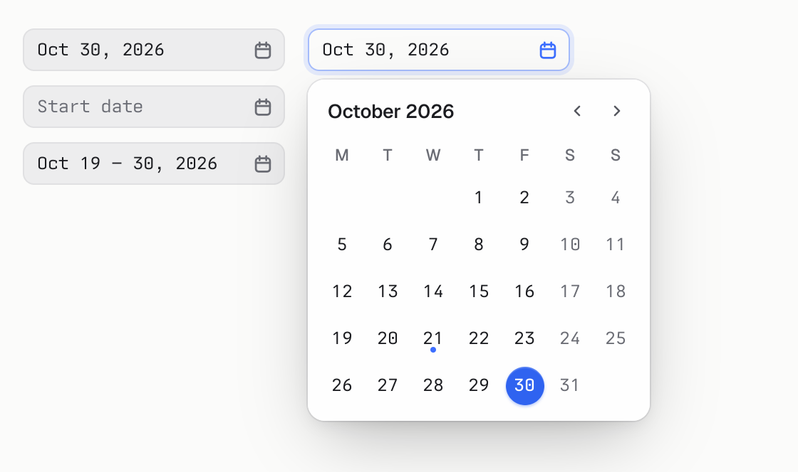
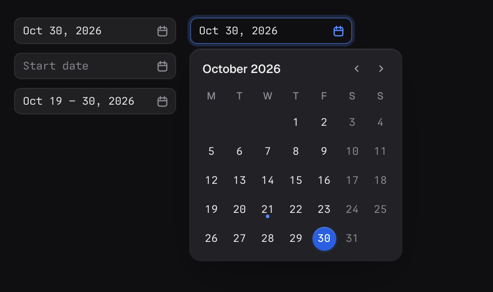
<figcaption>关闭状态的字段（单日、<code>placeholder</code>、<code>range</code>），以及带有日历的 <code>open</code> 字段。</figcaption>
</figure>

| 属性 | 类型 | 默认值 | 含义 |
| --- | --- | --- | --- |
| `value` | `string` \| `[string, string \| null]` | none | 与 `calendar` 相同；字段会显示 “Oct 30, 2026” 或范围 “Oct 19 – 30, 2026” |
| `range` | `boolean` | `false` | 选择日期范围；弹出层会保持打开，直到选中另一端 |
| `open` | `boolean` | `false` | 是否显示弹出层。点击字段会在本地切换该状态；属性变化时优先于点击操作 |
| `placeholder` | `string` | `"Pick a date"`（设置 `range` 时为 `"Pick dates"`） | 未设置 `value` 时字段显示的文本 |
| `month`、`today`、`min`、`max`、`weekStart`、`marks`、`cursor`、`note` | | | 与 `calendar` 相同，用于弹出层中的月份 |

**子节点：** 无（忽略）。

**事件：**

| 事件 | 负载 | 触发时机 |
| --- | --- | --- |
| `toggle` | `{ev = "toggle", id, collapsed}`：打开时为 `false`，关闭时为 `true` | 点击字段、点击已打开弹出层外部，或选择日期并关闭弹出层时 |
| `change` | `{ev = "change", id, value}` | 与 `calendar` 相同；之后会跟着发送 `collapsed = true` 的 `toggle` |
| `action` | `{ev = "action", id, act = "month", value = "YYYY-MM"}` | 与 `calendar` 相同 |

**键盘：** 字段不会获取焦点。要通过按键打开它，请设置 `open = true`，并像操作 `calendar` 一样驱动 `cursor` 和 `month`；按 Enter 时设置 `value`，按 Enter 或 Escape 时设置 `open = false`。

**样式：**

```html
<div class="sf sf-date open" data-id="main.due" data-variant="month">
	<button class="sf-date-box" aria-haspopup="dialog" aria-expanded="true">
		<span class="sf-date-val">Oct 30, 2026</span><svg class="sf-date-ic">…</svg>
	</button>
	<div class="sf-date-pop" role="dialog">
		<div class="sf-cal-month">…as calendar…</div>
	</div>
</div>
```

| 目标 | 选择器 |
| --- | --- |
| 节点、打开状态 | `.sf-date`、`.sf-date.open` |
| 字段框 | `.sf-date-box`（边框环通过其 `box-shadow` 绘制） |
| 值、占位文本 | `.sf-date-val`、`.sf-date-val.ph` |
| 图标 | `.sf-date-ic` |
| 弹出层 | `.sf-date-pop` |
| 月历 | 上文所有 calendar 选择器，在 `.sf-date` 之下 |

字段高度为 30px，最小宽度为 184px，使用类似 `input` 的 `--l1` 井槽，打开时显示强调色环。弹出层采用半透明背景（`--pop-bg`，带模糊效果）、12px 圆角，位于字段下方 6px；日期单元格尺寸为 32 × 30px。
## `slider`

可以沿轨道拖动设置一个值，也可以用两个滑块拖动设置一个范围。适合用于用户凭感觉而非输入数值来设置的场景：例如不透明度、字号、模型温度或延迟范围。数值会以等宽字体显示在轨道旁边，格式由你指定（`72%`、`13 px`、`200 ms – 1.2 s`）。

有两种外观。`default` 是 kit 的滑块，也是 Tern 自身设置所用的样式：细而中性的轨道填充到白色滑块处，标签位于左侧、数值位于右侧，整行高 28px，可与设置 `col` 中其他项目对齐。`accent` 适用于视图主要关注的单个控件：标签和数值位于强调色轨道上方，轨道上带有刻度，端点值显示在下方；当指针位于轨道上或拖动滑块时，滑块上方会显示数值气泡。只要 `value` 是一对数值，任一种外观都会呈现为范围滑块。

与 `el` 控件相同，slider 只能通过指针操作：按下轨道会将最近的滑块移到该处，拖动时滑块会跟随指针，并立即绘制更新；它不会获取焦点，因此按键仍由你接收。松开指针时会发送包含新值的 `change` 事件。用户设置的值会一直显示，直到程序更改 `value`，此时程序提供的值会优先生效；将 `change` 同步到 `value`，即可继续由程序控制。

**构建方式：** `tern.ui.node("slider", { value = …, min = …, max = … })`。

| 属性 | 类型 | 默认值 | 含义 |
| --- | --- | --- | --- |
| `value` | number or `{ number, number }` | `min` | 当前值。数值对（`{ lo, hi }`）会绘制带两个滑块的范围；数值会按从小到大的顺序排列，并钳制在 `min`..`max` 之间，再调整到最近的步进值 |
| `min` | number | `0` | 最小值 |
| `max` | number | `100` | 最大值。若低于 `min`，则按 `min` 处理 |
| `step` | number | 范围数量级的百分之一 | 值之间的间隔，从 `min` 开始计数：所有绘制和发送的值都满足 `min + n × step`。未指定时，范围为 0–1 使用 `0.01`，范围为 0–100 使用 `1`，范围为 0–2000 使用 `10`。如果 `max` 不在步进点上，只有当它刚好落在步进点时才能到达 |
| `label` | string | none | 左侧显示的名称（`accent` 外观中显示在轨道上方）；滑块会用它播报无障碍标签（`aria-label`；范围滑块使用“`label`，最小值/最大值”） |
| `unit` | string | none | 添加在数字后的单位：`%`、`°`、`×`、`x`、`‰`、`′`、`″` 会紧贴数值（`72%`），其他单位前会加空格（`13 px`）。仅适用于 `format: "number"` |
| `format` | `"number"` \| `"percent"` \| `"duration"` | `"number"` | 数值的显示格式。`number`：按步长的小数位数显示值（步长为 `0.1` 时显示 `0.6`），然后附加单位。`percent`：将比例显示为百分比（`0.9` → `90%`）。`duration`：将毫秒显示为 `0`、`200 ms`、`1.2 s`、`1 min 30 s` |
| `ticks` | boolean, number or `{ number }` | `accent`：当提供的 `step` 对应刻度不超过 40 个时显示每个刻度；`default`：不显示 | 轨道下方的刻度标记。`true` 会在每个步进处显示一个（最多 100 个）；数字表示将轨道均分为该数量的部分（`4` → 0、25、50、75、100%）；列表则在其中每个值的位置显示一个。`false` 不绘制刻度 |
| `variant` | `"default"` \| `"accent"` | `"default"` | 外观（见下文）。其他值按 `default` 处理 |
| `disabled` | boolean or string | `false` | 显示为暗色且不可操作：滑块不会移动，也不会发送事件；类名为 `disabled`，`aria-disabled="true"`。字符串表示禁用原因，并作为轨道的工具提示显示 |

通用属性也可用：`title`、`aria`、`tone`、`key`、`actions` 和 flex 属性。slider 会填满分配给它的宽度；轨道占用标签和数值以外的剩余空间（至少 96px）。

**变体。**

| `variant` | 外观 | 用途 |
| --- | --- | --- |
| `default` | 单行显示：标签为 `--t2`，4px 的 `--l2` 轨道以 `--t3` 填充至 14px 白色滑块处；右侧数值为 `12px` 等宽字体 `--t2`（最小时为 `--t3`）。悬停时填充色加深为 `--t2` | 设置、一列相关数值，以及与其他控件并排显示的任何场景 |
| `accent` | 标签（`--t1`）和数值显示在轨道上方；填充部分为 `--accent`，16px 滑块是带 2.5px 强调色环的 `--card` 圆盘；轨道下方以 `--l4` 显示刻度，并在其下方以 `11.5px` 等宽字体 `--t3` 显示端点值；悬停或拖动时，滑块上方会显示反色数值气泡 | 视图或步骤重点关注的数值，例如模型温度、预算、时间窗口 |

按住的滑块会略微放大（放大到 114%；`accent` 外观下为 112%），并一比一跟随指针；点击时，滑块和轨道填充会在 .14 s 内平滑移到目标位置。数值列宽度按最宽数值确定（至少七个字符），因此拖动时轨道不会移动，数值较短的一列滑块也能让轨道对齐。范围滑块中，离按下位置较近的滑块会响应拖动，并会停在另一个滑块处，不能越过；两个滑块重合时，向哪一侧拖动就由那一侧的滑块移动。启用 Tern 或系统级减少动态效果时，不会播放平滑动画。

**子节点：** 无（忽略）。

**事件：** 拖动结束（或点击轨道）且数值发生变化时，会发送：

```lua
{ ev = "change", id = "<the slider's id>", value = 0.6 }          -- one value
{ ev = "change", id = "<the slider's id>", value = { 200, 1200 } } -- a range
```

发送的值会按绘制结果进行钳制和步进；整数会作为整数发送。拖动过程中不会发送事件；松开时如果数值没有变化，也不会发送事件。slider 已禁用，或位于已关闭的 surface 或以 `listen = false` 打开的 surface 上时，不会发送事件，也不会移动。

**键盘：** slider 不会获取焦点。要通过键盘操作，请在程序中处理按键（←/→ 每次移动一个 `step`，Home/End 移到两端）并设置 `value`；可通过按键图例展示相应快捷键。

**样式：**

```html
<div class="sf sf-slider range ticked" data-id="main.latency" data-variant="accent">
	<span class="sf-slider-label">Latency</span>
	<div class="sf-slider-track">
		<div class="sf-slider-rail">
			<div class="sf-slider-fill"></div>
			<div class="sf-slider-ticks" aria-hidden="true"><i class="sf-slider-tick"></i>…</div>
			<span class="sf-slider-thumb lo" role="slider" aria-label="Latency, minimum"
				aria-valuemin="0" aria-valuemax="2000" aria-valuenow="200" aria-valuetext="200 ms">
				<span class="sf-slider-bubble" aria-hidden="true">200 ms</span>
			</span>
			<span class="sf-slider-thumb hi" role="slider" …><span class="sf-slider-bubble">1.2 s</span></span>
		</div>
		<div class="sf-slider-ends" aria-hidden="true"><span class="lo">0</span><span class="hi">2 s</span></div>
	</div>
	<span class="sf-slider-value" aria-hidden="true">200 ms – 1.2 s</span>
</div>
```

| 目标 | 选择器 |
| --- | --- |
| 节点 | `.sf-slider` |
| 变体 | `.sf-slider[data-variant='accent']` |
| 范围 / 带刻度 | `.sf-slider.range`、`.sf-slider.ticked` |
| 已禁用 | `.sf-slider.disabled`（滑块为 `[aria-disabled='true']`） |
| 拖动中 | `.sf-slider.drag`，被按住的滑块为 `.sf-slider-thumb.held` |
| 标签 / 数值文本 | `.sf-slider-label`、`.sf-slider-value`（处于最小值时为 `.min`） |
| 轨道（指针交互区） / 滑轨 / 填充部分 | `.sf-slider-track`、`.sf-slider-rail`、`.sf-slider-fill` |
| 滑块 | `.sf-slider-thumb`（`.lo`、`.hi`；仅范围滑块显示 `.hi`） |
| 刻度 | `.sf-slider-tick`（内部结构，可能变化） |
| 气泡 / 端点值 | `.sf-slider-bubble`、`.sf-slider-ends`（仅 `accent` 外观；内部结构，可能变化） |

标签使用区域的字体（应用中为 sans，默认区域中为 mono）；数值、端点和气泡始终使用等宽字体与等宽数字。

```lua
local ui = tern.ui

return ui.node("col", { gap = "sm" }, {
	ui.node("slider", { label = "Opacity", value = 72, step = 1, unit = "%" }),
	ui.node("slider", { label = "Font size", min = 9, max = 24, step = 1, value = 13, unit = "px" }),
	ui.node("slider", {
		label = "Latency", min = 0, max = 2000, step = 50,
		value = { 200, 1200 }, format = "duration",
	}),
	ui.node("slider", {
		key = "temperature", label = "Temperature", variant = "accent",
		min = 0, max = 1, step = 0.1, value = state.temperature,
	}),
})
```

由块同步该事件：

```lua
local function event(state, ev)
	if ev.ev == "change" and ev.id == "main.temperature" then
		state.temperature = ev.value
	end
end
```

TypeScript SDK 中的相同示例（TSX）：

```tsx
<col gap="sm">
   <slider label="Opacity" value={opacity} step={1} unit="%" onChange={(v) => setOpacity(v)} />
   <slider label="Latency" min={0} max={2000} step={50} value={[lo, hi]} format="duration"
      onChange={([a, b]) => setWindow(a, b)} />
   <slider variant="accent" label="Temperature" min={0} max={1} step={0.1} value={temperature}
      onChange={setTemperature} />
</col>
```

<figure class="tn-figure">
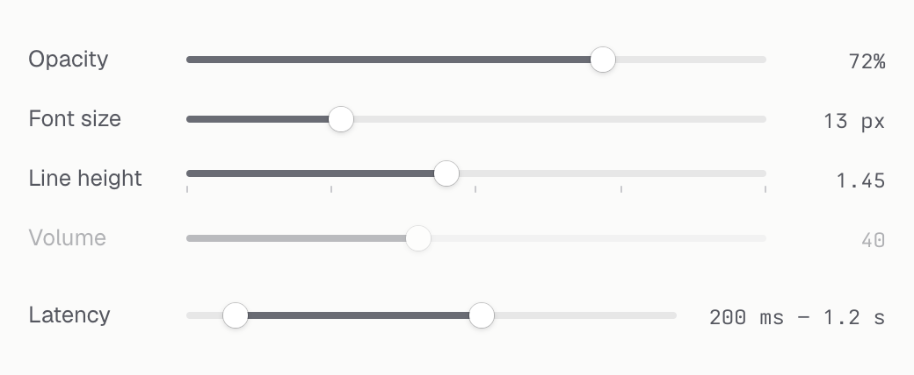
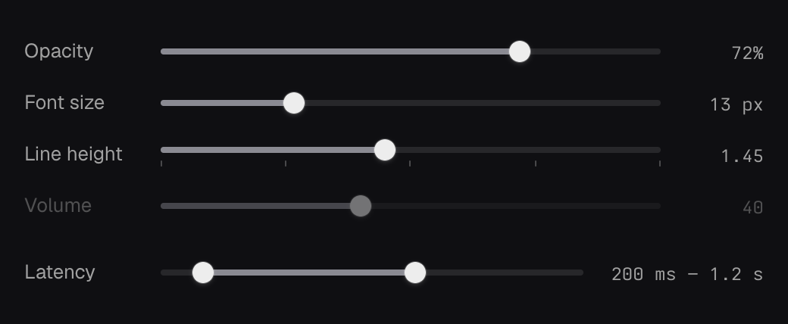
<figcaption><code>default</code> 外观：带单位的数值、<code>ticks</code>、已禁用的滑块，以及使用 <code>format: "duration"</code> 的范围滑块。</figcaption>
</figure>

<figure class="tn-figure">
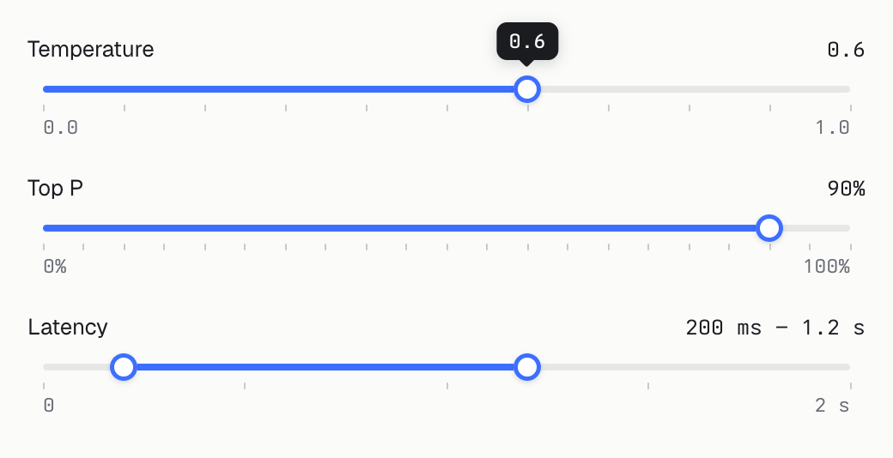
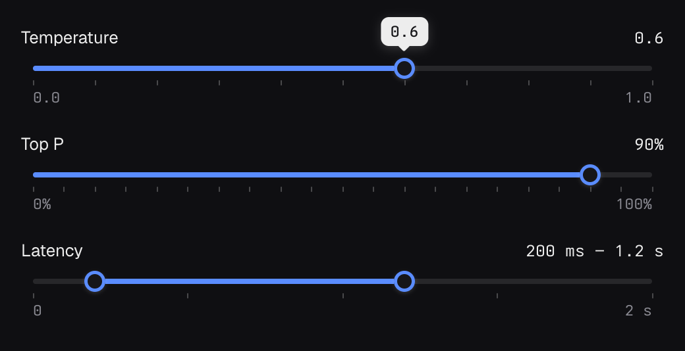
<figcaption><code>accent</code> 外观：每个步进值都有刻度、显示端点值、支持范围，以及悬停或拖动时滑块携带的气泡。</figcaption>
</figure>

## `switch`

采用 Tern 外观的开/关设置，与 Tern 自己的设置使用相同样式。点击开关或其标签会立即切换状态并发送 `change`；状态由你的程序保存，并通过 `on` 返回。适合用于会立即生效的选项（换行、跟随输出、遥测）；如果选项要随表单一起提交，请使用 [`el` checkbox](el.md)。

有三种外观：`default` 是 kit 的 36×22 开关；添加 `label`（以及位于其下方的 `hint`）后，它会填满整行，成为设置行：文字在左侧，开关在右侧。`compact` 是 26×15 的开关，标签位于右侧，适用于密集列表和工具栏。`segment` 是双状态分段控件，显示为 Off | On，在 mono 区域中也很清晰；使用 `labels` 可为两侧重新命名。

与 `el` 控件相同，它只能通过指针操作，不会获取焦点，因此按键仍由你接收。通过自行更改 `on`，即可用键盘驱动它。

**构建方式：** `tern.ui.node("switch", { label = …, on = … })`。

```lua
local ui = tern.ui

ui.node("col", { gap = "sm" }, {
	ui.node("switch", { key = "wrap", label = "Wrap long lines",
		hint = "Soft-wrap instead of scrolling", on = state.wrap }),
	ui.node("switch", { key = "follow", variant = "compact",
		label = "Follow output", on = state.follow }),
	ui.node("switch", { key = "telemetry", variant = "segment",
		label = "Telemetry", on = state.telemetry }),
})
```

TypeScript SDK 中的相同示例（TSX）：

```tsx
<col gap="sm">
   <switch label="Wrap long lines" hint="Soft-wrap instead of scrolling" on={wrap} onChange={(v) => setWrap(v)} />
   <switch variant="compact" label="Follow output" on={follow} onChange={setFollow} />
   <switch variant="segment" label="Theme" labels={['Light', 'Dark']} on={dark} onChange={setDark} />
</col>
```

<figure class="tn-figure">
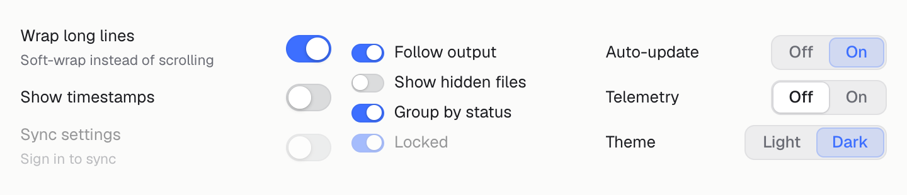
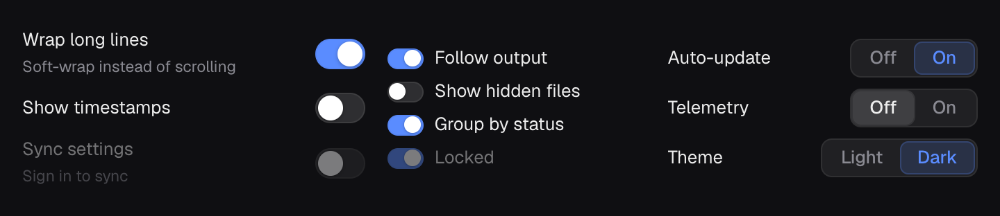
<figcaption>三种外观：<code>default</code> 设置行、<code>compact</code> 列表开关和 <code>segment</code> 分段控件。</figcaption>
</figure>

<figure class="tn-figure">
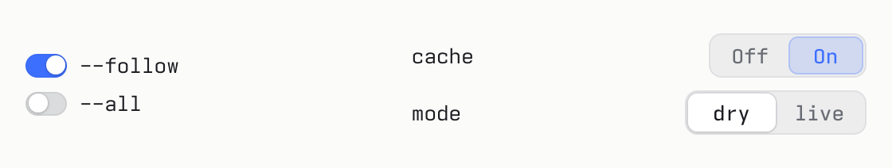
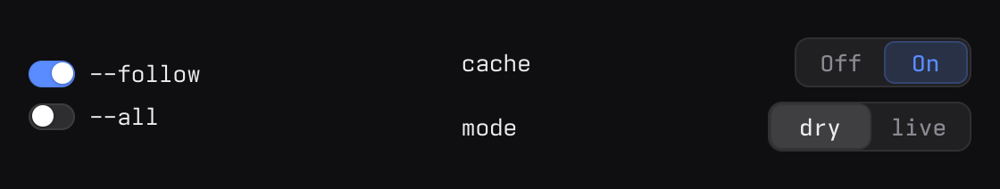
<figcaption>默认 mono 区域中的 <code>compact</code> 和 <code>segment</code>。</figcaption>
</figure>

| 属性 | 类型 | 默认值 | 含义 |
| --- | --- | --- | --- |
| `on` | boolean | `false` | 开关是否开启：类名为 `on`，`aria-checked="true"`。`on` 发生变化时会覆盖用户在本地的切换 |
| `variant` | `"default"` \| `"compact"` \| `"segment"` | `"default"` | 外观（见下文）。其他值按 `default` 处理 |
| `label` | string | none | 设置名称；同时也作为开关的无障碍名称。带标签的开关会填满所在行（类名 `row`） |
| `hint` | string | none | 显示在标签下方的低调文本行，必要时会换行 |
| `labels` | `{ string, string }` | `{ "Off", "On" }` | `segment` 两侧显示的文本，先关后开。其他变体会忽略此属性 |
| `disabled` | boolean or string | `false` | 显示为暗色且不可操作：点击不会切换或发送事件；类名为 `disabled`，`aria-disabled="true"`。字符串表示原因，会作为工具提示显示（优先于 `title`） |

通用属性也可用：`key`（通过它在同级节点间记住本地切换状态，否则使用 id）、`title`、`tone`、`actions` 和 flex 属性。

**变体。**

| `variant` | 外观 | 用途 |
| --- | --- | --- |
| `default` | 36×22 胶囊：关闭时为 `--l3`（深色主题下为 13% 白色），开启时为 `--accent`，两种主题下旋钮均为白色；左侧为标签和提示，右侧为开关 | 设置页面和偏好设置卡片 |
| `compact` | 26×15 胶囊，旋钮为 12px，标签位于其右侧；行高 22px | 密集列表、筛选器、工具栏 |
| `segment` | 28px 高的分段控件，背景为 `--l1`：Off 下方是凸起的卡片式滑块，On 下方是强调色底纹和强调色文字；标签位于左侧 | 以文字选项表达更清晰的设置、mono 区域 |

旋钮会沿弹簧曲线滑动（`--out`，.32 s），按下时会向目标方向拉伸；分段控件的滑块也会以相同方式滑动。在减少动态效果、`.sf-still` 和 `.sf-paused` 状态下，动画会停止。已禁用的开关以 45% 不透明度绘制。

**子节点：** 无（忽略）。

**事件：** 点击开关或其标签会发送事件；对于 `segment`，点击当前未选中的一侧，或点击标签切换状态时也会发送：

```lua
{ ev = "change", id = "<the switch's id>", value = true }  -- the new state
```

开关会立即绘制新状态，并根据 `key` 保持该状态，直到程序发送与上次绘制值不同的 `on`；之后以 `on` 为准。将 `value` 同步到 `on`，即可继续由你控制状态。已禁用的开关，以及位于已关闭 surface 或以 `listen = false` 打开的 surface 上的所有开关，都不会切换或发送事件。

**键盘：** 开关本身没有键盘操作。按键由你的程序负责：切换自己的状态并发送新的 `on`（例如，在整行获得焦点时按 Space）。

**样式：**

```html
<div class="sf sf-switch row on" data-id="main.wrap" data-variant="default"
	role="switch" aria-checked="true" aria-disabled="false" aria-label="Wrap long lines">
	<span class="sf-switch-text">
		<span class="sf-switch-label">Wrap long lines</span>
		<span class="sf-switch-hint">Soft-wrap instead of scrolling</span>
	</span>
	<span class="sf-switch-track" aria-hidden="true"><span class="sf-switch-knob"></span></span>
	<!-- segment: <span class="sf-switch-seg" aria-hidden="true">
		<span class="sf-switch-thumb"></span>
		<span class="sf-switch-opt off">Off</span><span class="sf-switch-opt on">On</span>
	</span> -->
</div>
```

`compact` 会将轨道放在文本之前。

| 目标 | 选择器 |
| --- | --- |
| 节点 | `.sf-switch` |
| 变体 | `.sf-switch[data-variant='compact']`、`[data-variant='segment']` |
| 开启 / 已禁用 | `.sf-switch.on`（`[aria-checked='true']`）、`.sf-switch.disabled`（`[aria-disabled='true']`） |
| 带标签的行 | `.sf-switch.row` |
| 标签 / 提示 | `.sf-switch-label`、`.sf-switch-hint`（位于 `.sf-switch-text` 中） |
| 轨道 / 旋钮 | `.sf-switch-track`、`.sf-switch-knob` |
| 分段控件、滑块、两侧选项 | `.sf-switch-seg`、`.sf-switch-thumb`、`.sf-switch-opt.off`、`.sf-switch-opt.on` |
## `button`

采用 Tern 外观的按钮：包含标签、可选的前置图标，以及表示相同操作按键的键帽。点击会发送 `action` 事件；在你的程序作出响应之前不会发生其他操作。视图中的所有操作都应使用按钮；[设计指南](../guides/design.md#按钮)说明了各处应采用的变体和尺寸。

按钮会按内容确定尺寸，不会拉伸，即使它是 `col` 的子节点也一样（除非你指定 `grow`，否则会保持 `align-self: flex-start`）。与 `el` 控件相同，它只能通过指针操作，不会获取焦点，因此按键仍由你接收；`keys` 可向用户显示应按哪个键。

**构建方式：** `tern.ui.button(text, props?)`（参见 [UI 构建器](../reference/ui.md#button)），或 `tern.ui.node("button", { text = …, variant = … })`。在 SDK 中，按钮的字符串子节点会像徽标的字符串子节点一样成为其 `text`。

| 属性 | 类型 | 默认值 | 含义 |
| --- | --- | --- | --- |
| `text` | string | `""` | 标签。若文本为空且设置了 `icon`，则会绘制仅含图标的按钮；请提供 `title` 或 `aria` |
| `icon` | icon name | none | 来自 [Tern 图标集](data.md#图标名称)的前置图标：普通尺寸为 14px，`sm` 为 12px |
| `keys` | `{ string }` | none | 标签后面的键帽，名称与 [`kbd`](data.md#kbd) 中相同。它只用于显示，按键仍由你的程序处理。未设置 `title` 时，工具提示会显示标签和按键（`Refresh  R`） |
| `variant` | `"default"` \| `"primary"` \| `"quiet"` \| `"danger"` | `"default"` | 外观（见下文）。其他值按 `default` 处理 |
| `size` | `"sm"` \| `"md"` | `"md"` | `md` 高 28px，适用于标题、工具栏和表单；`sm` 高 22px，适用于行内和内联场景 |
| `on` | boolean | `false` | 处于按下状态的切换按钮：类名为 `on`，`aria-pressed="true"`，并绘制强调色底纹 |
| `disabled` | boolean or string | `false` | 显示为暗色且不可操作：不发送事件；类名为 `disabled`，`aria-disabled="true"`。字符串表示原因，会作为工具提示显示（优先于 `title`） |
| `busy` | boolean | `false` | 加载指示器会取代图标（或显示在标签前面）；按钮不会发送事件且保持原宽度；类名为 `busy`，`aria-busy="true"` |

通用属性也可用：`title`、`aria`、`tone`（为你的样式表设置 `--tc`）、`actions` 和 flex 属性。

**变体。**

| `variant` | 外观 | 用途 |
| --- | --- | --- |
| `default` | `--t2` 文字显示在 `--chip-bg` 上，带 `--l2` 细线边框；悬停时变为 `--l2` 背景上的 `--t1` 文字 | 大多数操作 |
| `primary` | `--grad-ink` 文字显示在品牌渐变（`--grad`）上，并带柔和的强调色光晕；键帽使用文字颜色 | 视图存在的主要操作 |
| `quiet` | 无填充、无边框，文字为 `--t2`；悬停时以 `--l1` 着色 | 工具栏和标题中的次要操作、Cancel |
| `danger` | `--bad` 文字显示在 8% `--bad` 底色上，边框为 22% `--bad` | 具有破坏性的操作本身 |

按下时按钮会立即缩放到 98%，并在 .3 s 内恢复；悬停效果立即出现，并在 .15 s 内消退。已禁用的按钮以 45% 不透明度绘制。可用时指针显示手形，按钮已禁用或忙碌时显示箭头。

**子节点：** 无（忽略）。

**事件：** 点击时发送：

```lua
{ ev = "action", id = "<the button's id>", act = "click" }
```

如果按钮设置了 `actions.click`，`act` 就是该值；例如 `actions = { click = "deploy" }` 会发送 `act = "deploy"`（对于 `name=value` 操作还会发送 `value`；按下修饰键时会发送 `mods`；在 `el` 表单中会发送 `values`；规则与其他 action 相同）。已禁用或忙碌的按钮不会发送任何事件，连 `dblclick` 也不会。其他情况下，`dblclick` 和 `menu` 操作与任意节点上的行为相同。复制视图时，按钮会以 `[Label]` 形式写入。

**样式：**

```html
<button class="sf sf-button" data-id="main.bar.deploy" data-variant="primary" data-size="md"
	title="Deploy  ⌘ ⏎">
	<span class="sf-btn-ic"><svg class="ico">…</svg></span>   <!-- busy: <span class="sf-orbit"><i></i></span> -->
	<span class="sf-btn-label">Deploy</span>
	<span class="sf-kbd kbds"><span class="kbd">⌘</span><span class="kbd">⏎</span></span>
</button>
```

| 目标 | 选择器 |
| --- | --- |
| 节点 | `.sf-button` |
| 变体 / 尺寸 | `.sf-button[data-variant='primary']`、`[data-size='sm']` |
| 按下状态的切换按钮 | `.sf-button.on`、`[aria-pressed='true']` |
| 已禁用 / 忙碌 | `.sf-button.disabled`（`[aria-disabled='true']`）、`.sf-button.busy`（`[aria-busy='true']`） |
| 仅图标 | `.sf-button.only-ic` |
| 图标 / 标签 | `.sf-btn-ic`、`.sf-btn-label`（内部结构，可能变化） |
| 忙碌加载指示器 | `.sf-button .sf-orbit`（内部结构，可能变化） |
| 键帽 | `.sf-button .kbd`（内部结构；高 16px，文字 10px） |

`md` 使用 `500 12.5px` sans 字体、`padding: 0 10px`、6px 间距和 8px 圆角；`sm` 使用 `500 12px` sans 字体、`padding: 0 8px`、5px 间距和 6px 圆角。无论区域是否使用 mono，两种尺寸都采用 sans 字体绘制。按钮不会带有 `.sf-act`；它会通过自身规则显示手形指针。

```lua
local ui = tern.ui

return ui.col({
	ui.row({
		ui.button("Deploy", { variant = "primary", keys = { "cmd", "enter" }, actions = { click = "deploy" } }),
		ui.button("Refresh", { icon = "repeat", keys = { "r" }, actions = { click = "refresh" } }),
		ui.button("Follow", { variant = "quiet", on = true, actions = { click = "follow" } }),
		ui.button("Delete", { variant = "danger", actions = { click = "delete" } }),
	}),
	ui.row({
		ui.button("Approve", { size = "sm", actions = { click = "approve" } }),
		ui.button("Retry", { size = "sm", icon = "repeat" }),
		ui.button("Saving", { size = "sm", busy = true }),
		ui.button("Publish", { size = "sm", disabled = "Sign in to publish" }),
		ui.button("", { size = "sm", icon = "more", title = "More actions" }),
	}),
})
```

TypeScript SDK 中的相同示例（TSX）；其中的处理器会为你设置 click 操作：

```tsx
<row>
   <button variant="primary" keys={['cmd', 'enter']} onClick={deploy}>Deploy</button>
   <button icon="repeat" keys={['r']} onClick={refresh}>Refresh</button>
   <button variant="quiet" on={follow} onClick={toggleFollow}>Follow</button>
   <button variant="danger" onClick={askDelete}>Delete</button>
</row>
```

<figure class="tn-figure">
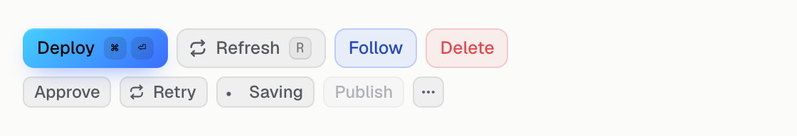
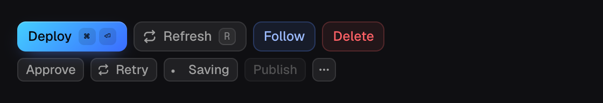
<figcaption>四种变体的 <code>md</code> 尺寸，以及带有 <code>busy</code>、<code>disabled</code> 和仅图标按钮的 <code>sm</code> 尺寸。</figcaption>
</figure>

在表格行内放置按钮时，请使用 [按钮单元格](data.md#table)，它会随操作一同发送所在行。
## `buttons`

将一组 [`button`](#button) 节点绘制为一个控件。适用于需要组合在一起的操作：Undo 和 Redo、上一项 / Today / 下一项、一组 `on` 切换组成的视图切换器、带选项菜单的操作，或窗格顶部的图标工具栏。子节点仍是普通按钮：每个按钮都会单独发送自己的 `action`、显示自己的工具提示，并可处于 `on`、`disabled` 或 `busy` 状态。分组控件只负责将它们绘制在一起。

分组会按内容确定尺寸，不会拉伸（在 `col` 中会保持 `align-self: flex-start`）。分组本身不会获取焦点，组内按钮也不会。

**构建方式：** `tern.ui.node("buttons", { variant = … }, { …buttons })`。

```lua
local ui = tern.ui

return ui.row({
	ui.node("buttons", { label = "History" }, {
		ui.button("Undo", { icon = "undo", actions = { click = "undo" } }),
		ui.button("Redo", { icon = "redo", actions = { click = "redo" } }),
	}),
	ui.node("buttons", { variant = "split" }, {
		ui.button("Deploy", { variant = "primary", icon = "rocket", actions = { click = "deploy" } }),
		ui.button("", { variant = "primary", icon = "chev", title = "Deploy options",
			actions = { click = "deploy-menu" } }),
	}),
	ui.node("buttons", { variant = "toolbar", label = "View" }, {
		ui.button("", { icon = "search", title = "Find", actions = { click = "find" } }),
		ui.button("", { icon = "eye", title = "Preview", on = state.preview,
			actions = { click = "preview" } }),
	}),
})
```

TypeScript SDK 中的相同示例（TSX）：

```tsx
<row>
   <buttons label="History">
      <button icon="undo" onClick={undo}>Undo</button>
      <button icon="redo" onClick={redo}>Redo</button>
   </buttons>
   <buttons variant="split">
      <button variant="primary" icon="rocket" onClick={deploy}>Deploy</button>
      <button variant="primary" icon="chev" title="Deploy options" onClick={openDeployMenu} />
   </buttons>
   <buttons variant="toolbar" label="View">
      <button icon="search" title="Find" onClick={find} />
      <button icon="eye" title="Preview" on={preview} onClick={togglePreview} />
   </buttons>
</row>
```

<figure class="tn-figure">
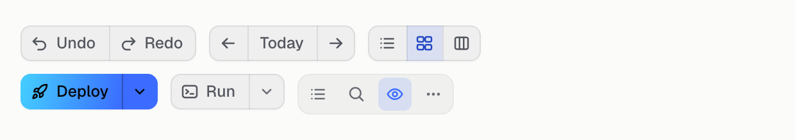
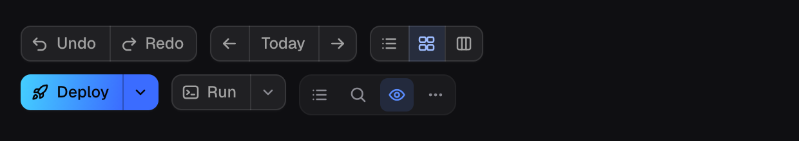
<figcaption>三种变体：连体、分离和工具栏。</figcaption>
</figure>

<figure class="tn-figure">
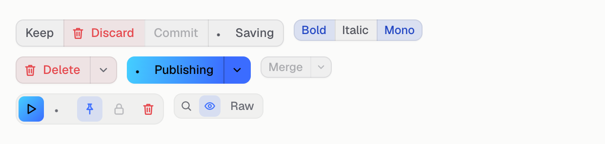
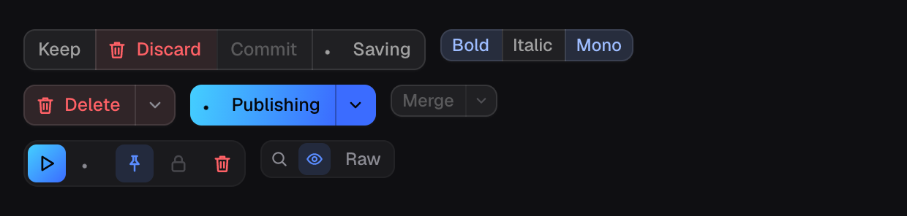
<figcaption>子按钮在所有分组中都会保留各自的变体和状态；<code>size = "sm"</code> 会缩小所有按钮。</figcaption>
</figure>

| 属性 | 类型 | 默认值 | 含义 |
| --- | --- | --- | --- |
| `variant` | `"joined"` \| `"split"` \| `"toolbar"` | `"joined"` | 外观（见下文）。其他值按 `joined` 处理 |
| `size` | `"sm"` \| `"md"` | `"md"` | 子按钮尺寸，优先于子按钮自身的 `size`：`md` 高 28px（工具栏中为 26px），`sm` 高 22px |
| `label` | string | none | 分组的无障碍名称（`aria-label`），例如 `"History"` |

通用属性也可用：`title`、`aria`、`tone` 和 flex 属性。

**变体。**

| `variant` | 外观 | 用途 |
| --- | --- | --- |
| `joined` | 所有子按钮外围只有一个 `--l2` 细线边框和 8px 圆角；按钮之间以 `--l2` 细线分隔；子按钮自身的边框和内侧圆角会移除。`on` 子按钮带 12% 的 `--accent` 底色，`danger` 子按钮带 7% 的 `--bad` 底色，`primary` 子按钮保留渐变背景 | 相关操作（Undo/Redo）、步进器（← Today →）、一组 `on` 切换组成的视图切换器 |
| `split` | 用于两个子按钮的 `joined` 外观：先是操作按钮，然后是 28px（`sm` 时为 22px）的菜单区域，文字为 `--t3`，通常是只显示 `chev` 图标的按钮。两个 `primary` 子按钮会连成一个胶囊：渐变横跨操作按钮和菜单区域，菜单区域保持渐变末端颜色，两者之间由 28% 的 `--grad-ink` 细线分隔 | 带选项的操作：Deploy ▾、Run ▾ |
| `toolbar` | 柔和的井槽（`--t1` 的 5% 底色、10px 圆角、3px 内边距），其中放置相隔 4px 的无边框按钮：26px 方形图标按钮（`sm` 时为 22px），图标为 `--t3`，悬停时为 `--l2`；`on` 按钮使用 `--accent` 和 14% 强调色底纹 | 窗格的工具栏：轮廓、查找、预览、更多 |

每个分段都拥有自己的悬停和按下底色（按下时以着色代替缩放，因此相邻部分不会移动）；已禁用的分段以 45% 不透明度绘制（工具栏中为 40%），忙碌状态则显示按钮的加载指示器。

**子节点：** 按顺序排列的 `button` 节点。其他 kind 仍会绘制在该行中，但不会重新设置样式。

**事件：** 分组本身不产生事件。每个子节点都会像单独的 [`button`](#button) 一样发送自己的 `action`（`{ ev = "action", id = "<the button's id>", act = … }`）；已禁用和忙碌状态的子按钮不会发送事件。

**键盘：** 分组和按钮都不会获取焦点。按键由你的程序负责：使用子按钮的 `keys` 显示按键（工具提示也会列出），并通过属性驱动状态（为活动切换按钮设置 `on`，工作期间设置 `busy`，禁用时提供原因）。

**无障碍：** 使用 `role="group"`（`toolbar` 变体使用 `role="toolbar"`），并将 `label` 作为 `aria-label`；子按钮保留各自的 `aria-pressed` / `aria-disabled` / `aria-busy`。仅显示图标的子按钮应设置 `title`。

**样式：**

```html
<div class="sf sf-buttons" data-id="main.bar.view" data-variant="toolbar" data-size="md"
	role="toolbar" aria-label="View">
	<button class="sf sf-button only-ic" data-variant="default" data-size="md" title="Find">…</button>
	<button class="sf sf-button only-ic on" aria-pressed="true" title="Preview">…</button>
</div>
```

| 目标 | 选择器 |
| --- | --- |
| 节点 | `.sf-buttons` |
| 变体 / 尺寸 | `.sf-buttons[data-variant='split']`、`[data-size='sm']` |
| 分段 | `.sf-buttons > .sf-button` |
| 按下状态的分段 | `.sf-buttons > .sf-button.on` |
| 分离式菜单部分 | `.sf-buttons[data-variant='split'] > .sf-button:last-child` |
## `field`

带标签的表单行：包含标签、控件（或多个控件），以及一行帮助文本；当程序判断出现错误时，该行会显示相应错误信息。只要控件需要名称，就可以使用它：例如面板中的表单、设置列表或对话框字段。它只负责布局和状态：子节点是普通控件（[`input`](#input)、[`editor`](#editor)、[`select`](#select)、[`date`](#date)、[`otp`](#otp)、[`switch`](#switch)、按钮、[`el`](el.md) 复选框），它们保留自己的属性和事件。field 只负责在控件周围绘制文字；处于 `error` 或 `warning` 状态时，会将内部控件的边框环变为红色或琥珀色，因此你不需要在控件本身设置错误属性。

`variant` 有三种外观：

- **`stacked`**（默认）：标签位于控件上方，帮助文本行位于其下方；有错误时会显示带警告图标、颜色为 `--bad` 的错误信息。文本字段会填满宽度。适用于纵向排列的表单。
- **`row`**：类似 Tern 自身设置页面的设置行：标签和提示位于左侧，控件在右侧垂直居中。连续的 `row` 字段之间会绘制细线，因此将它们放入 `col` 后看起来像一个列表。警告或错误会以相应色调替代提示，并在标签前显示图标。
- **`grid`**：类似对话框的表单网格：控件前方是右对齐的标签列（默认 `labelWidth` 为 12 个字符宽），备注位于控件下方。同一列中的每个字段具有相同的标签宽度，因此控件彼此对齐；没有 `label` 的字段仍会保留空列（例如，用于在其他控件下方单独放置复选框）。

标签不是 HTML 的 `<label>`：点击它不会产生任何操作，因此按键仍由程序指定的对象接收（节点不会获取焦点）。请在 `label` 中填写字段名称；控件会通过所属组获取无障碍名称（`role="group"`，由标签命名，并由备注描述）。

**构建方式：** `tern.ui.node("field", { label = …, … }, { control })`。在 SDK 中，field 的子节点就是其控件。

```lua
local ui = tern.ui

local port_error = nil
if state.port < 1 or state.port > 65535 then
	port_error = "Must be 1–65535"
end

return ui.node("col", { gap = "lg" }, {
	ui.node("field", { label = "Service name", hint = "Lowercase letters, digits and dashes", required = true }, {
		ui.node("input", { key = "name", text = state.name }),
	}),
	ui.node("field", { label = "Port", error = port_error }, {
		ui.node("input", { key = "port", text = tostring(state.port) }),
	}),
})
```

TypeScript SDK 中的设置列表和对话框网格示例（TSX）：

```tsx
<col>
   <field variant="row" label="Auto-update" hint="Check daily, install on quit">
      <select key="update" value={update} options={['Never', 'Daily', 'Weekly']} />
   </field>
   <field variant="row" label="Endpoint" warning={reachable ? undefined : 'Unreachable: timed out'}>
      <input key="endpoint" text={endpoint} />
   </field>
   <field variant="row" label="Launch at login" hint="Start Tern when you sign in">
      <switch key="login" on={login} />
   </field>
</col>

<col gap="md">
   <field variant="grid" label="Name"><input key="name" text={name} /></field>
   <field variant="grid" label="Replicas" error={replicas > quota ? `Quota allows ${quota} replicas in this region` : undefined}>
      <input key="replicas" text={String(replicas)} />
   </field>
</col>
```

<figure class="tn-figure">
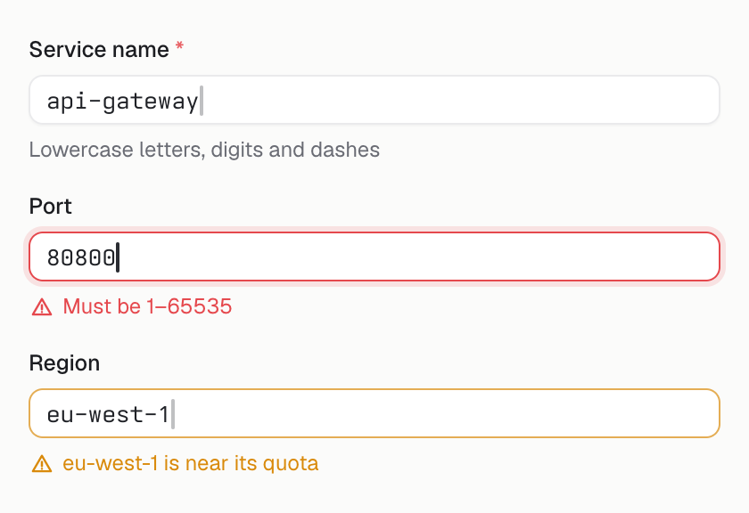
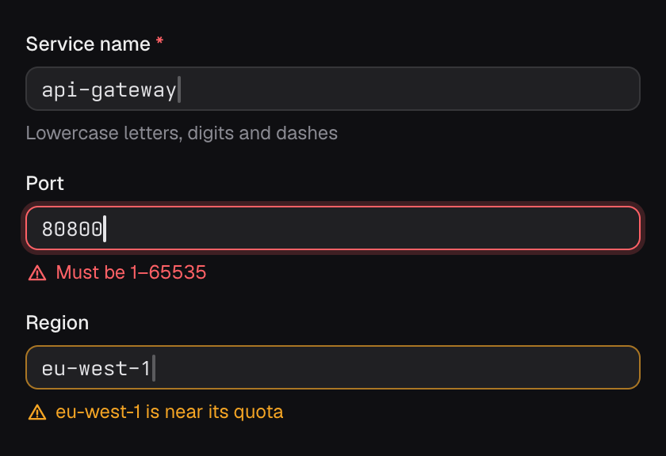
<figcaption><code>stacked</code>：帮助文本、<code>required</code>、已聚焦 input 上的 <code>error</code>，以及 <code>warning</code>。</figcaption>
</figure>

<figure class="tn-figure">
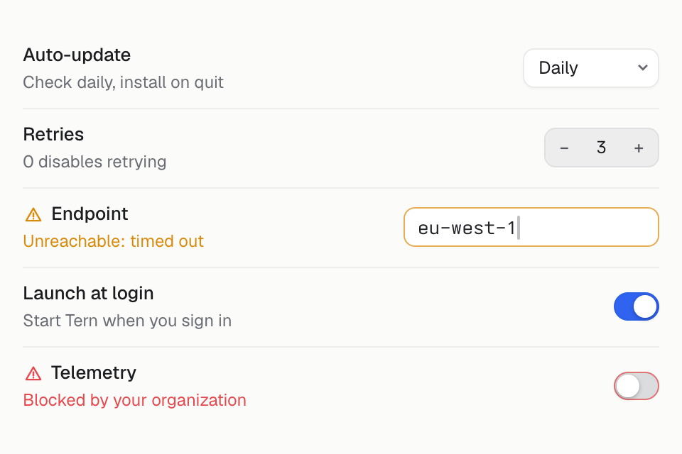
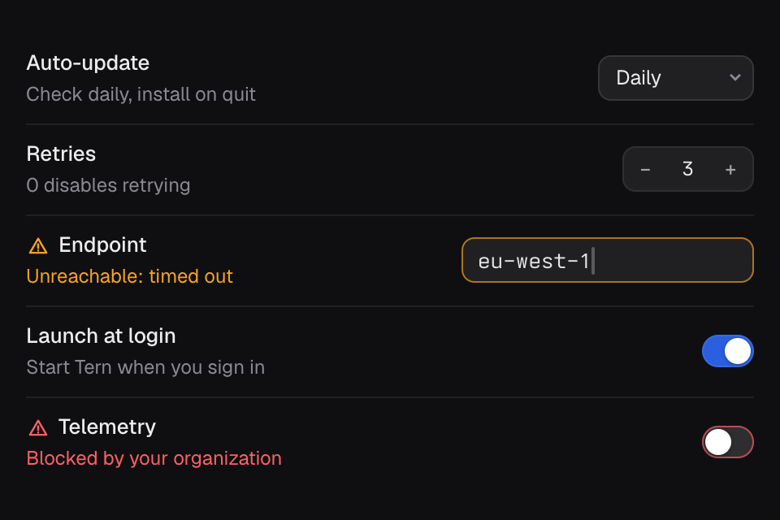
<figcaption><code>row</code>：设置列表，其中的 <code>warning</code> 和 <code>error</code> 替代了提示文本。</figcaption>
</figure>

<figure class="tn-figure">


<figcaption><code>grid</code>：标签共用一列，使控件在其右侧对齐；没有 <code>label</code> 的字段也会保留标签列。</figcaption>
</figure>

| 属性 | 类型 | 默认值 | 含义 |
| --- | --- | --- | --- |
| `label` | 文本（string 或 spans） | none | 字段名称。未设置时，`stacked` 和 `row` 不绘制标签行；`grid` 保留空列 |
| `hint` | 文本 | none | 帮助文本行：在 `stacked`、`grid` 中位于控件下方，在 `row` 中位于标签下方，颜色为 `--t3`。显示 `error` 或 `warning` 时隐藏 |
| `error` | 文本或 boolean | none | 表示发生错误：备注以 `--bad` 显示并带警告图标，内部控件会显示 `--bad` 边框环。设为 `true` 会设置该状态（并显示边框环），但不显示文本行；`""`、`false` 或未设置会清除此状态。优先于 `warning` |
| `warning` | 文本或 boolean | none | 表示需要留意但并非错误：行为与 `error` 相同，使用 `--warn`。设置了 `error` 时会忽略 |
| `required` | boolean | `false` | 在标签后以 `--bad` 显示小型 `*`（`title` 为 "Required"），类名为 `req`。仅用于显示：验证由你的程序负责 |
| `labelWidth` | 尺寸（`"14ch"` 或 `0.3` 等比例值） | `"12ch"` | 仅适用于 `grid`：标签列宽度，以区域字符单元（`--sf-cw`）或字段宽度比例表示。同一表单中的每个字段都应使用相同值 |
| `variant` | `"stacked"` \| `"row"` \| `"grid"` | `"stacked"` | 外观（见下文）。其他值按 `stacked` 处理 |

通用属性也可用（`title`、`aria`、`tone`、`actions`、flex 属性，以及 `w` / `min` / `max`）。文本属性可以使用 spans，因此提示文本可带有 `code` 或 `path` 标记。

**变体。**

| `variant` | 外观 | 用途 |
| --- | --- | --- |
| `stacked` | 标签（`500 12.5px` sans，`--t1`）位于控件上方，备注位于控件下方，间距为 6px；文本字段填满宽度 | 面板或卡片中的表单 |
| `row` | 网格布局：标签（`500 13px`）位于左侧、备注在其下方；控件在右侧居中，两者间隔 24px；最小高度 52px，上下各留 10px；每个 `row` 字段上方会在其前面还有其他 `row` 字段时绘制 `--l1` 细线；文本字段宽 180px | 设置、偏好选项、切换控件 |
| `grid` | 右对齐的标签列（`400 13px`、`--t2`、`labelWidth`）与控件之间相隔 14px（行高 28px），备注位于控件下方 4px | 对话框和包含多个字段的密集表单 |

`error` 或 `warning` 会短暂淡入并下移（.22 s；减少动态效果时不播放）；边框环会跟随控件自身的过渡效果。

当控件正在接收按键（已聚焦的 `input` 或 `editor`）或处于打开状态（`select`、`date`）时，边框环会变为完全饱和的状态色并增加 3px 光晕，以取代强调色焦点环。

**子节点：** 控件，在一行中排列；间距为 8px，必要时换行：`input` 和 `editor` 会扩展以填满空间（`flex: 1 1 140px`；`row` 中固定为 180px），其他控件保持自身宽度。field 内的单行 `input` 会使用表单字段外观（28px 高、8px 圆角、`--card` 底色和 `--l2` 细线边框），而不是着色井槽。子节点也可以使用 `row`。

**事件：** field 本身不产生事件。内部控件会像其他位置一样发送自己的事件（`change`、`edit`、`action`、…）；点击标签或备注不会发送事件，也不会移动焦点。

**键盘：** field 不会获取焦点。照常由你的程序驱动控件的键盘状态（`focus` 操作、`cursor`、`open`、`value`），并通过 `error` / `warning` 管理字段状态：在 `edit` 或 `change` 时执行校验，再设置或清除它们。

**无障碍：** field 的角色为 `role="group"`；`aria-labelledby` 指向其标签，显示备注时 `aria-describedby` 指向备注；错误或警告备注使用 `role="alert"`，因此出现时会被播报。图标均为 `aria-hidden`。

**样式：**

```html
<div class="sf sf-field bad" data-id="main.port" data-variant="stacked" role="group"
	aria-labelledby="…-label" aria-describedby="…-note">
	<div class="sf-field-lbl" id="…-label">
		<span class="sf-field-ic" aria-hidden="true"><svg class="ico">…</svg></span>  <!-- row look only -->
		<span class="sf-field-t">Port</span>
		<span class="sf-field-req sf-hidden" title="Required">*</span>  <!-- shown with `required` -->
	</div>
	<div class="sf-field-ctl"><!-- the children --></div>
	<div class="sf-field-note" id="…-note" role="alert">
		<span class="sf-field-ic" aria-hidden="true"><svg class="ico">…</svg></span>
		<span class="sf-field-msg">Must be 1–65535</span>
	</div>
</div>
```

| 目标 | 选择器 |
| --- | --- |
| 节点 | `.sf-field` |
| 变体 | `.sf-field[data-variant='row']`、`[data-variant='grid']` |
| 错误 / 警告状态 | `.sf-field.bad`、`.sf-field.warn`；色调通过节点上的 `--sf-field-tc` 设置 |
| 必填 / 无标签 / 无备注 | `.sf-field.req`、`.sf-field.nolbl`、`.sf-field.nonote` |
| 标签列 | `.sf-field-lbl`（其文本为 `.sf-field-t`，标记为 `.sf-field-req`） |
| 控件 | `.sf-field-ctl`（子节点的父元素） |
| 备注 | `.sf-field-note`（其中的文本为 `.sf-field-msg`） |
| 图标 | `.sf-field-ic`（内部结构，可能变化） |

边框环规则定义在 field 自身的类上，而不是控件上；它会作用于 `.sf-field-ctl` 内的 `.sf-input`、`.sf-editor`、`.sf-select-btn`、`.sf-date-box`、`otp` 单元格、`switch` 轨道、按钮和 `el` 复选框。你自己的控件可以采用相同规则：

`.sf-field.bad .sf-field-ctl .mine { box-shadow: inset 0 0 0 1px var(--sf-field-tc) }`

参见[设置视图样式](../styles/index.md)，了解如何限定样式表的作用范围；关于规则可使用的属性，参见[支持的 CSS](../styles/css.md)。
