# 布局

布局 kind 用于排列其他节点。使用 `col` 和 `row` 将节点堆叠或并排放置，使用 `card` 为一个工作单元添加框架、标题、状态和可选的折叠，使用 `section` 创建无框架的轻量折叠组，使用 `split` 创建可由用户调整大小的窗格，使用 `scroll` 创建可滚动其子项的容器，使用 `empty` 表示视图暂无内容时的状态，使用 `rule` 表示分隔线或对话记录标记，使用 `spacer` 表示固定垂直间距。

| 种类 | 构建器 | 绘制内容 |
| --- | --- | --- |
| [`col`](#col) | `tern.ui.col(…)`, `tern.ui.lines(…)` | 子项的垂直弹性堆栈 |
| [`row`](#row) | `tern.ui.row(…)` | 子项的水平弹性行 |
| [`card`](#card) | `tern.ui.card(head, …)` | 带框的盒子：标题行（角色图标、标题、状态徽标、折叠箭头）、主体、预览截断 |
| [`section`](#section) | `tern.ui.section(head, …)` | 无框架的折叠组：缩进主体上方的折叠箭头和标题 |
| [`split`](#split) | `tern.ui.node("split", { sizes = … }, …)` | 并排或堆叠的窗格，用户可拖动窗格之间的把手调整大小 |
| [`scroll`](#scroll) | `tern.ui.node("scroll", { max = … }, …)` | 在边界内滚动其子项的盒子，可选固定在末尾（日志、聊天） |
| [`empty`](#empty) | `tern.ui.node("empty", { title = … }, …)` | 空状态：图标、标题、一行弱化文本，以及用于填充内容的操作 |
| [`rule`](#rule) | `tern.ui.rule(label?)`, `tern.ui.node("rule", { variant = … })` | 细分隔线（可带标签）；备注行或固定的对话记录标记（检查点、加入、压缩） |
| [`spacer`](#spacer) | `tern.ui.node("spacer", { size = … })` | 固定垂直空间块 |

## 布局节点的常用 props

每个节点都接受常用 props（参见 [元素](index.md)）。其中两组对布局最重要：弹性 props（用于设置节点在父级 `col` 或 `row` 中的尺寸）以及 `hidden`。这些属性应设在子项上，而不是堆栈上。

| 属性 | 类型 | 效果 |
| --- | --- | --- |
| `grow` | number | 行内 `flex-grow` |
| `shrink` | number | 行内 `flex-shrink` |
| `basis` | number or `"content"` | 数字表示父级的比例（`0.5` → `flex-basis: 50%`）。`"content"` 会设置 `flex-basis: auto` 和 `flex-shrink: 0`：节点保持内容尺寸。其他值会被忽略 |
| `min` | `{ w?, h? }` | 行内 `min-width` / `min-height` |
| `max` | `{ w?, h? }` | 行内 `max-width` / `max-height`。`max.h` 还会添加 class `sf-clip`（`overflow: hidden`），并在截断内容时添加 `sf-clipped`，此时末尾两行会淡出。若要让超出部分仍可访问，请使用 [`scroll`](#scroll) |
| `hidden` | boolean | 添加 `sf-hidden`（`display: none !important`） |

`min` 和 `max` 接受以下尺寸：

| 尺寸 | 示例 | CSS |
| --- | --- | --- |
| 字符单元格 | `"40ch"` | `calc(40 * var(--sf-cw))` |
| 文本行 | `"10lines"` | `calc(10 * var(--sf-lh))` |
| 比例 | `0.25` | `25%` |

像素字符串（`"200px"`）、负数和其他字符串都会被忽略。`--sf-cw` 和 `--sf-lh` 分别是 surface 的单元格宽度和行高（参见[变量](../styles/variables.md)）。

弹性 props 会写入元素的行内样式，因此样式表规则需要使用 `!important` 才能覆盖它们。其他常用 props 会成为属性：`role` → `data-role`、`tone` → `data-tone`（仅接受已知 tone：`neutral`、`accent`、`info`、`success`、`warning`、`error`、`pending`、`muted`、`user`）、`mark` → `data-mark`、`href` → `data-href`、`title` → `title`、`aria` → `aria-label`。

## `col`

垂直弹性堆栈（`display: flex; flex-direction: column; min-width: 0`）。子项按顺序直接绘制在元素中：没有内部包装元素。未设置 `align` prop 时，子项会拉伸至列宽（弹性布局默认值）。

**空堆栈不占空间。** 放置子项后，如果 `col` 绘制的子项全部隐藏或自身为空（或没有子项），就会获得 class `sf-void`（`display: none !important`），因此也不会给父级增加间距。`grow > 0` 的空堆栈会保留：它充当弹性间隔。

**大列依然高效。** `main` 下 `col` 的每个子项都会绘制，但远离视口的子项不会进行布局：它会保持上次的高度（在首次显示之前根据文本估算），并设置 `content-visibility: auto`。无需显式启用，子项滚入和滚出视口时也会保留其状态。`main` 下的 `section`、`card`（不包括 `head` 子项）和带框架的 `tool` 的主体子项也遵循相同规则；截断预览会被视为视口，因此被截断隐藏的内容也不会布局。

**构建方式：** `tern.ui.col(children)`（`gap = "sm"`）或 `tern.ui.lines(children)`（`gap = "none"`，用于一段文本流中的多行）；参见 [UI 构建器](../reference/ui.md#布局)。也可以使用 `tern.ui.node("col", { gap = "md" }, children)`。

| 属性 | 类型 | 默认值 | 含义 |
| --- | --- | --- | --- |
| `gap` | `"none"` \| `"xs"` \| `"sm"` \| `"md"` \| `"lg"` | `"none"`（构建器会发送 `"sm"`） | 子项之间的间距：0、2px、6px、10px、16px。添加 class `gap-<value>` |
| `align` | `"start"` \| `"center"` \| `"end"` \| `"baseline"` \| `"stretch"` | 无（stretch） | 交叉轴对齐（`align-items`）。添加 `al-<value>`；其他值不会添加任何内容 |
| `justify` | `"between"` \| `"end"` | 无（start） | 主轴分布（`justify-content: space-between` / `flex-end`）。添加 `js-<value>`；`"start"` 和其他值不会添加任何内容 |
| `wrap` | boolean | `false` | 添加 class `wrap`。在 `col` 上没有自身样式（只有 `.sf-row.wrap` 规则） |

未知的 `gap` 仍会添加 `gap-<value>`，但没有规则匹配，因此间距为 0。样式表可自行定义：例如在 `gap = "huge"` 时使用 `.sf-col.gap-huge { gap: 40px }`。

```lua
local ui = tern.ui

local rows = {}
for _, gap in { "none", "xs", "sm", "md", "lg" } do
	table.insert(rows, ui.node("row", { gap = "md" }, {
		ui.node("text", { spans = { ui.span(gap, "muted") }, min = { w = "6ch" } }),
		ui.node("row", { gap = gap }, {
			ui.badge("build", "info"),
			ui.badge("test", "info"),
			ui.badge("deploy", "info"),
		}),
	}))
end
return { main = ui.col(rows) }
```

<figure class="tn-figure">
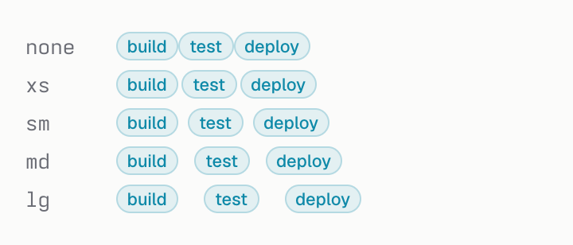
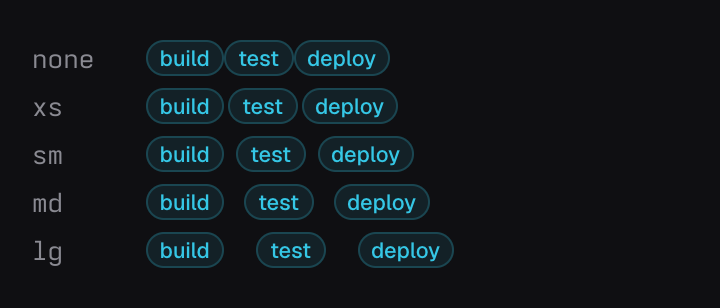
<figcaption>五种间距在行中的效果；列以相同方式设置子项间距。</figcaption>
</figure>

**子项：** 按顺序直接绘制在元素中。

**事件：** 自身没有事件；`actions` 的行为与任意节点相同。

**样式：**

```html
<div class="sf sf-col gap-sm al-center js-between" data-id="main.list">
	<!-- children -->
</div>
```

| 目标 | 选择器 |
| --- | --- |
| 节点 | `.sf-col` |
| 间距 | `.sf-col.gap-none` … `.gap-lg` |
| 对齐 | `.al-start`、`.al-center`、`.al-end`、`.al-baseline`、`.al-stretch` |
| 分布 | `.js-between`、`.js-end` |
| 换行标记 | `.sf-col.wrap` |
| 无内容可显示 | `.sf-void` |

`.sf-col`、`[data-id]`、`[data-role]` 和 `[data-tone]` 是稳定钩子；`gap-*`、`al-*`、`js-*` 和 `wrap` 类随 props 变化。块的区域根节点（`main`、`dock`、`layer`）会直接绘制其子项，而不会绘制为 `col` 元素（参见[视图样式](../styles/index.md)）。

```lua
local ui = tern.ui

return {
	main = ui.node("col", { gap = "md" }, {
		ui.text("Deploy"),
		ui.lines({ ui.text("step 1: build"), ui.text("step 2: upload") }),
	}),
}
```

## `row`

水平弹性行（`display: flex; flex-direction: row; align-items: center; min-width: 0`）。每个直接子项都会获得 `min-width: 0`，因此长文本会收缩并截断，而不是撑宽整行。除非 `align` 另有指定，子项会垂直居中。

行的子项总是会布局。空行与列完全相同，会获得 `sf-void`（参见 [`col`](#col)）；带有 `grow > 0` 且没有子项的 `row` 会保留为间隔，这是将后续子项推到最右端的常用方式。

**构建方式：** `tern.ui.row(children)`（`gap = "sm"`，参见 [UI 构建器](../reference/ui.md#布局)），或 `tern.ui.node("row", { gap = "md", justify = "between" }, children)`。

| 属性 | 类型 | 默认值 | 含义 |
| --- | --- | --- | --- |
| `gap` | `"none"` \| `"xs"` \| `"sm"` \| `"md"` \| `"lg"` | `"none"`（构建器会发送 `"sm"`） | 子项之间的间距：0、2px、6px、10px、16px（`gap-<value>`） |
| `align` | `"start"` \| `"center"` \| `"end"` \| `"baseline"` \| `"stretch"` | 无（样式表设为 `center`） | `align-items`（`al-<value>`）。使用 `"baseline"` 对齐不同字号的文本，使用 `"start"` 对齐多行子项 |
| `justify` | `"between"` \| `"end"` | 无（start） | `justify-content: space-between` / `flex-end`（`js-<value>`） |
| `wrap` | boolean | `false` | `flex-wrap: wrap`（class `wrap`）：子项放不下时会流入更多行 |

一个两行列与标签和徽标并排，在四种 `align` 值下的效果：

```lua
local ui = tern.ui

local rows = {}
for _, align in { "start", "center", "end", "baseline" } do
	table.insert(rows, ui.node("row", { gap = "md", align = align }, {
		ui.node("text", { spans = { ui.span(align, "muted") }, min = { w = "8ch" } }),
		ui.node("col", {}, { ui.text("main.rs"), ui.text("lib.rs") }),
		ui.badge("2 files", "info"),
	}))
end
return { main = ui.node("col", { gap = "lg" }, rows) }
```

<figure class="tn-figure">
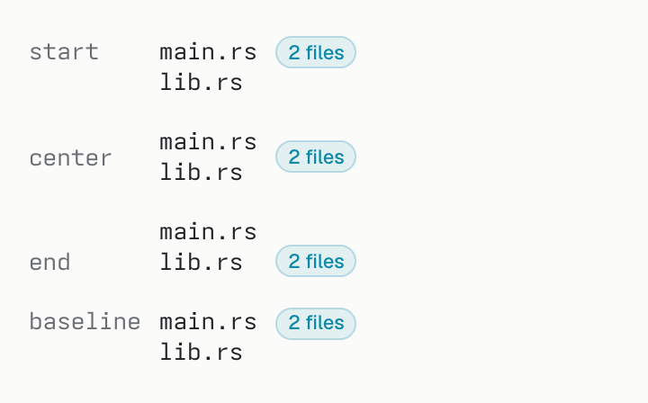
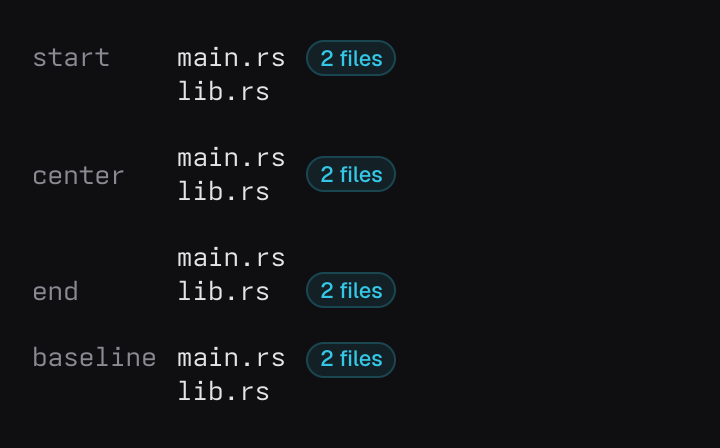
</figure>

**子项：** 按顺序直接绘制在元素中。使用[常用弹性 props](#布局节点的常用-props)设置尺寸。

**事件：** 自身没有事件；`actions` 的行为与任意节点相同。

**样式：**

```html
<div class="sf sf-row gap-sm wrap" data-id="main.toolbar">
	<!-- children -->
</div>
```

| 目标 | 选择器 |
| --- | --- |
| 节点 | `.sf-row` |
| 子项 | `.sf-row > *` |
| 换行 | `.sf-row.wrap` |
| 间距、对齐、分布 | 与 `col` 相同的 `.gap-*`、`.al-*`、`.js-*` |
| 无内容可显示 | `.sf-void` |

```lua
local ui = tern.ui

return ui.node("row", { gap = "md", align = "baseline" }, {
	ui.text({ ui.span("api", "strong") }),
	ui.node("row", { grow = 1 }), -- empty and growing: pushes the badge right
	ui.badge("healthy", "success"),
})
```

<figure class="tn-figure">
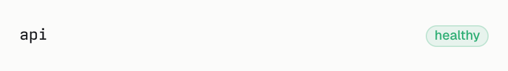
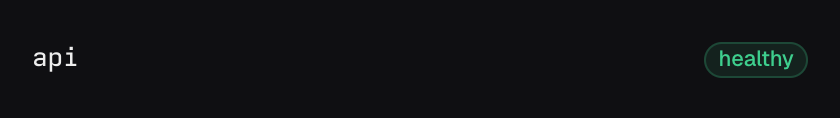
</figure>

## `card`

带圆角的盒子，边框细线根据 `tone` 着色，包含标题行和主体：一个面板。标题行从左到右显示：图标（`icon`，否则使用 `role` 隐含的图标）、标题内容、弱化的 `meta`，然后在最右侧显示 `end` 子项（你的控件）、状态徽标和折叠箭头。主体将其他子项放在一列中，子项间距为 `--sf-inner-gap`（8px），并缩进以与标题文本对齐：带图标时使用 `padding: 0 12px 10px 36px`，不带图标时使用 `0 12px 10px`（class `noic`；omp 自己的卡片会保留其内边距）。在应用中，card 表示一个对象（所选项目的详情、确认条、错误），不要用它包住表格、`stats` 条或另一张 card；哪些内容应该放在哪里，请参见[设计视图](../guides/design.md#卡片)。

**标题控件。** `end` 用 id 指定 card 自身的一个子项（与 `head` 相同）；Tern 会将其绘制在标题右侧，而不是主体中：例如包含 [`button`](input.md#button) 的 `row`、分段式 [`tabs`](lists.md#tabs)、[`badge`](data.md#badge)。点击它不会折叠可折叠的 card。`meta` 是在标题内容之后、使用 `--t3` 绘制的文本（sans 区域中的 12.5px sans），与标题相距 8px：例如数量、版本、“2 分钟前更新”。

`end` 是 Luau 关键字，因此 prop 必须写成 `["end"] = …`。SDK 会为 `end`（以及 `head`）接受一个节点：将其添加为 key 为 `end`（或 `head`）的 card 子项，并发送它的 id。

```lua
local ui = tern.ui

return ui.col({
	ui.node("card", { key = "services", icon = "server", head = "Services", meta = "24 · 2 degraded",
		["end"] = "main.services.end" }, {
		ui.node("row", { key = "end", gap = "sm" }, {
			ui.node("tabs", { key = "filter", variant = "segmented", active = "all", items = {
				{ id = "all", label = "All" }, { id = "degraded", label = "Degraded" },
			} }),
			ui.button("Refresh", { icon = "repeat", keys = { "r" }, actions = { click = "refresh" } }),
		}),
		ui.text({ ui.span("api-gateway, billing, search and 21 more", "muted") }),
	}),
	ui.node("card", { key = "notes", head = "Notes", meta = "no icon: the body lines up with the head" }, {
		ui.text("Body text starts under the head text."),
	}),
})
```

<figure class="tn-figure">
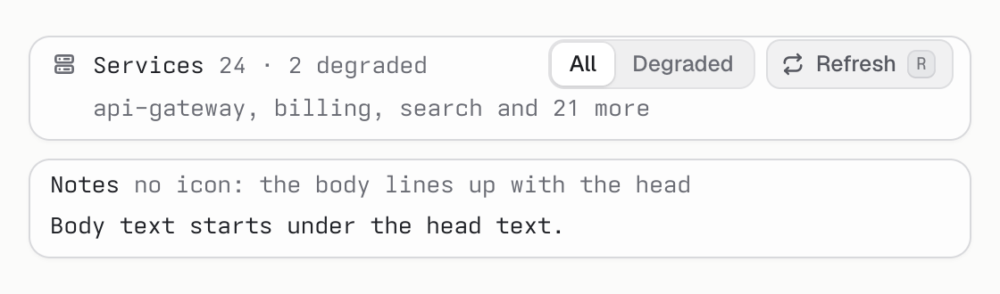
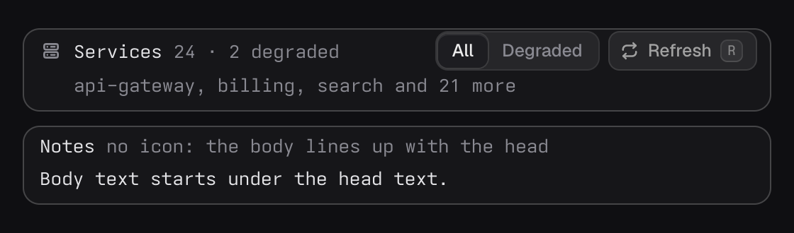
<figcaption>带有 <code>icon</code>、<code>meta</code> 和 <code>end</code> 控件的面板标题，以及一张不带图标的卡片。</figcaption>
</figure>

**标题。** `head` 可以是 span 列表（`TspText`：字符串或 spans），绘制到 `div.sf-head` 中；也可以是 card 自身某个子项的 id，该子项会绘制在标题中而不是主体中。不是子项 id 的字符串会作为普通文本。块中子项 id 为 `<parent id>.<key>`（未设置 key 时为 `<parent id>.<index>`），因此 id 为 `main.build` 的 card 下，`key = "title"` 的子项名称是 `"main.build.title"`。`tern.ui.card(head, …)` 始终会将 `head` 作为 spans 发送；若要指定子项，请将 `p.head` 设为其 id，或使用 `tern.ui.node` 构建 card。

**主体。** 即使没有子项，主体也会保留底部内边距，因此有标题但主体为空的 card 会在标题行下方绘制 10px 空间。

**无标题。** 如果 card 没有标题内容、没有状态且不是 `collapsible`，标题行会隐藏（class `nohead`），主体采用均匀内边距（`10px 12px`）。仅有 role 图标不会使标题显示。

**角色图标。** `icon` 直接指定标题图标（[图标名称](data.md#图标名称)），优先于 `role` 所隐含的图标。未指定时，`role` 会选择图标：`lens.<family>…` 按 family 映射（`lens.git.log` → branch，未知 family → terminal），`omp.tool.<tool>…` 按 tool 映射（未知 tool → plug），其他 role 则使用它的第二个点分段（前提是 Tern 有该名称的图标；`omp.user` → user，`plugin.search.results` → search，`plugin.bash` → terminal）。已知名称包括 `bash`、`shell`、`edit`、`read`、`search`、`web`、`todo`、`task`、`user` 和 `error`。大多数插件角色都没有图标（`plugin.ci.job` 会读取 `ci`），因此图标容器会保持隐藏。图标采用 tone 颜色（neutral 或未着色的 card 使用 `--t3`）。

**状态徽标。** `status` 可为 `pending`（时钟，“Pending”）、`running`（脉动圆点，“Running”）、`done`（勾号，“Done”）、`error`（叉号，“Failed”）或 `cancelled`（停止符号，“Canceled”）。其他值不会显示徽标。card 自身不会绘制定时器：要显示定时器，请在标题中放置 [`elapsed`](motion.md#elapsed) 节点。

每种 tone，其中部分带状态：

```lua
local ui = tern.ui

local cards = {}
for _, t in {
	{ "untoned", nil, "running" }, { "neutral", "neutral" }, { "accent", "accent" }, { "info", "info" },
	{ "success", "success", "done" }, { "warning", "warning" }, { "error", "error", "error" },
	{ "pending", "pending", "pending" }, { "muted", "muted", "cancelled" }, { "user", "user" },
} do
	table.insert(cards, ui.node("card", { head = t[1], tone = t[2], status = t[3], basis = 0.48, grow = 1 }, {
		ui.text("Body"),
	}))
end
return { main = ui.node("row", { gap = "sm", wrap = true }, cards) }
```

<figure class="tn-figure">
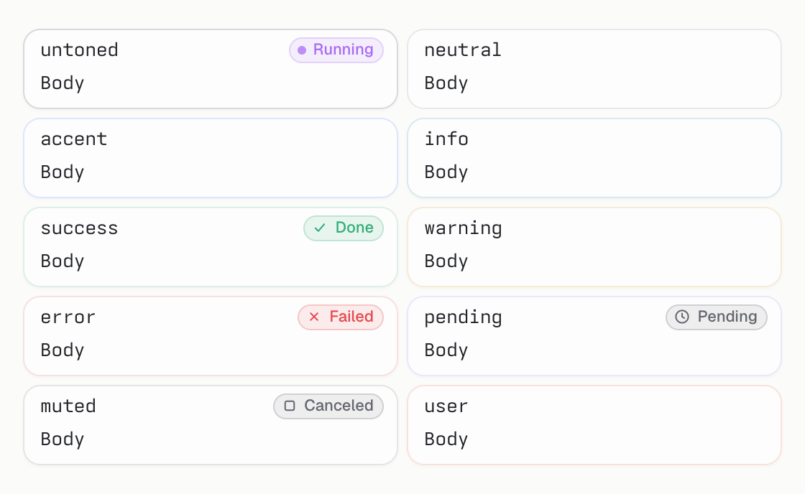
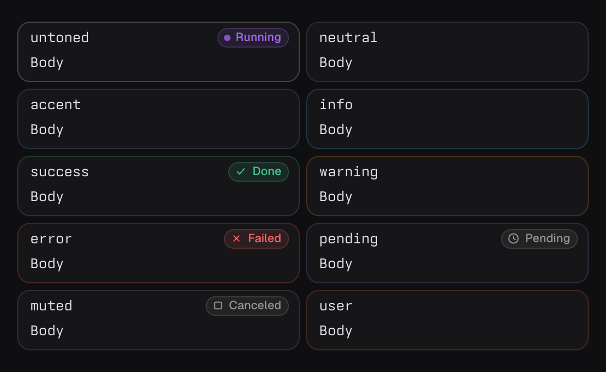
<figcaption>填充色保持为 <code>--sf-card-bg</code>；tone 会体现在边框上。</figcaption>
</figure>

**折叠。** 设置 `collapsible = true` 后，标题会成为按钮（`role="button"`、`tabindex="0"`、`aria-expanded`）：点击、按 Enter 或 Space 均可切换折叠状态。在标题上按 ⌘-点击不会切换，因此标题中的链接仍能正常打开。折叠时：

- 未设置 `preview`：主体和“更多”按钮会隐藏（class `nopreview`）；
- 设置了 `preview`：主体会截断为指定行数（`preview × line height`）。内容更高时，card 会获得 class `clamped`：主体的 `max-height` 为 `var(--sf-clamp)`，最后约 2 行上方有渐隐效果，其下方显示 `button.sf-more`，文本为 `N more lines`（或 `1 more line`），带折叠箭头，`title` 为 `Show all  N more lines`。点击后会展开 card（与点击标题的本地切换相同）。内容未超出时不会截断，也不会显示按钮。只有超过四分之一行的部分才算隐藏行。card 尺寸改变时会重新测量截断高度。

未设置 `collapsible` 时，`collapsed` 不起作用：card 仍保持展开。

```lua
local ui = tern.ui

local log = "step 1: ok\nstep 2: ok\nstep 3: ok\nstep 4: ok\nstep 5: ok"
local function build(head, p)
	p.head, p.role, p.collapsible = head, "lens.build", true
	return ui.node("card", p, { ui.ansi(log) })
end
return {
	main = ui.col({
		build("Open", { status = "done" }),
		build("Collapsed", { status = "done", collapsed = true }),
		build("Collapsed, preview 2 lines", {
			status = "error", tone = "error", collapsed = true, preview = { lines = 2 },
		}),
	}),
}
```

<figure class="tn-figure">
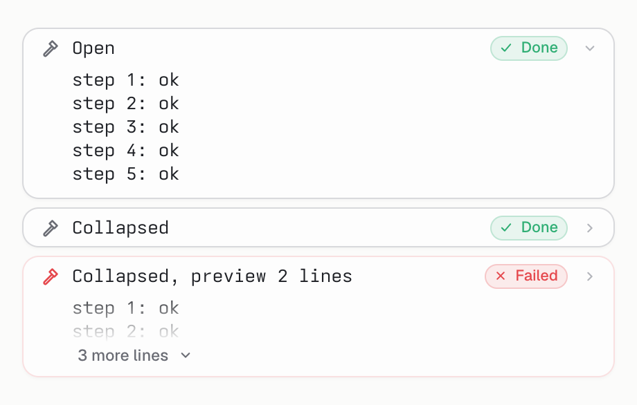
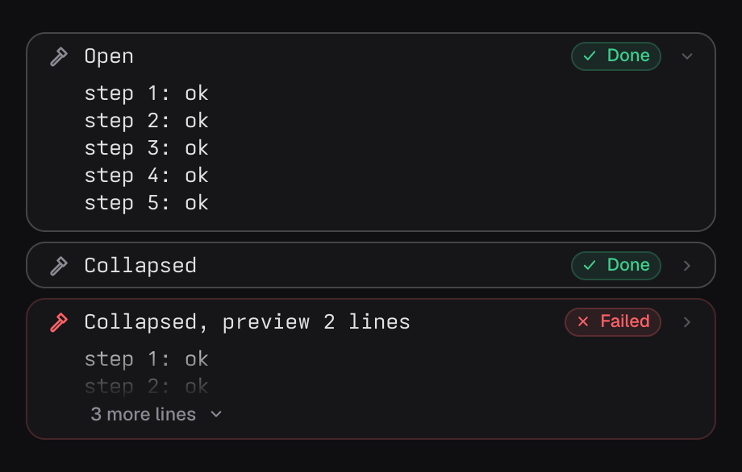
<figcaption>展开时折叠箭头朝下，折叠时朝右；<code>lens.build</code> 隐含锤子图标。</figcaption>
</figure>

**折叠状态是本地状态。** 用户切换后立即生效，无需往返通信；状态按同级节点的 `key`（未设置时使用 id）记忆，而不是按整个 surface 记忆。在同一父级下，删除某张卡片后再添加具有新 id、相同 key 的卡片，会保留折叠状态；在另一父级下使用相同 key 时，状态彼此独立。`collapsed` prop 设置初始状态；用户切换后，本地状态优先，直到视图发送不同的 `collapsed` 值才会重置（再次发送同一值不会产生变化）。程序会收到 `toggle` 事件。

**内部预览。** 自带 `preview` 的 kind（`ansi`、`code`）仅在折叠时应用该 prop：位于展开的可折叠 card、section 或 [`tool`](work.md#tool) 内（取树中最近的一个）时，内部预览会让位并完整显示；外层因点击或程序的 `collapsed` 而折叠后，则重新截断。折叠组收起期间，点击内部的“还有 N 行”/“前面还有 N 行”按钮会展开外层（像点击标题一样发送 `toggle` 事件），而不是只展开它们自己的块。

**构建方式：** `tern.ui.card(head, children)`（参见 [UI 构建器](../reference/ui.md#布局)），然后在 `p` 上设置 props；或者使用 `tern.ui.node("card", { head = …, status = "running", collapsible = true }, children)`。

| 属性 | 类型 | 默认值 | 含义 |
| --- | --- | --- | --- |
| `head` | spans、string 或子项 id | 无 | 标题内容（见上文） |
| `icon` | 图标名称 | 无 | 标题图标；优先于 `role` 隐含的图标 |
| `meta` | spans 或 string | 无 | 标题内容后方的弱化文本 |
| `end` | 子项 id | 无 | 将该子项绘制在标题最右侧，而不是主体中（见上文） |
| `status` | `"pending"` \| `"running"` \| `"done"` \| `"error"` \| `"cancelled"` | 无 | 状态徽标；添加 `.sf-chip.st-<status>` |
| `role` | string | 无 | `data-role`，以及它隐含的标题图标 |
| `tone` | tone 名称 | 无 | `data-tone`：边框颜色和填充色（见下文） |
| `collapsible` | boolean | `false` | 标题可切换折叠；添加 `collapsible` 并显示折叠箭头 |
| `collapsed` | boolean | `false` | 初始折叠状态（需要 `collapsible`）；添加 `collapsed` |
| `preview` | `"auto"` 或 `{ lines = n }` | 无 | 折叠时显示的行数。`"auto"` 为 10；小数 `lines` 会截断取整，小于 1 或其他形状的值表示不预览 |
| `key` | string | 无 | 同级节点身份；同一父级下按此 key 记住本地折叠状态（未设置 key 时使用节点 id） |
| `selected` | boolean | `false` | class `selected`：强调色边框和柔和的 3px 强调色光晕 |
| `inset` | boolean | `false` | class `inset`：主体无内边距（`0 0 1px`），子项使用 card 底部圆角，使 `code`、`diff` 或 `table` 从边到边填满卡片 |
| `variant` | `"bare"` | 无 | class `bare`：无边框、填充或圆角；标题为无内边距的普通行高行，主体缩进 24px。保留标题、状态、折叠和预览。用于分组和紧凑展示，例如一组行或较大卡片中的单个文件 |

```lua
local ui = tern.ui

return {
	main = ui.node("col", { gap = "md" }, {
		ui.node("card", { head = "selected", selected = true }, { ui.text("An accent ring and halo.") }),
		ui.node("card", { head = "inset", inset = true }, { ui.code('[build]\ntarget = "release"', "toml") }),
		ui.node("card", { head = "variant = bare", variant = "bare", status = "done", collapsible = true }, {
			ui.text("A plain head row over an indented body."),
		}),
		ui.node("card", {}, { ui.text("No head: the head row hides.") }),
	}),
}
```

<figure class="tn-figure">
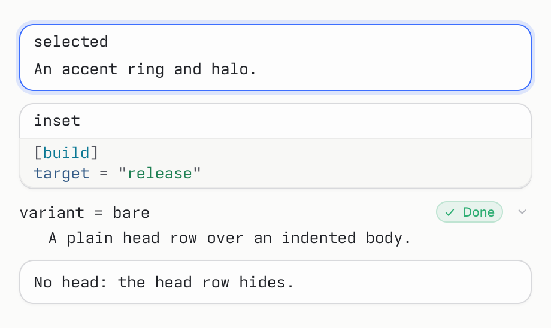
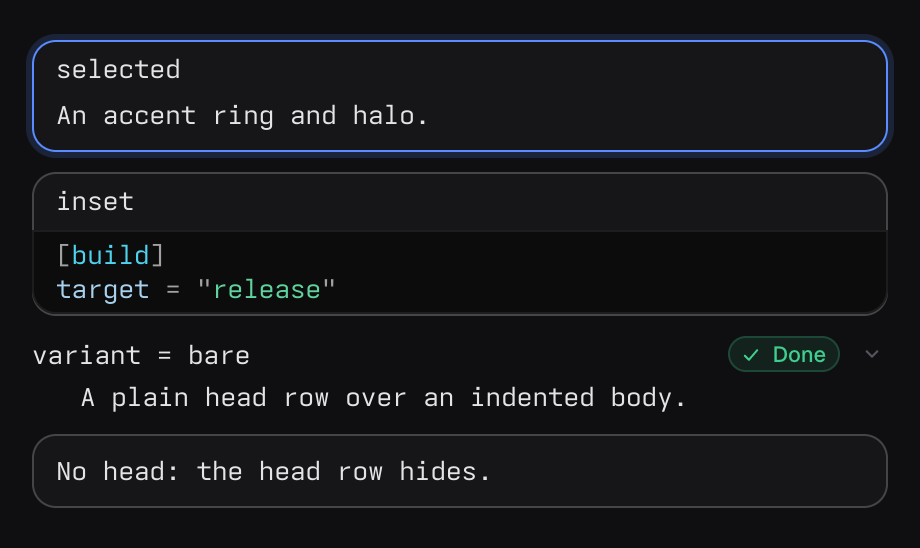
</figure>

**子项：** `head` 指定的子项（若有）进入 `div.sf-head`；`end` 指定的子项（若有）进入 `div.sf-card-end`；其余子项按顺序进入 `div.sf-card-body`。

**事件：** 用户切换可折叠 card 时发送 `toggle`（点击标题、聚焦标题后按 Enter/Space，或点击“更多”按钮）：

```lua
{ ev = "toggle", id = "main.build", collapsed = true, key = "build" } -- key only when the node has one
```

块的 `event(state, ev, cx)` 会接收此事件。在 card 自身设置 `actions = { click = "toggle" }` 也会切换折叠状态。其他情况下，`actions` 的行为与任意节点相同。

**样式：**

```html
<div class="sf sf-card collapsible collapsed clamped" data-id="main.build" data-role="plugin.ci.job" data-tone="error"
	style="--sf-clamp: 200px">
	<div class="sf-card-head meta" role="button" tabindex="0" aria-expanded="false">   <!-- .meta with a meta -->
		<span class="sf-card-ic sf-hidden" aria-hidden="true"></span>
		<div class="sf-head"><!-- head spans or the head child --></div>
		<span class="sf-card-meta"><!-- meta spans --></span>
		<div class="sf-card-end"><!-- the end child --></div>
		<span class="sf-chip st-error"><svg class="ico">…</svg>Failed</span>
		<span class="sf-chev" aria-hidden="true"><svg class="ico">…</svg></span>
	</div>
	<div class="sf-card-body"><!-- children --></div>
	<button class="sf-more" aria-hidden="false" title="Show all  12 more lines">12 more lines<svg class="ico">…</svg></button>
</div>
```

| 目标 | 选择器 |
| --- | --- |
| 节点 | `.sf-card` |
| 按 role / tone | `.sf-card[data-role='…']`、`.sf-card[data-tone='error']` |
| 标题行 | `.sf-card-head`（内部结构，可能变化） |
| 标题内容 | `.sf-card-head > .sf-head`（内部结构，可能变化） |
| 标题图标 | `.sf-card-ic`（内部结构，可能变化） |
| Meta / 标题控件 | `.sf-card-meta`、`.sf-card-end`（内部结构，可能变化） |
| 状态徽标 | `.sf-chip`、`.sf-chip.st-pending` … `.st-cancelled`、运行圆点 `.sf-chip .dot`（内部结构，可能变化） |
| 折叠箭头 | `.sf-chev`（内部结构，可能变化）；仅在 `.collapsible` 时显示，在 `.collapsed` 时旋转 −90° |
| 主体 | `.sf-card-body`（内部结构，可能变化） |
| “还有 N 行” | `.sf-more`（内部结构，可能变化）；仅在 `.sf-card.clamped` 时显示 |
| 折叠 | `.sf-card.collapsible`、`.sf-card.collapsed`、`.sf-card.nopreview`、`.sf-card.clamped` |
| 标记 | `.sf-card.selected`、`.sf-card.inset`、`.sf-card.bare`、`.sf-card.nohead`、`.sf-card.noic`（没有标题图标） |

色调和颜色：

- 边框使用 `rgb(from var(--tc) r g b / 16%)`（暗色主题中为 20%），其中 `--tc` 是由 `[data-tone]` 设置的 tone 颜色。未着色的 card 使用 `--sf-neutral`；`tone = "neutral"` 使用原始 `--l2` 细线。
- 填充色为 `--sf-card-bg`；若定义了 `--sf-tint-<tone>`，`success`、`error`、`pending`、`user`、`info` 和 `neutral`/未着色 card 会改用该变量（参见[变量](../styles/variables.md#上下文填充色)）。
- 主体间距为 `--sf-inner-gap`；圆角半径为 `--r-card`；截断高度为 `--sf-clamp`，在截断时设为行内样式。
- 状态徽标根据 `--cc` 采用以下颜色：`--sf-muted`（pending、cancelled）、`--live`（running）、`--sf-ok`（done）、`--sf-bad`（error）。
- 可折叠标题在悬停时使用 `--sf-shade` 着色。
- 被截断主体中的子项有 `flex-shrink: 0`：如果样式表允许它们收缩，“还有 N 行”的计数就会出错。

`bare` 外观（无填充、边框和圆角）适用于区域内部（`.sf-region .sf-card.bare`）。

```lua
local ui = tern.ui

local function job(j)
	local card = ui.card({ ui.span(j.name, "strong"), ui.span("  " .. j.branch, "muted") }, {
		ui.node("ansi", { text = j.log }),
	})
	local p: { [string]: any } = card.p or {}
	p.key = j.id
	p.role = "plugin.ci.job"
	p.status = j.failed and "error" or "done"
	p.tone = j.failed and "error" or nil
	p.collapsible = true
	p.collapsed = not j.failed
	p.preview = { lines = 6 }
	card.p = p
	return card
end
```

## `section`

轻量的无框架折叠组：标题行由折叠箭头和标题内容组成，主体向内缩进 22px，左侧带 1px 细线（`box-shadow: inset 1px 0 0 var(--l2)`）。主体子项之间使用 `--sf-inner-gap` 间距。

`head`、`collapsible`、`collapsed` 和 `key` 的行为与 [`card`](#card) 完全相同：标题可以是 spans 或子项 id；可折叠时标题会成为按钮，支持 Enter/Space 并带有 `aria-expanded`；同级节点的本地折叠状态按 `key` 记忆；并发送 `toggle` 事件。折叠时主体会隐藏。section 不支持角色图标、状态徽标、预览截断、“更多”按钮、`selected`、`inset` 或 `variant`；这些 props 会被忽略。折叠箭头始终显示，展开时朝下，即使 section 不可折叠也是如此。

**构建方式：** `tern.ui.section(head, children)`（参见 [UI 构建器](../reference/ui.md#布局)），或 `tern.ui.node("section", { head = "Details", collapsible = true }, children)`。

| 属性 | 类型 | 默认值 | 含义 |
| --- | --- | --- | --- |
| `head` | spans、string 或子项 id | 无 | 标题内容 |
| `collapsible` | boolean | `false` | 标题可切换折叠；添加 `collapsible` |
| `collapsed` | boolean | `false` | 初始折叠状态（需要 `collapsible`）；添加 `collapsed` 和 `nopreview`（主体隐藏；`preview` prop 会被忽略） |
| `key` | string | 无 | 同级节点身份；同一父级下按此 key 记住本地折叠状态（未设置 key 时使用节点 id） |

**子项：** `head` 子项进入 `div.sf-head`，其余进入 `div.sf-section-body`。

**事件：** `toggle`，与 [`card`](#card) 相同。

**样式：**

```html
<div class="sf sf-section collapsible" data-id="main.env">
	<div class="sf-section-head" role="button" tabindex="0" aria-expanded="true">
		<span class="sf-chev" aria-hidden="true"><svg class="ico">…</svg></span>
		<div class="sf-head"><!-- head --></div>
	</div>
	<div class="sf-section-body"><!-- children --></div>
</div>
```

| 目标 | 选择器 |
| --- | --- |
| 节点 | `.sf-section` |
| 标题行 | `.sf-section-head`（内部结构，可能变化） |
| 标题内容 | `.sf-section-head > .sf-head`（内部结构，可能变化） |
| 折叠箭头 | `.sf-section-head .sf-chev`（内部结构，可能变化）；折叠时旋转 −90° |
| 主体 | `.sf-section-body`（内部结构，可能变化） |
| 折叠 | `.sf-section.collapsible`、`.sf-section.collapsed` |

标题文本使用 `--t2`。可折叠标题悬停时变为 `--t1`，并使用 `--l1` 底色。主体左侧细线向内缩进 7px，位于折叠箭头下方。

```lua
local ui = tern.ui

local function env(key: string, collapsed: boolean)
	local s = ui.section({ ui.span("Environment"), ui.span(" 2", "muted") }, {
		ui.kv({ { "PATH", "/usr/bin" }, { "HOME", "/Users/me" } }),
	})
	local p: { [string]: any } = s.p or {}
	p.key = key
	p.collapsible = true
	p.collapsed = collapsed
	s.p = p
	return s
end

return { main = ui.col({ env("env", false), env("env2", true) }) }
```

<figure class="tn-figure">
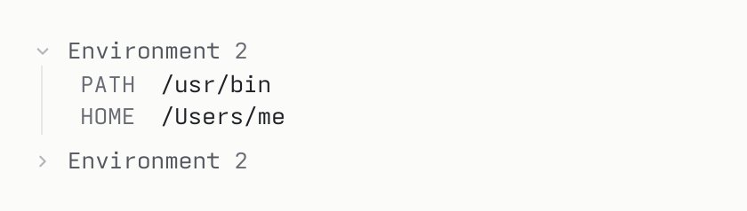
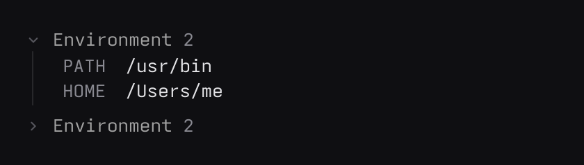
</figure>

## `split`

可由用户调整大小的窗格：每个子项都是一个窗格，两个窗格之间有一个可由指针拖动的把手。适用于两个或三个视图共享空间，且用户应能决定各自占比的情况：文件列表与文件并排、查询与结果上下排列、对话与详情并排。若要采用固定布局，请使用带 `basis` 的 `row` 或 `col`；若要一次显示一个视图，请使用 [`tabs`](lists.md#tabs)。

有三种外观。默认的 `hairline` 是一个带框架的盒子，窗格之间有 1px 分隔线；悬停时分隔线会染上色调并显示握把胶囊，按住分隔线时会变为强调色，并显示玻璃质感的比例提示。`gutter` 会让每个窗格都成为独立卡片，间隔 6px，间隙中有点状握把。`tiles` 会让每个窗格成为独立卡片，间隔 8px，间隙本身就是把手：悬停时显示强调色线条，按住时线条保持显示。

`dir = "col"` 会堆叠窗格，把手上下移动。堆叠式 split 需要高度：可使用 `h`（默认 12 行），或在自身有高度的父级中使用 `grow`（例如 screen surface 的 `main`），以填满父级。

**构建方式：** `tern.ui.node("split", { sizes = { 0.36, 0.64 } }, { pane, pane })`（没有专用构建器）。

| 属性 | 类型 | 默认值 | 含义 |
| --- | --- | --- | --- |
| `variant` | `"hairline"` \| `"gutter"` \| `"tiles"` | `"hairline"` | 外观（见下文）。未知值按 `hairline` 处理 |
| `dir` | `"row"` \| `"col"` | `"row"` | `row`：窗格并排，把手左右移动。`col`：窗格堆叠，把手上下移动 |
| `sizes` | number[] | 窗格均分 | 每个窗格的比例，顺序与子项一致。会归一化至总和为 1（`{ 2, 1 }` 会变为 `{ 0.667, 0.333 }`）；缺失、为零或负值的项会平分其他项从 1 中留下的余量（如果没有余量，则采用其他项的平均值）。用于指定用户拖动前显示的比例，以及双击把手后恢复的比例。若 `sizes` 改变，则以新值覆盖用户拖动结果 |
| `min` | (string \| number \| nil)[]、string 或 number | 无 | 每个窗格沿 split 方向的最小尺寸：`"<n>ch"`（字符单元格）、`"<n>lines"`（文本行）或作为 split 比例的数字（`0.2`）；`nil`（`null`）表示无最小值。单个值会应用于每个窗格。无论 `sizes` 如何指定，窗格都会保持此最小值，拖动也会在此处停止。对象 `{ w?, h? }` 仍是 split 自身的[常用尺寸边界](#布局节点的常用-props) |
| `h` | string 或 number | `row`：窗格内容；`col`：`"12lines"` | split 高度：`"<n>lines"`、`"<n>ch"` 或父级高度的比例。窗格内容高于其分配高度时会滚动 |
| `grow` | number | 无 | 常用 prop：可增长的 split 也会填满自身盒子的高度（例如 screen surface 的 `main`），因此其中的 `col` split 无需设置 `h` |
| `active` | number | 无 | 程序正通过按键移动的把手（0 表示第一个窗格后的把手）：绘制为按住状态，并显示比例提示 |
| `key` | string | 无 | 用户拖动布局的身份，在 split 的同级节点中按此记忆（未设置时使用节点 id），因此重建 split 后仍会保留布局 |

| 变体 | 外观 | 适用场景 |
| --- | --- | --- |
| `hairline` | 一个带框架的盒子，带 1px 分隔线；悬停时分隔线变为强调色并显示握把胶囊；按住时显示强调色和玻璃质感的 `36% │ 64%` 提示 | 彼此相关的视图：列表及其详情、编辑器及其输出 |
| `gutter` | 每个窗格各自成为卡片，相距 6px；间隙中有 2 × 3 点状握把（悬停时变深，按住时变为强调色） | 彼此独立并排放置、且应始终显示握把的对象 |
| `tiles` | 每个窗格各自成为卡片，相距 8px；间隙是把手，悬停时显示强调色线条，按住时显示实线 | 仪表板和网格工具，与 Tern 的 tiles 布局一致 |

```lua
local ui = tern.ui

return {
	main = ui.node("split", { key = "browser", sizes = state.sizes or { 0.36, 0.64 }, min = { "18ch", "30ch" } }, {
		ui.list(state.files),
		ui.code(state.source, "lua"),
	}),
}
```

<figure class="tn-figure">
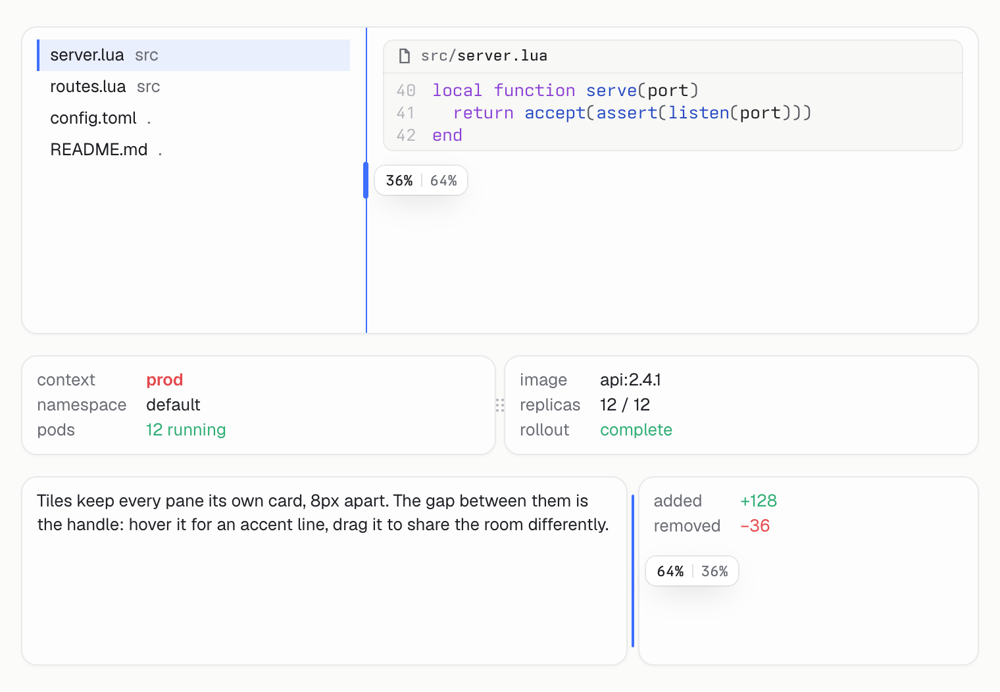
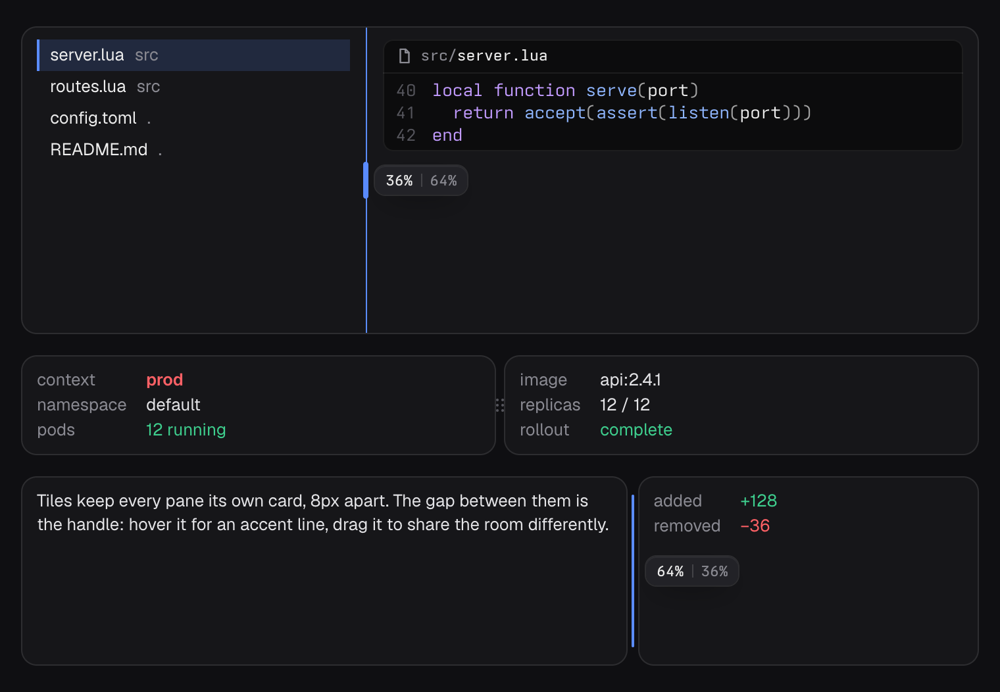
<figcaption>三种外观：<code>hairline</code>（把手处于按住状态，与设置 <code>active</code> 时的绘制效果相同）、<code>gutter</code> 和 <code>tiles</code>（按住状态）。</figcaption>
</figure>

<figure class="tn-figure">
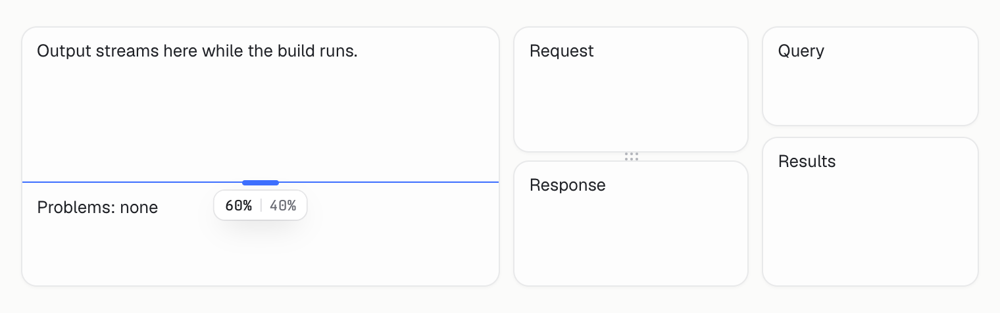
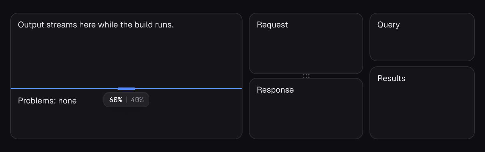
<figcaption>三种外观都设置了 <code>dir = "col"</code> 和 <code>h = "11lines"</code>。</figcaption>
</figure>

<figure class="tn-figure">
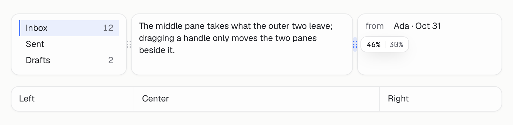
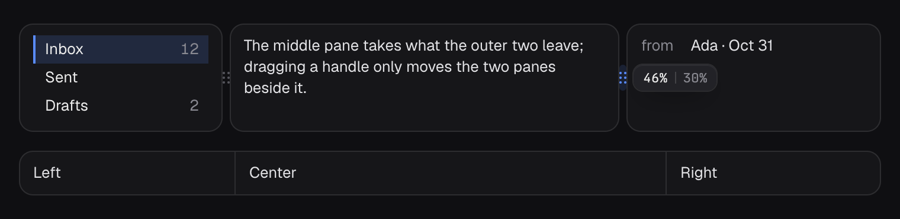
<figcaption>三个窗格：一个把手只会移动它两侧的窗格。</figcaption>
</figure>

<figure class="tn-figure">
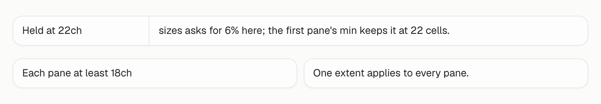
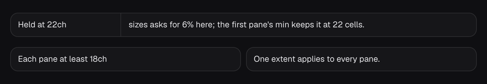
<figcaption>无论 <code>sizes</code> 的设定或指针的拖动如何，<code>min</code> 都会将窗格保持在其最小尺寸。</figcaption>
</figure>

**子项：** 按顺序为每个子项分配一个窗格。每个子项都位于窗格主体中，内边距为 10px × 12px；当子项高于窗格时，主体会滚动。只有一个子项的 split 是没有把手的单窗格。

**事件：** 移动过的把手释放时会发送

```lua
{ ev = "change", id = "main.browser", value = { 0.3, 0.7 } } -- every pane's share, summing to 1
```

`value` 按绘制后的尺寸测量，每个窗格有一个比例（精确到小数点后四位），因此其中已包含最小值的影响。双击任意把手会将所有窗格恢复为 `sizes`，如果这改变了尺寸，就会发送 `change`。

窗格会立即跟随指针，split 会按 `key` 记住用户的比例，直到程序发送的 `sizes` 与上次绘制的值不同；随后以 `sizes` 为准。若要持久化布局，请保存 `value`，并在下次将其作为 `sizes` 传入；如果双击后要恢复默认值，请另行保存默认布局。关闭 surface 上的 split，或以 `listen = false` 打开的 surface（参见 [Surface](../protocol/surfaces.md#打开与关闭)）会绘制把手，但不会移动，也不会发送任何内容。

```lua
-- event(state, ev, cx)
if ev.ev == "change" and ev.id == "main.browser" then
	state.sizes = ev.value
end
```

**键盘：** 自身没有键盘操作（节点不会获得焦点）。按键由程序负责：设置 `active` 为正在移动的把手，并在每次按键时发送新的 `sizes`（例如 ←/→ 每次调整 2%，⇧ 每次调整 10%）；`active` 会将该把手绘制为按住状态并显示比例提示。完成后清除 `active`。

**无障碍：** 每个把手都有 `role="separator"`、`aria-orientation`（并排窗格之间为 `vertical`）、`aria-valuenow`（前一个窗格所占比例，单位为百分比）、`aria-valuemin="0"`、`aria-valuemax="100"` 和 `aria-label="Resize panes"`；握把和提示设为 `aria-hidden`。

**动画：** 悬停时握把淡入并缩放（0.22s `--out`），分隔线和点状标记染色（0.15s `--ease`），比例提示淡入淡出（0.14s）。在减少动态效果、`.sf-still` 和 `.sf-paused` 状态下禁用。

**样式：**

```html
<div class="sf sf-split" data-id="main.browser" data-variant="hairline" data-dir="row">
	<div class="sf-split-box">
		<div class="sf-split-pane" style="flex-grow: 360; min-width: calc(18 * var(--sf-cw))">
			<div class="sf-split-body"><!-- the first child --></div>
		</div>
		<div class="sf-split-handle held" role="separator" aria-orientation="vertical"
			aria-valuenow="36" aria-valuemin="0" aria-valuemax="100" aria-label="Resize panes">
			<span class="sf-split-grip" aria-hidden="true">
				<span class="sf-split-dot"></span><!-- ×6, shown by gutter -->
			</span>
			<span class="sf-split-tip" aria-hidden="true">
				<span class="a">36%</span><span class="sep"></span><span class="b">64%</span>
			</span>
		</div>
		<div class="sf-split-pane" style="flex-grow: 640">
			<div class="sf-split-body"><!-- the second child --></div>
		</div>
	</div>
</div>
```

`.sf-split` 元素自身会在拖动把手时获得 class `held`。依赖外观或方向的规则会通过 `> .sf-split-box >` 生效，因此嵌套在窗格中的 split 会保留自身样式。

| 目标 | 选择器 |
| --- | --- |
| 节点 | `.sf-split` |
| 外观 / 方向 | `.sf-split[data-variant='gutter']`、`[data-variant='tiles']`；`.sf-split[data-dir='col']` |
| 正在进行拖动 | `.sf-split.held` |
| 盒子（`hairline` 的框架、`col` 的高度） | `.sf-split-box`（split 增长时为 `.fill`）（内部结构，可能变化） |
| 窗格 / 其可滚动主体 | `.sf-split-pane`、`.sf-split-body`（内部结构，可能变化） |
| 把手；按住、程序激活 | `.sf-split-handle`、`.sf-split-handle.held`、`.sf-split-handle.active`（内部结构，可能变化） |
| 握把 / gutter 点 | `.sf-split-grip`、`.sf-split-dot`（内部结构，可能变化） |
| 比例提示 | `.sf-split-tip`（`.a`、`.sep`、`.b`）（内部结构，可能变化） |
| 间隙 / 分隔线宽度 | `.sf-split` 上的 `--sf-split-gap`（按外观分别为 1px、6px、8px） |

## `scroll`

滚动子项而不是裁切它们的盒子。为它指定边界，例如 `max = { h = "12lines" }`，或使用父级提供的高度（在定尺寸的 `col` 中设置 `grow`）；其子项（任意节点，按顺序绘制，与 `col` 一样）会在盒子中使用 Tern 的细覆盖式滚动条滚动。对其他节点设置 `max.h` 会裁切超出内容并使裁切处淡出（参见[常用 props](#布局节点的常用-props)）；若其余内容仍应可访问，请使用 `scroll`。

还有两种行为使它也适用于消息滚动。`stick = "end"` 会在内容增长时保持滚动位置在末尾，无论是收到新子项还是最后一个子项持续流式增长（文本 [`append`](text.md#文本-kind-与文本-ops)）都适用，直到用户向上滚动；随后浮动的 **↓ N 条新内容** 胶囊会统计视野外新增的子项，点击后跳回末尾，并再次跟随末尾。`variant = "fade"` 会在内容仍延续的边缘添加渐隐效果，并在 **N 条更多 ↓** 徽标上计数显示下方剩余内容。

**构建方式：** `tern.ui.node("scroll", { stick = "end", max = { h = "14lines" } }, children)`（没有专用构建器）。

| 属性 | 类型 | 默认值 | 含义 |
| --- | --- | --- | --- |
| `variant` | `"bar"` \| `"fade"` | `"bar"` | 外观（见下文）。其他值按 `bar` 处理 |
| `stick` | `"end"` | 无 | 内容增长时保持滚动到末尾，直到用户向上滚动离开；随后显示 **↓ N 条新内容** 胶囊 |
| `pinned` | boolean | 设置 `stick` 时为 `true` | 固定视图是否跟随末尾。用户滚动会在本地更改它；若值与上次绘制时不同，则以新值为准（`false` 会让日志从开头打开，但仍提供提示胶囊） |
| `bar` | `"auto"` \| `"always"` | `"auto"` | 滚动条何时显示：滚动时（以及指针移入时），或只要存在可滚动内容就始终显示 |
| `gap` | `"none"` \| `"xs"` \| `"sm"` \| `"md"` \| `"lg"` | `"none"` | 子项间距，与 [`col`](#col) 相同 |
| `noun` | string 或 `{ string, string }` | 无 | 计数所使用的名词：`"line"`（复数形式加 s）或 `{ "entry", "entries" }`，例如 “4 more lines”、“2 new entries”。未设置时显示 “4 more”、“2 new” |

边界由常用的 `max.h` 提供（或由父级提供高度：在定尺寸的 `col` 中使用 `grow`，或使用 `basis`）；未指定边界时，盒子会随内容增长，不会发生滚动。其他常用 props 也适用：`title`、`aria`、`role`、`hidden`、弹性 props。

| 变体 | 外观 | 用途 |
| --- | --- | --- |
| `bar` | 内容延伸至边缘；右边缘内缩 2px 处显示 6px 覆盖式滑块，滚动时显示随后淡出（类似 macOS 滚动视图），指针移入时加宽。其 12px 区域可按压：拖动滑块，或按轨道以将滑块移至指针下方 | 列表、窗格，以及任何用户有意滚动的内容 |
| `fade` | 在滚动条之外，内容延续处的顶部和底部边缘也会渐隐，右下角显示小型玻璃质感的 **N more ↓** 徽标，统计完全位于视口下方的子项（若剩余内容在当前可见的最后一个子项内部，则显示 “More ↓”）。点击后向下滚动接近一屏的距离 | 预览和摘要，适用于需要一眼看出“还有更多内容”的场景 |

`stick = "end"` 可与任一外观配合使用。固定时，每个新子项和最后一个子项的每次增长（流式 `text` append）都会纳入视图，且视图始终停留在末尾。向上滚动会取消固定；滚回末尾、点击提示胶囊或程序发送 `scroll` op 至 `"end"` 会重新固定。取消固定时，胶囊显示 **↓ N 条新内容**，统计下方尚未进入视野的新增子项（用户滚动查看时计数会减少）；如果没有新内容，则只显示圆形箭头；下边缘会在胶囊下方渐隐。`fade` 外观下，提示胶囊取代徽标。

```lua
local ui = tern.ui

return {
	main = ui.col({
		-- A build log that follows its output.
		ui.node("scroll", { key = "log", stick = "end", max = { h = "14lines" } }, state.lines),
		-- Release notes with fading edges and a "4 more changes" chip.
		ui.node("scroll", { key = "notes", variant = "fade", noun = "change", max = { h = "8lines" } }, state.notes),
		-- A chat: messages 6px apart, the pill reading "2 new messages".
		ui.node("scroll", {
			key = "chat", stick = "end", gap = "sm", noun = { "message", "messages" }, max = { h = "20lines" },
		}, state.messages),
	}),
}
```

<figure class="tn-figure">
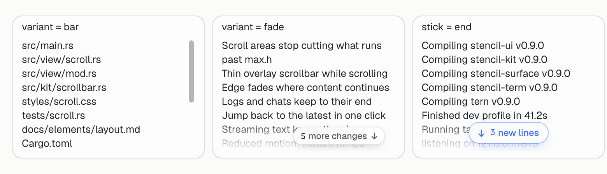
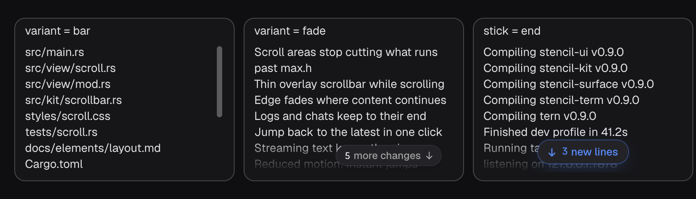
<figcaption>三种外观：覆盖式滚动条（此处设置了 <code>bar = "always"</code>；默认情况下滚动时显示）、带徽标的 <code>variant = "fade"</code>，以及滚离末尾的 <code>stick = "end"</code>。</figcaption>
</figure>

<figure class="tn-figure">
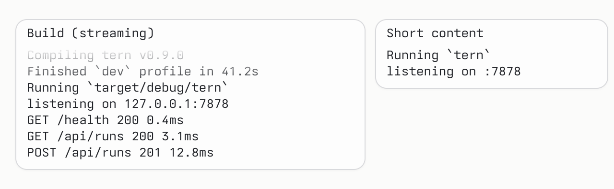
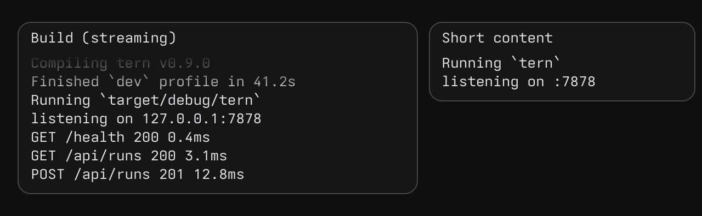
<figcaption>跟随末尾的日志会在新增行或最后一行持续增长时保持在末尾；内容未超出视口时，不显示任何滚动装饰。</figcaption>
</figure>

<figure class="tn-figure">
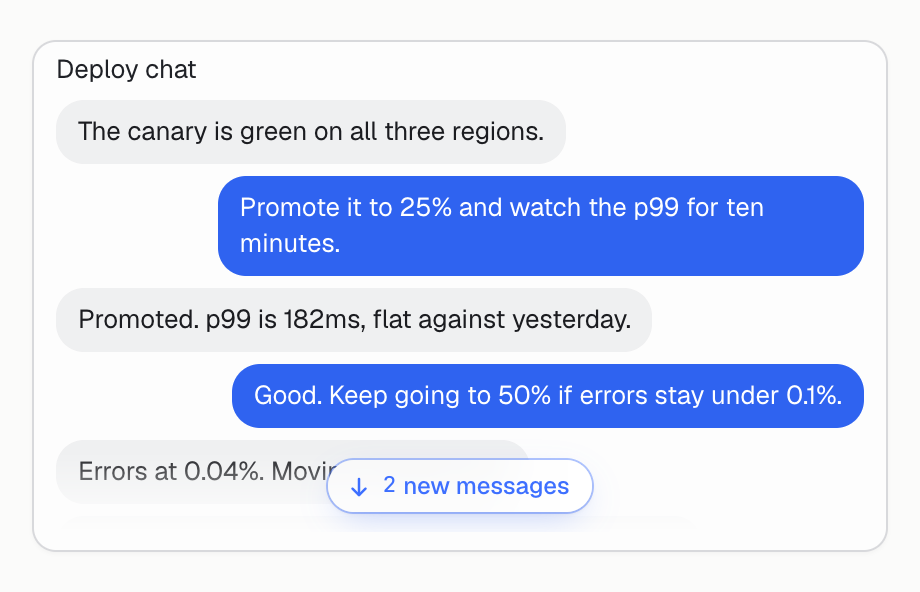
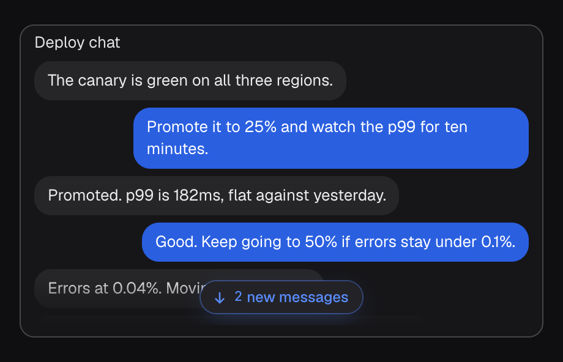
<figcaption>用户向上滚动过的消息滚动视图：胶囊会统计下方尚未查看的消息，点击后跳至最新消息。</figcaption>
</figure>

**子项：** 任意节点，按顺序绘制（使用 `gap` 分隔）。

**事件：** 无。滚动、固定状态和计数均属于查看器，因此关闭的 surface 上，或以 `listen = false` 打开的 surface 上，`scroll` 仍以相同方式滚动。

**键盘：** 节点不会获得焦点。程序可通过节点 id（或其中任意节点）上的 [`scroll` op](../protocol/documents.md#帧-ops)滚动盒子，支持：`"page-up"`、`"page-down"`、`"line-up"`、`"line-down"`、`"start"`、`"end"`。在块中可使用 `cx:frame({ { "scroll", "main.log", "page-up" } })`。`"end"` 会重新固定视图（在用户发送消息时执行）。`pinned` 可直接设置固定状态。

**无障碍：** 固定视图的滚动容器使用 `role="log"`（新子项会以礼貌方式播报）。徽标和提示胶囊会作为按钮，以描述其用途的名称显示（“下方还有 4 行，向下滚动”、“2 条新消息，跳至最新”）；隐藏时会对辅助技术隐藏；滚动条仅作装饰。

**样式：**

```html
<div class="sf sf-scroll scroll fade stick can sf-clip" data-id="main.log">
	<div class="sf-scroll-view gap-sm down up" role="log"><!-- children --></div>
	<div class="sf-scroll-bar fa" aria-hidden="true"><div class="sf-scroll-thumb"></div></div>
	<button class="sf-scroll-more">
		<span class="n">4</span><span class="w">more</span><svg class="ico">…</svg>
	</button>
	<div class="sf-scroll-dock">
		<button class="sf-scroll-jump on" aria-label="2 new messages, jump to latest">
			<svg class="ico">…</svg><span class="n">2</span><span class="w">new messages</span>
		</button>
	</div>
</div>
```

| 目标 | 选择器 |
| --- | --- |
| 节点（有边界的框架） | `.sf-scroll` |
| 外观 / 行为 | `.sf-scroll.fade`、`.sf-scroll.stick`、`.sf-scroll.always` |
| 存在可滚动内容 | `.sf-scroll.can` |
| 滚动容器（子项的父元素） | `.sf-scroll-view`（内部结构，可能变化） |
| 视口上方 / 下方有内容 | `.sf-scroll-view.up`、`.sf-scroll-view.down`（内部结构，可能变化） |
| 滑块（轨道、拖动时） | `.sf-scroll-thumb`（`.sf-scroll-bar`、`.sf-scroll-bar.held`）（内部结构，可能变化） |
| “N more” 徽标（显示时） | `.sf-scroll-more`、`.sf-scroll-more.on`（内部结构，可能变化） |
| “↓ N new” 提示胶囊（显示 / 仅箭头） | `.sf-scroll-jump.on`、`.sf-scroll-jump.bare`（内部结构，可能变化） |
| 计数 / 其文字 | `.sf-scroll-more .n`、`.sf-scroll-jump .w`（内部结构，可能变化） |

## `empty`

当窗格、卡片、列表或放置目标尚无内容时显示的状态。标题说明缺少什么，弱化的一行文本说明原因（或要做什么），子项则承载用于填充内容的操作，通常是一个 [`button`](input.md#button)。应使用它替代缺失数据对应的视图，而不是并排放在视图旁边；保留视图的 key，让空状态和内容在同一位置交替显示。

它是每个视图应具备的[四种状态](../guides/design.md#四种状态)之一（加载中、空、错误、成功）：设置 `tone = "error"` 后，它会成为整个窗格的错误状态，其子项中可包含 Retry 按钮。

由 `variant` 选择三种外观：

- `center`（默认）：柔和圆形底座中的图标、标题、一行文本及其下方的操作，在可用空间中居中。适用于卡片或窗格。
- `inline`：一行内容：图标、标题和弱化文本，操作位于末尾。适用于与表格同尺寸的区域或小面板；`frame = true` 会为其添加细线卡片边框。按钮应使用 `variant = "quiet"` 和 `size = "sm"`。
- `drop`：虚线框区域，图标置于凸起的方块中，另有标题、文本和操作；按钮的 `keys` 会显示对应的键帽提示。程序检测到拖动经过时，设置 `over = true` 可使用强调色点亮该区域。

所有外观都会短暂淡入（减少动态效果时除外）。

**构建方式：** `tern.ui.node("empty", { icon = …, title = …, text = … }, { button })`（没有专用构建器）。

| 属性 | 类型 | 默认值 | 含义 |
| --- | --- | --- | --- |
| `variant` | `"center"` \| `"inline"` \| `"drop"` | `"center"` | 外观（见下文）。其他值按 `center` 处理 |
| `icon` | 图标名称 | 按外观分别为 `inbox`、`info`、`file-plus`；tone 为 `error` 或 `warning` 时使用 `warn` | 图标（[图标名称](data.md#图标名称)）；空字符串 `""` 表示无图标 |
| `title` | spans 或 string | 无 | 用简短文字说明缺少什么 |
| `text` | spans 或 string | 无 | 一行弱化文本：说明原因或下一步操作 |
| `tone` | tone 名称 | 无 | `error` 或 `warning` 会为图标（以及 `drop` 外观的边框）着色：表示错误空状态 |
| `frame` | boolean | `false` | 仅用于 `inline`：为该行绘制细线卡片边框 |
| `over` | boolean | `false` | 仅用于 `drop`：表示拖动正位于区域上方，此时区域会亮起强调色 |

常用 props（`grow`、`key`、`min`、`max` 等）均适用；为 `center` 和 `drop` 设置 `grow` 可使其填满窗格。

| 变体 | 外观 | 用途 |
| --- | --- | --- |
| `center` | 圆形底座中的图标、标题、一行文本、下方的操作，整体居中 | 卡片、窗格、视图首次运行 |
| `inline` | 单行内容：图标、标题、弱化文本，操作位于末尾 | 与表格同尺寸的区域、小面板、筛选无结果时 |
| `drop` | 虚线框区域、图标方块、标题、文本、带键帽提示的操作 | 接受拖放文件的位置 |

```lua
local ui = tern.ui

return {
	main = ui.col({
		ui.node("empty", { icon = "inbox", title = "No deployments yet", text = "Push to main or run tern deploy." }, {
			ui.button("New deployment", { variant = "primary", icon = "rocket", actions = { click = "deploy" } }),
		}),
		ui.node("empty", { variant = "inline", frame = true, icon = "search", text = "Nothing matches “zzz”" }, {
			ui.button("Clear", { variant = "quiet", size = "sm", keys = { "esc" }, actions = { click = "clear" } }),
		}),
	}),
}
```

<figure class="tn-figure">
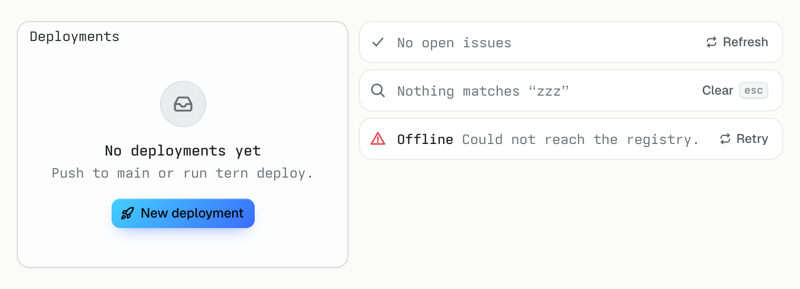
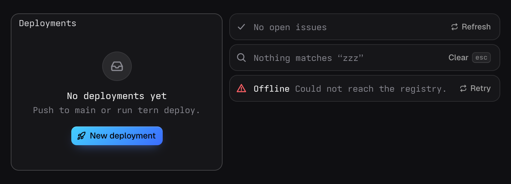
<figcaption>卡片中的 <code>center</code> 外观，以及设置了 <code>frame</code> 的 <code>inline</code> 外观；最后一个示例设置了 <code>tone = "error"</code>。</figcaption>
</figure>

<figure class="tn-figure">
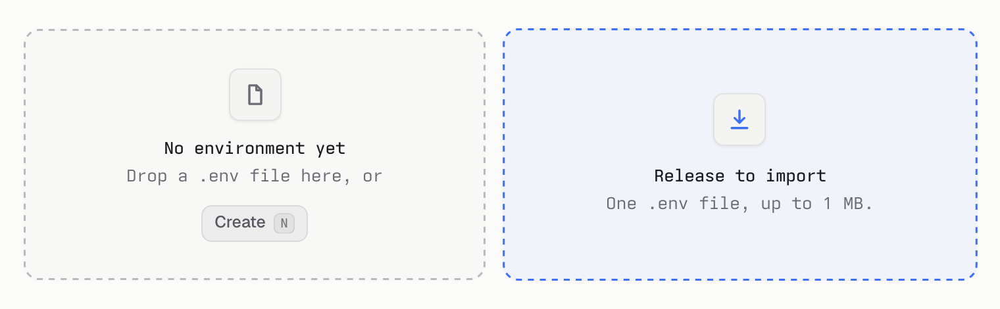
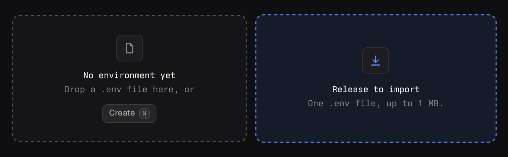
<figcaption>处于静止状态的 <code>drop</code> 外观，以及设置 <code>over = true</code> 时的外观。</figcaption>
</figure>

<figure class="tn-figure">
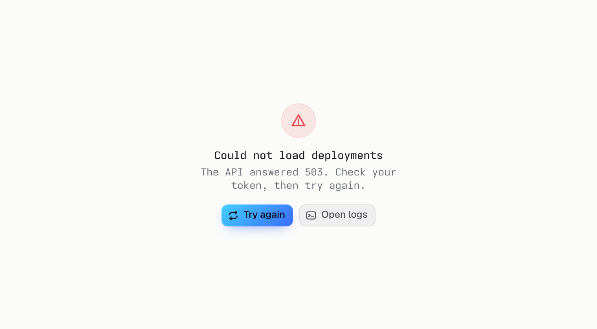
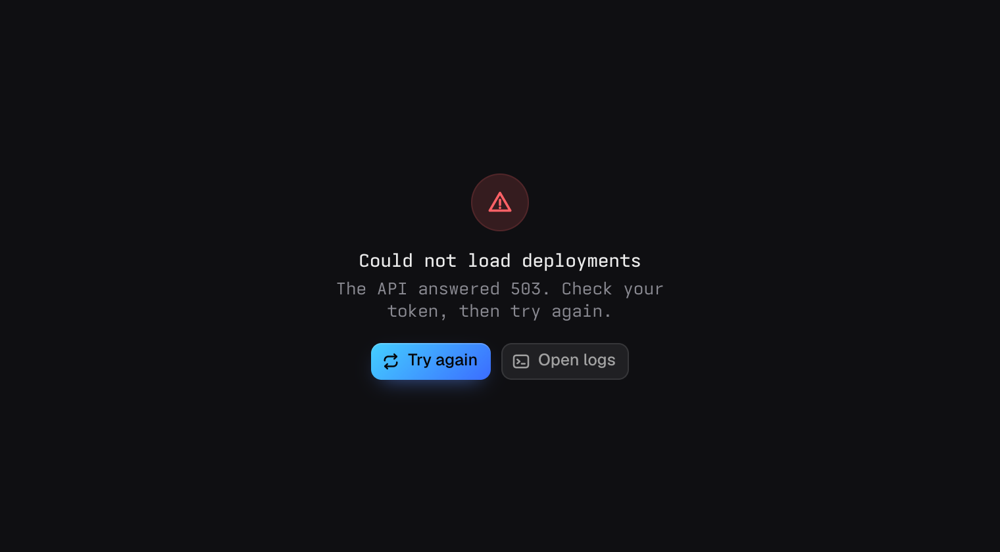
<figcaption>占据整个窗格的错误状态：设置 <code>tone = "error"</code> 和 <code>grow</code>。</figcaption>
</figure>

**子项：** 操作子项按顺序放入 `div.sf-empty-acts`。

**事件：** 自身没有事件。子项会发送各自的事件（`button` 的 `action` 及 `act`）。

**键盘：** 节点不会获得焦点。应在程序中为操作绑定按键，并通过按钮的 `keys` 显示对应按键；`over` 则由程序自身的拖动跟踪设置。

**无障碍：** 节点使用 `role="status"`；图标设置了 `aria-hidden`。

**样式：**

```html
<div class="sf sf-empty framed" data-id="main.issues" data-variant="inline" data-tone="error" role="status">
	<div class="sf-empty-in">
		<span class="sf-empty-ic" aria-hidden="true"><svg class="ico">…</svg></span>
		<div class="sf-empty-copy">
			<div class="sf-empty-title">Offline</div>
			<div class="sf-empty-text">Could not reach the API</div>
		</div>
		<div class="sf-empty-acts"><!-- children --></div>
	</div>
</div>
```

| 目标 | 选择器 |
| --- | --- |
| 节点 | `.sf-empty` |
| 外观 / tone | `.sf-empty[data-variant='inline']`、`[data-variant='drop']`；`.sf-empty[data-tone='error']` |
| 带框架的行 / 正在拖动经过 | `.sf-empty.framed`、`.sf-empty.over` |
| 内层盒子 | `.sf-empty-in`（内部结构，可能变化） |
| 图标 | `.sf-empty-ic`（内部结构，可能变化） |
| 标题和文本 | `.sf-empty-copy`、`.sf-empty-title`、`.sf-empty-text`（内部结构，可能变化） |
| 操作 | `.sf-empty-acts`（内部结构，可能变化） |

## `rule`

一条占一行高（`--sf-lh`）的水平细线（`--l2`），使用 `role="separator"`。若设置了 `label`，它会以 11.5px sans 的 `--t3` 字体显示在两条细线之间。没有标签、图标、时间或 `end` 时，rule 会显示为一条全宽细线，并获得 class `bare`。

rule 也可用于在对话记录中标记某个时刻：日期分隔、检查点、有人加入、上下文压缩。由 `variant` 选择三种外观：

- `line`（默认）：细线分隔符；可在标签前添加 `icon`，在标签后添加 `time`（例如 `Checkpoint 3 · 14:02`），并将标签置于两条细线之间居中显示。
- `note`：左对齐的弱化文本行，依次显示图标、标签，以及位于最右侧、使用等宽字体的 `time`。添加 `end` 子项（例如 Restore 按钮）时，它会成为带框架的检查点行：圆角行使用卡片色调背景和细线边框，标签使用 `--t1`，图标使用强调色（或 tone 颜色），控件位于右侧。
- `pin`：位于对话记录轨道上的胶囊；左侧 1.5px 竖线贯穿整行（连续的 pin 和行会连接为一条轨道），胶囊位于轨道上，包含图标、中等字重的标签和等宽字体的 `time`，并采用强调色或 `tone` 色调。`end` 子项位于胶囊旁边。

用 `line` 分隔不同组（天、章节），用 `note` 表示对话记录中的事件，用 `pin` 标记用户可跳回的位置。应将操作放进 `end`，而不是放在 rule 旁边：rule 会负责定位它，点击事件则由按钮自身发出。

**构建方式：** `tern.ui.rule(label?)`（参见 [UI 构建器](../reference/ui.md#布局)），或 `tern.ui.node("rule", { label = "Older" })`。变体和其他 props 需要使用 `tern.ui.node`：`tern.ui.node("rule", { variant = "note", label = …, icon = …, time = …, ["end"] = id }, { button })`。与 [`card`](#card) 一样，`end` 是 Luau 关键字，须写作 `["end"] = …`，并通过 id 指定 rule 自身的一个子项。

| 属性 | 类型 | 默认值 | 含义 |
| --- | --- | --- | --- |
| `variant` | `"line"` \| `"note"` \| `"pin"` | `"line"` | 外观（见下文）。未知值会绘制为 `line`。添加 class `v-note` / `v-pin` |
| `label` | spans 或 string | 无 | 标签；span 样式 token 适用（例如用 `muted` 显示 `12 files` 之类的说明） |
| `icon` | 图标名称 | 无 | 标签前的图标（[图标名称](data.md#图标名称)：`history`、`user`、`warn`）。未知名称不会绘制图标 |
| `time` | string | 无 | 时间或简短标记：`line` 中显示在标签后，如 ` · 14:02`；`note` 中以等宽字体显示在最右侧；`pin` 中以等宽字体显示在胶囊中 |
| `tone` | tone 名称 | 无 | 为图标（`line`、`note`）着色，或为整个胶囊（`pin`）着色；即常用的 `data-tone` |
| `end` | 子项 id | 无 | 将该子项绘制在末尾：`line` 中位于标签之后，`note` 中位于带框架行的右侧，`pin` 中位于胶囊旁边 |

| 变体 | 外观 | 设置 `end` 时 |
| --- | --- | --- |
| `line` | 图标 · 标签 · 时间居中显示在两条细线之间 | 子项跟在标签后方 |
| `note` | 左对齐的弱化文本行：图标、标签（超出部分省略）、最右侧时间 | 带框架的检查点行（class `framed`）：卡片背景、细线边框、`--r-ctl` 圆角、`--t1` 标签、强调色图标 |
| `pin` | 垂直对话轨道上的着色胶囊（图标、标签、时间） | 子项位于胶囊旁边 |

**子项：** 只有由 `end` 指定的子项会被绘制到 `span.sf-rule-end` 中；其他子项不会绘制。

**事件：** 自身没有事件；`actions` 的行为与任意节点相同。`end` 子项发送自身事件（`button` 的 `action`），并使用自身 id。

**键盘：** rule 不会获得焦点。若程序支持键盘恢复操作，请将按键绑定到 `end` 按钮（`keys`）。

**无障碍：** 使用 `role="separator"`；存在 `end` 子项时使用 `role="group"`（separator 中的内容仅作呈现，会导致控件对辅助技术隐藏）。图标设置了 `aria-hidden`。

**样式：**

```html
<!-- line -->
<div class="sf sf-rule" data-id="main.3" role="separator">
	<span class="sf-rule-label"><svg class="ico sf-rule-ic">…</svg>Checkpoint 3<span class="sf-rule-time"> · 14:02</span></span>
</div>
<!-- note with end -->
<div class="sf sf-rule v-note framed" data-id="main.note" role="group">
	<svg class="ico sf-rule-ic">…</svg><span class="sf-rule-label">Checkpoint 3</span><span class="sf-rule-time">14:02</span>
	<span class="sf-rule-end"><!-- the end child --></span>
</div>
<!-- pin -->
<div class="sf sf-rule v-pin" data-id="main.pin" role="group">
	<span class="sf-rule-pill"><svg class="ico sf-rule-ic">…</svg><span class="sf-rule-label">Checkpoint 3</span><span class="sf-rule-time">14:02</span></span>
	<span class="sf-rule-end"><!-- the end child --></span>
</div>
```

| 目标 | 选择器 |
| --- | --- |
| 节点 | `.sf-rule` |
| 细线 | `.sf-rule::before`、`.sf-rule::after`（在 `.sf-rule.bare` 上隐藏 `::after`） |
| 无标签 | `.sf-rule.bare` |
| 外观 | `.sf-rule.v-note`、`.sf-rule.v-pin`；带框架的 note 为 `.sf-rule.v-note.framed` |
| 轨道（`pin`） | `.sf-rule.v-pin::before` |
| 标签 | `.sf-rule-label`（内部结构，可能变化） |
| 图标、时间、胶囊、end 容器 | `.sf-rule-ic`、`.sf-rule-time`、`.sf-rule-pill`、`.sf-rule-end`（内部结构，可能变化） |
| 胶囊颜色 | `.sf-rule-pill` 上的 `--pc`（强调色，或设置 tone 时采用 `--tc`） |

```lua
local ui = tern.ui

return {
	main = ui.col({ ui.text("today"), ui.rule("Yesterday"), ui.text("yesterday"), ui.rule(), ui.text("older") }),
}
```

<figure class="tn-figure">
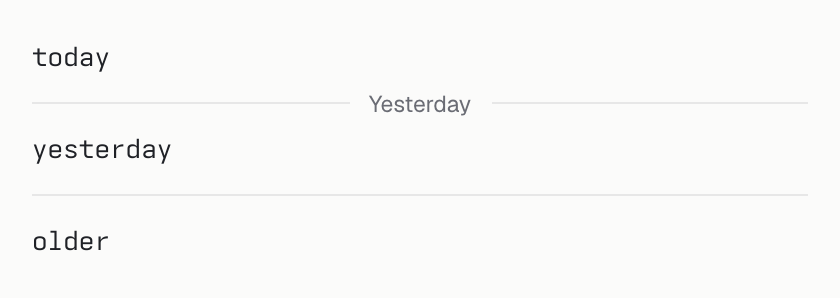
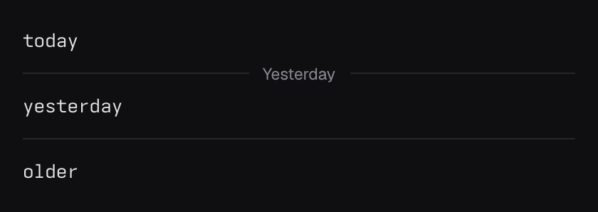
</figure>

对话记录标记示例，其中 Restore 按钮是带框架的 note 和 pin 的 `end` 子项：

```lua
local ui = tern.ui

return {
	main = ui.col({
		ui.node("rule", { label = "Checkpoint 3", icon = "history", time = "14:02" }),
		ui.node("rule", { variant = "note", label = "Sarah joined the session", icon = "user", time = "14:01" }),
		ui.node("rule", { variant = "note", label = "Context compacted · 182k → 41k", icon = "warn", tone = "warning" }),
		ui.node("rule", {
			key = "note", variant = "note", label = "Checkpoint 3", icon = "history", time = "14:02",
			["end"] = "main.note.restore",
		}, {
			ui.button("Restore", { key = "restore", variant = "quiet", size = "sm", actions = { click = "restore:3" } }),
		}),
		ui.node("rule", {
			key = "pin", variant = "pin", label = "Checkpoint 3", icon = "history", time = "14:02",
			["end"] = "main.pin.restore",
		}, {
			ui.button("Restore", {
				key = "restore", variant = "quiet", size = "sm", icon = "undo", actions = { click = "restore:3" },
			}),
		}),
	}),
}
```

<figure class="tn-figure">
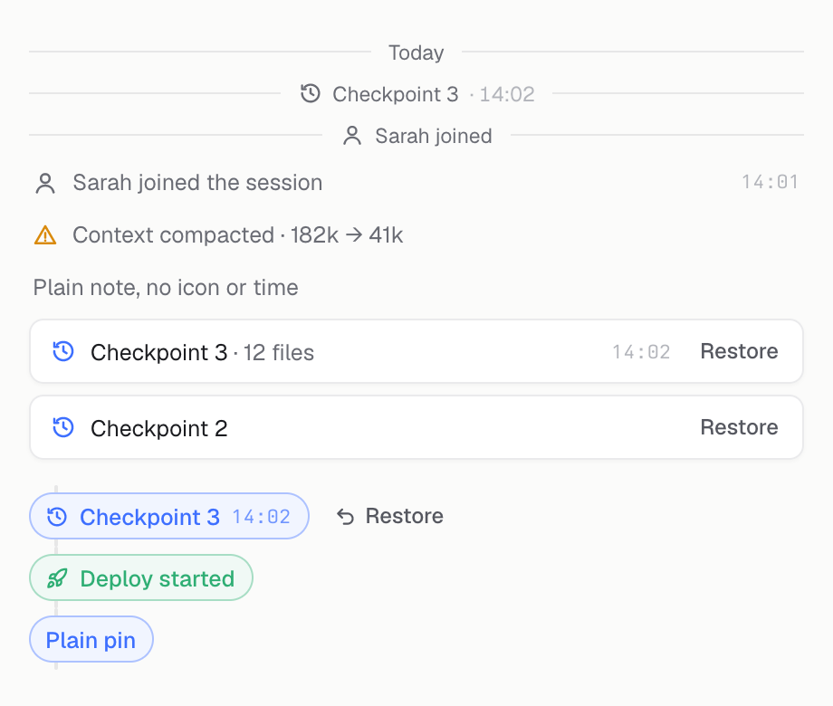
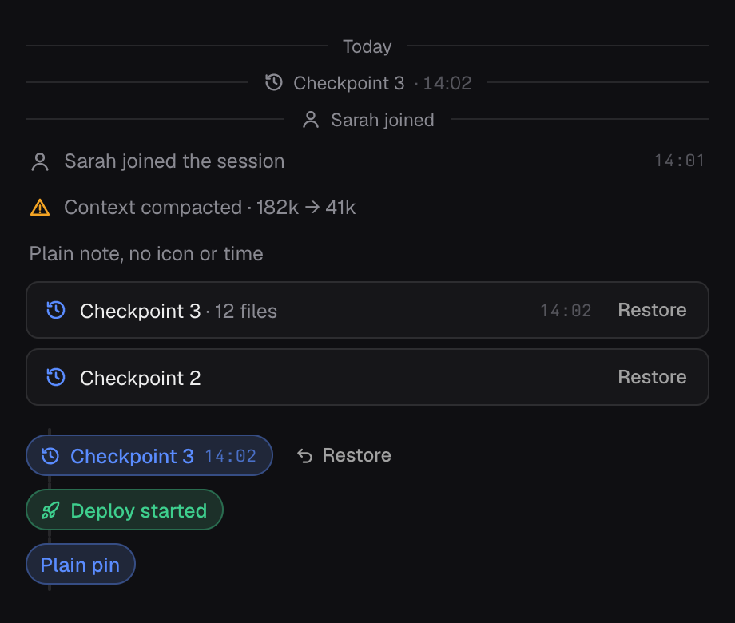
<figcaption>三种 rule 外观：<code>line</code>、<code>note</code>（带框架且有 <code>end</code> 子项）和 <code>pin</code>。</figcaption>
</figure>

## `spacer`

固定的垂直空间块（`flex: none`），设置了 `aria-hidden`。若要在 `row` 或 `col` 中使用弹性空间，请改用设置 `grow = 1` 的空堆栈（参见 [`row`](#row)）。Tern 会自行在块及其各部分之间设置间距（`--sf-block-gap`、`--sf-inner-gap`）；仅当这些间距节奏无法满足需求时才使用 spacer。

**构建方式：** `tern.ui.node("spacer", { size = "lg" })`（没有专用构建器）。

| 属性 | 类型 | 默认值 | 含义 |
| --- | --- | --- | --- |
| `size` | `"none"` \| `"xs"` \| `"sm"` \| `"md"` \| `"lg"` | `"md"` | 高度：0、2px、6px、12px、20px。添加 class `sz-<value>`；未知值不会匹配任何规则，并回退至基础值 8px |

**子项：** 无（会忽略）。

**事件：** 自身没有事件。

**样式：**

```html
<div class="sf sf-spacer sz-md" data-id="main.4" aria-hidden="true"></div>
```

| 目标 | 选择器 |
| --- | --- |
| 节点 | `.sf-spacer` |
| 尺寸 | `.sf-spacer.sz-none` … `.sz-lg` |

```lua
local ui = tern.ui

return { main = ui.col({ ui.text("header"), ui.node("spacer", { size = "lg" }), ui.text("body") }) }
```

两个徽标之间设置每种间距：

```lua
local ui = tern.ui

local cols = {}
for _, size in { "none", "xs", "sm", "md", "lg" } do
	table.insert(cols, ui.node("col", {}, {
		ui.badge(size, "accent"),
		ui.node("spacer", { size = size }),
		ui.badge(size, "accent"),
	}))
end
return { main = ui.node("row", { gap = "lg", align = "start" }, cols) }
```

<figure class="tn-figure">
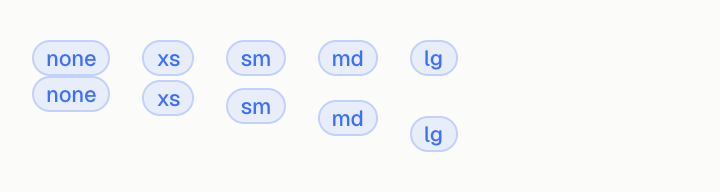
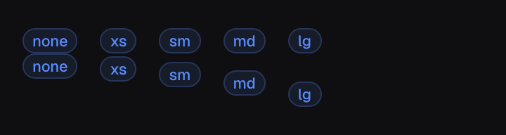
</figure>

## 稳定钩子

`.sf-col`、`.sf-row`、`.sf-card`、`.sf-section`、`.sf-split`、`.sf-scroll`、`.sf-empty`、`.sf-rule`、`.sf-spacer`、`[data-id]`、`[data-role]`、`[data-tone]`、`[data-variant]`、`[data-dir]`、`[data-mark]`、`[data-href]` 以及区域的 `[data-surface]` 均为稳定钩子。随 props 变化的状态类（`gap-*`、`al-*`、`js-*`、`wrap`、`sz-*`、`collapsible`、`collapsed`、`selected`、`inset`、`bare`、`fade`、`stick`、`always`、`framed`、`over`、`v-note`、`v-pin`）遵循上述 props；`held`（split 正在拖动）和 `can`（scroll 有可滚动内容）则随用户操作变化。内部部件上的类（`.sf-card-head`、`.sf-head`、`.sf-card-ic`、`.sf-chip`、`.sf-chev`、`.sf-card-body`、`.sf-more`、`.sf-section-head`、`.sf-section-body`、`.sf-split-*`、`.sf-scroll-*`、`.sf-empty-*`、`.sf-rule-label`、`.sf-rule-ic`、`.sf-rule-time`、`.sf-rule-pill`、`.sf-rule-end`）属于 Tern 内部结构，可能在不同版本间变化。参见[视图样式](../styles/index.md)和[支持的 CSS](../styles/css.md)。
