# 列表、菜单与导航

用户指向、由你的代码选择的行；容纳应用命令的菜单；以及在视图之间切换的控件。使用 `list` 和 `item` 子项构成可选择的行列，使用 `menu` 创建打开命令下拉菜单的按钮，使用 `menubar` 将应用菜单排列成一行，使用 `tabs` 创建切换显示内容的标签栏，使用 `nav` 展示应用分区及其子页面，使用 `breadcrumb` 展示返回层级上级的路径，在分页显示的表格或列表下使用 `pager`；需要从数据绘制完整模态面板（搜索、范围、事实列、预览、操作栏）时使用 `picker`。

| 类型 | 构建器 | 绘制内容 |
| --- | --- | --- |
| [`list`](#list) | `tern.ui.list(items)` 或 `tern.ui.node("list", …)` | 由 `item` 行组成的列表框，包含你的选择、筛选高亮和空列表提示 |
| [`item`](#item) | 在 `tern.ui.list` 中，或 `tern.ui.node("item", …)` | 单行：图标、标签、详情、值、快捷键提示 |
| [`menu`](#menu) | `tern.ui.node("menu", …)` | 打开命令下拉菜单的按钮：图标、快捷键、勾选项、单选组、子菜单、丰富的双行选项 |
| [`menubar`](#menubar) | `tern.ui.node("menubar", …)` | 一行菜单标题，每个标题都会在下方打开菜单：简洁条带或浮动玻璃胶囊 |
| [`tabs`](#tabs) | `tern.ui.node("tabs", …)` | 带下划线活动项的标签栏，或分段控件 |
| [`nav`](#nav) | `tern.ui.node("nav", …)` | 导航胶囊或链接；带子项的条目会打开菜单或丰富面板 |
| [`breadcrumb`](#breadcrumb) | `tern.ui.node("breadcrumb", …)` | 从根节点到当前位置的路径；每个路径项都可返回对应位置 |
| [`pager`](#pager) | `tern.ui.node("pager", …)` | 分页：范围和箭头、编号页，或“显示更多”行 |
| [`picker`](#picker) | `tern.ui.node("picker", …)` | 模态玻璃面板：搜索栏、范围、标签、虚拟行、预览、操作栏 |

所有这些控件都由你的代码负责维护选择。点击或双击会发送事件；你更新状态，并在下一次视图中发送新的 `selected`（或 `active`、`open`、`page` 或 `tab`）。`list`、`tabs` 和 `picker` 只有在此后才会变化；`menu`、`menubar`、`nav`、`breadcrumb` 和 `pager` 会立即显示点击效果，并保持该状态，直到你发送的值与上次不同。它们都不会获取焦点，因此按键不会在这里变成事件：按键会传给块的 `key` 处理器，由处理器以同样方式移动选择。

## `list`

由 `item` 子项构成的垂直列表框。它会绘制：

- 选中项（你的 `selected` prop）使用强调色调和 2px 左侧标记，其他项在悬停时显示悬停色调；
- 每个条目标签中 `filter` 查询的 `<mark>` 高亮；
- 没有条目时显示 `empty` 行。

列表本身不会筛选、排序或移动选择。`filter` 只负责标记：传入已经筛选好的待显示条目，以及生成筛选结果的查询。

**筛选标记。** 查询会先去除首尾空白，再与标签的纯文本进行不区分大小写的匹配。整条查询第一次连续出现的位置会被标记；若没有连续匹配，则组件库的模糊子序列匹配会标记命中的字符，并将相邻命中合并为连续片段。没有匹配时不标记任何内容。标签中的 span 样式会跨越截取范围保留。例如，`LIFE` 会标记 `Session Lifecycle` 中的 `Life`；`sl` 会标记 `session-lifecycle` 中的 `s` 和 `l`。

**高度与滚动。**没有 `max` 时，列表高度与行数相应，并随周围区域滚动。设置 `max` 后，列表高度会受限并在自身内部滚动（`.sf-list-scroll.max`、细滚动条、限制过度滚动）。每行高度为一行终端字体加 6px。

**让选择保持在视野中。**`selected` 变化时，列表会滚动自身的滚动容器（仅在设置 `max` 时），以最小必要距离显示该条目。协议的 `reveal` 请求若指向列表中的条目，也会以相同方式滚动列表自身的容器，并按起始、末尾或最近位置对齐；没有 `max` 的列表则由区域负责滚动。插件没有发送 `reveal` 的调用；插件通过更改 `selected` 让条目进入视野。若列表随 `main` 一起滚动，列表不会滚动其中的选中项。

**虚拟列表。** 当子项超过 200 个且全为 `item`，或设置 `virtual = true` 时，条目不会作为节点挂载。所有行共用一个高度（一行加 6px；若样式表使行更高，则使用绘制行中的最高高度），并且只在 `.sf-list-slot` 内绘制视野附近的行（其他行占用的空间以内边距保留）。含有其他类型（标题、链接等）的长列表会保持挂载。只有绘制某行时才会读取其条目内容。点击仍会发送携带条目节点 id 的 `select` 和 `activate`。在虚拟列表中，条目自身的 `actions` 和链接不会绑定交互：该行仅支持选择和激活。

**构建：**`tern.ui.list(items)` 根据 `{label, detail?, value?, icon?, tone?}` 表构建含 `item` 子项的 `list`（参见 [UI 构建器](../reference/ui.md#list)）。在返回节点的 `p` 中设置 `selected`、`filter`、`empty`、`max` 或 `virtual`，也可以使用 `tern.ui.node("list", { … }, items)`。

| 属性 | 类型 | 默认值 | 含义 |
| --- | --- | --- | --- |
| `selected` | `string` | none | 选中条目的节点 id。绘制为选中状态（`.sel`、`aria-selected="true"`），值变化时保持在视野中。若 id 不是子项，则不会绘制选中状态 |
| `filter` | `string` | `""` | 查询；匹配项会在其标签中以 `mark.sf-mark` 标记。只标记，不隐藏内容 |
| `empty` | Spans | none | 列表没有子项时显示的行。未设置时不显示 |
| `max` | `{lines = n}` 或 `number` | none | 高度上限。`{lines = n}`：`n` 行 `--sf-row`（一行加 6px；样式表可提高非虚拟列表的行高）。数值表示窗口高度的比例（`0.5` = `50vh`）。非正数或其他值会被忽略。设置上限后列表自行滚动 |
| `virtual` | `boolean` | `false` | 即使少于 200 个条目也将行虚拟化 |

[通用 props](index.md) 也适用（`key`、`role`、`tone`、`actions`）。

**子项：**`item` 节点，按顺序绘制在 `.sf-list-slot` 中。其他 kind 也会放置，但没有行行为。在虚拟列表中，子项不会挂载：每个子项的 item props 会被读入绘制的行。

**事件：**自身不发送事件。其条目会发送以列表为目标的 `select` 和 `activate`（见 [`item`](#item)）。

**样式：**

```html
<div class="sf sf-list" data-id="main.items" role="listbox">
	<div class="sf-list-scroll max">            <!-- .max only with `max` -->
		<div class="sf-list-slot">
			<div class="sf sf-item sel" data-id="main.items.i1" role="option" aria-selected="true">…</div>
			<!-- virtual: <div class="sf sf-item" role="option" data-item="main.items.i1">…</div> -->
		</div>
	</div>
	<div class="sf-list-empty sf-hidden">No results</div>
</div>
```

| 目标 | 选择器 |
| --- | --- |
| 节点 | `.sf-list`、`.sf-list[data-id=…]`、`.sf-list[data-role=…]` |
| 虚拟列表 | `.sf-list.virtual` |
| 滚动容器 | `.sf-list-scroll`（内部实现，可能变化）；有高度上限时为 `.sf-list-scroll.max` |
| 已挂载条目 | `.sf-list-slot`（内部实现，可能变化） |
| 虚拟行 | `.sf-list.virtual .sf-item[data-item=…]`（内部实现，可能变化） |
| 空行 | `.sf-list-empty`（内部实现，可能变化） |
| 选中条目 | `.sf-list .sf-item.sel`、`[aria-selected='true']` |
| 筛选命中 | `.sf-list mark.sf-mark` |

`.sf-hidden` 会隐藏当前无内容可显示的部分（有条目时隐藏空行，没有条目时隐藏滚动容器）。选中色调为你设置的 `var(--sf-sel)`，否则为强调色的 10%（浅色）或 16%（深色）；标记为 `inset 2px 0 0 var(--accent)`。悬停使用 `--l1`。在 `overlay` 卡片（`.sf-ov-card`）内，选中背景改为中性 `--l2` 填充，并使用 `--grad` 边缘。行高使用 `--sf-lh`。参见 [变量](../styles/variables.md)。

稳定钩子为 `.sf-list`、`.sf-item`、`[data-id]`、`[data-role]`、`[data-tone]` 和 ARIA 属性；`sf-list-*` 与 `sf-item-*` 部分属于 Tern 的内部结构。

```lua
local ui = tern.ui

-- view: state.visible holds the branches matching state.query ("log"),
-- state.sel the selected branch name ("fix-login")
local rows = {}
for _, b in state.visible do
	local row = ui.list({ {
		label = b.name,
		detail = b.upstream or "no upstream",
		value = b.drift, -- "↑2", "↓5" or nil
		icon = "git-branch",
		tone = b.behind and "warning" or nil,
	} }).c[1]
	row.p.key = b.name
	row.p.disabled = b.upstream == nil
	table.insert(rows, row)
end
return {
	main = ui.col({
		ui.node("list", {
			key = "branches",
			selected = state.sel and ("main.branches." .. state.sel) or nil,
			filter = state.query,
			empty = { ui.span("No branches match", "muted") },
			max = { lines = 12 },
		}, rows),
	}),
}
```

<figure class="tn-figure">
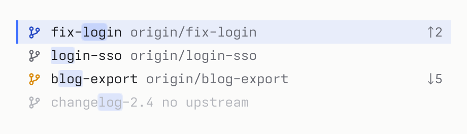
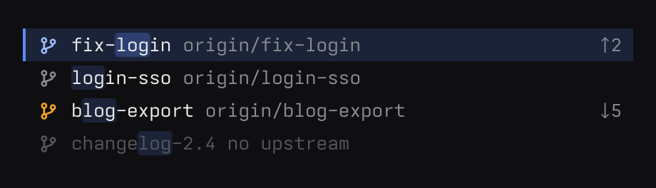
<figcaption>选择、<code>filter</code> 标记、<code>warning</code> 色调和禁用行。</figcaption>
</figure>

## `item`

单行包含图标、标签、占用剩余空间并在空间不足时截断的暗色详情、右对齐值和按键帽。在 `list` 中它是列表框的一个 `option`；单独使用时则是包含相同部分的普通行。文本永不换行；标签、详情和值会以省略号截断。

**构建：**作为 `tern.ui.list(items)` 的元素（参见 [UI 构建器](../reference/ui.md#list)），该构建器支持 `label`、`detail`、`value`、`icon` 和 `tone`。`hint` 和 `disabled` 需要使用 `tern.ui.node("item", { … })`，或在构建出的子项 `p` 上设置。

| 属性 | 类型 | 默认值 | 含义 |
| --- | --- | --- | --- |
| `label` | Spans | `""` | 行文本。筛选命中会在其中标记 |
| `detail` | Spans | `""` | 标签之后的暗色文本；可伸缩，并最先截断 |
| `value` | Spans | `""` | 右对齐文本（等宽数字，最多占行宽的 40%）。为空时隐藏 |
| `icon` | `string` | none | 图标名称（参见 [`icon`](data.md#icon)）；未知名称不会显示图标 |
| `hint` | `{ string }` | `{}` | 行末绘制为按键帽的按键名称，例如 `{ "cmd", "enter" }`。仅用于显示，不会绑定按键 |
| `disabled` | `boolean` | `false` | 将行变暗（`.off`、`aria-disabled="true"`），不接收指针事件，也不发送 `select` 或 `activate` |
| `tone` | tone name | none | 设置 `data-tone` 并为图标着色。可用值：`neutral`、`accent`、`info`、`success`、`warning`、`error`、`pending`、`muted`、`user`；其他名称会被忽略 |

**子项：**无（忽略）。

**事件：**

| 操作 | 事件 |
| --- | --- |
| 点击 | `{ev = "select", id = <list id>, item = <item id>}` |
| 双击 | `{ev = "activate", id = <list id>, item = <item id>}` |

双击也会发送首次点击的 `select`。在列表外，`id` 和 `item` 都是条目自身的 id。禁用条目不发送事件。点击条目中的链接 span 会打开链接（按住 ⌘），而不是选择条目。若条目有自己的 `actions.click`，该操作会取代 `select`；自己的 `actions.dblclick` 会取代 `activate`。事件会发送到块的 `event(state, ev, cx)`；只有视图发送新的 `selected` 后，屏幕才会变化。

列表本身不处理按键（方向键、Enter）：按键会传给块的 `key` 处理器。在那里移动选择并返回新视图。

**样式：**

```html
<div class="sf sf-item sel" data-id="main.items.i1" data-tone="warning"
		role="option" aria-selected="true">
	<span class="sf-item-ic"><!-- icon --></span>
	<span class="sf-item-label">fix-<mark class="sf-mark">log</mark>in</span>
	<span class="sf-item-detail">origin/fix-login</span>
	<span class="sf-item-value">↑2</span>
	<span class="sf-item-hint kbds"><!-- keycaps (.kbd) --></span>
</div>
```

| 目标 | 选择器 |
| --- | --- |
| 节点 | `.sf-item`、`.sf-item[data-id=…]` |
| 选中项 | `.sf-item.sel` |
| 禁用项 | `.sf-item.off`、`[aria-disabled='true']` |
| 着色项 | `.sf-item[data-tone='warning']` |
| 图标 | `.sf-item-ic`（内部实现，可能变化） |
| 标签 | `.sf-item-label`（内部实现，可能变化） |
| 详情 | `.sf-item-detail`（内部实现，可能变化） |
| 值 | `.sf-item-value`（内部实现，可能变化） |
| 按键提示 | `.sf-item-hint`、`.sf-item-hint .kbd`（内部实现，可能变化） |
| 筛选命中 | `.sf-item mark.sf-mark` |

空图标、值和提示部分带有 `.sf-hidden`。设置 `data-tone` 时，图标使用 `--tc` 色调颜色（`neutral` 时使用 `--t3`；没有色调的选中行使用 `--accent-ink`）。详情和值使用 `--t3`，禁用行使用 `--t4`。在减少动态效果模式（`.sf-still` 或 `prefers-reduced-motion`）下，悬停和选择过渡会关闭。

```lua
local ui = tern.ui

ui.node("item", {
	key = "deploy",
	label = "Deploy",
	detail = "production",
	icon = "jobs",
	hint = { "cmd", "enter" },
	tone = "accent",
})
```

## `menu`

打开命令下拉菜单的按钮，使用 Tern 自有的菜单外观（Tern 菜单使用的磨砂面板）。当节点的命令多到无法都放进按钮时（例如“…”按钮）、需要带单选组和复选组的排序或视图菜单，或有少数重要且需要逐条说明的选项（Promote、Roll back）时使用。节点本身就是触发器：外观类似 [`button`](input.md#button)，菜单从其下方展开。

行由数据定义：操作项可带 `icon`、在右侧绘制的快捷键 `keys`、标签下方的 `detail` 行（丰富的双行条目）、复选状态 `checked` 或命名单选组的 `radio`、子菜单 `items`、`disabled` 原因、`danger` 色调；`"-"` 是分隔线，`{ header = "…" }` 是分区标题。同样的行也可用于任何节点的右键菜单（见下方 [`actions.menu`](#右键菜单-actions-menu)）。

有两种外观：`default` 是 kit 菜单，行高 32px；`dense` 将长排序和筛选菜单压缩为 24px 行和 12.5px 字体。带 `detail` 的行在两种外观下都会绘制为丰富行：图标位于柔和底色块中，标签位于详情上方。

与 [`el`](el.md) 控件一样，它仅由指针操作：不会获取焦点，因此按键仍由你处理。点击后立即打开；要通过键盘驱动，请使用 `open` 和 `active`。

**构建：**`tern.ui.node("menu", { text = …, items = { … } })`。没有专用 builder。

```lua
local ui = tern.ui

ui.row({
	ui.node("menu", {
		key = "more",
		title = "Deployment actions",
		items = {
			{ header = "Deployment" },
			{ id = "logs", label = "Open logs", icon = "list", keys = { "cmd", "L" } },
			{ id = "follow", label = "Follow output", checked = state.follow },
			"-",
			{ id = "export", label = "Export", icon = "download", items = {
				{ id = "json", label = "JSON" },
				{ id = "csv", label = "CSV" },
			} },
			"-",
			{ id = "delete", label = "Delete…", icon = "trash", danger = true },
		},
	}),
	ui.node("menu", {
		key = "sort",
		text = "Sort",
		icon = "list",
		variant = "dense",
		items = {
			{ header = "Sort by" },
			{ id = "name", label = "Name", radio = "sort", checked = state.sort == "name" },
			{ id = "deploy", label = "Last deploy", radio = "sort", checked = state.sort == "deploy" },
		},
	}),
})

-- event(state, ev, cx)
-- ev.ev == "action" and ev.act == "follow" -> state.follow = ev.checked
-- ev.ev == "action" and ev.id == "main.sort" -> state.sort = ev.act
```

<figure class="tn-figure">
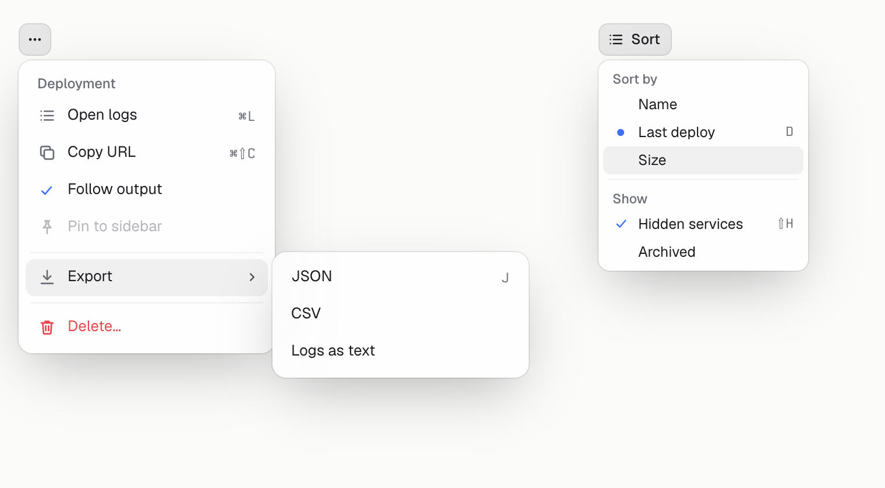
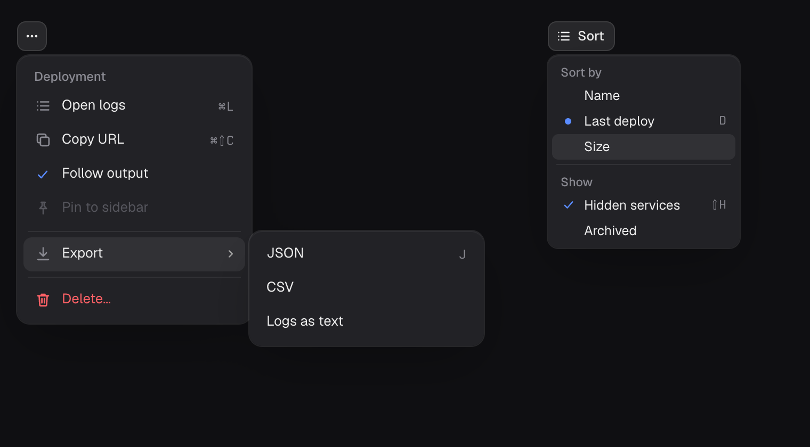
<figcaption><code>default</code> 展示所有行类型和展开的子菜单，<code>dense</code> 展示单选组和复选组。</figcaption>
</figure>

几个重要选项，每个选项都有一句说明，位于带标签的触发器下：

```lua
ui.node("menu", {
	key = "release",
	text = "Release",
	icon = "rocket",
	caret = true,
	items = {
		{ id = "promote", label = "Promote", icon = "rocket", detail = "Copy staging to production" },
		{ id = "rollback", label = "Roll back", icon = "undo", detail = "Restore the previous release" },
	},
})
```

<figure class="tn-figure">
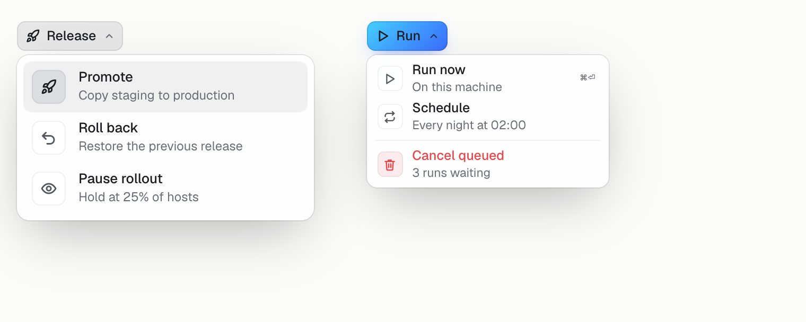
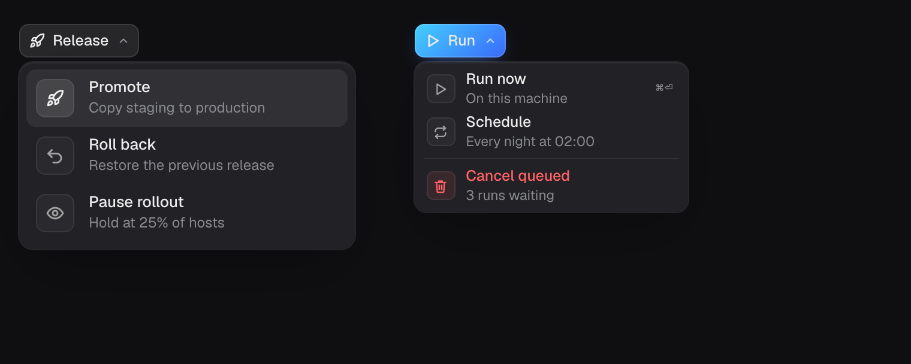
<figcaption>带 <code>detail</code> 的行在 <code>default</code> 和 <code>dense</code> 中都会显示为带说明的双行条目；<code>caret</code> 和 <code>trigger</code> 用于设置按钮样式。</figcaption>
</figure>

<figure class="tn-figure">
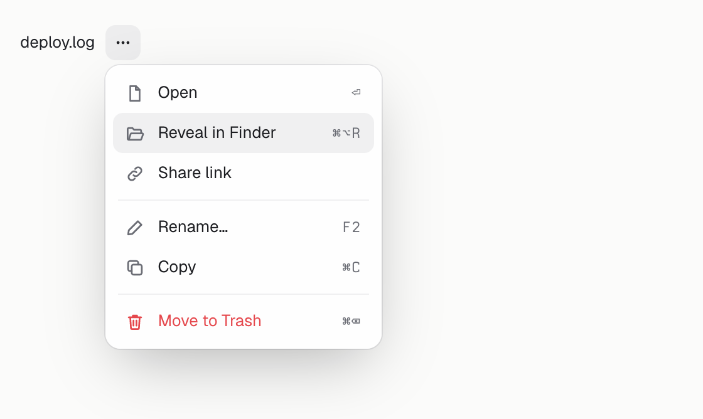
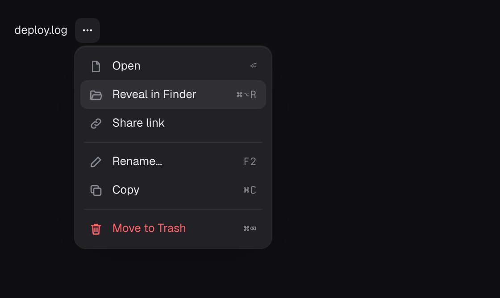
<figcaption>右键菜单可使用这些行：图标、按键、分隔线和危险操作行（此处使用 <code>quiet</code> 触发器）。</figcaption>
</figure>

| 属性 | 类型 | 默认值 | 含义 |
| --- | --- | --- | --- |
| `items` | `{ item }` | `{}` | 按顺序排列的行（见下方“条目”说明） |
| `text` | `string` | none | 触发器标签。没有 `text` 和 `icon` 时，触发器是方形 … 按钮 |
| `icon` | `string` | none | 触发器前置图标（与 `button` 一样使用图标名称） |
| `trigger` | `"default"` \| `"quiet"` \| `"primary"` | `"default"` | 触发器外观：对应名称的 `button` 变体 |
| `caret` | `boolean` | `false` | 标签后显示的箭头，菜单打开时翻转 |
| `size` | `"md"` \| `"sm"` | `"md"` | 触发器大小（28px 或 22px），与 `button` 一样 |
| `variant` | `"default"` \| `"dense"` | `"default"` | 菜单外观（见下文）。其他值按 `default` 处理 |
| `open` | `boolean` | `false` | 是否显示菜单。`open` 变化优先于用户本地的打开或关闭操作 |
| `active` | `string` | none | 高亮行的 `id`（你的键盘光标）。包含该项的子菜单会保持打开；高亮行若有子菜单，其子菜单也会打开 |
| `align` | `"start"` \| `"end"` | `"start"` | 菜单与触发器哪一侧对齐；触发器位于行尾时使用 `end` |
| `disabled` | `boolean` \| `string` | `false` | 触发器变暗且不会打开；字符串表示原因，并显示为工具提示 |
| `title` | `string` | none | 触发器工具提示；没有 `text` 时也作为其可访问名称（默认值为 "Menu"） |

[通用 props](index.md#每个节点都可使用的-props) 同样适用：`key`（按节点保留本地状态）、`tone` 和 flex props。

**条目。** `items`（以及 `actions.menu`）的每个条目可以是：

| 条目 | 含义 |
| --- | --- |
| `"-"` | 分隔线 |
| `{ header = "…" }` | 暗色分区标题 |
| `"<id>"` | 根据 id 生成标签的操作（`open-file` → "Open file"） |
| `{ id, … }` | 下方列出的条目 |

| 字段 | 类型 | 默认值 | 含义 |
| --- | --- | --- | --- |
| `id` | `string` | 必填 | `action` 事件以此作为 `act` 发送 |
| `label` | `string` | 根据 `id` 生成 | 行文本 |
| `icon` | `string` | 无 | 前置图标 |
| `keys` | `string` \| `{ string }` | 无 | 在右侧以等宽字形绘制的快捷键（`{"cmd","shift","C"}` → ⌘⇧C）。仅负责显示；快捷键需由你的程序绑定 |
| `detail` | `string` | 无 | 标签下方的第二行；该行会绘制为丰富行（图标置于底色块中） |
| `checked` | `boolean` | 无 | 将行设为复选项（`menuitemcheckbox`），为 `true` 时显示勾选标记 |
| `radio` | `string` | 无 | 将行设为该组的单选项（`menuitemradio`）：`checked` 时显示圆点；选择该项会关闭同组其他项 |
| `disabled` | `boolean` \| `string` | `false` | 变暗且不可选择；字符串表示原因，并显示为该行工具提示 |
| `danger` | `boolean` | `false` | 危险操作，使用 `--bad` 绘制 |
| `items` | `{ item }` | 无 | 子菜单；悬停或点击该行时在旁展开；该行自身不发送事件 |

同时带有 `icon` 和 `checked` 的行，在未选中时显示图标，选中时显示勾选标记。

**变体：**

| `variant` | 外观 | 用途 |
| --- | --- | --- |
| `default` | kit 菜单：12px 磨砂面板、8px 胶囊上的 32px 行、13px 字体、16px 图标列、右侧等宽按键、子菜单使用 › | 操作、“…” 菜单、右键菜单 |
| `dense` | 6px 胶囊上的 24px 行、12.5px 字体、10px 面板 | 长排序、筛选和视图菜单 |
| 带 `detail` 的行 | 图标位于 32px 方块（`dense` 中为 24px），中等字重标签位于暗色说明行上方 | 少数需要逐条说明的重要选项 |

菜单从触发器处淡入并缩放（`--out`，0.2 秒）；标记开启时会弹出。减少动态效果、`.sf-still` 和 `.sf-paused` 下会停止动画。

**子项：**无（忽略）。

**事件：**选择行时发送：

```lua
{ ev = "action", id = "<the menu's id>", act = "<the row's id>" }
{ ev = "action", id = "…", act = "follow", checked = true }  -- a check or radio row: its new state
```

然后关闭菜单。通过指针（触发器、点击外部、选择条目）打开或关闭菜单时会发送：

```lua
{ ev = "toggle", id = "<the menu's id>", open = true }
```

菜单会立即打开或关闭，复选项和单选项也会立即切换；菜单会保持该状态，直到程序发送的 `open`（或条目的 `checked`）与上次绘制的值不同时，新值才会生效。将事件同步回 `open` 和 `checked` 即可继续由你管理状态。禁用行、子菜单行、标题和分隔线不发送事件；禁用的触发器不会打开菜单。surface 关闭或以 `listen = false` 打开时，不会打开菜单、切换选项或发送事件。

**键盘：**自身不处理键盘。按键由你的程序管理：设置 `open` 显示菜单，用方向键移动 `active`（通过命名子菜单中的某行进入子菜单），并在 Enter 时自行执行 `active` 行。

### 右键菜单：`actions.menu`

任何节点的 `actions.menu`（参见[操作与事件](../guides/views.md#操作与事件)）都接受相同条目，因此右键菜单可以使用图标、按键、复选项、单选组、分隔线、标题、禁用和危险操作行以及子菜单。普通字符串仍然有效。Tern 会绘制菜单（使用其原生菜单外观），并在末尾添加 Copy；若菜单含有图标、按键或分隔线，则会先加一条分隔线。选择行会发送带 `act` 的 `action`；复选项和单选项还会发送 `checked`（新状态）；该行的 `detail` 在这里显示为工具提示。

```lua
local file = tern.ui.text("deploy.log")
file.p.actions = { menu = {
	{ id = "open", label = "Open", icon = "file", keys = "enter" },
	{ id = "reveal", label = "Reveal in Finder", icon = "folder-open", keys = { "cmd", "alt", "R" } },
	"-",
	{ id = "trash", label = "Move to Trash", icon = "trash", danger = true },
} }
```

**样式：**

```html
<div class="sf sf-menu open" data-id="main.more">
	<button class="sf-menu-trigger sf-button" data-variant="default" data-size="md"
		aria-haspopup="menu" aria-expanded="true">
		<span class="sf-btn-ic" aria-hidden="true"><svg class="ico">…</svg></span>
		<span class="sf-btn-label">Release</span>
		<span class="sf-menu-caret" aria-hidden="true"><svg class="ico">…</svg></span>
	</button>
	<div class="sf-menu-pop marks" role="menu" data-variant="default" data-align="start">
		<div class="sf-menu-head" role="presentation">Deployment</div>
		<div class="sf-menu-item active" role="menuitem" data-act="logs">
			<span class="sf-menu-lead" aria-hidden="true"><svg class="ico">…</svg></span>
			<span class="sf-menu-text"><span class="sf-menu-label">Open logs</span>
				<span class="sf-menu-detail">…</span></span>
			<span class="sf-menu-keys" aria-hidden="true">⌘L</span>
		</div>
		<div class="sf-menu-item on" role="menuitemcheckbox" aria-checked="true" data-act="follow">
			<span class="sf-menu-lead" aria-hidden="true"><i class="sf-menu-check"><svg class="ico">…</svg></i></span>…
		</div>
		<div class="sf-menu-sep" role="separator"></div>
		<div class="sf-menu-item sub open" role="menuitem" aria-haspopup="menu" aria-expanded="true" data-act="export">
			…<span class="sf-menu-more" aria-hidden="true"><svg class="ico">…</svg></span>
			<div class="sf-menu-pop sf-menu-subpop" role="menu">…</div>
		</div>
	</div>
</div>
```

| 目标 | 选择器 |
| --- | --- |
| 节点 / 打开状态 | `.sf-menu`、`.sf-menu.open` |
| 触发器 | `.sf-menu-trigger`（一个 `.sf-button`），箭头 `.sf-menu-caret` |
| 菜单 / 变体 | `.sf-menu-pop`、`.sf-menu-pop[data-variant='dense']`、`[data-align='end']` |
| 子菜单 | `.sf-menu-subpop`；其行 `.sf-menu-item.sub`，打开时为 `.sf-menu-item.open` |
| 行 | `.sf-menu-item`；`.active`、`.on`（已勾选）、`.dis`、`.danger`、`.rich` |
| 行的组成部分 | `.sf-menu-lead`（图标或标记：`.sf-menu-check`、`.sf-menu-dot`）、`.sf-menu-label`、`.sf-menu-detail`、`.sf-menu-keys`、`.sf-menu-more` |
| 分隔线 / 标题 | `.sf-menu-sep`、`.sf-menu-head` |

## `menubar`

一行菜单标题，每个标题都会在下方打开命令菜单，类似 Mac 应用的菜单栏。当全屏应用的命令多到无法放进工具栏且自然分组（File、Edit、View、Go、Help，或 Deploys、Services、Logs）时使用：标题保持简短且可见，每条命令在菜单中展示时都保留其按键提示。只有一组命令时，使用 [`menu`](#menu) 按钮即可。

菜单使用 [`menu`](#menu) 的弹出层：相同的行（图标、按键、复选标记、单选组、子菜单、分隔线、标题、丰富双行、禁用和危险操作行）以及相同的磨砂面板。

指针操作方式与菜单栏相同：点击标题会打开其菜单；一个菜单打开时，将指针停在另一个标题上会切换到那个菜单；再次点击已打开菜单的标题或在菜单外任意位置按下会关闭菜单；选择一行也会关闭菜单。所有这些状态都会立即显示，并通过 `toggle` 事件报告。按键仍由你的程序处理：在按键处理器中驱动 `open`（以及高亮行 `active`）。

`variant` 提供两种外观：

- `strip`（默认）：带细线环的简洁文字条带，高 30px，宽度与容器一致，适用于应用的标题行或 dock。打开的标题显示在柔和灰色胶囊上。在 dock 中菜单向上打开。
- `pill`：浮动玻璃胶囊，高 40px，宽度只覆盖标题，左侧显示应用标记（强调色 `icon`）。打开的标题使用强调色着色。

**构建：**`tern.ui.node("menubar", { menus = { … } })`。没有专用 builder。

```lua
local ui = tern.ui

ui.node("menubar", {
	key = "bar",
	open = state.menu,
	active = state.row,
	menus = {
		{ id = "file", label = "File", items = {
			{ id = "new", label = "New window", keys = { "cmd", "N" } },
			{ id = "open", label = "Open…", keys = { "cmd", "O" } },
			"-",
			{ id = "close", label = "Close", keys = { "cmd", "W" } },
		} },
		{ id = "view", label = "View", items = {
			{ id = "zoom-in", label = "Zoom in", keys = { "cmd", "+" } },
			{ id = "zoom-out", label = "Zoom out", keys = { "cmd", "-" } },
			"-",
			{ id = "sidebar", label = "Sidebar", checked = state.sidebar },
		} },
		{ id = "help", label = "Help", items = { { id = "docs", label = "Documentation" } } },
	},
})

-- event(state, ev, cx)
if ev.id == "main.bar" then
	if ev.ev == "toggle" then
		state.menu = ev.open and ev.item or nil
	elseif ev.ev == "action" then
		state.menu = nil
		run(ev.item, ev.act, ev.checked)
	end
end
```

<figure class="tn-figure">
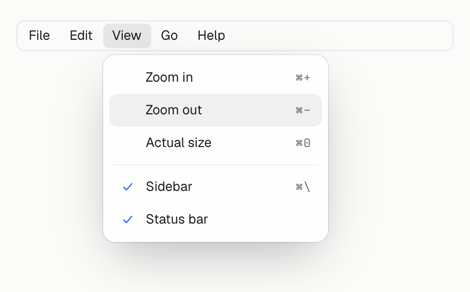
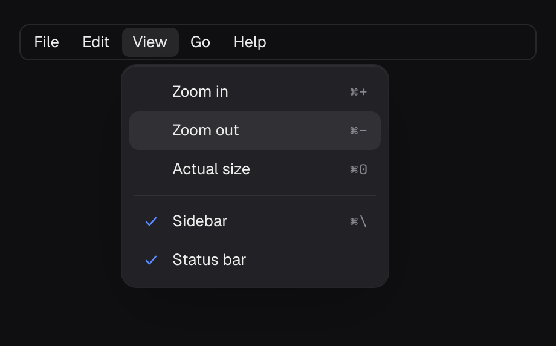
<figcaption><code>open = "view"</code> 且 <code>active = "zoom-out"</code> 时的条带。</figcaption>
</figure>

<figure class="tn-figure">
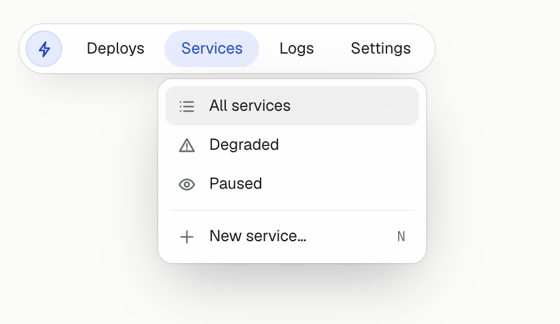
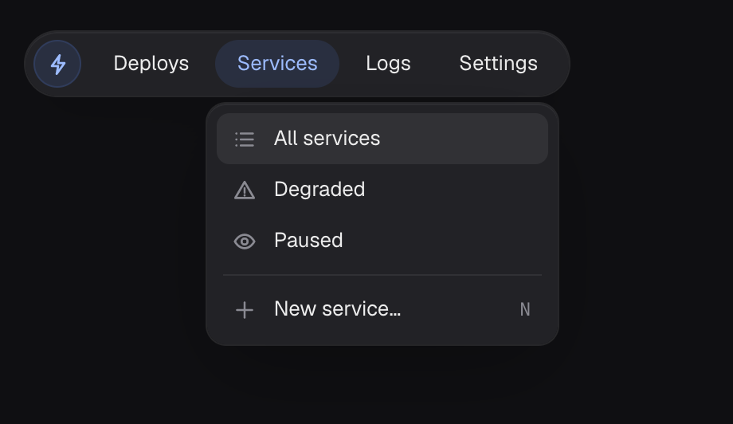
<figcaption><code>variant = "pill"</code>，配合 <code>icon = "bolt"</code> 和 <code>open = "services"</code>。</figcaption>
</figure>

<figure class="tn-figure">
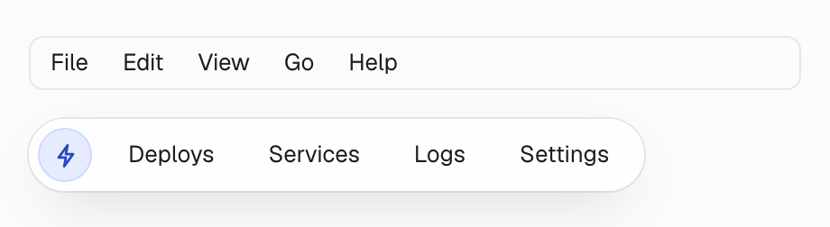
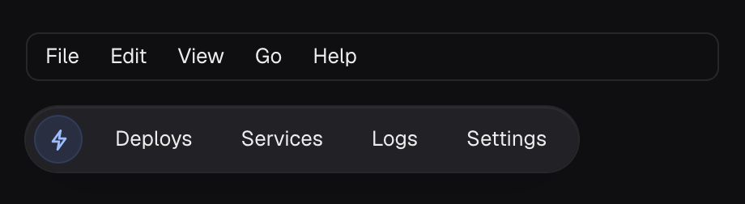
<figcaption>两种外观均处于关闭状态。</figcaption>
</figure>

<figure class="tn-figure">
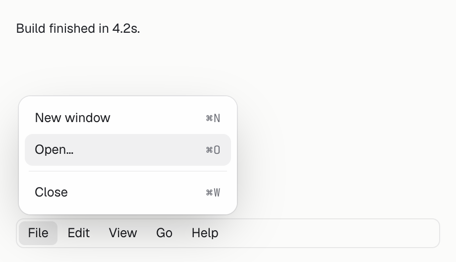
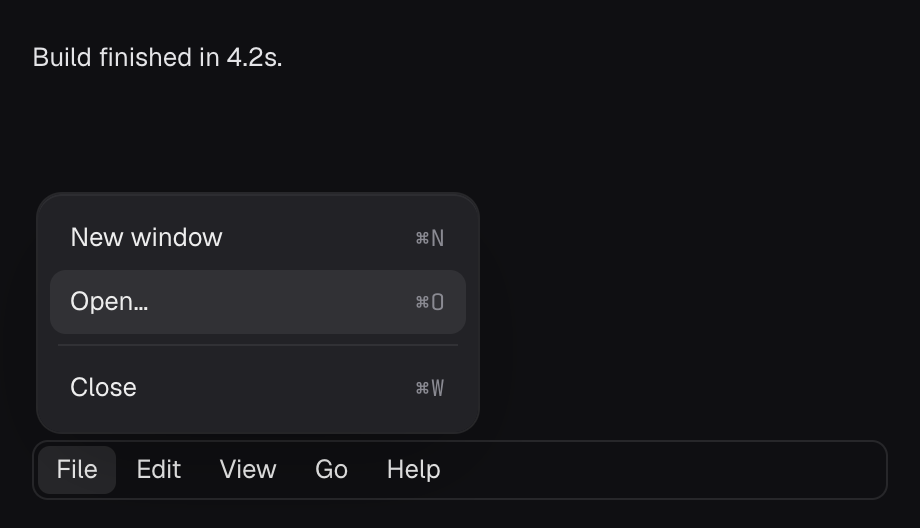
<figcaption>在 dock 中菜单会向上打开。</figcaption>
</figure>

| 属性 | 类型 | 默认值 | 含义 |
| --- | --- | --- | --- |
| `menus` | `{ {id: string, label?: string, items: { item }} }` | `{}` | 按顺序排列的菜单。`id` 用于事件和 `open`；没有 `id` 的条目会跳过。`label` 是标题（默认使用 `id`）。`items` 是 [`menu`](#menu) 条目：item 对象、表示分隔线的 `"-"`、表示分区标题的 `{header}` |
| `variant` | `"strip"` \| `"pill"` | `"strip"` | 外观（`data-variant`）；其他值按 `"strip"` 处理 |
| `icon` | `string` | none | 绘制在标题前的图标名称，作为应用标记（`.sf-mb-mark`，仅装饰用途）。`pill` 中在 30px 强调色底圆盘上显示强调色图标；`strip` 中以 `--t2` 直接绘制。未知名称不绘制 |
| `open` | `string` | none | 正在打开显示的菜单 `id`。值变化优先于指针操作；值保持不变时，指针的打开或关闭操作会保留。不存在的 `id`（或 `""`）不会打开菜单 |
| `active` | `string` | none | 打开菜单中高亮行的 `id`（你的键盘光标）；沿途的子菜单会保持打开 |

**子项：**无（忽略）。

| 变体 | 外观 | 适用位置 |
| --- | --- | --- |
| `strip` | 高 30px 的细线条带，全宽，标题高 24px；打开的标题位于 `--l2` 胶囊上 | 应用标题行、dock（菜单向上打开） |
| `pill` | 高 40px 的磨砂胶囊，宽度与标题总宽相同，标题为 30px 胶囊，带强调色标记；打开标题使用强调色着色 | 浮于应用上方，在 `row` 中以 `justify = "center"` 居中 |

**事件：**

| 事件 | 载荷 | 触发时机 |
| --- | --- | --- |
| `toggle` | `{ev = "toggle", id, item = <menu id>, open = true}` | 点击关闭状态的标题以打开菜单；或已有菜单打开时指针停在另一个标题上（只发一个事件：打开新菜单会关闭其他菜单） |
| `toggle` | `{ev = "toggle", id, item = <menu id>, open = false}` | 点击打开菜单的标题、在菜单外按下，或选择菜单项 |
| `action` | `{ev = "action", id, act = <row id>, item = <menu id>, checked?}` | 点击可用行；复选行的 `checked` 是新状态（切换后），单选行的 `checked` 为 `true`（同组其他项关闭）。随后会发送 `open = false` 的菜单 `toggle` |

禁用行、标题和分隔线不发送事件；带子菜单的行会打开子菜单。surface 关闭或以 `listen = false` 打开时，菜单栏仍会绘制（包括 `open` 指定的菜单），但指针无法打开、关闭或选择，也不会发送事件。

**键盘：**菜单栏永不获取焦点。典型模型：按键（F10 或类似 macOS 的 ⌃F2）将 `open` 设为第一个菜单；←/→ 在菜单间移动 `open`；↑/↓ 在打开的菜单中移动 `active`；Enter 执行 `active`（由你自行发送命令并清除 `open`）；Escape 清除 `open`。将 `toggle` 同步到 `open`，使指针与键盘操作保持一致。

**样式：**

```html
<div class="sf sf-menubar open" data-id="main.bar" data-variant="strip" role="menubar">
	<span class="sf-mb-mark" aria-hidden="true"><svg class="ico">…</svg></span>
	<span class="sf-mb-menu sf-menu-anchor" data-menu="file">
		<span class="sf-mb-title" role="menuitem" aria-haspopup="menu" aria-expanded="false">File</span>
		<div class="sf-menu-pop" role="menu" data-variant="default" data-align="start">…</div>
	</span>
	<span class="sf-mb-menu sf-menu-anchor open" data-menu="view">
		<span class="sf-mb-title" role="menuitem" aria-haspopup="menu" aria-expanded="true">View</span>
		<div class="sf-menu-pop" role="menu" data-variant="default" data-align="start">…</div>
	</span>
</div>
```

| 目标 | 选择器 |
| --- | --- |
| 节点 | `.sf-menubar`、`.sf-menubar[data-variant='pill']` |
| 菜单已打开 | `.sf-menubar.open` |
| 应用标记 | `.sf-mb-mark` |
| 标题及其菜单 | `.sf-mb-menu`、`.sf-mb-menu[data-menu='view']` |
| 已打开的菜单项 | `.sf-mb-menu.open` |
| 标题 | `.sf-mb-title`、`.sf-mb-title[aria-expanded='true']` |
| 菜单 | `.sf-mb-menu > .sf-menu-pop`（其行参见 [`menu`](#menu)） |

即使在等宽区域中，标题也使用 `--sans` 的 `400 13px` 字体和 `--t1`；悬停增加 `--l1`，按下增加 `--l2`。`strip` 的标题高 24px，圆角为 6px，位于高 30px、圆角为 8px、带 `--l2` 细线环的条带中；打开的标题位于 `--l2` 上。`pill` 使用带 `--l2` 边框和柔和阴影的 `--pop-bg` 磨砂玻璃，标题为 30px 胶囊；打开标题使用 12% 强调色底和 `--accent-ink`。每个菜单都会绘制，但只有打开的菜单显示（否则为 `display: none`）；它位于条带下方 7px（胶囊下方 10px），并使用弹出层进场动画。减少动态效果、`.sf-still` 和 `.sf-paused` 下会关闭过渡和进场动画。

## `tabs`

位于细线上方的一行标签，活动标签下方有强调色下划线。标签栏不会滚动：超出宽度的标签会被裁切。活动标签由你管理：点击会发送 `select`，只有你发送新的 `active` 后标签栏才会变化。

带下划线的标签栏用于页面导航：应用有两个以上面板时，在标题行和统计信息下方放置一个标签栏，每个视图对应一个标签（视图名称及适用时的暗色计数），并在其下方全宽绘制当前活动视图。通过 `select` 事件，以及按键处理器中的 Tab/⇧Tab（或 `[`/`]`）切换视图，并在按键说明中注明（参见[设计视图](../guides/design.md#页面结构)）。

`variant = "segmented"` 会将标签栏改为分段控件：较小的槽中容纳各段，活动项凸起显示在卡片表面上。它的宽度按标签决定，不会拉伸。可在视图工具栏行（左侧为暗色说明，右侧为控件）或卡片标题的 [`end`](layout.md#card) 位置使用，以筛选或切换单个视图的内容；不要将它作为第二个导航栏（参见[设计视图](../guides/design.md#视图-表格与详情)）。

**构建：**`tern.ui.node("tabs", { items = { … }, active = "…" })`。没有专用 builder。

| 属性 | 类型 | 默认值 | 含义 |
| --- | --- | --- | --- |
| `items` | `{ {id: string, label: Spans} }` | `{}` | 按顺序排列的标签。没有 `id` 的条目会跳过 |
| `active` | `string` | none | 活动标签的 `id`（`.on`、`aria-selected="true"`） |
| `variant` | `"underline"` \| `"segmented"` | `"underline"` | 外观。`"segmented"` 添加 class `seg`；其他值按 `"underline"` 处理 |

**子项：**无（忽略）。

**事件：**点击标签会发送 `{ev = "select", id = <tabs node id>, item = <tab id>}`。`item` 是 `items` 中标签的 `id`，不是节点 id。

**样式：**

```html
<div class="sf sf-tabs" data-id="main.tabs" role="tablist">
	<div class="sf-tab on" role="tab" aria-selected="true" data-tab="files">Files</div>
	<div class="sf-tab" role="tab" aria-selected="false" data-tab="commits">Commits</div>
</div>
```

| 目标 | 选择器 |
| --- | --- |
| 节点 | `.sf-tabs` |
| 标签 | `.sf-tab`、`.sf-tab[data-tab='files']` |
| 活动标签 | `.sf-tab.on`、`.sf-tab[aria-selected='true']` |
| 分段标签栏 | `.sf-tabs.seg` |

标签栏使用 `--sans` 12px 字体；非活动标签为 `--t3`，悬停时增加 `--l1`，活动下划线使用 `--accent`，细线使用 `--l2`。减少动态效果时关闭过渡。

分段标签栏高 28px，padding 为 2px，圆角 9px，底色为 `--l1`，并带 `--l1` 细线环。每个标签高 24px，`padding: 0 10px`，圆角 7px，使用 `--t3` 的 `500 12.5px` sans 字体；活动标签使用 `--t1`，显示在 `--card`（深色模式下为 `--raise`）上，并带柔和阴影和 `--l1` 边框。所有标签都显示指针手型。

```lua
local ui = tern.ui

ui.node("tabs", {
	key = "tabs",
	active = state.tab,
	items = {
		{ id = "files", label = "Files" },
		{ id = "commits", label = { ui.span("Commits "), ui.span("12", "muted") } },
		{ id = "checks", label = "Checks" },
	},
})

-- event(state, ev, cx): render only the active view
-- if ev.ev == "select" and ev.id == "main.tabs" then state.tab = ev.item end
```

<figure class="tn-figure">
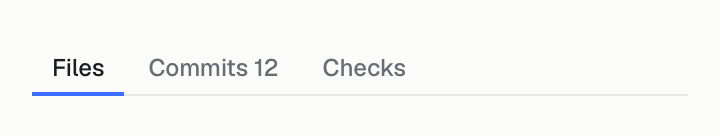
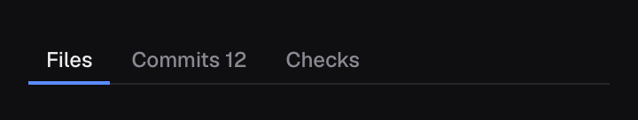
<figcaption><code>active = "files"</code> 时的标签栏。</figcaption>
</figure>

在视图工具栏行中使用分段筛选器，位于其所筛选的表格上方：

```lua
ui.node("col", { key = "jobs" }, {
	ui.node("row", { key = "bar", justify = "between", align = "center" }, {
		ui.text({ ui.span(#shown(state) .. " of " .. #state.jobs .. " jobs", "muted") }),
		ui.node("tabs", {
			key = "filter",
			variant = "segmented",
			active = state.filter,
			items = {
				{ id = "all", label = "All" },
				{ id = "failed", label = "Failed" },
				{ id = "running", label = "Running" },
			},
		}),
	}),
	jobs_table(state),
})
```

<figure class="tn-figure">
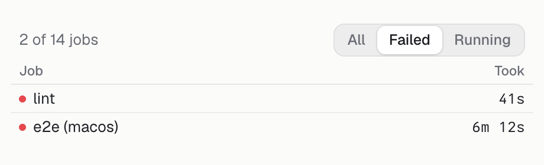
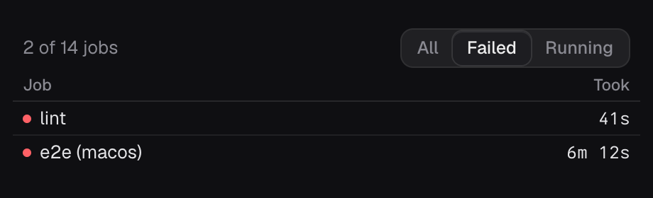
<figcaption>工具栏行中使用 <code>variant = "segmented"</code> 和 <code>active = "failed"</code>，位于所筛选的表格上方。</figcaption>
</figure>

## `nav`

导航栏：展示应用的各个分区、标记活动项，并让带有子页面的条目打开子项菜单。当某个分区是一个分组（Deploys → Production、Previews、History）而非单一视图时使用；平铺的一行视图应使用 [`tabs`](#tabs)。

有两种外观：

- `variant = "pills"`（默认）：条目位于小槽中，活动项凸起显示在卡片表面上，与分段标签相似。带子项的条目会显示箭头，并在其下方打开紧凑菜单（[`menu`](#menu) kind 的行：图标、标签、右侧暗色等宽详情）。宽度由条目决定；放入工具栏行或页面标题处。
- `variant = "links"`：文字链接位于细线上，活动项下方有强调色下划线，切换时下划线会滑动。带子项的条目会打开双栏面板，其中是丰富条目：图标块、标题和单行说明。导航栏横跨容器宽度；用作标题行下方的页面导航。

活动条目由你管理：点击没有子项的条目或子项会立即标记该项并发送 `select`；你需将它回传到 `active`。点击带子项的条目会在本地打开（或再次点击时关闭）其菜单，不发送事件。当 `active` 为子项 id 时，其父项也显示为活动状态，子项则在打开的菜单中标记。

程序更改 `active` 或 `open`，使其值不同于上次发送的值时，新值优先于用户本地选择或打开/关闭操作；重复发送同一值会保留用户选择。在以 `listen = false` 打开（或已关闭）的 surface 上，导航照常绘制，但点击不会切换状态，也不会发送事件。

**构建：**`tern.ui.node("nav", { items = { … }, active = "…" })`。没有专用 builder。

```lua
local ui = tern.ui

ui.node("nav", {
	key = "nav",
	variant = "links",
	active = state.page,
	open = state.menu, -- the item whose panel shows, driven by your keys
	items = {
		{ id = "overview", label = "Overview" },
		{ id = "deploys", label = "Deploys", items = {
			{ id = "production", label = "Production", detail = "Live releases, by region", icon = "rocket" },
			{ id = "history", label = "History", detail = "Every release, rollbacks", icon = "history" },
			{ id = "previews", label = "Previews", detail = "One per open pull request", icon = "eye" },
			{ id = "hooks", label = "Hooks", detail = "Run checks before a promote", icon = "bolt" },
		} },
		{ id = "usage", label = "Usage" },
		{ id = "issues", label = "Issues", count = 3 },
	},
})

-- event(state, ev, cx)
-- if ev.ev == "select" and ev.id == "main.nav" then state.page = ev.item end
```

<figure class="tn-figure">
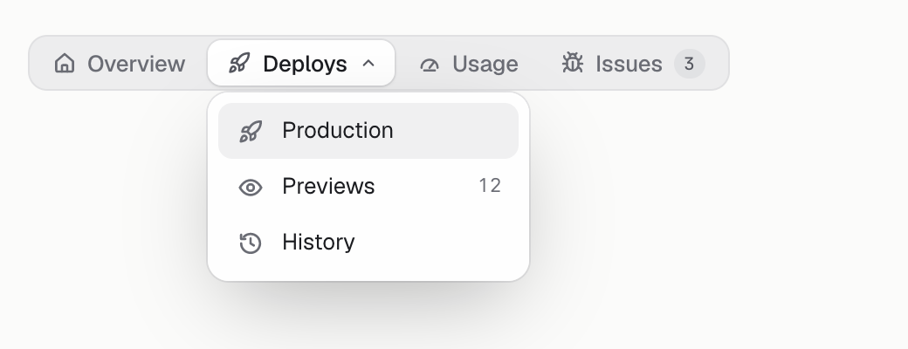
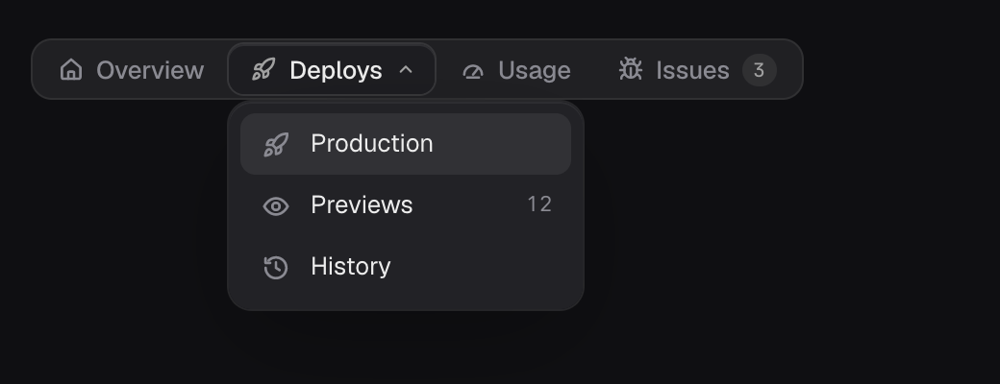
<figcaption>默认的 <code>pills</code> 外观；<code>open</code> 指向 Deploys，活动子项已标记。</figcaption>
</figure>

<figure class="tn-figure">
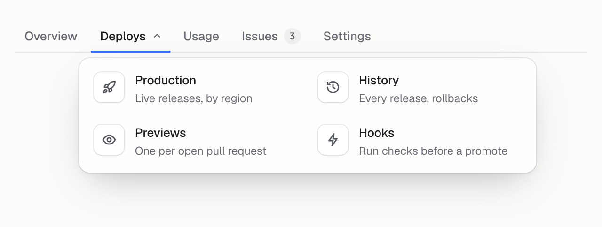
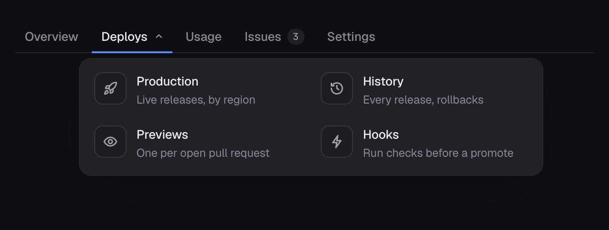
<figcaption><code>variant = "links"</code>，丰富条目面板处于打开状态。</figcaption>
</figure>

<figure class="tn-figure">
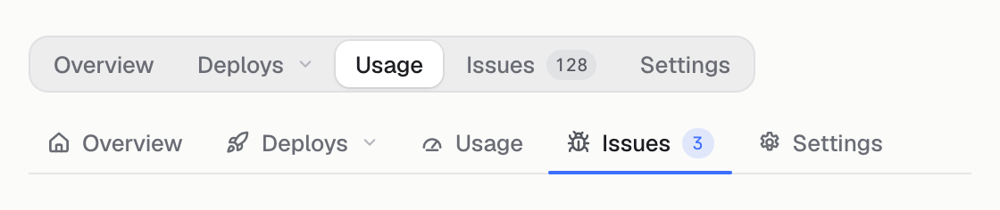
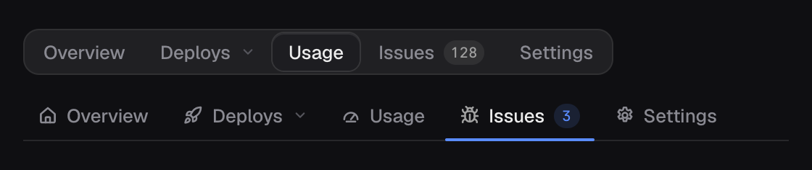
<figcaption>两种外观均处于关闭状态，带图标和计数。</figcaption>
</figure>

| 属性 | 类型 | 默认值 | 含义 |
| --- | --- | --- | --- |
| `items` | `{ {id: string, label?: string, icon?: string, count?: string \| number, items?: { {id: string, label?: string, detail?: string \| number, icon?: string} }} }` | `{}` | 按顺序排列的条目。没有 `id` 的条目会跳过；`label` 默认使用 `id`。`icon` 是 Tern 图标名称（与 [`icon`](data.md#icon) kind 相同）。`count` 在标签后显示为小型等宽胶囊（活动项上使用强调色）。非空 `items` 表示该项有子项：显示箭头并打开菜单，而不是被选中。子项的 `detail` 在 `pills` 菜单中是右对齐的暗色注释，在 `links` 面板中则是说明行；其 `icon` 显示在菜单行前方，或填充面板条目的图标块 |
| `active` | `string` | none | 活动条目或子项的 `id`。子项 id 也会使父条目显示为活动状态 |
| `open` | `string` | none | 要显示其菜单或面板的（带子项）条目 `id`。其他值不会显示任何菜单 |
| `variant` | `"pills"` \| `"links"` | `"pills"` | 外观；其他值按 `"pills"` 处理 |

**子项：**无（忽略）。

| 变体 | 外观 | 子项打开时 |
| --- | --- | --- |
| `pills` | 槽中的胶囊，活动项凸起显示 | 在条目下方打开紧凑菜单（`menu` kind 的行） |
| `links` | 细线上的文字链接，活动项下方显示可滑动强调色下划线 | 显示双栏条目面板：图标块、标题、说明 |

**事件：**

| 事件 | 载荷 | 触发时机 |
| --- | --- | --- |
| `select` | `{ev = "select", id = <nav node id>, item = <item or sub-item id>}` | 点击没有子项的条目或点击子项。surface 不接收事件时不发送 |

打开或关闭菜单不会发送事件；如果你驱动 `open`，需维护自己的状态并发送该值。

**键盘：**节点永不获取焦点。通过按键处理器驱动导航：使用 ←/→（或 Tab/⇧Tab）移动 `active`，使用 ↓ 或 Enter 发送 `open = <item id>` 以打开活动项菜单，使用 ↑/↓ 在子项中移动 `active`，并使用 Escape 发送 `open = nil` 关闭菜单。请在按键说明中注明。

**样式：**

```html
<div class="sf sf-nav" data-id="main.nav" data-variant="links">
	<div class="sf-nav-bar inked" role="menubar">
		<div class="sf-nav-item" role="menuitem" data-item="overview"><span class="sf-nav-label">Overview</span></div>
		<div class="sf-nav-item on open" role="menuitem" data-item="deploys" aria-current="page" aria-haspopup="menu" aria-expanded="true">
			<span class="sf-nav-label">Deploys</span><span class="sf-nav-chev">…</span>
		</div>
		<div class="sf-nav-item" role="menuitem" data-item="issues">
			<span class="sf-nav-label">Issues</span><span class="sf-nav-count">3</span>
		</div>
		<span class="sf-nav-ink" aria-hidden="true"></span>
	</div>
	<div class="sf-nav-pop" role="menu" aria-label="Deploys" data-for="deploys">
		<div class="sf-nav-entry" role="menuitem" data-sub="production">
			<span class="sf-nav-tile">…</span>
			<span class="sf-nav-text"><span class="sf-nav-title">Production</span><span class="sf-nav-detail">Live releases, by region</span></span>
		</div>
	</div>
</div>
```

| 目标 | 选择器 |
| --- | --- |
| 节点 | `.sf-nav`、`.sf-nav[data-variant='pills' \| 'links']` |
| 导航条 | `.sf-nav-bar`（`role=menubar`） |
| 条目 | `.sf-nav-item`、`.sf-nav-item[data-item='deploys']` |
| 活动条目 | `.sf-nav-item.on`、`.sf-nav-item[aria-current='page']` |
| 菜单已打开的条目 | `.sf-nav-item.open`、`[aria-expanded='true']` |
| 条目组成部分 | `.sf-nav-ico`、`.sf-nav-label`、`.sf-nav-count`、`.sf-nav-chev` |
| 下划线（`links`） | `.sf-nav-ink`（由导航条上的 `--ink-x` / `--ink-w` 定位） |
| Pills 菜单 | `.sf-nav-item .sf-menu-pop`（`menu` kind 的类） |
| Links 面板 | `.sf-nav-pop`，其条目 `.sf-nav-entry[data-sub]`、`.sf-nav-entry.on`、`.sf-nav-tile`、`.sf-nav-title`、`.sf-nav-detail` |
| 任意菜单已打开 | `.sf-nav.has-pop` |

条目使用 `--sans` 的 `500 13px` 字体，非活动项为 `--t3`，悬停和活动项为 `--t1`。Pills 高 26px，位于 `--l1` 的 3px 内边距槽中，槽的圆角为 11px；活动胶囊显示在 `--card`（深色模式下为 `--raise`）上，并带柔和阴影。Links 高 36px，位于 `--l2` 细线上方；2px 的 `--accent` 下划线以 0.28 秒滑动。计数是 `--chip-bg` 上的等宽 10.5px 胶囊，活动时带强调色。面板是带 `--r-card` 圆角的 `--pop-bg` 玻璃卡片；条目宽 236px，排成两栏，32px 图标块在悬停时转为强调色。`.sf-still`、`.sf-paused` 和减少动态效果时会关闭过渡和打开动画。

## `breadcrumb`

从根节点到当前位置的路径：组织、项目、环境或文件夹路径。最后一个路径项以外的每一项都能让用户返回对应步骤。当视图深入层级时，将它放在页面标题行；在同级视图之间切换则使用 [`tabs`](#tabs) 或 [`nav`](#nav)。

有两种外观：

- `variant = "chevron"`（默认）：无衬线路径项，可选前置图标，路径项之间以尖括号箭头分隔。悬停项显示在柔和胶囊上；末项（当前位置）使用完整字色。
- `variant = "path"`：使用 Tern 窗格标题样式的等宽路径；暗色父级之间以 `/` 分隔，末级突出显示。不绘制图标。用于文件路径、键路径或 URL 等步骤。

设置 `max` 后，若路径项数超过该值，则保留第一项和最后 `max - 1` 项（若 `max` 为 `1`，则只保留最后一项），并将中间部分折叠到一个“…”胶囊中。点击胶囊会打开一个包含折叠路径项的菜单（[`menu`](#menu) kind 的弹出层：图标和标签；`path` 外观使用密集行）；选择一项会像点击显示中的路径项一样发送 `select`，然后关闭菜单。

末项代表当前位置：它带有 `aria-current="page"`，点击不会发送事件。点击其他路径项会发送带其 `id` 的 `select`；由你导航并发送新路径。带 `href` 的路径项在按住 ⌘ 点击时会打开链接，与通用 [`href`](index.md#每个节点都可使用的-props) 相同（普通点击仍会选择）。路径项标签过长时（每项上限 220px；行宽不足时会收缩，当前项最后收缩），中间部分会被省略，保留首尾，例如 `observabi…ay-ingest`；完整标签显示为工具提示。

菜单在本地打开和关闭：点击“…”、在菜单外按下，或选择一项。程序更改 `open`，使其不同于上次发送的值时，新值优先于用户的操作；重复发送相同值会保留用户选择。surface 以 `listen = false` 打开（或已关闭）时，路径照常绘制，但胶囊不会打开菜单，也不会发送事件。

**构建：**`tern.ui.node("breadcrumb", { items = { … } })`。没有专用 builder。

```lua
local ui = tern.ui

ui.node("breadcrumb", {
	key = "where",
	max = 4,
	items = {
		{ id = "acme", label = "acme", icon = "folder" },
		{ id = "infra", label = "infra", icon = "folder" },
		{ id = "k8s", label = "k8s", icon = "folder" },
		{ id = "clusters", label = "clusters" },
		{ id = "prod-eu", label = "prod-eu", href = "https://console.acme.dev/clusters/prod-eu" },
	},
})

-- event(state, ev, cx)
-- if ev.ev == "select" and ev.id == "main.where" then go_to(state, ev.item) end
```

<figure class="tn-figure">
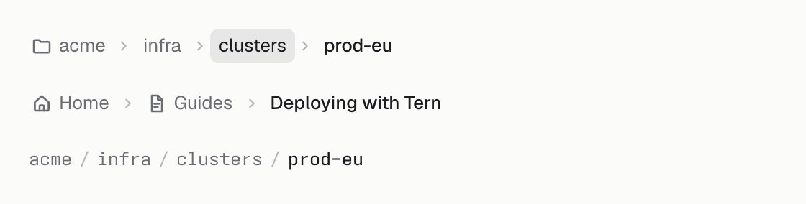
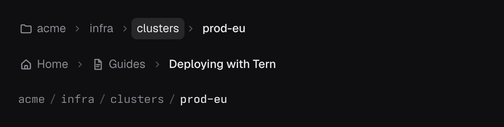
<figcaption>默认的 <code>chevron</code> 外观（<code>active</code> 指向 clusters 时绘制其胶囊），以及 <code>variant = "path"</code>。</figcaption>
</figure>

<figure class="tn-figure">
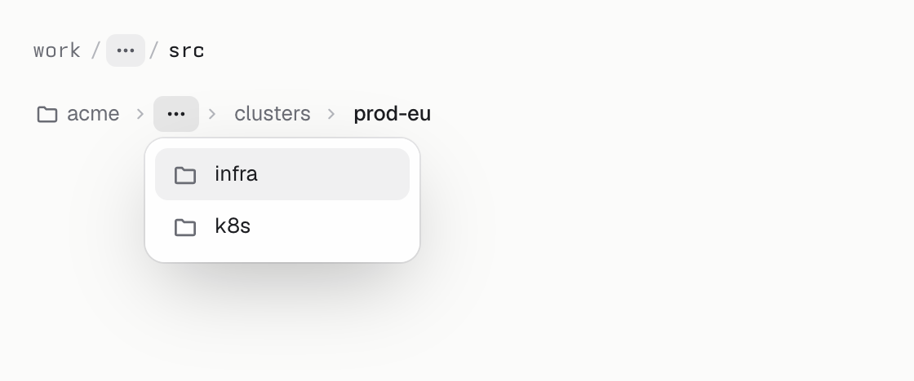
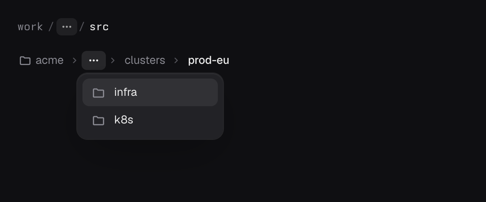
<figcaption><code>path</code> 外观使用 <code>max = 2</code> 折叠，<code>max = 3</code> 时折叠菜单为 <code>open</code>。</figcaption>
</figure>

<figure class="tn-figure">
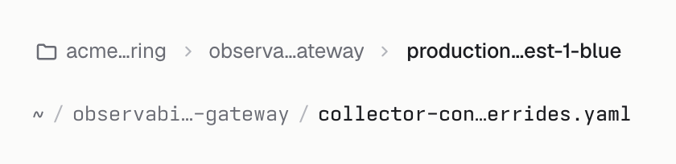
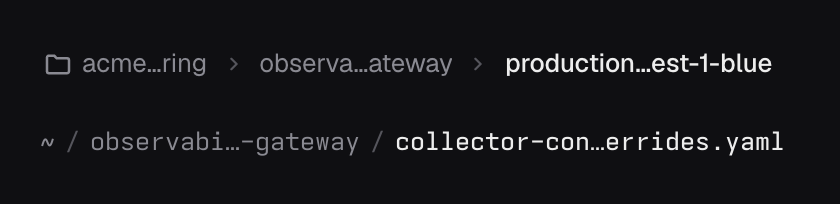
<figcaption>长标签会省略中间部分；完整标签是路径项的工具提示。</figcaption>
</figure>

| 属性 | 类型 | 默认值 | 含义 |
| --- | --- | --- | --- |
| `items` | `{ {id: string \| number, label?: string, icon?: string, href?: string} }` | `{}` | 路径项，按从根到末端的顺序排列；最后一项是当前位置。没有 `id` 的条目会跳过；`label` 默认使用 `id`。`icon` 是 Tern 图标名称（如 [`icon`](data.md#icon) kind），在 `chevron` 外观和折叠菜单中绘制于标签前。`href` 是 URL 或路径，按住 ⌘ 点击路径项时会打开 |
| `variant` | `"chevron"` \| `"path"` | `"chevron"` | 外观；其他值按 `"chevron"` 处理 |
| `max` | `number` | none | 显示的路径项上限。更长的路径会保留第一项和最后 `max - 1` 项（为 `1` 时只保留末项），其余折叠到“…”菜单中。未设置、为 `0` 或非数字时永不折叠 |
| `open` | `boolean` | `false` | 是否显示折叠菜单（仅在有折叠项时有效）。值变化时优先于用户的打开或关闭操作 |
| `active` | `string` | none | 键盘光标所在路径项的 `id`：显示中的路径项绘制悬停胶囊，折叠项则在菜单中高亮。末项永远不会成为活动项 |

**子项：**无（忽略）。

| 变体 | 外观 |
| --- | --- |
| `chevron` | 13px sans 字体的路径项，高 24px，可选 14px 图标，以 `›` 分隔；悬停时显示柔和胶囊；当前位置使用 500 字重的完整字色 |
| `path` | 12.5px 等宽字体，父项之间以 `--t3` 的 `/` 分隔，末项使用 `--t1` 和 550 字重；没有图标；悬停胶囊更淡 |

**事件：**

| 事件 | 载荷 | 触发时机 |
| --- | --- | --- |
| `select` | `{ev = "select", id = <breadcrumb node id>, item = <crumb id>}` | 点击末项以外的路径项，或点击菜单中的折叠项。按住 ⌘ 点击带 `href` 的路径项（会打开链接）以及 surface 不接收事件时不发送 |

打开或关闭菜单不会发送事件；如果你驱动 `open`，需维护自己的状态。

**键盘：**节点永不获取焦点。通过按键处理器驱动路径：用 ←/→ 移动 `active`（发送 `open = true` 后，折叠项会在菜单中高亮），Enter 时像 `select` 一样导航到 `active`，Escape 时发送 `open = false` 关闭菜单。请在按键说明中注明。

**样式：**

```html
<div class="sf sf-breadcrumb" data-id="main.where" data-variant="chevron" role="navigation" aria-label="Breadcrumb">
	<ol class="bc-list">
		<li class="bc-it">
			<button class="bc-crumb" data-item="acme"><span class="bc-ic" aria-hidden="true">…</span><span class="bc-lbl">acme</span></button>
		</li>
		<li class="bc-it bc-fold open sf-menu-anchor">
			<span class="bc-sep" aria-hidden="true">…</span>
			<button class="bc-more" aria-haspopup="menu" aria-expanded="true" aria-label="2 more crumbs">…</button>
			<div class="sf-menu-pop" role="menu" data-variant="default">…</div>
		</li>
		<li class="bc-it">
			<span class="bc-sep" aria-hidden="true">…</span>
			<button class="bc-crumb cur" data-item="prod-eu" aria-current="page"><span class="bc-lbl">prod-eu</span></button>
		</li>
	</ol>
</div>
```

| 目标 | 选择器 |
| --- | --- |
| 节点 | `.sf-breadcrumb`、`.sf-breadcrumb[data-variant='chevron' \| 'path']` |
| 路径列表 | `.bc-list`，其步骤为 `.bc-it` |
| 路径项 | `.bc-crumb`、`.bc-crumb[data-item='infra']`；带链接时为 `.bc-crumb[data-href]` |
| 当前路径项 | `.bc-crumb.cur`、`[aria-current='page']` |
| 键盘光标 | `.bc-crumb.active` |
| 路径项组成部分 | `.bc-ic`、`.bc-lbl` |
| 分隔符 | `.bc-sep` |
| 折叠项 | `.bc-fold`（菜单显示时为 `.open`），其胶囊 `.bc-more`（`[aria-expanded='true']`） |
| 折叠菜单 | `.bc-fold .sf-menu-pop`（`menu` kind 的类） |

路径项使用 `--t3`，当前项使用 `--t1`；分隔符使用 `--t4`。悬停胶囊和键盘光标使用 `--l2`（`path` 中使用 `--l1`），圆角为 `--r-chip`，按下时缩放至 0.97。“…”胶囊在 `--l1` 上为 28×22，悬停或打开时使用 `--l2`。标签上限为 220px。`.sf-still`、`.sf-paused` 和减少动态效果时会关闭过渡和按下缩放。

## `pager`

位于分页表格或列表下方的控件。你发送当前页和计数，Tern 绘制三种外观之一，并在用户翻页时通知你。当视图只显示较大内容的一部分时使用：`range`（默认）是紧凑的表格页脚；`pages` 允许用户跳转到某页；`more` 则在用户请求更多内容时逐步扩展列表（日志、动态流、提交记录）。

- **`range`**：等宽字体显示 “12–24 of 312”，计数突出、文字较暗，后接合并为一个 28px 胶囊的 ‹ ›。全宽布局（`col` 或区域的 `main`）中，箭头靠右；放在 `row` 中时宽度与内容一致。到达边界时，相应箭头禁用。
- **`pages`**：‹ 1 2 3 4 5 … 26 ›，当前页显示为强调色胶囊。超过七页后，条带始终有七个槽位：第一页和最后一页、当前页及其相邻页，以及每段省略页对应的“…”（`1 2 3 4 5 … 26`、`1 … 12 13 14 … 26`、`1 … 22 23 24 25 26`）。每个槽位宽度按最大页码设置，因此翻页时箭头不会移动。页数达到数千时条带会很宽（四位数页码约 440px）；此时优先使用 `range`。
- **`more`**：位于细线下方的简洁居中行（类似表格行），其中强调色胶囊显示 “Show 50 more”，旁边的暗色文字显示 “· 262 left”。紧接列表或表格放置，作为其底部收尾。此处 `page` 表示已加载的页数：`size = 50`、`total = 312` 时，第 1 页表示已显示 50 项、还有 262 项。最后一页只提供剩余数量（“Show 12 more”）；没有剩余内容时，该行显示 “All 312 shown” 且不发送事件。

**计数。**页数优先使用 `pages`；否则根据 `total` 除以 `size`（向上取整）计算。`range` 需要 `total` 和 `size` 才能显示条目范围；只有 `pages` 时显示 “Page 3 of 26”。没有任何计数时，`range` 和 `pages` 都只有一页且两个箭头均关闭；`more` 会持续提供更多内容（有 `size` 时为 “Show 100 more”，否则为 “Show more”），直到你移除它。数字按千位分组（`1,048,576`）。

**边界处理。**`page` 从 1 开始，并限制在页数范围内：`0` 按 1 处理，超过末页的值按最后一页处理。Tern 发送的 `change` 事件始终在有效范围内。

**优先本地翻页。**点击箭头或页码胶囊会立即显示该页，并发送以页码为 `value` 的 `change`；你的程序加载该页并回复 `page`。直到你的 `page` 发生变化，用户选择的页码都会继续显示（其他 prop 变化，如 `loading`，不会影响它）；当 `page` 变化时，以你发送的值为准。`more` 行不会自行移动任何内容：它会发送 `act = "more"` 的 `action`，由你的程序加载下一页并发送 `page + 1`。

**加载中。** `loading = true` 会显示旋转环：`range` 中显示在范围之后；`pages` 中占据当前页码的位置（胶囊宽度不变）；`more` 中取代该行的箭头，同时文字变为 “Loading…”，且该行在 `loading` 结束前不发送事件。箭头和页码胶囊在加载期间仍然可用。

surface 关闭或以 `listen = false` 打开时，分页器照常绘制，但不能翻页，也不会发送事件。

**构建：**`tern.ui.node("pager", { page = …, total = …, size = … })`。没有专用 builder。

```lua
local ui = tern.ui
local SIZE = 25

-- view
return {
	main = ui.col({
		deploys_table(state.rows),
		ui.node("pager", {
			key = "pager",
			page = state.page,
			total = state.total,
			size = SIZE,
			label = "deployments",
			loading = state.loading,
		}),
	}),
}

-- event(state, ev, cx)
-- if ev.ev == "change" and ev.id == "main.pager" then
--   state.page = ev.value; state.loading = true; fetch(state.page, SIZE)
-- end
```

不断增长的动态流，底部以“更多”行收尾：

```lua
ui.node("col", { key = "log" }, {
	commit_list(state.commits),
	ui.node("pager", {
		key = "more",
		variant = "more",
		page = state.loaded,
		total = state.total,
		size = 50,
		label = "commits",
		loading = state.loading,
	}),
})

-- if ev.ev == "action" and ev.act == "more" then
--   state.loading = true; fetch_page(state.loaded + 1)
-- end
```

<figure class="tn-figure">
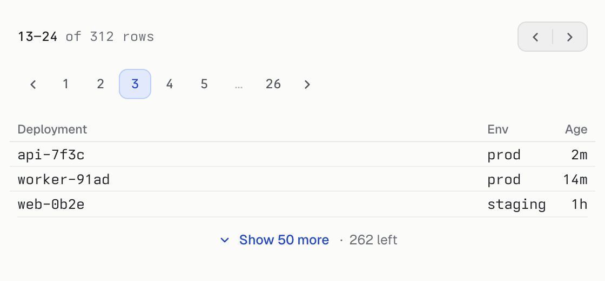
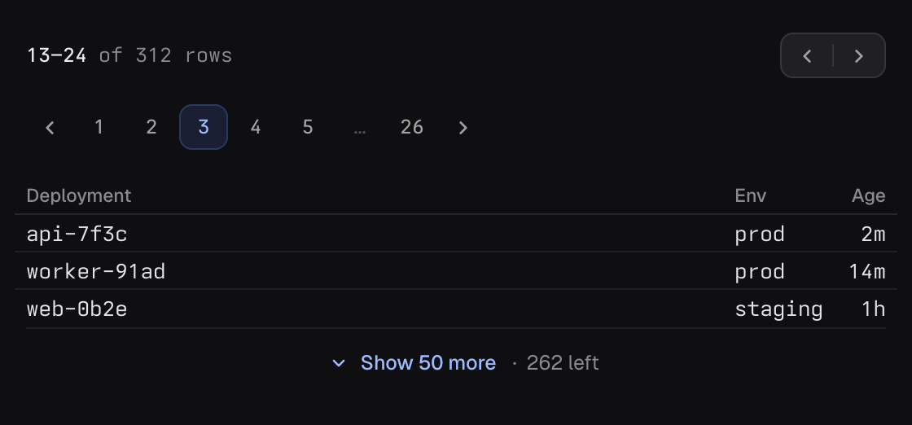
<figcaption>三种外观：<code>range</code>（默认）、<code>pages</code>，以及在表格底部收尾的 <code>more</code>。</figcaption>
</figure>

<figure class="tn-figure">
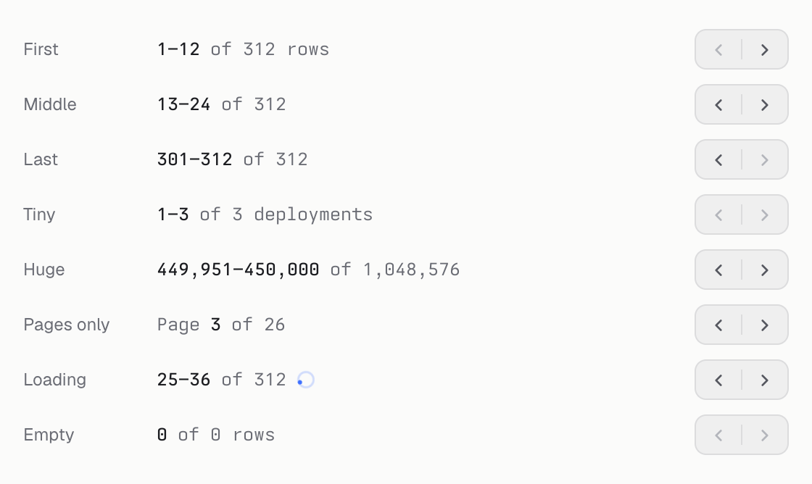
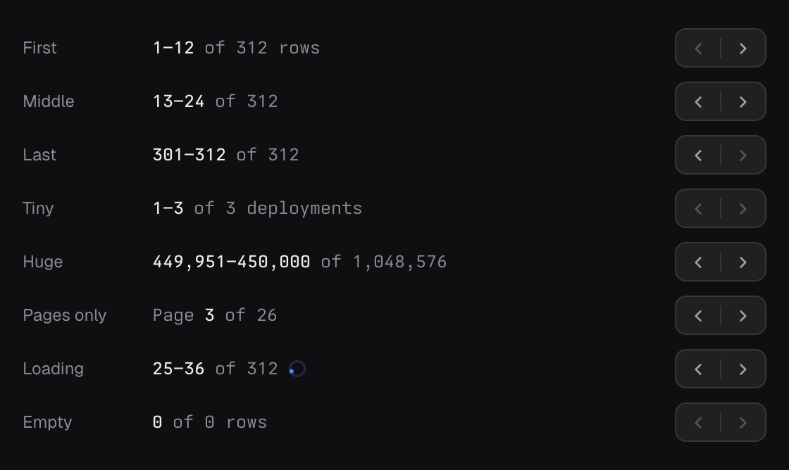
<figcaption><code>range</code> 的边界情况：极小和极大的总数、仅页数、<code>loading</code> 以及无内容。</figcaption>
</figure>

<figure class="tn-figure">
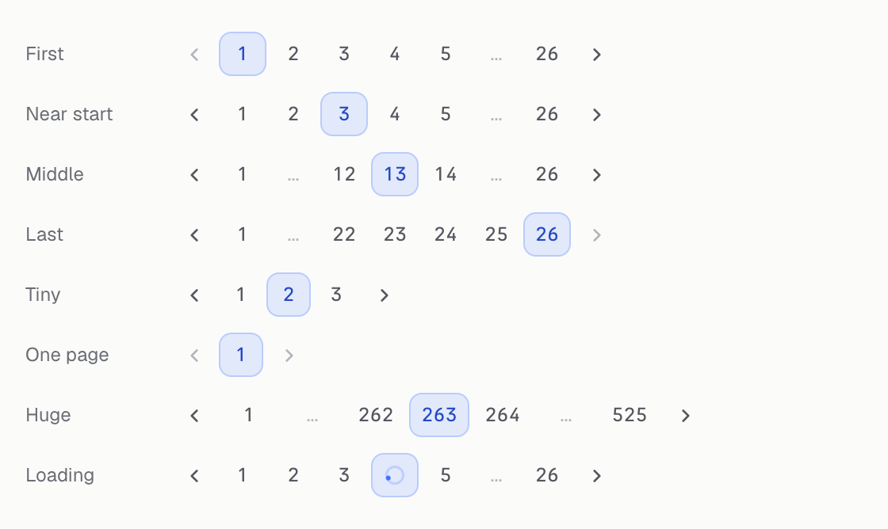
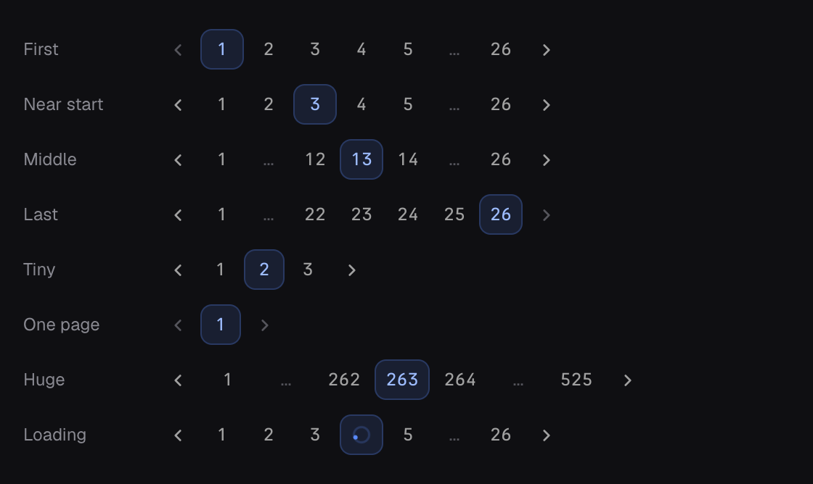
<figcaption><code>pages</code>：七槽窗口在第一页、靠前页、中间页和最后一页的状态，页数较少和较多，以及 <code>loading</code> 状态。</figcaption>
</figure>

<figure class="tn-figure">
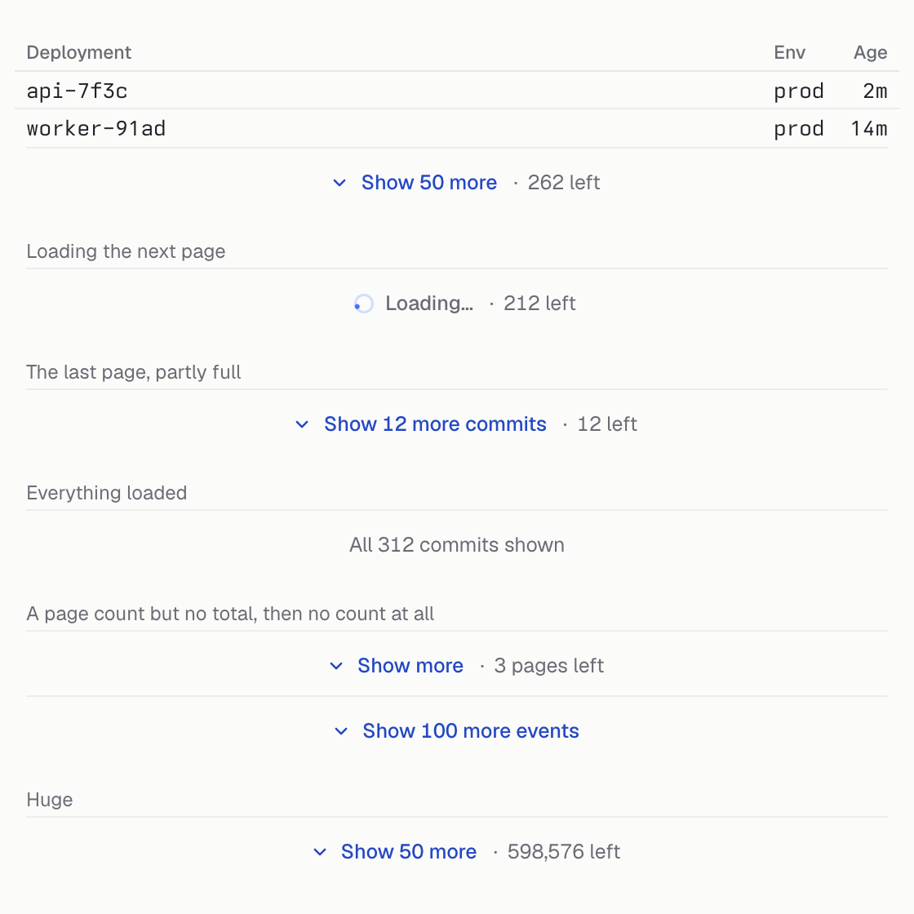
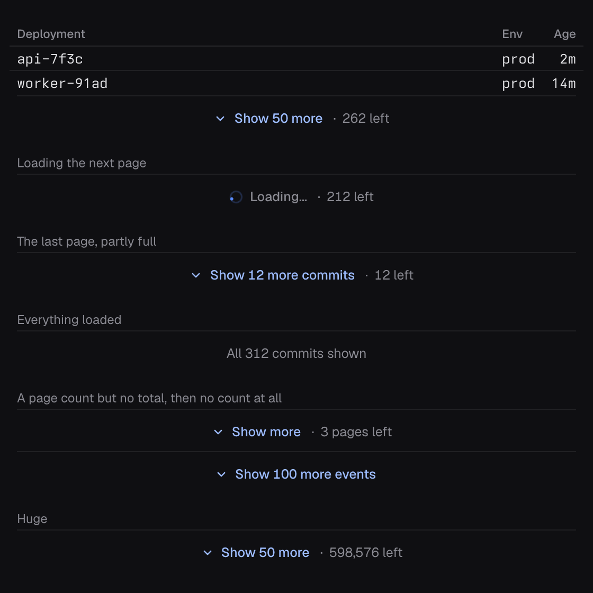
<figcaption>在表格底部收尾的 <code>more</code>，以及加载中、最后一页、完成状态、部分计数和无计数状态。</figcaption>
</figure>

| 属性 | 类型 | 默认值 | 含义 |
| --- | --- | --- | --- |
| `variant` | `"range"` \| `"pages"` \| `"more"` | `"range"` | 外观（见下文）。未知值按 `"range"` 处理 |
| `page` | `number` | `1` | 当前页，从 1 开始，限制在页数范围内。`more` 中表示已加载页数。变化时优先于用户的本地页码 |
| `pages` | `number` | 根据 `total` / `size` 计算 | 页数。计数时优先于 `total` / `size`；为 `0` 或未设置时回退到后两者 |
| `total` | `number` | none | 条目总数：`range` 显示 “12–24 of 312”，`more` 统计剩余数量 |
| `size` | `number` | none | 每页条目数。未设置时，`range` 会根据 `pages` 平均分配 `total` |
| `loading` | `boolean` | `false` | 显示旋转环（范围后、当前页胶囊内、more 行中）并设置 `aria-busy`；more 行不发送事件 |
| `label` | `string` | none | 条目的复数名称，显示在计数之后：“of 312 rows”、“Show 50 more commits”、“All 312 commits shown” |

[通用 props](index.md#每个节点都可使用的-props) 适用（`key`、`aria`、`title`、`grow`、`min` 等）。没有 `aria` 时，`range` 或 `pages` pager 是一个名为 "Pagination" 的 `navigation` landmark。

**子项：**无（忽略）。

**变体：**

| `variant` | 外观 | 用途 |
| --- | --- | --- |
| `range` | “12–24 of 312”（等宽、等宽数字）以及组合为胶囊的 ‹ › | 表格或列表页脚；默认值 |
| `pages` | ‹ 1 2 [3] 4 5 … 26 ›，当前页为强调色胶囊，稳定的七槽窗口 | 用户需要跳转页码时（搜索结果、文档索引） |
| `more` | “Show 50 more · 262 left”，居中且简洁；结束时显示 “All 312 shown” | 按需增长的列表（日志、动态流、历史记录） |

**事件：**

| 事件 | 载荷 | 触发时机 |
| --- | --- | --- |
| `change` | `{ev = "change", id, value = <page>}`：页码，从 1 开始且处于有效范围 | 点击箭头或页码胶囊（`range`、`pages`）；页面立即绘制 |
| `action` | `{ev = "action", id, act = "more"}` | 点击未处于 `loading` 状态且尚未完成的 more 行（`more`） |

**键盘：**pager 永不获取焦点：按键由你的程序处理。通过自行更改 `page` 实现键盘翻页（←/→ 或 PgUp/PgDn 切换上一页和下一页，Home/End 切换首页和末页），并在页面载入期间显示 `loading`。

**无障碍：**箭头是名称为 “Previous page” 和 “Next page” 的 `role=button`（到达边界时设置 `aria-disabled`）；页码胶囊名称为 “Page N”，当前项带 `aria-current="page"`；省略项隐藏。more 行是以自身文本作为名称的 `role=button`。

**样式：**

| 目标 | 选择器 |
| --- | --- |
| 任意分页器 | `.sf-pager`、`.sf-pager[data-variant=range\|pages\|more]` |
| 箭头及边界状态 | `.sf-pager-step.prev`、`.sf-pager-step.next`、`.sf-pager-step.off` |
| 范围文本 | `.sf-pager-range`（`.pre`、`.cur`、`.of`） |
| 组合箭头 | `.sf-pager-steps`、`.sf-pager-sep` |
| 页码胶囊 | `.sf-pager-list`、`.sf-pager-pg`、`.sf-pager-pg.on`、`.sf-pager-pg.gap`、`.sf-pager-pg.busy` |
| more 行 | `.sf-pager-more`（`.busy`）、`.sf-pager-ic`、`.sf-pager-left`、`.sf-pager-done` |

文字使用 `--sans`，数字使用 `--mono` 和等宽数字（适用于任何区域）。箭头和胶囊高 28px，圆角为 `--r-ctl`；悬停时增加 `--l1`，按下时立即缩小并随后恢复。当前胶囊使用 13% 的 `--accent` 色调和 24% 边框显示 `--accent-ink`；禁用箭头为 `--t4`。more 胶囊悬停时显示 `--accent-ink` 和 10% `--accent` 色调。减少动态效果和 `.sf-still` 下会停止过渡。

## `picker`

以数据为中心的模态面板：你发送目录和要显示的内容，Tern 绘制包含搜索栏、可选范围列、标签行、事实列、虚拟化行、预览窗格和操作栏的玻璃面板。它面向 omp 构建（编码代理的模型选择器、会话选择器和设置），并由 `omp-pickers.css` 样式化；该文件会为每个 surface 加载，因此在插件块中也保持相同外观。

**在插件中使用。**它可在块中使用，直接放入 `layer` 区域：节点本身就是面板，覆盖整个块（`position: absolute; inset: 0`），位于变暗、模糊的背景上方。在 `main` 或 lens 中使用时，它会覆盖对应容器，通常不是你想要的效果。它不会绘制真正的文本输入框：搜索行显示你的 `query` 和绘制出的插入光标，因此输入、方向键、Enter 和 Escape 必须在块的 `key` 处理器中处理，由该处理器更新 `query`、`selected` 及其他状态。指针输入通过事件传递（见下文）。这是重量级组件；若只需在自己的布局中放置普通可选列表，请使用 [`list`](#list)。

### 布局与行为

- **大小。** `size = "lg"`（默认）是顶部居中的面板，最大 1120×760px，距顶部 28px。`"md"` 是命令面板大小的面板，最大宽 680px、高 540px，距顶部 72px；高度只按行数所需决定（`query` 缩小结果时仍保持高度）。`"screen"` 填满 surface，不显示背景遮罩、圆角或阴影。
- **窄面板。**宽度低于 760px 时，范围列会折叠为标题按钮（`.narrow`），其菜单发送相同的 `scope` action，副标题隐藏。低于 980px 时，侧边预览会移到列表下方（`.pv-below-auto`）；低于 640px 时，预览和计数都隐藏（`.pv-hide`）。`md` 面板仅在没有 `query` 时显示副标题：此时标题和副标题上下排列在标题栏中。
- **行**按布局使用固定高度进行虚拟化：`rows` 为 36px、`cards` 为 54px、`timeline` 为 26px（`node = "user"` 时为 34px）、`tree` 为 24px；分组标题高 32px。一个选择标记栏（`.pk-selbar`）会在行间滑动。第一个可见行所属分组固定在顶部（`.pk-sticky`）。匹配的 `hits` 会在标签中以粗体显示，不使用 `list` 的色调。
- **保持选择在视野中。**打开面板、布局变化、`selected` 变化，以及选择当前可见时行发生变化，都会让列表滚动到选中项。用户滚离列表后，更新不会改变其位置。
- **事实列**从最低 `priority` 开始隐藏，直到标签保留 260px 宽度。`text` 列会在标签剩余空间内扩展以适应最宽的值（最大 320px）；在任何列隐藏之前会先缩回默认宽度。值仍被截断时，事实列工具提示会显示完整内容。
- **标题栏 `esc`。**只有当没有操作在 `keys` 中包含 `"esc"` 或 `"escape"` 时，标题栏的 `esc` 按键帽才显示；对应操作栏按钮会取代它。
- **操作栏折叠。**按钮溢出时，绑定 Escape 的操作（除非它是 `primary`）会移入标题栏的 `esc` 按钮（`.fold-esc`），随后根节点也会添加 `.fold-keys`；宽度恢复时会展开。
- **按钮只显示标签。**操作栏按钮显示操作名称；按键放在工具提示中（`Select  ⏎`），不绘制在按钮上。确认条的按钮响应 ⏎ 和 esc，但不绘制按键。Omp 的 Console 聊天样式会在 TUI 按键说明中再次绘制按键。
- **动态效果。** 面板会播放进入动画，变更行会依次进入（最多 8 行，间隔 24ms），计量条事实项首次显示时从零宽增长。在 `.sf-still` 或 `prefers-reduced-motion` 下会关闭这些效果。

**构建：**`tern.ui.node("picker", props, preview_children)`。没有专用 builder。

### 面板 props

| 属性 | 类型 | 默认值 | 含义 |
| --- | --- | --- | --- |
| `size` | `"md"` \| `"lg"` \| `"screen"` | `"lg"` | 面板大小（见上文）。其他值回退为 `"lg"` |
| `layout` | `"rows"` \| `"cards"` \| `"timeline"` \| `"tree"` | `"rows"` | 行模板。`cards` 将 `detail` 单独放在一行；`timeline` 为每行绘制一个节点；`tree` 绘制深度辅助线和展开箭头 |
| `preview` | `"side"` \| `"below"` \| `"none"` | `"side"`，`md` 时为 `"none"` | 预览窗格的位置 |
| `title` | Spans | none | 标题（不是通用工具提示）。未设置时，标题栏只显示图标和搜索（`.no-title`）；面板的无障碍名称回退为 `placeholder`，否则为 `noun` |
| `subtitle` | Spans | none | 标题的第二部分 |
| `icon` | `string` | 列表图标 | 标题栏图标名称 |
| `query` | `string` | none | 搜索文本。未设置时隐藏搜索（`.no-query`）；设为 `""` 时显示占位文字 |
| `cursor` | `number` | `query` 末尾 | `query` 中光标位置，以 UTF-16 单位计 |
| `placeholder` | `string` | `"Search <noun>…"` | 搜索占位文字 |
| `noun` | `string` | `"items"` | 对行内容的称呼，用于占位文字和空状态文本 |
| `focus` | `"list"` \| `"scopes"` \| `"tabs"` \| `"strip"` \| `"preview"` | `"list"` | 由按键驱动的部分；在 `.pk-sheet` 上设置 `.f-<focus>`。只有 `list` 显示光标；其他部分会为活动范围、活动标签、选中的 strip 胶囊或预览窗格显示环形标记 |
| `state` | `"ready"` \| `"loading"` \| `"error"` | `"ready"` | `loading` 显示 8 行骨架和 `…` 计数；`error` 在警报卡片中显示 `message`。设置 `.st-loading` / `.st-error` |
| `message` | Spans | none | `state = "error"` 时的错误卡片文本 |
| `empty` | Spans | `"No <noun> yet"` | 没有行且 `query` 为空时显示的文本 |
| `total` | `number` | none | 目录大小；与显示行数不同时，计数显示 `"<shown> of <total>"` |

### 行：`items`、`order`、选择

| 属性 | 类型 | 默认值 | 含义 |
| --- | --- | --- | --- |
| `items` | `{ PickerItem }` | `{}` | 按 `id` 索引的目录。替换它会重新构建行 |
| `itemsAdd` | `{ PickerItem }` | none | 按 `id` 添加到目录（或替换目录项）的条目 |
| `itemsDel` | `{ string }` | none | 从目录中删除的条目 id |
| `order` | `{ string \| {group, label, count?} }` | `items` 顺序 | 按顺序显示的内容：条目 id（未知 id 会跳过）和分组标题。带 `group` 字段的任意表都是分组标题；它显示 `label` 和可选 `count`（数字按千位分隔） |
| `selected` | `string` | none | 选中条目的 id：用于选择标记栏和 `aria-activedescendant` |
| `current` | `{ string }` | `{}` | 以勾选标记为当前项的条目 id（`.cur`）；只要有任一当前项，每一行都会保留勾选位置（`.has-cur`） |
| `hits` | `{ [id]: { {from, to} } }` | none | 每个条目 id 的匹配范围：位置 `{from, to}` 对（JSON `[[0, 2]]`），表示标签纯文本中的 UTF-16 `[from, to)` 偏移；覆盖条目自身的 `hits` |
| `columns` | `{ Column }` | `{}` | 事实列，最多 8 列 |
| `confirm` | `{text, act?, label?}` | none | 选中行上的确认条：垃圾桶图标、`text`、危险按钮 `label`（默认 `"Delete"`，发送 `act`，默认 `"confirm"`），以及发送 `cancel` 的 `Keep` |

`PickerItem`：

| 字段 | 类型 | 含义 |
| --- | --- | --- |
| `id` | `string` | 必填；没有 id 的条目会丢弃 |
| `label` | Spans | 行文本。`mono = true` 且纯文本标签含 `/` 时，会拆分为暗色的 `dir` 和 `name`，其中 `dir` 优先截断 |
| `detail` | Spans | 标签后的行内详情（`cards` 中单独占一行） |
| `icon` | `string` | 前置图标名称 |
| `role` | `string` | 未设置 `icon` 时，根据 role 名称选择前置图标 |
| `mark` | `{text, seed?, icon?}` | 头像：Tern 有对应图标时使用 `icon`（模型提供方 logo 使用 `provider:<id>`，参见 [图标名称](data.md#图标名称)），否则使用 `text` 的前两个非空格字符作为首字母，并以 `seed`（默认 `text`）生成渐变；优先于 `icon` |
| `dot` | tone name | 没有 mark 或 icon 时作为前置状态点，否则作为角标点（`tree` 中不显示）。`timeline` 中不绘制。在 `tree` 中，`"accent"` 会点亮深度辅助线 |
| `mono` | `boolean` | 标签使用等宽字体 |
| `facts` | `{ [column id]: number \| Spans }` | 列值。数字使用紧凑格式（`272k`、`1.6M`）；`bar` 列的 0–1 数字表示计量条；`elapsed` 列数字表示经过的毫秒数，从条目到达时开始由终端计时（`12.3s`、`2m12s`、`1h5m`、`3d2h`） |
| `badges` | `{ {text, tone?, title?} }` | 标签后最多显示 3 个徽章，之后显示 `+N` 徽章，其工具提示列出其余内容 |
| `chips` | `{ {text, on?, auto?, dot?} }` | 徽章后的角色胶囊；`dot` 是命名点颜色的 span token |
| `tone` | tone name | 行上的 `data-tone` |
| `disabled` | `true` \| `string` | 将行变暗（`.off`）；字符串是工具提示中的禁用原因。禁用行仍可选中，但不会激活 |
| `hits` | `{ {from, to} }` | 标签中的匹配范围：位置对（JSON `[[0, 2]]`），即 UTF-16 `[from, to)` 偏移；以 `mark.sf-mark` 标记 |
| `node` | `string` | `timeline`：节点样式 `n-<node>`（`user`、带图标的 `tool`，默认 `assistant`）；同时设置 `data-node` |
| `depth` | `number` | `tree`：缩进辅助线 |
| `open` | `boolean` | `tree`：展开箭头；为 `true` 时旋转；未设置表示叶节点 |
| `title` | `string` | 行工具提示（也适用于 `bar` 事实项） |

`Column`：

| 字段 | 类型 | 默认值 | 含义 |
| --- | --- | --- | --- |
| `id` | `string` | 必填 | `facts` 的键 |
| `head` | `string` | `""` | 列标题。只要设置了任意标题，标题就会显示在首个分组标题和固定标题上；若列表开头不是分组，则显示在独立的 `.pk-colhead` 行 |
| `format` | `"text"` \| `"num"` \| `"price"` \| `"bar"` \| `"time"` \| `"elapsed"` \| `"dim"` | `"text"` | class `f-<format>` 和默认宽度：text 为 96（有空间时扩展以适应值），num 为 52，price 为 76，bar 为 44，time 为 44，elapsed 为 52，dim 为 64px。它只设置列样式，不会格式化值：除 `bar` 和 `elapsed` 外，数字均以紧凑格式显示（`3`，而不是 `$3`），因此价格和 `time` 值应以文本发送 |
| `priority` | `number` | `100` | 列表窄时优先隐藏较低值的列 |
| `min` | `number` | none | 字符单位的最小宽度 |

### 范围、标签、strip、操作

| 属性 | 类型 | 含义 |
| --- | --- | --- |
| `scopes` | `{ {id, label, group?, mark?, icon?, dot?, count?, disabled?} }` | 左侧的垂直范围列；`mark` 的结构与条目的 `mark` 相同，且优先于 `icon`。连续且 `group` 相同的范围共用标题；从有分组变为无分组时显示分隔线。`disabled`（true 或原因）会添加锁和工具提示，但仍发送 action |
| `scope` | `string` | 活动范围 id |
| `tabs` | `{ {id, label, count?} }` | 列表上方的标签行：最多 4 个标签时为分段控件，更多时为胶囊 |
| `tab` | `string` | 活动标签 id |
| `strip` | `{label?, items = { {id, label, on?, dot?} }, selected?}` | 操作栏上方的一行切换胶囊；`on` 会勾选胶囊，`selected` 会为其描边 |
| `actions` | `{ {id, label?, keys?, primary?, end?, danger?, on?, disabled?} }` | 操作栏；`label` 默认使用 `id`。次要操作位于左侧，`end` 项位于右侧，`primary` 项最后显示在角落。`keys` 会在按钮工具提示中显示其按键（`Label  keys`）；`keys` 含 `"escape"` / `"esc"` 的操作会由背景遮罩和标题栏 `esc` 触发。`on` 表示按下状态。`disabled`（true 或原因）会使按钮变暗（`.off`，原因为工具提示），点击不会发送事件 |

空状态且没有查询时，`keys` 包含 `"tab"` 的第一个操作会显示为按钮；错误状态下则显示 `id = "retry"` 的操作。

**子项：**预览内容。子项绘制在 `.pk-pv-slot` 中；没有子项时，窗格显示 “Nothing to preview”。`preview = "none"` 会隐藏窗格。

### 事件

`id` 是 picker 节点的 id。

| 操作 | 事件 |
| --- | --- |
| 点击一行 | `{ev = "select", id, item}` |
| 点击已选行、上次点击的行，或双击一行 | `{ev = "activate", id, item}`（每次双击发送一次；禁用行永不触发） |
| 点击范围，或在窄屏范围菜单中选择范围 | `{ev = "action", id, act = "scope", value = <scope id>}` |
| 点击标签 | `{ev = "action", id, act = "tab", value = <tab id>}` |
| 点击 strip 胶囊 | `{ev = "action", id, act = "strip", value = <chip id>}` |
| 点击操作栏按钮 | `{ev = "action", id, act = <action id>}` |
| 点击背景遮罩或标题栏 `esc` | `{ev = "action", id, act = <escape action id or "close">}` |
| 确认条按钮 | `act = <confirm.act or "confirm">`，或 `act = "cancel"` |
| 空状态中的 `Clear search` | `{ev = "action", id, act = "clear"}` |
| 空状态或错误状态按钮 | `{ev = "action", id, act = <that action's id>}` |

分组标题不发送事件。按键由你处理：在 `key` 中处理。

### 样式

```html
<div class="sf sf-picker sz-lg lay-rows pv-side has-cur" data-id="layer.models">
	<div class="pk-dim" aria-hidden="true"></div>
	<div class="pk-sheet f-list" role="dialog" aria-modal="true">
		<div class="pk-head">
			<span class="pk-ic"></span>
			<div class="pk-title"><span class="t">Models</span><span class="sub">…</span></div>
			<button class="pk-scopebtn" data-pk="menu"></button>
			<div class="pk-search"><span class="q">son</span><span class="caret"></span></div>
			<span class="pk-count">12 of 140</span>
			<button class="pk-esc" data-pk="act" data-v="close"><span class="kbd">esc</span></button>
		</div>
		<div class="pk-body">
			<div class="pk-scopes" role="tablist">
				<div class="pk-sgh">Providers</div>
				<div class="pk-scope nav-row on" data-pk="scope" data-v="all">…</div>
			</div>
			<div class="pk-center">
				<div class="pk-main">
					<div class="pk-tabs seg"><div class="pk-tabs-in"><button class="pk-tab on" data-pk="tab" data-v="…"></button></div></div>
					<div class="pk-colhead"></div>
					<div class="pk-list">
						<div class="pk-sticky pk-row grp"></div>
						<div class="pk-scroll">
							<div class="pk-rows" role="listbox">
								<div class="pk-selbar"></div>
								<div class="pk-confirm" role="alertdialog"></div>
								<div class="pk-row sel cur" role="option" data-pk="row" data-v="sonnet" id="pk-sonnet">
									<span class="pk-lead"></span>
									<div class="pk-txt"><div class="pk-l1">
										<span class="pk-label">…</span><span class="pk-tags">…</span>
										<span class="pk-detail"><span class="t">…</span></span>
									</div></div>
									<div class="pk-facts"><span class="pk-fact c0 f-price">$3</span></div>
									<span class="pk-cur"></span>
								</div>
							</div>
						</div>
					</div>
					<div class="pk-state"></div>
				</div>
				<div class="pk-pv"><span class="pk-pv-empty">Nothing to preview</span><div class="pk-pv-slot">…</div></div>
			</div>
		</div>
		<div class="pk-strip" role="toolbar"></div>
		<div class="pk-bar" role="toolbar"><button class="pk-btn" data-pk="act" data-v="…"></button><span class="pk-bar-fill"></span><button class="pk-btn primary">…</button></div>
	</div>
</div>
```

| 目标 | 选择器 |
| --- | --- |
| 节点 | `.sf-picker`、`.sf-picker[data-id=…]`、`[data-role=…]` |
| 尺寸、布局、预览 | `.sz-md` `.sz-lg` `.sz-screen`、`.lay-rows` `.lay-cards` `.lay-timeline` `.lay-tree`、`.pv-side` `.pv-below` `.pv-none` |
| 宽度状态 | `.narrow`、`.pv-below-auto`、`.pv-hide`、`.fold-esc`、`.fold-keys`、`.h0`–`.h7`（隐藏列） |
| 内容状态 | `.no-title`、`.no-query`、`.has-cur`、`.st-loading`、`.st-error` |
| 背景遮罩、面板 | `.pk-dim`、`.pk-sheet`、`.pk-sheet.f-<focus>`（内部实现，可能变化） |
| 标题栏 | `.pk-head`、`.pk-ic`、`.pk-title .t`、`.pk-title .sub`、`.pk-search .q/.ph/.caret`、`.pk-count`、`.pk-esc`、`.pk-scopebtn`（内部实现，可能变化） |
| 范围 | `.pk-scopes`、`.pk-scope`、`.pk-scope.on`、`.pk-scope.dis`、`.pk-sgh`、`.pk-ssep`、`.pk-lock`（内部实现，可能变化） |
| 标签 | `.pk-tabs.seg` / `.pk-tabs.chips`、`.pk-tab`、`.pk-tab.on`、`.pk-tab .n`（内部实现，可能变化） |
| 行 | `.pk-row`、`.pk-row.sel`、`.pk-row.cur`、`.pk-row.off`、`.pk-row.grp`、`.pk-row[data-v=…]`、`.pk-row[data-tone=…]`、`.pk-row[data-node=…]`、`.pk-row.arr-a/.arr-b`（进入中）（内部实现，可能变化） |
| 行组成部分 | `.pk-lead`、`.pk-mark`、`.pk-mark.logo`（图标标记）、`.pk-dot`、`.pk-dot.corner`、`.pk-node.n-<node>`、`.pk-guides .pk-g`、`.pk-chev`、`.pk-label`、`.pk-label.mono.path .dir/.name`、`.pk-tags`、`.pk-badge`、`.pk-chip`、`.pk-detail`、`.pk-facts`、`.pk-fact.c<i>.f-<format>`、`.pk-meter`、`.pk-cur`、`.pk-gl`、`.pk-gc`（内部实现，可能变化） |
| 选择、固定标题、确认 | `.pk-selbar`、`.pk-sticky`、`.pk-rows.confirming`、`.pk-confirm`、`.pk-ct`（内部实现，可能变化） |
| 状态 | `.pk-state.loading .pk-sk`、`.pk-state.error .pk-err`、`.pk-state.empty .pk-empty`（内部实现，可能变化） |
| 预览 | `.pk-pv`、`.pk-pv-empty`、`.pk-pv-slot`（内部实现，可能变化） |
| Strip、操作栏 | `.pk-strip`、`.pk-strip-l`、`.pk-schip`、`.pk-bar`、`.pk-btn`、`.pk-btn.primary/.danger/.on/.off/.esc`（内部实现，可能变化） |
| 筛选命中 | `.sf-picker mark.sf-mark` |

所有 `pk-*` class 都是 Tern 为 omp 面板使用的结构；只有根节点上的 `.sf-picker` 及状态 class 值得依赖。面板使用主题的 `--pop-bg`、`--glass-hi`、`--dim`、`--l1`–`--l3`、`--t1`–`--t4`、`--accent` 和 `--grad`（参见 [变量](../styles/variables.md)）。

```lua
local ui = tern.ui

-- in a block view; state.query ("cl") and state.sel ("sonnet") are driven
-- by your key handler, state.current ("opus") is the model in use
local items, order = {}, {}
for _, g in state.groups do -- the models matching state.query, by provider
	table.insert(order, { group = g.id, label = g.name, count = #g.models })
	for _, m in g.models do
		table.insert(items, {
			id = m.id,
			label = m.path, -- "anthropic/claude-opus": dim dir, bold hits
			mono = true,
			icon = "model",
			hits = { { m.hit, m.hit + #state.query } }, -- UTF-16 offsets
			facts = { ctx = m.context, price = m.price }, -- 200000, "$15"
			disabled = m.offline and (m.runtime .. " is not running") or nil,
		})
		table.insert(order, m.id)
	end
end
return {
	main = ui.col({ ui.text("Choose the model for this session.") }),
	layer = ui.col({
		ui.node("picker", {
			key = "models",
			size = "md",
			title = "Model",
			noun = "models",
			query = state.query,
			items = items,
			order = order,
			selected = state.sel,
			current = { state.current },
			columns = {
				{ id = "ctx", head = "Context", format = "num" },
				{ id = "price", head = "$/M", format = "price", priority = 50 },
			},
			actions = {
				{ id = "close", label = "Cancel", keys = { "esc" } },
				{ id = "use", label = "Use", keys = { "enter" }, primary = true },
			},
		}),
	}),
}

-- event(state, ev, cx)
-- ev.ev == "select"   -> state.sel = ev.item
-- ev.ev == "activate" -> use ev.item
-- ev.ev == "action" and ev.act == "close" -> hide the picker
```

<figure class="tn-figure">
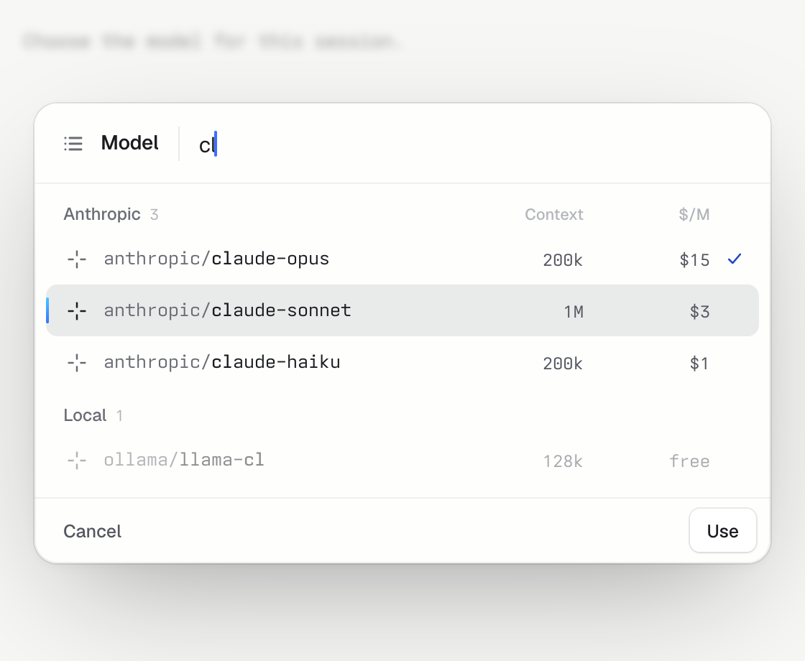
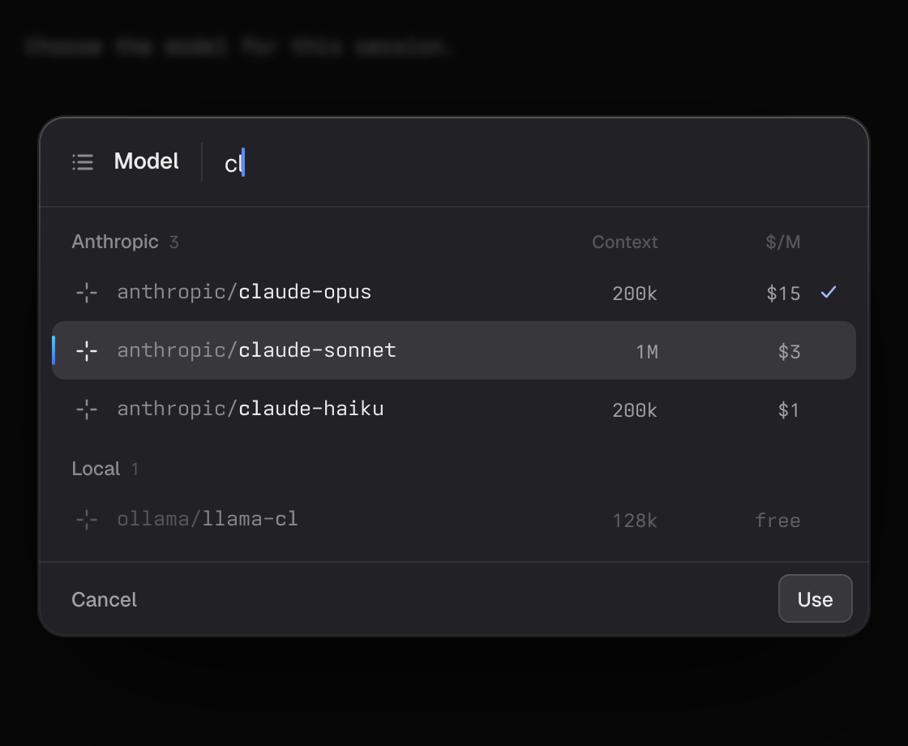
<figcaption><code>layer</code> 区域中的 <code>md</code> 面板。此宽度低于 640px，因此计数隐藏。</figcaption>
</figure>

## 相关页面

- [构建视图](../guides/views.md)：操作与事件。
- [块](../guides/blocks.md)：节点 id、key、`key` 处理器。
- [设置视图样式](../styles/index.md)、[变量](../styles/variables.md)。
