# 进度与动态效果

这些元素种类用于展示进行中的工作和数量。Tern 会自行运行所有动画，因此你的插件无需发送帧：只需发送一次 `spinner`、`shimmer` 或 `elapsed`，Tern 就会持续让它动起来，直到节点发生变化或消失。要表达“忙碌”，使用 `spinner` 或 `shimmer`；要展示数据尚未到达的视图形状，使用 `skeleton`；要显示运行中的计时器，使用 `elapsed`；要显示吞吐量数值，使用 `rate`；要显示已知（或未知）的完成比例，使用 `progress`；要显示用量等水平或整体的组成，使用 `meter`；要显示一组数据或组成部分，使用 `chart`；要显示 omp 的思考力度字形，使用 `effort`。

| 种类 | 构建器 | 绘制内容 |
| --- | --- | --- |
| [`spinner`](#spinner) | `tern.ui.node("spinner", …)` | 活动指示器，可带可选标签 |
| [`shimmer`](#shimmer) | `tern.ui.node("shimmer", …)` | 有一道亮光扫过的文本 |
| [`skeleton`](#skeleton) | `tern.ui.node("skeleton", …)` | 内容仍在加载时显示的占位形状（线条、头像、行、磁贴或块） |
| [`elapsed`](#elapsed) | `tern.ui.node("elapsed", …)` | 实时计时器或倒计时（`12.3s`、`4:05`） |
| [`rate`](#rate) | `tern.ui.node("rate", …)` | 平滑过渡到每个新值的数值（`42.3 tok/s`） |
| [`progress`](#progress) | `tern.ui.progress(value, label)` | 确定或不确定进度条 |
| [`meter`](#meter) | `tern.ui.meter(value, label)` | 以条形、圆环或块网格显示数值或堆叠部分 |
| [`chart`](#chart) | `tern.ui.bars(…)`, `tern.ui.spark(…)` | 热力图、条形图、迷你折线图、随时间变化的折线或面积图（一个或多个系列），或份额环形图 |
| [`effort`](#effort) | `tern.ui.node("effort", …)` | 随思考力度等级填充的圆环 |

所有这些 kind 都没有子节点：传入的子节点会被 Tern 忽略。它们都接受 [元素](index.md) 中描述的通用 props（`id`、`role`、`tone`、`title`、`aria`、`actions`、…）。

## Tern 如何为动态效果计时

时钟有两种。

- **CSS 关键帧。** spinner、shimmer、skeleton、不确定进度条、effort 火焰、chart 入场动画和 meter 填充，都是由文档时钟驱动的 CSS 动画和过渡。每种元素的关键帧名称列在其**样式**部分。你可以重新设置样式，或用自己的 `@keyframes` 替换（参见[支持的 CSS](../styles/css.md)）。
- **视图的 tick。**`elapsed` 和 `rate` 会改变其*文本*，因此视图会为每个实例保留时钟。只有文本变化时才重绘：`short` 格式下，未满一分钟时每 100 ms 重绘一次，否则每秒一次。速率平滑过渡期间约每 16 ms 重绘一次。停止的计时器、结束的倒计时或已稳定的速率都不需要任何帧。

时间以**经过时长**表示，而不是墙上时钟时间戳。`elapsed.age` 是构建节点时已经过去的毫秒数。Tern 将起点设为“age 到达的时间 − age”，因此重绘、延迟挂载或重新挂接后的重播仍会显示正确时间。

### 隐藏、遮盖与减少动态效果

Tern 会在每个区域（`.sf-main`、`.sf-dock`、`.sf-layer`）上设置状态类：

| 类 | 条件 | 对动态效果 kind 的影响 |
| --- | --- | --- |
| `.sf-paused` | surface 不可见 | Spinner、shimmer 和 effort 关键帧停在当前位置；skeleton 显示普通块；Spindle 标记停在静止帧 |
| `.sf-still` | Tern 的 Reduce Motion 设置已开启（默认跟随系统；你可以强制开启或关闭） | 与 `.sf-paused` 相同，此外还有更多影响：见下表 |
| `@media (prefers-reduced-motion: reduce)` | 系统设置已开启 | 与 `.sf-still` 相同（Tern 的基础样式表还会将所有动画和过渡时长设为零） |

有些效果不是 CSS 实现的，因此 Tern 在渲染时也会读取 Reduce Motion。此时 `meter` 或 `effort` 会立即绘制其值，不播放首次显示时的扫入效果。

减少动态效果时各 kind 的表现：

| 种类 | 减少动态效果时的表现 |
| --- | --- |
| `spinner` | 指示器停在第一帧；标签保留 |
| `shimmer` | 以自身颜色显示普通文本，不扫光 |
| `skeleton` | `shimmer` 和 `pulse` 显示普通柔和色块，不显示扫光带或呼吸效果；`wire` 本来就是静止的 |
| `elapsed` | 继续计时（它是文本，不是动态效果） |
| `rate` | 继续更新并保持平滑过渡：过渡由视图的 tick 驱动，而不是 CSS |
| `progress` | 确定进度：系统设置启用时填充立即到位（过渡时长归零）；仅启用 `.sf-still` 时仍会在 0.3 s 内平滑过渡。不确定进度：显示不透明度为 35% 的全宽填充 |
| `meter` | 首次显示时不增长；之后条形和圆环数值直接跳变，不做平滑过渡（`transition: none`）。除非系统设置启用，否则块单元仍会在 0.3 s 内淡入淡出 |
| `chart` | 热力图列、条形、线、面积、点、图例和环形图分段立即出现（没有 `omp-cell`/`omp-bar`/`sf-chart-*` 入场动画）；悬停点和线立即显示，不做平滑过渡 |
| `effort` | 不扫入或交叉淡入淡出；等级为 `max` 时会显示火焰，但不闪烁 |

在某个面板下方（例如模态选择器），Tern 会添加 `.sf-covered`。其中的所有动画都会停留在当前帧，直到面板消失。

## `spinner`

行内活动指示器，可选地在后面跟一个标签。它按内容确定尺寸，且不会收缩（`flex: none`）。指示器使用 `tone` 指定的颜色；未指定时使用强调色。标签使用文本颜色。

没有标签的 spinner 在指示器后没有间距，因为其标签元素在有内容之前保持隐藏（`.sf-hidden`）。如果未设置 `aria`，spinner 会获得 `role="img"`，并将 `aria-label` 设为标签的纯文本；没有标签时则设为 `"Working"`。

**构建：** `tern.ui.node("spinner", { style = "dots", label = "Fetching" })`。没有专用构建器。

| 属性 | 类型 | 默认值 | 含义 |
| --- | --- | --- | --- |
| `style` | `"braille"` \| `"dots"` \| `"starburst"` \| `"orbit"` | `"braille"` | 指示器。未知值会绘制为 `braille` |
| `label` | Spans（字符串或 span 列表） | 无 | 指示器后的文本。Span token 和 `fx` 的用法与 [`text`](text.md) 相同 |
| `tone` | Tone | accent | 指示器颜色（`[data-tone]`） |
| `aria` | string | 标签文本或 `"Working"` | 无障碍名称。设置此项也会移除自动添加的 `role="img"` |

样式如下：

| `style` | 绘制内容 | 循环 |
| --- | --- | --- |
| `braille` | `⠋⠙⠹⠸⠼⠴⠦⠧⠇⠏`，在单行窗口中每次显示一个字形 | `sf-strip`，1 s，10 步 |
| `starburst` | `·✢✳✶✻✽✻✶✳✢`，omp 的思考字形 | `sf-strip`，1.2 s，10 步 |
| `dots` | 三个点依次脉动 | `sf-dot`，1.25 s，延迟 0 / 0.15 / 0.3 s |
| `orbit` | 一个点绕着浅色圆环运行 | `sf-turn`，0.9 s，18 步 |

如果 `starburst` spinner 的父级具有 `role = "omp.working"`（omp 的工作行），它会改为绘制 Stencil Spindle 标记（`span.sf-spindle`）。Tern 会原生绘制该标记，而非使用 CSS 关键帧。这是为 omp 设计的。插件也可以通过在父级上使用该 role 来调用它，但应使用文档所述的样式。

**子节点：**无（忽略）。

**事件：**自身没有事件；`actions` 的用法与任何节点相同。

**样式：**

```html
<span class="sf sf-spinner" data-id="…" data-tone="info" role="img" aria-label="Fetching">
	<!-- braille / starburst -->
	<span class="sf-spin braille" aria-hidden="true">
		<span class="strip"><span>⠋</span><span>⠙</span>…</span>
	</span>
	<!-- dots:     <span class="sf-dots" aria-hidden="true"><i></i><i></i><i></i></span> -->
	<!-- orbit:    <span class="sf-orbit" aria-hidden="true"><i></i></span> -->
	<!-- Spindle:  <span class="sf-spindle" aria-hidden="true"></span> -->
	<span class="lbl">Fetching</span>
</span>
```

| 目标 | 选择器 |
| --- | --- |
| 节点 | `.sf-spinner` |
| 按 tone 选择 | `.sf-spinner[data-tone='success']` |
| 帧窗口（braille、starburst） | `.sf-spin`、`.sf-spin.braille`、`.sf-spin.starburst`（内部结构，可能变化） |
| 帧条，动画元素 | `.sf-spin .strip`（内部结构，可能变化） |
| 点 | `.sf-dots > i`（内部结构，可能变化） |
| Orbit 圆环及其点 | `.sf-orbit`、`.sf-orbit > i`（内部结构，可能变化） |
| Spindle 标记 | `.sf-spindle`（内部结构，可能变化） |
| 标签 | `.sf-spinner .lbl`（内部结构，可能变化） |

关键帧为 `sf-strip`（将条带向上平移 100%）、`sf-dot` 和 `sf-turn`。指示器读取 `--tc`（tone 颜色）或 `--accent`。标签读取 `--tv-fg`，并以 `--t1` 为回退值。帧窗口宽 `1.2em`、高 `--sf-lh`。Spindle 标记以 `currentColor` 绘制，`--sf-spindle: still` 会让它停在静止帧。

```lua
local ui = tern.ui

return ui.col({
	ui.node("row", { gap = "lg" }, {
		ui.node("spinner", { label = "braille" }),
		ui.node("spinner", { style = "starburst", label = "starburst" }),
		ui.node("spinner", { style = "dots", label = "dots" }),
		ui.node("spinner", { style = "orbit", label = "orbit" }),
	}),
	ui.node("spinner", { style = "dots", tone = "info", label = { ui.span("Syncing ", ""), ui.span("3 repos", "muted") } }),
})
```

<figure class="tn-figure">
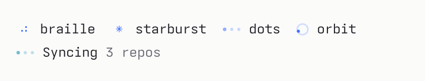
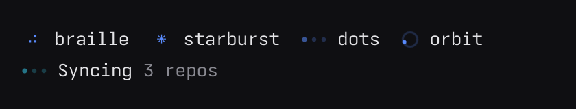
<figcaption>每种样式在循环中的一个瞬间，以及带色调和样式化标签的 spinner。</figcaption>
</figure>

## `shimmer`

一道亮光从左向右扫过标签。用于表达“正在工作”的消息。无论标签多长，光带都会在 2 s 内扫过整个标签，然后重新开始。文本会保留空白（`white-space: pre`）。节点的 `aria-label` 是纯文本。

任何 span 也可以使用同样的效果，写作 `fx = "shimmer"`（参见[文本](text.md)）。

**构建：** `tern.ui.node("shimmer", { text = "Thinking…" })`。

| 属性 | 类型 | 默认值 | 含义 |
| --- | --- | --- | --- |
| `spans` | span 列表 | 无 | 样式化文本。当它是数组时优先于 `text` |
| `text` | string | 无 | 纯文本；`spans` 不是数组时使用 |
| `mode` | `"classic"` \| `"kitt"` | `"classic"` | `classic` 从左向右扫过后重新开始。`kitt` 来回反弹（`animation-direction: alternate`，class `.kitt`） |
| `palette` | 由 span token 构成的 `{ low?, mid?, high? }` | 主题文本颜色 | 三种扫光颜色。每个值的第一个 span token 会将 `--sh-lo` / `--sh-mid` / `--sh-hi` 设为 `var(--sf-c-<token>)`。使用颜色 token（`muted`、`dim`、`accent`、`info`、`success`、…）；omp 主题 token 会映射为对应 token（`toolDiffAdded` → `ins`）。缺少键、未知 token 或不代表颜色的 token（`strong`）都会回退到默认值 |

每个 span 的样式 token 会成为包裹该 span 文本的 `sf-t-<token>` class。扫光会绘制在文本上，因此扫动时 span 上的颜色 token 不会显示（减少动态效果时会显示）。其他 token（如 `strong`）仍会生效。

**子节点：**无（忽略）。

**事件：**自身没有事件；`actions` 的用法与任何节点相同。

**样式：**

```html
<span class="sf sf-shimmer kitt" data-id="…" aria-label="Thinking…">
	<span class="sf-fx-shimmer">
		<span class="sf-t-strong">Thinking…</span>
	</span>
</span>
```

| 目标 | 选择器 |
| --- | --- |
| 节点 | `.sf-shimmer` |
| 来回模式 | `.sf-shimmer.kitt` |
| 扫光 | `.sf-shimmer .sf-fx-shimmer`（内部结构，可能变化） |

扫光是 `background-clip: text` 渐变，由关键帧 `sf-sh` 移动（2 s，线性，无限循环），与 OpenAI Codex 的扫光相同：光带宽约十个字符（`--sh-band`，默认 `5em`），颜色沿余弦曲线从边缘的 `--sh-lo` 经 `--sh-mid` 升至中间的 `--sh-hi`，起点位于文本前一个带宽处，终点则越过文本同样的距离。颜色默认使用 `--t3`、`--t2` 和 `--t1`（参见[变量](../styles/variables.md)）。你可以在样式表中设置 `--sh-lo`、`--sh-mid`、`--sh-hi` 和 `--sh-band`，而不使用 `palette`：

```css
[data-role='plugin.deploy.status'] .sf-shimmer {
	--sh-hi: var(--accent);
}
```

```lua
local ui = tern.ui

return ui.node("shimmer", {
	text = "Deploying to staging…",
	mode = "kitt",
	palette = { low = "muted", mid = "info", high = "accent" },
})
```

<figure class="tn-figure">
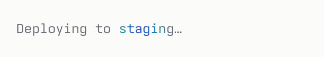
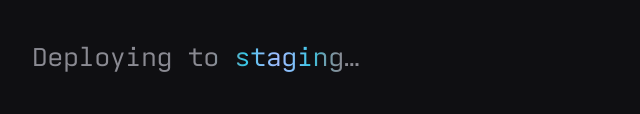
<figcaption>扫光的一个瞬间：高亮前后的字符都呈现低亮度颜色。</figcaption>
</figure>

## `skeleton`

用于表示尚未到达的内容形状：在文本、头像、表格行或统计磁贴将出现的位置显示柔和的占位块。用它代替数据尚未到达的视图，并让尺寸与视图相同，这样数据到达时就不会发生跳动：为它设置视图的 `key`，并在相同位置将节点替换为真实视图。对于有名称的工作（“Fetching services…”），[`shimmer`](#shimmer) 或 [`spinner`](#spinner) 表达得更清楚；对于 `picker` 中的列表，使用其 [`state = "loading"`](lists.md#picker)。

`shape` 用于选择代表的内容：

- `text`（默认）：`lines` 条参差不齐的线，每条高度为一行文本，最后一条较短。
- `avatar`：32px 圆盘，旁边有一条名称行和一条较短的下方行。
- `rows`：`rows` 条类似表格的行，每行有一个点、一条横线和右边缘的短数值线，行间有细线分隔。
- `card`：并排显示 `tiles` 个统计磁贴（标签、数值、副行），如 [`stats`](data.md#stats) 绘制的样式；磁贴会换行而不会被挤压。
- `block`：填满节点的一个圆角矩形（图片、图表、编辑器）；除非通过通用 `min` / `max` 尺寸设置（`min = { h = "8lines" }`），否则高 72px。

每个宽度都由节点的 id 决定，因此同一个节点在每一帧、每次重绘和重新挂载时都会保持相同的参差边缘。

`variant` 可选择三种样式：

| 变体 | 样式 | 用途 |
| --- | --- | --- |
| `shimmer`（默认） | 柔和色块；一道亮光按 [`shimmer`](#shimmer) 标签的时钟（2 s，从左到右）和颜色扫过整个 skeleton。每个形状显示同一道光带的一部分 | 加载任何内容 |
| `pulse` | 相同色块缓慢呼吸（2 s） | 更平缓的加载状态，或同时显示多个 skeleton |
| `wire` | 虚线细轮廓，无填充、无动态效果：即将呈现的布局线框 | 等待用户而非网络的视图（尚未选择任何内容）、类似打印草图的视图 |

减少动态效果（Tern 设置或系统设置）、隐藏副本中以及暂停时，`shimmer` 和 `pulse` 都会保持静止，显示为普通柔和色块。

`tone` 会为形状着色（例如为选中项的卡片使用 `accent` skeleton）。程序样式表设置的 shimmer `--sh-lo` / `--sh-mid` / `--sh-hi` 颜色也会应用于 skeleton。

**构建：** `tern.ui.node("skeleton", { shape = "rows", rows = 6 })`。

| 属性 | 类型 | 默认值 | 含义 |
| --- | --- | --- | --- |
| `variant` | `"shimmer"` \| `"pulse"` \| `"wire"` | `"shimmer"` | 样式（见上文）。其他任何值都会按 `shimmer` 处理 |
| `shape` | `"text"` \| `"avatar"` \| `"rows"` \| `"card"` \| `"block"` | `"text"` | 代表的内容。其他任何值都会按 `text` 处理 |
| `lines` | 整数，1–24 | `3` | 仅用于 `text`：行数。会限制范围；0 会绘制一行 |
| `rows` | 整数，1–50 | `4` | 仅用于 `rows`：行数。会限制范围 |
| `tiles` | 整数，1–8 | `3` | 仅用于 `card`：统计磁贴数。会限制范围 |
| `tone` | Tone | 无 | 使用该 tone 的颜色为形状（以及 `wire` 轮廓）着色 |
| `aria` | string | `"Loading"` | 无障碍名称 |

通用的 `min` 和 `max` 用于设置 `block` 的尺寸；`max.w` 可让任何形状都不超过所在列宽。

```lua
local ui = tern.ui

return ui.node("col", { gap = "lg" }, {
	ui.node("skeleton", { shape = "avatar" }),
	ui.node("skeleton", { lines = 3 }),
	ui.node("skeleton", { shape = "card", tiles = 3 }),
})
```

TSX 写法相同：

```tsx
<skeleton key="services" shape="rows" rows={6} variant="pulse" />
```

<figure class="tn-figure">


<figcaption>默认的 <code>shimmer</code>：<code>shape: "avatar"</code>、<code>"text"</code> 和 <code>"card"</code>，一道光带扫过全部形状。</figcaption>
</figure>

<figure class="tn-figure">


<figcaption><code>variant: "pulse"</code>：色块缓慢淡入淡出。</figcaption>
</figure>

<figure class="tn-figure">
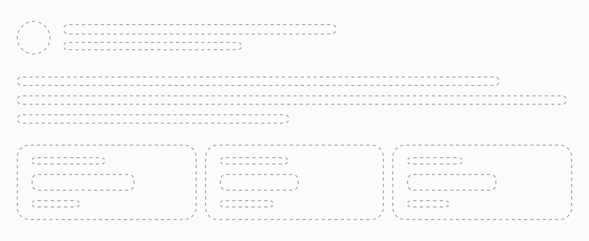
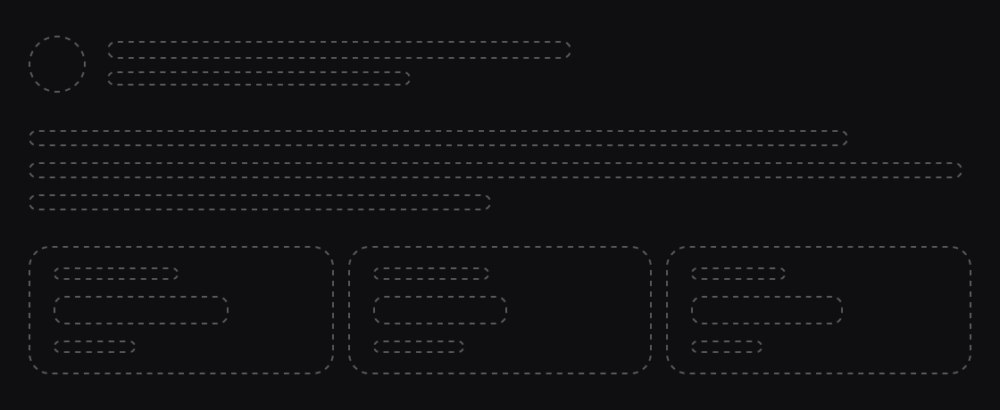
<figcaption><code>variant: "wire"</code>：即将呈现布局的静态线框。</figcaption>
</figure>

<figure class="tn-figure">
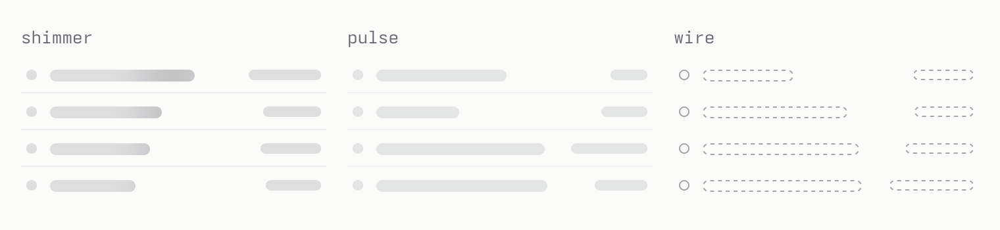
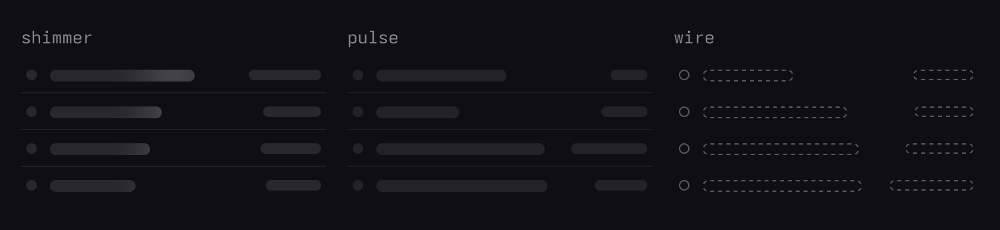
<figcaption>每种变体的 <code>shape: "rows"</code>。</figcaption>
</figure>

<figure class="tn-figure">
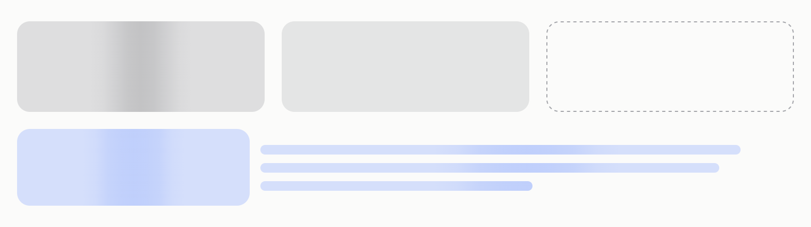
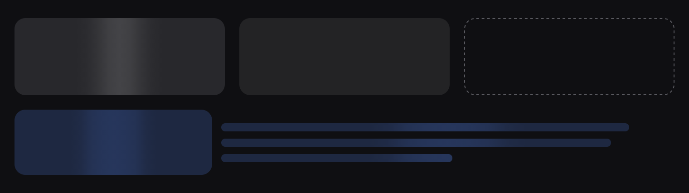
<figcaption>每种变体中由 <code>min: { h: "5lines" }</code> 设置尺寸的 <code>shape: "block"</code>；下方是带 <code>tone: "accent"</code> 和 <code>max: { w: 0.3 }</code> 的示例。</figcaption>
</figure>

<figure class="tn-figure">


<figcaption>减少动态效果时，<code>shimmer</code> 会保持静止，显示为普通色块。</figcaption>
</figure>

**子节点：**无（忽略）。

**事件：**自身没有事件；`actions` 的用法与任何节点相同。

**键盘：**该节点永远不会获得焦点，也没有可操作内容；数据到达时，程序会用真实视图替换它。

**无障碍：**节点的 role 为 `status`，并带有 `aria-busy="true"`，名称为 `Loading`（或其 `aria`）；辅助技术会忽略这些形状。

**样式：**

```html
<div class="sf sf-skeleton" data-id="…" data-variant="shimmer" data-shape="avatar" role="status" aria-busy="true" aria-label="Loading">
	<div class="sk-in" aria-hidden="true" style="--sk-run: …; --sk-band: …">
		<i class="sk-b sk-av" style="--sk-x: …"></i>
		<div class="sk-col">
			<div class="sk-line"><i class="sk-b sk-name"></i></div>
			<div class="sk-line"><i class="sk-b sk-meta"></i></div>
		</div>
	</div>
</div>
<!-- text: <div class="sk-line"><i class="sk-b sk-t"></i></div>…
     rows: <div class="sk-row"><i class="sk-b sk-dot"></i><i class="sk-b sk-bar"></i><i class="sk-b sk-end"></i></div>…
     card: <div class="sk-tile"><i class="sk-b sk-lbl"></i><i class="sk-b sk-val"></i><i class="sk-b sk-sub"></i></div>…
     block: <i class="sk-b sk-blk"></i> -->
```

| 目标 | 选择器 |
| --- | --- |
| 节点 | `.sf-skeleton` |
| 变体 / 形状 / 色调 | `.sf-skeleton[data-variant='wire']`、`[data-shape='rows']`、`[data-tone]` |
| 形状容器 | `.sf-skeleton .sk-in`（内部结构，可能变化） |
| 任意形状 | `.sf-skeleton .sk-b`（内部结构，可能变化） |
| 文本行 | `.sk-line`、`.sk-t`（内部结构，可能变化） |
| 头像圆盘及其线条 | `.sk-av`、`.sk-col`、`.sk-name`、`.sk-meta`（内部结构，可能变化） |
| 行及其组成部分 | `.sk-row`、`.sk-dot`、`.sk-bar`、`.sk-end`（内部结构，可能变化） |
| 磁贴及其组成部分 | `.sk-tile`、`.sk-lbl`、`.sk-val`、`.sk-sub`（内部结构，可能变化） |
| 块 | `.sk-blk`（内部结构，可能变化） |

变量：`--sk-fill`（色块）、`--sk-mid` / `--sk-hi`（光带）和 `--sk-wire`（轮廓）都由 `--sh-lo` / `--sh-mid` / `--sh-hi` 派生；`.sk-in` 上的 `--sk-run` 和 `--sk-band`（扫光的路径与光带宽度）以及 `--sk-x`（形状在路径中的偏移）由 Tern 在布局后设置。关键帧：`sk-sweep` 让光带扫过每个形状（2 s，线性，无限循环）；`sk-pulse` 让 `pulse` variant 呼吸（2 s，ease-in-out，无限循环）。

## `elapsed`

实时计时器，可从某个经过时长开始递增，也可倒计时至零。文本使用等宽数字，不换行，并以 `--t3` 绘制。它具有 `role="timer"`。

**构建：** `tern.ui.node("elapsed", { age = ms })`。

| 属性 | 类型 | 默认值 | 含义 |
| --- | --- | --- | --- |
| `age` | number（ms） | `0` | 构建节点时已经过的毫秒数。负数表示倒计时，会在到达后的相应毫秒数结束 |
| `stopped` | number（ms） | 无 | 将显示冻结在此毫秒数。计时器不再跳动 |
| `format` | `"short"` \| `"clock"` | `"short"` | 时间的显示格式。未知值会按 `short` 处理 |

格式（负值显示为零）：

| 显示时间 | `short` | `clock` |
| --- | --- | --- |
| 不足 1 min | `12.3s`（十分之一秒，向下取整，因此不会超前） | `0:12` |
| 不足 1 h | `4m 05s` | `4:05` |
| 1 h 或更长 | `1h 02m` | `1:02:03` |

age 的工作方式：

- 正数 `age` 显示 `age` 加上该 `age` 值到达后经过的时间。每次收到 `age`（在新节点中或包含该值的 `set` 中）都会重新锚定计时，即使数值未变。对其他 props 执行 `set` 会让计时继续。因此，每次发送时都应根据自己的起始时间计算 `age`（`(os.clock() - started) * 1000`，或使用插件时间源的等效计算）。
- 负数 `age` 从 `-age` ms 开始倒计时，并在 `0:00` / `0.0s` 停止。锚定方式相同：它会在该 `age` 值到达后 `-age` ms 结束；对其他 props 执行 `set` 不会打断计时；新的 `age`（即使数字相同）会重新开始。到达零后会保持为零。
- `stopped` 显示固定时长，例如已完成工作的最终耗时。

**子节点：**无（忽略）。

**事件：**自身没有事件；`actions` 的用法与任何节点相同。

**样式：**

```html
<span class="sf sf-elapsed" data-id="…" role="timer">4m 05s</span>
```

| 目标 | 选择器 |
| --- | --- |
| 节点 | `.sf-elapsed` |

它没有关键帧。减少动态效果不会让它停止。

```lua
local ui = tern.ui

-- a running job, a finished one and a countdown
return ui.col({
	ui.row({ ui.text("build"), ui.node("elapsed", { age = 12345 }) }),
	ui.row({ ui.text("tests"), ui.node("elapsed", { stopped = 18400 }) }),
	ui.row({ ui.text("retry in"), ui.node("elapsed", { age = -30000, format = "clock" }) }),
})
```

<figure class="tn-figure">
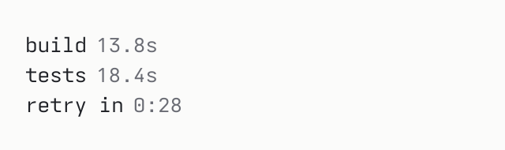
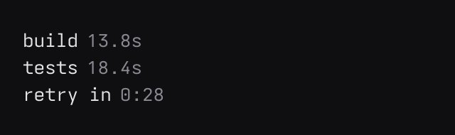
<figcaption>在帧到达约 1.5 s 后绘制：运行中的计时器和倒计时已从各自的 age 继续前进；已停止的计时器没有变化。</figcaption>
</figure>

## `rate`

平滑过渡到每个新值的数值，而不是直接跳变。适合显示每秒 token 数等吞吐量。发送新 `value` 时，显示值会在 420 ms 内（ease-out cubic）从当前值过渡到新值。第一个值立即显示。数值小于 100 时保留一位小数；从 100 起不保留小数；设置了 `unit` 时，后面会接一个空格和单位（`42.3 tok/s`、`1234`）。

**构建：** `tern.ui.node("rate", { value = 42.26, unit = "tok/s" })`。

| 属性 | 类型 | 默认值 | 含义 |
| --- | --- | --- | --- |
| `value` | number | `0` | 目标值 |
| `unit` | string | 无 | 在数值后以空格隔开追加 |

**子节点：**无（忽略）。

**事件：**自身没有事件；`actions` 的用法与任何节点相同。

**样式：**

```html
<span class="sf sf-rate" data-id="…">42.3 tok/s</span>
```

| 目标 | 选择器 |
| --- | --- |
| 节点 | `.sf-rate` |

它使用等宽数字，不换行，并以 `--t2` 绘制。节点需要稳定的 `id` 才能平滑过渡：具有新 id 的节点会从其值重新开始。

```lua
local ui = tern.ui

return ui.row({ ui.text("download"), ui.node("rate", { id = "dl-rate", value = state.mbps, unit = "MB/s" }) })
```

## `progress`

横向进度条，后面可带标签。提供 `value` 时，填充表示相应比例，并在 0.3 s 内过渡到新值。不提供时（`nil`/`null`），进度条为**不确定状态**：宽度为 30% 的填充会在轨道上滑动。节点具有 `role="progressbar"`、`aria-valuemin` 0 和 `aria-valuemax` 100。`aria-valuenow` 为四舍五入后的百分比，不确定状态时不设置。轨道会扩展以填满所在行（最小 40 px）。标签为空时会隐藏。

**构建：** `tern.ui.progress(value, label)`（参见 [UI 构建器](../reference/ui.md#progress)），或 `tern.ui.node("progress", { value = 0.4, label = "40%" })`。

| 属性 | 类型 | 默认值 | 含义 |
| --- | --- | --- | --- |
| `value` | number 0–1，或 `nil` | `nil`（不确定状态） | 完成比例。限制在 0–1 范围并四舍五入为整数百分比 |
| `label` | Spans | 无 | 条后的文本，使用等宽数字 |
| `tone` | Tone | accent | 填充颜色。`neutral` 也使用强调色 |

**子节点：**无（忽略）。

**事件：**自身没有事件；`actions` 的用法与任何节点相同。

**样式：**

```html
<div class="sf sf-progress indeterminate" data-id="…" role="progressbar" aria-valuemin="0" aria-valuemax="100">
	<div class="track"><div class="fill"></div></div>
	<span class="lbl">Uploading…</span>
</div>
```

| 目标 | 选择器 |
| --- | --- |
| 节点 | `.sf-progress` |
| 不确定状态 | `.sf-progress.indeterminate` |
| 轨道 | `.sf-progress .track`（内部结构，可能变化） |
| 填充 | `.sf-progress .fill`（内部结构，可能变化） |
| 标签 | `.sf-progress .lbl`（内部结构，可能变化） |

关键帧为 `sf-indet`（1.3 s，`translateX(-100%)` → `translateX(340%)`）。轨道在 `--l2` 上高 4 px。填充使用 `--tc`；未指定 tone 时使用 `--accent`。减少动态效果时，不确定进度条会变成不透明度为 35% 的全宽填充。

```lua
local ui = tern.ui

return ui.col({
	ui.progress(0.4, "40%"),
	ui.node("progress", { value = 0.85, tone = "success", label = "85%" }),
	ui.progress(nil, "Preparing…"), -- indeterminate
})
```

<figure class="tn-figure">
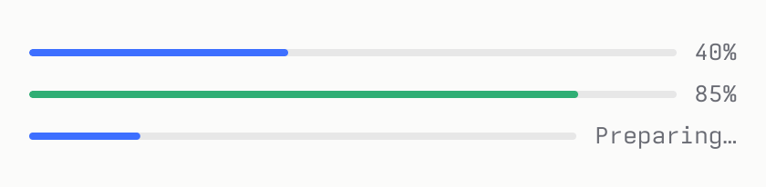
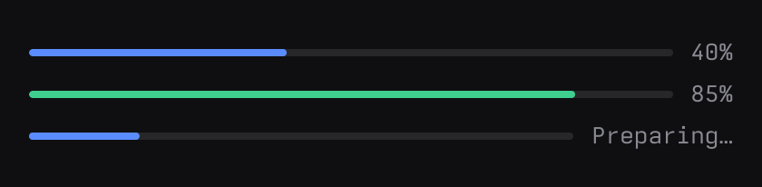
<figcaption>确定进度、带色调的进度和不确定进度。每条轨道都会占据标签剩余的宽度。</figcaption>
</figure>

## `meter`

以**条形**（默认）、**圆环**或**块网格**绘制的水平值。它显示一个 `value`，或显示组成整体的堆叠 `parts`（例如已用 / 缓存 / 空闲）。阈值会将其着色为 `warn` 或 `bad`。刻度（`marks`）可在轨道上标出限制值。

形状由 `style` 决定。Tern 不会根据数值选择形状：

| `style` | 形状 | `size` `sm` / `md` / `lg` |
| --- | --- | --- |
| `bar`（默认，也用于任何未知值） | 沿所在行扩展的圆角轨道（`flex: 1 1 60px`；在列中会横向拉伸） | 高 4 / 6 / 10 px |
| `ring` | 从 12 点钟方向顺时针填充的 16 单位 SVG 圆环 | 12 / 16 / 24 px |
| `blocks` | 由 8 px 方块组成的网格，共 10 列。提供 `steps` 时改为一行指定数量的细条 | 2 / 5 / 10 行（20 / 50 / 100 个单元） |

首次显示时，条形或圆环填充会在 0.6 s 内从零增长（`meter-fill`，这是 Web Animation，而非 CSS 关键帧）。之后的数值会在 0.4 s 内平滑过渡（对条形使用 `width`/`left` 的 CSS 过渡，对圆环使用 `stroke-dasharray`）。块单元不会增长；它们会在 0.3 s 内改变颜色。减少动态效果时，数值会立即绘制。

**构建：** `tern.ui.meter(value, label)`（参见 [UI 构建器](../reference/ui.md#meter)），或使用 `tern.ui.node("meter", { … })` 并传入下列 props。`tern.ui.test_summary(…)` 会构建带堆叠 meter 的行（参见 [UI 构建器](../reference/ui.md#test-summary)）。表格单元格也可以使用 meter（`tern.ui.meter_cell`、`meter_parts_cell`，参见 [数据](data.md)）。

| 属性 | 类型 | 默认值 | 含义 |
| --- | --- | --- | --- |
| `value` | number 0–1 | 无 | 水平值。限制在 0–1 范围。提供 `parts` 时绘制会忽略它，但 `thresholds` 仍会使用它 |
| `parts` | `{ { value, token?, label?, hatch? } }` | 无 | 从左至右堆叠的部分（在圆环上按顺时针方向）。见下文 |
| `thresholds` | `{ warn?: number, bad?: number }` | 无 | `value ≥ bad` 会设置 `data-level="bad"`，否则 `value ≥ warn` 会设置 `data-level="warn"`。需要提供 `value` |
| `style` | `"bar"` \| `"ring"` \| `"blocks"` | `"bar"` | 形状 |
| `size` | `"sm"` \| `"md"` \| `"lg"` | `"sm"` | 参见形状表。其他值会按 `sm` 处理 |
| `steps` | 整数 1–20 | 无 | 仅用于 `blocks`：一行恰好包含此数量的单元（`data-steps`）。超出范围的值会被忽略 |
| `marks` | `{ { at, tone?, title?, icon? } }` | 无 | 在 `at` 处绘制刻度（0–1，必填）。见下文 |
| `label` | Spans | 无 | 形状后的文本，通常为数值（`72%`） |
| `total` | Spans | 无 | 标签后的文本，通常为整体数值（`200K`），颜色更暗 |
| `tone` | Tone | accent | 填充颜色。优先于阈值等级（`neutral` 除外） |
| `title` | string | parts 摘要 | 工具提示。未设置时，带标签部分的 meter 会显示 `used 42% · cache 8%` |

`parts` 条目：

| 字段 | 类型 | 含义 |
| --- | --- | --- |
| `value` | number | 该部分占整体的比例。各部分按顺序限制，确保总和不超过 1：溢出的部分会被截断，之后的部分值为 0 |
| `token` | string | 颜色：span token（`success`、`error`、`muted`、…）或 omp 主题 token（`toolDiffAdded`、…），后者会映射为语义 token。填充使用该 token 所绘制文本的颜色。`"track"` 表示间隔：该部分保留位置，但绘制为空轨道 |
| `label` | string | 该部分的工具提示，也用于 meter 的默认 `title` |
| `hatch` | boolean | 在填充上绘制斜线，用于标示预留或估算部分 |

`marks` 条目：

| 字段 | 类型 | 含义 |
| --- | --- | --- |
| `at` | number 0–1 | 轨道上的位置，限制在 0–1 范围。没有 `at` 的标记会被丢弃 |
| `tone` | Tone | 刻度颜色（刻度上的 `data-tone`） |
| `title` | string | 工具提示（仅适用于条形刻度） |
| `icon` | 图标名称 | 仅适用于条形。会在轨道上绘制图标，并在图标周围中断轨道和填充，间隔宽 `--sf-mt-gap`（默认 14 px）。图标名称参见[数据中的 `icon`](data.md) |

在圆环上，标记是短径向刻度。块网格会忽略标记。在块网格中，各部分会按顺序填充单元。每部分会获得四舍五入后的份额，总数与份额总和四舍五入后的结果一致。

节点具有 `role="meter"`、`aria-valuemin` 0 和 `aria-valuemax` 100。`aria-valuenow` 是 `value` 的四舍五入百分比（或 parts 总和的百分比）。它还会在节点上将 `--sf-meter` 设为数值（0–1），因此样式表可以绘制自己的 meter。未提供 `value` 或 `parts` 时，节点会获得 class `unknown` 和虚线轨道。

**子节点：**无（忽略）。

**事件：**自身没有事件；`actions` 的用法与任何节点相同。

**样式：**

```html
<div class="sf sf-meter" data-id="…" data-style="bar" data-size="sm" data-level="warn"
     role="meter" aria-valuenow="78" style="--sf-meter: 0.78">
	<div class="sf-mt-track gapped">
		<div class="sf-mt-rail"></div>                <!-- only with icon marks -->
		<div class="sf-mt-fill"></div>                <!-- one value -->
		<!-- or per part: <div class="sf-mt-part first hatch" title="cache"></div> … <div class="sf-mt-part last gap"></div> -->
		<div class="sf-mt-mark icon" data-tone="warning" title="compacts here"><svg>…</svg></div>
	</div>
	<!-- ring:   <svg class="sf-mt-ring" viewBox="0 0 16 16"><circle class="track"/><circle class="arc"/>…<line class="mark"/></svg> -->
	<!-- blocks: <div class="sf-mt-blocks"><i class="on"></i><i class="on hatch"></i><i></i>…</div> -->
	<span class="sf-mt-lbl">78%</span>
	<span class="sf-mt-total">200K</span>
</div>
```

| 目标 | 选择器 |
| --- | --- |
| 节点 | `.sf-meter` |
| 形状 / 尺寸 / 步进 | `.sf-meter[data-style='ring']`、`[data-size='lg']`、`[data-steps]` |
| 等级 | `.sf-meter[data-level='warn']`、`[data-level='bad']` |
| 无数值 | `.sf-meter.unknown` |
| 条形轨道、轨道 | `.sf-mt-track`、`.sf-mt-track.gapped`、`.sf-mt-rail`（内部结构，可能变化） |
| 单项填充、各部分 | `.sf-mt-fill`；`.sf-mt-part` 及其 `.first`、`.last`、`.hatch`、`.gap`（内部结构，可能变化） |
| 条形刻度 | `.sf-mt-mark`、`.sf-mt-mark.icon`、`.sf-mt-mark[data-tone]`（内部结构，可能变化） |
| 圆环 | `.sf-mt-ring`、`.sf-mt-ring .track`、`.sf-mt-ring .arc`（为空时带 `.gap`、`.sf-hidden`）、`.sf-mt-ring .mark`（内部结构，可能变化） |
| 块网格、单元 | `.sf-mt-blocks`、`.sf-mt-blocks i`、`i.on`、`i.hatch`（内部结构，可能变化） |
| 标签、总数 | `.sf-mt-lbl`、`.sf-mt-total`（内部结构，可能变化） |

变量：`--mt` 是填充颜色。默认值为 `--accent`，会根据等级变为 `--warn` 或 `--bad`；节点具有非 neutral tone 时则为 `--tc`。覆盖 `--mt` 可一次性为所有形状重新着色。轨道使用 `--l2`（圆环和步进单元使用 `--l3`）。标签使用 `--t3`，总数使用 `--t4`。`--sf-mt-gap` 设置图标标记的中断宽度。`--sf-meter` 是由 Tern 设置的数值。meter 规则位于 `omp-composer.css` 样式表中，但并未限定于 omp，适用于所有 surface。

```lua
local ui = tern.ui

return ui.col({
	ui.node("meter", {
		value = 0.84,
		thresholds = { warn = 0.8, bad = 0.95 },
		label = "84%",
		total = "512G",
		marks = { { at = 0.9, tone = "warning", title = "quota" } },
	}),
	ui.node("row", { gap = "lg" }, {
		ui.node("meter", {
			style = "ring",
			size = "md",
			parts = {
				{ value = 0.42, token = "info", label = "used" },
				{ value = 0.08, token = "muted", label = "cache", hatch = true },
			},
			label = "50%",
		}),
		ui.node("meter", { style = "blocks", value = 0.6, label = "60%" }),
		ui.node("meter", { style = "blocks", steps = 5, value = 0.6 }),
	}),
})
```

<figure class="tn-figure">
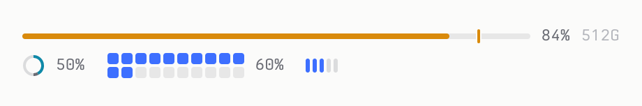
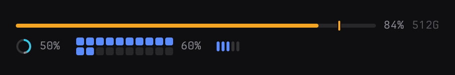
<figcaption>超过 <code>warn</code> 阈值且带标记的条形、由两部分组成的圆环、<code>sm</code> 块网格（20 个单元）以及 <code>steps = 5</code>。</figcaption>
</figure>

## `chart`

由 Tern 绘制的系列数据：**热力图**（日历样式的单元网格）、**条形图**、由细条组成的迷你**折线图**、随时间变化的**折线图**或**面积图**（一个或多个系列），或份额**环形图**。节点具有 `role="figure"`。提供 `summary` 时，其纯文本会成为 `aria-label`，图表下方还会显示摘要行。

| `kind` | 绘制内容 | 适用场景 |
| --- | --- | --- |
| `heatmap`（默认） | 由 `--chart-c` 的四种深浅构成的日历样式单元格网格 | 按周或按年查看活动（运行、部署） |
| `bars` | 每个条目绘制一条柱，共用所在行的宽度 | 并排比较少量数值（每日运行次数） |
| `spark` | 一行细条 | 在行或表格单元格中显示数值旁边的趋势 |
| `line`（单系列） | 1.75 px 折线，下方是颜色渐变至基线的柔和面积，配有浅色网格线和下方的 x 标签；最后一个点有圆点标记，最后的数值显示在绘图区域旁边 | 随时间变化的一个数值：本周延迟、覆盖率趋势、部署以来的 req/s |
| `line`（多个系列） | 在同一数值域中每个系列一条线，上方有图例标签，每条线末端有圆点；没有面积或最后的数值 | 相同时间范围内的多个系列（p50/p95/p99） |
| `area` | 与 `line` 相同，但每个系列下方有更饱满的填充 | 随时间变化且数量本身重要的值（已用磁盘、已用 token），而非仅关注趋势形状 |
| `donut` | 由带小间隔的分段构成的圆环，浅色轨道，中间显示总数，下方显示 `caption`，旁边显示图例列表（圆点、标签、数值） | 整体由少量部分组成（4–6 项）：按服务划分的请求、按类型划分的磁盘 |

每次 props 变化时，Tern 都会重建热力图，因此热力图应保持较小（一个年份有 371 个单元）。其他 kind 会原位更新，所以每秒更新一次的图表不会重放入场动画：条形会保留其元素（只有上次绘制后新增的条形会入场，其余条形会平滑过渡到新高度）；折线、面积和环形图会保留已绘制部分并移动数据点，同时保持形状不变。图表首次出现或形状改变（例如 `kind` 变化、系列或分段数量变化）时会播放入场动画：折线从左向右绘出（0.9 s，每个系列比前一个延迟 90 ms）；面积在其下方淡入，末端点和最后的数值随折线出现；环形图旋转到位，同时各分段淡入。

指向折线或面积图时，绘图区域会出现一条细竖线，以及每个系列在该位置上的一个点；停留在该处时会显示数据点的工具提示：其 x 标签和每个系列的值及 `unit`（`Tue · p50 12 ms · p95 45 ms`），或数据点自身的 `title`。环形图分段及其图例行共用一个工具提示：标签、数值和占比（`api · 552 · 46%`）。

**构建：**`tern.ui.bars(series)` 和 `tern.ui.spark(series)`（参见 [UI 构建器](../reference/ui.md#bars、spark)）。热力图、折线图、面积图、环形图，以及 `summary`、`size` 或 `token`，请使用 `tern.ui.node("chart", { … })`。

| 属性 | 类型 | 默认值 | 含义 |
| --- | --- | --- | --- |
| `kind` | `"heatmap"` \| `"bars"` \| `"spark"` \| `"line"` \| `"area"` \| `"donut"` | `"heatmap"` | 图表类型。其他任何值都会绘制为热力图 |
| `size` | `"sm"` \| `"md"` \| `"lg"` | `"md"` | 热力图单元为 8 / 11 / 13 px。条形高 2 / 4 / 8 行。spark 始终高一行。`line`/`area`：绘图区高 60 / 112 / 176 px（字体 13 px 时；宽度填满）。`donut`：圆环直径为 76 / 112 / 152 px。其他值按 `md` 绘制 |
| `token` | span token | `accent` | 填充颜色，设为 `--chart-c`：条形、单元、折线或面积图的第一个系列、环形图的第一个分段。未设置 `token` 的后续系列和分段依次使用 `--chart-2` … `--chart-10`（紫、琥珀、绿、青、红，然后是从主题颜色生成的四种色调），之后重新从头开始 |
| `summary` | Spans | 无 | 图表下方的一行文本，也是其无障碍名称 |
| `series`（`bars`、`spark`） | `{ { value, label?, title?, tone? } }` | 无 | 每个条目按顺序绘制一条柱。高度根据数值域（`min`..`max`）确定；值为零、负数或缺失时绘制 1 px 短线。柱宽最多 24 px（spark 为 4 px），并共用所在行的宽度。工具提示使用 `title`，否则使用 `label`。`tone` 会为该柱填色，而非使用 `token` |
| `series`（`line`、`area`，单系列） | `{ number \| { value?, label?, title? } }` | 无 | 每个条目在绘图区域中均匀放置一个数据点。没有数值的条目（`null`，或没有 `value` 的表）表示间隙：折线会在该处断开。未提供 `labels` 时，`label` 是数据点的 x 标签；`title` 会替换该点的工具提示 |
| `series`（`line`、`area`，多个系列） | `{ { label?, token?, values } }`，每个 `values` 为 `{ number \| { value, title? } }` | 无 | 只要有一个条目带有 `values` 数组，就会采用此格式；没有该数组的条目会被跳过。每个条目绘制一条线；各点按索引共用 x 位置（最长系列决定数据点数量）。`label` 是其图例标签和工具提示中的名称；`token` 是其颜色 |
| `series`（`donut`） | `{ number \| { value, label?, token?, title? } }` | 无 | 每个条目绘制一个分段，从顶部顺时针排列，大小按其占总量的份额确定。`value` 为零、负数或缺失时不会绘制分段，但会保留图例行。`title` 会替换分段的工具提示 |
| `labels` | `{ string }` | 条目中的 `label`（单系列） | `line`/`area`：按数据点索引设置 x 标签。`""` 会让数据点不带标签。超过 8 个标签时会均匀抽稀。第一个标签与绘图区域左边缘对齐，最后一个与右边缘对齐 |
| `unit` | string | 无 | `line`/`area`/`donut`：追加到 Tern 输出的每个数值之后（工具提示、最后的数值、环形图总数和图例）。货币符号（`$`、`€`、`£`、`¥`）放在数值前（`$51.4`）；`%`、`×` 和 `°` 紧跟数值（`64%`）；其他单位在空格后显示（`182 ms`） |
| `last` | `boolean` \| Spans | `true` | 单系列 `line`/`area`：最后一个数据点旁的标签。`true` 会显示其数值和 `unit`；文本或 spans 会替代该数值；`false` 会隐藏标签。多系列不会显示该标签 |
| `min`、`max` | number | `0`、系列或标记中的最大值 | `bars`/`spark`：固定数值域。数值会限制在该范围内。退化域（`max ≤ min` 或非有限值）会让所有条形都为空。`line`/`area`：见下文。对于 `chart` 节点，它们是数值，而不是通用 `{ w, h }` 尺寸范围 |
| `marks` | `{ { value, tone?, title? } }` | 无 | `bars`/`spark`/`line`/`area`：在数值单位对应的位置横跨图表绘制水平虚线参考线（目标值、限制值）。`tone` 设置线条颜色（默认：muted 前景色）；悬停时 `title` 是其工具提示。超出数值域的标记会限制到域的边缘 |
| `total` | Spans | 数值总和及 `unit` | `donut`：环形图中间显示的内容 |
| `caption` | Spans | 无 | `donut`：环形图下方的低调文本行（`requests`），换行宽度约为圆环宽度 |
| `cells` | `{ { number? } }`（按行排列的列） | 无 | `heatmap`：0–1 范围内的行强度值。最宽的一行决定列数 |
| `tips` | `{ { string? } }` | 无 | `heatmap`：每个单元的工具提示，按 `cells` 的索引对应 |
| `rows` | `{ string }` | 无 | `heatmap`：每行的标签（`"Mon"`、`""`、`"Wed"`、…） |
| `cols` | `{ { at, label } }` | 无 | `heatmap`：列标签（月），放置在列 `at` 上（从 0 起始的整数）。缺少任一字段的条目都会被跳过 |

热力图单元的数值会映射为等级（`data-l`）：`≤ 0` → `0`（空色块），`≤ 0.25` → `1`，`≤ 0.5` → `2`，`≤ 0.75` → `3`，更高则为 `4`。非数值或缺失的单元会设为 `n`，并以透明方式绘制。四种等级分别以 `--chart-c` 的 20%、40%、65% 和 100% 填充。

对于 `line` 或 `area`，`min` 和 `max` 会固定数值域，超出范围的数值会限制到域的边缘。未设置时，数值域从 0 开始（如果存在负数，则从小于最小值处开始），并延伸至略大于最大数值或标记值的位置；上限会向上取整为 10 的幂乘以 1、1.2、1.5、2、2.5、3、4、5、6 或 8（182 → 200）。退化域（全为零、`max ≤ min`）会让所有点落在基线上。

Tern 输出的数值简短：最多三位有效数字；千位缩写为 `k`，百万为 `M`，十亿为 `B`（`1200` → `1.2k`、`12.34` → `12.3`、`3.14159` → `3.14`），负号使用真正的减号。要按自己的方式输出数值，可发送 `last`、`total` 或数据点的 `title`。

只有在每个环形图分段都足够长、能够容纳间隙时，所有分段才会采用圆角端点；其中只要有一个细小分段，就会让它们全部改为方角，避免小份额看起来比实际更大。只有一个分段时会绘制完整圆环。

请注意，构建器会将 `series` 条目作为 `{ value, label }` 对象发送。传给 `tern.ui.node` 的 Luau 表也必须使用这些字段名：只有通过 `tern.ui.bars`/`spark` 才能使用位置式 `{ label, value }` 对。

`min`、`max`、`marks` 和系列 `tone` 是较新的功能；较旧版本的 Tern 会忽略它们（不显示标记，使用自动数值域）。

```lua
local ui = tern.ui

local latency = { 2, 4, 3, 6, 5, 8, 7, 9, 6, 4, 7, 10, 8, 6, 9 }
local series = {}
for i, v in latency do
	series[i] = { value = v }
end

return ui.col({
	ui.node("chart", {
		kind = "bars",
		size = "sm",
		series = {
			{ value = 3, label = "Mon" }, { value = 7, label = "Tue" }, { value = 5, label = "Wed" },
			{ value = 9, label = "Thu" }, { value = 4, label = "Fri" }, { value = 1, label = "Sat" },
			{ value = 2, label = "Sun" },
		},
	}),
	ui.node("chart", { kind = "spark", token = "success", series = series, summary = "p95 latency, last 15 min" }),
})
```

<figure class="tn-figure">
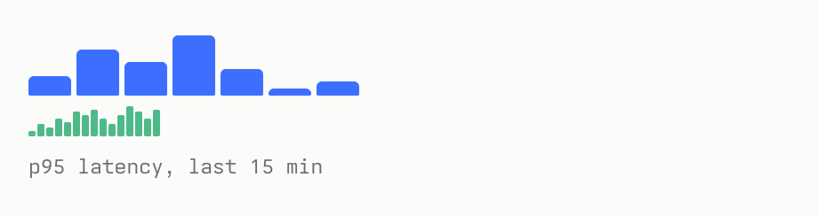
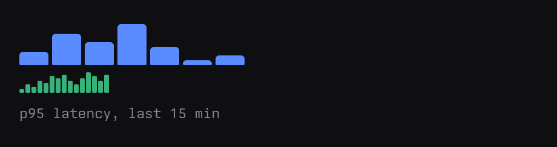
<figcaption>一个 <code>sm</code> 条形图，以及设置了 <code>token</code> 和 <code>summary</code> 的 spark。</figcaption>
</figure>

折线图、面积图和环形图：

```lua
local ui = tern.ui

return ui.col({
	-- One series: points are numbers or { value, label?, title? }; a point without a value is a gap.
	ui.node("chart", {
		kind = "line",
		unit = "ms",
		labels = { "Mon", "", "", "", "Wed", "", "", "", "", "Fri", "", "", "", "Sun" },
		series = state.latency, -- 14 numbers
		summary = "p95 latency, last 7 days",
	}),
	-- Several series share the labels and the domain.
	ui.node("chart", {
		kind = "line",
		unit = "ms",
		labels = state.days,
		series = {
			{ label = "p50", values = state.p50 },
			{ label = "p95", token = "pending", values = state.p95 },
			{ label = "p99", token = "warning", values = state.p99 },
		},
	}),
	ui.node("chart", {
		kind = "donut",
		caption = "requests",
		series = {
			{ label = "api", value = 552 },
			{ label = "web", value = 288 },
			{ label = "worker", value = 216 },
			{ label = "cron", value = 144 },
		},
	}),
})
```

TSX 写法相同：

```tsx
<col>
   <chart kind="line" unit="ms" labels={days} series={latency} summary="p95 latency, last 7 days" />
   <chart
      kind="line"
      unit="ms"
      labels={days}
      series={[
         { label: 'p50', values: p50 },
         { label: 'p95', token: 'pending', values: p95 },
         { label: 'p99', token: 'warning', values: p99 },
      ]}
   />
   <chart kind="donut" caption="requests" series={byService} />
</col>
```

<figure class="tn-figure">
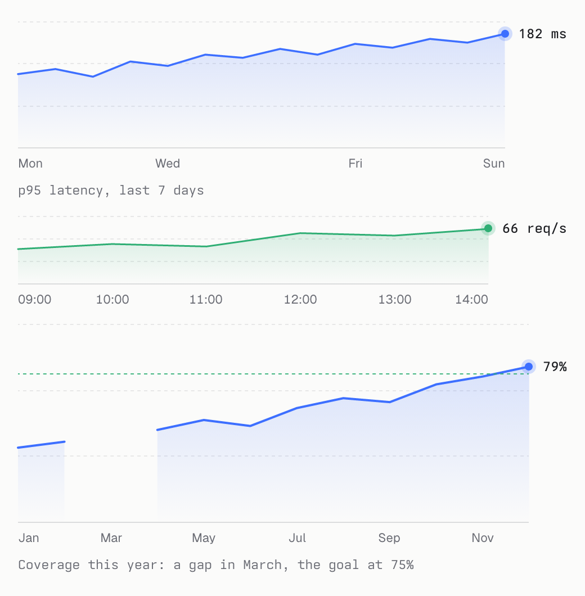
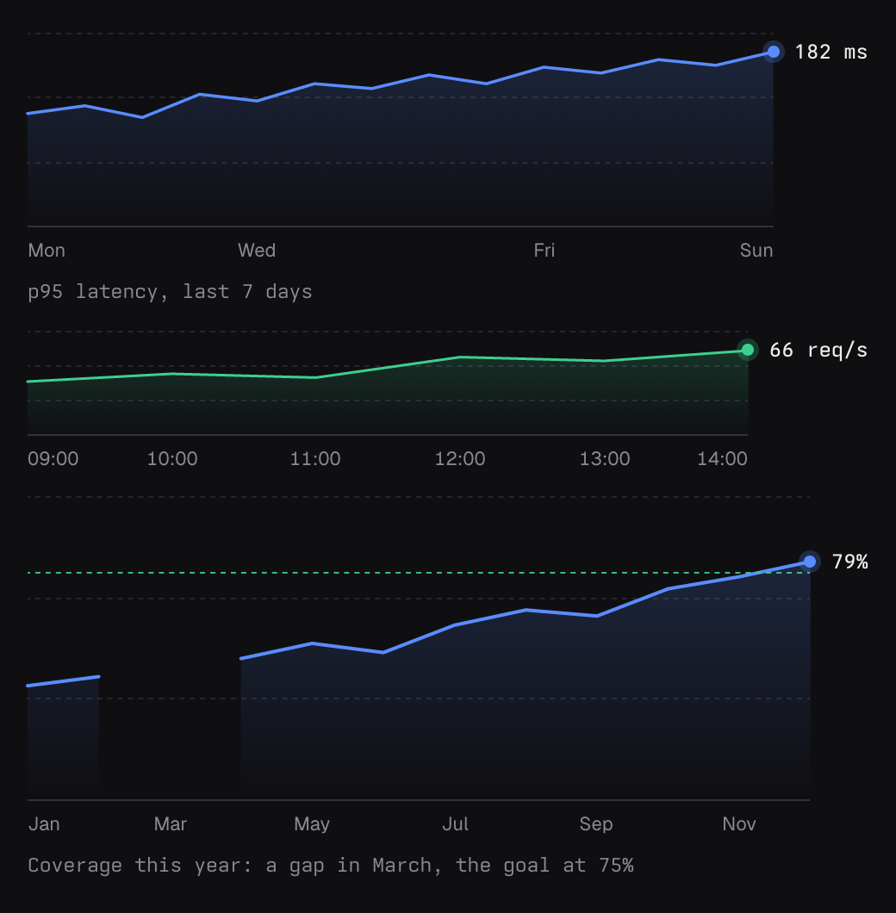
<figcaption>带 <code>unit</code> 的 <code>md</code> <code>line</code>、使用 <code>token</code> 的 <code>sm</code> 图表，以及在 <code>lg</code> 尺寸下包含间隙（<code>null</code>）、固定 <code>max</code> 和标记的图表。</figcaption>
</figure>

<figure class="tn-figure">
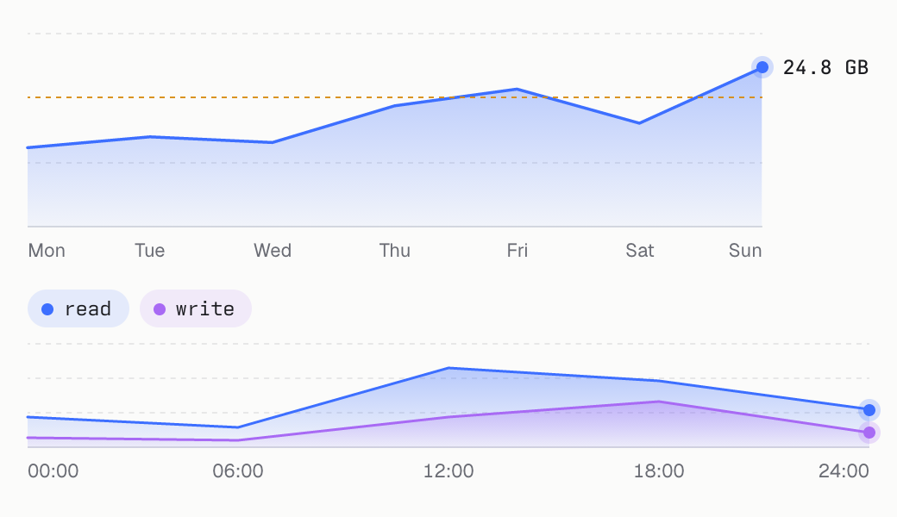
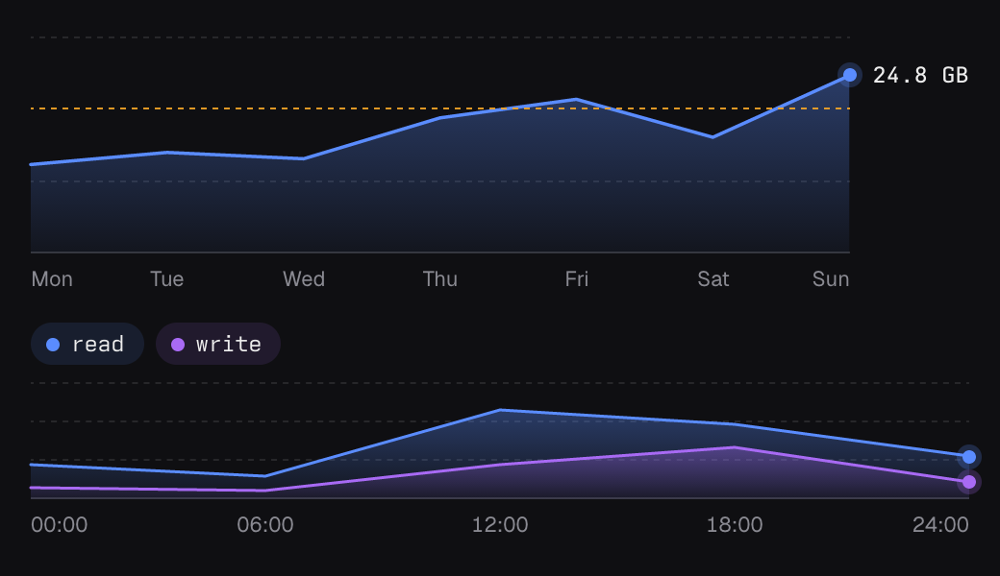
<figcaption>带 warning 标记的 <code>area</code>，以及含两个系列的 <code>sm</code> 面积图。</figcaption>
</figure>

<figure class="tn-figure">
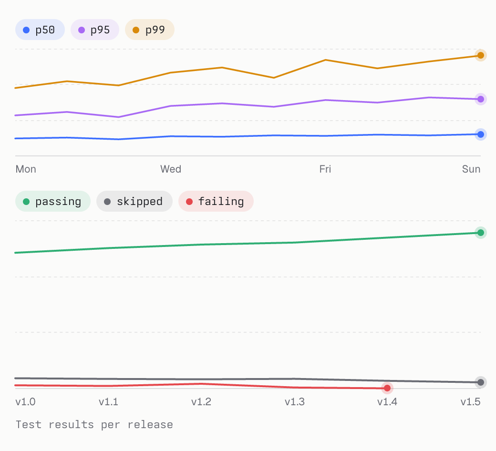
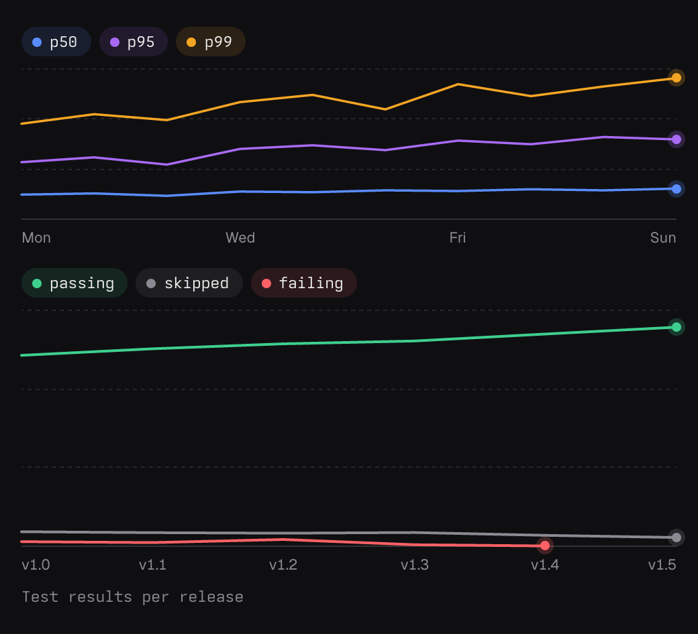
<figcaption>多个系列：顶部为图例标签，使用同一数值域，每条折线末端都有圆点。在 <code>lg</code> 尺寸下，最后一个值为 <code>null</code> 的系列会提前结束。</figcaption>
</figure>

<figure class="tn-figure">
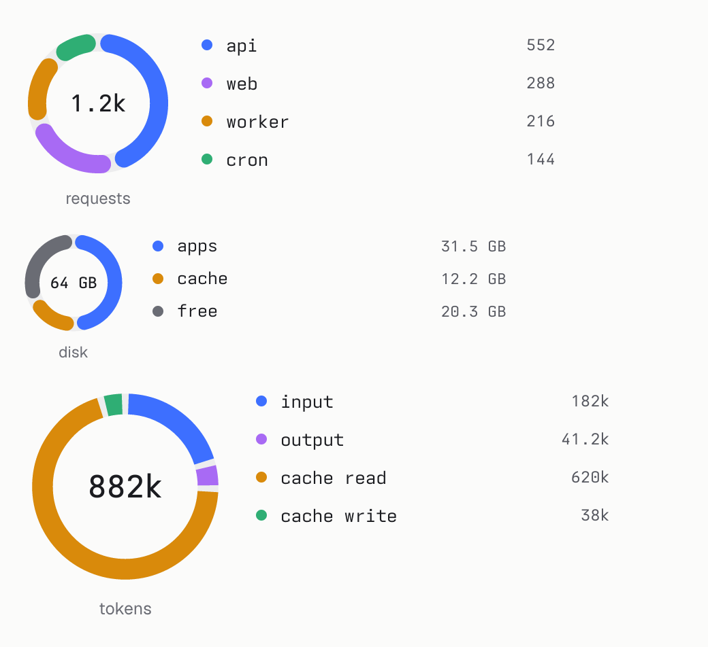
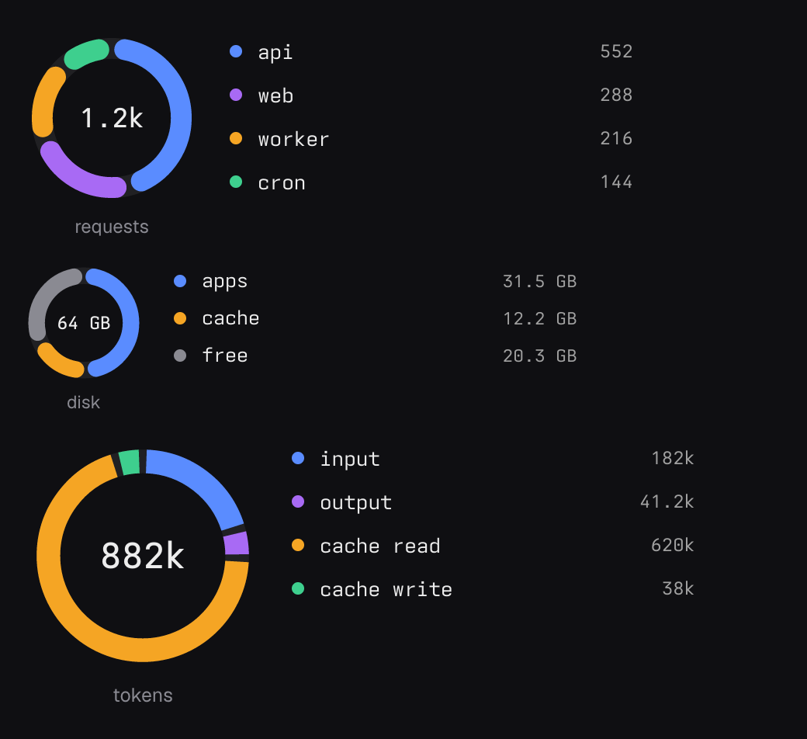
<figcaption>带 <code>caption</code> 的 <code>md</code> <code>donut</code>、带自定义 <code>total</code> 和 token 的 <code>sm</code> 图表，以及 <code>lg</code> 尺寸图表。</figcaption>
</figure>


**子节点：**无（忽略）。

**事件：**自身没有事件；`actions` 的用法与任何节点相同。指向图表只会显示工具提示。

**键盘：**图表不会接收按键。数据由程序负责：发送新的 `series`（和 `labels`）以更新图表；形状不变时，图表会保留已绘制部分并原位更新。

**样式：**

```html
<div class="sf sf-chart" data-id="…" data-kind="heatmap" data-size="md" role="figure" style="--chart-c: …">
	<div class="hm">
		<div class="mls"><span class="ml" style="--at: 4">Feb</span>…</div>
		<div class="grid">
			<div class="rls"><span class="rl">Mon</span>…</div>
			<div class="wk" style="--x: 0"><span class="c" data-l="3" title="Jan 3: 12 runs"></span>…</div>
			…
		</div>
	</div>
	<!-- bars / spark: <div class="bars"><span class="b" style="--v: 0.5; --x: 0" title="Mon"></span>…<span class="mk" style="--v: 0.8" title="Target"></span>…</div> -->
	<div class="sum">412 runs this year</div>
</div>
<div class="sf sf-chart" data-id="…" data-kind="line" data-size="md" role="figure" aria-label="…" style="--chart-c: …">
	<div class="lg"><span class="lgi" style="--sc: …"><i class="dot"></i><span class="t">p50</span></span>…</div>
	<div class="ln">
		<div class="pc">
			<div class="plot">
				<div class="gl" aria-hidden="true"><i class="g" style="--g: 0"></i>…</div>
				<svg class="sv" aria-hidden="true" viewBox="0 0 W H" preserveAspectRatio="none">
					<defs class="df"><linearGradient class="ag" id="ga0"><stop class="s0"/><stop class="s1"/></linearGradient></defs>
					<g class="se" style="--sc: …; --i: 0"><path class="fa"/><path class="st"/></g>
				</svg>
				<span class="end" style="--sc: …; --x: 1; --v: 0.91"></span>
				<div class="ov">
					<span class="col" title="Mon · 50 ms" style="--x0: 0; --x1: 0.04; --px: 0"><i class="vl"></i><i class="pd" style="--sc: …; --v: 0.25"></i></span>…
					<span class="mk" style="--v: …"></span>…
				</div>
			</div>
			<div class="xl" aria-hidden="true"><span class="x s" style="--x: 0">Mon</span>…</div>
		</div>
		<div class="sd"><span class="lv" style="--v: 0.91">182 ms</span></div>
	</div>
	<div class="sum">…</div>
</div>
<div class="sf sf-chart" data-kind="donut" …>
	<div class="dn">
		<div class="fig">
			<div class="ring">
				<svg class="dv rd" viewBox="0 0 100 100"><circle class="tr"/><circle class="sg" title="api · 552 · 46%" style="--sc: …"/>…</svg>
				<div class="ctr"><span class="tot">1.2k</span></div>
			</div>
			<span class="cap">requests</span>
		</div>
		<div class="leg"><div class="lr" title="…" style="--sc: …"><i class="dot"></i><span class="t">api</span><span class="v">552</span></div>…</div>
	</div>
</div>
```

| 目标 | 选择器 |
| --- | --- |
| 节点 | `.sf-chart` |
| 种类 / 尺寸 | `.sf-chart[data-kind='spark']`、`.sf-chart[data-size='sm']` |
| 热力图容器、月份标签 | `.sf-chart .hm`、`.mls`、`.ml`（内部结构，可能变化） |
| 网格、行标签、列 | `.sf-chart .grid`、`.rls`、`.rl`、`.wk`（内部结构，可能变化） |
| 按等级选择单元 | `.sf-chart .c[data-l='0'…'4']`、`.c[data-l='n']`（内部结构，可能变化） |
| 条形容器、条形 | `.sf-chart .bars`、`.sf-chart .b`（内部结构，可能变化） |
| 参考线（标记） | `.sf-chart .mk`（内部结构，可能变化） |
| 图例标签（多个系列） | `.sf-chart .lg`、`.lgi`、`.lgi .dot`、`.lgi .t`（内部结构，可能变化） |
| 绘图区域、网格线 | `.sf-chart .plot`、`.gl`、`.g`（内部结构，可能变化） |
| 系列折线、面积 | `.sf-chart .se .st`、`.se .fa`；渐变色标为 `.ag .s0`、`.s1`（内部结构，可能变化） |
| 末端圆点、最后的数值 | `.sf-chart .end`、`.sf-chart .lv`（内部结构，可能变化） |
| 悬停带、细线和圆点 | `.sf-chart .col`、`.col .vl`、`.col .pd`（内部结构，可能变化） |
| X 标签 | `.sf-chart .xl .x`（第一个为 `.x.s`，最后一个为 `.x.e`）（内部结构，可能变化） |
| 环形图圆环、轨道、分段 | `.sf-chart .dv`、`.dv .tr`、`.dv .sg`（`.dv.rd`：圆角端点）（内部结构，可能变化） |
| 环形图总数、说明 | `.sf-chart .tot`、`.sf-chart .cap`（内部结构，可能变化） |
| 环形图例行、标签、数值 | `.sf-chart .lr`、`.lr .t`、`.lr .v`（内部结构，可能变化） |
| 摘要 | `.sf-chart .sum`（内部结构，可能变化） |

变量：`--chart-c`（填充色，第一个系列的颜色）、`--chart-2` … `--chart-10`（后续系列和分段使用的调色板）、`--sc`（系列或分段的颜色，设置在其组成元素上）、`--cell` 和 `--gap`（热力图单元大小和间距）、`--p`（单元按等级设置的填充百分比）、`--at`（月份标签所在列）、`--x`（列或条形索引，用于错开动画；折线图中表示绘图区域上的 0–1 位置）、`--v`（条形高度或数据点在绘图区域中的位置，以比例表示）、`--i`（系列或分段的索引，用于错开动画）、`.sf-chart` 上的 `--ph`（绘图区域高度）和 `--ring`（环形图直径）。可在 role 样式表中设置 `--ph` 或 `--ring`，让图表尺寸介于三种预设尺寸之间。

关键帧：`omp-cell` 让每列热力图淡入，每列间隔 8 ms。`omp-bar` 在首次绘制时让每条柱从底部增长（0.6 s，每条间隔 20 ms，最多 24 条）；之后新增的条形立即出现，保留的条形会平滑过渡到新高度（`transition: height 0.3s`）。`sf-chart-draw` 绘出每条折线（0.9 s，每个系列间隔 90 ms）；`sf-chart-fade` 淡入面积、图例标签、最后的数值、环形图分段（相隔 60 ms）和图例行（相隔 50 ms）；`sf-chart-pop` 在 0.6 s 后弹出每个末端圆点；`sf-chart-spin` 让环形图旋转到位（0.7 s）。由于 Tern 每次变化都会重建热力图，因此 props 变化时会重放其入场动画；其他 kind 则每种形状只播放一次。图表规则位于 `omp-panels.css`，适用于所有 surface。

```lua
local ui = tern.ui

return ui.node("chart", {
	kind = "heatmap",
	token = "success",
	rows = { "Mon", "", "Wed", "", "Fri", "", "" },
	cols = {
		{ at = 0, label = "Sep" }, { at = 4, label = "Oct" }, { at = 9, label = "Nov" },
		{ at = 13, label = "Dec" }, { at = 17, label = "Jan" },
	},
	cells = state.cells, -- 7 rows × N weeks of 0–1
	tips = state.tips,
	summary = string.format("%d deploys", state.count),
})
```

<figure class="tn-figure">
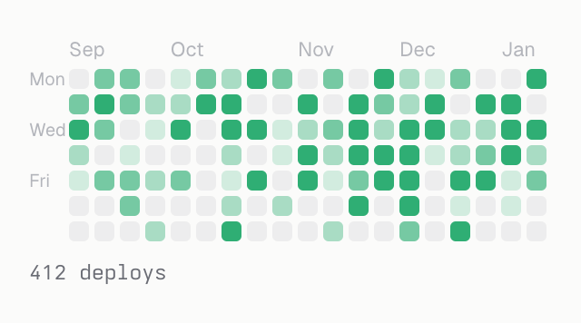
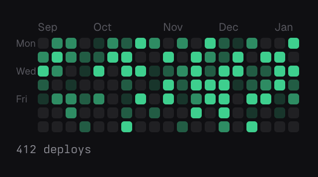
<figcaption>默认 <code>md</code> 尺寸的 20 周数据。<code>null</code> 单元（<code>data-l="n"</code>）不绘制内容，如最后一列所示。</figcaption>
</figure>


## `effort`

omp 输入区标签上的思考力度字形。它专为 omp 构建，但任何插件都可以显示。它绘制一个 14 px 圆环，每个等级按顺时针方向填充六分之一，并使用该等级对应的颜色。达到 `max` 时圆环闭合并“燃烧”：一圈火焰从圆环上方升起，内部有一个余烬，两者都会闪烁。其他任何等级（例如尚未解析的 `auto`）都会绘制虚线空圆环，并设置 class `unknown`。

等级变化时，圆弧会扫至新的填充位置，火焰会交叉淡入淡出（CSS 过渡）。首次显示时，圆弧会在 0.6 s 内从空状态扫入。减少动态效果时，或处于 `.sf-still`、`.sf-paused` 状态时，火焰都会保持静止。减少动态效果时也不会有扫入动画。

**构建：** `tern.ui.node("effort", { level = "high" })`。

| 属性 | 类型 | 默认值 | 含义 |
| --- | --- | --- | --- |
| `level` | `"off"` \| `"minimal"` \| `"low"` \| `"medium"` \| `"high"` \| `"xhigh"` \| `"max"` | 无 | 等级：0/6 至 6/6。其他值表示尚未解析 |
| `aria` | string | `"Thinking effort"` | 无障碍名称 |

| 等级 | 填充 | 圆弧颜色 |
| --- | --- | --- |
| `off` | 空 | （无圆弧） |
| `minimal` | 1/6 | `muted` |
| `low` | 2/6 | `info` |
| `medium` | 3/6 | `accent` |
| `high` | 4/6 | `warning` |
| `xhigh` | 5/6 | `error` |
| `max` | 全满，燃烧状态 | `error`（与火焰混合） |

颜色是 span token 对应的颜色（`--sf-c-<token>`）。在 `max` 时，轨道和圆弧会淡出，改由带火焰渐变描边的圆环取代。节点具有 `role="meter"`、`aria-valuemin` 0、`aria-valuemax` 6、`aria-valuenow` 等级数值（尚未解析时为 0），以及表示等级的 `aria-valuetext`。

**子节点：**无（忽略）。

**事件：**自身没有事件；`actions` 的用法与任何节点相同。

**样式：**

```html
<span class="sf sf-effort" data-id="…" data-level="max" role="meter" aria-valuenow="6" aria-valuetext="max">
	<svg class="sf-eff" viewBox="0 0 16 16" aria-hidden="true">
		<defs><linearGradient id="fire"><stop class="lo"/><stop class="hi"/></linearGradient></defs>
		<path class="crown"/>
		<circle class="track"/>
		<circle class="arc"/>
		<circle class="blaze"/>
		<path class="ember"/>
	</svg>
</span>
```

| 目标 | 选择器 |
| --- | --- |
| 节点 | `.sf-effort` |
| 按等级选择 | `.sf-effort[data-level='high']` |
| 未解析 | `.sf-effort.unknown` |
| 字形 | `.sf-eff`（内部结构，可能变化） |
| 圆环轨道、等级圆弧 | `.sf-eff .track`、`.sf-eff .arc`（内部结构，可能变化） |
| 火焰：燃烧圆环、火焰、余烬 | `.sf-eff .blaze`、`.sf-eff .crown`、`.sf-eff .ember`（内部结构，可能变化） |
| 火焰渐变色标 | `.sf-eff .lo`、`.sf-eff .hi`（内部结构，可能变化） |

变量：`--fire`（渐变的低位色标，由 `--bad` 混合而成）和 `--fire-hi`（高位色标，`#ffc24a`）。轨道为 `--l3`。关键帧：`sf-flame`（火焰冠，1.4 s）和 `sf-ember`（0.9 s，alternate），两者都会在等级达到 `max` 后延迟 0.5 s 开始。

```lua
local ui = tern.ui

local levels = { "off", "minimal", "low", "medium", "high", "xhigh", "max", "auto" }
local cells = {}
for i, level in levels do
	cells[i] = ui.node("col", { gap = "xs", align = "center" }, {
		ui.node("effort", { level = level }),
		ui.text({ ui.span(level, "dim") }),
	})
end
return ui.node("row", { gap = "lg" }, cells)
```

<figure class="tn-figure">
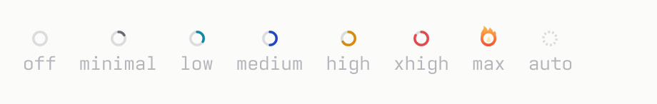
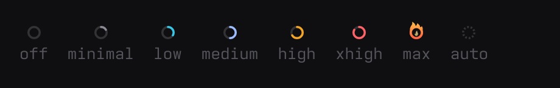
<figcaption>所有等级，以及作为未解析等级的 <code>auto</code>。</figcaption>
</figure>

## 相关页面

- [元素](index.md)：通用 props 和完整 kind 索引。
- [文本](text.md)：span token 和 `fx = "shimmer"` span 效果。
- [设置视图样式](../styles/index.md)：样式表、钩子和状态 class，例如 `.sf-still`。
- [变量](../styles/variables.md)：`--accent`、`--t1`…`--t4`、`--l1`…`--l3`、tone 颜色。
- [支持的 CSS](../styles/css.md)：`@keyframes`、动画和过渡支持。
