# 文本与代码

这些 kind 会在屏幕上呈现文字：带样式的 span、Markdown、高亮代码、差异、原始终端输出和公式。标签和需要逐个 span 设置样式的短行使用 `text`；任何由人编写的 Markdown 使用 `md`；文件或代码片段使用 `code`；变更使用 `diff`；以终端显示方式呈现程序输出使用 `ansi`；单个 TeX 公式使用 `math`。

| 元素种类 | 构建器 | 绘制内容 |
| --- | --- | --- |
| [`text`](#text) | `tern.ui.text(spans)` | 可换行、截断行数或省略的带样式 span |
| [`md`](#md) | `tern.ui.md(text)` | omp 方言的 Markdown：提示框、表格、任务、数学、mermaid |
| [`code`](#code) | `tern.ui.code(text, lang?, start?)` | 带高亮的代码块，可选行号和标记 |
| [`diff`](#diff) | `tern.ui.diff(text, path?)` | 带词级强调的统一或并排差异 |
| [`ansi`](#ansi) | `tern.ui.ansi(text)` | 迷你终端中的程序输出（SGR 颜色、OSC 8 链接） |
| [`rows`](#rows) | `tern.ui.node("rows", …)` | 固定宽度的预渲染终端行（迁移回退方案） |
| [`math`](#math) | `tern.ui.node("math", …)` | 单个排版后的 TeX 公式，行内或独立显示 |

它们都不绘制子节点：传入的子节点会被忽略。每个节点元素都是 `<div class="sf sf-<kind>" data-id="…">`，而[通用 props](index.md)（`key`、`tone`、`role`、`title`、`min`/`max`、`actions`、…）对每种 kind 都适用。这些 kind 中的文本使用终端等宽字体，字号和行高由 `--sf-fs`/`--sf-lh` 控制，并且可选中。

样式表可稳定使用的钩子：`.sf-<kind>`、`[data-id]`、`[data-role]`、`[data-tone]`、`[data-mark]`、`[data-href]`、`.sf-t-<token>` span 类、`.sf-link`、`.sf-fx-*`、`.tk-*`，以及区域的 `[data-surface]`。以下其他所有类都是 Tern 的内部结构：列出它们是为了方便你设置样式，但它们属于内部实现，版本之间可能改变。关于作用域和层叠，请参阅[视图样式](../styles/index.md)；关于 `--sf-c-*`、`--t1`…`--t4`、`--code-bg` 等变量，请参阅 [CSS 变量](../styles/variables.md)；关于样式表可使用的内容，请参阅[支持的 CSS](../styles/css.md)。

## 文本 kind 与文本 ops

`text`、`md`、`code`、`ansi` 和 `math` 是*文本 kind*：它们的主要文本是 `text` prop，协议的 `text` 和 `splice` ops 会作用于该文本（`editor`、`input`、`shimmer` 和 `el` 也如此；参见[输入](input.md)、[动效](motion.md)和 [`el`](el.md)）。`diff` 和 `rows` 不是文本 kind。

| 操作 | 效果 |
| --- | --- |
| `text append <s>` | 将 `s` 追加到 `text` 字符串（如果 `text` 不存在或不是字符串，则设置它） |
| `text replace <s>` | 将 `text` 设置为 `s` |
| `splice <at> <del> <s>` | 将 `text` 中偏移量 `at` 处的 `del` 个 UTF-16 单元替换为 `s`；范围超出文本或拆分代理对时会报错 |

插件永远不会发送 ops。插件返回完整视图；当某个文本 kind 的 `text` prop 相较上一个视图增加了后缀时，Tern 会将其作为 append 发送给渲染器（参见 [UI 构建器](../reference/ui.md#文本与代码)）。渲染器会让 append 的开销很低：`md` 只从最后一个发生变化的顶层块重新解析，`code` 保留未变行的高亮，`ansi` 只将新增尾部内容送入终端。流式追加只适用于 `text` prop：带有 `spans` 的 `text` 节点会绘制其 spans，并忽略 `text`。

## `text`

绘制一串带样式的 span。默认按词换行；也可以在任意位置换行、保持单行、限制行数，或从末尾、开头或中间截断。换行由 CSS 控制。截断行数和省略由 Tern 在布局后根据元素宽度计算：省略处以 `…` 结尾，且被省略的节点会将完整文本设为工具提示（`title`），除非你自行设置了 `title`。宽度改变时，Tern 会重新显示完整 spans、测量并重新省略。Span 可以引用来源（[引用](#引用)）。

**构建方式：** `tern.ui.text(spans)`（参见 [UI 构建器](../reference/ui.md#节点与文本片段)），它会生成 `{k = "text", p = {spans = …}}`。使用 `tern.ui.span`、`tern.ui.link` 和 `tern.ui.path` 构建 spans。也可以使用 `tern.ui.node("text", { text = "One style", wrap = "none" })`。

| 属性 | 类型 | 默认值 | 含义 |
| --- | --- | --- | --- |
| `spans` | `Spans`（span 表和字符串的列表） | 无 | 带样式的片段。`spans` 是列表时优先于 `text` |
| `text` | string | `""` | 纯文本，作为一个无样式 span。仅当 `spans` 不是列表时使用 |
| `wrap` | `"word"` \| `"char"` \| `"none"` | `"word"` | `word` 在词之间换行（长于行宽的词会按字符换行）；`char` 可在任意位置换行；`none` 让每个以 `\n` 分隔的行保持单行。未知值按 `word` 处理 |
| `truncate` | `"end"` \| `"start"` \| `"middle"` | `"end"` | 溢出文本的截断位置：`end` 保留开头（`abcd…`），`start` 保留结尾（`…wxyz`），`middle` 保留两端（`ab…yz`）。未知值按 `end` 处理。没有 `wrap` 或 `lines` 的 `truncate` 会让文本保持单行 |
| `lines` | integer | 无 | 限制为指定的可视行数，末行以 `…` 结束。`0` 表示不限制。`1` 保留一行 |
| `measure` | `"prose"` | 无 | `prose` 将行长限制为 80 个单元格，以便段落易读；否则文本填满可用宽度 |
| `cite` | `"chip"` \| `"pill"` \| `"note"` | `"chip"` | 被引用 spans 的显示方式（参见[引用](#引用)）。未知值按 `chip` 处理 |
| `sources` | boolean | `note` 时为 `true`，否则为 `false` | 在文本下方绘制编号来源列表。文本适配时（`truncate`、`lines`、`wrap = "none"`）不绘制 |

进行适配时：

- 单行（`wrap = "none"`、`lines = 1` 或仅设置 `truncate`）：只有文本确实溢出时 Tern 才截断，并按 `truncate` 指定方式截断。
- 带换行的 `lines = N`：Tern 按 `wrap` 规则计算每行的单元格数（字体为等宽），保留适合 N 行的内容，去掉尾随空格并以 `…` 结尾（在末行内部：末行已满时会让出最后一个字符）。此时不适用 `truncate`：限制始终在末尾截断。
- `truncate = "middle"` 且某个 span 使用 `path` 样式时，会先去掉该 span 的完整前导目录（`Edited …/src/routes/users.ts`），若仍不足以适配，再截断整段文本的中间部分。
- 截断点落在 span 内时，会保留该 span 的样式，包括省略号。

```lua
local s = "Indexing the workspace for symbols and references"
ui.node("text", { truncate = "end", spans = { ui.span("end    ", "dim"), s } })
ui.node("text", { truncate = "start", spans = { ui.span("start  ", "dim"), s } })
ui.node("text", { truncate = "middle", spans = { ui.span("middle ", "dim"), s } })
ui.node("text", { truncate = "middle", spans = {
	ui.span("path   ", "dim"), ui.span("Edited ", "muted"),
	ui.span("app/server/src/routes/users.ts", "path"), ui.span(" +12", "ins num"),
} })
ui.node("text", { lines = 2, spans = { ui.span("lines=2 ", "dim"),
	s .. ", then warming the type cache for every open file." } })
```

<figure class="tn-figure">
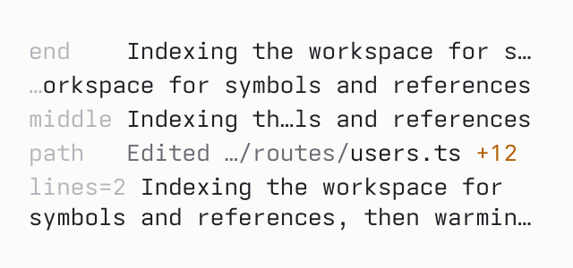
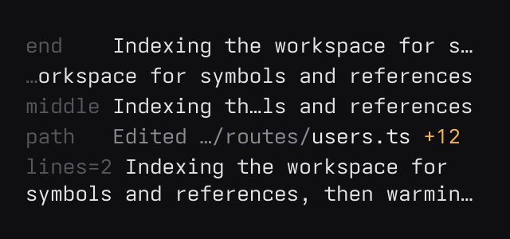
<figcaption>五个节点，宽度为 288px：<code>start</code> 也会截断标签，因为截断针对整段文本；路径行会优先移除目录。</figcaption>
</figure>

### 文本片段（span）

一个 span 是一个表；span 列表中的普通字符串表示无样式 span。

| 字段 | 类型 | 含义 |
| --- | --- | --- |
| `t` | string | 文本。空的 `t` 不绘制任何内容 |
| `s` | string | 以空格分隔的样式 token（见下文）。缺省或 `""` 表示普通样式。未知 token 不生成类（另见程序 token 的说明） |
| `href` | string | 将该 span 设为链接（见下文） |
| `fx` | `"shimmer"` \| `"pulse"` \| `"none"` | 动效。`shimmer` 在字符上扫过高亮；`pulse` 让 span 渐隐渐现。其他值均表示无动效 |
| `cite` | 来源表，或来源表列表 | 此片段引用的来源（参见[引用](#引用)）；标记紧随片段。带引用且 `t` 为空的 span 只绘制标记 |

`tern.ui.span(t, s)` 和 `tern.ui.link(t, href, s)` 会构建 `t`、`s` 和 `href`；你需要自行在返回的表上设置 `fx`。Span 用于 `text`，也用于所有接收 span props 的 kind（`card` 和 `section` 标题、`kv`、`table` 单元格、`badge` 等），因此此处的所有内容同样适用于它们。

### Span 样式 token

每个语义 token 都会在 span 上绘制为 `.sf-t-<token>` 类：

| 样式 token | 绘制内容 |
| --- | --- |
| `muted` | 低调文本：`--sf-c-muted` |
| `dim` | 更低调的文本：`--sf-c-dim` |
| `strong` | 主文本颜色（`--t1`）下的 600 字重 |
| `em` | 斜体 |
| `accent` | `--sf-c-accent` |
| `success` | `--sf-c-success` |
| `warning` | `--sf-c-warning` |
| `error` | `--sf-c-error` |
| `info` | `--sf-c-info` |
| `pending` | `pending` tone 的颜色（`--live`），用于等待某人响应的词，通常与 pending 圆点或徽标相邻 |
| `title` | 页面标题行中的标题：无衬线字体（Geist），`550 15px/1.3`，字间距 `-0.014em`，颜色为 `--t1` |
| `code` | 行内代码 chip：`--chip-bg` 上的 `--sf-c-code`、细线边框、圆角 |
| `mono` | 等宽数字（`font-variant-numeric: tabular-nums`）；在无衬线区域中也使用等宽字体 |
| `path` | 文件路径：`--sf-c-path`。含 `/` 的 span 会拆分为 `span.dir`（目录，直到最后一个 `/`，颜色为 `--sf-c-muted`）和文件名。`truncate = "middle"` 会按目录缩短路径 |
| `key` | 按键帽：带内边距，位于 `--l1` 上，颜色为 `--sf-c-key`。没有空格的按键 id（`ctrl+r`、`shift+enter`、`f5`）会按平台显示为按键帽（`⌃R`），并将 id 作为工具提示 |
| `link` | 链接颜色（`--sf-c-link`），但不会使其成为链接；真正的链接请使用 `href` |
| `num` | 代码中的数字：使用等宽数字和代码数字颜色 `--sf-c-num`。`kv` 值和文本中的数字请使用 `mono` |
| `ins` | 插入的文本：`--sf-c-ins` |
| `del` | 删除的文本：`--sf-c-del`，带删除线 |
| `mark` | 高亮（搜索匹配项、选中行）：着色背景，若已设置则使用 `--sf-mark-bg` |
| `typo` | 拼写错误的单词：带点下划线，颜色为 `--spelling-error-color`，与 Tern 文本字段标记拼写错误的方式相同 |
| `icon` | 采用图标度量的 Nerd Font 字形（宽 1.2em，使用带 Nerd 补丁的等宽字体，`aria-hidden`）。若下一个非空 span 不以空白开头，该 span 还会获得 `.gap`（小的右侧外边距） |
| `hide` | 不绘制（`display: none`），但仍保留在文本中 |

在使用 [`font: "sans"`](../protocol/surfaces.md#打开与关闭) 打开的 surface 区域内，`mono`、`code`、`num`、`path` 和 `key` spans（以及 Markdown 行内代码）使用终端等宽字体，字号为 12.5px：可在无衬线文本中让 id、版本、大小、时间和路径保持等宽。`title` span 无论区域如何设置，都使用无衬线字体。

你可以组合 token：`"strong error"`、`"muted path"`。即使多个 token 映射到同一类，该类也只出现一次。

文本含空格或不是以 `+` 连接的 id（`Esc to cancel`）的 `key` span 会原样绘制。

<figure class="tn-figure">
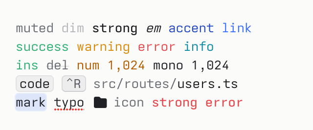
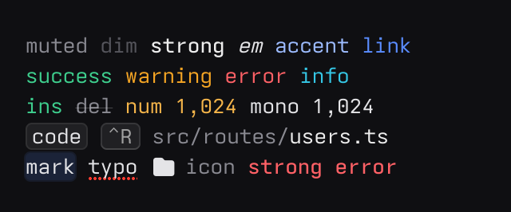
<figcaption>每个词都是按其名称设置 token 样式的 span：<code>{t = "ctrl+r", s = "key"}</code>、<code>{t = "src/routes/users.ts", s = "path"}</code>，以及一个使用 <code>s = "icon"</code> 的文件夹字形。</figcaption>
</figure>

**任意文本中的图标。**若某个 span 不含 `icon` 样式，但包含私用区码点（U+E000–U+F8FF、平面 15 和 16：Nerd Font 图标），该码点会被拆分为单独 span，并沿用原 span 的样式并添加 `icon`。`md` 正文和编辑器中也会如此处理，因此 Nerd 字形不会与其后的文本重叠。

### 程序（主题）token

omp 主题的 token 名也可用作 span token。每个 token 会以主题中对应的颜色绘制（`--omp-<token>`，参见[主题 token 颜色](../styles/variables.md#主题令牌颜色)）；若不存在，则使用其映射到的语义 token 的颜色。omp 的 `accent`、`dim`、`muted`、`error`、`success` 和 `warning` 本身已经是语义 token。

| 样式 token | 映射为 |
| --- | --- |
| `text`, `customMessageText`, `syntaxVariable`, `toolOutput`, `userMessageText` | 普通（无类） |
| `borderAccent`, `customMessageLabel`, `mdListBullet`, `statusLineModel`, `syntaxFunction`, `thinkingMedium` | `accent` |
| `borderMuted`, `statusLineSep`, `thinkingOff` | `dim` |
| `border`, `mdCodeBlockBorder`, `mdHr`, `mdLinkUrl`, `mdQuote`, `mdQuoteBorder`, `statusLineOutput`, `statusLineSpend`, `statusLineUntracked`, `syntaxComment`, `syntaxOperator`, `syntaxPunctuation`, `thinkingText`, `thinkingMinimal`, `toolDiffContext` | `muted` |
| `thinkingXhigh`, `thinkingMax`, `toolDiffRemoved` | `error` |
| `statusLineCost`, `statusLineGitClean`, `statusLineStaged`, `syntaxString` | `success` |
| `bashMode`, `statusLineDirty`, `statusLineGitDirty`, `thinkingHigh` | `warning` |
| `pythonMode`, `statusLineContext`, `statusLineSubagents`, `syntaxKeyword`, `syntaxType`, `thinkingLow` | `info` |
| `mdCode` | `code` |
| `mdCodeBlock` | `mono` |
| `mdHeading`, `toolTitle` | `strong` |
| `mdLink` | `link` |
| `statusLinePath` | `path` |
| `syntaxNumber` | `num` |
| `toolDiffAdded` | `ins` |
| `customMessageBg`, `selectedBg`, `statusLineBg`, `toolErrorBg`, `toolPendingBg`, `toolSuccessBg`, `userMessageBg` | 无：填充色不会给文本着色 |

Tern 不认识的 token（`s = "myTone"`）不会获得类或颜色。Span 中没有原始颜色。

### 链接

带 `href` 的 span 会绘制为 `span.sf-link[data-href]`（链接颜色、指针光标、悬停时显示下划线），工具提示为 `<href>  ⌘-click to open`。按住 ⌘ 点击可打开链接。若 Tern 的“Open links with”设置为普通点击，普通点击也会打开链接，除非同时按住 ⇧，或点击结束了文本选择。

| `href` | 打开方式 |
| --- | --- |
| 带协议方案的 URL（`https://…`、`mailto:…`） | 通过窗口的链接处理机制打开，优先使用 `tern.route.link`（参见[路由](../guides/routing.md)） |
| `file://…` | 通过 Tern 的系统集成，在文件块中打开文件 |
| 无协议方案：路径（`./README.md`、`docs/a.md:12`、`../b.md#L3`、`src/a.rs:10-20`、`src/a.rs#L10-L20`、`~/x`、`C:\x`） | 先进行 `%XX` 解码；相对路径基于窗格的工作目录解析，使用窗格所在的主机；像 `file://` 链接一样在文件块中打开，并定位到指定行（范围则定位到首行）。如果此机器上不存在该路径，会显示一条指出解析后路径的浮动提示 |

`tern.ui.path(p, cwd)` 会构建一个链接到绝对 `file://` URL 的 `path` span。

### 引用

Span 可以引用其文字的来源。为其指定 `cite`（单个来源或来源列表）后，Tern 会在片段后绘制标记：默认是小型编号 chip，也可以是显示来源域名的 pill，或点线下划线加上标注上标数字，并在文本下方显示编号来源列表。适用于代理回答或摘要依赖网页、问题或文档，且读者应能在不离开窗格的情况下查证来源的情形。

| 来源字段 | 类型 | 默认值 | 含义 |
| --- | --- | --- | --- |
| `href` | string | 必需 | 来源地址；点击时打开。没有该字段的来源会被忽略 |
| `title` | string | `""` | 来源标题（悬停卡片、来源列表、可访问名称） |
| `n` | integer ≥ 1 | 按出现顺序 | 显示的编号。未指定编号的来源会按首次出现顺序使用下一个可用编号 |
| `site` | string | `href` 的主机名，去掉 `www.` | pill 显示的名称 |
| `snippet` | string | 无 | 在悬停卡片中显示的引文（最多两行） |

来源按其 `href` 首次出现的顺序在每个 `text` 节点内编号（相同 `href` 使用同一编号）；来源自己的 `n` 优先。节点的 `cite` prop 决定显示方式：

| `cite` | 显示方式 | 悬停卡片触发位置 |
| --- | --- | --- |
| `chip`（默认） | 片段后显示一个小型编号 accent chip，每个来源一个 | 每个 chip（对应来源） |
| `pill` | 显示第一个来源的域名 pill，带彩色圆点；更多来源显示 `+N` | pill（所有来源） |
| `note` | 片段下方显示点线，之后显示上标数字；下方列出来源 | 被引用片段（所有来源） |

普通点击标记、被引用片段（`note`）或来源行会像[链接](#链接)一样打开 `href`，不会向程序发送事件（按住 ⇧ 点击和结束文本选择的点击都不会打开链接）。指针停留在触发悬停卡片的元素上时，会显示一张含来源标题、URL 和摘录的卡片。复制文本（使用其 `copy` 操作或通过选择文本）时，每个被引用片段后都会保留 `[1]` 形式的标记。没有 `cite` 的 spans 不受影响。

引用只能通过指针操作：节点不会获得焦点。需要键盘操作的程序应自行列出来源（或启用 `sources`），并通过自身的按键处理器打开来源。

```lua
tern.ui.node("text", {
	cite = "chip",
	spans = {
		{
			t = "The lockfile drifted from package.json",
			cite = {
				title = "pnpm install — frozen lockfile",
				href = "https://pnpm.io/cli/install",
				snippet = "CI fails when the lockfile needs an update.",
			},
		},
		" after the bump, and ",
		{ t = "CI refuses frozen installs", cite = {
			{ title = "Frozen lockfile errors", href = "https://github.com/pnpm/pnpm/issues/7019" },
			{ title = "pnpm install", href = "https://pnpm.io/cli/install" },
		} },
		".",
	},
})
```

TSX 中相同的写法，以脚注形式显示来源列表：

```tsx
<text
   cite="note"
   spans={[
      { t: 'The lockfile drifted', cite: { title: 'pnpm install', href: 'https://pnpm.io/cli/install' } },
      ' after the bump.',
   ]}
/>
```

<figure class="tn-figure">
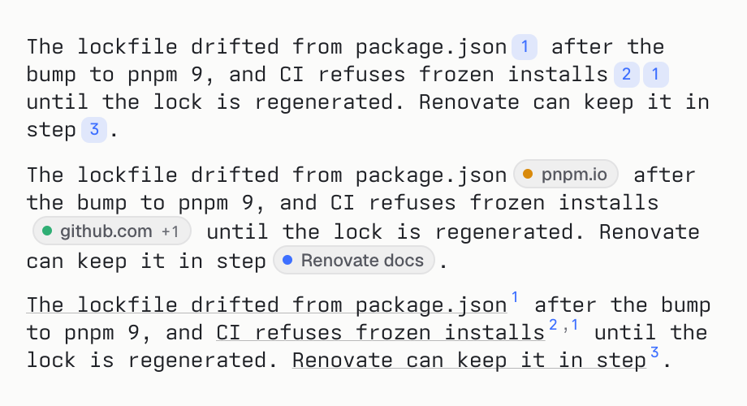
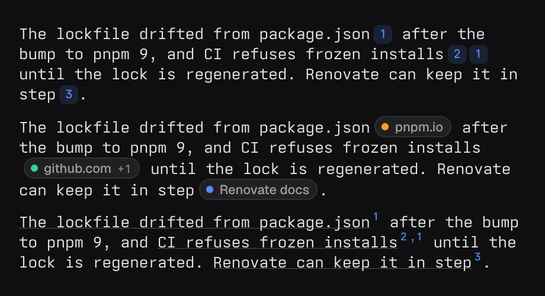
<figcaption>三种显示方式：<code>chip</code>、<code>pill</code> 和 <code>note</code>（此处未显示来源列表）。</figcaption>
</figure>


<figure class="tn-figure">
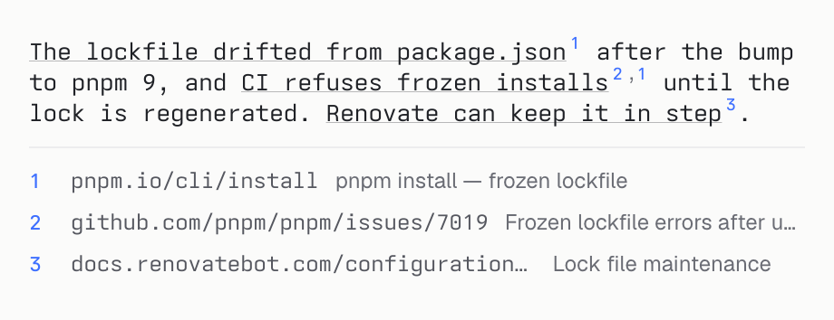
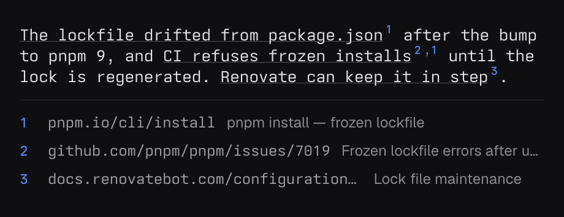
<figcaption><code>cite = "note"</code> 会在文本下方绘制编号来源。</figcaption>
</figure>


### 动效

`fx = "shimmer"` 会在 span 上扫过一条亮带，效果与 [`shimmer`](motion.md#shimmer) kind 相同（`--sh-lo`、`--sh-hi`、`--sh-mid` 设置三种颜色，默认分别为 `--t3`、`--t1`、`--t2`）。`fx = "pulse"` 会添加 `.sf-fx-pulse`（1.6 秒内不透明度从 1 → 0.45 → 1）。两者都会带有 `.sf-fx-<fx>`，并在重绘时保持文档时钟的相位。在减少动态效果模式（`.sf-still`）下以及窗格隐藏时（`.sf-paused`）会停止；静止状态下的 shimmer 会以其自身颜色显示文本。

**子节点：**无（忽略）。

**事件：**没有自身事件；`actions` 与任意节点相同。链接和引用点击由 Tern 处理，不会传给你的 `event`。

**样式：**

```html
<div class="sf sf-text nowrap" data-id="…" title="full text when cut">
	plain text
	<span class="sf-t-muted">Edited </span>
	<span class="sf-t-path sf-link" data-href="file:///…" title="file:///…  ⌘-click to open">
		<span class="dir">app/src/routes/</span>users.ts
	</span>
	<span class="sf-t-icon gap" aria-hidden="true"></span>
	<span class="sf-t-key" title="ctrl+r">⌃R</span>
	<span class="sf-fx-shimmer">Working…</span>
</div>
<div class="sf sf-text cite-chip" data-id="…">
	<span class="sf-cite" data-href="https://pnpm.io/cli/install">
		<span class="run">The lockfile drifted</span>
		<span class="mk">
			<span class="cp">[1]</span>
			<span class="n" role="link" data-href="https://pnpm.io/cli/install" aria-label="Source 1: pnpm install">1</span>
			<span class="pill" role="link" data-href="…" aria-label="Source: pnpm.io"><span class="dot" data-c="…"></span><span class="site">pnpm.io</span></span>
		</span>
	</span>
	after the bump.
	<div class="sf-cite-list" role="list"><div class="src" data-href="…"><span class="n">1</span><span class="url">…</span><span class="ttl">…</span></div>…</div>
</div>
```

没有 `href` 且无动效的无样式 span 会直接成为文本节点，而不是 `span`。

| 目标 | 选择器 |
| --- | --- |
| 节点 | `.sf-text` |
| 单行（`wrap = "none"` 或 `lines = 1`） | `.sf-text.nowrap` |
| 按字符换行 | `.sf-text.char` |
| 正文行长限制 | `.sf-text.prose` |
| 带样式的 span | `.sf-t-<token>` |
| 链接 span | `.sf-link`、`[data-href]`、`[data-href^="http"]` |
| 路径的目录及其位置（`:12`、`#L3`） | `.sf-t-path .dir`、`.sf-t-path .ln`（内部实现，可能改变） |
| 图标后跟文本 | `.sf-t-icon.gap` |
| 动效 | `.sf-fx-shimmer`、`.sf-fx-pulse` |
| 引用显示方式 | `.sf-text.cite-chip`、`.cite-pill`、`.cite-note` |
| 被引用 span：其文字和标记 | `.sf-cite[data-href]`、`.sf-cite .run`、`.sf-cite .mk`（内部实现，可能改变） |
| 仅用于复制的 `[1]` 文本（不可见） | `.sf-cite .cp`（内部实现，可能改变） |
| 编号 chip 或上标 | `.sf-cite .n[data-href]`（内部实现，可能改变） |
| 域名 pill | `.sf-cite .pill`、`.pill .dot[data-c]`、`.pill .site`、`.pill .more`（内部实现，可能改变） |
| 引用悬停卡片 | `.sf-hovercard.sf-cite-card`、`.src`、`.head`、`.dot`、`.ttl`、`.url`、`.snip`（内部实现，可能改变） |
| 来源列表 | `.sf-cite-list`、`.src[data-href]`、`.n`、`.url`、`.ttl`（内部实现，可能改变） |

变量：每个带颜色的 token 都有对应的 `--sf-c-<token>`（`muted`、`dim`、`accent`、`success`、`warning`、`error`、`info`、`code`、`path`、`key`、`link`、`num`、`ins`、`del`），以及 `--sf-mark-bg`、`--spelling-error-color`、`--sh-lo`/`--sh-mid`/`--sh-hi`。参见 [CSS 变量](../styles/variables.md)。

```lua
local ui = tern.ui

local function header(run)
	local file = ui.path(run.file, run.cwd)
	local line = ui.text({
		ui.span("Edited ", "muted"),
		file,
		ui.span(" +" .. run.added, "ins num"),
		ui.span(" −" .. run.removed, "del num"),
	})
	local p = line.p or {}
	p.truncate = "middle" -- one line; drops directories of the path first
	line.p = p
	return line
end

local busy = ui.span("Indexing…", "muted")
busy.fx = "shimmer"
return ui.col({ header(state.run), ui.text({ busy }) })
```

## `md`

通过 kit 的 Markdown 视图以 omp 方言绘制 Markdown，并使用终端等宽字体。源文本会拆分为顶层块，每块各自绘制为一个 `div.md`；更新时只重新解析源内容变化的块（链接引用定义发生变化时则全部重新解析）。长文档的开销仍然很低：远离视口的块不会布局，并保留其上次的高度（首次显示前使用估算高度）；长代码围栏中的行组以及长列表中的条目（停止流式生成后）也如此。查找和复制仍可访问完整源文本。

**图片。**`` 图片由 Tern 而非程序解析：窗格旁的文件（或绝对路径、`file://`、`~/`）、`data:` URI 或 `http(s)` 地址会在 UI 线程之外读取和解码，并以图片的自然大小显示，宽度不会超过栏宽（位于另一台主机上的文件会通过该主机读取）。Tern 无法读取的来源会保留 chip，即图片图标和 alt 文本，并以来源作为工具提示。

**构建方式：** `tern.ui.md(text)`（参见 [UI 构建器](../reference/ui.md#文本与代码)），或 `tern.ui.node("md", { text = src, stream = true })`。

| 属性 | 类型 | 默认值 | 含义 |
| --- | --- | --- | --- |
| `text` | string | `""` | Markdown 源文本 |
| `stream` | bool | `false` | 表示源文本仍在接收：最后一个块为暂定状态（`.streaming`），可能是尚未闭合的围栏或列表。其最后一个元素以 86% 不透明度绘制，尾随段落、标题或列表项末尾会显示脉动的 accent 光标。尚未闭合的 mermaid 围栏会显示为代码，直到围栏闭合或 `stream` 关闭，因此未完成的图表绝不会被布局 |
| `marks` | `Spans` | 无 | 在正文中每次出现字面文本的位置，用对应的 span 替代。每次优先选择位置最靠前的匹配；起始位置相同时选择最长的匹配。omp 用它在已发送的提示中呈现标签、技能和提及项 |

### 方言

| 功能 | 语法 | 绘制内容 |
| --- | --- | --- |
| CommonMark | 标题、段落、强调、链接、图片、列表、引用、分隔线、代码 | 常见元素。原始 HTML 保持为字面文本（块使用 `div.md-html`） |
| 标题 5 和 6 | `#####`、`######` | `h4.h5`、`h4.h6`（没有 `h5`/`h6`） |
| 换行 | 段落内的每个行尾，在终端中绘制 Markdown 时与 omp 一样（CommonMark 会将这些行合并）；行尾两个空格或 `\` 也可换行 | `span.br` |
| GFM 表格 | 竖线、`:---:` 对齐 | `div.tbl > table > thead + tbody`；对齐方式作为行内 `text-align` |
| 严重性 pill | 单元格内容恰为 `high`、`medium` 或 `low`（任意大小写） | `span.sev.<level> > i + text` |
| 任务列表 | `- [ ]`、`- [x]` | `ul.tasks > li.task`（已勾选时为 `.done`，其文本带删除线），只读方框 `span.cb[role=checkbox]`（勾选时为 `.on`） |
| 删除线、自动链接 | `~~x~~`、裸 URL（`http://`、`https://`、`file://`、`www.`）和电子邮件地址 | `del`、链接 |
| 提示框 | 首行是 `[!NOTE]`、`[!TIP]`、`[!IMPORTANT]`、`[!WARNING]` 或 `[!CAUTION]`（不区分大小写）的引用 | `div.callout.<kind> > .co-ic + div.co-body`；warning 和 caution 使用 `--warn` 着色并显示警告图标，其余使用 `--accent` 着色并显示信息图标 |
| 数学 | 行内 `$…$`、`\(…\)`；独立显示 `$$…$$`、`\[…\]`、`\begin{env}…\end{env}` 块 | 在 `currentColor` 中排版为 `svg`，外层为 `span.math`（`.display`）或 `div.math-display`；公式排版失败时显示标题为错误内容的 `code.math-err`。包装元素将 TeX 存入 `data-tex`，选择文本会复制为 `$tex$` / `$$tex$$` |
| 代码围栏 | ```` ```lang ```` | `div.code > div.code-head（语言 + Copy）+ pre > code`，背景为 `--code-bg`，每行一个 span，并使用 `.tk-*` 类高亮（参见 [`code`](#code)）。标题仅在悬停或聚焦时显示于块的右上角。标签为小写的围栏语言；若未指定则为 `text` |
| Mermaid | ```` ```mermaid ```` | `figure.mfig[data-m] > div.mfig-head（图标、“mermaid · <kind>”、Source、Copy、Open）+ div.mfig-body`，图表按自然尺寸显示；宽图表可横向滚动 |
| 颜色色样 | 代码 span 中的十六进制颜色 | 在其前显示 `span.chip` 颜色 chip |
| 文件路径 | 正文中的路径或完整代码 span，可带位置：`` `crates/x/y.rs:10-20` ``、`src/a.ts#L4`、`./b.md:3:7` | 带链接的 `path` span：`span.sf-t-path.sf-link[data-href]`（目录 `.dir` 和位置 `.ln` 呈低调样式，文件名为粗体），像路径 `href` 一样在对应行打开文件。仅可识别为文件的文本才会链接：需要分隔符或位置，以及扩展名（`src/a.rs`、`keys.rs:12`；不会匹配 `ui.now`、`and/or`、`styles/*.css`）。Markdown 链接中的文本仍属于该链接 |
| Nerd 图标 | 私用区码点 | `icon` spans（参见 [Span 样式 token](#span-样式-token)） |

正文（段落、标题、列表项、单元格中的文本）会经由与 `text` 相同的 span 路径绘制。

**用户设置。**“Markdown headings”（默认是 Annotated）是 Tern 设置，并非 prop。Annotated：每个标题都使用正文大小、600 字重和 `mdHeading` 颜色，前面带低调的 `#`…`######` 标记（`::before`、`--t4`）。Annotated 会为区域添加 `.sf-h-annotated`。Sized：`h1`–`h3` 分别是 20/17/15px 的无衬线标题。“Open links with”设置决定普通点击是否打开链接，与 span 链接相同。

**复制。**代码块的 Copy 按钮（`.code-copy`，位于悬停或聚焦时显示的标题中）会将代码放入剪贴板。Mermaid 图示的 Open 按钮（`.mfig-open`）或对图示的点击会放大显示图表；完整 SVG 图示绘制完成后，点击其图示也会放大显示。SVG、3D 和 Mermaid 图示的围栏完整后，Source（`.mfig-source`）会以围栏代码（`pre.mfig-src`）替代图示，直到再次按下；Copy（`.mfig-copy`）会将该代码放入剪贴板。选择文本时复制的是基于 Markdown 的文本，数学公式以 TeX 形式复制。

**运行。**在 `main` 中，当 Tern 可以运行程序的命令时，`sh`、`shell`、`bash` 或 `zsh` 围栏会在 Copy 之前提供 Run 按钮（`.code-run`）：仅支持此机器上的程序，不支持通过 `ssh` 访问的程序；适用于 macOS 和 Linux。Run 会在窗格目录中通过相应 shell（`sh -c …`）启动代码，输入为空，输出通过管道传送（不使用分页器或终端提示），并流式显示在代码下方：迷你终端显示最后 16 行（上方的“N earlier lines”显示其余部分），状态和时间显示在下方信息行。运行期间按钮会变成 Stop，停止操作会中断命令（`SIGINT`；如果两秒内未结束则再执行 kill）。命令结束后，信息行会说明结束方式（Done、`exit N`、Stopped）并显示耗时和 Clear 按钮；Run 会在原输出位置重新运行命令。仍在接收内容的围栏（流式尾部）暂不提供 Run。输出只供 Tern 使用：程序看不到它；代码块离开记录时输出会消失（运行中的命令也会结束）。

**子节点：**无（忽略）。

**事件：**没有自身事件；`actions` 与任意节点相同。Copy、Open、Run 和链接点击均由 Tern 处理。

**样式：**

```html
<div class="sf sf-md" data-id="…">
	<div class="md">
		<h2 id="h-…">Setup</h2>
		<p>Run <code>make</code> first.</p>
	</div>
	<div class="md streaming">
		<div class="callout warning"><svg class="co-ic">…</svg><div class="co-body"><p>…</p></div></div>
		<div class="code">
			<div class="code-head"><span>rust</span><button class="btn sm quiet code-copy">Copy</button></div>
			<pre><code><span><span class="tk-keyword">fn</span> main() {}</span></code></pre>
		</div>
	</div>
</div>
```

| 目标 | 选择器 |
| --- | --- |
| 节点 | `.sf-md` |
| 一个顶层块（片段） | `.sf-md .md`（内部实现，可能改变） |
| 暂定的流式尾部 | `.sf-md .md.streaming` |
| 标题 | `.sf-md .md :is(h1, h2, h3, h4)`、`h4.h5`、`h4.h6` |
| Annotated 标题 | `.sf-h-annotated .sf-md .md h2` |
| 列表、任务 | `ul`、`ol`、`li > .li-t`、`ul.tasks`、`li.task`、`li.task.done`、`.cb`、`.cb.on` |
| 表格 | `.tbl`、`table`、`th`、`td`、`.sev.high`/`.medium`/`.low` |
| 提示框 | `.callout`、`.callout.note`/`.tip`/`.important`/`.warning`/`.caution`、`.co-ic`、`.co-body` |
| 代码围栏 | `.code`、`.code-head`、`.code-copy`、`pre code`、`.tk-*` |
| 可运行围栏 | `.code.runnable`、`.code.ran`、`.code.running`、`.code.failed`、`.code-run`、`.code-out`、`.code-out-foot`、`.code-out-state[data-tone]`、`.code-out-time`、`.code-out-clear` |
| Mermaid | `.mfig`、`.mfig-head`、`.mfig-open`、`.mfig-body` |
| 数学 | `.math`、`.math.display`、`.math-display`、`code.math-err` |
| 图片 | `.md-img`、`.md-img.framed`、`.md-img-frame`、`.md-img-alt` |
| 行内代码、色样 | `code`、`.chip`、`.swatch` |

所有内部选择器都属于 kit 的 Markdown DOM（内部实现，可能改变）。块之间相隔 `0.5 × --sf-lh`（在 `.sf-md` 上使用 `gap`）。变量：`--code-bg`、`--chip-bg`、`--t1`…`--t4`、`--accent`、`--warn`、以及 `--tk-*` 颜色。

````lua
local ui = tern.ui

local doc = ui.node("md", {
	text = [[
## Release

> [!WARNING]
> Tag only from `main`.

- [x] changelog, see [notes](https://example.com)
- [ ] tag `v1.4.0`

| Check | Risk |
| --- | :---: |
| Migrations | high |
| Docs | low |

Energy: $E = mc^2$, accent `#7c5cff`.

```rust
fn main() { println!("ship"); }
```
]],
	stream = state.generating,
})
return { main = ui.col({ doc }) }
````

<figure class="tn-figure">
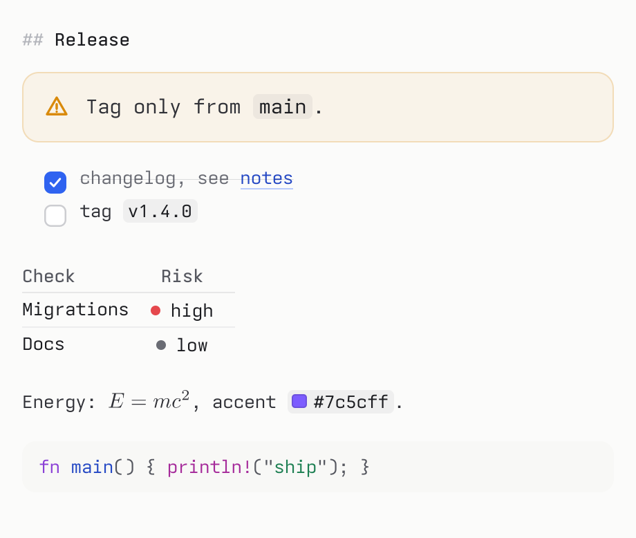
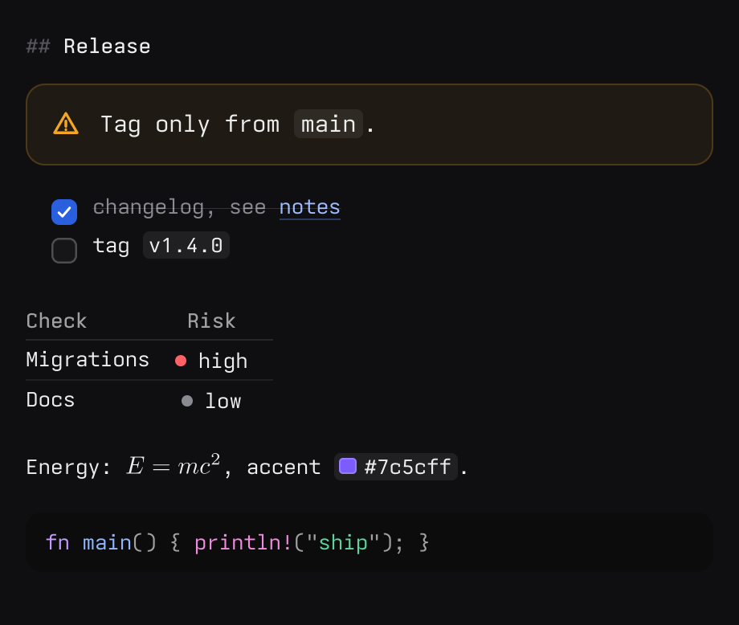
<figcaption><code>stream</code> 关闭时的显示效果。悬停时会显示围栏语言标签和 Copy 按钮。</figcaption>
</figure>

## `code`

使用 Tern 的高亮器绘制代码块，可选行号和标记行。高亮会在后台对完整文本运行，因此多行字符串和注释的着色正确；颜色载入前，行会显示为普通文本。未换行的行会在块内横向滚动。代码块始终保持完整源文本的高度，但只挂载视口附近的行。没有 `wrap` 时每行高度固定为一行；有 `wrap` 时行高按换行结果计算。超过 4,096 字节的行只绘制前 4,096 字节（在字符边界处截断），随后显示暗色的“… N more characters”（`span.sf-elided`）；只有绘制出的部分会被高亮和标记。

**预览。**`preview = { lines = N }` 会将高于 N 个绘制行的代码块限制为前 N 行（换行行按多行计），并在底部显示渐隐（类 `clamped`）；正文之后有一个显示“K more lines”（“1 more line”）的 `button.sf-code-more`。仅挂载限制范围内的行（并保留通常的额外视口范围）；展开后其余行才会挂载，未换行的行仍可横向滚动。按钮会在原位展开代码块（再次点击“Show less”可折叠）；新的 `preview` 值会重置此状态。在可折叠的 `card`、`section` 或 `tool` 容器内，预览只在该容器折叠时生效：容器展开后显示完整代码块并隐藏按钮；容器折叠时，按钮会展开该容器（触发 `toggle` 事件，与点击标题栏相同），而不是只展开代码块。

**渐变洗色。**标记的 `wash`（数字列表）会沿与 `heat` 相同的十级琥珀到红色渐变为行着色；每个值都是限制在 0–1 范围内的分数（非数字值按 0 处理）。单个值会为整行统一着色；多个值会从左至右渐变，并在各值间均匀分布色标，因此一行可并列显示两个评分器的结果。它会替代 `heat` 的纯色洗色以及该行 tone 的底色；`heat` 仍会设置概览条和折叠行 sparkline 中的行条。空列表不绘制任何内容；所有分数均为 0 时，即使设置了 `heat`，行也保持原样。标记带有 `wash` 但没有 `tone` 时，不绘制 tone 条。

**折叠。**每个 `folds`（`from`/`to`，表示行号栏中的首末行号）都会将其中各行绘制为一行（`.sf-fold`）：显示代码字体的 `label`（默认是 `… [lines {from}-{to}]`；单行时为 `… [line {from}]`）、折叠行标记 `heat` 的迷你图，随后是 `note`（字符串或 spans）。点击折叠行会在原位展开，并在标题行（`.sf-fold.open`）下方绘制各行及其标记（标记仅在展开后生效）；标题行先显示行号，如果给定了 `label`，则随后显示该标签。再次点击标题行可重新折叠（聚焦折叠行后按 Enter 或 Space 也可切换）；展开折叠区域中绘制的行带有 `.folded`（已关闭的折叠区域不绘制其中的行）。折叠区域内有查找匹配时会自动展开。Tern 会按首行号跨 `text` 或 `folds` 更新保留每个折叠区域的展开状态；`open = true` 只会展开此前未绘制过的折叠区域（此前未有折叠区域以该行开头）。与之前的折叠区域重叠或超出文本范围的折叠区域会被丢弃。`tone = "error"` 会给行着色；任何 tone 都会给说明文字着色。`hovercard` 是指针停留在折叠行时显示为卡片的节点树，与通用 [`hovercard`](index.md) prop 相同。

**概览。**`overview = true` 会在行上方绘制一条概览带（`.sf-code-map`）：每行一个条形，其高度对应该行标记的 `heat`、颜色对应标记的 tone；其下方显示覆盖折叠区域以外行的带状区域；并显示跟随滚动的当前视口行范围括号。点击或拖动概览带会滚动代码块至对应行。

**摘录。**`nums` 为每行单独指定行号（每行文本对应一个整数，且必须严格递增），取代从 `start` 开始计数；适用于从较长文件中选取搜索命中及其上下文。行号未接续前一行时，会在该行上方添加 `…` 行（`.sf-gap`），位于 gutter 中并与行号对齐，让摘录仍保持为一个整体并可横向滚动。标记和折叠区域使用这些行号。如果 `nums` 的长度与文本行数不同或未递增，则忽略它，行号改从 `start` 开始计数。

**构建方式：** `tern.ui.code(text, lang, start)`（参见 [UI 构建器](../reference/ui.md#文本与代码)）；给定 `start` 时还会设置 `numbers = true`。也可以使用 `tern.ui.node("code", { text = src, path = "src/main.rs", wrap = true })`。

| 属性 | 类型 | 默认值 | 含义 |
| --- | --- | --- | --- |
| `text` | string | `""` | 代码 |
| `lang` | string | 无 | 按语言名或扩展名选择语法（`"rust"`、`"lua"`、`"ts"`）。优先于 `path`。未指定 `lang` 和 `path` 时按普通文本显示 |
| `path` | string | 无 | 文件路径：未指定 `lang` 时按文件名选择语法，并显示含文件图标、暗色目录和文件名的标题（工具提示为路径）。不指定 `path` 时不显示标题 |
| `numbers` | bool | `false` | 显示行号 gutter |
| `start` | integer | `1` | 首行行号 |
| `nums` | 整数列表 | 无 | 逐行指定行号，必须严格递增，取代 `start`；行号跳跃处显示 `…` 行（参见摘录） |
| `marks` | `{line, tone?, heat?, wash?, ranges?}` 列表 | 无 | 标记行。`line` 使用行号栏中的行号（从 `start` 开始，或由 `nums` 指定）；`start` 之前或 `nums` 中不存在的行会被忽略。`tone` 是[色调](index.md)之一（默认 `accent`；未知 tone 按 `accent` 处理）；行上会出现色调标记条，行号也使用该色调；除 `accent` 外的色调还会给行着色。`accent` 标记（搜索匹配项）无论主题中的 accent 颜色如何都保持低调，因此一串搜索匹配项不会看起来像差异；未标记行则会淡化至半透明。`heat` 是 0 到 1 的分数（会限制到该范围），以十级琥珀到红色渐变为行着色，从无底色逐步增强，替代色调底色（`wash`，参见渐变洗色，会替代它）；带有 `heat` 或 `wash` 但没有 `tone` 的标记不绘制标记条；在含 `accent` 标记的块中，只会淡化其文本，不会淡化洗色背景。`ranges` 是该行中的 `{{start, end}, …}` 字节范围（不含结束位置），会以更浓的底色绘制，例如用于搜索匹配项 |
| `wrap` | bool | `false` | 对长行软换行，而非横向滚动 |
| `preview` | `{lines = N}` | 无 | 在渐隐效果下限制为前 N 个绘制行，并显示“K more lines”按钮（参见预览）。若 `lines` 为小数则截断；小于 1 或结构不同则表示不预览 |
| `folds` | `{from, to, label?, note?, tone?, open?, hovercard?}` 列表 | 无 | 折叠行范围，展开前绘制为单行（参见折叠）。按序排列且不得重叠 |
| `overview` | bool | `false` | 在行上方显示概览条（参见概览） |

高亮 token 类，来自 kit 的高亮器：

| 类 | 颜色变量 | 常见 token |
| --- | --- | --- |
| `.tk-comment` | `--tk-comment` | 注释 |
| `.tk-doc` | `--tk-doc` | 文档注释（`///`、`/** */`、文档字符串） |
| `.tk-keyword` | `--tk-keyword` | 关键字 |
| `.tk-function` | `--tk-function` | 函数名 |
| `.tk-macro` | `--tk-macro` | 宏、属性、装饰器（`println!`、`#[derive]`、`@sealed`） |
| `.tk-variable` | `--tk-variable` | 变量 |
| `.tk-property` | `--tk-property` | 字段、属性、对象和配置键、标记语言属性名 |
| `.tk-string` | `--tk-string` | 字符串、行内代码 |
| `.tk-escape` | `--tk-escape` | 字符串中的转义字符和格式占位符、标记语言实体 |
| `.tk-number` | `--tk-number` | 数字 |
| `.tk-constant` | `--tk-constant` | `true`、`None`、`nil`、具名常量、枚举成员 |
| `.tk-type` | `--tk-type` | 类型 |
| `.tk-tag` | `--tk-tag` | 标记语言标签名（HTML、JSX、XML） |
| `.tk-heading` | `--tk-heading` | 标记语言标题 |
| `.tk-link` | `--tk-link` | 标记语言链接文本和目标 |
| `.tk-operator` | `--tk-operator` | 运算符 |
| `.tk-punct` | `--tk-punct` | 标点符号 |
| `.tk-inserted` | `--tk-inserted` | 插入行（diff 语法） |
| `.tk-deleted` | `--tk-deleted` | 删除行（diff 语法） |

相同类也用于给 `md` 围栏、`diff` 和 `editor` 代码着色。覆盖 `--tk-*` 变量即可一次性重新着色所有内容。

**子节点：**无（忽略）。

**事件：**没有自身事件；`actions` 与任意节点相同。预览展开属于 Tern 的本地状态。

**样式：**

```html
<div class="sf sf-code numbers wrap clamped" data-id="…" style="--sf-gw:…">
	<div class="sf-code-head"><svg class="ico">…</svg><span class="sf-code-path" title="src/main.rs"><span class="dir">src/</span><span class="name">main.rs</span></span></div>
	<div class="sf-code-body">
		<div class="sf-code-lines">                   <!-- the mounted lines only -->
			<div class="sf-ln mk" data-tone="warning">
				<span class="sf-gut" aria-hidden="true">12</span>
				<span class="sf-lt"><span class="tk-keyword">let</span> x = <span class="sf-em">42</span>;</span>
			</div>
		</div>
	</div>
	<button class="sf-code-more" title="Show all lines" aria-expanded="false">14 more lines<svg class="ico chev">…</svg></button>
</div>
```

| 目标 | 选择器 |
| --- | --- |
| 节点 | `.sf-code` |
| 带行号、换行 | `.sf-code.numbers`、`.sf-code.wrap` |
| 含 `accent` 标记（未标记行会淡化） | `.sf-code.matches` |
| 标题（没有 `path` 时隐藏） | `.sf-code-head`、`.sf-code-head.sf-hidden`（内部实现，可能改变） |
| 标题中的路径 | `.sf-code-path`、`.sf-code-path .dir`、`.sf-code-path .name`（内部实现） |
| 滚动正文、行 | `.sf-code-body`、`.sf-code-lines`（内部实现） |
| 预览限制 | `.sf-code.clamped > .sf-code-body`（`max-height: var(--sf-clamp)`，content-box，底部渐隐） |
| 更多/更少按钮 | `.sf-code-more`、`.sf-code-more.open`（已展开）、`.sf-code-more.sf-hidden`（内部实现） |
| 行 | `.sf-ln`（内部实现） |
| 标记行 | `.sf-ln.mk`、`.sf-ln[data-tone="error"]` |
| 行的 heat 档位（`0`–`10`；可能没有 `.mk`） | `.sf-ln[data-heat="7"]` |
| 洗色行（由 `wash` 或大于 0 的 `heat` 设置；背景为 `--wash`） | `.sf-ln.wash` |
| `nums` 跳跃处的 `…` 行 | `.sf-ln.sf-gap`（内部实现） |
| gutter、行文本 | `.sf-gut`、`.sf-lt`（内部实现） |
| 被截断行的说明 | `.sf-elided`（内部实现） |
| 标记范围 | `.sf-ln.mk .sf-em` |
| 折叠行及展开状态（其标题） | `.sf-fold`、`.sf-fold.open`、`.sf-fold[data-tone="error"]`（内部实现） |
| 展开折叠区域中的一行 | `.sf-ln.folded`（内部实现） |
| 概览条 | `.sf-code-map`（内部实现） |
| Token | `.tk-*` |

变量：`--sf-gw`（gutter 宽度，根据位数设置为行内样式）、`--sf-clamp`（限制行的高度，在 `.sf-code-body` 上设置为行内样式）、`--tc`（来自 `data-tone` 的 tone 颜色）、`--code-bg`（块背景）、`--l1`（边框和标题分隔线）、`--t3`/`--t4`、`--sf-lh`、`--sf-tab`（每个 tab 止位的列数）、`--tk-*`。

```lua
local ui = tern.ui

local block = ui.code(state.source, nil, 40) -- numbers from 40
block.p.path = "src/server.lua"
block.p.marks = {
	{ line = 42, tone = "error", ranges = { { 16, 21 } } }, -- `sockt`
	{ line = 45, tone = "warning" },
}
return { main = ui.col({ block }) }
```

<figure class="tn-figure">
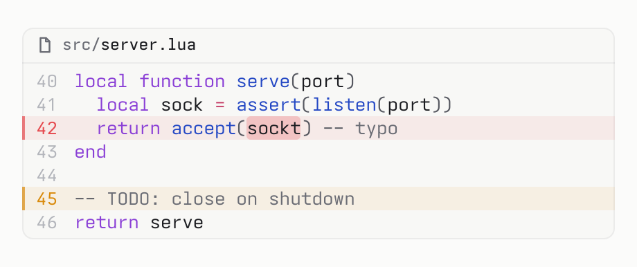
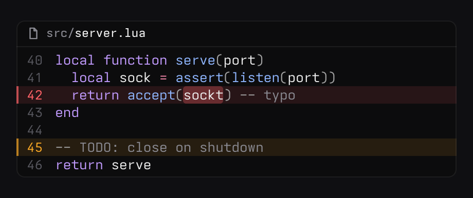
<figcaption>使用七行 <code>state.source</code> 的示例。由于 <code>lang</code> 为 nil，因此语法由 <code>path</code> 决定。</figcaption>
</figure>

带折叠、洗色和概览条的评分行：

```lua
local ui = tern.ui

local block = ui.code(state.output, nil, 1)
block.p.overview = true
block.p.marks = {
	{ line = 1, tone = "accent", heat = 0.9, wash = { 0.9, 0.3 } },
	{ line = 2, heat = 0.2, wash = { 0.2, 0.6 } },
	{ line = 7, heat = 0.7 }, -- folded below, still hot
}
block.p.folds = {
	{
		from = 3, to = 9, label = "… [lines 3-9]", note = "7 lines below the cutoff", tone = "error",
		hovercard = ui.text("Line 7 scored 0.9, under the cutoff of 1"),
	},
}
return { main = ui.col({ block }) }
```

## `diff`

绘制带词级强调的差异，并在两侧进行语法高亮。它本身不绘制标题：应放入标题中包含文件名的 `card`。在 `card` 内部会贴合放置（不带自身边框或背景）。没有变更的 diff 会显示 “No changes”。

**构建方式：** `tern.ui.diff(text, path)`（参见 [UI 构建器](../reference/ui.md#文本与代码)），或 `tern.ui.node("diff", { hunks = …, path = …, mode = "split" })`。

| 属性 | 类型 | 默认值 | 含义 |
| --- | --- | --- | --- |
| `text` | string | 无 | 统一 diff：由 `@@ -a,b +c,d @@` 形式的 hunks 组成。接受 `diff --git`、`---`/`+++` 和 `index` 标题，并可据此确定文件名。完全没有 hunk 标题的文本会被视为由 `+`/`-`/` ` 行组成的一个 hunk |
| `hunks` | `{oldStart?, newStart?, lines}` 列表 | 无 | 直接给定 hunks；它是列表时优先于 `text`。`oldStart`/`newStart` 默认值为 `1`；`lines` 为以 `+`、`-` 或空格开头的字符串（其他行及空行会作为完整的上下文行处理）。以 `\` 开头的行（`\ No newline at end of file`）会被跳过 |
| `path` | string | 标题中指定的文件 | 当 `lang` 未设置时选择语法。不绘制 |
| `lang` | string | 无 | 按语言名选择语法；优先于 `path` |
| `mode` | `"unified"` \| `"split"` \| `"auto"` | `"auto"` | `unified`：单列，每行只显示一个行号（删除行使用旧行号，其余行使用新行号）。`split`：左右并排显示旧版和新版；未配对行缺少的一侧留空。缺省、`auto` 或任何其他值：遵循用户设置。无论哪种模式，长行都会在其行内（或半边内）换行；diff 不会横向滚动 |

**Edits 设置。**除了 `mode` 为 `unified` 或 `split` 以外，所有模式都遵循 Tern 的“Edits”设置：Inline（默认）以统一格式绘制；Split 会在块宽度超过 112 个单元格时并排显示，否则使用统一格式，并在宽度变化时重新判断。显式设置的 `mode` 优先于该设置。

超过 4,096 字节的行会像 [`code`](#code) 一样截断，并附带说明。

配对行（同一变更中的第 i 个 `-` 行和第 i 个 `+` 行）会对发生变化的词进行词级强调（`.sf-em`），除非任一行超过 1000 字节，或两侧大部分内容都已重写。Hunk 之间的折叠行会显示 `⋯ N unchanged lines`（若间隔未知则仅显示 `⋯`），并显示下一 hunk 的 `@@` 标题中的外围函数；首个 hunk 的标题文本不绘制。缩进至少 2 个单元格的新增和删除行会在前导空白处以浅色标记每个缩进单位（含制表符时按 tab 止位；若空格数为 4 的倍数则每 4 个单元格，否则每 2 个）。布局超过 64 行的 diff 会分组到 `div.sf-dgrp` 中，每组 64 行，并且只在视口附近布局（此前每组按其行的估算高度占位）。

**Tab width 设置。**这里、[`code`](#code) 和 Markdown 代码中，制表符都会按 Tern 的“Tab width”设置每隔 N 列停止一次（设置路径为 Settings › Appearance › Programs，默认值为 3；区域变量为 `--sf-tab`）。

**子节点：**无（忽略）。

**事件：**没有自身事件；`actions` 与任意节点相同。

**样式：**

```html
<div class="sf sf-diff split" data-id="…" style="--sf-gw:…">
	<div class="sf-diff-body">
		<div class="sf-dsep">⋯ 12 unchanged lines<span class="fn">fn main()</span></div>
		<!-- unified -->
		<div class="sf-dl del"><span class="sf-dg">4</span><span class="sf-dm">-</span><span class="sf-dt">let x = <span class="sf-em">1</span>;</span></div>
		<!-- split -->
		<div class="sf-dr">
			<div class="sf-dl half del">…</div>
			<div class="sf-dl half add">…</div>
		</div>
		<!-- over 64 rows: the rows in groups of 64 -->
		<div class="sf-dgrp" style="content-visibility:auto;contain-intrinsic-height:auto …px">…</div>
	</div>
</div>
```

| 目标 | 选择器 |
| --- | --- |
| 节点 | `.sf-diff`、`.sf-diff.split` |
| 正文 | `.sf-diff-body`（内部实现，可能改变） |
| 空内容 | `.sf-diff-empty`（内部实现） |
| 长 diff 的行组 | `.sf-dgrp`（内部实现，仅在视口附近布局） |
| Hunk 之间的折叠行 | `.sf-dsep`、`.sf-dsep .fn`（内部实现） |
| 行 | `.sf-dl.ctx`、`.sf-dl.add`、`.sf-dl.del`（内部实现） |
| 并排行和两侧 | `.sf-dr`、`.sf-dl.half`、空白侧上的 `.nil`（内部实现） |
| 行号、标记、文本 | `.sf-dg`、`.sf-dm`、`.sf-dt`（内部实现） |
| 变化的词 | `.sf-dl.add .sf-em`、`.sf-dl.del .sf-em` |
| 缩进指示线 | `.sf-dt.ind`（内部实现） |
| Token | `.tk-*` |

变量：`--sf-gw`、`--ok`（新增）、`--bad`（删除）、`--code-bg`、`--l1`、`--l2`（缩进指示线）、`--t4`、`--sf-cw`、`--sf-tab`、`--sf-shade`（空白侧）、`--ind`/`--ind-unit`（在 `.sf-dt.ind` 上设置为行内样式）、`--tk-*`。

```lua
local ui = tern.ui

local change = ui.diff(state.patch, "src/app.lua")
return ui.card({ ui.path("src/app.lua", state.cwd) }, { change })
```

同一补丁的两种显示方式，均位于 card 外：

```lua
local patch = [[
@@ -3,4 +3,4 @@ function start(cfg)
 local port = cfg.port
local host = cfg.host
 log("on " .. port)
return serve(host, tls)
@@ -20,2 +20,3 @@ return {
 start = start,
stop = stop,
 }]]
return ui.col({
	ui.node("diff", { text = patch, path = "src/app.lua", mode = "unified" }),
	ui.node("diff", { text = patch, path = "src/app.lua", mode = "split" }),
})
```

<figure class="tn-figure">
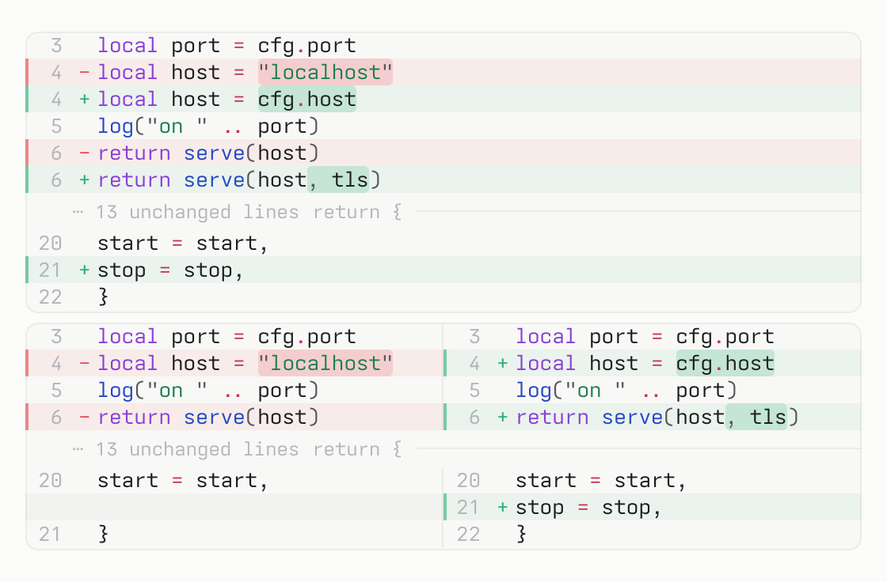
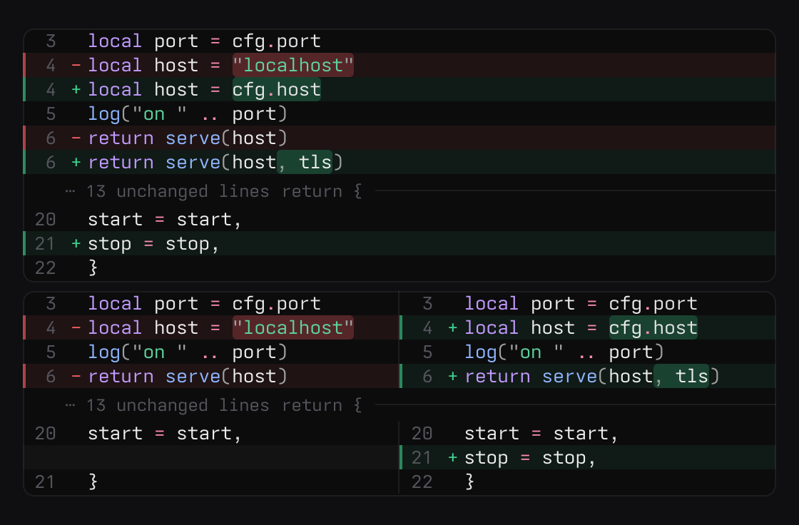
<figcaption><code>mode = "unified"</code>（上方）和 <code>mode = "split"</code>（下方）。配对行只会给发生变化的词着色。</figcaption>
</figure>

## `ansi`

在迷你终端中绘制原始程序输出：包括 SGR 颜色和样式、OSC 8 超链接、`\r` 和 `\b`。输出会按块宽度换行，并在宽度变化时重新排版；单独的 `\n` 会移至下一行开头，如同 pty 一样。块的高度与输出内容相同，但只绘制视口内的行（以及前后各 24 行）。ANSI 颜色取自终端主题（`--ansiN`）；背景透明。

只有在文本增长时（`text append` 或视图的 `text` 增加了后缀）才只追加新增尾部；其他变化都会重启终端。

**构建方式：** `tern.ui.ansi(text)`（参见 [UI 构建器](../reference/ui.md#文本与代码)），或 `tern.ui.node("ansi", { text = out, follow = true, preview = { lines = 8 } })`。

| 属性 | 类型 | 默认值 | 含义 |
| --- | --- | --- | --- |
| `text` | string | `""` | 带转义序列的输出 |
| `cols` | integer | 无 | 最大列数；当块宽度更大时，按此宽度换行 |
| `preview` | `{lines = N}` | 无 | 在渐隐效果下限制为 N 行，并显示可在原位展开的按钮（再次点击“Show less”可折叠）。显示前 N 行，下方显示“K more lines”；或者设置 `follow` 后显示最后 N 行，上方显示“K earlier lines”（“1 earlier line”）。新的 `preview` 值会重置展开状态。在可折叠卡片、section 或工具内部时，只有折叠时才生效；按钮会改为展开该容器（见下文） |
| `follow` | bool | `false` | 保持尾部在视口中。与 `preview` 一起使用时，限制区域显示尾部。设置 `max.h` 后，块会保持滚动至底部，直到用户向上滚动离开；回到底部后又会继续跟随 |
| `max` | `{h = …}` | 无 | 通用尺寸上限。在 `ansi` 上设置 `max.h`（`"10lines"`）会让块垂直滚动（`.scroll`），而不是裁切 |

按住 ⌘ 点击 OSC 8 链接可打开（若“Open links with”设置为普通点击，则普通点击也可打开；按住 ⇧ 或点击结束了选择时除外）。

鼠标会像在终端中一样选取输出：拖动会从按下位置开始逐行选取单元格；双击选取词，三击选取整行，⇧-click 可延伸选区。Tern 的复制操作（Copy 快捷键、上下文菜单的 Copy、选中后复制）会复制所选文本，每个输出行尾附带换行，并省略超出行文本的空白单元格。在其他位置按下鼠标会结束选择。

**子节点：**无（忽略）。

在可折叠卡片、section 或工具内部（沿树向上最近的容器）时，容器展开后预览会暂时失效：块显示完整内容并隐藏按钮。容器折叠时，按钮会展开该容器（触发 `toggle` 事件，如点击标题），而不是只展开块。

**事件：**没有自身事件；`actions` 与任意节点相同。更多按钮属于 Tern 的本地状态。

**样式：**

```html
<div class="sf sf-ansi scroll" data-id="…">
	<div class="sf-term-clip clamped fade-bottom" style="--sf-clip:…">
		<div class="tv-mini">…</div>
	</div>
	<button class="sf-ansi-more" title="Show all output" aria-expanded="false">12 more lines<svg class="ico chev">…</svg></button>
</div>
<!-- a tail preview (`follow`): the button, with .tail, comes before the clip -->
<div class="sf sf-ansi" data-id="…">
	<button class="sf-ansi-more tail" title="Show all output" aria-expanded="false">12 earlier lines<svg class="ico chev">…</svg></button>
	<div class="sf-term-clip clamped fade-top" style="--sf-clip:…">…</div>
</div>
```

| 目标 | 选择器 |
| --- | --- |
| 节点 | `.sf-ansi` |
| 滚动（`max.h`） | `.sf-ansi.scroll` |
| 裁切区 | `.sf-term-clip`、`.sf-term-clip.clamped`、`.fade-top`（跟随时）、`.fade-bottom`（内部实现，可能改变） |
| 终端 | `.tv-mini`（内部实现） |
| 更多/更少按钮 | `.sf-ansi-more`、`.sf-ansi-more.open`（已展开）、`.sf-ansi-more.tail`（尾部预览的按钮，位于裁切区之前）、`.sf-ansi-more.sf-hidden`（内部实现） |

变量：`--sf-clip`（限制高度）、`--sf-lh`、终端主题中的 `--ansi0`…`--ansi15`。

```lua
local ui = tern.ui

local log = ui.ansi(state.output)
log.p.follow = true
log.p.max = { h = "12lines" }
return { main = ui.col({ ui.text("Build output"), log }) }
```

失败构建的预览：八行 SGR 着色输出，其中含一个 OSC 8 链接，限制为七行。

```lua
local E = "\27"
local out = table.concat({
	E .. "[1;32m   Compiling" .. E .. "[0m tern-core v0.9.2",
	E .. "[1;32m   Compiling" .. E .. "[0m tern-ui v0.9.2",
	E .. "[1;33mwarning" .. E .. "[0m" .. E .. "[1m: unused variable: `port`" .. E .. "[0m",
	"  " .. E .. "[34m-->" .. E .. "[0m src/server.rs:42:9",
	E .. "[1;31merror[E0308]" .. E .. "[0m" .. E .. "[1m: mismatched types" .. E .. "[0m",
	"  " .. E .. "[34m-->" .. E .. "[0m src/app.rs:17:5",
	E .. "[2mFor more information, see" .. E .. "[0m "
		.. E .. "]8;;https://doc.rust-lang.org/error_codes/E0308.html" .. E .. "\\E0308" .. E .. "]8;;" .. E .. "\\",
	E .. "[1;31merror" .. E .. "[0m: could not compile `tern-ui`",
}, "\n")
return ui.node("ansi", { text = out, preview = { lines = 7 } })
```

<figure class="tn-figure">
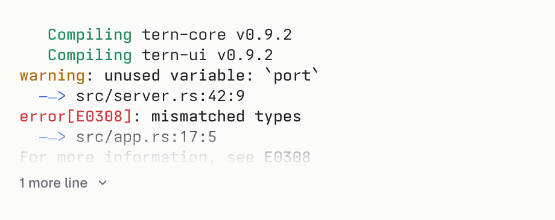
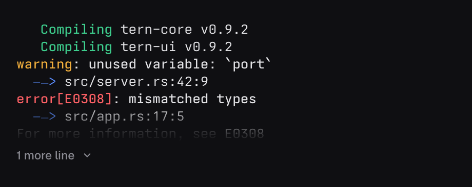
<figcaption>颜色取自终端主题。不设置 <code>follow</code> 时，预览保留前面的行并在底部渐隐。</figcaption>
</figure>

## `rows`

这是迁移回退方案：将程序已为终端绘制的行原样展示为恰好 `cols` 列，不重新换行，显示所有行，并在角落显示低调的 `fallback` 标记以便调试。此 kind 供迁移到协议的程序使用；插件应优先使用会重新排版的 `ansi`。

**构建方式：**`tern.ui.node("rows", { lines = { … }, cols = 80 })`。

| 属性 | 类型 | 默认值 | 含义 |
| --- | --- | --- | --- |
| `lines` | 字符串列表 | `{}` | 带转义序列的行；非字符串会被跳过 |
| `cols` | integer | `80` | 精确的列宽 |

**子节点：**无（忽略）。

**事件：**没有自身事件；`actions` 与任意节点相同。

**样式：**

```html
<div class="sf sf-rows" data-id="…">
	<span class="sf-rows-mark" title="Fallback rows (3)" aria-label="Fallback rows (3)">fallback</span>
	<div class="sf-term-clip"><div class="tv-mini">…</div></div>
</div>
```

| 目标 | 选择器 |
| --- | --- |
| 节点 | `.sf-rows` |
| 标记 | `.sf-rows-mark`（内部实现，可能改变） |
| 裁切区、终端 | `.sf-term-clip`、`.tv-mini`（内部实现） |

```lua
return tern.ui.node("rows", { lines = { "\27[1mname\27[0m  size", "a.txt     12" }, cols = 40 })
```

## `math`

使用与 `md` 数学相同的引擎排版一个 TeX 公式：默认作为行内公式，也可以作为独立显示块。

**构建方式：**`tern.ui.node("math", { text = "e^{i\\pi} + 1 = 0", display = true })`。

| 属性 | 类型 | 默认值 | 含义 |
| --- | --- | --- | --- |
| `text` | string | `""` | 不带定界符的 TeX |
| `display` | bool | `false` | 显示样式，在节点宽度内居中作为独立块。显示公式会忽略空行（否则会结束块）；行内公式仅占一行（换行视为空格），并位于节点起始处 |

无法排版的公式会显示其源文本，作为标题为错误内容的 `code.math-err`。

**子节点：**无（忽略）。

**事件：**没有自身事件；`actions` 与任意节点相同。

**样式：**

```html
<div class="sf sf-math display" data-id="…">
	<div class="md">
		<div class="math-display" data-tex="…"><svg>…</svg></div>
	</div>
</div>
<!-- inline: <div class="md"><p><span class="math" data-tex="…"><svg>…</svg></span></p></div> -->
```

| 目标 | 选择器 |
| --- | --- |
| 节点 | `.sf-math`、`.sf-math.display` |
| 公式 | `.sf-math .math`、`.sf-math .math-display`（内部实现，可能改变） |
| 排版失败的公式 | `.sf-math code.math-err`（内部实现） |

svg 使用 `currentColor` 绘制，内部元素会将其设为 `--t1`（`.md` 以及显示公式中的 `.math-display`），因此设置 `.sf-math` 本身的 `color` 不会作用于 svg。使用 `.sf-math :is(.math, .math-display) { color: … }` 为公式重新着色。

```lua
local ui = tern.ui

return ui.col({
	ui.text("The identity:"),
	ui.node("math", { text = "e^{i\\pi} + 1 = 0", display = true }),
	ui.node("math", { text = "\\sum_{k=1}^{n} k = \\frac{n(n+1)}{2}" }),
})
```

<figure class="tn-figure">
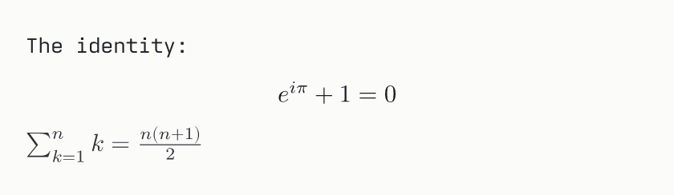
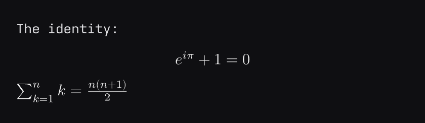
<figcaption>独立显示公式（居中）和行内公式（文本样式：求和符号的上下标位于旁边，并显示小型分数）。</figcaption>
</figure>
