# Agent、聊天与任务类

这些 kind 将代理的工作、对话和设置绘制为实时数据。它们是为两个程序设计的：omp（编码代理）使用 `tool`、`agent`、`checklist` 和 `prefs` 绘制其工具调用、子代理、待办列表和 `/settings` 页面；Tern 自身则在 `block` 中绘制 shell 命令的 Lens 输出。聊天类绘制围绕这些工作的对话：消息（`message`）、答案背后的步骤和推理（`trace`）、带堆栈的错误（`stacktrace`）、下一步可询问的内容（`suggestions`）以及代理反问的问题（`questions`）。每种 kind 在插件视图中也都能渲染，本页说明了它们在那里如何工作。当插件展示相同形态时可以使用它们：带状态和输出正文的运行步骤（`tool`）、带实时统计的工作者（`agent`）、分阶段任务列表（`checklist`）、聊天或设置页面（`prefs`）。你不需要自行构建 `block`：Tern 会将 Lens 视图包装在其中。

| 种类 | 构建方式 | 绘制内容 |
| --- | --- | --- |
| [`tool`](#tool) | `tern.ui.node("tool", …)` | 一个步骤：数据化标题（图标、动词、目标、元信息、状态、计时器），下方是带边框且可折叠的正文，或者等待批准的步骤 |
| [`agent`](#agent) | `tern.ui.node("agent", …)` | 一行工作者状态及实时统计，并可展开内容 |
| [`trace`](#trace) | `tern.ui.node("trace", …)` | 代理步骤、思路链、带来源的推理块 |
| [`stacktrace`](#stacktrace) | `tern.ui.node("stacktrace", …)` | 错误及其堆栈帧：高亮应用帧、折叠库帧、帧中的代码 |
| [`checklist`](#checklist) | `tern.ui.node("checklist", …)` | 分阶段待办列表、带弹出层的停靠胶囊，或“仍未完成”提醒 |
| [`message`](#message) | `tern.ui.node("message", …)` | 一条聊天消息：作者、时间、头像、正文、回应、悬停操作和状态行 |
| [`suggestions`](#suggestions) | `tern.ui.node("suggestions", …)` | 以标签、编号行或小卡片呈现的后续提示 |
| [`questions`](#questions) | `tern.ui.node("questions", …)` | 问卷：步骤、行内标签或可折叠列表 |
| [`block`](#block) | Tern 在 Lens 视图外创建 | 命令输出：Lens 视图或原始输出、Native/Raw 切换、Copy |
| [`prefs`](#prefs) | `tern.ui.node("prefs", …)` | 完整设置页面或设置面板，由你的数据和键控制 |

这些 kind 都没有专用的 `tern.ui` builder；使用 `tern.ui.node(kind, props, children)`（参见 [UI 构建器](../reference/ui.md)）。每个节点都是 `<div class="sf sf-<kind>" data-id="<id>">`，并接受 [元素](index.md) 中描述的通用 props（`role`、`tone`、`hidden`、`actions` 等），但有两个例外：`tool` 和 `trace` 使用 `title` 作为标题文字，而非工具提示；`message` 则将 `actions` 作为自己的按钮列表。

它们的样式表内置，并为每个 surface 加载：`omp-tools.css`（`tool`、`agent`、`checklist`）、`surface-trace.css`、`surface-stacktrace.css`、`surface-message.css`、`surface-suggestions.css` 和 `surface-questions.css`（每种 kind 一个），`surface-lens.css`（`block`），以及 kit 的 `prefs.css` 和 `omp-prefs.css`（`prefs`）。稳定的钩子包括 `.sf-<kind>`、`[data-id]`、`[data-role]`、`[data-tone]`、`[data-state]`、`[data-variant]` 和区域 `[data-surface]`。下文列出的其他类是 Tern 的内部结构：文档列出它们供你定位，但它们属于**内部实现，可能随版本改变**。

## `tool`

一个工作步骤：Tern 根据数据绘制标题，正文由你的子节点构成。omp 为每次工具调用（`bash`、`read`、`edit` 等）发送一个；在插件中，它适合部署步骤、查询、构建阶段等任何具有动词、目标、状态和输出的内容。

标题从左到右依次为：左边缘的状态条、图标、`title` 动词、`target`、`meta` 事实、徽标、弹性间隔、`note`、`exit N` 标签、计时器、状态字形、折叠箭头和悬停操作按钮。正文按顺序包含子节点。每当可见子节点的 kind 与前一个可见子节点不同时（例如先是代码，再是输出，然后是表格），该子节点会获得 `.sf-tool-hr`，样式表会在其上方绘制细线。两个 `code` 子节点之间的 `text` 表示同一文件的两个代码段之间的间隔（行号跳跃处 omp 会显示 `…`）：它获得 `.sf-tool-gap`，其上方代码段获得 `.sf-tool-cont`，不绘制分隔线，因此样式表可以将代码段及其间隔绘制为一个整体。正文中不会绘制第二个边框：嵌套的 `card` 和 `tool` 子节点会移除环线和色调，作为无边框区块绘制（嵌套卡片也会隐藏标题徽标）；`code` 和 `diff` 子节点会移除背景和边框（代码块也会隐藏标题），因此步骤不会出现框中套框。

**边框。** `frame: "card"`（默认值）绘制一条环线，在 `running`/`pending` 状态下带淡色，在 `error` 状态下带红色。`frame: "inline"` 移除环线、色调和状态条：仅显示标题行和正文，并缩进到细线之后。

**状态。** `status` 可取 `pending`、`running`、`done`、`error`、`cancelled`、`ask` 之一；其他值按 `pending` 处理。`running` 显示旋转环形字形和常亮左侧状态条；`error` 显示圆圈叉号和红色状态条；`cancelled` 显示带斜杠的圆圈；`done` 和 `pending` 不显示字形。`ask` 等待用户批准（见下文“批准”）：不显示字形，图标使用警告色。

**计时器。** 在 `running` 或 `pending` 状态下，`age`（发送时已经经过的毫秒数）会启动实时计时器：它从 `age` 加上距 `age` 最近一次到达后的时间开始递增，因此不修改 `age` 的补丁不会重置计时器。否则，计时器显示 `took`，若无则显示 `age`，并保持冻结。低于一秒的冻结时间会获得 `.fast`（仅在悬停标题时显示）。没有 `age`/`took` 时不显示计时器。

```lua
local ui = tern.ui

ui.node("col", { gap = "sm" }, {
	ui.node("tool", { name = "bash", title = "Deploy", status = "pending",
		target = "kubectl apply -f k8s/web.yaml", targetKind = "command",
		badges = { { text = "prod", tone = "info" } } }),
	ui.node("tool", { name = "bash", title = "Build", status = "running", age = 4200,
		target = "cargo build --release 2>&1 | tee build.log", targetKind = "command" }, {
		ui.node("ansi", { text = "Compiling stencil-css v0.1.0\n…" }),
	}),
	ui.node("tool", { name = "edit", title = "Edit", status = "done", took = 640,
		target = "src/deploy/plan.rs:13-36", targetKind = "path", meta = { "+8 −1" } }),
	ui.node("tool", { name = "bash", title = "Test", status = "error", took = 3100,
		exit = 101, note = "2 failed",
		target = "cargo test -p deploy", targetKind = "command" }, {
		ui.node("ansi", { text = "test plan::rollback ... \27[31mFAILED\27[0m\n…" }),
	}),
})
```

<figure class="tn-figure">
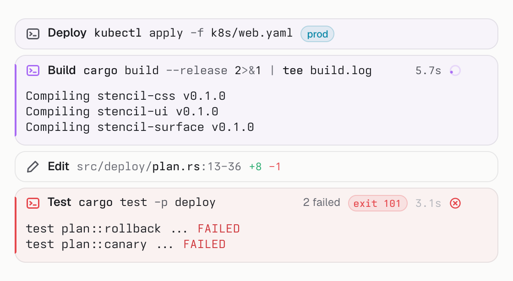
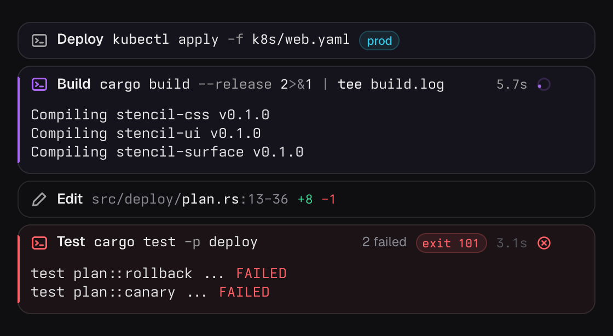
<figcaption>待处理、运行中、已完成和出错状态。Edit 的 640 ms 不到一秒，因此计时器要等到悬停时才显示。</figcaption>
</figure>

**目标。** `targetKind` 决定字符串 `target` 的绘制方式：

| `targetKind` | 绘制方式 |
| --- | --- |
| `command` | 一行 shell 命令拆分为若干片段：`.cmd`（程序词）、`.flag`（`-x`）、`.str`（带引号字符串）、`.var`（`$X`）、`.op`（`\|`、`&&`、`;`、`>` 等），其余为普通文本。折叠时显示省略号，展开时换行。 |
| `path` | `.dir`（目录，弱化）、`.name`（文件，突出）、`.ln`（`:12` / `:13-36` 后缀，弱化） |
| `pattern`, `query` | 文本显示在一对 `.q` 弯引号之间 |
| `text`（默认） | 按给定内容绘制文本或片段 |

片段（以表而非字符串表示）始终按片段绘制。节点带有 `href` 时，目标的工具提示会显示链接名称，按住 ⌘ 点击工具任意位置即可打开链接。

**元信息。** 每个 `meta` 条目都是一个 `.sf-tool-meta` span。普通字符串中的 `+N` 会被包装在 `.add`（新增颜色）中，`-N` / `−N` 会被包装在 `.del`（移除颜色）中，因此 `"+8 −1"` 会显示为差异统计。

**折叠。** `collapsible: true` 会将标题设为按钮（Enter 或 Space 切换；普通点击切换，⌘-点击不切换）。状态保存在本地，并按同级节点中的 `key` 记忆（若无则使用 id），与卡片类似，不是整个 surface 共用。删除节点后，在同一父节点下添加一个具有新 id 和相同 key 的节点会保留折叠状态；相同 key 位于另一父节点时状态相互独立。`collapsed` 设置初始状态；之后更改该 prop 会将记忆状态重置为该值。折叠时：

- 使用 `preview: { lines = N }` 时，正文会在底部渐隐效果下限制为前 N 行，下方显示“`K more lines · Show all ⌃O`”按钮；
- 使用 `preview: { tail = N }` 时，正文会在顶部渐隐效果下限制为最后 N 行，并显示“`K earlier lines · Show all ⌃O`”（两者都提供时 tail 优先）；
- 使用 `preview = "children"` 时，正文保持完整：不裁剪，也不显示 Show all 按钮（类为 `clamp-children`）。子节点自己的预览（`ansi`、`code`）会改为裁剪，因此正文中的每个区块都显示自身的若干行；
- 没有 preview 时隐藏正文。

绘制出来的行才计入行数（折行会被计为多行），行数根据正文高度测量。仅当正文高于预览高度时才裁剪。`lines` 模式下 Show all 按钮位于裁剪正文下方；`tail` 模式下则位于标题与正文之间；点击会展开工具。`⌃O` 键帽仅为标签：按键会到达你的块的 `key` 处理器，而不是工具。

可折叠工具用于控制其中的预览，类似卡片：工具展开时，其中 `ansi` 或 `code` 的 `preview` 会让位并显示完整内容；工具折叠时（由标题、程序设置的 `collapsed` 或 Show all 按钮折叠），它们会再次裁剪。工具折叠期间，子节点的“N more lines”/“N earlier lines”按钮会展开整个工具（作为标题点击发送 `toggle` 事件），而不是仅展开自身区块。

**复制命令。** 有 `command` prop 时，或 `command` 缺省且 `targetKind = "command"` 的字符串 `target` 存在时，标题会提供 Copy command 按钮（悬停时出现，与操作按钮相同），复制整个原始命令行，不受标题显示形式影响。`command` 可使工具复制命令，同时让 `target` 显示其他内容（意图）。

```lua
ui.node("tool", {
	name = "bash", title = "Deploy", status = "done", took = 12400,
	target = "kubectl rollout status deploy/web", targetKind = "command",
	collapsible = true, collapsed = true, preview = { tail = 3 },
	tools = { { id = "copy", label = "Copy" }, { id = "rerun", label = "Rerun" } },
}, {
	ui.node("ansi", { text = rollout_log }), -- six lines
})
```

<figure class="tn-figure">
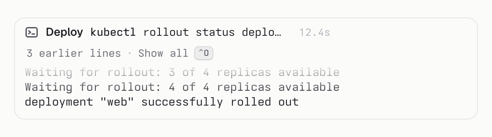
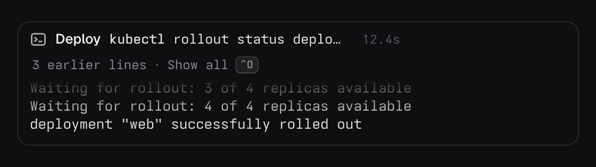
<figcaption>使用 <code>preview = { tail = 3 }</code> 折叠显示。悬停时会显示折叠箭头、Copy 和 Rerun 按钮。</figcaption>
</figure>

**折叠分组。** 启用 Tern 的 *Fold tool calls* 设置（默认关闭）后，`main` 子节点中两个或更多连续工作块（`tool` 节点，以及 omp 的工具卡片和仅包含思考内容的消息）会归入一个 `div.sf-work-head` 披露区，显示“Worked for 12.3s · Deploy ×2 · Test”：总计 `took`，随后是每个 `title`（若无则 `name`）及其数量。后面跟着其他块的工作序列初始折叠；`main` 末尾仍在增长的序列初始展开。序列中的块获得 `.sf-work`，已折叠的块获得 `.sf-folded`。嵌套工具不会折叠。

**操作。** `tools` 列出标题中在悬停或键盘聚焦时显示的按钮：`{ id, label, keys? }`，其中 `keys` 是按键名称列表，会以键帽形式显示在按钮内。点击会在工具节点上将 `id` 作为 action 执行：内置项（`toggle`、`copy`、`open`、`select`、`activate`、`zoom`）与其他节点上的行为相同（见 [元素](index.md)）；其他 id 会发送 `action`。

**批准。** 工具可以在运行前等待用户批准。设置 `status = "ask"`，Tern 会在标题与正文之间绘制批准面板；使用 `ask` 描述面板。只要步骤有足够风险、应先征得用户同意，就使用此功能：删除文件、强制推送、部署、任何会花钱的操作。程序收到答复后，将状态设为实际运行状态（`running`、`done`、`cancelled` 等），并设置 `approved`：面板消失，标题中会记录决定标签（绿色的 *Allowed once*、*Allowed this session*、*Always allowed*，或红色的 *Denied*；任何状态下都显示）。

`confirm` 选择外观：

| `confirm` | 外观 | 按钮 |
| --- | --- | --- |
| `card`（默认） | 边框变为警告色（环线和色调），标题显示脉动的 *Needs your approval* 标签，细线下方的底栏放置按钮。适用于用户在批准前应完整查看的调用。 | 左侧 Deny；右侧 Always 和 Allow ⏎ |
| `strip` | 标题下方显示一条紧凑的警告条，内容为 `ask.text`（*Allow this command?*）；边框保持普通。适合连续调用，避免每个调用都使用卡片而显得嘈杂。 | Deny · Allow |
| `scopes` | 问题（*Allow this?*）、范围单选列表（批准持续时间），然后是按钮；边框保持普通。若没有 `ask.scopes`，列表为 *Only this time*、*For this session*、*Always*（`once`、`session`、`always`）。 | Deny · Allow ⏎ |

点击按钮会发送 `action { id, act, value? }`，其中 `act` 为 `allow`、`deny` 或 `always`，`value` 是所选范围（`ask.scope` 或用户选取的单选项；没有范围时省略）。选择范围单选项不会发送任何内容：它会立即显示为选中，并随下一个按钮的 `value` 一起发送。程序更改 `ask.scope` 时优先于用户的选择。面板不会获取焦点：Allow 上的 ⏎ 键帽只是标签，因此应在块的 `key` 处理器中绑定 Enter（如果需要，也可将 Escape 绑定为拒绝），并像处理点击那样响应；要通过键盘移动范围选择，请设置 `ask.scope`。surface 已关闭或以 `listen: false` 打开时会绘制面板，但不发送事件，也不改变单选状态。

```lua
local ui = tern.ui

ui.node("tool", {
	name = "bash", title = "Run", target = "rm -rf dist build", targetKind = "command",
	status = "ask", confirm = "scopes",
	ask = {
		text = "Let bash run rm -rf?",
		scopes = {
			{ id = "once", label = "Only this time" },
			{ id = "session", label = "For this session" },
			{ id = "repo", label = "Always, in this repo" },
		},
	},
})

-- after action { act = "allow", value = "once" }, the same tool once it ran:
ui.node("tool", {
	name = "bash", title = "Run", target = "rm -rf dist build", targetKind = "command",
	status = "done", approved = "once", took = 840,
})
```

<figure class="tn-figure">
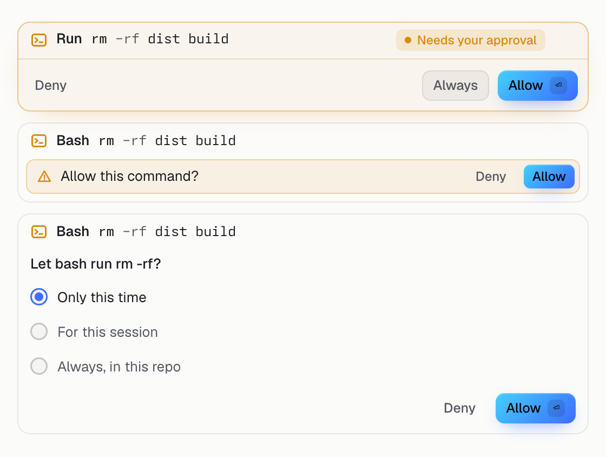
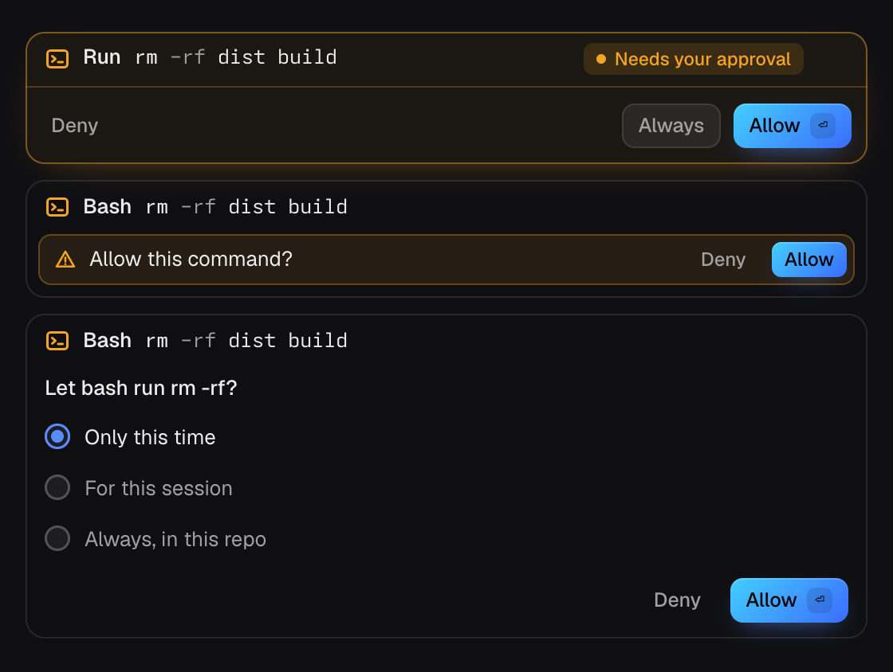
<figcaption>三种批准外观：<code>confirm = "card"</code>、<code>"strip"</code> 和 <code>"scopes"</code>。</figcaption>
</figure>

<figure class="tn-figure">
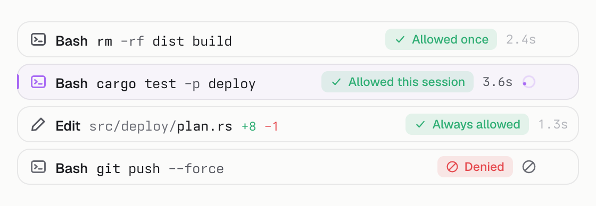
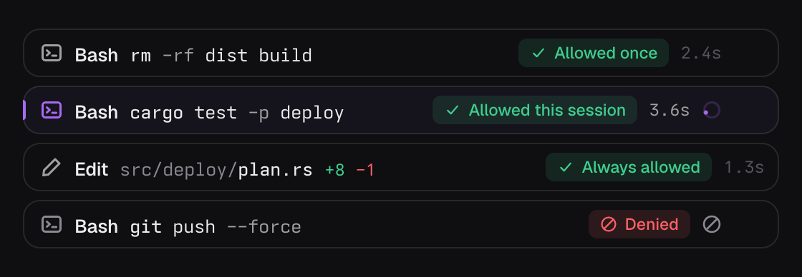
<figcaption>答复后：<code>approved</code> 会在标题中留下标签。</figcaption>
</figure>

**构建方式：** `tern.ui.node("tool", { … }, { …body })`。

| 属性 | 类型 | 默认值 | 含义 |
| --- | --- | --- | --- |
| `name` | string | `""` | 工具名称；根据 `omp.tool.<name>` 角色表选择图标（`bash`/`shell` 终端、`read` 文档、`edit` 笔、`write` 文件加号、`grep`/`glob`/`search` 搜索、`find` 闪光、`ls` 文件夹、`web`/`fetch`/`browser` 地球、`todo` 勾选列表、`task` 用户、`eval` 代码、`python`、`lsp` 大括号、`proc` 活动等）。其他名称使用插头图标。 |
| `title` | 文本 | `""` | 动词（“Deploy”“Query”）。也是标题的可访问名称，包含目标和状态。此处不是工具提示。 |
| `target` | 文本 | 无 | 主要参数，使用等宽字体。 |
| `targetKind` | `"command"` \| `"path"` \| `"pattern"` \| `"query"` \| `"text"` | `"text"` | 字符串 `target` 的绘制方式（见上表）。也会设置为节点的 `data-tk`，并成为 `.sf-tool-target` 的类。 |
| `href` | string | 无 | 工具链接：⌘-点击可打开；链接显示在目标工具提示中。 |
| `meta` | 文本数组 | `[]` | 目标之后的简短事实。 |
| `badges` | 数组，元素为 `{ text, tone?, title? }` | `[]` | 标题中的 `.sf-badge` 标签；`tone` 设置 `data-tone`，`title` 设置工具提示。 |
| `note` | 文本 | 无 | 计时器前的简短状态注记（“timed out”“partial”）。 |
| `exit` | number | 无 | 非零代码显示 `exit N` 标签（`.sf-chip.st-error.sf-tool-exit`）。 |
| `status` | `"pending"` \| `"running"` \| `"done"` \| `"error"` \| `"cancelled"` \| `"ask"` | `"pending"` | 状态：类 `st-<status>`、字形、色调、计时器模式；`"ask"` 会等待批准并绘制面板。 |
| `age` | number（毫秒） | 无 | 发送时经过的时间；运行/待处理时显示实时计时器，之后作为冻结回退值。 |
| `took` | number（毫秒） | 无 | 完成后显示的最终时长。 |
| `intent` | string | 无 | 标题的工具提示。 |
| `frame` | `"card"` \| `"inline"` | `"card"` | 显示或不显示环线。 |
| `collapsible` | boolean | `false` | 标题可切换正文。 |
| `collapsed` | boolean | 无 | 初始折叠状态（仅在 `collapsible` 下有效）。 |
| `preview` | `{ lines = N }` \| `{ tail = N }` \| `"children"` | 无 | 折叠正文的裁剪方式；`"children"` 保持正文完整，并由子节点自己的预览负责裁剪。 |
| `command` | string | 无 | 标题中的 Copy command 按钮要复制的原始命令行（否则复制 `command` 类型的目标）。 |
| `tools` | 数组，元素为 `{ id, label?, keys? }` | `[]` | 悬停操作按钮。 |
| `confirm` | `"card"` \| `"strip"` \| `"scopes"` | `"card"` | `status` 为 `"ask"` 时的批准外观（见上表）。 |
| `ask.text` | string | `"Allow this command?"`（strip），`"Allow this?"`（scopes），card 无默认值 | 问题文字。 |
| `ask.allow` | string | `"Allow"` | Allow 按钮标签。 |
| `ask.deny` | string | `"Deny"` | Deny 按钮标签。 |
| `ask.always` | string \| `false` | `"Always"` | Always 按钮标签（仅 `card`）；`false` 会隐藏按钮。 |
| `ask.scopes` | 数组，元素为 `{ id, label? }` | once / session / always | `confirm = "scopes"` 的单选项；`label` 默认取 `id`。 |
| `ask.scope` | string | scopes 外观下为首个范围，否则无 | 所选范围，作为按钮的 `value` 发送。程序更改时优先于用户选择。 |
| `approved` | `"once"` \| `"session"` \| `"always"` \| `"denied"` | 无 | 答复；任何状态下都显示为标题标签。 |
| `key` | string | 节点 id | 同级节点中的标识；折叠状态按此 key 在同一父节点下记忆。 |

**子节点：** 按顺序绘制在 `.sf-tool-body` 中（任意 kind）。嵌套的 `card` 和 `tool` 子节点不带边框。

**事件：** 用户切换可折叠工具时发送 `toggle { id, collapsed, key? }`；非内置 id 的操作按钮发送 `action { id, act, mods? }`；批准按钮发送 `action { id, act, value? }`，其中 `act` 为 `allow`、`deny` 或 `always`，`value` 为所选范围。此外还有节点通用的 `actions`。

**样式：**

```html
<div class="sf sf-tool card st-running collapsible [collapsed] [nopreview] [clamped] [tail] [clamp-children] [inline] [ask-card|ask-strip|ask-scopes]"
	data-id="…" data-tk="command">
	<i class="sf-tool-bar"></i>
	<div class="sf-tool-head" role="button" tabindex="0" aria-expanded="true">
		<span class="sf-tool-ic"><!-- icon --></span>
		<span class="sf-tool-line">
			<span class="sf-tool-title">Deploy</span>
			<span class="sf-tool-target command"><span class="cmd">kubectl</span> apply <span class="flag">-f</span> …</span>
			<span class="sf-tool-meta"><span class="add">+8</span> <span class="del">−1</span></span>
			<span class="sf-badge" data-tone="info">prod</span>
			<span class="sf-tool-sp"></span>
			<span class="sf-tool-note">partial</span>
			<span class="sf-chip st-error sf-tool-exit">exit 1</span>
			<span class="sf-tool-askchip"><i class="dot"></i>Needs your approval</span>
			<span class="sf-tool-approved" data-tone="ok"><svg class="ico">…</svg>Allowed once</span>
		</span>
		<span class="sf-tool-time [fast]" role="timer">1.2s</span>
		<span class="sf-tool-st"><i class="sf-tool-spin"></i></span>
		<span class="sf-chev"><!-- chevron --></span>
		<button class="sf-tool-copy [sf-hidden]" title="Copy command"><svg class="ico">…</svg></button>
		<span class="sf-tool-acts"><button class="sf-tool-act">Copy<span class="kbd">⌘C</span></button></span>
	</div>
	<div class="sf-tool-ask scopes [sf-hidden]"><!-- card: text and foot; strip: .sf-tool-ask-ic, text, .sf-tool-sp and the buttons in one row -->
		<div class="sf-tool-ask-text">Let bash run rm -rf?</div>
		<div class="sf-tool-scopes" role="radiogroup">
			<button class="sf-tool-scope on" role="radio" aria-checked="true"><i class="radio"></i><span class="label">Only this time</span></button>
		</div>
		<div class="sf-tool-ask-foot">
			<span class="sf-tool-sp"></span>
			<button class="sf-button sf-tool-ask-btn" data-variant="quiet"><span class="sf-btn-label">Deny</span></button>
			<button class="sf-button sf-tool-ask-btn" data-variant="primary"><span class="sf-btn-label">Allow</span><span class="sf-kbd"><span class="kbd">⏎</span></span></button>
		</div>
	</div>
	<div class="sf-tool-body"><!-- children; a child whose kind changes gets .sf-tool-hr, a text between two code runs .sf-tool-gap (the run above it .sf-tool-cont) --></div>
	<button class="sf-tool-more"><span class="n">12 more lines</span><span class="dot">·</span>Show all<span class="kbd">⌃O</span></button>
</div>
```

| 目标 | 选择器 |
| --- | --- |
| 节点 | `.sf-tool` |
| 有边框/无边框 | `.sf-tool.card` / `.sf-tool.inline` |
| 状态 | `.sf-tool.st-pending`、`.st-running`、`.st-done`、`.st-error`、`.st-cancelled` |
| 目标类型 | `.sf-tool[data-tk='path']` |
| 折叠状态 | `.sf-tool.collapsible`、`.collapsed`、`.nopreview`（折叠且无预览）、`.clamped`（预览裁剪生效）、`.tail`（尾部预览）、`.clamp-children`（`preview = "children"`） |
| 左侧状态条 | `.sf-tool-bar`（内部实现，可能改变） |
| 标题、图标、行 | `.sf-tool-head`、`.sf-tool-ic`、`.sf-tool-line`（内部实现，可能改变） |
| 动词、目标、元信息 | `.sf-tool-title`、`.sf-tool-target.<kind>`，包含 `.cmd .flag .str .var .op` / `.dir .name .ln` / `.q`，以及 `.sf-tool-meta .add` / `.del`（内部实现，可能改变） |
| 注记、退出码、计时器、字形 | `.sf-tool-note`、`.sf-tool-exit`、`.sf-tool-time`（`.fast`）、`.sf-tool-st`、`.sf-tool-spin`（内部实现，可能改变） |
| 折叠箭头 | `.sf-tool-head > .sf-chev`（内部实现，可能改变） |
| 操作按钮 | `.sf-tool-acts`、`.sf-tool-act`、`.sf-tool-act .kbd`（内部实现，可能改变） |
| 复制命令 | `.sf-tool-copy`、`.sf-tool-copy.sf-hidden`（无可复制内容）（内部实现，可能改变） |
| 正文、分隔线 | `.sf-tool-body`、`.sf-tool-body > .sf-tool-hr`（内部实现，可能改变） |
| 代码段间隔及其上方代码段 | `.sf-tool-body > .sf-tool-gap`、`.sf-tool-body > .sf-code.sf-tool-cont`（内部实现，可能改变） |
| Show all 按钮 | `.sf-tool-more` 及其 `.n`、`.dot`、`.kbd`（内部实现，可能改变） |
| 等待批准的外观 | `.sf-tool.st-ask`，以及 `.ask-card`、`.ask-strip`、`.ask-scopes` |
| 批准面板 | `.sf-tool-ask.card` / `.strip` / `.scopes`、`.sf-tool-ask-ic`、`.sf-tool-ask-text`、`.sf-tool-ask-foot`、`.sf-tool-ask-btn[data-variant]`（也有 `.sf-button`）（内部实现，可能改变） |
| 范围单选项 | `.sf-tool-scopes` > `.sf-tool-scope`（`.on`、`aria-checked`）及 `.radio`、`.label`（内部实现，可能改变） |
| 批准标签 | `.sf-tool-askchip`（`.dot`）、`.sf-tool-approved[data-tone='ok' \| 'bad']`（内部实现，可能改变） |

变量：裁剪高度在 `.clamped` 时以内联方式设置为节点上的 `--sf-clamp`。色调优先读取已定义的 `--sf-tint-pending` 和 `--sf-tint-error`，否则使用 `--live` / `--sf-bad`；`--sf-run-a` 是运行中色调的 alpha（深色模式 0.04，浅色模式 0.05）。批准卡片的环线和色调、提示条以及标签圆点读取 `--warn`。颜色使用 Tern 的语义 token 颜色（见 [CSS 变量](../styles/variables.md)）。旋转图标、状态条和标题动画、批准面板进入动画以及标签脉动都会在减少动态效果或静态视图（`.sf-still`）下停止。

```lua
local ui = tern.ui

local function step(s)
	return ui.node("tool", {
		key = "deploy." .. s.env,
		name = "bash",
		title = "Deploy",
		target = "kubectl apply -f " .. s.file,
		targetKind = "command",
		badges = { { text = s.env, tone = "info" } },
		status = s.status, -- "running", "done", "error"
		age = s.status == "running" and s.elapsed or nil,
		took = s.took,
		exit = s.exit,
		collapsible = true,
		collapsed = s.status == "done",
		preview = { tail = 6 },
		tools = { { id = "copy", label = "Copy" }, { id = "rerun", label = "Rerun" } },
	}, {
		ui.node("ansi", { text = s.output }),
	})
end
```

点击 Rerun 会向块的 `event` 发送 `action { id = <tool id>, act = "rerun" }`。

## `agent`

一个工作者行：状态字形、名称、徽标、单行任务，以及右对齐的统计信息（模型、工具调用、请求、进度、上下文计量条或 token、费用、计时器）。第二行显示当前运行的内容（工具图标、工具名称、带闪烁效果的意图和工具自己的计时器）或重试倒计时。子节点是展开后的内容。omp 为每个子代理发送一个；在插件中可用于任意任务或工作者池，例如 CI runner、爬虫、同步工作者。

**状态。** `status` 可取 `pending`、`running`、`done`、`failed`、`aborted`、`idle`、`parked` 之一（其他值按 `pending` 处理）。字形分别为实时脉动（`running`）、勾号（`done`）、叉号（`failed`）、斜线（`aborted`）或空心环（其余状态）。

**统计信息。** 从 `stats` 读取；每一项仅在设置后显示：

| 字段 | 绘制方式 |
| --- | --- |
| `model`（节点 prop） | `.model` 标签，显示名称中最后一个 `/` 后的部分；完整名称作为工具提示。设置 `thinking`（例如 `thinkingLow`）后，圆点使用该 token 的语义颜色。 |
| `stats.tools` | `.tools`：扳手图标和计数（大于 0 时） |
| `stats.requests` | `.req`：`N req`（大于 0 时） |
| `stats.done` | `.done`：小环和 `N%`（比例 0–1，四舍五入），仅在 `running` 时显示 |
| `stats.context` | `.sf-agent-meter`：比例计量条（0–1，或大于 1 时按百分比）；75% 时 `.warn`，90% 时 `.bad`；工具提示和标签使用 `contextLabel` 或 `N% context` |
| `stats.tokens` | `.tok`：紧凑计数（`12K`、`1.2M`），仅在未设置 `context` 时显示 |
| `stats.cost` | `.cost`：`$0.42` 或 `<$0.01`（大于 0 时） |
| `stats.age` / `stats.took` | `.time`：`running`/`pending` 时根据 `age` 实时计时；否则显示冻结的 `took`（若无则 `age`） |

与 `tool` 的 `age` 一样，`stats.age`、`tool.age` 和 `retry.age` 从到达时开始递增，因此其他 props 的补丁不会影响计时。由于它们位于对象中，即使 `stats`（或 `tool`、`retry`）再次以相同的 `age` 到达，例如更新 `tools`，计时仍会继续；不同的 `age` 会从该值重新开始。

**第二行。** 设置 `retry` 时显示 `↻ retry A/M in <countdown>`（倒计时为 `delay - age` 毫秒），并将 `error` 作为工具提示。否则，当状态为 `running` 且设置了 `tool` 时，显示工具图标（与 [`tool`](#tool) 使用相同的表）、工具名称、意图（除非片段自带效果，否则应用 `shimmer` 效果）以及从 `tool.age` 开始的实时计时。该行为空时隐藏。

**折叠。** 与 `tool` 相同：`collapsible` 会将该行变为按钮（点击、Enter、Space；⌘-点击不会切换）；状态在本地保存，并按同级节点中的 `key`（若无则用 id）区分；`collapsed` 设置其状态，`.collapsed` 会隐藏子节点。

**深度。** `depth`（0–6）会在节点上设置 `--sf-depth`；样式表以 `depth × 22px` 缩进该行，适用于以同级节点绘制的工作者树。

```lua
ui.node("col", { gap = "xs" }, {
	ui.node("agent", { name = "runner-3", agent = "linux", task = "Build and test main",
		status = "running", model = "anthropic/opus", thinking = "thinkingHigh",
		stats = { tools = 14, done = 0.4, context = 0.78, cost = 0.42, age = 72000 },
		tool = { name = "bash", intent = "Running the test suite", age = 8000 } }),
	ui.node("agent", { name = "runner-4", agent = "linux", task = "Lint the workspace",
		status = "done", stats = { tools = 6, tokens = 19400, cost = 0.08, took = 41000 } }),
	ui.node("agent", { name = "runner-5", agent = "macos", task = "Sign the app bundle",
		status = "failed", badges = { { text = "flaky", tone = "warning" } },
		stats = { tools = 3, took = 12000 } }),
	ui.node("agent", { name = "crawler-1", task = "Fetch the changelog", status = "running",
		depth = 1, stats = { requests = 2, age = 5000 },
		retry = { attempt = 2, max = 5, delay = 30000, age = 12000, error = "429 Too Many Requests" } }),
	ui.node("agent", { name = "runner-6", task = "Waiting for a slot", status = "idle" }),
})
```

<figure class="tn-figure">
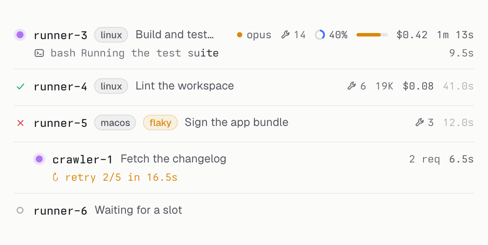
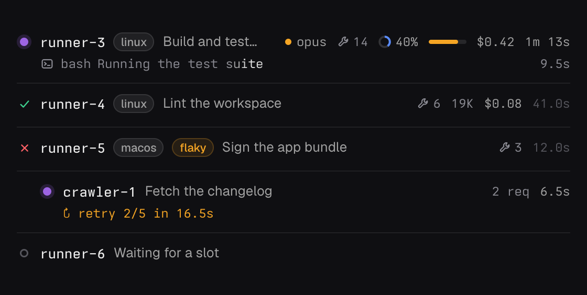
<figcaption>上下文计量条在 75% 时变为琥珀色。</figcaption>
</figure>

**构建方式：** `tern.ui.node("agent", { … }, { …content })`。

| 属性 | 类型 | 默认值 | 含义 |
| --- | --- | --- | --- |
| `name` | string | `""` | 显示名称；与状态一起构成该行的可访问名称。 |
| `agent` | string | 无 | 类型，显示为第一个 `.sf-badge`（无色调）。 |
| `badges` | 数组，元素为 `{ text, tone? }` | `[]` | 其他 `.sf-badge` 标签。 |
| `task` | 文本 | 无 | 单行任务；超出部分以省略号显示，完整文本作为工具提示，除非代理有 `hovercard`。 |
| `status` | 见上文 | `"pending"` | 类 `st-<status>`、字形和计时器模式。 |
| `model` | string | 无 | 模型标签。 |
| `thinking` | string | 无 | 模型标签圆点的 token。 |
| `stats` | `{ tools?, requests?, done?, context?, contextLabel?, tokens?, cost?, age?, took? }` | 无 | 上述统计信息。未设置 `stats` 时不显示计时器。 |
| `tool` | `{ name, intent?, age? }` | 无 | 当前运行的工具（第二行，仅 `running` 时显示）。 |
| `retry` | `{ attempt?, max?, delay?, age?, error? }` | 无 | 第二行的重试倒计时（优先于 `tool`）；`attempt`/`max` 默认值为 1。 |
| `depth` | integer | `0` | 嵌套深度，最大为 6。 |
| `collapsible` | boolean | `false` | 此行可切换子节点的显示。 |
| `collapsed` | boolean | 无 | 初始折叠状态。 |
| `key` | string | 节点 id | 同级节点中的标识；折叠状态按此 key 在同一父节点下记忆。 |

**子节点：** 按顺序绘制在 `.sf-agent-kids` 中（无子节点或折叠时隐藏）。

**悬停卡片：** 通用 `hovercard` 仅覆盖该行，不覆盖子节点。omp 会将子代理的完整任务作为 `md` 卡片发送，该行的 `task` 是其单行摘要。

**事件：** 用户切换可折叠行时发送 `toggle { id, collapsed, key? }`。此外还有通用的 `actions`。

**样式：**

```html
<div class="sf sf-agent st-running collapsible [collapsed]" data-id="…" style="--sf-depth: 1">
	<div class="sf-agent-row" role="button" tabindex="0" aria-expanded="true">
		<span class="sf-agent-g"><i class="live"></i></span>
		<span class="sf-agent-name">runner-3</span>
		<span class="sf-badge">linux</span>
		<span class="sf-agent-task">Build and test main</span>
		<span class="sf-sp"></span>
		<span class="sf-agent-stats">
			<span class="model"><i class="dot"></i>opus</span>
			<span class="tools"><!-- wrench -->14</span>
			<span class="req">9 req</span>
			<span class="done"><!-- ring -->40%</span>
			<span class="sf-agent-meter warn"><i class="fill"></i></span>
			<span class="cost">$0.42</span>
			<span class="time" role="timer">1m 12s</span>
		</span>
	</div>
	<div class="sf-agent-now">
		<span class="ic"><!-- icon --></span><span class="tn">bash</span>
		<span class="intent">Running tests</span><span class="time">8s</span>
	</div>
	<div class="sf-agent-kids"><!-- children --></div>
</div>
```

| 目标 | 选择器 |
| --- | --- |
| 节点 | `.sf-agent` |
| 状态 | `.sf-agent.st-running`、`.st-done`、`.st-failed`、`.st-aborted`、`.st-idle`、`.st-parked`、`.st-pending` |
| 折叠 | `.sf-agent.collapsible`、`.sf-agent.collapsed` |
| 行、字形 | `.sf-agent-row`、`.sf-agent-g`（`.live`、`.hollow`、图标）（内部实现，可能改变） |
| 名称、任务 | `.sf-agent-name`、`.sf-agent-task`（内部实现，可能改变） |
| 统计信息 | `.sf-agent-stats` 及 `.model`、`.model .dot`、`.tools`、`.req`、`.done`、`.tok`、`.cost`、`.time`（内部实现，可能改变） |
| 上下文计量条 | `.sf-agent-meter`（`.warn`、`.bad`）、`.sf-agent-meter .fill`（内部实现，可能改变） |
| 第二行 | `.sf-agent-now` 及 `.ic`、`.tn`、`.intent`、`.time`、`.retry`（内部实现，可能改变） |
| 内容 | `.sf-agent-kids`（内部实现，可能改变） |

变量：`--sf-depth`（在每个节点上设置）。脉动和计量条填充会动画，并在减少动态效果或静态视图中停止。

```lua
local ui = tern.ui

local function worker(w)
	return ui.node("agent", {
		key = "w." .. w.id,
		name = w.id,
		agent = w.pool,
		task = w.job,
		status = w.state, -- "running", "idle", "done", "failed"
		stats = { tools = w.steps, cost = w.cost, age = w.elapsed, took = w.took },
		tool = w.state == "running" and { name = "bash", intent = w.step, age = w.step_age } or nil,
		collapsible = true,
		collapsed = true,
	}, {
		ui.node("md", { text = w.log_summary }),
	})
end
```

## `trace`

将代理的步骤作为数据呈现：每行是一个步骤（带状态色调的图标、标题、命令或路径等等宽目标、可选详情行、耗时及读取的来源），任意一行都可以就地展开，显示其产出。适用于代理跟踪或思路链、带来源的推理块、任务队列；单次工具调用及其正文使用 [`tool`](#tool)，工作者行使用 [`agent`](#agent)，计划使用 [`checklist`](#checklist)。

**变体。** `variant` 选择外观：

| 变体 | 外观 | 标题 | 默认展开状态 |
| --- | --- | --- | --- |
| `rail`（默认） | 沿垂直细线排列，每个步骤一个字形；运行中的行带闪烁效果和实时计时器；含内容的行会在其行下方就地展开。 | 仅在设置 `title` 时显示为说明文字（不折叠） | 始终展开 |
| `summary` | 单行，例如 `Worked for 12s · 5 steps ⌄`（根据 `status` 和 `took`/`age` 生成，除非设置 `summary`），点击后展开为无竖线的紧凑列表。 | 摘要行；点击折叠 | 折叠 |
| `card` | 简洁卡片：标题（`title`，否则运行中为 `Reasoning`，结束后为 `Thought for 4s`），运行中带闪烁效果和经过时间（`0:04`）；细线上的文字正文（子节点）；来源标签行。 | 标题；点击折叠 | 展开 |

**状态。** 每一行及 trace 的 `status` 可取 `pending`、`running`、`done`、`error` 之一（其他值按 `pending` 处理）。字形为行的 `icon`，并按状态着色（`pending` 弱化、`running` 使用实时颜色、`done` 使用次要颜色、`error` 为红色）；没有图标时，分别显示旋转环（`running`）、绿色勾号（`done`）或空心圆点（`pending`）。`error` 行会在圆圈中显示 ✕，并将标题设为红色。使用与 [`tool`](#tool) 和 [`agent`](#agent) 相同的环形图标、勾号和闪烁效果。

**时间。** `running` 行显示实时计时器，从 `age`（发送时已经经过的毫秒数）开始递增；再次发送相同的 `age` 会保持计时。已结束的行以弱化颜色显示 `took`（若无则 `age`）；`pending` 行不显示时间。trace 自身的 `age`/`took` 控制标题：`running`/`pending` 时实时计时，否则显示冻结时间（`rail` 标题始终显示；`summary` 和 `card` 标题仅在运行时显示，结束后以文字描述时间）。

**内容。** `key`（若无则 id）与行 `id` 相同的子节点是该行的展开内容：该行会显示折叠箭头，其行变为按钮，展开时内容显示在下方。其他子节点均为正文：在 `card` 中作为文字正文，在 `rail` 和 `summary` 中显示于各行之后。

**来源。** 行上的 `sources` 会在其下方绘制标签；trace 上的 `sources` 会在底部绘制 `Sources` 行（`card` 外观）。标签在圆点后显示 `site`（若无则显示去除 `www.` 的 `href` 主机名），圆点颜色根据站点选择；`title` 和 `href` 作为工具提示；点击会像任何 surface 链接一样打开 `href`。

**展开状态。** 仅由指针控制，在本地立即生效，与卡片折叠相同：点击含内容的行（或 `summary`/`card` 标题）会立即切换，并按行 id 记忆选择（标题使用无 id 状态），之后发送 `toggle` 事件。程序更新 `open` 且值不同于上次绘制值时会覆盖用户选择（行的 `open`，标题的 trace `open`）。⌘-点击不会切换。surface 已关闭或以 `listen: false` 打开时不可交互：只绘制，不切换也不发送事件（来源标签仍可打开链接）。

**键盘。** 节点不会获取焦点；程序通过 `open`（trace 本身及每一行）驱动展开状态，并再次发送 trace。

```lua
local ui = tern.ui

ui.node("trace", {
	lines = {
		{ id = "think", icon = "clock", title = "Thought for 5s", status = "done", took = 5000 },
		{ id = "v", icon = "terminal", title = "Ran", target = "pnpm --version", status = "done", took = 420 },
		{ id = "diff", icon = "terminal", title = "Ran", target = "git diff --stat HEAD~1",
			status = "done", took = 180, open = true },
		{ id = "inst", icon = "terminal", title = "Failed", target = "pnpm install --frozen-lockfile",
			status = "error", took = 3100, detail = "ERR_PNPM_OUTDATED_LOCKFILE" },
		{ id = "src", icon = "globe", title = "Used 2 sources", status = "done", sources = {
			{ title = "pnpm install", href = "https://pnpm.io/cli/install", site = "pnpm.io" },
			{ title = "Frozen lockfile in CI", href = "https://github.com/pnpm/pnpm/issues/1890", site = "github.com" },
		} },
	},
}, {
	ui.node("code", { key = "diff", lang = "text",
		text = "package.json | 2 +-\n1 file changed, 1 insertion(+), 1 deletion(-)" }),
})
```

<figure class="tn-figure">
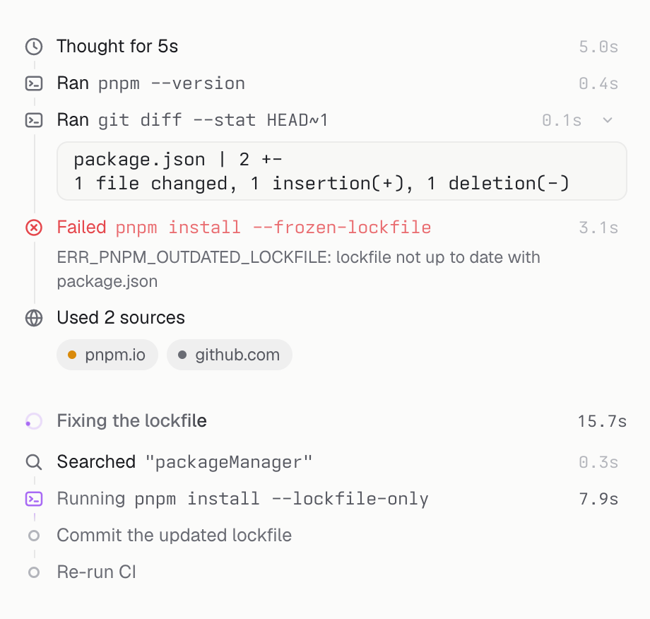
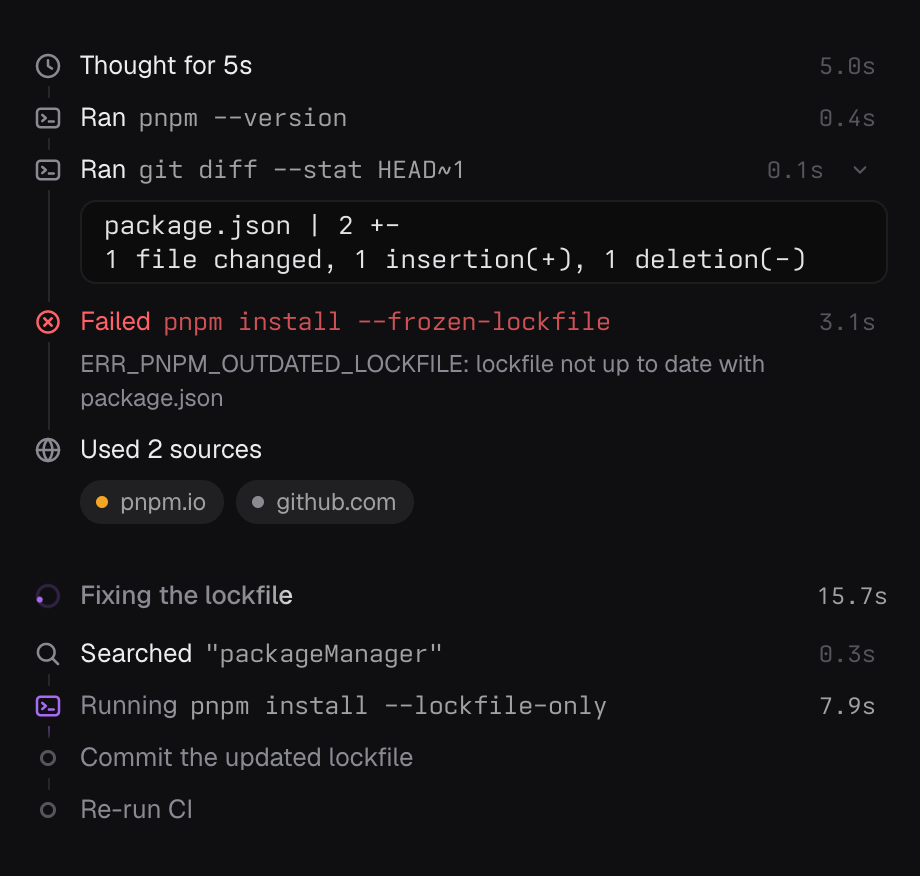
<figcaption>默认的 rail 外观：含内容的行会就地展开；运行中的行带闪烁效果并计时。</figcaption>
</figure>


推理块使用同一个节点并设置 `variant = "card"`：子节点是文字正文，`sources` 是底部的来源标签。

```lua
ui.node("trace", {
	variant = "card",
	status = thinking and "running" or "done",
	age = thinking and elapsed or nil,
	took = not thinking and took or nil,
	sources = { { title = "pnpm install", href = "https://pnpm.io/cli/install", site = "pnpm.io" } },
}, {
	ui.node("text", { text = "The frozen install fails because the lockfile was not updated after the version bump." }),
})
```

<figure class="tn-figure">
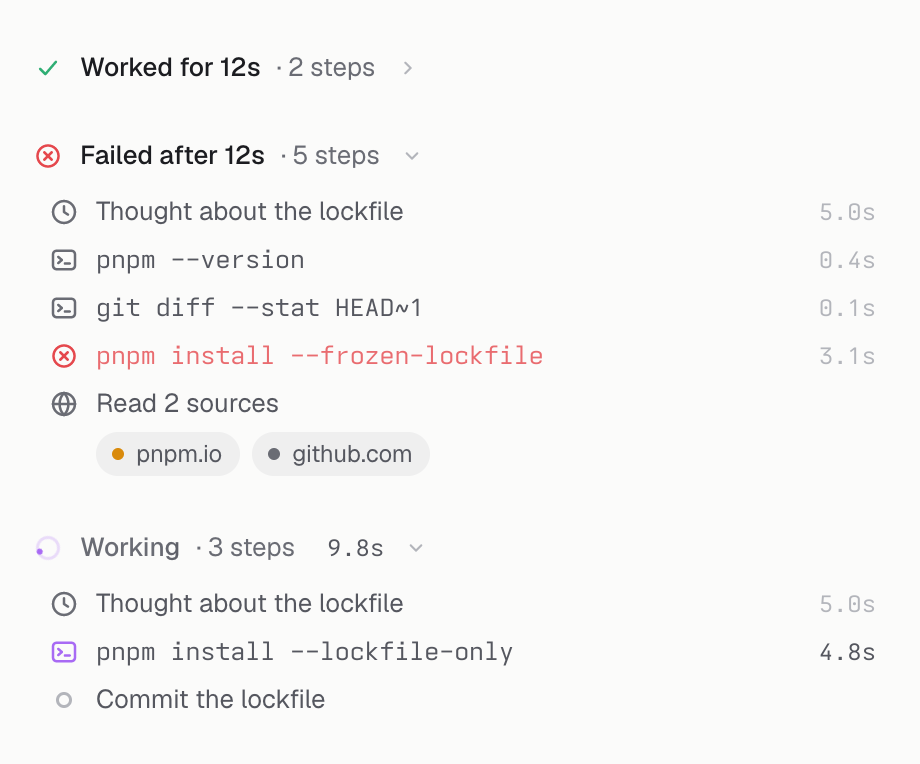
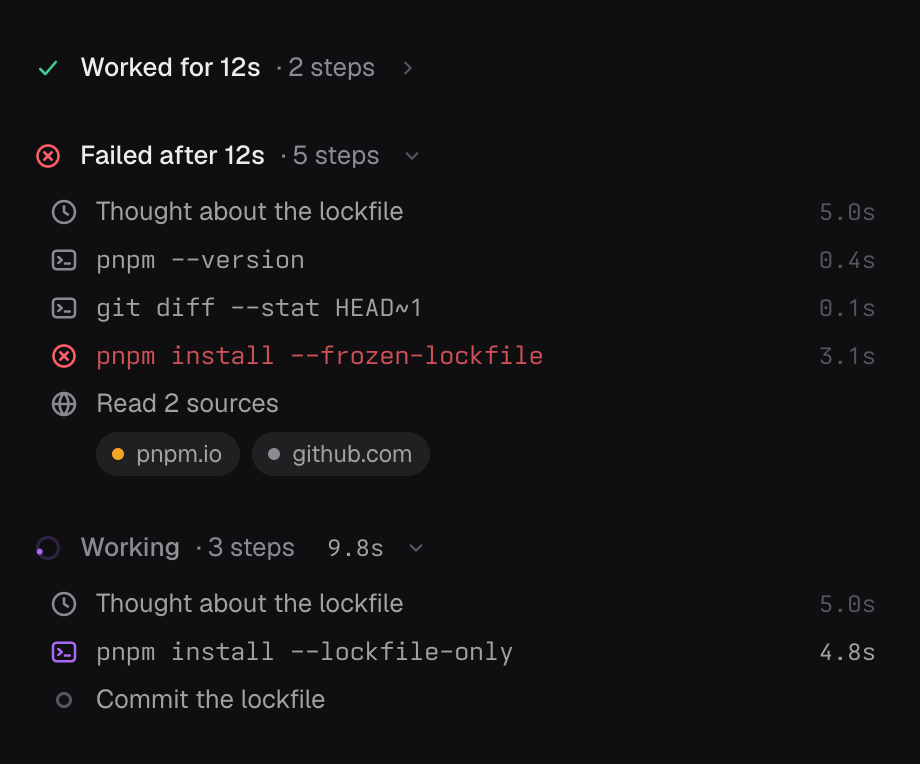
<figcaption><code>variant = "summary"</code> 会根据状态和时间生成摘要行。</figcaption>
</figure>

<figure class="tn-figure">
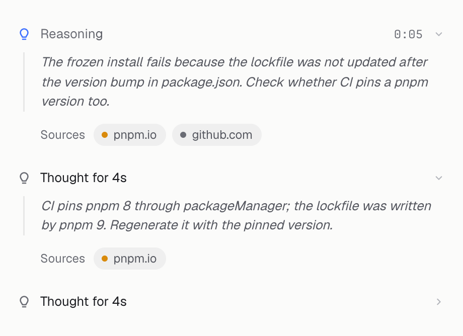
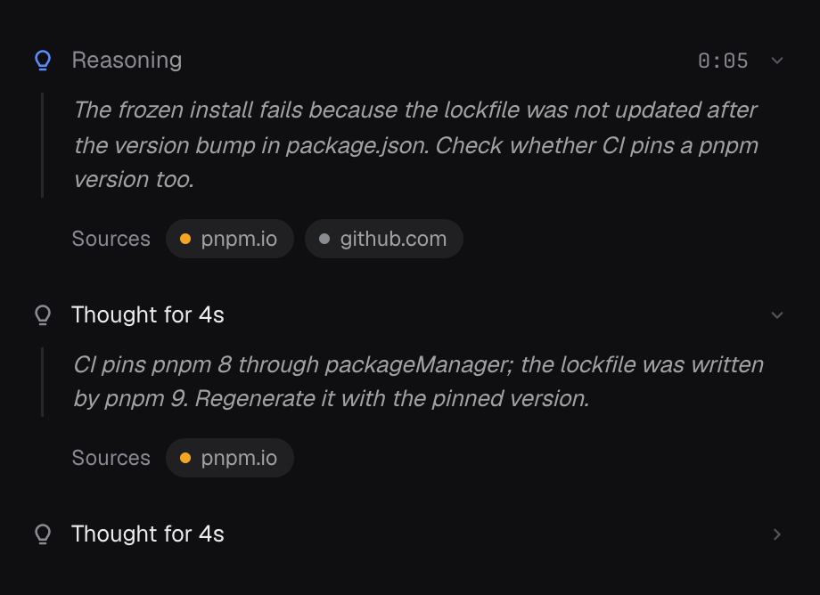
<figcaption><code>variant = "card"</code>：带来源的推理内容。</figcaption>
</figure>


**构建方式：** `tern.ui.node("trace", { … }, { …content })`。

| 属性 | 类型 | 默认值 | 含义 |
| --- | --- | --- | --- |
| `variant` | `"rail"` \| `"summary"` \| `"card"` | `"rail"` | 外观（见上表）。 |
| `lines` | 行数组（见下文） | `[]` | 按顺序排列的步骤。 |
| `status` | `"pending"` \| `"running"` \| `"done"` \| `"error"` | `"pending"` | 整个 trace 的状态：标题字形、闪烁效果、计时器模式、派生摘要。 |
| `title` | 文本 | 无 | 标题文字（`card`：默认 `Reasoning` / `Thought for <took>`；`rail`：说明文字，未设置时无标题）。此处不是工具提示。 |
| `summary` | 文本 | 自动生成 | `summary` 标题文字；默认派生值：`Working`（运行中）、`Queued`（待处理）、`Worked for 12s`（已完成）、`Failed after 12s`（出错）。 |
| `icon` | string（图标名称） | `card` 为 `lightbulb`，否则无 | 非运行或失败时的标题字形。 |
| `age` | number（毫秒） | 无 | 发送时已经过的时间；运行中或待处理时用于标题实时计时器。 |
| `took` | number（毫秒） | 无 | 结束后的总耗时（若无则用 `age`）。 |
| `open` | boolean | `summary` 为 `false`，否则为 `true` | 标题的展开状态（适用于 `summary`、`card`）；更改会覆盖用户选择。 |
| `sources` | 来源数组（见下文） | `[]` | trace 底部的 `Sources` 行。 |
| `key` | string | 节点 id | 同级节点中的标识。 |

行字段：

| 字段 | 类型 | 默认值 | 含义 |
| --- | --- | --- | --- |
| `id` | string | 索引 | 标识：用于关联内容子节点、展开状态和 `toggle` 事件的 `item`。 |
| `icon` | string（图标名称） | 无 | 行字形（`clock`、`terminal`、`globe`、`search` 等），按状态着色。 |
| `title` | 文本（片段） | 无 | 文字描述的步骤；`running` 时带闪烁效果。 |
| `target` | 文本 | 无 | 操作对象，使用等宽字体（命令、路径、查询）；超出部分省略，完整文本作为工具提示。 |
| `detail` | 文本 | 无 | 行下方的弱化说明。 |
| `status` | `"pending"` \| `"running"` \| `"done"` \| `"error"` | `"pending"` | 类 `st-<status>`、字形和计时器。 |
| `age` | number（毫秒） | 无 | 发送时已经过的时间；`running` 时显示实时计时器。 |
| `took` | number（毫秒） | 无 | 结束后的耗时（若无则用 `age`）。 |
| `open` | boolean | `false` | 是否显示其内容；更改会覆盖用户选择。没有内容时忽略。 |
| `sources` | 来源数组 | `[]` | 行下方的标签。 |

来源格式：`{ title?, href?, site? }`（`site` 默认为 `href` 主机名，去除 `www.`）。

**子节点：** `key`（若无则 id）与某行 `id` 相同的子节点会放在该行下方；其余子节点按顺序构成正文（`.sf-trace-prose`，为空时隐藏）。

**事件：** 用户切换行或标题时发送 `toggle { id, item?, open }`（行的 `item` 为其 id；标题不带 `item`）。来源标签会请求 host 打开其 `href`（不发送事件）。此外还有节点通用的 `actions`。

**样式：**

```html
<div class="sf sf-trace rail st-running open" role="group" data-id="…">
	<div class="sf-trace-head" role="button" aria-expanded="true"><!-- summary, card, titled rail -->
		<span class="sf-trace-g"><!-- glyph --></span>
		<span class="sf-trace-title">Worked for 12s</span>
		<span class="sf-trace-n">· 5 steps</span>
		<span class="sf-trace-sp"></span>
		<span class="sf-trace-time" role="timer">0:04</span>
		<span class="sf-chev"></span>
	</div>
	<div class="sf-trace-fold"><div class="sf-trace-in">
		<div class="sf-trace-lines" role="list">
			<div class="sf-trace-line st-done has-body open [last]" role="listitem">
				<div class="sf-trace-row" role="button" aria-expanded="true">
					<span class="sf-trace-g"><!-- icon, i.sf-trace-spin, i.hollow; .tick --></span>
					<span class="sf-trace-t">
						<span class="sf-trace-title">Ran</span>
						<span class="sf-trace-target">git diff --stat HEAD~1</span>
					</span>
					<span class="sf-trace-time" role="timer">0.1s</span>
					<span class="sf-chev"></span>
				</div>
				<div class="sf-trace-detail">…</div>
				<div class="sf-trace-srcs">
					<button class="sf-trace-src" data-hue="2"><i class="dot"></i>pnpm.io</button>
				</div>
				<div class="sf-trace-body"><div class="sf-trace-in"><!-- the line's children --></div></div>
			</div>
		</div>
		<div class="sf-trace-prose"><!-- the body --></div>
		<div class="sf-trace-srcs"><span class="sf-trace-srcs-l">Sources</span><!-- chips --></div>
	</div></div>
</div>
```
| 目标 | 选择器 |
| --- | --- |
| 节点 | `.sf-trace` |
| 变体 | `.sf-trace.rail`、`.summary`、`.card` |
| 状态 | `.sf-trace.st-running`、`.st-done`、`.st-error`、`.st-pending`（`.sf-trace-line` 上也有） |
| 展开状态 | `.sf-trace.open`、`.sf-trace-line.open`、`.sf-trace-line.has-body` |
| 标题 | `.sf-trace-head` 及 `.sf-trace-g`、`.sf-trace-title`、`.sf-trace-n`、`.sf-trace-time`、`.sf-chev`（内部实现，可能改变） |
| 行 | `.sf-trace-line`（`.last`）、`.sf-trace-row`、`.sf-trace-g`（`.tick`、`.sf-trace-spin`、`.hollow`）、`.sf-trace-title`、`.sf-trace-target`、`.sf-trace-time`、`.sf-trace-detail`（内部实现，可能改变） |
| 竖线 | `.sf-trace-line::before`（内部实现，可能改变） |
| 内容、正文 | `.sf-trace-body`、`.sf-trace-prose`（内部实现，可能改变） |
| 来源 | `.sf-trace-srcs`、`.sf-trace-srcs-l`、`.sf-trace-src[data-hue]`（0–5）、`.sf-trace-src .dot`（内部实现，可能改变） |

环形图标、闪烁效果和折叠会播放动画，并在减少动态效果或静态视图（`.sf-still`）下停止；计时器仍会走动。

## `stacktrace`

以数据形式绘制错误及抛出错误的堆栈。发送错误类型和消息，以及按最内层优先排列的堆栈帧；Tern 会高亮你代码中的帧，折叠其中的库帧，并在双击帧时打开对应文件和行。凡是运行、测试或代理工具调用因异常失败，都可以使用它，例如测试 runner 的失败、崩溃报告或服务器日志条目。纯文本日志请使用 `ansi` 或 `code`。

**变体。** `variant` 选择外观：

- **`frames`**（默认）：错误卡片。标题显示错误图标、错误颜色的类型及其下方完整换行的消息。每个应用帧占两行：等宽字体函数名，以及弱化的目录和醒目的 `file:line`。每段库帧（`app = false`）折叠为一行弱化的“▸ N library frames”；点击会就地展开（仅本地视图状态，不会发送）。选中的库帧会展开其所在帧组。
- **`split`**：错误单行位于帧列表上方，帧列表（左侧函数名、右侧 `file:line`）与选中帧的代码摘录并排显示；代码使用与 `code` 相同的 Tern 高亮器，错误行带错误色调和标记。空间较窄时，代码移到列表下方。没有 `code` 的帧显示“No source for this frame”。
- **`mono`**：错误颜色的 `Type: message` 行下方是紧凑的 `at fn (file:line:col)` 等宽区域；选中帧以错误状态条高亮，库帧弱化，底部提供 Copy 按钮。

| 变体 | 外观 | 适用场景 |
| --- | --- | --- |
| `frames` | 错误卡片：图标、类型、消息；应用帧按函数名及 `dir/file:line` 展示；库帧组折叠 | 对话记录或结果视图中的失败信息 |
| `split` | 错误行位于帧列表上方，旁边是选中帧的高亮代码，错误行有标记 | 有源代码时的调试器式视图 |
| `mono` | `at fn (file:line:col)` 等宽区域，选中帧高亮，底部有 Copy | 用户会复制到其他位置的紧凑日志条目 |

**选择。** 点击帧会立即选中它（在 `split` 中同时显示其代码），并发送 `select`；双击会发送 `activate` 并打开该帧所在行和列的文件，方式与链接的 `path` span 相同（`src/a.ts#L42C13`；host 会根据窗格目录解析相对路径）。设置 `selected` 之前，默认选中第一个应用帧。`selected` 更改时优先于本地选择。

**复制。** Copy 按钮或节点上的 `copy` action 会将完整堆栈作为文本复制到剪贴板：

```text
TypeError: Cannot read properties of undefined (reading 'id')
    at resolveUser (src/auth/session.ts:42:13)
    at Layer.handle (node_modules/express/lib/router/layer.js:95:5)
```

```lua
tern.ui.node("stacktrace", {
	key = "crash",
	variant = "split",
	lang = "typescript",
	error = { type = "TypeError", message = "Cannot read properties of undefined (reading 'id')" },
	frames = {
		{ fn = "resolveUser", file = "src/auth/session.ts", line = 42, col = 13,
			code = { start = 40, lines = {
				"  const s = await load(token);",
				"  if (!s) return null;",
				"  return users.get(s.user.id);",
				"}",
			} } },
		{ fn = "Layer.handle", file = "node_modules/express/lib/router/layer.js", line = 95, col = 5, app = false },
		{ fn = "main", file = "src/index.ts", line = 8, col = 3 },
	},
	selected = state.frame,
})
```

<figure class="tn-figure">
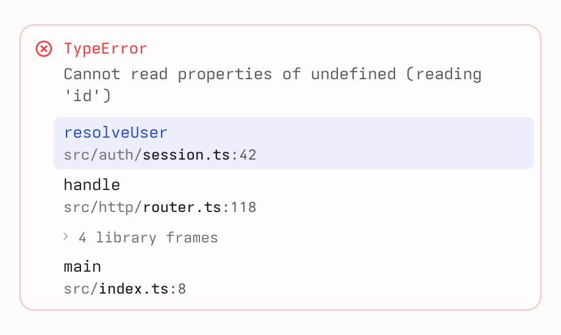
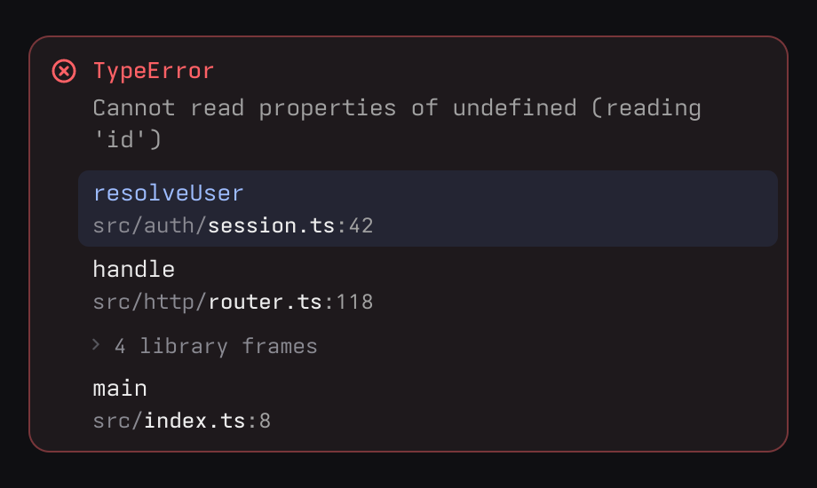
<figcaption><code>frames</code>：高亮应用帧，折叠库帧。</figcaption>
</figure>


<figure class="tn-figure">
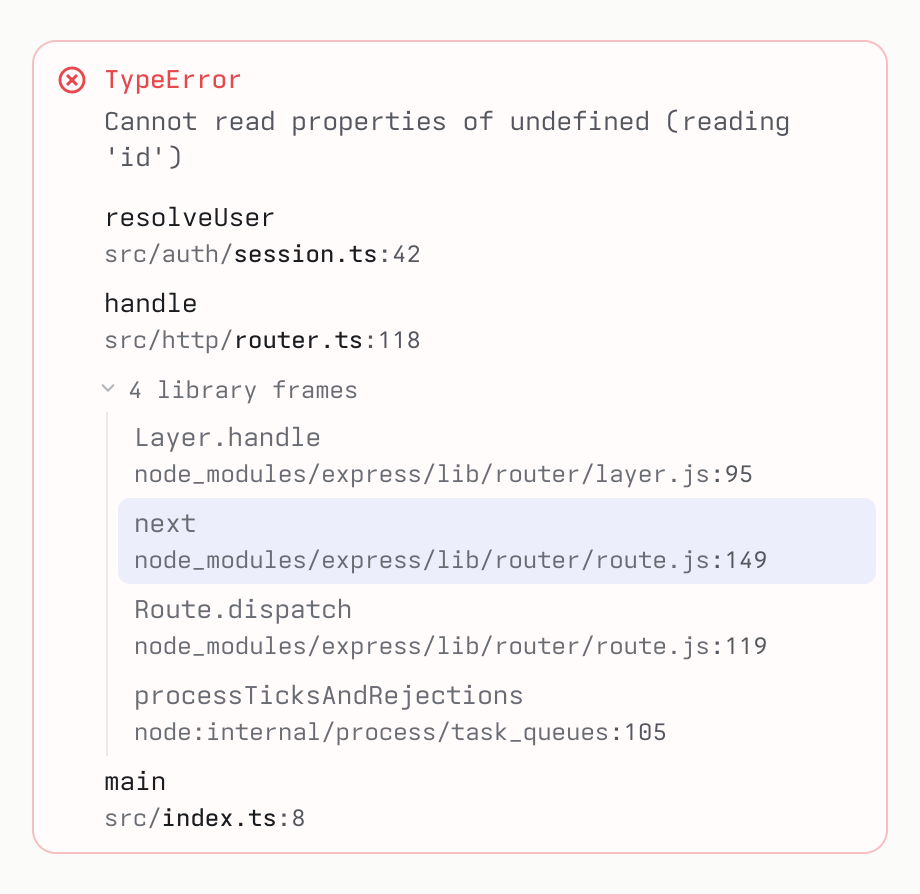
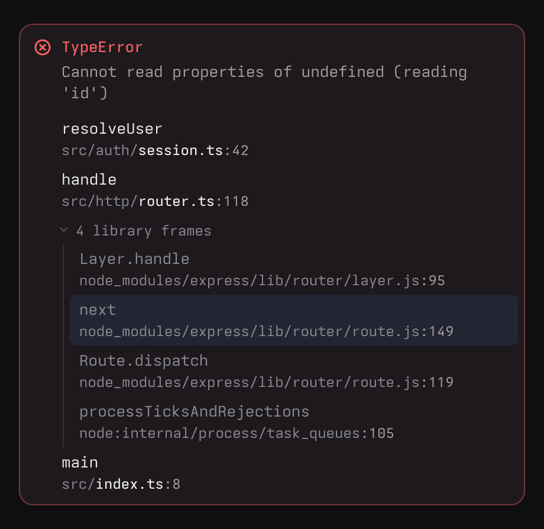
<figcaption>选中的库帧会展开其所在帧组。</figcaption>
</figure>

<figure class="tn-figure">
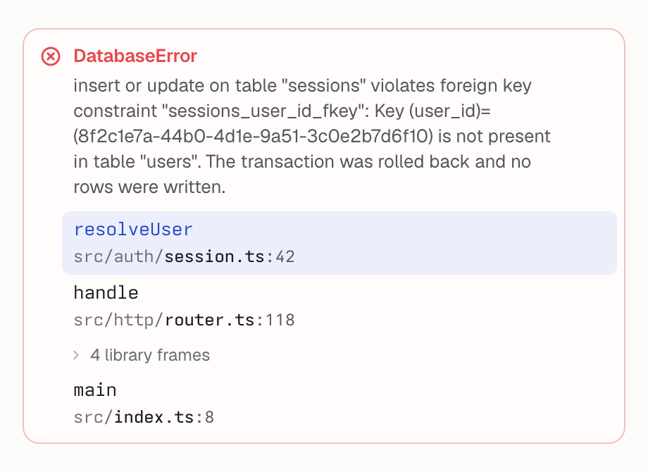
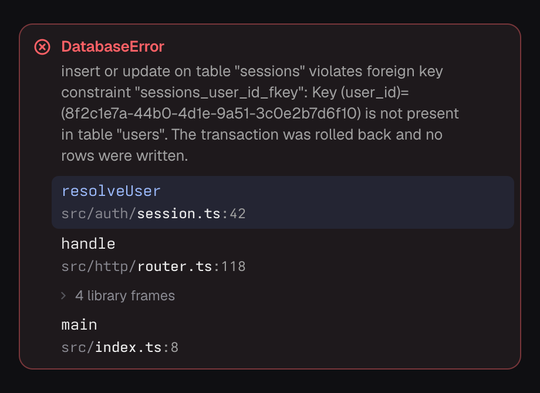
<figcaption>长消息会完整换行显示。</figcaption>
</figure>


<figure class="tn-figure">
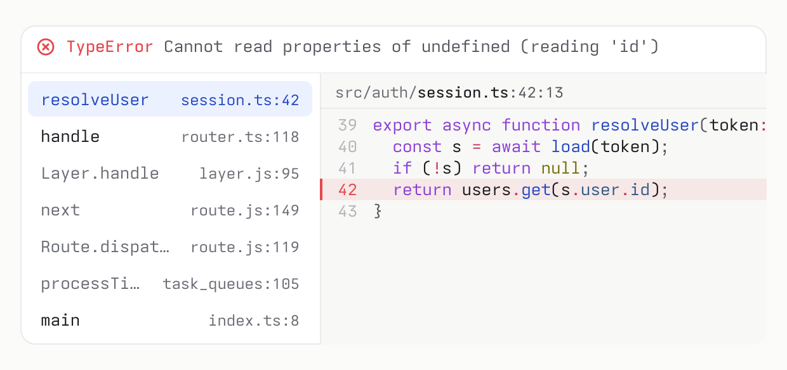
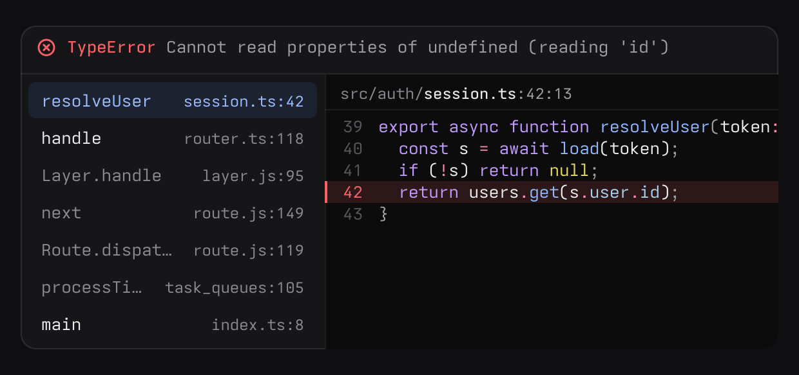
<figcaption><code>split</code>：帧列表旁显示选中帧处的代码。</figcaption>
</figure>

<figure class="tn-figure">
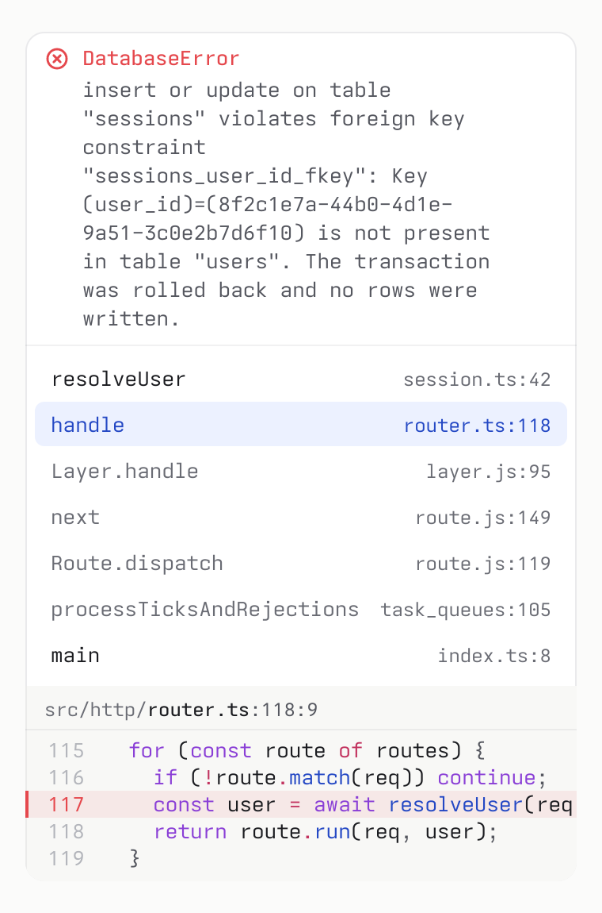
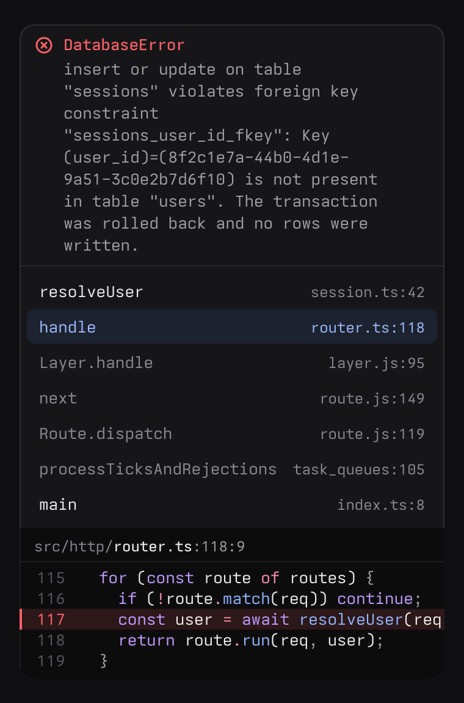
<figcaption>空间较窄时，代码移到列表下方。</figcaption>
</figure>

<figure class="tn-figure">
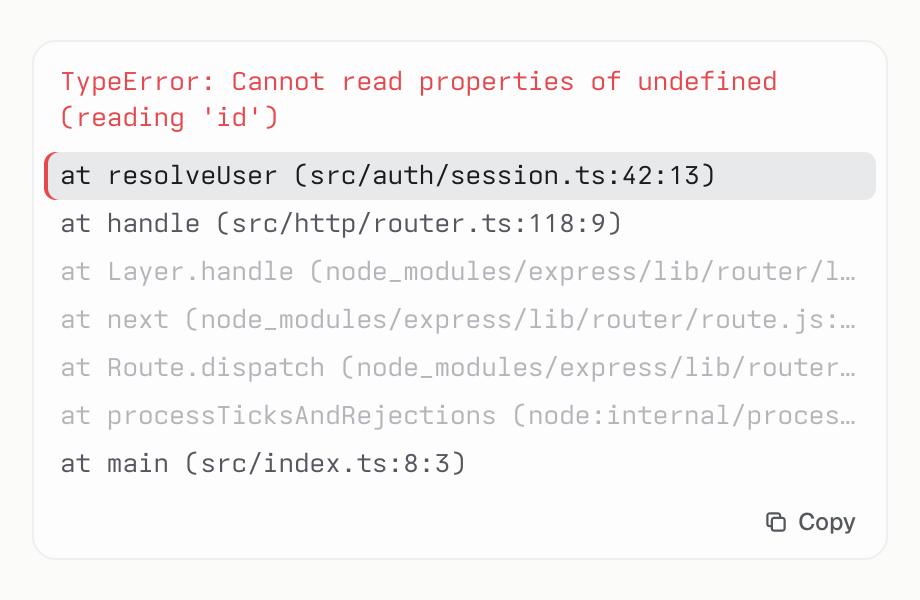
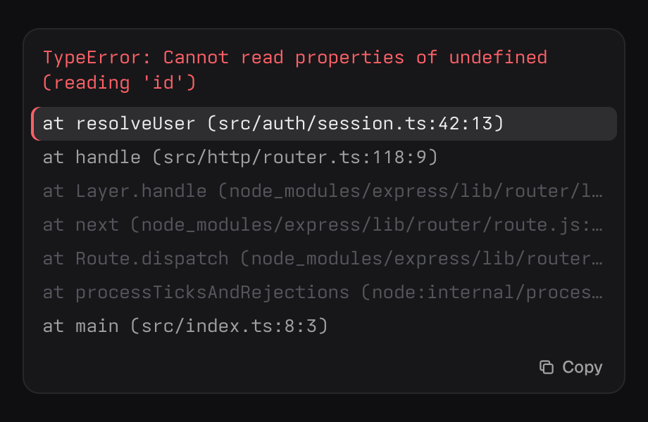
<figcaption><code>mono</code>：紧凑行和 Copy 按钮。</figcaption>
</figure>

<figure class="tn-figure">
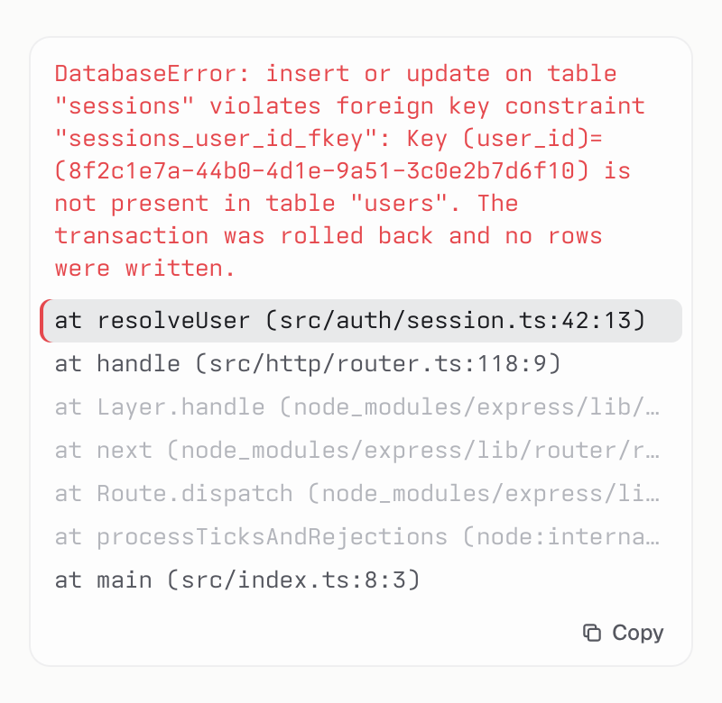
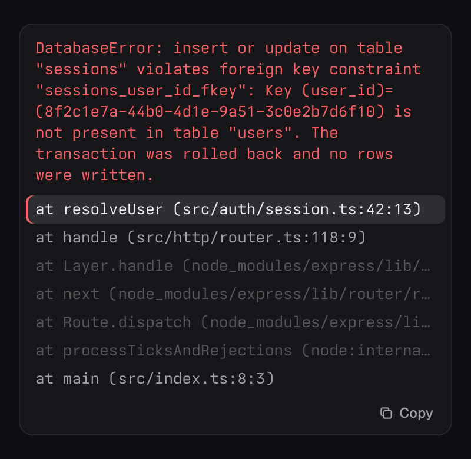
<figcaption><code>mono</code> 中的长消息。</figcaption>
</figure>

**构建方式：** `tern.ui.node("stacktrace", { error = …, frames = … })`。

| 属性 | 类型 | 默认值 | 含义 |
| --- | --- | --- | --- |
| `error` | `{ type?, message? }` | 无 | 错误。标题显示类型和消息（`mono`：`Type: message`）。 |
| `frames` | 堆栈帧数组 | `[]` | 按最内层优先排列的堆栈。 |
| `frames[].fn` | string | `""` | 函数（为空时显示 `<anonymous>`）。 |
| `frames[].file` | string | `""` | 程序已知的文件路径；相对路径会相对于窗格目录打开。 |
| `frames[].line` | integer | 无 | 从 1 开始计数的行号。 |
| `frames[].col` | integer | 无 | 从 1 开始计数的列号（`mono`、`split` 代码标题和打开链接会显示）。 |
| `frames[].app` | boolean | `true` | 是否为你的代码（`true`）或库代码（`false`：在 `frames` 中折叠，在其他变体中弱化）。 |
| `frames[].code` | `{ start?, lines, line? }` | 无 | `split` 的源代码摘录：起始行号（默认 1）、各行内容以及标记行（默认使用帧的 `line`）。 |
| `selected` | integer | 第一个应用帧 | 选中帧的索引。更改会覆盖用户上次的选择。 |
| `lang` | string | 根据第一个摘录的文件名确定 | 摘录的高亮语言（`typescript`、`rust` 等）。 |
| `variant` | `"frames"` \| `"split"` \| `"mono"` | `"frames"` | 外观。 |

**子节点：** 无（会忽略）。

**事件：** 点击帧 `item`（索引）时发送 `select { id, item }`，并立即显示选中状态；双击时发送 `activate { id, item }`，Tern 会在其所在行打开文件。库帧折叠和 Copy 都是本地操作，不发送事件。surface 以 `listen: false` 打开（或已关闭）时，点击不会选择，也不会发送事件；折叠、复制和打开文件仍然有效。此外还有节点通用的 `actions`。

**键盘：** 堆栈不会获取焦点。通过设置 `selected` 让按键控制选择（↑↓切换帧），并在 Enter 时自行打开帧（发送 host 的 open，或复用 `activate` 的处理方式）。

**样式：**

```html
<div class="sf sf-stacktrace" data-id="…" data-variant="frames">
	<div class="sf-st-head" data-variant="frames">
		<span class="sf-st-ic" aria-hidden="true"><svg class="ico">…</svg></span>
		<div class="sf-st-title">
			<span class="sf-st-type">TypeError</span>
			<span class="sf-st-msg">Cannot read properties of undefined</span>
		</div>
		<button class="sf-st-copy sf-button" data-variant="quiet" data-size="sm" data-act="copy" aria-label="Copy trace"></button>
	</div>
	<div class="sf-st-body">
		<!-- frames -->
		<div class="sf-st-frames" role="listbox">
			<div class="sf-st-frame [sel]" data-frame="0" role="option" aria-selected="true">
				<span class="sf-st-fn">resolveUser</span>
				<span class="sf-st-loc"><span class="dir">src/auth/</span><span class="name">session.ts</span><span class="pos">:42</span></span>
			</div>
			<div class="sf-st-fold [open]">
				<div class="sf-st-fold-head" role="button" data-fold="1" aria-expanded="false">
					<span class="sf-chev"></span><span class="sf-st-fold-label">2 library frames</span>
				</div>
				<div class="sf-st-fold-body"><div class="sf-st-frame lib" data-frame="1">…</div></div>
			</div>
		</div>
		<!-- split -->
		<div class="sf-st-split">
			<div class="sf-st-list" role="listbox">
				<div class="sf-st-frame [lib] [sel]" data-frame="0"><span class="sf-st-fn"></span><span class="sf-st-at">session.ts:42</span></div>
			</div>
			<div class="sf-st-code">
				<div class="sf-st-nocode [sf-hidden]">No source for this frame</div>
				<div class="sf-st-pane [sf-hidden]" data-pane="0">
					<div class="sf-st-path"><span class="sf-st-loc">…</span></div>
					<div class="sf-st-lines">
						<div class="sf-st-ln [err]"><span class="sf-st-gut">42</span><span class="sf-st-lt"><span class="tk-keyword">return</span> …</span></div>
					</div>
				</div>
			</div>
		</div>
		<!-- mono -->
		<div class="sf-st-frame mono [lib] [sel]" data-frame="0">at resolveUser (src/auth/session.ts:42:13)</div>
	</div>
	<div class="sf-st-foot"><!-- mono: the Copy button --></div>
</div>
```

| 目标 | 选择器 |
| --- | --- |
| 节点 | `.sf-stacktrace`、`[data-variant='frames' \| 'split' \| 'mono']` |
| 标题 | `.sf-st-head`、`.sf-st-ic`、`.sf-st-title`、`.sf-st-type`、`.sf-st-msg`、`.sf-st-copy`（内部实现，可能改变） |
| 帧 | `.sf-st-frame[data-frame='<index>']` 及 `.sel`、`.lib`、`.mono`；`.sf-st-fn`、`.sf-st-loc`（`.dir`、`.name`、`.pos`）、`.sf-st-at`（内部实现，可能改变） |
| 库帧折叠 | `.sf-st-frames`、`.sf-st-fold`（`.open`）、`.sf-st-fold-head`、`.sf-st-fold-label`、`.sf-st-fold-body`（内部实现，可能改变） |
| Split | `.sf-st-split`、`.sf-st-list`、`.sf-st-code`、`.sf-st-nocode`、`.sf-st-pane`、`.sf-st-path`、`.sf-st-lines`、`.sf-st-ln`（`.err`）、`.sf-st-gut`、`.sf-st-lt` 及高亮器的 `.tk-*`（内部实现，可能改变） |
| 底栏 | `.sf-st-foot`（内部实现，可能改变） |

变量：节点上的 `--st-row` 是 `mono` 行和库帧折叠行的高度（24px）。折叠和 `split` 代码面板会播放进入动画，并在减少动态效果或静态视图（`.sf-still`）下停止。

## `checklist`

按阶段组织的待办列表，以三种呈现方式之一从数据绘制。omp 将其用于待办工具（`full`）、消息输入框上方的胶囊（`hud`）和回合结束提示（`reminder`）。插件可用于发布检查清单、迁移计划或任何分阶段进度。

**项目。** 每项都有 `status`：`pending`（空心环）、`active`（环内脉动圆点，文字突出）、`done`（勾号，文字删除线）、`dropped`（短横线、删除线、弱化）或 `blocked`（警告三角形；其注记使用警告色）。未知状态按 `pending` 绘制。阶段进度统计 `done` 和 `dropped` 项。

**`full`**（默认）。每个阶段是一行，包含进度环、标题及 `done/total`，其下方列出项目。单个无标题阶段会隐藏其标题行。完成的阶段会折叠为一行；阶段上的 `collapsed` prop 可覆盖此行为。点击阶段行（或按 Enter/Space）可在本地切换展开状态；状态按阶段 id 在节点存续期间记忆。没有 `id` 的阶段共享一个折叠状态。

**`hud`。** 右侧边缘的胶囊按钮：整体进度环、首个 `active` 项的文字（否则为首个 `pending`；如果都没有，则显示“All done”或“Todos”）以及 `done/total`。点击会打开或关闭胶囊上方的弹出层（`.sf-ck-pop`），其中显示 `full` 列表，并发送 `activate { id, item = "hud" }`。

**`reminder`。** 标题按钮：警告图标、“`N todos still open`”（未完成项指 `pending`、`active` 或 `blocked`）、`note` 和折叠箭头。点击仅展开未完成项。

自上次绘制以来变为 `done` 的项目会获得一次 `.fresh`：勾号缩放出现并绘制删除线，后续重绘不会重复。向同一个节点发送新的 `phases` 更新以保留此状态。

**构建方式：** `tern.ui.node("checklist", { mode = …, phases = { … } })`。

| 属性 | 类型 | 默认值 | 含义 |
| --- | --- | --- | --- |
| `phases` | 阶段数组 | `[]` | 阶段列表。 |
| `phases[].id` | string | `""` | 阶段 id；用于标识本地折叠状态。 |
| `phases[].title` | 文本 | 无 | 阶段标题。 |
| `phases[].items` | 项目数组 | `[]` | 项目列表（没有 `id` 的项目会跳过）。 |
| `phases[].collapsed` | boolean | 完成时折叠 | 初始折叠状态。 |
| `items[].id` | string | 必填 | 项目 id；用于标识 `.fresh` 动画。 |
| `items[].text` | 文本 | `""` | 项目文字。 |
| `items[].status` | `"pending"` \| `"active"` \| `"done"` \| `"dropped"` \| `"blocked"` | `"pending"` | 项目状态。 |
| `items[].note` | 文本 | 无 | 项目下方的一行文字。 |
| `mode` | `"full"` \| `"hud"` \| `"reminder"` | `"full"` | 呈现方式；同时作为节点上的类。 |
| `note` | 文本 | 无 | 仅用于 `reminder`：计数之后的文字（“reminder 1/3”）。 |

**子节点：** 无（会忽略）。

**事件：** 点击 `hud` 胶囊时发送 `activate { id, item = "hud" }`。阶段折叠和 reminder 展开均为本地状态，不发送事件。

**样式：**

```html
<!-- full -->
<div class="sf sf-checklist full" data-id="…" role="group" aria-label="Todos, 3 of 7 done">
	<div class="sf-ck-phase [done] [folded]">
		<div class="sf-ck-ph" role="button" tabindex="0" aria-expanded="true">
			<svg class="sf-ring [full]"><circle class="tr"/><circle class="fl"/></svg>
			<span class="t">Ship</span><span class="n">2/3</span>
		</div>
		<div class="sf-ck-items">
			<div class="sf-ck-item st-done [fresh]">
				<span class="sf-ck-g"><!-- check / dash / warn / <i class="dot"> --></span>
				<span class="sf-ck-t">Tag the release</span>
				<div class="sf-ck-note">waiting on CI</div>
			</div>
		</div>
	</div>
</div>
<!-- hud -->
<div class="sf sf-checklist hud [open]">
	<button class="sf-ck-pill" aria-expanded="false"><svg class="sf-ring">…</svg><span class="t">Tag the release</span><span class="n">3/7</span></button>
	<div class="sf-ck-pop [sf-hidden]"><!-- the full list --></div>
</div>
<!-- reminder -->
<div class="sf sf-checklist reminder [open]">
	<div class="sf-ck-rh" role="button" tabindex="0"><span class="ic"><!-- warn --></span><span class="t">4 todos still open</span><span class="n">reminder 1/3</span><span class="sf-chev"></span></div>
	<div class="sf-ck-items"><!-- open items --></div>
</div>
```

| 目标 | 选择器 |
| --- | --- |
| 节点 | `.sf-checklist` |
| 呈现方式 | `.sf-checklist.full`、`.hud`、`.reminder`；`.open`（弹出层或 reminder 已展开） |
| 阶段 | `.sf-ck-phase`（`.done`、`.folded`）、`.sf-ck-ph` 及 `.t`、`.n`（内部实现，可能改变） |
| 进度环 | `.sf-ring`（完成时为 `.full`）、`.sf-ring .tr`、`.sf-ring .fl`（内部实现，可能改变） |
| 项目 | `.sf-ck-items`、`.sf-ck-item.st-<status>`、`.sf-ck-item.fresh`（内部实现，可能改变） |
| 项目部分 | `.sf-ck-g`（active 时为 `.dot`）、`.sf-ck-t`、`.sf-ck-note`（内部实现，可能改变） |
| HUD | `.sf-ck-pill` 及 `.t`、`.n`；`.sf-ck-pop`（内部实现，可能改变） |
| 提醒 | `.sf-ck-rh` 及 `.ic`、`.t`、`.n`、`.sf-chev`（内部实现，可能改变） |

进度环的填充通过内联设置的 `stroke-dasharray` 控制。脉动、删除线、弹出层和 active 圆点的动画会在减少动态效果或静态视图中停止。

```lua
local ui = tern.ui

local phases = {
	{ id = "build", title = "Build", items = {
		{ id = "b1", text = "Compile", status = "done" },
		{ id = "b2", text = "Test", status = "done" },
	} },
	{ id = "ship", title = "Ship", items = {
		{ id = "s1", text = "Write the changelog", status = "done" },
		{ id = "s2", text = "Tag the release", status = "active" },
		{ id = "s3", text = "Publish", status = "blocked", note = "waiting on approval" },
		{ id = "s4", text = "Announce", status = "pending" },
		{ id = "s5", text = "Update the old docs", status = "dropped" },
	} },
}

ui.node("col", { gap = "md" }, {
	ui.node("checklist", { mode = "full", phases = phases }),
	ui.node("checklist", { mode = "hud", phases = phases }),
	ui.node("checklist", { mode = "reminder", note = "reminder 1/3", phases = phases }),
})
```

<figure class="tn-figure">
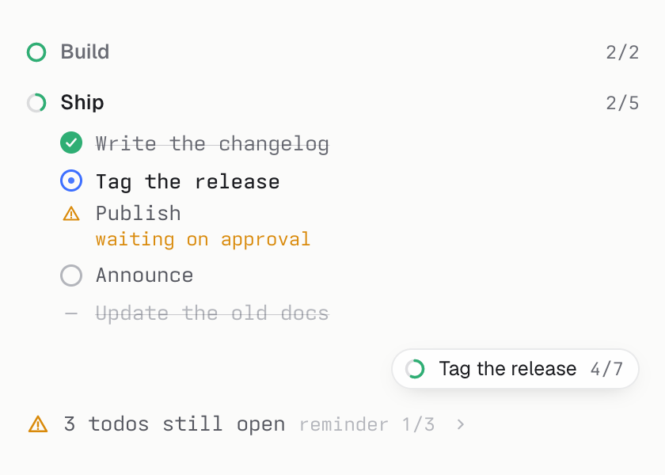
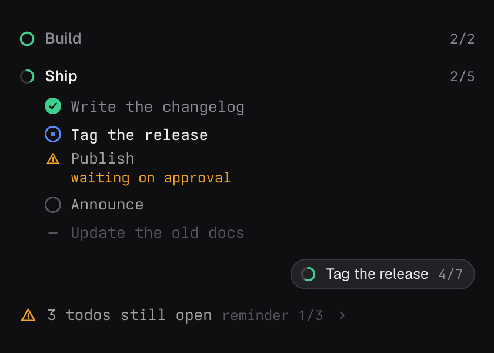
<figcaption>相同阶段的 <code>full</code>、<code>hud</code> 和 <code>reminder</code> 呈现。Build 已完成，因此折叠为一行。</figcaption>
</figure>

## `message`

一条对话中的单条消息。节点绘制聊天消息的框架（作者及时间、头像、收到的回应、悬停操作行和状态行），其子节点构成正文：可以是用于文字的 `md`、`code` 块、图片、`tool` 卡片等。一个 kind 通过 `variant` 覆盖三种聊天外观：

- **`auto`**（默认）是 omp Reader 使用的代理聊天外观：本地用户的消息（`side = "end"`）靠右显示为强调色调气泡；其他消息在小头像、名称和时间下方，以普通正文铺满内容宽度。
- **`bubble`** 是即时消息外观：两侧都是气泡，起始侧消息旁有头像，气泡下方显示回应标签，本地用户消息下方显示状态。
- **`flat`** 是团队讨论串（Slack、Linear 评论）：每行从左侧开始，显示 32px 头像、名称和时间，正文在下方；指针悬停时整行着色，操作按钮浮动在右上角。

一侧为代理时使用 `auto`，用户彼此交谈时使用 `flat`，类似手机即时消息时使用 `bubble`。将消息放在无间隔的 `col` 中：每条消息会自行控制与上一条的距离（通常为 12px，`continued` 时为 2px）。

| 变体 | 外观 | 适用场景 |
| --- | --- | --- |
| `auto` | 结束侧：右侧显示强调色调气泡（浅色 13%，深色 24%），最大宽度为区域宽度的 78% 或 560px，圆角半径 18，尾部角为 6px。起始侧：20px 头像、名称（字重 550）和使用等宽字体 `--t3` 的时间，下方是宽度铺满的普通正文 | 代理聊天：用户提问，代理以文字、代码和工具卡片作答 |
| `bubble` | 两侧都是气泡：结束侧右边显示强调色调气泡；起始侧在 28px 头像旁显示柔和灰色气泡（`--t1` 的 6.5%/8.5%），名称位于上方；气泡下方显示回应；连续气泡会收紧同侧圆角 | 即时消息、支持聊天及类似手机的聊天界面 |
| `flat` | 所有行从左侧开始：32px 头像、名称和时间，正文位于下方；指针悬停时整行使用 `--sf-shade` 着色；连续行在悬停时于头像栏显示时间；操作按钮浮动在行右上角的小型 `--pop-bg` 工具栏中 | 团队讨论串、评论、代码评审讨论 |

**侧别。** `side = "end"` 表示本地用户的消息。在 `auto` 和 `bubble` 中，它们位于右侧并使用强调色调气泡，不显示标题（用户知道自己是谁）；除非被 `status` 替代，否则 `time` 显示在底栏中。在 `flat` 中，侧别不影响布局：所有行都从左侧开始。

**连续消息。** `continued = true` 表示该消息与前一条来自同一作者：隐藏标题和头像（头像栏仍保留，因此内容对齐），与前一条间距为 2px；在 `bubble` 中会收紧同侧气泡圆角。在 `flat` 中，连续行悬停时会在头像栏显示 `time`。

**头像。** `avatar` 指定节点的一个子节点（[`avatar`](data.md#avatar) 节点，或 `icon`、`image`）；它会按变体规定的大小绘制在头像槽中（`auto` 为 20px，`bubble` 为 28px，`flat` 为 32px），不属于正文。在 `auto` 中，头像槽位于名称旁；在 `bubble` 和 `flat` 中，它位于左侧列的开头。`auto` 和 `bubble` 的结束侧消息会隐藏头像。

**回应。** `reactions` 列出正文下方的标签：`text`（表情符号或字形，也是回应的标识）、`count`（回应人数，包含本地用户）以及 `on`（本地用户是否参与）。点击会立即切换标签，并将用户计入或移出，然后发送 `change { value = text, on }`。切换状态按节点的 `key` 和标签文字记忆，因此使用新 id 重建节点时也会保留；直到下一帧更改该回应的 `on` 值时，由程序发送的值会重新优先。请将事件同步回 `on` 和 `count`。

**操作。** `actions` 是此 kind 自有的页脚图标按钮列表（在 `flat` 中是浮动在行右上角的小型工具栏），并非通用的 `{ click, menu }` 对象。指针悬停于消息时显示；设置 `reveal = "always"` 后始终显示（适用于代理聊天中的最新答案）。点击会像 click action 一样执行（见 [元素](index.md)）：`copy` 会复制消息文本（对于 `md`，复制子节点的 Markdown 源码）并显示 Copied；内置项（`open`、`toggle`、`zoom`、`select`、`activate`）与其他位置行为相同；其他 act 会发送 `action { act }`。未提供 `icon` 时，使用该 act 的默认图标（`copy`、`retry`/`regenerate`/`refresh` 使用 ↻、`edit`、`share`、`rewind`，其他使用 `more` ⋯）；未提供 `title` 时，工具提示使用首字母大写的 act。

**状态。** `status` 是消息下方以低调等宽字体显示的短行（“Read 14:03”、“Delivered”、“Edited”）。`pending = true` 会使其闪烁；若为结束侧消息，气泡也会变暗，表示消息仍在发送中。

```lua
local ui = tern.ui

local function message(m, prev)
	local same = prev and prev.author == m.author
	local kids = {}
	if not same and m.author ~= me then
		kids[#kids + 1] = ui.node("avatar", { id = m.id .. ".av", text = m.author, size = "sm" })
	end
	kids[#kids + 1] = ui.node("md", { text = m.text })
	return ui.node("message", {
		key = m.id,
		side = m.author == me and "end" or "start",
		author = m.author,
		time = m.time,
		continued = same,
		avatar = (not same and m.author ~= me) and (m.id .. ".av") or nil,
		reactions = m.reactions, -- { { text = "♥", count = 2, on = true } }
		actions = m.author == "omp" and {
			{ act = "copy" },
			{ act = "retry", title = "Regenerate" },
		} or nil,
		reveal = m.last and "always" or nil,
		status = m.author == me and m.read and ("Read " .. m.read) or nil,
		pending = m.sending,
	}, kids)
end

-- in the block's event handler
if ev.ev == "change" and ev.id:match("^msg") then
	toggle_reaction(ev.id, ev.value, ev.on)
elseif ev.ev == "action" and ev.act == "retry" then
	regenerate(ev.id)
end
```

<figure class="tn-figure">
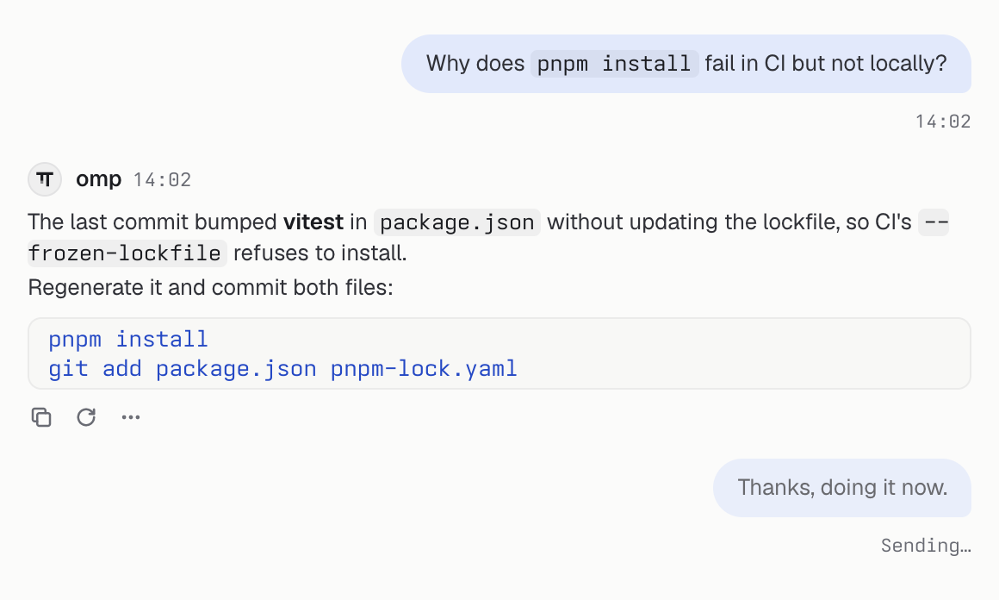
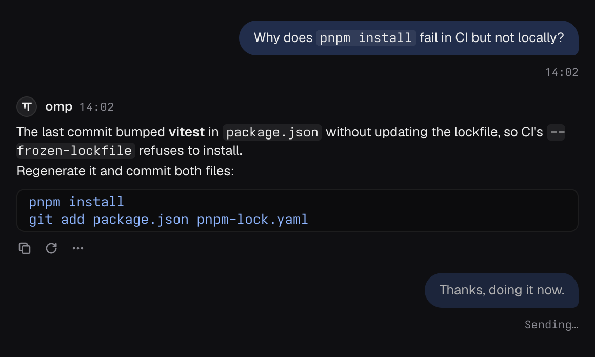
<figcaption><code>auto</code>：用户消息在右侧显示为气泡，代理消息以纯文本显示并带操作按钮。</figcaption>
</figure>

<figure class="tn-figure">
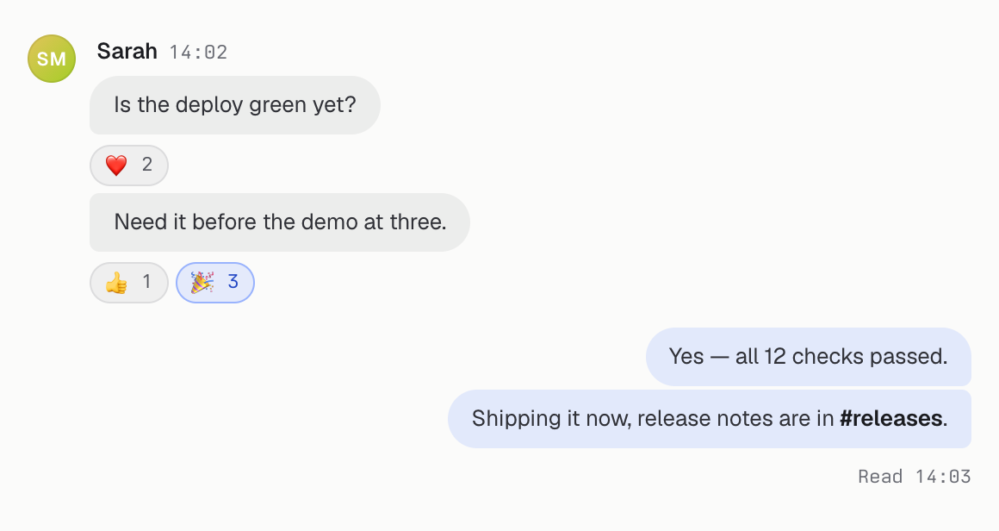
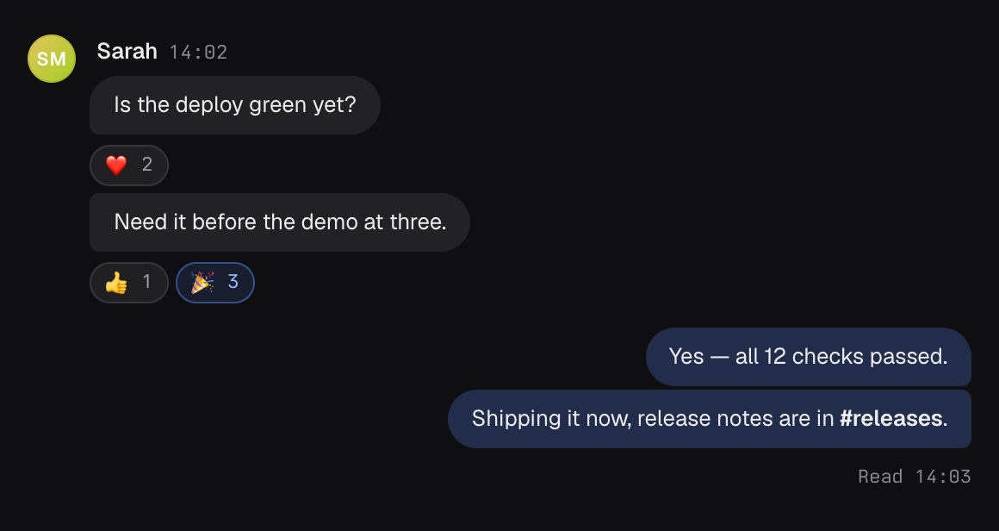
<figcaption><code>bubble</code>：两侧均为气泡，并显示回应和已读状态。</figcaption>
</figure>

<figure class="tn-figure">
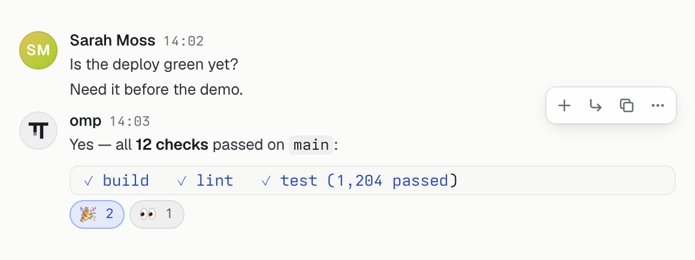
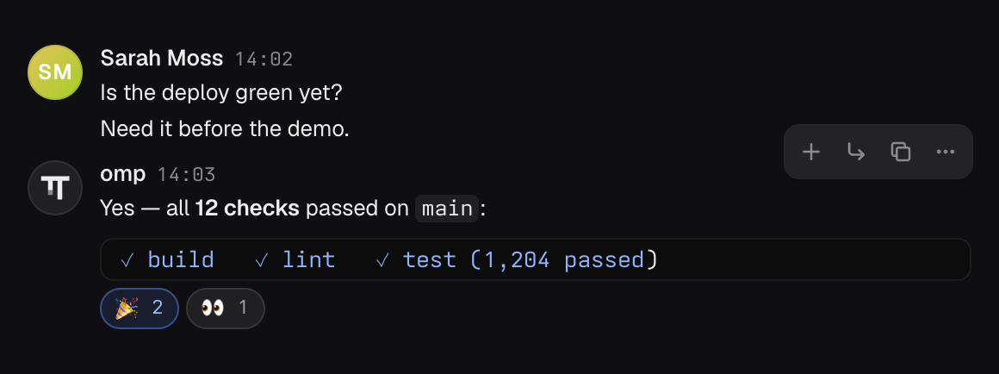
<figcaption><code>flat</code>：按作者分组的行，操作按钮浮动于行上方。</figcaption>
</figure>

<figure class="tn-figure">
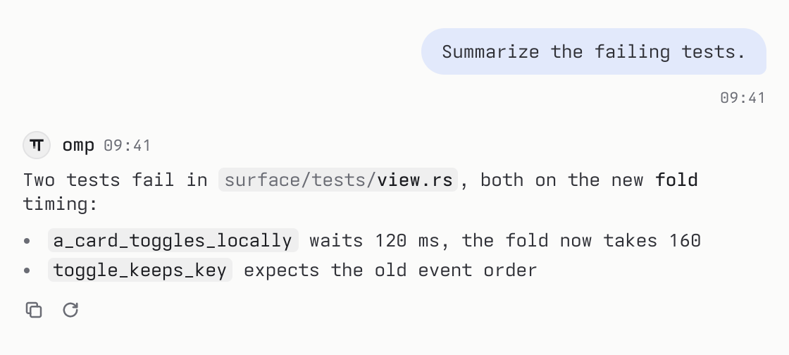
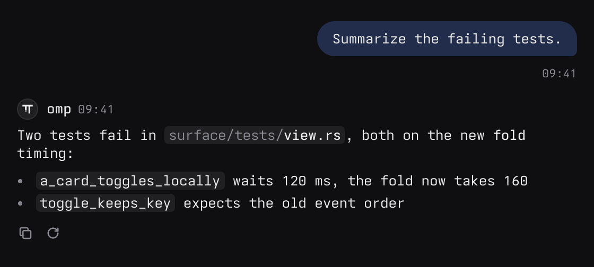
<figcaption>在等宽字体区域中，消息仍保持原有形状，并使用终端字体。</figcaption>
</figure>

**构建方式：** `tern.ui.node("message", { … }, { avatar, …body })`。

| 属性 | 类型 | 默认值 | 含义 |
| --- | --- | --- | --- |
| `variant` | `"auto"` \| `"bubble"` \| `"flat"` | `"auto"` | 外观（见上表）。未知值按 `auto` 处理。 |
| `side` | `"start"` \| `"end"` | `"start"` | `end` 表示本地用户：在 `auto` 和 `bubble` 中位于右侧并显示强调色气泡。 |
| `author` | string | 无 | 标题中的名称。 |
| `time` | string | 无 | 标题中的时间，使用等宽字体（`"14:02"`、`"Yesterday"`）；`auto`/`bubble` 的结束侧消息在无 `status` 时显示于底栏；`flat` 连续行悬停时显示于边栏。 |
| `avatar` | string | 无 | 要绘制在头像槽中的子节点 id（`avatar` 节点或 `icon`、`image`）。若 id 不存在，则不显示头像，子节点会留在正文中。 |
| `continued` | boolean | `false` | 与前一条消息作者相同：不显示标题和头像，与前一条相距 2px。 |
| `reactions` | 数组，元素为 `{ text, count?, on? }` | `[]` | 回应标签：`text` 为表情或字形（也是标识；未提供则跳过），`count`（整数 ≥ 0，默认 0；为 0 时隐藏）为包含本地用户在内的回应人数，`on`（布尔值，默认 `false`）表示本地用户已回应。 |
| `actions` | 数组，元素为 `{ act, icon?, title? }` | `[]` | 悬停时显示的图标按钮：`act` 是点击时执行的操作（未提供则跳过），`icon` 为任意 Tern 图标名（否则使用 act 默认图标，见操作说明），`title` 是工具提示和可访问名称（否则使用首字母大写的 act）。 |
| `reveal` | `"hover"` \| `"always"` | `"hover"` | 操作按钮的显示时机；`always` 表示始终显示（例如最新答案）。 |
| `status` | string | 无 | 消息下方以低调等宽字体显示的一行文字（“Read 14:03”、“Delivered”）。 |
| `pending` | boolean | `false` | 消息仍在发送：状态行闪烁，结束侧气泡变暗。 |
| `key` | string | 节点 id | 同级节点中的标识；回应切换状态按此 key 在同一父节点下记忆。 |

**子节点：** `avatar` 子节点放入头像槽；其他子节点构成正文，按顺序排列且间隔 8px（任意 kind：`md`、`code`、`image`、`tool`、`attachment` 行等）。没有正文子节点的消息只绘制标题和标签。

**事件：** 用户切换回应标签时发送 `change { id, value, on }`（`value` 为标签文字）；点击非内置 act 的操作时发送 `action { id, act, value?, mods? }`（act 为 `name=value` 时，像其他地方一样会单独发送 `value`）。`copy` 不发送事件：Tern 会复制消息文本。surface 已关闭或以 `listen: false` 打开时，会绘制标签和按钮，但不会切换或发送事件。

**键盘：** 无；消息不会获取焦点，其按钮也会把按键留给程序。通过 props 控制键盘行为：将按键切换的回应写入 `reactions`（`on`、`count`），并对光标所在消息设置 `reveal = "always"` 以显示其操作按钮。

**样式：**

```html
<div class="sf sf-message [continued] [has-av] [reveal] [pending]" data-id="…"
	data-variant="auto" data-side="start" role="article">
	<div class="sf-msg-av">
		<div class="sf-msg-pic"><!-- the avatar child --></div>
		<span class="sf-msg-stamp" aria-hidden="true">14:02</span>
	</div>
	<div class="sf-msg-head">
		<span class="sf-msg-author">omp</span>
		<span class="sf-msg-time">14:02</span>
	</div>
	<div class="sf-msg-body"><!-- the other children --></div>
	<div class="sf-msg-reacts" role="group" aria-label="Reactions">
		<button class="sf-msg-react on" aria-pressed="true" aria-label="🎉 3" data-i="0">
			<span class="sf-msg-emoji">🎉</span><span class="sf-msg-count">3</span>
		</button>
	</div>
	<div class="sf-msg-foot">
		<div class="sf-msg-acts" role="toolbar" aria-label="Message actions">
			<button class="sf-msg-act" data-act="copy" title="Copy" aria-label="Copy"><svg class="ico">…</svg></button>
		</div>
		<span class="sf-msg-status [sf-fx-shimmer]">Read 14:03</span>
	</div>
</div>
```

没有可显示内容的部分会带有 `.sf-hidden`。

| 目标 | 选择器 |
| --- | --- |
| 节点 | `.sf-message`、`[data-variant='auto' \| 'bubble' \| 'flat']`、`[data-side='start' \| 'end']` |
| 状态 | `.sf-message.continued`、`.has-av`（已绘制头像子节点）、`.reveal`（始终显示操作）、`.pending` |
| 头像栏、槽位、边栏时间 | `.sf-msg-av`、`.sf-msg-pic`、`.sf-msg-stamp`（内部实现，可能改变） |
| 标题、名称、时间 | `.sf-msg-head`、`.sf-msg-author`、`.sf-msg-time`（内部实现，可能改变） |
| 正文（`auto`/`bubble` 中的气泡） | `.sf-msg-body`（内部实现，可能改变） |
| 回应标签 | `.sf-msg-reacts`、`.sf-msg-react`（`.on`）、`.sf-msg-emoji`、`.sf-msg-count`（内部实现，可能改变） |
| 底栏、操作、状态 | `.sf-msg-foot`、`.sf-msg-acts`、`.sf-msg-act[data-act]`、`.sf-msg-status`（内部实现，可能改变） |

节点上的变量：`--msg-bubble`（结束侧气泡填充色）、`--msg-other`（`bubble` 中起始侧气泡填充色）、`--msg-av`（头像栏宽度及头像大小）。消息进入时会短暂上升并淡入；这些效果、悬停淡入淡出和 pending 闪烁会在减少动态效果或静态视图（`.sf-still`）下停止。

## `suggestions`

用户接下来可以提出的问题，每项都可点击一次发送：可显示在代理回答下方、空聊天中或错误之后。节点绘制建议项并报告点击的是哪一项；程序负责将文本放入输入框或直接发送。

**变体。** `variant` 选择外观：

- `chips`（默认）：可换行排列的胶囊，每个前面带闪光图标（或项目的 `icon`）。适用于少量简短提示。项目的 `detail` 会作为工具提示。
- `rows`：全宽行，前面带 `›`（或项目的 `icon`），文本后面以弱化颜色显示 `detail`，右侧显示数字键帽 1–9（或项目自己的 `keys`）。适用于程序同时支持快捷键的提示。
- `cards`：两列小卡片，文字下方显示弱化的 `detail`（选择理由）；项目的 `icon` 显示在左上角。

各项会错开依次出现，指针悬停时略微上移（减少动态效果时均不执行）。长文本末尾以省略号截断：`chips` 和 `rows` 为一行，`cards` 为两行。

```lua
local ui = tern.ui

ui.node("suggestions", {
	id = "next",
	variant = "rows",
	items = {
		{ id = "explain", text = "Explain this error" },
		{ id = "test", text = "Write a test for resolveUser" },
		{ id = "lint", text = "Fix the 3 lint warnings", detail = "src/user.ts" },
	},
})

-- in the block's event handler
if ev.ev == "activate" and ev.id == "next" then
	send(prompts[ev.item])
end
```

<figure class="tn-figure">
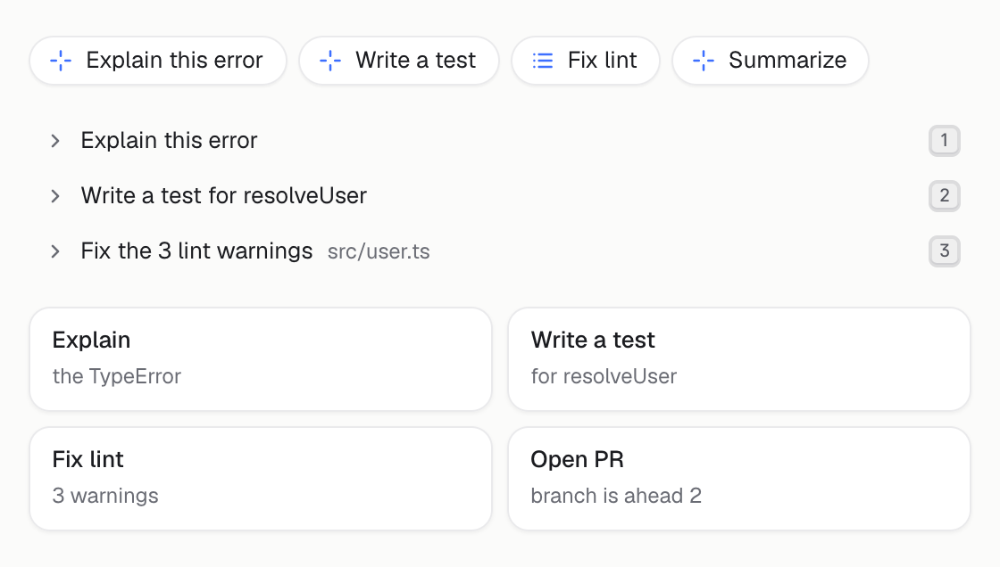
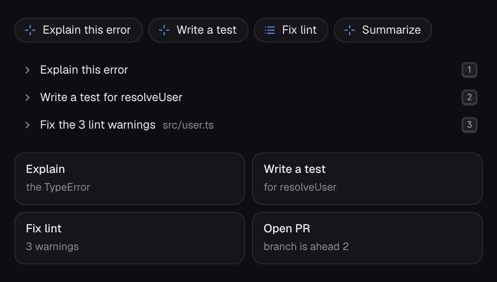
<figcaption><code>chips</code>、<code>rows</code> 和 <code>cards</code> 三种外观。</figcaption>
</figure>


<figure class="tn-figure">
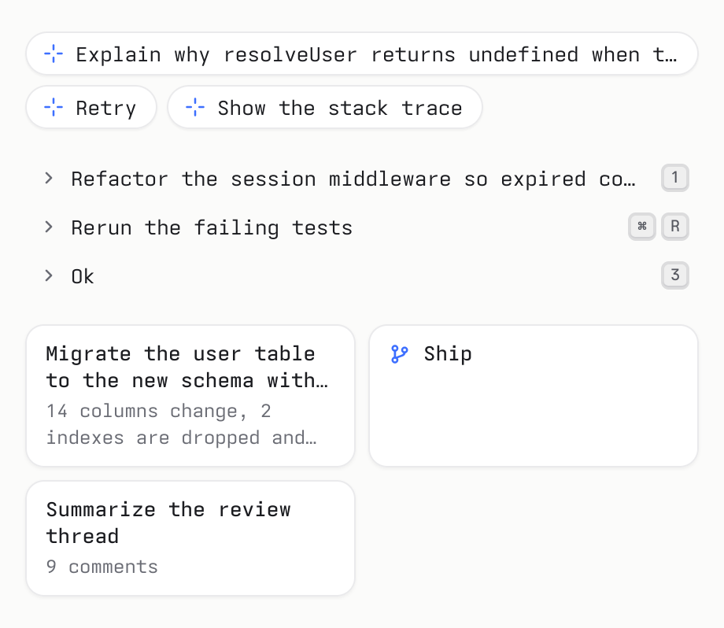
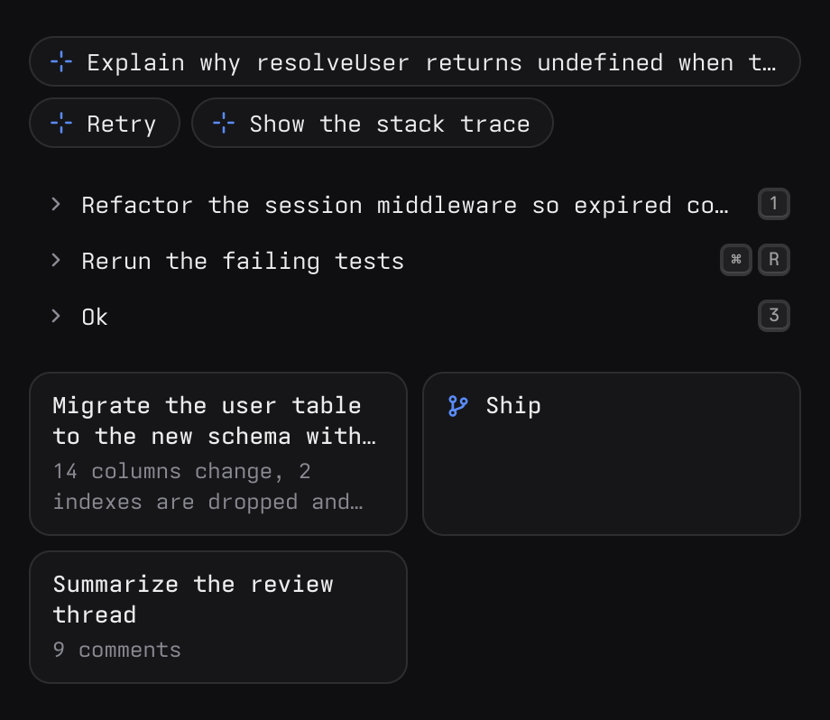
<figcaption>等宽区域中的长短文本，以及项目自定义的 <code>keys</code> 和 <code>icon</code>。</figcaption>
</figure>

**构建方式：** `tern.ui.node("suggestions", { variant = …, items = { … } })`。

| 属性 | 类型 | 默认值 | 含义 |
| --- | --- | --- | --- |
| `variant` | `"chips"` \| `"rows"` \| `"cards"` | `"chips"` | 外观（见上表）。 |
| `items` | 数组，元素为 `{ id?, text, detail?, icon?, keys? }` | `[]` | 按顺序排列的建议项。没有 `text` 的项目会跳过。 |
| `items[].id` | string | 项目的 `text` | `activate` 事件中使用的名称。 |
| `items[].text` | string | 必填 | 显示的提示文字。 |
| `items[].detail` | string | 无 | `rows`：显示在文本后并弱化；`cards`：显示在其下方的弱化行；`chips`：作为工具提示。 |
| `items[].icon` | string（图标名称） | `chips` 为 `sparkles`，`rows` 为 `›`，`cards` 无 | 前置图标。 |
| `items[].keys` | 按键名称数组 | `rows`：项目编号，1–9 | 仅 `rows` 使用：右侧的键帽，按 `kbd` 的方式绘制；空数组表示不显示。 |

**子节点：** 无（会忽略）。

**事件：** 点击项目时发送 `activate { id, item }`（`item` 为其 `id`，若无则为 `text`）。surface 已关闭或以 `listen: false` 打开时不发送。此外还有节点通用的 `actions`。

**键盘：** 节点不会获取焦点。提供快捷键（`rows` 中的数字）的程序需自行绑定按键，并像处理 `activate` 一样响应；键帽只用于显示按键提示。

**样式：**

```html
<div class="sf sf-suggestions" data-id="…" data-variant="rows" role="list">
	<div class="sf-sug" role="listitem" data-item="lint" style="--i: 2">
		<span class="sf-sug-ic"><svg class="ico">…</svg></span>
		<span class="sf-sug-body">
			<span class="sf-sug-text">Fix the 3 lint warnings</span>
			<span class="sf-sug-detail">src/user.ts</span>
		</span>
		<span class="sf-sug-keys kbds"><span class="kbd">3</span></span>
	</div>
</div>
```

| 目标 | 选择器 |
| --- | --- |
| 节点 | `.sf-suggestions`、`[data-variant='chips' \| 'rows' \| 'cards']` |
| 项目 | `.sf-sug[data-item='<id>']` |
| 图标、文本、详情 | `.sf-sug-ic`、`.sf-sug-body`、`.sf-sug-text`、`.sf-sug-detail`（内部实现，可能改变） |
| 键帽（`rows`） | `.sf-sug-keys.kbds > .kbd`（内部实现，可能改变） |

变量：项目上的 `--i` 是其索引（最多 12），用于错开进入动画。进入动画和上移动画会在减少动态效果或静态视图（`.sf-still`）下停止。

## `questions`

问卷：包含多个可选答案的问题，每次回答一个步骤。适用于程序或代理继续执行前需要用户作出决定的场景，例如接下来构建什么、应包含哪些部分或截止时间。在对话记录中向用户提出一个带少量选项的问题时，使用 `variant = "inline"`；简短调查使用 `steps`（默认）或 `list`。自由填写的表单请使用 `el` 控件；只有一个是/否问题时使用两个按钮。

**项目。** 每个问题有 `id`、`prompt`、可选的 `description`、`choices`（`{ value, label, detail? }`，或直接使用一个字符串作为 value 和 label），以及三个标志：`multi`（可多选：使用复选框而非单选按钮）、`required`（不显示 Skip；Next 和 Submit 等待答案）和 `other`（`{ placeholder }`：允许自由文本作答）。前九个选项会显示数字键帽，因此程序可以接收键盘上的 `1`–`9`。

**其他答案。** 自由文本答案是节点的 `input` 子节点，`key = "<question id>.other"`；在该问题的选项显示时绘制于其下方，否则不绘制。程序像处理任意 `input` 一样负责维护其文本，并将其同步到 `answers`（摘要中，若文本答案与任何选项的 value 都不匹配，则直接显示该文本）。

**变体。** `variant` 选择外观：

| 变体 | 外观 | 适用场景 |
| --- | --- | --- |
| `steps` | 每个问题一张卡片，带进度、选项卡片、Back / Skip / Next | 用户专注于回答的简短调查 |
| `inline` | 流程中的提示、带快捷键的标签和提示文字 | 代理在对话中途提出的一个快速问题 |
| `list` | 显示所有问题；已回答的问题折叠为“✓ prompt · answer” | 用户可按任意顺序回答的多个问题 |

- **`steps`**（默认）：每个问题一张卡片。显示分段进度和“2 of 4”、问题提示（必答问题带红色 `*`）及描述、选项卡片（单选或复选标记、标签、详情、键帽）、Other 输入框，然后是 Back、Skip（仅非必答问题）和 Next；最后一步的 Next 会变为 Submit（或使用 `submit` 标签）。
- **`inline`**：嵌入流程的紧凑外观。闪光图标和问题提示（存在更多问题时显示“2/3”）、带快捷键的标签（`multi` 已选项后带勾号）、Other 输入框以及提示行（使用 `hint`，否则自动生成：“1–3 picks · or type an answer · skip to leave it”）。不显示按钮：程序接收按键。
- **`list`**：按顺序显示每个问题。当前问题（`step`）显示其标签和 Other 输入框；已回答的问题折叠为一行，带绿色勾号、问题提示和答案（例如“Delegation”，或以“, ”连接的各标签）；未回答的问题显示编号。点击折叠的问题会展开它。底栏在 Submit 旁显示“2 of 4 answered”。

**本地状态。** 与 `el` 控件一样，指针操作立即生效，程序随后收到事件：选择项立即显示，Back / Next / Skip 会切换步骤，列表行会展开。节点在绘制期间记住这些状态。程序发送的 `step` 或答案若与其上次发送的值不同，则会覆盖用户选择。surface 已关闭或以 `listen: false` 打开时，不会切换状态，也不会发送事件。

```lua
local ui = tern.ui

ui.node("questions", {
	id = "plan",
	step = 1,
	answers = { dir = "deleg" },
	items = {
		{ id = "dir", prompt = "Direction", required = true,
			choices = { { value = "deleg", label = "Delegation" }, { value = "ask", label = "Question prompts" } } },
		{ id = "detail", prompt = "What should we prototype next?", description = "Pick one, or write your own.",
			other = { placeholder = "Another answer…" },
			choices = {
				{ value = "deleg", label = "Delegation", detail = "Work moving to a specialist" },
				{ value = "ask", label = "Question prompts", detail = "Choices while the UI waits" },
			} },
	},
}, {
	ui.node("input", { key = "detail.other", placeholder = "Another answer…" }),
})
```

<figure class="tn-figure">
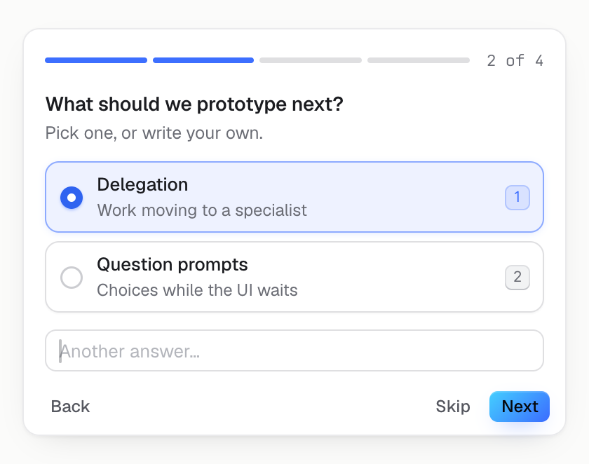
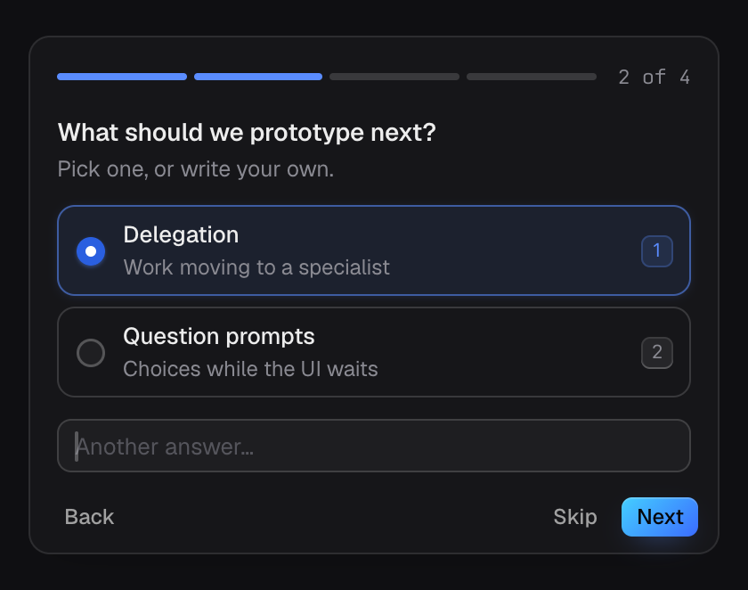
<figcaption><code>steps</code>：进行到一半时的单选问题。</figcaption>
</figure>

<figure class="tn-figure">
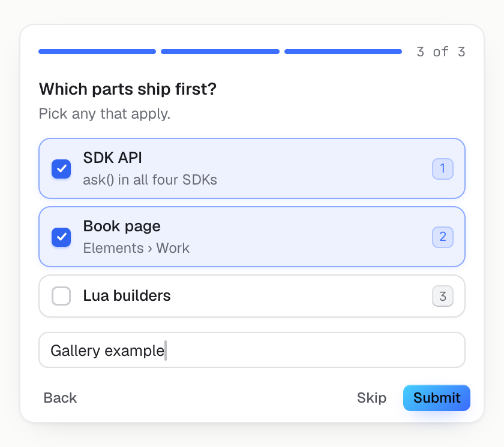
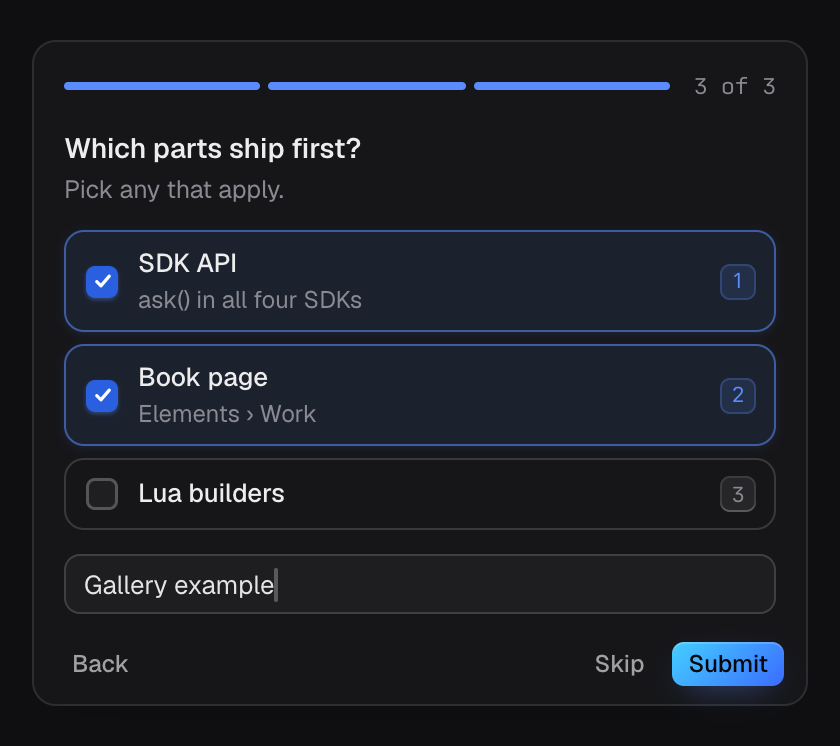
<figcaption><code>steps</code> 的最后一步：带 Other 答案的 <code>multi</code> 问题。</figcaption>
</figure>

<figure class="tn-figure">
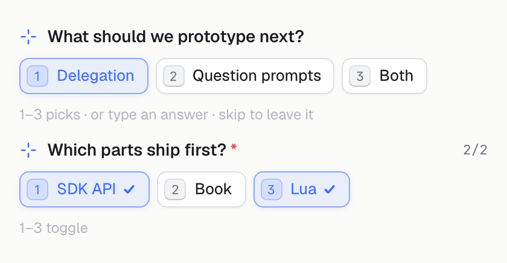
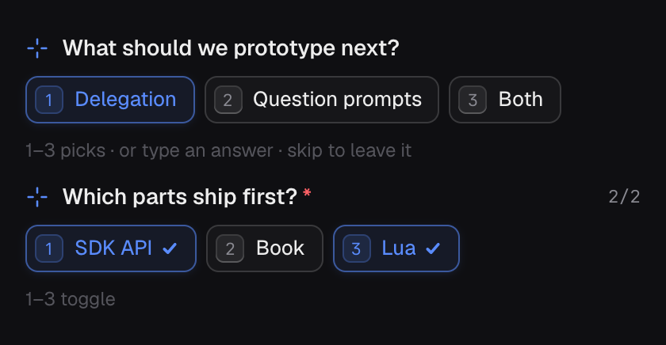
<figcaption><code>inline</code>：带 Other 的单选问题，以及必答的 <code>multi</code> 选择题。</figcaption>
</figure>

<figure class="tn-figure">


<figcaption><code>list</code>：已回答的问题折叠为一行。</figcaption>
</figure>

**构建方式：** `tern.ui.node("questions", { items = { … }, step = …, answers = { … } }, { …other inputs })`。

| 属性 | 类型 | 默认值 | 含义 |
| --- | --- | --- | --- |
| `items` | 问题数组 | `[]` | 问题列表（没有 `id` 的问题会跳过）。 |
| `items[].id` | string | 必填 | 问题 id：事件的 `item` 和 `answers` 中对应的键。 |
| `items[].prompt` | string | `""` | 问题提示。 |
| `items[].description` | string | 无 | 提示文字下方的一行说明。 |
| `items[].choices` | 数组，元素为 `{ value, label?, detail? }` 或字符串 | `[]` | 选项；`label` 默认为 `value`。 |
| `items[].choices[].detail` | string | 无 | 选项卡片上的第二行（仅 `steps`）。 |
| `items[].multi` | boolean | `false` | 可多选；答案是值数组。 |
| `items[].other` | `{ placeholder? }` \| boolean | 无 | 从 key 为 `<id>.other` 的 `input` 子节点获取自由文本答案。 |
| `items[].required` | boolean | `false` | 不显示 Skip；Next 等待当前问题答案，Submit 等待所有必答问题的答案。 |
| `step` | number | `0` | 当前问题的索引，从 0 开始（限制在 items 范围内）。 |
| `answers` | 对象，id → string \| 字符串数组 | `{}` | 答案：选项值、多个值组成的数组（`multi`）或文本（Other）。 |
| `variant` | `"steps"` \| `"inline"` \| `"list"` | `"steps"` | 外观。 |
| `hint` | string | 自动生成 | `inline` 的提示行（空字符串 `""` 会隐藏）。 |
| `submit` | string | `"Submit"` | 最后一步（以及 `list`）的提交按钮标签。 |

**子节点：** 仅显示当前展示其选项的问题所对应、key 为 `<question id>.other` 的 `input`，并将其放在对应问题的 Other 槽中；其他子节点不绘制。

**事件：**

| 事件 | 载荷 | 触发时机 |
| --- | --- | --- |
| `change` | `{ id, item, value }`：`item` 为问题 id，`value` 为新答案（选项值，或 `multi` 时的数组） | 点击选项以选中（或切换）它时。 |
| `action` | `{ id, act, item }`：`act` 为 `next`、`back` 或 `skip`，`item` 为离开的问题 | 点击 Next、Back 或 Skip 时。 |
| `action` | `{ id, act = "submit", value }`：`value` 为所有答案，用户当前答案优先于 `answers` | 所有必答问题均已回答并点击 Submit 时。 |
| `select` | `{ id, item }`：`item` 为问题 id | 点击 `list` 中的另一个问题时。 |

**键盘：** 节点不会获取焦点。程序通过 props 驱动它：`1`–`9` 选择当前问题的选项（设置 `answers`），Enter / Tab 切换 `step`，输入文字会传给 Other 的 `input`（`autofocus`、`cursor`）。将 `change` 同步到 `answers`，并将 `action` 同步到 `step`，以确保程序始终掌控状态。

**无障碍。** 节点是 `form`；选项是带 `aria-checked` 的 `radiogroup` 和 `radio`（或带 `aria-checked` 的 `group` 和 `checkbox`）；`steps` 的进度是带 `aria-valuenow` 的 `progressbar`；`list` 中的问题是以其提示文字命名的 `group`。

**样式：**

```html
<div class="sf sf-questions" data-id="…" data-variant="steps" role="form">
	<div class="q-body">
		<div class="q-top">
			<div class="q-progress" role="progressbar" aria-valuenow="2"><i class="q-seg on"></i><i class="q-seg on"></i><i class="q-seg"></i></div>
			<span class="q-count">2 of 3</span>
		</div>
		<div class="q-head">
			<span class="q-prompt">What should we prototype next?<span class="q-req">*</span></span>
			<span class="q-desc">Pick one, or write your own.</span>
		</div>
		<div class="q-choices" role="radiogroup">
			<div class="q-choice on" role="radio" aria-checked="true">
				<span class="q-mark q-dot"><i class="q-pip"></i></span>
				<span class="q-text"><span class="q-label">Delegation</span><span class="q-detail">Work moving to a specialist</span></span>
				<span class="q-key">1</span>
			</div>
		</div>
		<div class="q-other"><!-- the input keyed detail.other --></div>
		<div class="q-foot"><button class="sf-button">Back</button><span class="q-fill"></span><button class="sf-button">Skip</button><button class="sf-button">Next</button></div>
	</div>
</div>
```

| 目标 | 选择器 |
| --- | --- |
| 节点 | `.sf-questions`、`[data-variant='steps' \| 'inline' \| 'list']` |
| 正文、进度 | `.q-body`、`.q-top`、`.q-progress`、`.q-seg`（`.on`）、`.q-count`（内部实现，可能改变） |
| 问题 | `.q-head`、`.q-prompt`、`.q-req`、`.q-desc`、`.q-spark`（`inline`）（内部实现，可能改变） |
| 选项 | `.q-choices`、`.q-choice`（`.on`；`inline` 和 `list` 中为 `.q-chip`）、`.q-mark`（`.q-dot` 和 `.q-pip`、`.q-box`）、`.q-tick`、`.q-text`、`.q-label`、`.q-detail`、`.q-key`（内部实现，可能改变） |
| Other、提示 | `.q-other`、`.q-hint`（内部实现，可能改变） |
| `list` 中的问题 | `.q-q`（`.open`、`.done`）、`.q-num`、`.q-ok`、`.q-sum`（内部实现，可能改变） |
| 底栏 | `.q-foot`、`.q-fill`；按钮为 `.sf-button`（内部实现，可能改变） |

选项的过渡动画会在减少动态效果或静态视图（`.sf-still`）下停止。

## `block`

Tern 的命令 Lens 块：从终端网格中分离出来、由 Lens 读取的单条 shell 命令输出。该块由 Tern 创建，面向终端而非插件视图。你为 [Lens](../reference/api-host.md) 编写的内容就是其中的视图：Tern 会将你的视图包装在 id 为 `native` 的 `col` 中，并将其插入为该块的第一个子节点，位于 `raw`（包含捕获字节的 `ansi` 节点）之前。

如果 Settings › Terminal › **Native command output** 已启用且存在 `native`，块会显示 `native`，否则显示 `raw`；切换该设置会更新已经显示的块。对单个块切换 Native/Raw 会覆盖该块的全局设置：这是本地的逐块选择，按同级节点中的 `key` 记忆（若无则按 id），而不是整个 surface 共用。删除块后，在同一父节点下添加一个具有新 id 和相同 key 的块会保留该选择；相同 key 位于另一个父节点时状态相互独立。只有显示的子节点会挂载，因此切换会重绘该块。框架保持低调，使其看起来像命令输出：

- 左侧有一条淡淡的 2px 边缘：悬停时变亮，运行中使用 `--live` 色调，退出失败后使用 `--sf-bad`；
- 右上方的工具栏（块高于窗格时，位于当前可见部分的右上方），悬停或键盘聚焦时出现，其中包括 Lens 标签（图标加程序名称；对于 `git`、`cargo`、`docker`、`npm`、`kubectl` 等，还会显示子命令；忽略 `NAME=value` 赋值及 `sudo`、`env`、`time`、`npx`、`uvx` 等包装程序），并以输入的 `cmd` 作为工具提示；Native/Raw 分段控件（没有原生视图时隐藏）；以及 Copy 按钮；
- 底部有弱化的一行内容，显示 `exit N` 标签（命令完成且退出码非零时）和耗时（命令完成且 `took` 超过一秒时）。两者都不存在时隐藏底栏。

Copy 会执行 `copy` action：将原始输出作为纯文本复制，格式与终端按捕获内容宽度显示时相同。

**构建方式：** 由 Tern 构建。此处列出其 props 供参考：

| 属性 | 类型 | 默认值 | 含义 |
| --- | --- | --- | --- |
| `cmd` | string | `""` | 实际输入的命令行；作为 Lens 标签的工具提示。 |
| `line` | string | `cmd` | 识别出的命令行；标签由此派生。 |
| `cwd` | string | 无 | 工作目录（Tern 恢复时使用；不绘制）。 |
| `lens` | string | `""` | Lens id（`git.log`、`plugin.k8s.get`）；`data-role` 会变为 `lens.<lens>`，并据此选择图标。插件 Lens（`lens.plugin.…`）使用终端图标。 |
| `role` | string | `lens.<lens>` | 覆盖 `data-role`。 |
| `state` | `"running"` \| `"done"` | `"done"` | 设置 `data-state`；除 `"running"` 外的任何值均按 `done` 处理。 |
| `exit` | integer | 无 | 退出状态；命令完成后非零时添加 `.failed` 和退出码标签。 |
| `took` | number（毫秒） | 无 | 底栏中的耗时（命令完成且超过 1000 ms 时）。 |
| `age` | number（毫秒） | 无 | 由 Tern 携带，但块不会绘制。 |
| `key` | string | 节点 id | 同级节点中的标识；Native/Raw 选择会按此 key 在同一父节点下记忆。 |

**子节点：** `native`（位于 `col` 中的 Lens 视图；Lens 还没有视图时不存在）和 `raw`（`ansi`）。raw 子节点是 id 为 `raw` 的节点，若没有则使用最后一个 `ansi` 子节点；native 子节点是第一个其他子节点。每次只显示其中一个。

**事件：** 无。命令完成后无需监听，因此 Native/Raw 和 Copy 都是本地操作。

**样式：** Lens 作者可在此处限定 CSS 作用范围。

```html
<div class="sf sf-block [failed]" data-id="b" data-role="lens.plugin.k8s.get" data-state="done" data-view="native">
	<div class="sf-block-bar">
		<span class="sf-block-lens" title="kubectl get pods -A">
			<span class="sf-block-ic"><!-- icon --></span><span class="lbl">kubectl get</span>
		</span>
		<div class="sf-block-seg" role="group" aria-label="Output">
			<button class="sf-block-opt on" aria-pressed="true">Native</button>
			<button class="sf-block-opt" aria-pressed="false">Raw</button>
		</div>
		<button class="sf-block-copy" aria-label="Copy output"><!-- icon --></button>
	</div>
	<div class="sf-block-body">
		<div class="sf sf-col" data-id="native"><!-- your lens view --></div>
	</div>
	<div class="sf-block-foot">
		<span class="sf-badge" data-tone="error">exit 1</span><span class="sf-block-took">2.4s</span>
	</div>
</div>
```

| 目标 | 选择器 |
| --- | --- |
| 你的 Lens 块 | `.sf-block[data-role='lens.plugin.<plugin>.<lens>']` |
| 运行中/已完成 | `.sf-block[data-state='running']` / `[data-state='done']` |
| 退出失败 | `.sf-block.failed` |
| 显示 native 或 raw | `.sf-block[data-view='native']` / `[data-view='raw']` |
| 你的视图 | `.sf-block-body > [data-id='native'] > …`，或使用你节点上的自定义 `role` |
| 工具栏 | `.sf-block-bar`、`.sf-block-lens`、`.sf-block-ic`、`.sf-block-lens .lbl`（内部实现，可能改变） |
| Native/Raw | `.sf-block-seg`、`.sf-block-opt`、`.sf-block-opt.on`（内部实现，可能改变） |
| Copy | `.sf-block-copy`（内部实现，可能改变） |
| 正文 | `.sf-block-body`（内部实现，可能改变） |
| 底栏 | `.sf-block-foot`、`.sf-block-foot > .sf-badge`、`.sf-block-took`（内部实现，可能改变） |

`surface-lens.css` 中有两条规则会影响 Lens 视图：块内卡片的正文缩进 12px（`.sf-block-body .sf-card-body`）；带有 `role = "output"` 的列表按输出行呈现（文本可选中、不显示悬停效果，并在非虚拟化时自动换行）。正文间距为 `--sf-inner-gap`。

```css
/* A plugin sheet: highlight a failing kubectl lens, and dim it while it runs. */
.sf-block[data-role='lens.plugin.k8s.get'].failed .sf-table {
	box-shadow: inset 2px 0 0 var(--sf-bad);
}
.sf-block[data-role='lens.plugin.k8s.get'][data-state='running'] .sf-table {
	opacity: 0.7;
}
```

你可以在自己的块视图中放置 `block` 节点，但这没有实际用途：它仍会绘制；然而在终端命令块之外，Copy 只会复制空字符串，因为原始文本来自块 surface。

## `prefs`

根据你的数据绘制的 kit Preferences 设置页面。omp 会将其用于 `/settings`。这是此处功能最丰富的 kind：程序拥有所有设置和按键；页面会将每个指针操作作为事件发送回来，你再通过新 props 响应。

**绘制位置。** 在 `main` 中，它会填满区域 host，作为完整页面显示：包含导航栏（品牌标识、搜索、页面分组）、可滚动文档和右上角的 Close 按钮。宽度低于 760px 时，导航栏会折叠成图标栏（`.pf.rail`）。在 `layer` 中，它是 kit 的侧边面板（`.pf.sheet`）：停靠在右侧，宽度为 `--tv-aside`（host 未预留宽度时为 440px），Close 按钮位于品牌行，页面则显示为图标条。在终端的 inline surface 中，host 会收窄面板旁的对话记录（形成“aside”）；插件块是 screen surface，因此旁边内容不会收窄：面板覆盖在块内容之上。

**数据模型。** 页面由导航 `pages`、当前的 `page` 以及包含若干行的 `sections` 组成。每一行都有一个 `control`，其 `k` 是七种类型之一。

| 属性 | 类型 | 默认值 | 含义 |
| --- | --- | --- | --- |
| `title` | string | `"Settings"` | 品牌标题，也是页面的可访问名称。 |
| `pages` | 数组，元素为 `{ id, label?, group?, icon?, disabled?, changed? }` | `[]` | 导航行。相邻且 `group` 相同的页面会归入一个带该标题的分组。`icon` 为[图标名称](data.md#icon)（默认 `sliders`）。`disabled`（原因字符串）会使行变暗，并作为工具提示；无论从导航行还是搜索结果标题都无法打开（标记为 `.off`，并显示同一工具提示）。`changed`（大于 0 的计数）会显示“N changed from default”计数。 |
| `page` | string | `""` | 当前页面 id：在导航栏中高亮；标题显示 `NN · Label` 和对应标签。 |
| `lead` | string | 无 | 页面标题下方的段落。 |
| `sections` | 区块数组 | `[]` | 文档中的各个 section（见下文）。 |
| `query` | string | `""` | 搜索文本。非空（去除首尾空白）时，文档会显示结果，按各 section 的 `page` 分组并置于页面标题下，匹配到的 label 和 hint 文字包在 `<mark>` 中。Tern 不会执行筛选：你需要仅发送匹配的 sections，并为每个 section 设置其 `page`。 |
| `cursor` | integer | 无 | 搜索字段中的 UTF-16 光标位置；当搜索字段持有按键时设置。若未设置，字段显示去除首尾空白的 query，或显示“Search settings”。 |
| `focus` | string | 无 | 行 id 或 section id；对应位置显示焦点环（`.focus`）。页面会滚动到该位置（section 滚到顶部，行滚到最近边缘）。 |
| `editing` | `{ row, option?, draft?, cursor? }` | 无 | 当前通过键盘编辑的行（见“编辑”）。 |

Section 格式为 `{ id?, title?, page?, rows }`。没有行的 section 会跳过（id 为 `status-line` 的除外，见“子节点”）。没有任何行的页面会显示“Nothing to set here”；没有匹配结果的搜索会显示“No settings match …”。

行字段：

| 字段 | 类型 | 含义 |
| --- | --- | --- |
| `id` | string | 必填；行的 `data-row` 及其事件的 `item`。 |
| `label` | string | 标签（默认使用 id）。 |
| `hint` | string | 标签下方的一行说明。 |
| `warning` | string | 标签前的警告图标及下方的警告文字（`.warn`）。 |
| `disabled` | string | 禁用原因：显示在标签下方并作为工具提示；该行会变暗（`.off`），控件不执行任何操作。 |
| `changed` | boolean | 标签左侧的强调色圆点（工具提示为“Changed from default: `defaultLabel`”，若无则为“Changed from default”），并在控件前显示 Reset 按钮（`action` 和 `keys` 行以及禁用行除外）。 |
| `defaultLabel` | string | 默认值名称，显示在圆点的工具提示中。 |
| `control` | object | 按 `k` 指定的控件（见下表）。 |

七种控件：

| `k` | 字段 | 绘制内容 | 点击时 |
| --- | --- | --- | --- |
| `switch` | `on` | `.pf-sw` 开关 | 立即切换，并发送 `change { value = bool }` |
| `choice` | `value`、`options`（`{ value, label?, detail? }`）、`style`（`"auto"` \| `"segmented"` \| `"menu"`）、`mono` | `segmented` 时显示 `.pf-seg` 分段选项；`auto` 且有 2–4 个选项、标签总长度不超过 28 个字符时也如此；否则显示 `.pf-pick` 弹出按钮，其中展示当前标签。`detail` 是分段选项的工具提示或菜单选项的第二行。 | 点击分段选项：立即选中，发送 `change { value = string }`。点击弹出按钮：发送 `activate`；你为该行设置 `editing` 后会显示菜单；选择选项时发送 `change { value }`。 |
| `number` | `value`、`min`、`max`、`step`（默认 1）、`unit`、`labels`（`{ ["<n>"] = label }`） | `.pf-step`：− 数值 + | 发送包含下一个值的 `change { value = number }`：若有 `labels`，取其中的下一个键；否则使用 `value ± step` 并限制在 `min`/`max` 范围内。无法继续变化的按钮会禁用。数值显示对应的 `labels` 条目，否则显示数值及 `unit`。 |
| `text` | `value`、`placeholder`（默认“Not set”）、`secret`、`mono` | `.pf-in`：字段外观，并非输入框 | 发送 `activate`；编辑时显示 `editing.draft`，光标位于 `editing.cursor`。`secret` 会将内容显示为圆点。 |
| `keys` | `keys`（快捷键组合数组，每个组合是按键名称数组） | 键帽组合（`.pf-chord > .kbd`）；该行添加 `.pf-key` | 无（不执行控件操作） |
| `multi` | `values`、`options`、`ordered` | 切换标签（`.pf-chips > .pf-chip`）；设置 `ordered` 时显示可排序列表（`.pf-order > .pf-oi`：拖动柄、位置、标签、开关），已启用项排在前面，并按照 `values` 的顺序排列 | 发送 `change { value = { …enabled values in order } }`。在有序列表中，将拖动柄拖到另一项上会把该项移到目标项之前（若放在目标项下半部则移到其后），并启用它，同时发送新顺序。 |
| `action` | `act`（默认 `"edit"`）、`label`（默认“Edit…”） | 小按钮 | 发送 `action { act, value = row }` |

**编辑。** 按键不会到达页面，而会交给块的 `key` 处理器。你通过 props 驱动键盘交互：`focus` 移动焦点环；`editing = { row }` 会打开 choice 行的菜单（高亮 `option`，默认当前值）、将 multi 行的高亮移到 `option`，或显示 text 行的 `draft` 及位于 `cursor` 的光标。清除 `editing` 可关闭编辑状态。

**更新。** 只有结构改变时才重建文档（例如 page、query、sections、行 id、控件类型和选项）；page 或 query 变化时也会滚到顶部并重新播放进入动画。其他情况下会原位更新行，因此开关会滑动，而不是重绘。

**子节点：** 根据 `role` 放置。role 为 `omp.prefs.preview.status` 的子节点放在 `status-line` section 之后（该 section 未显示时不绘制）。role 为 `omp.prefs.editor` 的子节点或任何 `picker` 会放入 `.pf-editor`，作为覆盖在页面上的玻璃质感卡片（用于没有原生控件的编辑器或大型 choice 的子菜单）。其他内容放在 sections 之后的 `.pf-extra` 中。

**事件：** 所有事件都带有 `id`，其值为 prefs 节点的 id。

| 用户操作 | 事件 |
| --- | --- |
| 点击导航行或搜索结果中的页面标题 | `action { act = "page", value = <page id> }`（如果页面已禁用，无论从哪个位置点击都不发送） |
| 点击 Close（或面板上的 x） | `action { act = "close" }` |
| 切换开关、分段选项、菜单选项、步进器、标签、重新排序或点击 Reset | `change { item = <row>, value }`：switch 为 `bool`，choice 为 `string`，number 为 `number`，multi 为按顺序排列的 `string[]`，Reset 为 `null` |
| 点击弹出按钮或文本字段 | `activate { item = <row> }` |
| 再次点击已打开弹出菜单的按钮，或点击打开菜单之外的任意位置 | `action { act = "close", value = <row> }` |
| 指针移到菜单选项上 | 每个选项各发送一次 `select { item = "<row>=<value>" }`（用于实时预览） |
| 点击 `action` 按钮 | `action { act = <control.act>, value = <row> }` |
| 点击控件以外的行区域 | `select { item = <row> }` |
| 焦点在页面外的字段中时点击页面 | 先发送 `focus`，然后发送上表对应事件 |

页面自身不处理 Escape：Escape 会到达你的 `key` 处理器，由你关闭页面（或当前打开的编辑器）。所有这些事件都会传给插件块的 `event`。

**样式：**

```html
<div class="sf sf-prefs" data-id="…">
	<div class="pf on [rail] [sheet]" aria-label="Settings">
		<nav class="pf-nav">
			<div class="pf-brand"><span class="pf-mark"></span><span class="pf-brand-t">Settings</span><button class="icon-btn pf-close"></button></div>
			<div class="pf-search"><!-- icon --><span class="q [ph]"><span class="pre"></span><span class="pf-caret"></span><span class="post"></span></span></div>
			<div class="pf-groups">
				<div class="nav-group pf-group"><div class="nav-head">General</div>
					<div class="pf-items"><button class="nav-row [on] [off]" data-v="look"><!-- icon --><span class="lbl">Look</span><span class="meta pf-changed">2</span></button></div>
				</div>
			</div>
		</nav>
		<div class="pf-scroll"><div class="pf-doc [arrive]">
			<header class="pf-head [pf-found]"><div class="pf-eyebrow mono">01 · Look</div><h1 class="pf-title">Look</h1><p class="pf-lead">…</p></header>
			<section class="pf-sec" data-sec="theme"><h2 class="pf-sec-t">Theme</h2>
				<div class="pf-rows">
					<div class="pf-row [changed] [warn] [off] [editing] [stack] [focus]" data-row="dark">
						<span class="pf-dot"></span>
						<div class="pf-lbl"><div class="t">Dark mode</div><div class="h">…</div></div>
						<div class="pf-ctl"><button class="pf-reset">Reset</button><button class="pf-sw on" role="switch"><i class="knob"></i></button></div>
					</div>
				</div>
				<div class="pf-preview"></div>
			</section>
			<div class="pf-extra"></div>
		</div></div>
		<div class="pf-top"><button class="btn sm quiet"><span class="kbd">esc</span>Close</button></div>
		<div class="pf-editor [on]"></div>
	</div>
</div>
```

| 目标 | 选择器 |
| --- | --- |
| 节点 | `.sf-prefs`；在 layer 中为 `.sf-layer .sf-prefs` |
| 页面、图标栏、面板 | `.pf`、`.pf.rail`、`.pf.sheet`（kit 类，内部实现，可能改变） |
| 导航 | `.pf-nav`、`.pf-brand`、`.pf-close`、`.pf-search .q`（`.ph`、`.pf-caret`）、`.pf-groups`、`.nav-group`、`.nav-head`、`.nav-row`（`.on`、`.off`）、`.pf-changed`（内部实现，可能改变） |
| 文档 | `.pf-scroll`、`.pf-doc`（`.arrive`）、`.pf-head`（搜索命中时为 `.pf-found`）、`.pf-eyebrow`、`.pf-title`、`.pf-lead`、`.pf-part`、`.pf-part-h`（`.off`）、`.pf-part-b`、`.pf-none`（内部实现，可能改变） |
| 区块 | `.pf-sec[data-sec='<id>']`（`.focus`）、`.pf-sec-t`、`.pf-rows`、`.pf-preview`、`.pf-extra`、`.pf-editor.on`（内部实现，可能改变） |
| 行 | `.pf-row[data-row='<id>']`，及 `.changed`、`.warn`、`.off`、`.editing`、`.stack`（multi）、`.focus`、`.pf-key`（keys）；`.pf-dot`、`.pf-lbl .t`、`.pf-lbl .h`、`.pf-warn`、`.pf-why`、`.pf-ctl`、`.pf-reset`、`mark`（内部实现，可能改变） |
| 控件 | `.pf-sw`（`.on`、`.sm`、`.knob`）；`.pf-seg > button.on`；`.pf-pop`、`.pf-pick`、`.pf-menu`（`.still`）、`.mi`（`.cur`、`.sel`、`.two`）、`.pf-check`、`.pf-ml .t`、`.pf-ml .d`；`.pf-step`、`.pf-step .v`；`.pf-in`（`.mono`、`.editing`、`.v`、`.ph`、`.secret`）；`.pf-chord .kbd`；`.pf-chips`、`.pf-chip`（`.on`、`.sel`）；`.pf-order`、`.pf-oi`（`.on`、`.sel`、`.drag`）、`.pf-grip`、`.pf-oi .n`（内部实现，可能改变） |

变量：`--tv-aside`（面板宽度）、`--sf-zoom`、`--pf-room`（在打开的菜单上内联设置：菜单可用宽度预算，因此较长的选项会在行内换行），以及 kit 的 `--accent`、`--accent-ink`、`--accent-fill`。页面会将自身高度设为与 host 相同。

```lua
local ui = tern.ui

local function settings(state)
	return ui.node("prefs", {
		title = "Deploy settings",
		lead = "How and where your pushes deploy.",
		pages = {
			{ id = "general", label = "General", icon = "sliders" },
			{ id = "targets", label = "Targets", icon = "server", changed = state.changed },
			{ id = "keys", label = "Shortcuts", icon = "keyboard" },
		},
		page = state.page,
		focus = state.focus,
		editing = state.editing,
		sections = {
			{ id = "run", title = "Runs", rows = {
				{ id = "auto", label = "Deploy on push", hint = "Every push to main starts a deploy.",
					control = { k = "switch", on = state.auto } },
				{ id = "env", label = "Environment", changed = state.env ~= "dev", defaultLabel = "Dev",
					control = { k = "choice", value = state.env, options = {
						{ value = "dev", label = "Dev" },
						{ value = "staging", label = "Staging" },
						{ value = "prod", label = "Prod" },
					} } },
				{ id = "jobs", label = "Parallel jobs", control = { k = "number", value = state.jobs, min = 1, max = 8 } },
				{ id = "token", label = "API token", control = { k = "text", value = state.token, secret = true } },
				{ id = "notify", label = "Notify", control = { k = "multi", values = state.notify, options = {
					{ value = "slack", label = "Slack" },
					{ value = "email", label = "Email" },
					{ value = "pager", label = "Pager" },
				} } },
				{ id = "logs", label = "Clear logs", hint = "Deletes the logs of finished runs.",
					control = { k = "action", act = "clear-logs", label = "Clear" } },
			} },
		},
	})
end

-- In the block's event(state, ev, cx):
-- ev.ev == "change" and ev.item == "auto" -> state.auto = ev.value
-- ev.ev == "action" and ev.act == "page"  -> state.page = ev.value
-- ev.ev == "activate" and ev.item == "token" -> state.editing = { row = "token", draft = state.token, cursor = #state.token }
```

<figure class="tn-figure">


<figcaption>设置为 <code>page = "general"</code>、<code>focus = "env"</code>、<code>env = "prod"</code>、<code>changed = 2</code>。宽度为 560px 时，导航显示为图标栏；此图仅显示聚焦的 Environment 行和下方 Parallel jobs 行的一部分，实际页面会填满 host。</figcaption>
</figure>


之后在你的 `key` 处理器中处理文本编辑：根据每个按键更新 `editing.draft` 和 `editing.cursor`，按 Enter 提交，按 Escape 清除 `editing`。


