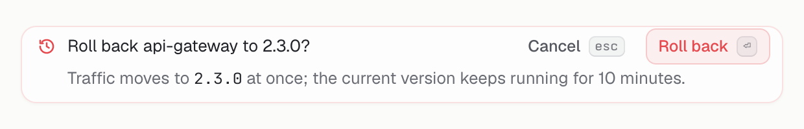
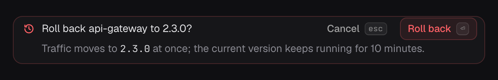
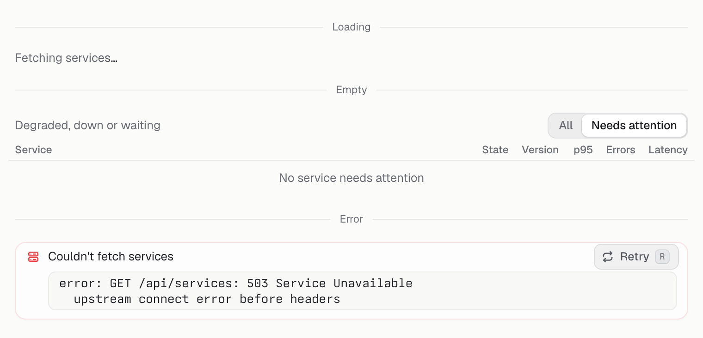
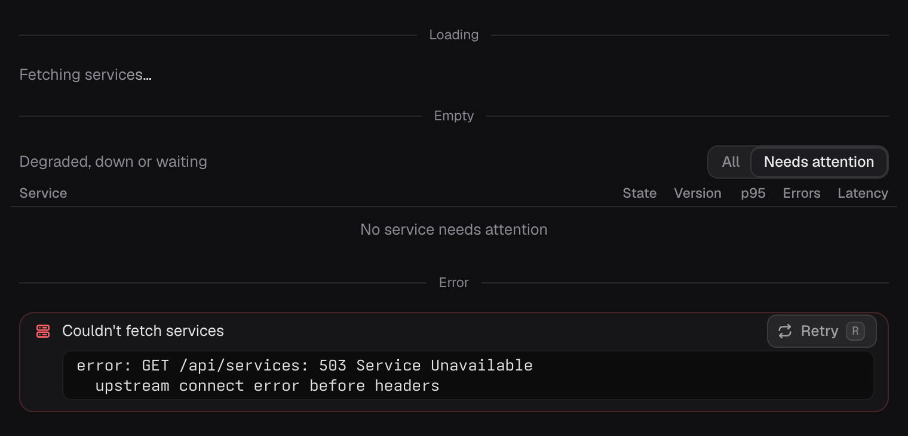
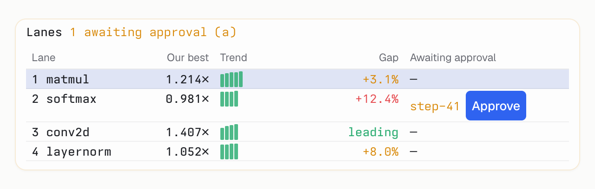
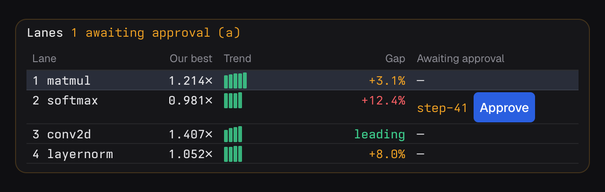
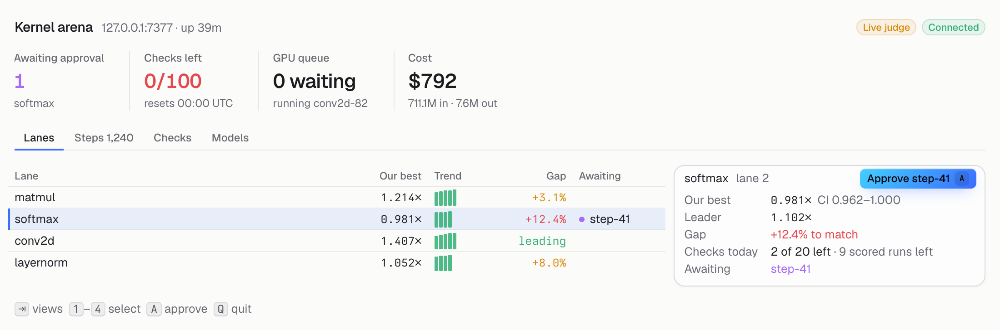
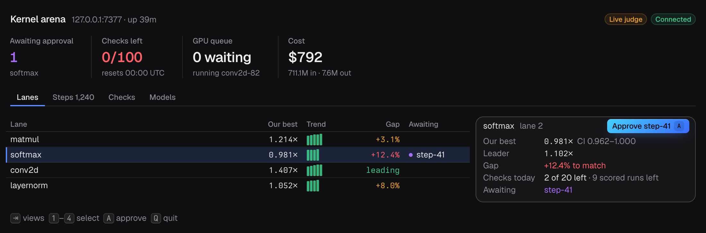

# 设计视图

Tern 自带的视图（omp 会话、git 块、设置、选择器）都采用统一的风格：以 Geist 的精确感绘制出宁静的桌面应用。面向用户的文字使用无衬线字体，机器字符串使用等宽字体；灰色低调、用细线代替边框、只在颜色有含义时使用颜色；屏幕上只有一个主要操作，并且每种状态都经过设计。[元素](../elements/index.md) 中的类型会为你绘制这种风格。按照本页规则使用这些类型构建视图，无需编写任何 CSS，就能让视图看起来像 Tern 的一部分。

本页适用于所有构建视图的人：无论是用 Luau 编写的插件块，还是通过 [Surface Protocol](../protocol/index.md) 与 Tern 通信的程序。示例使用 TSX（TypeScript [SDK](../protocol/sdks.md)），并提供对应的 Luau 版本；Rust、Python 和 Go SDK 使用相同的属性名，每个 SDK 都附带一个 `dashboard` 示例，将下文所有方案组合在一起。

<figure class="tn-figure">


<figcaption>这是一个页面，而不是一堆卡片：页首行、统计栏、标签页，以及与所选服务卡片并排的表格。无需样式表。</figcaption>
</figure>

## 规则

1. **在应用中使用无衬线字体。** 在 surface（或 block）上设置 `font: "sans"`，即可用 UI 字体绘制文字；机器字符串仍通过 span tokens 和列标志使用等宽字体。（[字体与排版](#字体与排版)）
2. **构建一个页面，而不是一堆卡片。** 使用页首行、统计栏、视图间的标签页，并在每个视图中将全宽表格与所选项目的卡片并排放置。每张卡片只承载一个对象；绝不要把表格、`stats` 统计栏或另一张卡片放进卡片。（[页面结构](#页面结构)）
3. **优先选择 kind，而不是 `el`。** `button`、`table`、`stats` 统计栏、`tabs` 标签栏、`card` 都由 Tern 负责绘制、调整大小、复制、朗读和应用主题。（[应该选择什么](#应该选择什么)）
4. **颜色只用于表达含义。** 使用色调和 span tokens；不要用十六进制色值，也不要自定义颜色类。（[颜色只用于表达含义](#颜色只用于表达含义)）
5. **屏幕上只有一个主要操作。** 它作用于当前选择：有卡片时放在所选项目的卡片中；没有卡片时放在所选行中。其他按钮都使用默认样式或 `quiet`。（[按钮](#按钮)）
6. **使用两种密度。** 页首行、工具栏和表单使用 `md` 控件；行、表格和详情卡片使用 `sm`。（[密度](#密度)）
7. **每个视图都有四种状态：** 加载中、空状态、错误和成功。（[四种状态](#四种状态)）
8. **按键由你负责，并且要显示出来。** 你的程序处理每个按键；用 `keys` 和按键图例显示它们。（[键盘](#键盘)）
9. **指针由 Tern 负责。** 所有可点击元素都已显示手形指针；绝不要设置 `cursor`。（[指针](#指针)）
10. **最后才写 CSS。** 仅在少数情况下编写，并将作用范围限定在自己的 surface，使用 tokens 着色。（[何时编写 CSS](#何时编写-css)）

## 页面结构

一个屏幕应用（仪表板、工具自己的窗口、会话）就是一个页面，从上往下阅读：它是什么、运行状况如何、可以去哪里，然后是当前正在查看的内容。

```text
head row     Deploys  prod · eu-west-1 · updated 2 min ago     [Canary running] [Connected] [Refresh R]
stats strip  Services 6 │ Error rate 0.42% │ p95 latency 182 ms │ Awaiting promotion 2
tabs         Services 6   Deploys 41   Alerts 2   Config
view         description ··········· [All | Needs attention]   ┌ search 3.2.0-rc.1  [Promote P] ┐
             table, full width, one grow column              │ facts and actions               │
dock         key legend (and a confirm strip while one is open)
```

1. **页首行**不是卡片：它是一个直接放在 `main` 中的 `row`，设置 `justify: "between"` 和 `align: "center"`。左侧是一个 `text`，应用名称使用 `title` token，后面是低调的元信息（监视的地址、运行时间、最近更新时间）；右侧是状态徽标和页面级控件（Refresh）。无需图标。
2. **统计栏**显示页面关注的少量数字，最多四个统计项，紧接在页首行下方并直接放在 `main` 中。`stats` 节点自身没有外框；绝不要把它放进卡片。没有汇总数据的页面可以省略统计栏。
3. **超过两个面板时使用标签页**：在页首和统计栏下方放置一个 [`tabs`](../elements/lists.md#tabs) 标签栏（默认使用下划线变体），每个视图对应一个标签，标签使用视图名称，并在有帮助时添加低调的计数（`Steps 1,240`、`Alerts 2`）。一次只显示一个全宽视图，由你的程序只渲染当前活动视图。Tab 和 ⇧Tab（或 `[` 和 `]`）用于切换视图；按键图例应说明这一点。两个面板可以直接上下排列。
4. **视图**就是页面上的数据：一个没有外层卡片的全宽 `table`，可在其上方放置工具栏 `row`（左侧为低调说明，右侧为分段 `tabs` 或按钮），并在旁边放置所选项目的卡片。主列表和详情放在设置 `align: "stretch"` 和 `gap: "lg"` 的 `row` 中：表格位于 `grow: 1` 且 `basis: 0` 的 `col` 中，卡片设置 `min: { w: '44ch' }` 和 `max: { w: '56ch' }`。仅主列表和详情可以并排放置，两个无关面板不能并排。
5. **卡片用于承载对象**：所选项目的详情、确认栏、错误、同类对象中的一个实体（例如用量页面上的一个提供商）。绝不要用卡片框住表格、`stats` 统计栏或另一张卡片。
6. **dock** 放置固定在底部的内容：打开确认时显示的确认栏，以及按键图例（使用带 `key` spans 的低调 `text`），或者 [`status`](../elements/chrome.md#status) 栏。

## 应该选择什么

| 你的需求 | 使用 | 不要使用 |
| --- | --- | --- |
| 页面名称和状态 | 页首 `row`：包含使用 `title` token 和低调元信息的 `text`；右侧放徽标和全局按钮 | 一个装下所有内容的页首卡片 |
| 少量重要数字 | 紧接页首行放置 [`stats`](../elements/data.md#stats) | 把 Stats 放进卡片；用 `text` 和徽标排成一行 |
| 多个面板 | 页首下方放置 [`tabs`](../elements/lists.md#tabs)，一次显示一个视图 | 同时显示所有面板；使用卡片网格 |
| 应用的顶层部分（有些部分还包含几个子页面） | 使用 [`nav`](../elements/lists.md#nav)（工具栏中的胶囊导航项、页面页首下方的链接）；所有部分都是平级视图时使用 `tabs` | 使用一排 `button` 切换视图 |
| 按 Mac 应用菜单栏的方式对应用命令分组（File、Edit、View） | 使用 [`menubar`](../elements/lists.md#menubar)：页首行或 dock 中用 `strip`，悬浮在应用上并带有应用标记时用 `pill` | 每组一个 `menu` 按钮并排成一行；工具栏按钮超过五六个 |
| 具有相同列的行；从中选择一行 | 使用带 `selectable`、`selected` 的 [`table`](../elements/data.md#table)，并在页面上铺满宽度 | 将表格放进卡片；使用带样式表的 `html.table` |
| 同时对多行执行操作（重启、删除、导出） | 使用带 `multi: true` 和 `bar` 操作的 `table`；键盘驱动的密集表格中，复选框会显得拥挤时使用 `variant: "bar"` | 每行都放一个 `el` 复选框；每行都放一个按钮 |
| 每次只显示一页的长表格或长列表 | 在表格下方使用 [`pager`](../elements/lists.md#pager)：表格页脚中用 `range`，方便用户跳转时用 `pages`，不断增长的信息流用 `more` | Prev/Next `button` 和“Page 3” `text` |
| 所选行的事实与操作 | 在表格旁放置详情 [`card`](../elements/layout.md#card)：包含一个 `kv`，并将主要操作放在卡片标题栏的 `end` 中 | 每行放一个按钮 |
| 用户可调整大小、同时显示两个或三个视图（列表及其详情、查询及其结果） | 使用 [`split`](../elements/layout.md#split)：同一带框区域中用 `hairline`，独立卡片用 `tiles` | 使用固定 `basis` 的 `row` 排列 `card`；只需一次显示一个视图时使用 `tabs` |
| 同类对象中的一个对象、确认项或错误 | 使用带 `icon`、`head`、`meta`、`end` 的 [`card`](../elements/layout.md#card) | 用卡片框住表格、统计数据或卡片 |
| 少量带标签的事实 | 使用 [`kv`](../elements/data.md#kv) | 使用 `el` `dl` 网格 |
| 可供选择的一列条目（标签、详情、值） | 使用由 `item` 组成的 [`list`](../elements/lists.md#list) | 单列的表格 |
| 固定高度中的长列表、日志或聊天 | 使用带 `max.h` 的 [`scroll`](../elements/layout.md#scroll)；对于不断增长的输出，使用 `stick: "end"` | 在 `col` 上设置 `max.h`，这样会截断超出部分 |
| 一个操作 | 使用 [`button`](../elements/input.md#button) | 使用带样式表的 `html.button` |
| 两到五个相关操作或切换（Undo/Redo、视图切换、操作及其菜单、窗格的工具栏） | 使用 [`buttons`](../elements/input.md#buttons) 包裹 `button` 节点 | 在 `row` 中散放 `button` |
| 工具栏放不下的更多命令；排序或视图菜单 | 使用 [`menu`](../elements/lists.md#menu)：操作用 `default`，排序/筛选组用 `dense`，少量重要选项用 `detail` 行；右键菜单用 `actions.menu` | 一排 `button`；用于查找而非命令的 `picker` |
| 栏中的开/关切换 | 使用带 `on` 的 `button` | 在表单外使用复选框 |
| 开或关的设置 | 使用 [`switch`](../elements/input.md#switch)：设置中用带 `label` 和 `hint` 的 `default`，密集列表中用 `compact` | 使用 `el` 复选框；在栏外使用带 `on` 的 `button` |
| 筛选条件或视图模式 | 在视图工具栏行中使用 `variant: "segmented"` 的 `tabs` | 绘制成分段控件的单选按钮；第二条下划线标签栏 |
| 从一组值中选择一项（模型、区域、分支） | 使用 [`select`](../elements/input.md#select)：表单中用 `field`，页首和工具栏中用 `quiet`，超过十二个选项时用 `search` | 点击按钮后展开的 `list`；一排按钮；选项多于三个时使用 `el` 单选按钮 |
| 状态词 | 使用带 `tone` 的 [`badge`](../elements/data.md#badge)、表格文本单元格的 `dot`，或对应色调的 span token | 自定义颜色类 |
| 执行者、负责人、模型或仓库 | 在名称旁放置 [`avatar`](../elements/data.md#avatar)；多人时（审阅者、关注者）使用 [`avatars`](../elements/data.md#avatars)，`max` 取 3–5 | 在 `badge` 中放姓名首字母；一排 `image` |
| 按键提示 | 在 `button` 上设置 `keys`；在 `dock` 的按键图例中显示页面的其他按键 | 将 `[r] refresh` 写成文字 |
| 趋势 | 使用表格的 [spark 单元格](../elements/data.md#table)，或 [`chart`](../elements/motion.md#chart) `kind: "spark"` | `▁▂▃▅` 字符 |
| 随时间变化的值及其最新读数，或同一时间范围内的多个序列（p50/p95/p99） | 使用 `chart` `kind: "line"`；多个序列使用 `values` 和 `labels` | 数字 `table`；纵向拉伸的 `spark`；将每个序列的图表上下堆叠 |
| 某项数值占整体的比例 | 使用 [`meter`](../elements/motion.md#meter)、表格的 meter 单元格、[`progress`](../elements/motion.md#progress) | 只显示百分比文本 |
| 整体如何拆分成部分 | 使用带 `caption` 的 `chart` `kind: "donut"` | 多部分的 `meter` 加手工绘制的图例 |
| 正在进行的工作 | 使用名称说明工作的 [`spinner`](../elements/motion.md#spinner) 或 [`shimmer`](../elements/motion.md#shimmer)，以及 [`elapsed`](../elements/motion.md#elapsed)（表格外） | “Loading…” |
| 数据正在加载的视图 | 在视图原位置使用 [`skeleton`](../elements/motion.md#skeleton)，形状应与即将显示的内容相符（表格用 `rows`，统计项用 `card`），并设置视图的 `key` | 空窗格中只放一个 spinner；“Loading…” |
| 尚无内容的视图、列表或区域 | 在视图原位置使用 [`empty`](../elements/layout.md#empty)：说明缺少什么、原因，以及唯一能解决问题的 `button` | 空框；单独的“No data” `text` |
| 对话框或面板 | 使用 [`overlay`](../elements/chrome.md#overlay)，并在 `foot` 中放置按钮 | 放在 `main` 中的卡片 |
| 视图旁的所选项目详情或设置 | 使用 [`overlay`](../elements/chrome.md#侧边面板与抽屉)，设置 `side: "right"`（检查器侧边面板），并在 `foot` 中放置 Apply | 覆盖在所描述内容上的居中对话框 |
| 从底部升起的日志、终端或预览 | 使用设置 `side: "bottom"`（抽屉）的 `overlay` | 用第二个视图替换页面 |
| 短暂的确认消息 | 使用 [`toast`](../elements/chrome.md#toast)（块中使用 `cx:toast`） | 一直留在页面上的行 |
| 底部事实 | 在 `dock` 中使用带 `seg` 的 [`status`](../elements/chrome.md#status) | 页脚 `text` |
| 文字、日志、代码 | 使用 [`md`](../elements/text.md#md)、[`ansi`](../elements/text.md#ansi)、[`code`](../elements/text.md#code) | 手工换行的 `text` |
| 回答中注明来源 | 使用带 `cite` 的 [`text`](../elements/text.md#text) spans；长文阅读时将来源列表和 `cite: "note"` 配合使用 | 裸 URL；在文字中直接输入 `[1]` |
| 对话（agent 聊天、团队讨论串、变更评论） | 在 `col` 中放置 [`message`](../elements/work.md#message) 节点；agent 聊天使用 `variant: "auto"`，人与人之间的对话使用 `"flat"`；正文使用 `md` 和 `code` 子节点 | 每条消息放一张 `card`；用 `el` 自制聊天气泡 |
| 消息携带的文件或消息编辑器将发送的文件 | 使用 [`attachment`](../elements/data.md#attachment)：消息中使用 `chip`，图片使用 `tile`，消息编辑器的附件托盘中使用 `pill` | 每个文件放一张 `card` 或一个 `badge`；使用 `image` 表示非图片文件 |
| 几张图片或几个面板供用户切换（屏幕截图、渲染结果、备选项） | 使用由 `image`（或任意类型）幻灯片组成的 [`carousel`](../elements/data.md#carousel) | 将全尺寸图片排成 `col`；用 `tabs` 切换图片 |
| 向用户推荐接下来可以向 agent 提出的问题 | 在最后一个回答下方使用 [`suggestions`](../elements/work.md#suggestions)：少量简短提示用胶囊项；程序绑定 1–9 时用带数字键的 `rows`；每项都需要说明理由时用 `cards` | 一排 `button`；包含提示的项目符号 `md` 列表 |
| 向用户提一个或多个选择题并等待回答 | 使用 [`questions`](../elements/work.md#questions)（在流程中只需快速问一个问题时使用 `inline`） | 在 `md` 中列出编号选项并要求用户输入答案 |
| 按步骤记录 agent 的操作，或附带来源的推理过程 | 使用 [`trace`](../elements/work.md#trace)：实时日志用 `rail`，结束后用 `summary`，推理过程用 `card` | 用于计划而非日志的 `checklist`；带 emoji 的 `text` 行列 |
| 在危险操作执行前征求同意（删除、push、消费资源） | 使用设置 `status: "ask"` 和 `confirm` 的 [`tool`](../elements/work.md#tool) | 用 Allow 和 Deny `button` 组成的 `card` |
| 异常或崩溃及其堆栈 | 使用 [`stacktrace`](../elements/work.md#stacktrace)：记录内容中使用 `frames`，有源代码时使用 `split`，紧凑且可复制的日志使用 `mono` | 原始堆栈的 `code` 块；带彩色行的 `ansi` |
| 在记录或日志中标记某个时刻（可恢复的检查点、有人加入、上下文已压缩） | 使用带 `variant: "note"` 或 `"pin"` 的 [`rule`](../elements/layout.md#rule)，并将 Restore 按钮作为其 `end` 子节点 | 为每个事件放一张 `card`；粗体 `text` 行 |
| 文本字段 | 使用 [`input`](../elements/input.md#input)、[`editor`](../elements/input.md#editor) | — |
| 带快捷键的搜索或筛选框 | 使用带 `icon: "search"`、`keys`、`clear` 的 [`input`](../elements/input.md#附加控件) | 将图标、`input` 和 `button` 排成一行 |
| URL、尺寸、带单位的金额 | 使用带 `prefix`/`suffix` 的 `input`，或 `stepper` + `unit` | 在字段旁放文本；在字段旁放 `+`/`-` 按钮 |
| 带 Send 按钮的消息框 | 使用带 `buttons` 的 `input`（或 `editor`），其中一个按钮设为 `primary` | 分开放置输入框和按钮行 |
| token 或密码 | 使用带 `secret` 的 `input`（以及 `copy` 按钮） | 自己绘制 `•` |
| 验证码或一次性代码 | 使用 [`otp`](../elements/input.md#otp)：由你的程序接收按键并设置 `text` | 使用占位符为 `______` 的 `input`；放六个 `input` |
| 用户凭感觉设置的数字（透明度、尺寸、温度、时间窗口） | 使用 [`slider`](../elements/input.md#slider)，范围使用 `[lo, hi]` `value` | 让用户在 `input` 中键入数字；放置 `+`/`−` 按钮 |
| 用户选择的某一天或日期范围 | 表单中使用 [`date`](../elements/input.md#date)；月份本身是视图时使用 [`calendar`](../elements/input.md#calendar) | 解析 `2026-10-30` 的 `input`；日期 `table` |
| 表单或设置：带标签、帮助文字和错误信息的控件 | 每个控件外包一层 [`field`](../elements/input.md#field)（表单中用 `stacked`，设置中用 `row`，对话框中用 `grid`） | 在控件上方放自定义标签 `text`，下方放红色 `text` |
| 一组选项构成的表单 | 使用包含带标签单选框和复选框的 `el` `form`（[HTML 元素](../elements/el.md#控件)），并用 `button` 提交 | — |

## 字体与排版

**面向用户使用无衬线字体，机器字符串使用等宽字体。** 程序的 surface 默认使用终端等宽字体，适合与 Shell 输出放在一起的内容。应用（`screen` surface、会话、仪表板、表单）则使用 UI 字体：

```tsx
const surface = session.open({ mode: 'screen', title: 'Deploys', font: 'sans' });
```

```lua
tern.block.define("deploys", {
	font = "sans",
	init = function(cx, args, saved) … end,
	view = function(state, cx) … end,
})
```

在无衬线 surface（[`font`](../protocol/surfaces.md#打开与关闭)）中，文字使用 13px Geist 字体；供人复制的内容则保持等宽：

- span tokens `mono`、`num`、`path`、`code` 和 `key` 使用 12.5px 等宽字体绘制：id、hash、版本、尺寸、时间、`+12 −3`；
- 设置 `mono: true` 的表格列，其单元格使用等宽字体；
- `code`、`diff`、`ansi`、`json`、`kbd`、`editor` 和 `input` 保持等宽字体。

**页面名称**使用 `title` token：Geist 15px，字重提高一级，仅用于页首行。页面内的标题使用卡片的 `head` 或标签的标签文字，不要使用更多 title。

**数字要对齐。** 设置 `align: "end"` 的表格列以及 `num` 和 `mono` tokens 使用等宽数字。每列中的数字都应右对齐。`kv` 值或正文中的数字使用 `mono`，而非 `num`：`num` 会以代码数字颜色绘制，看起来像语法高亮。

**强调使用更高一级字重**，而不是颜色：对重要的一个词使用 `strong`，对元信息（计数、单位、“updated 2 min ago”）使用 `muted`，对几乎不重要的内容使用 `dim`。所有文字都使用句首字母大写形式（“Error rate”，而不是“ERROR RATE”）；列标题不加冒号；要求进一步操作的命令以“…”结尾。

**在最缺乏区分度的位置截断长字符串。** 路径、分支和引用从中间截断（列上设置 `truncate: "middle"`，或使用 `path` token），正文从末尾截断；完整值放在 `title` 中。

## 颜色只用于表达含义

视图的大部分内容应保持中性。每种颜色只表达一种含义：

| 色调 | 含义 |
| --- | --- |
| `accent` | 选中状态、主要操作、焦点、链接；进行中的工作（运行、思考） |
| `info` | 与第一项并行的第二种进行中状态（其他内容在思考时正在评估）；中性通知 |
| `pending` | 正在等待某人处理：排队中、等待批准、尚未开始 |
| `success` | 状态正常、已通过、已完成、已添加 |
| `warning` | 状态降级、缓慢、很快需要关注、存在冲突 |
| `error` | 失败、不可用、已删除、具有破坏性 |
| `muted` | 空闲、过时、关闭、跳过、已取消 |
| `user` | 用户自己的内容 |

- **节点**使用 `tone`（徽标、卡片、文本单元格的 `dot`、meter）；**文字**使用 span token（`{ t: '3 failed', s: 'error' }`）。span tokens 包括 `accent`、`info`、`pending`、`success`、`warning`、`error`、`muted` 和 `dim`：等待步骤名称旁边的 `pending` dot，其文字也可以使用 `pending`。
- 给文字或圆点着色，而不是给整行着色。按状态为表格行着色会显得嘈杂；名称前的 6px 圆点一眼就能识别。
- 仅当整张卡片代表相应含义时才给它设置 tone，例如失败的运行、确认栏。面板中只有一个数字异常时，保留中性的描边，只给数字着色。
- 绝不使用十六进制值，也不要使用 `.ok { color: … }` 这类自定义 class：tones 和 tokens 会适配浅色、深色以及用户的主题，屏幕阅读器和复制操作也能在没有你的样式时获取文字内容。

## 密度

与 macOS 一样，分为两个层级：

| 层级 | 位置 | 控件 | 文字 |
| --- | --- | --- | --- |
| 界面框架 | 页首行、工具栏、dock、表单、对话框、确认栏 | `md` 按钮（28px）、分段标签（28px） | 13px |
| 内容 | 表格、列表、树、行、详情卡片 | `sm` 按钮（22px）、徽标（18px）、圆点、迷你趋势图 | 12.5–13px，等宽字体 12.5px |

- 使用 `gap` 控制间距（`xs` 2px、`sm` 6px、`md` 10px、`lg` 16px），不要使用外边距。`main` 已经让顶层节点间隔 16px：页首行、统计栏、标签页和视图无需额外间距。
- 阅读文本的宽度限制在约 66 个字符：在其 `md` 上设置 `max: { w: '66ch' }`。
- 内容越少越大。视图应是一个表格和所选项目的卡片，而不是六张各含三行文字的卡片；更多面板应改用 [tabs](#页面结构)。

## 按钮

[`button`](../elements/input.md#button) kind 会绘制 Tern 的按钮：

| `variant` | 用途 | 屏幕上数量 |
| --- | --- | --- |
| `default` | 大多数操作：Refresh、Open、Retry | 任意 |
| `primary` | 屏幕的核心操作，作用于所选项目：Promote、Approve、Commit；重要确认栏中的确认按钮 | 一个 |
| `quiet` | 工具栏或页首中的辅助操作、Cancel、文字中的切换项 | 任意 |
| `danger` | 具有破坏性的操作：确认栏或对话框的确认按钮，或打开该确认栏的触发按钮（绝不直接执行操作） | 一个，视上下文而定 |

- 行、表格和详情卡片中（包括其页首）使用 `size: "sm"`；页首行、工具栏、表单和确认栏中使用 `md`（默认值）。
- `keys` 显示程序处理的快捷键（`keys: ['cmd', 'enter']`）；工具提示会重复显示该快捷键。
- 操作正在执行时使用 `busy`：按钮保持宽度，显示 spinner，并且不再发送操作。通过带原因的字符串设置 `disabled`，说明禁用原因。
- 使用 `on` 表示切换状态（`Follow`、`Wrap`）。
- 标签使用句首字母大写形式的动词（“Roll back”、“Open logs”），不要使用“OK”。
- 不要为 `html.button` 添加样式：`button` kind 已经具备外观、按压效果、键帽和各种状态。表单中可使用 `el` `button`，它会采用相同的默认外观（[HTML 元素](../elements/el.md#默认外观)）。

```tsx
<row gap="sm">
   <button icon="repeat" keys={['r']} onClick={refresh}>Refresh</button>
   <button variant="quiet" on={state.follow} onClick={toggleFollow}>Follow</button>
   <button variant="primary" keys={['cmd', 'enter']} busy={state.deploying} onClick={deploy}>
      Deploy
   </button>
</row>
```

```lua
ui.row({
	ui.button("Refresh", { key = "refresh", icon = "repeat", keys = { "r" }, actions = { click = "refresh" } }),
	ui.button("Follow", { key = "follow", variant = "quiet", on = state.follow, actions = { click = "follow" } }),
	ui.button("Deploy", { key = "deploy", variant = "primary", keys = { "cmd", "enter" }, busy = state.deploying,
		actions = { click = "deploy" } }),
})
```

## 表格

[`table`](../elements/data.md#table) 会调整列宽、在空间不足时隐藏最不重要的列、只挂载屏幕上可见的行、以文本形式复制，并以表格形式向辅助技术朗读。设置 `selectable` 后，其行即可像原生应用一样供用户选择：

- `selectable` 使行可点击：单击会发送 `select`，并将行的 id 作为 `item`；双击会发送 `activate`。选择状态由你维护：将其作为 `selected` 传回，以绘制强调色底纹和左侧标记。也可以用按键处理器（↑/↓、j/k）以同样方式移动选择项。
- `selected` 发生变化时，只要表格在屏幕上，就会将对应行滚动到视野中。表格滚出视野后不会被移动，因此在别处设置选择项不会把页面滚回表格。
- **只设置一列 `grow`**：主文本列（名称、步骤 id、说明），用于填满剩余宽度。数字、迷你趋势图、徽标或按钮都不要设置 `grow`：剩余宽度会落在名称与其数值之间，形成空隙。网格是例外：行 × 类似列（通道 × 模型）应让每个数值列都设置 `grow: 1`，平均分配宽度，而行标签列不设置。
- **数字**设置 `align: "end"` 和 `mono: true`，并带上单位（`182 ms`）；次要数值使用 `muted`。id、版本、尺寸和时间也设置 `mono: true`；路径使用 `truncate: "middle"`。
- **`priority`** 决定表格变窄时哪些列先隐藏：未设置时为 `0`，最先隐藏。给 `grow` 列设置最高优先级，使其不会隐藏；数字列其次；迷你趋势图、meter 和次要列最低。
- 单元格应体现所承载的内容：带状态 `dot` 或 `icon` 的文本、`badge`、`button`（`sm`，点击时发送 `action` 并将行作为 `item`，不会选中该行）、`spark`、`meter`。
- 行可设置：用于右键操作的 `menu`、用于工具提示的 `title`，以及用于不可选行（须说明原因）的 `disabled`。
- `empty` 是没有行时显示的文字。
- **操作。** 表格旁有详情卡片时，所选项目的操作应是卡片页首中带快捷键的 `primary` 按钮，表格行不放按钮：等待该操作的行应在文本单元格中用 `pending` dot 说明。没有详情卡片时，行操作使用 `sm` 按钮单元格，且只有**选中行**的按钮是带快捷键的 `primary`（`keys: ['a']`）；其他行均为 `default`。两种情况下，屏幕上都只有一个 primary，并且它随选择项变化。
- **长度。** 屏幕应用中的表格不需要 `max.h`：页面会滚动。详情卡片中的列表只显示少量行（例如最近十个步骤）时，应截取数据，而不是限制高度。`max.h` 会按高度截断，而不是按行或段落截断，因此被截断的内容会淡出；仅在预览中说明其余内容的位置时使用（例如按 Enter 打开完整内容）。
- 没有 elapsed 单元格。将时长写成文本（`4m 12s`），并随时间增长重新渲染：视图 diff 只会修补发生变化的单元格。[`elapsed`](../elements/motion.md#elapsed) kind 用于表格之外。

数据不要使用 `html.table`：它不具备上述功能，而且若不用会与每种主题冲突的样式表，其行就无法呈现 Tern 的风格。

## 卡片

[`card`](../elements/layout.md#card) 用于承载一个对象：所选项目的详情、确认栏、错误、同类对象中的一个实体（例如用量页面上的一个提供商）。卡片页首是对象的标题栏：

- `icon`：对象是什么（`server`、`branch`、`activity`），在有帮助时使用。
- `head`：对象名称（`search`、`step-41`、“Couldn't fetch services”）。
- `meta`：对象的低调事实（`3.2.0-rc.1`、“updated 2 min ago”）。
- `end`：右侧控件，包括对象的主要操作（`sm`，并带快捷键）和状态 `badge`。点击这里不会折叠卡片。
- `status` 用于显示运行中/已完成/失败的标记；`selected` 表示卡片当前持有快捷键；`collapsible` 表示用户可以折叠卡片。

卡片剩余部分用于放置正文。没有图标时，正文与页首文字对齐。

卡片绝不用于框住表格、`stats` 统计栏或另一张卡片。页面本身已经是框架：表格外包卡片会占用宽度，还会徒增一道描边；卡片套卡片则显得杂乱。

## 常用方案

### 应用框架

`screen` surface 使用无衬线字体。页面由 `main` 承载：页首行、统计栏、标签页和当前活动视图，彼此间隔 16px；`dock` 承载确认栏（打开时显示）和按键图例。每个处理器都会更改状态并调用 `render`；按键通过循环传入。只渲染当前活动视图：标签页的 `select` 事件以及 Tab/⇧Tab 会更改 `view`，并在下一次渲染时切换视图。

在 Tern 外部，`plain()` 会将同一视图以文本形式打印出来。

```tsx
import { connect, plain, span, type Key } from '@stencil-hq/tern';

type View = 'services' | 'deploys' | 'alerts' | 'config';
const VIEWS: View[] = ['services', 'deploys', 'alerts', 'config'];

const session = await connect({ app: 'deploys' });
if (!session) {
   console.log(plain(page(state).main));
   process.exit(0);
}
const surface = session.open({ mode: 'screen', title: 'Deploys', font: 'sans', closable: true });
const render = (): void => surface.render(page(state));

function page(s: State) {
   return {
      main: (
         <col gap="lg">
            <Head s={s} />
            <Overview s={s} />
            <tabs
               key="nav"
               active={s.view}
               items={[
                  { id: 'services', label: ['Services ', span(String(s.services.length), 'muted')] },
                  { id: 'deploys', label: ['Deploys ', span(String(s.deploys.length), 'muted')] },
                  { id: 'alerts', label: ['Alerts ', span(String(s.alerts.length), 'muted')] },
                  { id: 'config', label: 'Config' },
               ]}
               onSelect={ev => { s.view = ev.item as View; render(); }}
            />
            {s.view === 'services' && <Services s={s} />}
            {s.view === 'deploys' && <Deploys s={s} />}
            {s.view === 'alerts' && <Alerts s={s} />}
            {s.view === 'config' && <Config s={s} />}
         </col>
      ),
      dock: (
         <col>
            {s.confirm && <Confirm s={s} />}
            <Legend />
         </col>
      ),
   };
}

/** Applies one key; false quits. */
function onKey(k: Key): boolean {
   const s = state;
   if (k.name === 'tab' || k.name === '[' || k.name === ']') {
      const step = k.shift || k.name === '[' ? -1 : 1;
      s.view = VIEWS[(VIEWS.indexOf(s.view) + step + VIEWS.length) % VIEWS.length];
   } else if (k.name === 'escape' && s.confirm) s.confirm = null;
   else if (k.name === 'escape' || k.name === 'q') return false;
   else if (k.name === 'up' || k.name === 'k') move(s, -1);
   else if (k.name === 'down' || k.name === 'j') move(s, 1);
   else if (k.name === 'r') refresh();
   else viewKey(s, k); // p, l, ⇧R, b: the selected service's actions
   return true;
}

render();
for await (const input of session) {
   if (input.type === 'key' && !onKey(input.key)) break;
   render();
}
await session.close();
```

```lua
local ui = tern.ui
local VIEWS = { "services", "deploys", "alerts", "config" }
local VIEW = { services = services, deploys = deploys, alerts = alerts, config = config }

local function nav(state)
	return ui.node("tabs", { key = "nav", active = state.view, items = {
		{ id = "services", label = { ui.span("Services "), ui.span(tostring(#state.services), "muted") } },
		{ id = "deploys", label = { ui.span("Deploys "), ui.span(tostring(#state.deploys), "muted") } },
		{ id = "alerts", label = { ui.span("Alerts "), ui.span(tostring(#state.alerts), "muted") } },
		{ id = "config", label = "Config" },
	} })
end

tern.block.define("deploys", {
	font = "sans",
	init = function(cx, args, saved)
		return { view = "services", services = {}, deploys = {}, alerts = {}, selected = nil, filter = "all", loading = true }
	end,
	view = function(state, cx)
		local dock = { legend() }
		if state.confirm then
			table.insert(dock, 1, confirm_strip(state))
		end
		return {
			main = ui.node("col", { gap = "lg" }, { head(state), overview(state), nav(state), VIEW[state.view](state) }),
			dock = ui.col(dock),
		}
	end,
	key = function(state, key, cx)
		if key.name == "tab" or key.name == "[" or key.name == "]" then
			local step = (key.shift or key.name == "[") and -1 or 1
			local at = table.find(VIEWS, state.view) or 1
			state.view = VIEWS[(at - 1 + step) % #VIEWS + 1]
			return true
		end
		return on_key(state, key, cx)
	end,
	event = function(state, ev, cx)
		if ev.ev == "select" and ev.id == "main.nav" then
			state.view = ev.item
		else
			on_event(state, ev, cx)
		end
	end,
})
```

为每个视图的根节点设置独立的 key（`services`、`deploys`），这样切换时会替换整个视图，而不是将一个视图修补成另一个。

### 页首行

应用名称使用 `title` token，身份信息以低调样式跟在其后；状态徽标和页面级控件以 `md` 尺寸放在右侧。

```tsx
function Head({ s }: { s: State }) {
   return (
      <row key="head" justify="between" align="center">
         <text key="title">
            <span s="title">Deploys</span>
            <span s="muted">{`   ${s.env} · ${s.region} · updated ${ago(s.updated)}`}</span>
         </text>
         <row key="end" gap="sm" align="center">
            {s.canary && <badge key="canary" tone="pending">Canary running</badge>}
            <badge key="link" tone={s.connected ? 'success' : 'error'}>{s.connected ? 'Connected' : 'Offline'}</badge>
            <button key="refresh" icon="repeat" keys={['r']} busy={s.refreshing} onClick={refresh}>Refresh</button>
         </row>
      </row>
   );
}
```

```lua
local function head(state)
	local status = {}
	if state.canary then
		status[#status + 1] = ui.badge("Canary running", "pending")
	end
	status[#status + 1] = state.connected and ui.badge("Connected", "success") or ui.badge("Offline", "error")
	status[#status + 1] = ui.button("Refresh", { key = "refresh", icon = "repeat", keys = { "r" }, busy = state.refreshing,
		actions = { click = "refresh" } })
	return ui.node("row", { key = "head", justify = "between", align = "center" }, {
		ui.text({ ui.span("Deploys", "title"),
			ui.span("   " .. state.env .. " · " .. state.region .. " · updated " .. ago(state.updated), "muted") }),
		ui.node("row", { key = "end", gap = "sm", align = "center" }, status),
	})
end
```

### 统计栏

页面关注的少量数字应平铺在页首行下方：不要放进卡片或框中；统计项使用自身宽度，中间以细线分隔，空间不足时自动换行。最多放四个统计项；更多数字放进统计项的 `sub` 或视图中。需要引起注意的值使用 `tone` 着色；`sub` 用于说明比较基准。

```tsx
function Overview({ s }: { s: State }) {
   const canaries = s.services.filter(svc => svc.state === 'canary').map(svc => svc.name);
   return (
      <stats
         key="stats"
         items={[
            { label: 'Services', value: String(s.services.length), sub: `${count(s, 'degraded')} degraded · ${count(s, 'down')} down` },
            { label: 'Error rate', value: '0.42%', tone: 'warning', sub: 'last 15 min' },
            { label: 'p95 latency', value: '182 ms', sub: 'target 250 ms' },
            { label: 'Awaiting promotion', value: String(canaries.length), tone: 'pending', sub: canaries.join(', ') },
         ]}
      />
   );
}
```

```lua
local function overview(state)
	local canaries = names(state, "canary")
	return ui.node("stats", { key = "stats", items = {
		{ label = "Services", value = tostring(#state.services),
			sub = count(state, "degraded") .. " degraded · " .. count(state, "down") .. " down" },
		{ label = "Error rate", value = "0.42%", tone = "warning", sub = "last 15 min" },
		{ label = "p95 latency", value = "182 ms", sub = "target 250 ms" },
		{ label = "Awaiting promotion", value = tostring(#canaries), tone = "pending", sub = table.concat(canaries, ", ") },
	} })
end
```

### 视图：表格与详情

Services 视图包含一个工具栏行（低调说明和分段筛选器）、一个带单列 `grow` 的全宽可选表格，以及与表格并排的所选服务卡片。表格的 `select` 设置选择项，`activate` 打开该服务，行菜单则发送 `action` 并将该行作为 `item`。卡片在页首中放置屏幕上唯一的 primary 操作 Promote，并绑定快捷键 `p`；其他操作以 `sm` 尺寸放在事实信息下方。表格行不放按钮：canary 的 `pending` dot 和状态文字表明它正在等待。

```tsx
const TONE = { live: 'success', degraded: 'warning', down: 'error', canary: 'pending' } as const;
const WORD = { live: 'muted', degraded: 'warning', down: 'error', canary: 'pending' } as const;

function ServicesView({ s }: { s: State }) {
   return (
      <row key="services" gap="lg" align="stretch">
         <col key="list" grow={1} basis={0}>
            <row key="bar" justify="between" align="center">
               <text key="about"><span s="muted">Canaries first, then by health</span></text>
               <tabs
                  key="filter"
                  variant="segmented"
                  active={s.filter}
                  items={[{ id: 'all', label: 'All' }, { id: 'attention', label: 'Needs attention' }]}
                  onSelect={ev => { s.filter = ev.item; render(); }}
               />
            </row>
            <table
               key="table"
               selectable
               selected={s.selected}
               empty="No service needs attention"
               cols={[
                  { id: 'name', head: 'Service', grow: 1, truncate: 'middle', priority: 9 },
                  { id: 'state', head: 'State', priority: 6 },
                  { id: 'version', head: 'Version', mono: true, priority: 2 },
                  { id: 'p95', head: 'p95', align: 'end', mono: true, priority: 8 },
                  { id: 'errors', head: 'Errors', align: 'end', mono: true, priority: 7 },
                  { id: 'trend', head: 'Latency', priority: 3 },
                  { id: 'deployed', head: 'Deployed', align: 'end', priority: 1 },
               ]}
               rows={shown(s).map(svc => ({
                  id: svc.name,
                  menu: ['logs', 'restart'],
                  cells: {
                     name: { text: svc.name, dot: TONE[svc.state] },
                     state: [{ t: svc.state, s: WORD[svc.state] }],
                     version: svc.version,
                     p95: `${svc.p95} ms`,
                     errors: svc.errors < 0.01 ? pct(svc.errors) : [{ t: pct(svc.errors), s: svc.state === 'down' ? 'error' : 'warning' }],
                     trend: { spark: { values: svc.latency } },
                     deployed: [{ t: ago(svc.deployedAt), s: 'muted' }],
                  },
               }))}
               onSelect={ev => { s.selected = ev.item; render(); }}
               onActivate={ev => openLogs(ev.item)}
               onAction={{ logs: ev => openLogs(ev.item), restart: ev => askRestart(ev.item) }}
            />
         </col>
         <Detail svc={s.services.find(svc => svc.name === s.selected)} />
      </row>
   );
}

function Detail({ svc }: { svc?: Service }) {
   if (!svc)
      return (
         <card key="detail" head="No service selected" min={{ w: '44ch' }} max={{ w: '56ch' }}>
            <text key="hint"><span s="muted">Select a service</span></text>
         </card>
      );
   return (
      <card
         key="detail"
         head={svc.name}
         meta={svc.version}
         min={{ w: '44ch' }}
         max={{ w: '56ch' }}
         end={
            svc.state === 'canary' && (
               <button variant="primary" size="sm" keys={['p']} onClick={() => promote(svc.name)}>Promote</button>
            )
         }
      >
         <kv
            key="facts"
            items={[
               { k: 'State', v: [{ t: svc.state, s: WORD[svc.state] }, { t: ` · ${svc.note}`, s: 'muted' }] },
               { k: 'Instances', v: [{ t: `${svc.ready}/${svc.instances}`, s: 'mono' }] },
               { k: 'p95', v: [{ t: `${svc.p95} ms`, s: 'mono' }, { t: `  ${svc.was.p95} ms on ${svc.was.version}`, s: 'muted' }] },
               { k: 'Errors', v: [{ t: pct(svc.errors), s: 'mono' }, { t: `  ${pct(svc.was.errors)} on ${svc.was.version}`, s: 'muted' }] },
               { k: 'Image', v: [{ t: svc.image, s: 'mono' }] },
               { k: 'Deployed by', v: [{ t: svc.deployedBy }, { t: ` · ${ago(svc.deployedAt)}`, s: 'muted' }] },
            ]}
         />
         <row key="actions" gap="sm">
            <button size="sm" keys={['l']} onClick={() => openLogs(svc.name)}>Logs</button>
            <button size="sm" keys={['shift', 'r']} onClick={() => askRestart(svc.name)}>Restart</button>
            <button variant="danger" size="sm" icon="history" keys={['b']} onClick={() => askRollback(svc.name)}>
               Roll back
            </button>
         </row>
      </card>
   );
}
```

```lua
local TONE = { live = "success", degraded = "warning", down = "error", canary = "pending" }
local WORD = { live = "muted", degraded = "warning", down = "error", canary = "pending" }

local function detail(state)
	local svc = find(state, state.selected)
	if not svc then
		return ui.card("No service selected", { ui.text({ ui.span("Select a service", "muted") }) },
			{ key = "detail", min = { w = "44ch" }, max = { w = "56ch" } })
	end
	local children, props = {}, { key = "detail", meta = svc.version, min = { w = "44ch" }, max = { w = "56ch" } }
	if svc.state == "canary" then
		children[#children + 1] = ui.button("Promote", { key = "end", variant = "primary", size = "sm", keys = { "p" },
			actions = { click = "promote" } })
		props["end"] = "main.services.detail.end"
	end
	children[#children + 1] = ui.kv({
		{ "State", { ui.span(svc.state, WORD[svc.state]), ui.span(" · " .. svc.note, "muted") } },
		{ "Instances", { ui.span(svc.ready .. "/" .. svc.instances, "mono") } },
		{ "p95", { ui.span(svc.p95 .. " ms", "mono"), ui.span("  " .. svc.was.p95 .. " ms on " .. svc.was.version, "muted") } },
		{ "Errors", { ui.span(pct(svc.errors), "mono"), ui.span("  " .. pct(svc.was.errors) .. " on " .. svc.was.version, "muted") } },
		{ "Image", { ui.span(svc.image, "mono") } },
		{ "Deployed by", { ui.span(svc.deployed_by), ui.span(" · " .. ago(svc.deployed_at), "muted") } },
	})
	children[#children + 1] = ui.node("row", { key = "actions", gap = "sm" }, {
		ui.button("Logs", { key = "logs", size = "sm", keys = { "l" }, actions = { click = "logs" } }),
		ui.button("Restart", { key = "restart", size = "sm", keys = { "shift", "r" }, actions = { click = "restart" } }),
		ui.button("Roll back", { key = "rollback", variant = "danger", size = "sm", icon = "history", keys = { "b" },
			actions = { click = "rollback" } }),
	})
	return ui.card(svc.name, children, props)
end

local function services(state)
	local rows = {}
	for i, svc in shown(state) do
		local errors = pct(svc.errors)
		if svc.errors >= 0.01 then
			errors = { ui.span(errors, svc.state == "down" and "error" or "warning") }
		end
		rows[i] = {
			id = svc.name,
			menu = { "logs", "restart" },
			cells = {
				name = { text = svc.name, dot = TONE[svc.state] },
				state = { ui.span(svc.state, WORD[svc.state]) },
				version = svc.version,
				p95 = svc.p95 .. " ms",
				errors = errors,
				trend = { spark = { values = svc.latency } },
				deployed = { ui.span(ago(svc.deployed_at), "muted") },
			},
		}
	end
	return ui.node("row", { key = "services", gap = "lg", align = "stretch" }, {
		ui.node("col", { key = "list", grow = 1, basis = 0 }, {
			ui.node("row", { key = "bar", justify = "between", align = "center" }, {
				ui.text({ ui.span("Canaries first, then by health", "muted") }),
				ui.node("tabs", { key = "filter", variant = "segmented", active = state.filter, items = {
					{ id = "all", label = "All" },
					{ id = "attention", label = "Needs attention" },
				} }),
			}),
			ui.node("table", {
				key = "table",
				selectable = true,
				selected = state.selected,
				empty = "No service needs attention",
				cols = {
					{ id = "name", head = "Service", grow = 1, truncate = "middle", priority = 9 },
					{ id = "state", head = "State", priority = 6 },
					{ id = "version", head = "Version", mono = true, priority = 2 },
					{ id = "p95", head = "p95", align = "end", mono = true, priority = 8 },
					{ id = "errors", head = "Errors", align = "end", mono = true, priority = 7 },
					{ id = "trend", head = "Latency", priority = 3 },
					{ id = "deployed", head = "Deployed", align = "end", priority = 1 },
				},
				rows = rows,
			}),
		}),
		detail(state),
	})
end

-- event(state, ev, cx): the table is main.services.list.table, the filter main.services.list.bar.filter
if ev.ev == "select" and ev.id == "main.services.list.table" then
	state.selected = ev.item
elseif ev.ev == "select" and ev.id == "main.services.list.bar.filter" then
	state.filter = ev.item
elseif ev.ev == "activate" or (ev.ev == "action" and ev.act == "logs") then
	open_logs(cx, ev.item or state.selected)
elseif ev.ev == "action" and ev.act == "promote" then
	promote_service(state, state.selected)
elseif ev.ev == "action" and ev.act == "restart" then
	ask_restart(state, ev.item or state.selected)
elseif ev.ev == "action" and ev.act == "rollback" then
	ask_rollback(state, state.selected)
end
```

`p`、`l`、⇧R 和 `b` 按键会对所选服务执行相应操作，如卡片中所示。即使没有选中任何服务，也要保留卡片并显示一行低调提示（“Select a service”），避免布局跳动。卡片若包含自己的列表（例如服务最近的部署记录），只显示从数据中截取的最后几行；长文本（报告、日志）则完整显示：卡片随之增高，页面滚动。

### 不使用详情卡片

行各自只有一个操作的短列表可以省略详情卡片：操作放在 `sm` 按钮单元格中。只有选中行的按钮是带快捷键的 `primary`；其他可执行该操作的行显示 `default` 按钮，这样屏幕上始终只有一个 primary，且它随选择项变化。

```tsx
act:
   svc.state !== 'canary'
      ? ''
      : svc.name === s.selected
        ? { button: { text: 'Promote', act: 'promote', variant: 'primary', keys: ['p'] } }
        : { button: { text: 'Promote', act: 'promote' } },
```

```lua
local promote = nil
if svc.state == "canary" then
	promote = { text = "Promote", act = "promote" }
	if svc.name == state.selected then
		promote.variant, promote.keys = "primary", { "p" }
	end
end
-- in the row's cells
act = promote and { button = promote } or "",
```

`act` 列设置 `align: "end"`，不要设置 `grow`。

### 按键图例

页面的快捷键放在 `dock` 中：使用低调的 `text` 和 `key` spans，并按用户操作时会用到它们的先后顺序排列。按钮上的快捷键也在此列出。

```tsx
const LEGEND: [string[], string][] = [
   [['tab'], 'views'], [['up', 'down'], 'select'], [['p'], 'promote'], [['l'], 'logs'],
   [['shift+r'], 'restart'], [['b'], 'roll back'], [['r'], 'refresh'], [['q'], 'quit'],
];

function Legend() {
   return (
      <text key="keys">
         {LEGEND.flatMap(([keys, what]) => [...keys.map(k => span(k, 'key')), span(` ${what}  `, 'muted')])}
      </text>
   );
}
```

```lua
local LEGEND = {
	{ { "tab" }, "views" }, { { "up", "down" }, "select" }, { { "p" }, "promote" }, { { "l" }, "logs" },
	{ { "shift+r" }, "restart" }, { { "b" }, "roll back" }, { { "r" }, "refresh" }, { { "q" }, "quit" },
}

local function legend()
	local spans = {}
	for _, entry in LEGEND do
		for _, k in entry[1] do
			spans[#spans + 1] = ui.span(k, "key")
		end
		spans[#spans + 1] = ui.span(" " .. entry[2] .. "  ", "muted")
	end
	return ui.node("text", { key = "keys", spans = spans })
end
```

需要在底部显示事实信息（如分支、时钟）的程序，可以改用 [`status`](../elements/chrome.md#status) 栏，并将快捷键提示放在一个分段中。

### 确认栏

破坏性操作应在原位请求确认：使用一张 error 色调的卡片，用一句话说明后果，并在页首的 `end` 中放置 Cancel 和该操作按钮。Cancel 使用 `quiet` 并绑定 `keys: ['esc']`，操作按钮使用 `danger` 并绑定 `keys: ['enter']`：Escape 取消，Enter 确认。可撤销的操作应直接撤销，而不是要求确认。

后果重大的非破坏性操作（例如会消耗配额或无法撤回的操作，如对评分运行执行 Approve）也以同样方式请求确认，但使用 `tone="accent"` 和 `primary` 确认按钮。确认栏打开期间，其按钮是屏幕上唯一的 primary：详情卡片（或行）中的按钮应显示为 `default`，直到确认栏关闭。

```tsx
<card
   key="confirm"
   tone="error"
   icon="history"
   head={`Roll back ${s.confirm.service} to ${s.confirm.to}?`}
   end={
      <row gap="sm">
         <button variant="quiet" keys={['esc']} onClick={cancel}>Cancel</button>
         <button variant="danger" keys={['enter']} busy={s.rollingBack} onClick={rollBack}>Roll back</button>
      </row>
   }
>
   <text>
      <span s="muted">Traffic moves to </span>
      <span s="mono">{s.confirm.to}</span>
      <span s="muted"> at once; the current version keeps running for 10 minutes.</span>
   </text>
</card>
```

```lua
ui.card("Roll back " .. c.service .. " to " .. c.to .. "?", {
	ui.node("row", { key = "end", gap = "sm" }, {
		ui.button("Cancel", { key = "cancel", variant = "quiet", keys = { "esc" }, actions = { click = "cancel" } }),
		ui.button("Roll back", { key = "go", variant = "danger", keys = { "enter" }, busy = state.rolling_back,
			actions = { click = "rollback-confirm" } }),
	}),
	ui.text({ ui.span("Traffic moves to ", "muted"), ui.span(c.to, "mono"),
		ui.span(" at once; the current version keeps running for 10 minutes.", "muted") }),
}, { key = "confirm", tone = "error", icon = "history", ["end"] = "main.confirm.end" })
```

以下是 TSX 中后果重大的操作示例：

```tsx
<card
   key="confirm"
   tone="accent"
   icon="check"
   head={`Approve ${s.ask.step} as a scored run?`}
   end={
      <row gap="sm">
         <button variant="quiet" keys={['esc']} onClick={cancel}>Cancel</button>
         <button variant="primary" keys={['enter']} onClick={approve}>Approve</button>
      </row>
   }
>
   <text><span s="muted">It uses 1 of today's 3 scored runs.</span></text>
</card>
```

将确认栏放在 `dock` 中、按键图例上方，这样页面滚动时它仍保持可见。需要超过一句话才能说明的决策，应使用带按钮 `foot` 的模态 [`overlay`](../elements/chrome.md#overlay)。

<figure class="tn-figure">


<figcaption>确认栏：用一句话说明后果；危险操作按钮采用淡色背景，而非饱和的实色填充。</figcaption>
</figure>

## 四种状态

每种状态都要精心设计；没有哪一种可以敷衍了事。

| 状态 | 显示 | 不要显示 |
| --- | --- | --- |
| 加载中 | 按最终页面的样子展示：在数据将要出现的视图位置放置形状相符的 [`skeleton`](../elements/motion.md#skeleton)，或用 `shimmer`、`spinner` 说明当前工作（“Fetching services…”） | 空窗格中单独一个 spinner；“Loading…” |
| 空状态 | 表格的 `empty` 提示，或在视图原位置放置 [`empty`](../elements/layout.md#empty)：说明缺少什么、原因，以及唯一能解决问题的 `button` | 空框；缺少视图 |
| 错误 | 在视图位置放一张 `tone: "error"` 的 `card`：在页首说明发生了什么错误，在 `code` 中显示工具自身的错误信息，并提供 Retry `button` | 会随滚动消失的红色文字；用于持久错误的 toast |
| 成功 | 展示变化本身：行的状态改变、计数更新。仅当效果不可见时才显示 `toast` | 对话框；一直保留的横幅 |

```tsx
function Services({ s }: { s: State }) {
   if (s.loading && s.services.length === 0) return <shimmer key="services">Fetching services…</shimmer>;
   if (s.error)
      return (
         <card key="services" icon="server" head="Couldn't fetch services" tone="error"
            end={<button icon="repeat" keys={['r']} onClick={refresh}>Retry</button>}>
            <code>{s.error}</code>
         </card>
      );
   return <ServicesView s={s} />;
}
```

```lua
local function services_state(state)
	if state.loading and #state.services == 0 then
		return ui.node("shimmer", { key = "services", text = "Fetching services…" })
	end
	if state.error then
		return ui.card("Couldn't fetch services", {
			ui.button("Retry", { key = "end", icon = "repeat", keys = { "r" }, actions = { click = "refresh" } }),
			ui.code(state.error),
		}, { key = "services", icon = "server", tone = "error", ["end"] = "main.services.end" })
	end
	return services(state)
end
```

各状态使用相同的视图 key，这样内容变化时视图仍保持原位。页首行、统计栏和标签页始终保留。

<figure class="tn-figure">


<figcaption>加载中、空状态和错误状态，分别替代 Services 视图显示。</figcaption>
</figure>

## 键盘

所有可用指针触发的操作，也都应能通过按键触发，并显示相应快捷键。

- 按键由你的程序负责：它们会传给 block 的 `key` 处理器或 TSP 程序的输入，而不会传给节点。`button` 不会获取焦点，因此点击按钮后，按键仍由你的程序接收。
- 在操作对应的位置显示快捷键：在按钮上设置 `keys`，并在 `dock` 的按键图例中显示页面级快捷键（使用带 `key` spans 的低调 `text`，或 `status` segment）。
- 使用常见按键：Tab 和 ⇧Tab（或 `[` 和 `]`）切换视图，↑/↓ 和 j/k 移动选择项，Enter 打开所选项，`r` 刷新，`/` 筛选，⌘Enter 提交。
- Escape 每次退回一层：先关闭确认栏，再退出筛选或搜索，最后关闭打开的详情。选择项不算一层，因此 Escape 不会清除选择项。无内容可退回时，Escape 和 `q` 退出全屏应用。
- 按键移动选择项会更改 `selected`；表格会将其滚动到视野中。每天会发生上百次的操作不要添加动画。

## 指针

在视图中，Tern 会为所有可点击内容显示手形指针：按钮、可选行、标签页、列表项、可折叠的页首、链接、带 `click` 操作的节点，以及 `el` 标签、复选框和单选按钮。禁用和忙碌中的控件显示箭头（[`.sf-act`](../styles/index.md#节点元素上的类和属性)）。不要自行设置 `cursor`：某一行设置 `cursor: pointer`、旁边按钮却没有，会造成 kind 原本要避免的不一致。

## 何时编写 CSS

很少需要写 CSS。先考虑使用 props：`tone`、span tokens、`gap`、`grow`、`min`/`max`、`variant`、`size`、`mono`、`align`。如果某项确实没有对应 prop：

- 将每条规则限定在自己的 surface（`[data-surface='plugin.<plugin>.<block>']`）或自定义 `role` 中；
- 使用 tokens 设置颜色（`--t1`…`--t4`、`--l1`…`--l4`、`--accent`、`--ok`、`--warn`、`--bad`、`--tc`），色调使用 `rgb(from var(--accent) r g b / 10%)`；绝不使用十六进制色值或 `#fff`；
- 细线使用 `box-shadow: inset 0 0 0 1px var(--l2)`，不要使用边框；
- 不要重设 Tern kinds 的样式、设置 `cursor`，或从头编写 `button` 和 `table` 元素的样式：它们的默认外观已经合适。

有关作用域限定和可用钩子，请参阅[设置视图样式](../styles/index.md)。

## 反模式

这些反模式来自按照本指南早期版本构建的真实仪表板。每种情况都应通过结构和 props 修正，而不是添加更多 CSS。

**卡片套卡片。** 页首卡片中嵌入 `stats` 区域，或面板卡片内又放了其他卡片：描边层层叠叠，每层内边距都会挤占宽度。

```tsx
<card key="head" head="Arena">
   <stats key="stats" items={tiles} />
   <card key="lanes" head="Lanes"><table key="t" … /></card>
</card>
```

改为：页首行和统计栏直接放在 `main` 中，表格直接放在对应视图中；卡片只承载一个对象，不再包含任何类似卡片的内容。

**用卡片网格构建仪表板。** 用带 `wrap` 的 `row` 放六张卡片，每张都设置 `grow` 和 `min.w`，且高度各不相同：卡片边缘无法对齐，视线会来回跳动。改为：使用一条 `tabs` 标签栏，每个标签对应一个全宽视图，只有主列表和详情并排显示。

**给迷你趋势图或数字列设置 `grow`。** `{ id: 'trend', grow: 1 }` 会拉伸表格：多出的宽度落在名称和数字之间，趋势图旁边则留下空隙。改为：仅在名称列设置 `grow: 1`；数字列设置 `align: "end"` 和 `mono`。

**用一张卡片承载页首的所有内容。** 第一张卡片放入名称、一行事实、徽标、统计区域和 Refresh 按钮，导致页面顶部既显得厚重，又显得空荡。改为：页首行中放置 `title` token、低调元信息、徽标和右侧的 Refresh；下方直接放统计栏，二者都属于页面本身。

**同时显示所有面板。** 通道、worker、步骤、检查和模型全部上下或并排展示，每项都被挤压到只剩几行。改为：使用带计数的标签页（`Steps 1,240`），一次只显示活动视图，通过 Tab/⇧Tab 切换，并在按键图例中说明。

**用样式表手工绘制表格、按钮和颜色。** 用七十行 CSS 重建 kinds 已经绘制的内容，使用会破坏主题的字面值 `#fff`，且只有行带指针光标：

```css
.g { width: 100%; border-collapse: collapse; font-variant-numeric: tabular-nums; }
.g th { text-align: left; font-weight: 400; color: var(--sf-c-muted); padding: 1px 6px; … }
.g tr.pick { cursor: pointer; }
.g tr.pick:hover td { background: var(--l1); }
.g tr.sel td { background: rgb(from var(--sf-c-accent) r g b / 14%); }
.ok { color: var(--sf-c-success); }
.warn { color: var(--sf-c-warning); }
.bad { color: var(--sf-c-error); }
button.btn { padding: 0 9px; margin-left: 6px; border-radius: 5px; background: var(--l1); … }
.g td button.btn { padding: 0 6px; line-height: 1.2; }
button.btn.go { background: var(--accent-fill); color: #fff; box-shadow: none; }
```

改为：不要样式表。`selectable` 和 `selected` 会提供悬停、手形指针和选中状态；tones 和 span tokens 负责颜色；`button` kind 和按钮单元格负责绘制按钮。

**用单元格中带强调色块的 `html.table` 构建仪表板。** 行使用带 `onClick` 的 `html.tr`，在 `td` 中嵌入迷你趋势图，用 class 设置颜色，并将填充强调色的 `html.button` 挤在行内：

```tsx
<card key="lanes" head={[{ t: 'Lanes', s: 'strong' }, { t: '  1-5 select', s: 'dim' }]}>
   <html.table key="t" class="g">
      <html.tr key="h">
         <html.th key="a">Lane</html.th>
         <html.th key="b" class="n">Our best</html.th>
         <html.th key="c">Trend</html.th>
         <html.th key="f" class="n">Gap</html.th>
         <html.th key="i">Awaiting approval</html.th>
      </html.tr>
      {lanes.map(lane => (
         <html.tr key={lane.id} class={lane.id === m.lane ? 'pick sel' : 'pick'} onClick={() => selectLane(lane.id)}>
            <html.td key="lane" class="lane">{lane.name}</html.td>
            <html.td key="best" class="n"><html.span key="x" class="b">{x3(lane.best)}</html.span></html.td>
            <html.td key="trend" class="trend"><chart key="c" kind="spark" token="success" series={lane.series} /></html.td>
            <html.td key="gap" class={`n ${lane.gap < 0.1 ? 'warn' : 'bad'}`}>{pct(lane.gap)}</html.td>
            <html.td key="aw">
               {lane.awaiting ? <html.button key="b" class="btn go" onClick={() => askApprove(lane.id)}>Approve</html.button> : null}
            </html.td>
         </html.tr>
      ))}
   </html.table>
</card>
```

改为页面结构：页首行和统计栏；通道、步骤等内容使用标签页；Lanes 视图中放置可自行调整尺寸、选择、复制并隐藏列的全宽表格，只有通道名称列设置 `grow`，并与所选通道的卡片并排。卡片页首放置屏幕上唯一的 primary 操作 Approve，并绑定 `a` 键；表格行不放按钮，等待处理的步骤则在文本单元格中显示于 `pending` dot 之后。

```tsx
<row key="lanes" gap="lg" align="stretch">
   <col key="list" grow={1} basis={0}>
      <table
         key="table"
         selectable
         selected={m.lane}
         cols={[
            { id: 'lane', head: 'Lane', grow: 1, priority: 9 },
            { id: 'best', head: 'Our best', align: 'end', mono: true, priority: 8 },
            { id: 'trend', head: 'Trend', priority: 2 },
            { id: 'gap', head: 'Gap', align: 'end', mono: true, priority: 7 },
            { id: 'awaiting', head: 'Awaiting', priority: 6 },
         ]}
         rows={lanes.map(lane => ({
            id: lane.id,
            cells: {
               lane: lane.name,
               best: x3(lane.best),
               trend: { spark: { values: lane.series, tone: 'success' } },
               gap: [{ t: pct(lane.gap), s: lane.gap < 0.1 ? 'warning' : 'error' }],
               awaiting: lane.awaiting ? { text: lane.awaiting, dot: 'pending' } : '',
            },
         }))}
         onSelect={ev => selectLane(ev.item)}
      />
   </col>
   <card
      key="detail"
      head={sel.name}
      meta={`lane ${sel.n}`}
      min={{ w: '44ch' }}
      max={{ w: '56ch' }}
      end={
         sel.awaiting && (
            <button variant="primary" size="sm" keys={['a']} onClick={() => askApprove(sel.awaiting)}>
               {`Approve ${sel.awaiting}`}
            </button>
         )
      }
   >
      <kv
         key="facts"
         items={[
            { k: 'Our best', v: [{ t: x3(sel.best), s: 'mono' }, { t: `  CI ${ci(sel)}`, s: 'muted' }] },
            { k: 'Leader', v: [{ t: x3(sel.leader), s: 'mono' }] },
            { k: 'Gap', v: [{ t: `${pct(sel.gap)} to match`, s: 'error' }] },
            { k: 'Awaiting', v: sel.awaiting ? [{ t: sel.awaiting, s: 'pending' }] : [{ t: 'nothing', s: 'muted' }] },
         ]}
      />
   </card>
</row>
```

<figure class="tn-figure">


<figcaption>改造前：<code>html.table</code>、样式表，以及所有内容都使用等宽字体。</figcaption>
</figure>

<figure class="tn-figure">


<figcaption>改造后：相同的数据改为页面布局：页首行、统计栏、标签页，以及与所选通道卡片并排的表格。</figcaption>
</figure>

**将事实堆成一串文字。** 页首一行使用低调标签和值（`tokens 1.2M in / 340k out · cost ≈ $4.10`），把数字堆在难以查找的位置。改为：页首行中在标题后以低调样式显示身份信息（arena URL、运行时间），并在右侧用徽标显示状态信息（实时或模拟评判、连接状态）；随后放置最多四个统计项的 `stats` 统计栏，单位和其他信息放进 `sub`。

**所有内容都用等宽字体。** surface 打开时没有设置 `font`，因此标签、页首和正文看起来都像终端输出。改为：设置 `font: "sans"`，并在机器字符串上使用 `mono: true` 或 `mono` token。

**手工设置颜色。** 使用 `.ok`、`.warn`、`.bad` 和 `.acc` class 覆盖 `--sf-c-*` 变量。改为：使用 `success`、`warning`、`error` 和 `accent` span tokens，或为节点设置 `tone`。

**行显示手形指针，按钮显示箭头。** 只在 `tr.pick` 上设置 `cursor: pointer`。改为：什么都不设置；Tern 会为所有可点击内容显示手形指针。

## 检查清单

发布视图之前，请检查：

- [ ] 应用使用 `font: "sans"` 打开；id、版本、路径、尺寸和时间使用等宽字体（`mono` 列、`mono`/`path` tokens）；`kv` 和正文中的数字使用 `mono`，而不是 `num`。
- [ ] 页面从顶部开始阅读：页首行（名称使用 `title` token，之后是低调元信息，右侧是徽标和全局控件），接着最多四个 `stats` 统计项，再接超过两个面板时使用的标签页。
- [ ] 没有卡片包裹表格、`stats` 统计栏或其他卡片；卡片用于承载对象（所选项目、确认栏、错误）。
- [ ] 一次只显示一个全宽视图；只有主列表和详情并排放置，卡片宽度为 44–56ch。
- [ ] 没有 `html.table` 用于数据；表单外没有 `html.button`；没有用样式表重建 kind。
- [ ] 没有十六进制颜色、没有自定义颜色类、没有 `cursor`。
- [ ] 屏幕上最多一个 `primary` 按钮：放在详情卡片的页首，或没有卡片时放在选中行（带快捷键）；其他行的按钮都是 `default`。
- [ ] 每个表格恰好有一个 `grow` 列，即主文本列（网格中每个数值列都设置 `grow: 1`，行标签列不设置）；数字使用 `align: "end"`、`mono` 和单位；`grow` 列的 `priority` 最高，迷你趋势图和次要列最低。
- [ ] 破坏性操作通过 error 色调的确认栏请求确认，并使用 `danger` 按钮；后果重大的操作使用 accent 色调的确认栏和 `primary` 按钮；Cancel 使用带 `esc` 的 `quiet`，确认按钮使用 `enter`，二者都放在确认栏的 `end` 中。
- [ ] 行、表格和详情卡片中的按钮使用 `sm`；页首行、工具栏和确认栏中的按钮使用 `md`。
- [ ] 每张卡片都有 `head`；在有帮助时设置 `icon`；事实放在 `meta` 中，操作和状态徽标放在 `end` 中。
- [ ] 状态使用相应色调：等待时用 `pending`，工作中用 `accent`（第二种并行工作状态用 `info`），健康时用 `success`，降级时用 `warning`，失败时用 `error`，空闲时用 `muted`。
- [ ] 表格中的时长使用文本，并随着变化重新渲染。
- [ ] 长路径从中间截断，完整值放在 `title` 中。
- [ ] 颜色仅在表达状态时使用，且仅用于圆点、徽标或文字。
- [ ] 加载中、空状态、错误和成功四种状态都经过设计。
- [ ] 每个操作都有快捷键且能正常工作，并由 `keys` 或按键图例显示；Tab 和 ⇧Tab 能切换视图。
- [ ] Escape 每次退回一层（确认栏、筛选器、打开的详情；不清除选择项）；无内容可退回时，Escape 和 `q` 都可退出。
- [ ] 浅色和深色主题下都清晰易读；80 列宽度下没有内容被截断。
- [ ] 在 Tern 外部，程序会打印易读的纯文本回退内容（或传入自己的 `fallback`）。

## 相关页面

- [元素](../elements/index.md)：所有 kind、prop 和 event。
- [构建视图](views.md) 和 [块](blocks.md)：插件中的视图。
- [Surface Protocol](../protocol/index.md) 和 [SDK](../protocol/sdks.md)：由程序提供的视图。
- [设置视图样式](../styles/index.md)：prop 无法满足需求时的样式设置。
