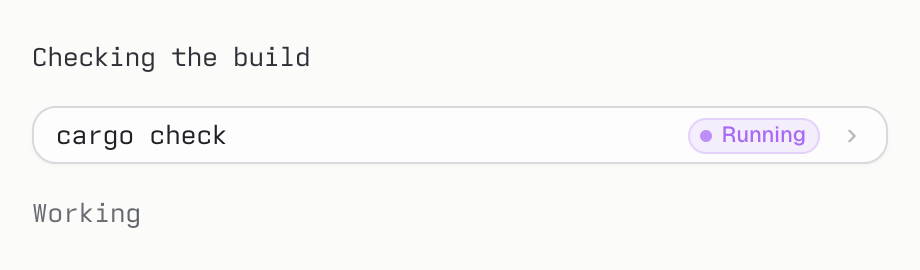
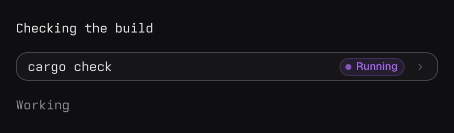
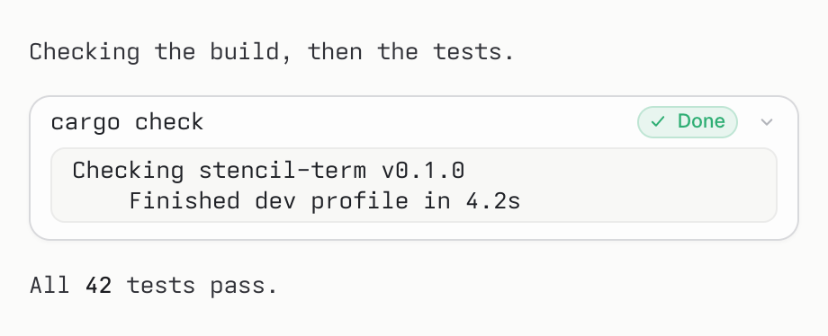
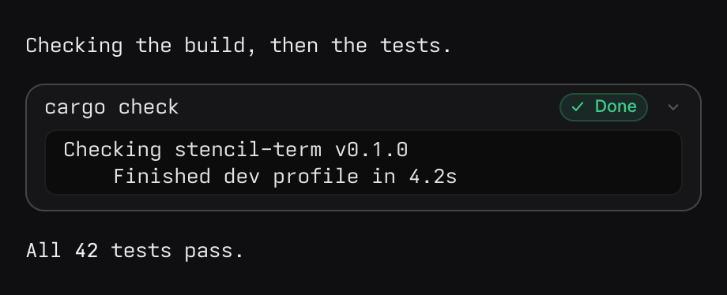

# 文档与帧

surface 的内容是一个文档：由程序构建，并通过一帧帧 ops 更改的节点树。

## 文档

节点的形式为 `{"id": string, "k": kind, "p": props, "c": [children]}`。`p` 和 `c` 均为可选。

- Id 由你决定：必须是非空字符串，在 surface 内唯一且尽量简短（omp 使用以 36 为基数的计数器）。组件的 id 在其生命周期内应保持稳定，这样 Tern 才能在更新期间保留其元素、高亮和折叠状态。
- `k` 必须是 `hello` 回复所列词汇表中的 kind。
- props 包含 kind 自身的 props，以及每个节点都可使用的 props。kind 及其 props 见 [元素](../elements/index.md)。值为 `null` 的 prop 会被丢弃，效果等同于未提供。
- 文本保存在 props 中（`text`、`spans`）。文本 kind（`text`、`md`、`code`、`ansi`、`math`、`editor`、`input`、`shimmer`、`el`）将主要文本保存在 `text` 中，由 `text` 和 `splice` ops 操作。程序的字体度量不会被继承。

根节点就是 surface 本身：一个 id 为 surface `id` 的 `col`，不可移动或删除。它的子节点是 [区域](surfaces.md#区域)：你在根节点下添加的节点，id 为 `main`、`dock` 和 `layer`（通常是 `col`）。surface 初始时只有根节点，因此第一帧会添加它所使用的区域。

## 帧

帧的形式为 `{"sf": surface, "s": seq, "ops": [op…]}`，并以原子方式应用：Tern 只在帧与帧之间绘制文档，因此 surface 用帧取代同步输出机制。每个 surface 的 `s` 都随帧递增，Tern 会通过 `ack` 事件确认已绘制的内容（[流控](operations.md#流控)）。Tern 不检查 `s` 的顺序；它会在 `ack` 和 `error` 中原样返回该值。

## 帧 ops

| 操作 | 形式 | 效果 |
| --- | --- | --- |
| `add` | `["add", id, parent, before\|null, node]` | 在 `parent` 下插入 `node`（整个子树），位置在同级节点 `before` 之前；若 `before` 为 `null`，则插入末尾。`id` 必须与 `node.id` 相等，并且必须提供 `before`。如果子树中的任一节点不符合要求（kind 未知、id 重复或超出限制），则整个子树都不会添加。 |
| `set` | `["set", id, props]` | 浅合并 props：每个键都会整体替换对应 prop。值为 `null` 时会删除 prop。 |
| `text` | `["text", id, "append"\|"replace", string]` | 更新文本 kind（`text`、`md`、`code`、`ansi`、`math`、`editor`、`input`、`shimmer`、`el`）的主要文本。对没有文本的节点执行 `append` 会设置文本。`append` 是流式传输路径：`md` 节点会从最后一个未闭合块起重新渲染。 |
| `splice` | `["splice", id, at, del, string]` | 在主要文本的 `at` 位置，将 `del` 个 UTF-16 代码单元替换为给定字符串（用于编辑器编辑、大型粘贴）。`at` 和 `del` 必须是整数，`at + del` 不得超出文本范围，且两端都不得拆分代理对。 |
| `move` | `["move", id, parent, before\|null]` | 重新设置子树的父节点或调整其顺序。`before` 必须是 `parent` 的子节点（或为 `null` 表示末尾），且不能是该节点本身。节点不能移动到自己的子树中。 |
| `del` | `["del", id]` | 删除整个子树。其内部的焦点也会一并移除。 |
| `settle` | `["settle", id]` | 提示该子树短期内不太可能更改。Tern 可以将其扁平化并释放其视图状态。之后任何深度上的 ops 若作用于该子树，都会使其恢复。`settle` 不会限制任何 op，但在[保留预算](operations.md#保留)内，Tern 会优先丢弃 `main` 中最早 settle 的子节点，并发出 `gone` 事件。 |
| `focus` | `["focus", id\|null]` | 将拥有插入光标和 IME 的 `editor` 或 `input` 设为焦点，或设为无焦点（[输入与事件](input.md#按键)）。 |
| `reveal` | `["reveal", id, "start"\|"end"\|"nearest"]` | 将节点滚动到视野内（例如选中的列表项或搜索结果）。节点所在的 `list` 会滚动到该节点。`main` 中的节点会滚动窗格（screen surface 自身的 `main`）；`dock` 或 `layer` 中的节点则只滚动其所在的容器。`start` 遵循滚动容器的 `scroll-padding`；其他任何位置值都按 `nearest` 处理。只有最新的 `reveal` 会生效。 |
| `scroll` | `["scroll", id, "line-up"\|"line-down"\|"page-up"\|"page-down"\|"start"\|"end"]` | 由你转发的键盘滚动操作（PgUp、PgDn 和 End 会传给程序）：将节点本身或其祖先中最近的滚动容器（带 `max.h` 的 `ansi` 块、`list`、picker 窗格、screen surface 的 `main`）滚动一行、一个视口减一行的高度，或滚动到首尾。将正在跟随尾部的 `ansi` 滚离尾部时，会停止跟随；`end` 会恢复跟随。inline surface 的 `main` 随窗格滚动，且会忽略此 op。功能特性 `scroll`。 |
| `suspend`、`resume` | `["suspend"]`、`["resume"]` | 将窗格交还给网格，并在之后重新接管（[Surface](surfaces.md#打开与关闭)）。 |

ops 只通过 id 定位节点，因此更改回滚区深处节点的成本与更改屏幕上节点相同：`["set","t9",{"collapsed":false}]` 会展开任意位置的卡片。

Tern 逐个应用帧 op。若某个 op 引用了未知 id、添加了词汇表之外的 kind、超出限制或参数格式错误，则仅拒绝该 op，并发出包含其从 0 开始的索引的事件；帧的其余部分仍会应用，因此后续 ops 看到的是未包含该 op 的文档：

```text
← ESC _ tsp;e;{"ev":"error","sf":"s1","s":2,"op":1,"msg":"unknown id t7"} ESC \
```

如果 Tern 完全无法接收某一帧（没有 `sf`、surface 未知或已关闭、`ops` 不是数组，或正文不是 JSON），则会整体丢弃该帧，并发出不带 `op` 的 `error`。

### 示例

向一个 flow surface 发送两帧。第一帧添加 `main`，其中包含一行 Markdown、一个折叠的卡片和一个 shimmer：

```text
→ ESC _ tsp;f;{"sf":"s1","s":1,"ops":[["add","main","s1",null,{"id":"main","k":"col","c":[
    {"id":"m1","k":"md","p":{"text":"Checking the build"}},
    {"id":"t9","k":"card","p":{"head":"cargo check","status":"running","collapsible":true,"collapsed":true},"c":[
      {"id":"o9","k":"code","p":{"lang":"text","text":"Checking stencil-term v0.1.0\n    Finished dev profile in 4.2s"}}]},
    {"id":"w1","k":"shimmer","p":{"text":"Working"}}]}]]} ESC \
```

<figure class="tn-figure">


<figcaption>第 1 帧之后。</figcaption>
</figure>

第二帧向 Markdown 追加内容，将卡片标记为完成并展开，移除 shimmer，然后添加结束行：

```text
→ ESC _ tsp;f;{"sf":"s1","s":2,"ops":[
    ["text","m1","append",", then the tests."],
    ["set","t9",{"status":"done","collapsed":false}],
    ["del","w1"],
    ["add","m2","main",null,{"id":"m2","k":"md","p":{"text":"All **42** tests pass."}}]]} ESC \
```

<figure class="tn-figure">


<figcaption>第 2 帧之后：一次绘制，没有中间状态。</figcaption>
</figure>

## Tern 的决定

- **间距。** `main` 中块与块之间，以及单个块内部各部分之间的间隔，遵循 Tern 的节奏。不要为此发送空白 `text` 或 `spacer` 节点。
- **用户设置。** 某些外观由用户设置，而不是 props 决定：Markdown 标题的样式（以正文大小标注，或按级别调整大小）、`mode` 缺失或为 `auto` 的 diff 如何布局（内联或拆分）、多次工具调用是否折叠在同一标题下，以及对话记录的聊天样式（Reader、Spine 或 Console）。这些设置都可以实时切换。
- **回退方案。** 对于终端的 `hello` 回复未列出的 kind，可以将其作为 `rows` 发送：按已公布的 `cols` 预先渲染的 ANSI 行（[文本与代码](../elements/text.md#rows)）。这适用于逐个组件迁移渲染器。

## 时间与动画

- 你无需发送逐帧更新。动态 kind（`spinner`、`shimmer`、`elapsed`、`rate`）和 span 效果（`fx`）由 Tern 按显示器刷新率驱动，并在窗格隐藏时暂停。
- **年龄，而非时间。** 持续时长以年龄表示：`elapsed.age`（以及 `tool` 的 `age`、`agent` 的 `stats.age`、`tool.age` 和 `retry.age`）是你写入帧时已经经过的毫秒数；倒计时使用负值，Tern 会存储 `start = receive time − age`。无需同步时钟，更新其他 props 的补丁不会重置计时；重放快照仍能保持正确，因为 Tern 在创建快照时会重写年龄值。
- **减少动态效果**（系统或 Tern 的设置）会将动态效果替换为静态等效形式：带标签的静态 spinner、不显示 shimmer，以及仍会计时的计时器。`hello` 回复中的 `reduceMotion` 和 `motion` 事件会告知你相关状态，因此你可以移除仅用于动态效果的节点。每种 kind 的详细信息见[进度与动态效果](../elements/motion.md)。