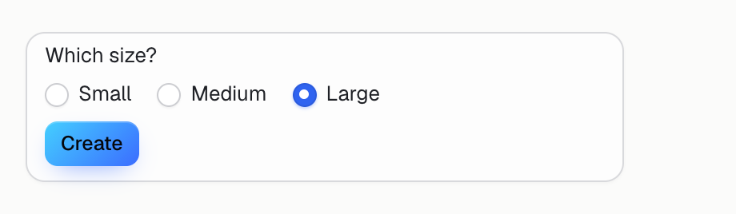
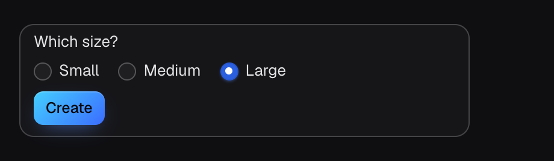

# Surface Protocol

Tern Surface Protocol（TSP）允许终端窗格中的程序将自己的 UI 描述为语义组件树。Tern 会原生地对该树进行布局、绘制和动画处理。使用 TSP 的程序不再绘制字符单元格：无需绘制框线字符、填充背景的留白、换行或截断计算、旋转指示器计时器，也无需在调整大小时重绘。程序只发送屏幕上“显示什么”，例如“一个待处理卡片，正文是这些 ANSI 字节，折叠到 10 行”，而由 Tern 决定“如何”呈现。

**在构建 UI 之前，请先阅读[设计视图](../guides/design.md)。** 该文档会介绍如何将应用布局为一个页面（顶部行、`stats` 条、视图之间的 `tabs`、与所选项目 `card` 并列的全宽 `selectable` `table`），将每项工作映射到合适的 kind，使用 sans 字体呈现应用，并列出会让视图看起来像网页的错误做法。遵循该设计的视图无需样式表，看起来就像 Tern 自带的界面。

插件无需阅读本部分：Tern 会为插件的块和 Lens 使用 TSP，而插件只需返回[视图](../guides/views.md)。这些页面面向在窗格中运行并向其 pty 写入内容的程序：打印表格或提问的 CLI、全屏 TUI、omp 这样的编码代理。TSP 可通过 ssh 和 Tern 会话守护进程工作，因为协议数据与程序的其他输出一起带内传输。

## 各部分由谁负责

| | 负责方 | 方式 |
| --- | --- | --- |
| 显示内容 | 程序 | 由[元素词汇表](../elements/index.md)中的节点组成的文档，通过帧操作更新。 |
| 布局 | Tern | 程序不会测量文本。只有 `rows` 回退方案和 ANSI 输出宽度需要使用单元格宽度（hello 回复和 `resize` 事件中的 `cols`）。 |
| 动画 | Tern | Tern 根据时钟驱动动效 kind（`spinner`、`shimmer`、`elapsed` 等），并遵守“减少动态效果”设置。程序不发送逐帧更新。 |
| 状态与输入 | 程序 | 按键通过 pty 输入到达程序。编辑器、选择列表和模式都属于程序自己的状态机，并根据程序发送的状态绘制。指针操作会作为事件返回。 |
| 仅用于视图的状态 | Tern | 悬停和滚动位置由 Tern 独占，不会上报。折叠，以及点击 `el` 复选框或单选框，会立即在窗口中生效并通过 `toggle`、`change` 上报，程序可以据此同步状态。 |
| 主题 | Tern | Tern 的主题为 surface 着色；程序可以添加自己的样式表。 |
| 历史 | 程序 | surface 打开期间，每个节点都可通过 id 寻址，包括视口内和滚动回溯中的节点；除非 Tern 因保留预算丢弃它（会发送 `gone` 事件）。不存在“最终”行：已经滚出视口的卡片仍然可以更新。surface 关闭时可以用 `keep` 保留在屏幕上，但不再接收帧。 |

不支持 TSP 的终端不会响应[握手](handshake.md)，程序就会继续使用自己的 ANSI 渲染器。

## 一个完整会话

CLI 在自己的输出下方提出一个问题，读取提交点击时的答案，然后退出，并把表单留在回滚内容中（`→` 表示程序通过 pty 输出发送给终端，`←` 表示终端通过输入发送给程序）：

```text
→ ESC _ tsp;q;{"q":"hello","v":[1],"app":"create-app"} ESC \  ESC [ c
← ESC _ tsp;r;{"r":"hello","v":1,…,"features":[…,"flow","font"],…} ESC \
← ESC [ ?62;52;c
→ ESC _ tsp;o;{"id":"pick","mode":"flow","font":"sans"} ESC \
→ ESC _ tsp;f;{"sf":"pick","s":1,"ops":[["add","main","pick",null,{"id":"main","k":"col","c":[…form…]}]]} ESC \
← ESC _ tsp;e;{"ev":"ack","sf":"pick","s":1} ESC \
← ESC _ tsp;e;{"ev":"change","sf":"pick","id":"l.r","value":"l","checked":true,"name":"size","values":{"size":"l"}} ESC \
← ESC _ tsp;e;{"ev":"action","sf":"pick","id":"go","act":"submit","values":{"size":"l"}} ESC \
→ ESC _ tsp;x;{"id":"pick","keep":true} ESC \
```

hello 回复先于 DA1 答复到达，因此 CLI 知道自己可以使用 TSP。它打开一个 [`flow` surface](surfaces.md)，该 surface 位于其输出中的光标行，使用 UI 字体（`font`），然后添加 `main` 区域的根节点，其父级为 surface id。问题是 `el` `form` 中的一个 `card`：标签单选框放在 `row` 中，旁边是主按钮 [`button`](../elements/input.md#button)。无需样式表：这些 kind 会绘制 Tern 的原生外观（该节点在线上协议中是一行数据）：

```json
{"id":"main","k":"col","c":[
 {"id":"ask","k":"el","p":{"tag":"form"},"c":[
  {"id":"q","k":"card","p":{"head":"Which size?","max":{"w":"48ch"}},"c":[
   {"id":"sizes","k":"row","p":{"gap":"lg"},"c":[
    {"id":"s","k":"el","p":{"tag":"label"},"c":[
     {"id":"s.r","k":"el","p":{"tag":"input","type":"radio","name":"size","value":"s"}},
     {"id":"s.t","k":"el","p":{"tag":"span","text":"Small"}}]},
    {"id":"m","k":"el","p":{"tag":"label"},"c":[
     {"id":"m.r","k":"el","p":{"tag":"input","type":"radio","name":"size","value":"m"}},
     {"id":"m.t","k":"el","p":{"tag":"span","text":"Medium"}}]},
    {"id":"l","k":"el","p":{"tag":"label"},"c":[
     {"id":"l.r","k":"el","p":{"tag":"input","type":"radio","name":"size","value":"l"}},
     {"id":"l.t","k":"el","p":{"tag":"span","text":"Large"}}]}]},
   {"id":"go","k":"button","p":{"text":"Create","variant":"primary","actions":{"click":"submit"}}}]}]}]}
```

Tern 会在帧 1 绘制完成后进行确认。点击 Large 会立即勾选对应单选框，并从单选框节点 `l.r` 发送带有 `values` 的 `change` 事件，其中包含表单的命名控件。点击 Create 会以按钮的 `click` 名称作为 `act` 发送 `action` 事件，并附带相同的 `values`。CLI 通过 `keep` 关闭 surface，因此最后绘制的表单会留在回滚内容中：

<figure class="tn-figure">


<figcaption>点击后 Large 处于选中状态，表单保留在会话滚动内容中。</figcaption>
</figure>

更完整的表单示例见 [HTML 元素](../elements/el.md#示例-带样式的表单)。

## 页面

| 页面 | 内容 |
| --- | --- |
| [传输](transport.md) | 分帧、动词、分块、Windows |
| [握手](handshake.md) | 检测 Tern、`hello` 查询与回复、功能特性 |
| [Surface](surfaces.md) | 打开和关闭 surface、inline/screen/flow 模式、锚定、区域 |
| [文档与帧](documents.md) | 文档模型、帧操作、时间 |
| [输入与事件](input.md) | 按键、原生编辑、指针操作、Tern 发送的所有事件 |
| [样式表与图标](theme.md) | 程序样式表、图标字形 |
| [流控、持久化与安全](operations.md) | 信用额度、保留策略、快照、调试、限制 |
| [SDK](sdks.md) | 用于 Rust、Python、Go 和 TypeScript 的库，支持以上所有协议功能 |

节点词汇表及每种 kind 的属性见[元素](../elements/index.md)，样式说明见[设置视图样式](../styles/index.md)。
