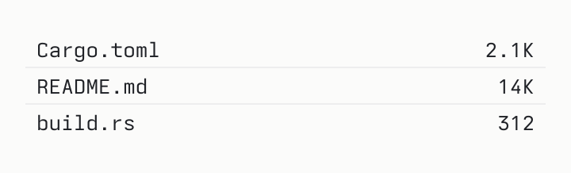
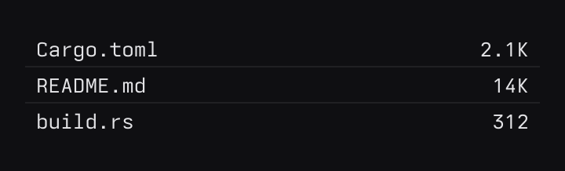
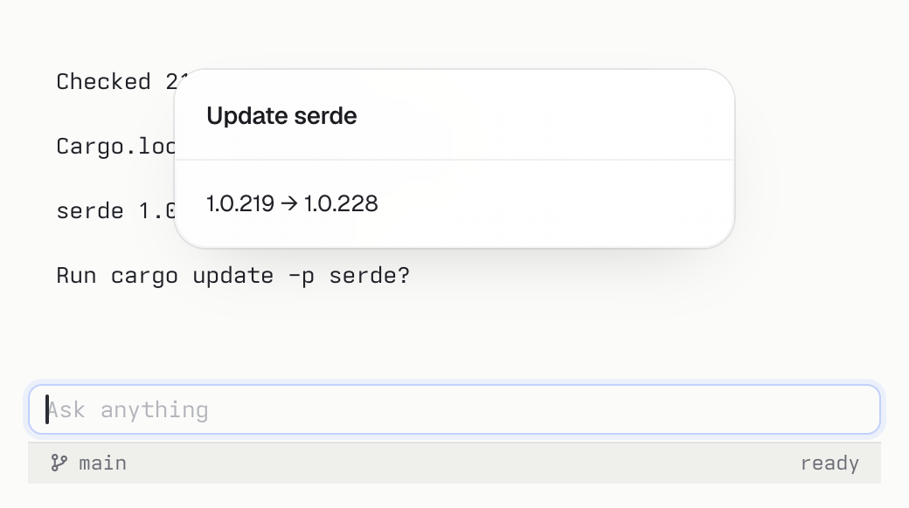
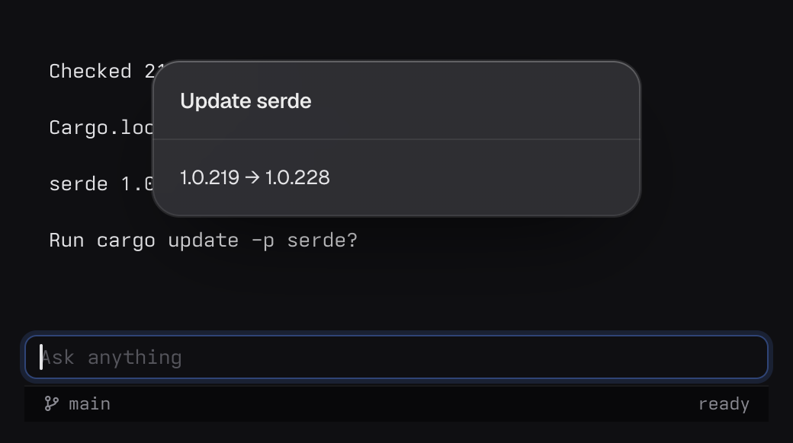

# 界面表面

**surface** 是程序在其窗格中显示的一份文档。实时 surface 中的所有内容始终都可编辑，包括已经滚入历史记录的部分：滚屏内容属于文档，而不是封存的旧行记录。一个窗格的滚屏内容中可以有任意多个已关闭的 surface，但每个屏幕缓冲区中，每种模式最多只能有一个实时 surface。

## 模式

| 模式 | 用途 | 所在位置 | 程序结束后 |
| --- | --- | --- | --- |
| `inline`（默认） | 在窗格中运行会话的程序（omp） | 主屏幕光标所在行；实时期间占用窗格 | 在下一个 shell 提示符处丢弃 |
| `screen` | 全屏视图（应用、全屏覆盖层） | 覆盖整个窗格，如同备用屏幕 | 关闭时丢弃 |
| `flow` | 非全屏程序：打印表格、提问或显示进度后退出的 CLI（`flow` 功能） | 主屏幕光标所在行，与周围输出并列 | 保留在滚屏内容中，如同普通输出 |

## 打开与关闭

```json
// tsp;o
{"id":"s1","mode":"inline","title":"omp","role":"omp.session"}
```

| 字段 | 含义 |
| --- | --- |
| `id` | 你为 surface 指定的名称：帧和事件会以 `sf` 携带它。必填；不带 `id` 的 `o` 会报错。每个打开的 surface 都要使用不同的 id：`f` 和 `x` 会作用于第一个具有该 id 的打开 surface，即当前屏幕缓冲区中的第一个。 |
| `mode` | `inline`、`screen` 或 `flow`。未知模式会报错。 |
| `title` | 在程序设置自己的标题（OSC 0/2）之前，用作窗格名称。 |
| `role` | 为样式表标识 surface：该值会成为 surface 三个区域元素（`omp.session`、`omp.rewind`）上的 `data-surface`。不是属于区域节点的 `data-role`。 |
| `adopt` | `true` 表示重新打开已关闭的 inline surface（见下文）。 |
| `listen` | `false` 表示程序永远不会读取其输入（见下文）。默认为 `true`。 |
| `closable` | `true` 表示关闭窗格不会丢失任何内容，因此 Tern 无需询问便会关闭窗格（见下文）。默认为 `false`。 |
| `font` | `"sans"` 使用 UI 字体绘制 surface，`"mono"` 使用终端字体（见下文）。默认为 `"mono"`；其他任何值都按 `"mono"` 处理。 |

- **Inline。** 锚定在主屏幕光标所在行；随滚屏内容一起流动。实时期间它会像备用屏幕一样占用窗格（**干净窗格**）：shell 的行、启动程序的命令、滚屏内容和较早关闭的 surface 都不会绘制，也不会有内容滚到 surface 首行上方。surface 关闭或暂停时，这些内容会恢复。在备用屏幕上打开 inline surface 会报错。
- **Screen。** 像备用屏幕一样填满窗格，包括覆盖层。关闭时会丢弃，不受 `keep` 设置影响。
- **Flow。** 像 `inline` 一样锚定在主屏幕光标所在行（在备用屏幕上打开会报错），但它不会占用窗格：其上方的 shell 行和下方的输出都会保留；它像这些行一样横跨窗格，但不会采用对话记录的聊天样式。它属于命令输出：关闭它（`x` 携带 `keep:true`，或程序退出）会使其留在原处；下一个 shell 提示符也会先关闭仍然打开的 flow surface，再保留它。它会一直保留，直到其锚点行离开滚屏内容。打开期间它是实时 surface，与 inline surface 一样具有帧、事件、`dock` 和 `layer`。
- **安全关闭。** 将 **Confirm before closing** 设为 **Running programs**（`confirm_close`，默认值）时，Tern 会在关闭仍有程序运行的窗格前询问。若程序关闭时不会丢失任何内容（例如查看器、仪表盘），则打开 surface 时设置 `closable:true`：该 surface 打开期间，关闭窗格无需提示。此设置仅适用于这一个 surface；surface 关闭后，或者 `adopt` 时未再次设置该选项，程序就会重新启用关闭保护。若程序有时存在未保存的工作，则改用 Program Status 序列报告状态：`ESC ] 7501 ; state=idle ESC \`（也可以用 `BEL` 代替 `ESC \`）。程序报告状态后，只有最近一次报告为 `state=working` 或 `state=blocked` 时，Tern 才会询问；因此，有未保存内容时发送 `state=working`，安全后发送 `state=idle`。
- **不监听输入。** `listen:false`（适用于任何模式）表示程序永远不会读取输入。此时 Tern 不会发送任何与该 surface 有关的内容：没有确认（发送帧时无需等待额度）、没有事件、错误或答复；直到你下次发送 `q` 或打开一个监听输入的 surface（`o`）才会恢复。其中的控件不会切换状态。以这种方式打印静态视图的程序无需启用原始模式，也不会在输入队列中留下任何内容供 shell 读取：

  ```text
  ESC _ tsp;o;{"id":"ls","mode":"flow","listen":false} ESC \
  ESC _ tsp;s;{"sf":"ls","name":"main","css":".size{text-align:right}"} ESC \
  ESC _ tsp;f;{"sf":"ls","s":1,"ops":[["add","main","ls",null,{"id":"main","k":"col","c":[
    {"id":"t","k":"el","p":{"tag":"table"},"c":[
      {"id":"a","k":"el","p":{"tag":"tr"},"c":[
        {"id":"a.n","k":"el","p":{"tag":"td","text":"Cargo.toml"}},
        {"id":"a.s","k":"el","p":{"tag":"td","class":"size","text":"2.1K"}}]},
      {"id":"b","k":"el","p":{"tag":"tr"},"c":[
        {"id":"b.n","k":"el","p":{"tag":"td","text":"README.md"}},
        {"id":"b.s","k":"el","p":{"tag":"td","class":"size","text":"14K"}}]},
      {"id":"c","k":"el","p":{"tag":"tr"},"c":[
        {"id":"c.n","k":"el","p":{"tag":"td","text":"build.rs"}},
        {"id":"c.s","k":"el","p":{"tag":"td","class":"size","text":"312"}}]}]}]}]]} ESC \
  ESC _ tsp;x;{"id":"ls","keep":true} ESC \
  ```

  <figure class="tn-figure">
  
  
  <figcaption>已关闭的 flow surface：表格像周围的行一样横跨窗格。</figcaption>
  </figure>

- **字体。** 默认情况下，surface 使用终端的等宽字体绘制，适合与 shell 输出并列的内容。设置 `font:"sans"`（`font` 功能）则改用 UI 字体，如同 Tern 自带应用；应用（仪表盘、表单、会话）应使用此设置打开（[设计视图](../guides/design.md#字体与排版)）。它的三个区域元素会获得 `sf-sans` 类：文本采用 13px/18px 的 Geist（`--sans`），随界面缩放；区域行高（`--sf-lh`、`"lines"` 范围、列表行、表格行）为 18px，而不是终端行高。机器字符串仍使用等宽字体：span token `mono`、`code`、`num`、`path` 和 `key` 使用终端字体，字号为 12.5px；带有 `mono` 的表格列也一样。显示机器文本的种类（`code`、`diff`、`ansi`、`rows`、`editor`、`input`、`json`、`kbd`、`math`，以及 `md` 中的围栏代码）也保留终端字体、字号和行高。其余内容（`text`、`md` 正文、卡片和分区标题、`kv`、列表、标签页、徽章、表格、树）都遵循区域设置。通过 `adopt` 打开的 `o` 会采用其携带的 `font`。

  ```text
  ESC _ tsp;o;{"id":"app","mode":"screen","title":"Deploys","font":"sans"} ESC \
  ```

- **Screen 覆盖 inline。** 不使用备用屏幕的程序可以在 inline surface 处于实时状态时打开 screen surface，以显示全屏视图。screen surface 会覆盖窗格：网格行、inline surface 的 `main`、`dock` 和覆盖层都会隐藏；指针输入、插入符和视图事件（`resize`、`visible`）会发送给 screen surface。它不会关闭或更改 inline surface：其文档、`dock`、`layer`、焦点和帧序列都保持原样，发给它的帧仍会生效。screen surface 关闭后，inline surface 会原样重新显示。无需重新发送任何内容。
- **替换。** 新的 `o` 会替换缓冲区中同模式的实时 surface：inline 或 flow surface 会像设置 `keep:true` 一样关闭，screen surface 则会丢弃。新的 inline `o`（程序启动会话时）也会丢弃仍覆盖该缓冲区的 screen surface。screen `o` 不会影响 inline surface，二者都不会影响 flow surface。
- **关闭。** `x` 携带 `{"id":"s1","keep":true}` 会关闭 surface：仅在实时期间存在的区域（`dock`、覆盖层、焦点）会移除，而 `main` 会留在滚屏内容中；inline surface 会保留到 shell 下一个提示符出现，flow surface 则会永久保留。`keep:false` 会将其移除。`keep` 默认为 `true`。
- **重新接管。** `o` 携带 `{"id":"s1","adopt":true}` 会重新打开此窗格滚屏内容中、仍然存在且 ID 相同的最新已关闭 inline surface：文档保持不变，并再次完全可编辑，但不带 `dock` 或 `layer`（关闭时已移除；需要时请重新添加）。`mode` 会被忽略；若提供了 `title` 和 `role`，则会替换旧值；`listen` 的行为与任何 `o` 一样。与新的 inline `o` 一样，它会关闭缓冲区中实时的 inline surface（如同 `keep:true`），并丢弃 screen surface；若重新接管的 ID 已处于实时状态，则不做任何操作。程序在停止/重新启动周期（例如外部编辑器）后重新接管 surface，使对话记录能在原处继续，而不是再打印一份。如果该 ID 不在此窗格中，Tern 会答复 `{"ev":"gone","ids":["s1"]}`（除非 `o` 设置了 `listen:false`），此时应打开新的 surface。
- **暂停。** 帧操作 `["suspend"]` 和 `["resume"]` 会暂时把窗格交还给网格（例如运行交互式 shell 命令或外部 `$EDITOR`）。暂停的 surface 保留原位且不会取得指针焦点；网格输出会出现在它下方。
- **崩溃安全。** 窗格进程退出时，所有实时 surface 都会关闭：inline 和 flow surface 按 `keep:true` 处理（已退出的窗格仍可供查看），screen surface 则会丢弃。RIS（`ESC c`）会清除屏幕及其上的 surface。此后程序会被视为已退出，Tern 不再发送任何内容，直到有操作请求（`q`）或打开 surface（`o`）。
- **回到提示符。** shell 提示符（OSC 133;A）表示程序已退出。Tern 会丢弃窗格中的所有 inline 和 screen surface，包括通过 `keep:true` 关闭的 surface，因此退出会话程序会将其对话记录从窗格中移除，并让 shell 行恢复原样。如果程序没有在 inline surface 锚点下方的网格中写入任何内容，锚点行会撤销，shell 光标也会回到程序启动前的位置。flow surface 和 Tern 自己的命令 Lens 块会保留：它们属于命令输出。
  因此，inline surface 上的 `keep:true` 只会在程序占用窗格期间有效，中间不能出现提示符。通过作业控制暂停（`^Z`、`fg`）后，`adopt` 会收到 `gone`。
- **退出前处理。** 停止读取输入前，先关闭自己的 surface（`x`），然后短暂排空输入，以免在途的答复和事件被 pty 的下一个读取者收到。下一个读取者通常是 shell，它会把这些内容当作键入的文本：zsh 会将 `ESC _` 识别为插入上一个单词。切勿打印或回显 TSP 输入。不读取输入的程序应改为以 `listen:false` 打开。
- **标题。** 命令打开第一个监听输入的 surface（不是 `listen:false`）时，Tern 会移除 shell 为窗格设置的标题（zsh 的 preexec 标题就是命令行）；此后 `o` 的 `title` 会成为窗格标题，直到程序自行设置标题。应在 `o` 之后设置程序自己的标题。同一命令打开后续 surface 时，不会更改程序标题。
- **额外输出。** surface 实时期间，不属于 TSP 的字节（例如库日志、stderr）会像往常一样发送到网格。inline surface 占用窗格期间，这些内容会和网格其余部分一起隐藏，直到 surface 关闭或暂停。
- **备用屏幕。** 切换到备用屏幕的程序（例如你的程序启动的 `vim`）会像往常一样覆盖窗格。inline 和 flow surface 属于主屏幕，备用屏幕结束后会重新显示。screen surface 属于打开时处于活动状态的缓冲区：在备用屏幕上打开的 surface 会在程序离开（或清除）备用屏幕时消失，监听输入的程序会收到 `{"ev":"gone","sf":"s1","ids":["s1"]}`。

## 在网格中锚定

inline 或 flow surface 恰好占据一个网格行，即它的**锚点**。执行 `o` 时，如果光标所在行有内容（光标位于第 0 列之后、存在文本或另一个锚点），Tern 会先结束该行；随后将光标行变为锚点，并把光标移到下一行起始处。锚点是 surface 在网格布局中唯一占用的行，因此，即使滚屏内容深处的节点增长、缩小、出现或消失，也不会移动、插入或重新折行任何网格行。调整大小时，锚点不会与折行后的行合并，不会作为空行被裁剪，并且像其他行一样滚入历史记录。快照会连同文档一起保存锚点。

surface 的生命周期与其锚点行完全相同。该行从滚屏内容末尾滚出、被擦除（`ESC [2J`、`clear`）、在滚动区域内滚走，或滚屏内容被清空时，surface 也会随之消失；如果其程序正在监听，打开状态的 surface 会收到 `{"ev":"gone","sf":"s1","ids":["s1"]}`。

Tern 将窗格绘制为固定高度的网格行序列，各序列之间穿插自然高度的 surface 块。选择、鼠标报告、链接、查找和光标都会遵循这一布局。

**滚动锚定。** 当用户正在查看的内容上方发生高度变化时（例如滚屏内容中的折叠卡片展开、过去的条目被替换），视图会继续停留在视口中原本显示的内容上，不会跳动。在 surface 内，滚动位置由 `main` 中的子节点及其内部偏移决定，因此上方子节点高度变化时，滚动位置也会相应调整。当视图跟随实时末尾时，尾部则会保持固定。对视野之外节点执行的操作会立即应用到文档；其布局会等节点进入视野后再计算，在此之前使用估算值。

## 区域

surface 的根节点（其 id 就是 surface 的 `id`）最多有三个子节点，且它们的 ID 固定：

| ID | 内容 |
| --- | --- |
| `main` | 流式文档（对话记录）。随窗格滚动。 |
| `dock` | surface 实时期间固定在窗格底部：可放置编辑器、状态行或工作指示器。关闭时移除。窗格会在其上方布局 `main`，并保持尾部可见，直到用户向上滚动。 |
| `layer` | 浮在所有内容上方的覆盖层（[覆盖层](../elements/chrome.md#overlay)）。关闭时移除。 |

```text
ESC _ tsp;f;{"sf":"s1","s":1,"ops":[
  ["add","main","s1",null,{"id":"main","k":"col","c":[
    {"id":"m1","k":"text","p":{"text":"Checked 214 crates."}},
    {"id":"m2","k":"text","p":{"text":"Cargo.lock pins serde 1.0.219."}},
    {"id":"m3","k":"text","p":{"text":"serde 1.0.228 is out."}},
    {"id":"m4","k":"text","p":{"text":"Run cargo update -p serde?"}}]}],
  ["add","dock","s1",null,{"id":"dock","k":"col","c":[
    {"id":"ed","k":"editor","p":{"placeholder":"Ask anything"}},
    {"id":"bar","k":"status","c":[
      {"id":"br","k":"seg","p":{"icon":"branch","text":"main"}},
      {"id":"st","k":"seg","p":{"side":"right","text":"ready"}}]}]}],
  ["add","layer","s1",null,{"id":"layer","k":"col","c":[
    {"id":"ask","k":"overlay","p":{"anchor":"top","size":"sm","head":[{"t":"Update serde"}]},"c":[
      {"id":"ask.t","k":"text","p":{"text":"1.0.219 → 1.0.228"}}]}]}],
  ["focus","ed"]]} ESC \
```

<figure class="tn-figure">


<figcaption>一个 inline surface：上方是 <code>main</code>，底部是 <code>dock</code>，<code>layer</code> 中的覆盖层位于二者之上。</figcaption>
</figure>

每个区域都会绘制到自己的元素中，而不是绘制到某种 kind 的节点中：区域节点的 kind 及除 `role` 外的 props 都会被忽略（`col` 不会绘制 `.sf-col`，其 `gap` 或 `class` 也不起作用），其子节点会直接放入区域元素。可通过以下选择器设置区域样式：

```html
<div class="sf-region sf-main" data-scope="sf1" data-surface="omp.session" data-role="…">…</div>
<div class="sf-region sf-dock" data-scope="sf1" data-surface="omp.session">…</div>
<div class="sf-region sf-layer" data-scope="sf1" data-surface="omp.session">…</div>
```

| 目标 | 选择器 |
| --- | --- |
| 任意区域 | `.sf-region` |
| 单个区域 | `.sf-main`、`.sf-dock`、`.sf-layer` |
| 按 `o` 的 `role` 选择 | `[data-surface='omp.session']`（全部三个区域） |
| 按程序的 `hello` `app` 选择 | `[data-app='hermes']`（全部三个区域） |
| 按区域节点的 `role` prop 选择 | `.sf-main[data-role='…']` |
| 位于模态框、全屏覆盖层或 `picker` 下方 | `.sf-main.sf-covered`、`.sf-dock.sf-covered` |

screen surface 的区域共享其覆盖范围：`main` 占据全部高度并自行滚动（`reveal` 会滚动它，而不是窗格），`dock` 位于 `main` 下方。

**侧栏**（`aside` 功能）。inline surface 的 `layer` 中若有 `prefs` 节点，它会作为停靠在窗格右侧的面板，而不是覆盖层：窗格会为它预留与 Tern 自带设置面板相同的宽度（最多占窗格的 60%）；网格行、`main` 和 `dock` 会在面板旁结束，并且 `resize` 会提供较窄的 `cols`。面板旁的其余 surface 内容仍保持实时；按键会发送到 `focus` 指定的位置，点击则会通过 `focus` 事件移动焦点。关闭该节点或 surface 后，窗格会恢复原有宽度。