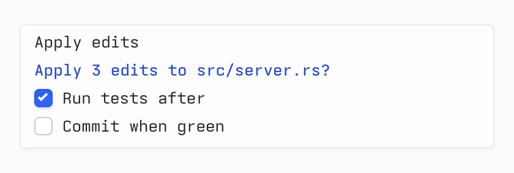
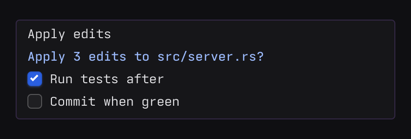

# 样式表与图标

程序可以携带自己的 CSS（`s`）和图标字形。二者都可选：如果不提供，Tern 会使用自己的主题绘制 surface。

Tern 会在 `hello` 回复中将外观报告为 `dark`，并在外观变化时发送 `{"ev":"theme","dark":bool}`。`t` 动词（以前的程序调色板）会被接受并忽略。

## 样式表

```text
ESC _ tsp;s;{"sf":"s1","name":"main","css":".ask label{display:flex;gap:8px}"} ESC \
```

`s`（功能特性 `styles`）会为 surface `sf` 安装或替换样式表 `name`（1–64 个 `A–Z a–z 0–9 _ -` 字符）；未指定时使用当前活动 surface。`css` 为 null、缺省或空字符串时会移除该样式表。

- 一个 surface 的样式表会按首次发送的顺序，在 Tern 自身的样式表之后层叠；被替换的样式表保留原有位置。
- surface 关闭后，样式表仍会随其保留，因此其滚动区仍保持原样，快照也会重放这些样式表。
- 一个 surface 最多容纳 256 KiB CSS，按所有样式表的总量计算，并以新文本替换被替换的样式表文本。超出此限制、名称无效、`css` 不是字符串或 surface 未知时，`s` 会被拒绝，并发送 `error` 事件；内容不会发生变化。
- **作用范围仅限 surface。** 每个选择器都相对于该 surface：`.ask label` 会匹配其 `main`、`dock` 和 `layer` 区域内的内容，不会匹配其他位置。区域元素本身位于作用范围之外，因此以 `.sf-main` 为目标的选择器不会匹配任何内容。Tern 的界面框架、其他窗格和其他 surface 均无法触及。作用范围不会增加优先级，因此你的规则可以胜过优先级相同的 Tern 规则。
- **无法触及的内容。** 含 `url()` 和 `position: fixed` 的声明会被丢弃并报告；`@font-face` 会被忽略，`@import` 会作为不支持的功能报告。样式表的 `@keyframes` 仅对该表自身有效；若动画指定的关键帧未由该样式表定义，则使用 Tern 的关键帧。
- **错误。** 对于无法解析或被丢弃的内容，窗口会跳过并报告；每当样式表的 CSS 发生变化时，相关问题只报告一次，并合并到一个事件中：`{"ev":"error","sf","sheet":name,"msg":"<line>:<col>: …; <line>:<col>: …"}`。

下面的样式表会布局由 `el` 节点构成的表单，并将 Tern 的卡片边角改为直角；由于这些卡片位于 surface 内，样式表可以触及它们：

```css
.ask { display: flex; flex-direction: column; gap: 6px }
.ask label { display: flex; gap: 8px; align-items: center }
.ask .q { font-weight: 600; color: var(--sf-c-accent) }
.sf-card { border-radius: 4px }
```

```json
{"id":"n1","k":"card","p":{"tone":"pending","head":"Apply edits"},"c":[
 {"id":"n2","k":"el","p":{"tag":"form","class":"ask"},"c":[
  {"id":"n3","k":"el","p":{"tag":"div","class":"q","text":"Apply 3 edits to src/server.rs?"}},
  {"id":"n4","k":"el","p":{"tag":"label"},"c":[
   {"id":"n5","k":"el","p":{"tag":"input","type":"checkbox","checked":true}},
   {"id":"n6","k":"el","p":{"tag":"span","text":"Run tests after"}}]},
  {"id":"n7","k":"el","p":{"tag":"label"},"c":[
   {"id":"n8","k":"el","p":{"tag":"input","type":"checkbox"}},
   {"id":"n9","k":"el","p":{"tag":"span","text":"Commit when green"}}]}]}]}
```

<figure class="tn-figure">


</figure>

关于可定位的钩子、层叠规则和示例，请参阅[视图样式](../styles/index.md)；CSS 引擎支持的内容见[支持的 CSS](../styles/css.md)。插件不会发送 `s`：它们的样式表来自 manifest 和 `tern.css`。

## 图标与字形

- **命名图标。** 固定图标槽位（`icon` 节点、`item` 或 `seg` 的 `icon`，以及 `role` 为卡片选择的图标）使用 Tern 图标集中的名称。名称列表见[数据](../elements/data.md#图标名称)。
- **文本中的字形。** 连续文本中的图标使用 Nerd Font 码点（私人使用区），放在带有 `icon` token 的 span 中，同时保留任何颜色 token（`"statusLineModel icon"`）。Tern 会以图标度量值，通过等宽 Nerd Font 字体绘制 `icon` span；若后面有文本，还会添加自身的间距，因此应删除你在终端字形后通常会加的填充空格。Tern 会将其他任何一段私人使用区码点移入其自身的图标 span，同时保留该 span 的样式：包括不带 `icon` token 的 span，以及不属于 span 的文本（编辑器缓冲区、`md` 正文）。不要发送表情符号或 Unicode 图标替代字符。
