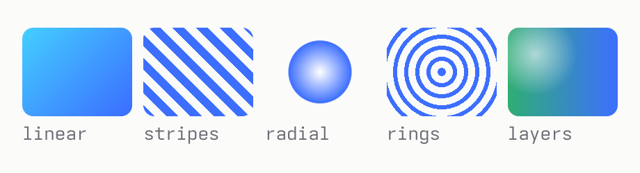
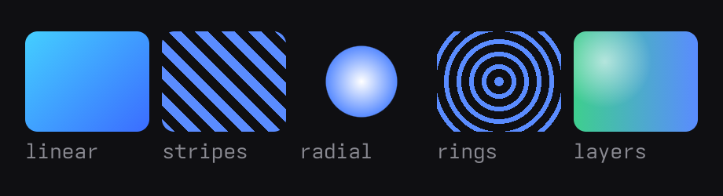
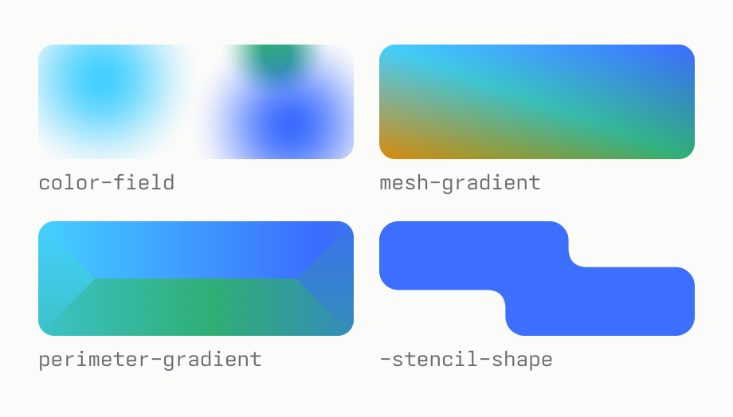
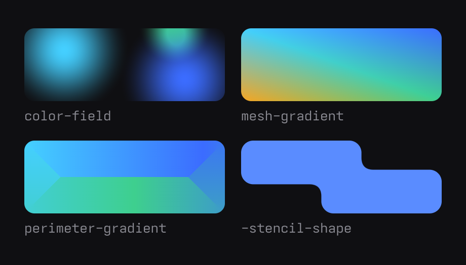
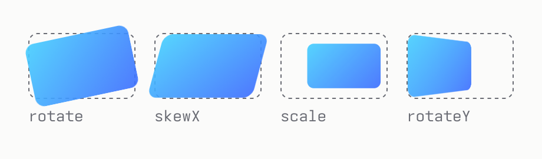
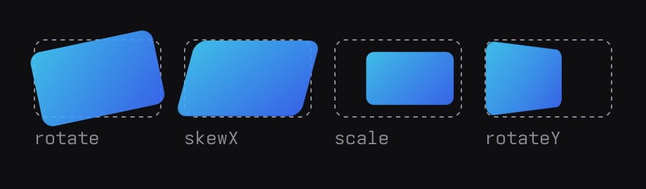
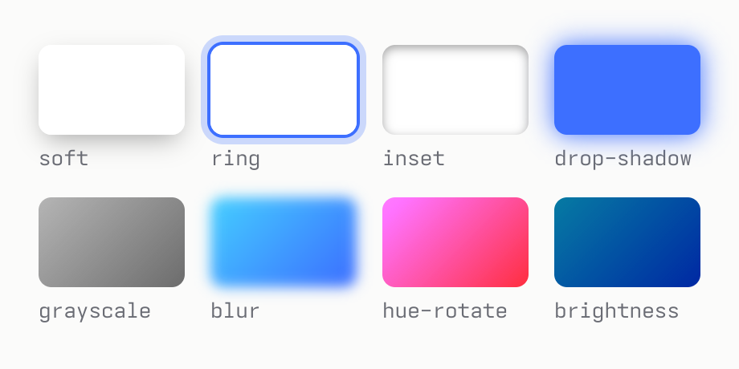
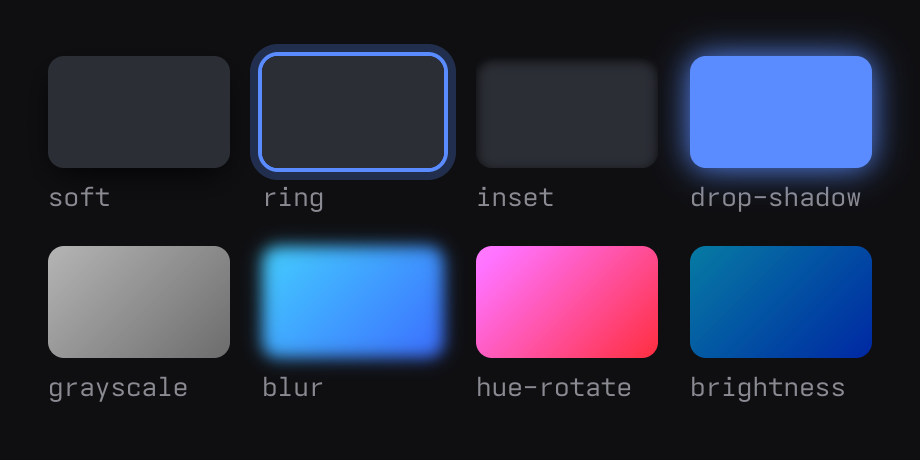
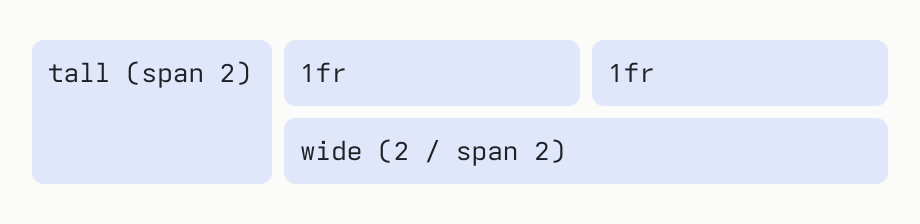
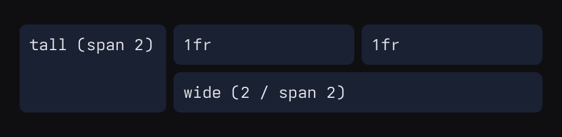

# 支持的 CSS

Tern 使用自己的引擎绘制插件视图，而不是浏览器。它支持一个明确界定的 CSS 子集，以及少量 Stencil 扩展。本页准确列出引擎接受、忽略和拒绝的内容。关于样式表的来源以及应针对哪些类，请参阅[视图样式](index.md)。关于主题变量，请参阅[CSS 变量](variables.md)。

## CSS 的放置位置

| 来源 | 样式表名称 | 作用范围 |
| --- | --- | --- |
| manifest `styles` | `plugin:<host>:<id>:styles`（在此机器上为 `plugin:local:<id>:styles`） | 全局作者样式表 |
| `tern.css(name, source)` | `plugin:local:<id>:<name>` | 全局作者样式表 |
| TSP 程序的 surface 样式表 | `tsp:<scope>:<name>` | 限定在其 surface 内（见[作用域样式表](#作用域样式表)） |

插件样式表是普通的作者样式表。其规则可以匹配窗口中的任何内容，因此请在选择器前加上你的块区域（`[data-surface="plugin.<plugin>.<block>"]`）或你自己的类。新样式表会添加到级联顺序的末尾；替换样式表（重新加载，或再次以相同名称调用 `tern.css`）会保留其位置。

### 错误

解析器不会让整张样式表失败。无法使用的部分会被丢弃，其余部分保留：

| 内容 | 结果 |
| --- | --- |
| 未知属性 | 丢弃声明，错误为 `unknown property` |
| 已知属性，值无效 | 丢弃声明，报错 |
| 被忽略的属性（见下文） | 静默丢弃声明 |
| 不支持的选择器、伪类或伪元素 | 丢弃整条规则（包括其所有选择器），报错 |
| 不支持的 at-rule（`@import`、`@supports`、`@container`、…） | 丢弃 at-rule，错误为 `unsupported at-rule` |
| 不支持的媒体特性或值 | 丢弃 `@media` 块，报错 |
| `var()` 解析为空且没有回退值 | 对该元素将属性视为 `unset`（不报错） |
| `var()` 解析为无效值 | 对该元素将属性视为 `unset`（不报错） |

对于插件样式表，Tern 会将错误记录为警告 `plugin style sheet has errors`，其中包含样式表名称以及每条错误，格式为 `file:line:column: message`。请在 Tern 的日志中查找。对于 TSP surface 样式表，错误会作为每张样式表的一个 `error` 事件返回给程序：`sheet` 保存样式表名称，`msg` 保存每条错误，格式为 ``line:column: message in `snippet` ``，并以 `; ` 连接：

```text
{"ev":"error","sheet":"main","msg":"2:6: unsupported length unit `rem` in `width: 2rem;`; 3:1: unsupported pseudo-class `:enabled` in `.t:enabled {`","sf":"s1"}
```

为兼容 Web 样式表，以下属性会被接受并丢弃，不报错：`-moz-osx-font-smoothing`、`text-rendering`、`-webkit-tap-highlight-color`、`-webkit-box-orient`。

## 语法

### 规则与嵌套

仅支持样式规则、`@media`、`@layer`、`@keyframes`（以及 `@-webkit-keyframes`）和 `@font-face`。CSS 嵌套可用，并会在解析时扁平化为普通规则：

```css
.my-panel {
	padding: 8px;

	& .title { font-weight: 600; }   /* .my-panel .title */
	> .row { display: flex; }        /* .my-panel > .row */
	.note { opacity: .7; }           /* .my-panel .note (no & means descendant) */
	&.busy { cursor: progress; }     /* .my-panel.busy */
	.dark & { color: white; }        /* .dark .my-panel */

	@media (max-width: 600px) { padding: 4px; }

	color: gray;  /* after nested rules: a later rule of its own, so it wins ties */
}
```

- `&` 表示父选择器列表。每个 `&` 在优先级计算中都按最具体的父选择器处理。
- 不带 `&` 的嵌套选择器是相对选择器：开头为 `>` 或 `+` 时使用该组合符，否则使用后代关系。
- 嵌套选择器不能既以组合符开头，又包含 `&`。
- 选择器以伪元素结尾的规则内不能嵌套任何内容。
- 样式规则内只允许嵌套 `@media`。嵌套 `@keyframes` 会报错。

### `!important`

`!important` 可用于任何声明，包括自定义属性。级联会先应用所有普通声明，再应用所有 `!important` 声明，因此重要声明会胜过任何普通声明。

### 级联顺序

对于一个元素，声明按以下顺序胜出（越靠后越优先）：

1. Tern 的用户代理样式表。
2. 作者规则（先是 Tern 内置样式表，再是插件样式表），依次按级联层（见[`@layer`](#layer)）、优先级、样式表顺序、样式表中的位置决定。由于插件样式表在 Tern 之后注册，同一层且优先级相同的情况下，你的规则会胜过 Tern 的规则。
3. 元素的行内样式。
4. 然后是 `!important` 声明：作者规则按反向层级顺序（未分层的优先级最低，第一层最高），接着是 CSS 主题，最后是行内 `!important`。

CSS 主题（[主题](../guides/themes.md)）会将每条声明都视为 `!important`：它胜过所有作者规则和行内样式，只有行内 `!important` 能胜过它。

正在运行的过渡、CSS 动画、脚本动画会依次绘制在级联值之上。关于这如何与 Tern 自有类配合使用，请参阅[视图样式](index.md)。

### CSS 全局关键字

每个属性都接受 `inherit`、`initial` 和 `unset`。不支持 `revert` 和 `revert-layer`。`all` 属性只接受这三个关键字。

### 继承

下方表格中“继承”列标为“是”的属性默认会继承；其余属性会重置为初始值。自定义属性始终会继承。

## 值

### 长度和百分比

| 单位 | 含义 |
| --- | --- |
| `px` | CSS 像素 |
| `em` | 元素的字号（对于 `font-size`，则为父元素的字号） |
| `ch` | 元素字号的一半（对于 `font-size`，则为父元素字号的一半）。这是 CSS 对字符 `0` 宽度的回退值；Tern 不会测量字形，因此在大多数等宽字体中，实际的 `0` 会稍宽（约为 0.6em） |
| `vw`、`vh` | 窗口宽度或高度的 1% |
| `%` | 相对于属性参考对象（包含块等）的百分比 |
| `0` | 单独的零值属于长度 |

其他长度单位均无法解析：`rem`、`ex`、`lh`、`vmin`、`vmax`、`dvh`、`cm`、`pt` 等会因 `unsupported length unit` 被拒绝。请使用 `em` 或 `px`，或使用来自 [CSS 变量](variables.md)的 `var()`。

只有在 SVG 属性（`stroke-width`、`stroke-dashoffset`、`stroke-dasharray`）中，裸数字才按 px 处理。

`em`、`ch`、`vw` 和 `vh` 会计算为 px，因此继承的长度（`letter-spacing` 等）继承的是绝对值。

### 数学函数

凡是接受长度或百分比的地方都可使用 `calc()`、`min()`、`max()` 和 `clamp()`，并可嵌套。支持运算符 `+`、`-`、`*`、`/`、括号以及上述长度单位：

```css
.side { width: clamp(160px, 30%, 320px); }
.gap  { margin-top: calc(1em + 2px); }
```

时间值也可使用数学运算（`calc(2 * 30ms)`），并会在解析时折叠计算。不支持其他数学函数（`round()`、`abs()`、`sin()`、…）。

### 其他单位

| 类型 | 单位 |
| --- | --- |
| `<time>` | `s`、`ms` |
| `<angle>` | `deg`、`rad`、`grad`、`turn`（允许裸 `0`） |
| Grid 轨道 | `fr` |

### 颜色

| 语法 | 说明 |
| --- | --- |
| `#rgb` `#rgba` `#rrggbb` `#rrggbbaa` | 十六进制 |
| 命名颜色（`red`、`rebeccapurple`、…） | 所有 CSS 命名颜色 |
| `transparent`、`currentColor` | `currentColor` 会保持动态，并遵循元素的 `color` |
| `rgb()` / `rgba()` | 旧式逗号语法，以及带 `/ alpha` 的现代空格语法 |
| `hsl()` / `hsla()` | 色相可使用数字或 `deg`；饱和度和亮度使用百分比。支持逗号或空格语法。 |
| `oklab()`、`oklch()` | 现代语法，允许分量为 `none`（`rgb()` 和 `hsl()` 不接受 `none`） |
| 相对颜色：`rgb(from <color> r g b / a)` | 也支持 `hsl(from …)`（`h s l`）、`oklab(from …)`（`l a b`）、`oklch(from …)`（`l c h`），并可在通道上使用 `alpha` 和数学运算。源颜色不能是 `currentColor`。 |
| `color-mix(in <space> [<hue-method> hue], <color> [<p>%], <color> [<p>%])` | 空间：`srgb` `srgb-linear` `hsl` `hwb` `lab` `lch` `oklab` `oklch` `xyz` `xyz-d50` `xyz-d65`。色相方法：`shorter` `longer` `increasing` `decreasing`。百分比范围为 0–100%，不能同时为零。操作数不能是 `currentColor`。 |
| `light-dark(<light>, <dark>)` | 根据元素计算后的 `color-scheme` 选择分支：当其中包含 `dark` 且不包含 `light` 时选 `dark`，否则选 `light`。可用于任何值，也可放在自定义属性中。 |

此处 `hwb()`、`lab()`、`lch()` 和 `color()` 并非颜色函数（它们只命名 `color-mix()` 空间）；它们会因 `unsupported color function` 被拒绝。系统颜色（`Canvas`、`ButtonText`、…）也会被拒绝。

### 自定义属性与 `var()`

`--name: <anything>` 会声明一个自定义属性；该属性会继承。`var(--name)` 和 `var(--name, fallback)` 可用于任何值，可嵌套在回退值中，也可引用其他自定义属性。引用循环或超过 32 层的链会像缺失变量一样失败。包含 `var()` 或 `light-dark()` 的值会在替换后按元素检查，因此包含 `var()` 的简写属性只会在那时展开。不支持 `@property`：自定义属性没有类型，也不会动画。

### 位置

`<position>`（`background-position`、`mask-position`、`transform-origin`、径向渐变的 `at`）接受一个、两个或四个分量，例如：`center`、`left 20%`、`30% 8px`、`right 8px bottom 4px`。关键字为 `left`、`right`、`top`、`bottom` 和 `center`。三值位置（`left 10px top`）会被拒绝。

### 图像

`background-image`、`mask-image` 和 `list-style-image` 接受 `none`、`url()`、`linear-gradient()`、`repeating-linear-gradient()`、`radial-gradient()` 和 `repeating-radial-gradient()`：

- 线性方向：`<angle>` 或 `to <side or corner>`（默认：to bottom）。
- 径向：`circle` / `ellipse`、`closest-side` / `closest-corner` / `farthest-side` / `farthest-corner` 或明确尺寸、`at <position>`（默认：ellipse、farthest-corner、at center）。
- 色标接受一个或两个位置；渐变至少需要两个色标。色标颜色不能是 `currentColor`。
- `repeating-` 形式会重复其色标范围：沿渐变线形成条纹，或从中心向外形成同心环。
- `url()` 仅在 `background-image` 中绘制：可以是 `data:` 图像；也可以在插件的全局样式表中使用插件文件（[Chrome 与样式](../guides/chrome.md#图片-url)）。视图自己的样式表会丢弃 `url()`，而 `mask-image` 接受渐变。

```css
.linear  { background: linear-gradient(135deg, var(--a1), var(--a2)); }
.stripes { background: repeating-linear-gradient(45deg, var(--accent) 0 6px, transparent 6px 12px); }
.radial  { background: radial-gradient(circle closest-side, #fff, var(--accent) 70%, transparent 72%); }
.rings   { background: repeating-radial-gradient(circle, var(--accent) 0 3px, transparent 3px 8px); }
.layers  {
	background:
		radial-gradient(circle at 25% 30%, rgb(255 255 255 / 60%), transparent 40%),
		linear-gradient(to right, var(--ok), var(--accent));
}
```

<figure class="tn-figure">


<figcaption>上方五条规则，每条对应一个方块。</figcaption>
</figure>

`conic-gradient()`、`image-set()` 和 `cross-fade()` 会因 `unsupported image function` 被拒绝。Stencil 添加了三个原生图像函数。坐标相对于方框左上角；百分比相对于其宽度或高度，半径百分比则相对于较短边：

| 函数 | 绘制内容 |
| --- | --- |
| `color-field(anchor(<color>, <x> <y>, <radius> [, <ax> <ay>, <fx> <fy>, <px> <py>])#)` | 柔和的色彩图斑，每个色斑都在其半径处渐隐。可选三元组使锚点漂移：振幅（长度）、频率（弧度/秒）和每个轴的相位，按 `-stencil-time` 采样。 |
| `mesh-gradient(vertices(vertex(<color>, <x> <y>)#), triangles(triangle(<i> <j> <k>)#))` | 顶点之间插值颜色的三角形。至少需要三个顶点；索引从 0 开始且互不相同。 |
| `perimeter-gradient(<radius>, <phase>, <color-stops>)` | 沿圆角半径为 `<radius>` 的圆角矩形顺时针排列的色标；`<phase>`（圈数）用于旋转起点。 |

```css
.field {
	border-radius: 10px;
	background: color-field(
		anchor(var(--a1), 20% 30%, 90%),
		anchor(var(--a2), 80% 70%, 90%),
		anchor(var(--ok), 75% 0, 50%));
}
.mesh {
	border-radius: 10px;
	background: mesh-gradient(
		vertices(vertex(var(--a1), 0 0), vertex(var(--a2), 100% 0),
			vertex(var(--ok), 100% 100%), vertex(var(--warn), 0 100%)),
		triangles(triangle(0 1 2), triangle(0 2 3)));
}
.edge {
	border-radius: 10px;
	background: perimeter-gradient(10px, 0, var(--a1), var(--a2), var(--ok), var(--a1));
}
.blob {
	background: var(--accent);
	-stencil-shape: shape-union(12px,
		round-rect(0 0 60% 60% / 12px),
		round-rect(40% 40% 60% 60% / 12px));
}
```

<figure class="tn-figure">


<figcaption>原生图像函数，以及 <code>-stencil-shape</code>（见 <a href="#stencil-扩展">Stencil 扩展</a>）。</figcaption>
</figure>

### 变换

`transform` 接受 `translate()`、`translateX()`、`translateY()`、`translateZ()`、`translate3d()`、`scale()`、`scaleX()`、`scaleY()`、`scaleZ()`、`scale3d()`、`rotate()`、`rotateX()`、`rotateY()`、`rotateZ()`、`rotate3d()`、`skew()`、`skewX()`、`skewY()`、`matrix()`、`matrix3d()` 和 `perspective()`（长度或 `none`）。单独的 `translate`、`rotate` 和 `scale` 属性也可用。祖先设置了 `perspective` 时，3D 旋转会显示深度：

```css
.slot   { perspective: 200px; }
.rotate { transform: rotate(-12deg); }
.skew   { transform: skewX(-15deg); }
.scale  { transform: scale(.7) translateX(12px); }
.flip   { transform: rotateY(50deg); transform-origin: left center; }
```

<figure class="tn-figure">


<figcaption>每个方块都与其未变换的虚线框对照。</figcaption>
</figure>

### 滤镜

`filter` 和 `backdrop-filter` 接受 `blur()`、`brightness()`、`contrast()`、`grayscale()`、`invert()`、`opacity()`、`saturate()`、`sepia()`、`hue-rotate()`、`drop-shadow()` 和 `url()`。数值为数字或百分比（不能为负）；空函数使用其默认值（数值函数为 `1`，`blur()` 和 `hue-rotate()` 为 `0`）。`drop-shadow()` 接受 `x y [blur]` 和颜色，不支持 `inset` 或扩展距离。

滤镜处理后的背景会替换元素边框框下方的内容（由其 `border-radius` 圆角裁切），元素的不透明度和蒙版也会应用于该背景。如果处理后的背景是半透明的，例如覆盖在透明窗口上，那么透出的内容会显示为该透明度，而不是未经滤镜处理的内容。Filter Effects 2 草案则会把滤镜后的背景合成在原内容之上（其 §2.1 第 7 步），从而让清晰内容透过模糊的半透明背景显示出来。

```css
.box  {
	height: 56px;
	border-radius: 8px;
	background: light-dark(#fff, #2c2e36);
	--shade: light-dark(rgb(0 0 0 / 35%), rgb(0 0 0 / 90%));
}
.gray, .blur, .hue, .dim { background: linear-gradient(135deg, var(--a1), var(--a2)); }
.glow { background: var(--accent); }
.soft { box-shadow: 0 6px 16px -4px var(--shade); }
.ring { box-shadow: 0 0 0 2px var(--accent), 0 0 0 6px rgb(from var(--accent) r g b / 25%); }
.inset { box-shadow: inset 0 2px 6px var(--shade); }
.glow { filter: drop-shadow(0 0 8px var(--accent)); }
.gray { filter: grayscale(1); }
.blur { filter: blur(4px); }
.hue  { filter: hue-rotate(120deg) saturate(1.5); }
.dim  { filter: brightness(.6) contrast(1.4); }
```

<figure class="tn-figure">


<figcaption>上：<code>box-shadow</code> 和 <code>drop-shadow()</code>。下：同一渐变应用四种滤镜。</figcaption>
</figure>

Stencil 添加了原生滤镜函数：

| 函数 | 效果 |
| --- | --- |
| `analytic-lens(<band>, <r> <g> <b> [, <pre-blur>])` | 沿元素形状（若已设置则为其 `-stencil-shape`）折射，作用范围为宽 `<band>` 的边缘带；`<r> <g> <b>` 是各通道带符号的位移长度，`<pre-blur>` 是先行应用的模糊。 |
| `ripple(<x> <y>, <amplitude>, <frequency>, <decay>, <speed>)` | 从 `<x> <y>` 发出的波纹，由 `-stencil-time` 驱动（为 0 时无效果）：位移长度、角频率、指数衰减、波前速度（px/s）。在减少动态效果模式下关闭。 |
| `color-matrix(<20 numbers>)` | 四行，每行五个数字：仿射 RGBA 颜色矩阵。 |
| `variable-blur(<sigma>, <image>)` | 依据方框上渐变（或 `url()`）蒙版的 alpha 值缩放模糊程度，最大为 `<sigma>`。 |
| `snapshot-warp(<progress>, <x> <y> <w> <h> [, <curvature>])` | 随 `<progress>` 从 0→1，将元素扭曲并过渡到目标矩形（曲率默认为 0.35）。 |
| `dissolve(<progress> [, <seed>])` | 随着 `<progress>` 从 0（完整）递增，以指定种子溶解元素的覆盖区域。 |

### 缓动函数

`linear`、`ease`、`ease-in`、`ease-out`、`ease-in-out`、`step-start`、`step-end`、`cubic-bezier(x1, y1, x2, y2)`（x 范围为 0–1）、`steps(n [, jump-start | jump-end | jump-none | jump-both | start | end])`（n ≥ 1，使用 `jump-none` 时 n ≥ 2），以及 Stencil 扩展 `spring(<duration>, <bounce>)`（duration > 0，bounce 在 −1…1 之间但不含端点）。不支持带停止点的 `linear(…)` 函数。

## 属性

厂商别名会映射到标准属性：`-webkit-backdrop-filter`、`-webkit-mask` 和所有 `-webkit-mask-*` 长属性（旧版 `-webkit-mask-composite` 运算符 `xor`、`source-over`、`source-in`、`source-out` 会被转换）、`-webkit-background-clip`、`-webkit-user-select`、`-webkit-transform`、`-webkit-filter`、`-webkit-app-region`、`-webkit-line-clamp`、`word-wrap`（→ `overflow-wrap`）、`grid-gap`、`grid-row-gap`、`grid-column-gap`。

“动画”列表示过渡和动画是否会对属性进行插值；其他属性会离散切换。`#` 标记逗号分隔的列表。

¹ 对齐关键字：`normal` `auto` `stretch` `center` `start` `end` `flex-start` `flex-end` `self-start` `self-end` `baseline` `space-between` `space-around` `space-evenly` `left` `right` `legacy`。<br>
² 轨道列表：`<length-percentage>`、`<n>fr`、`auto`、`min-content`、`max-content`、`minmax(a, b)` 和 `repeat(<integer>, tracks…)`。不支持 `repeat(auto-fill, …)`、命名线或 `grid-template-areas`。<br>
³ 参见[图像](#图像)。<br>
⁴ 参见[变换](#变换)。 ⁵ 参见[滤镜](#滤镜)。 ⁶ 参见[缓动函数](#缓动函数)。

### 盒模型与定位

| 属性 | 值 | 初始值 | 继承 | 动画 |
| --- | --- | --- | --- | --- |
| `display` | `none` `block` `inline` `inline-block` `flex` `inline-flex` `grid` `inline-grid` `contents` `list-item` `flow-root` `table` `table-row` `table-cell` `table-row-group` `table-header-group` `-webkit-box` `-webkit-inline-box` | `inline` | 否 | 否 |
| `position` | `static` `relative` `absolute` `fixed` `sticky` | `static` | 否 | 否 |
| `top` | `auto` \| `<length-percentage>` | `auto` | 否 | 是 |
| `right` | 与 `top` 相同 | `auto` | 否 | 是 |
| `bottom` | 与 `top` 相同 | `auto` | 否 | 是 |
| `left` | 与 `top` 相同 | `auto` | 否 | 是 |
| `z-index` | `auto` \| `<integer>` | `auto` | 否 | 是 |
| `box-sizing` | `content-box` `border-box` | `content-box` | 否 | 否 |
| `width` | `auto` `min-content` `max-content` `content` \| `<length-percentage>` | `auto` | 否 | 是 |
| `height` | 与 `width` 相同 | `auto` | 否 | 是 |
| `min-width` | 与 `width` 相同 | `auto` | 否 | 是 |
| `min-height` | 与 `width` 相同 | `auto` | 否 | 是 |
| `max-width` | `none` `min-content` `max-content` \| `<length-percentage>` | `none` | 否 | 是 |
| `max-height` | 与 `max-width` 相同 | `none` | 否 | 是 |
| `margin-top` | `auto` \| `<length-percentage>`（允许负值） | `0` | 否 | 是 |
| `margin-right` | 与 `margin-top` 相同 | `0` | 否 | 是 |
| `margin-bottom` | 与 `margin-top` 相同 | `0` | 否 | 是 |
| `margin-left` | 与 `margin-top` 相同 | `0` | 否 | 是 |
| `padding-top` | `<length-percentage>` | `0` | 否 | 是 |
| `padding-right` | `<length-percentage>` | `0` | 否 | 是 |
| `padding-bottom` | `<length-percentage>` | `0` | 否 | 是 |
| `padding-left` | `<length-percentage>` | `0` | 否 | 是 |
| `overflow-x` | `visible` `hidden` `clip` `scroll` `auto` | `visible` | 否 | 否 |
| `overflow-y` | 与 `overflow-x` 相同 | `visible` | 否 | 否 |
| `visibility` | `visible` `hidden` `collapse` | `visible` | 是 | 否 |
| `zoom` | `normal` \| `<number>` \| `<percentage>`（≥ 0；`0` = `normal`） | `1` | 是 | 否 |
| `content-visibility` | `visible` `auto` `hidden` | `visible` | 否 | 否 |
| `contain-intrinsic-width` | `none` \| `<length>` \| `auto <length>` \| `auto none` | `none` | 否 | 否 |
| `contain-intrinsic-height` | 与 `contain-intrinsic-width` 相同 | `none` | 否 | 否 |

### Flex 与 Grid

| 属性 | 值 | 初始值 | 继承 | 动画 |
| --- | --- | --- | --- | --- |
| `flex-direction` | `row` `row-reverse` `column` `column-reverse` | `row` | 否 | 否 |
| `flex-wrap` | `nowrap` `wrap` `wrap-reverse` | `nowrap` | 否 | 否 |
| `flex-grow` | `<number>` ≥ 0 | `0` | 否 | 是 |
| `flex-shrink` | `<number>` ≥ 0 | `1` | 否 | 是 |
| `flex-basis` | 与 `width` 相同 | `auto` | 否 | 是 |
| `order` | `<integer>` | `0` | 否 | 是 |
| `align-items` | 对齐关键字¹ | `normal` | 否 | 否 |
| `align-self` | 对齐关键字¹ | `auto` | 否 | 否 |
| `align-content` | 对齐关键字¹ | `normal` | 否 | 否 |
| `justify-content` | 对齐关键字¹ | `normal` | 否 | 否 |
| `justify-items` | 对齐关键字¹ | `legacy` | 否 | 否 |
| `justify-self` | 对齐关键字¹ | `auto` | 否 | 否 |
| `row-gap` | `normal` \| `<length-percentage>` | `normal` | 否 | 是 |
| `column-gap` | `normal` \| `<length-percentage>` | `normal` | 否 | 是 |
| `grid-template-columns` | `none` \| 轨道列表² | `none` | 否 | 是 |
| `grid-template-rows` | `none` \| 轨道列表² | `none` | 否 | 是 |
| `grid-column` | `<line> [/ <line>]`，line = `auto` \| `span <integer>` \| `<integer>` | `auto` | 否 | 否 |
| `grid-row` | 与 `grid-column` 相同 | `auto` | 否 | 否 |

### 颜色与背景

| 属性 | 值 | 初始值 | 继承 | 动画 |
| --- | --- | --- | --- | --- |
| `color` | `<color>` | `black` | 是 | 是 |
| `color-scheme` | `normal` \| `light` 和/或 `dark` | `normal` | 是 | 否 |
| `opacity` | `<number>` 或 `<percentage>`，限制在 0–1 | `1` | 否 | 是 |
| `background-color` | `<color>` | `transparent` | 否 | 是 |
| `background-image` | `<image>#`³ | `none` | 否 | 是 |
| `background-position` | `<position>#` | `0% 0%` | 否 | 是 |
| `background-size` | (`cover` \| `contain` \| `auto`/`<length-percentage>` {1,2})# | `auto` | 否 | 是 |
| `background-repeat` | (`repeat-x` \| `repeat-y` \| [`repeat` `no-repeat` `space` `round`]{1,2})# | `repeat` | 否 | 否 |
| `background-origin` | (`border-box` `padding-box` `content-box`)# | `padding-box` | 否 | 否 |
| `background-clip` | (`border-box` `padding-box` `content-box` `text`)# | `border-box` | 否 | 否 |
| `object-fit` | `fill` `contain` `cover` `none` `scale-down` | `fill` | 否 | 否 |
| `image-rendering` | `auto` `smooth` `high-quality` `pixelated` `crisp-edges` | `auto` | 是 | 否 |

`object-fit` 会将 [`image` 节点](../elements/data.md#image)的像素放入其方框中，并始终居中（不支持 `object-position`）；该节点的框架会继承此属性，且 Tern 的样式表将 `contain` 设为图像的默认值。`image-rendering: pixelated` 和 `crisp-edges` 会以最近的像素缩放图像（包括 `url()` 背景），形成硬朗的像素艺术边缘；其他值会平滑缩放。

### 边框与轮廓

| 属性 | 值 | 初始值 | 继承 | 动画 |
| --- | --- | --- | --- | --- |
| `border-top-width` | `thin`（1px）`medium`（3px）`thick`（5px）\| `<length>`（不接受 %） | `medium` | 否 | 是 |
| `border-right-width` | 与 `border-top-width` 相同 | `medium` | 否 | 是 |
| `border-bottom-width` | 与 `border-top-width` 相同 | `medium` | 否 | 是 |
| `border-left-width` | 与 `border-top-width` 相同 | `medium` | 否 | 是 |
| `border-top-style` | `none` `hidden` `solid` `dashed` `dotted` `double` `groove` `ridge` `inset` `outset` `auto` | `none` | 否 | 否 |
| `border-right-style` | 与 `border-top-style` 相同 | `none` | 否 | 否 |
| `border-bottom-style` | 与 `border-top-style` 相同 | `none` | 否 | 否 |
| `border-left-style` | 与 `border-top-style` 相同 | `none` | 否 | 否 |
| `border-top-color` | `<color>` | `currentcolor` | 否 | 是 |
| `border-right-color` | `<color>` | `currentcolor` | 否 | 是 |
| `border-bottom-color` | `<color>` | `currentcolor` | 否 | 是 |
| `border-left-color` | `<color>` | `currentcolor` | 否 | 是 |
| `border-top-left-radius` | `<length-percentage>` [`<length-percentage>`]（水平、垂直） | `0` | 否 | 是 |
| `border-top-right-radius` | 与上项相同 | `0` | 否 | 是 |
| `border-bottom-right-radius` | 与上项相同 | `0` | 否 | 是 |
| `border-bottom-left-radius` | 与上项相同 | `0` | 否 | 是 |
| `border-collapse` | `collapse` `separate` | `separate` | 是 | 否 |
| `outline-width` | 与 `border-top-width` 相同 | `medium` | 否 | 是 |
| `outline-style` | 与 `border-top-style` 相同 | `none` | 否 | 否 |
| `outline-color` | `<color>` | `currentcolor` | 否 | 是 |
| `outline-offset` | `<length-percentage>` | `0` | 否 | 是 |

### 效果、变换与蒙版

| 属性 | 值 | 初始值 | 继承 | 动画 |
| --- | --- | --- | --- | --- |
| `box-shadow` | `none` \| (`inset`? x y [blur [spread]] `<color>`?)# | `none` | 否 | 是 |
| `transform` | `none` \| 变换函数⁴ | `none` | 否 | 是 |
| `transform-origin` | `<position>` [z length，忽略] | `50% 50%` | 否 | 是 |
| `translate` | `none` \| `<length-percentage>` [`<length-percentage>` [`<length>`]] | `none` | 否 | 是 |
| `rotate` | `none` \| `<angle>` \| `x`/`y`/`z`/`<number>{3}` `<angle>` | `none` | 否 | 是 |
| `scale` | `none` \| `<number>`/`<percentage>` {1,3} | `none` | 否 | 是 |
| `perspective` | `none` \| `<length>` | `none` | 否 | 是 |
| `perspective-origin` | `<position>` | `50% 50%` | 否 | 是 |
| `filter` | `none` \| 滤镜函数⁵ | `none` | 否 | 是 |
| `backdrop-filter` | 与 `filter` 相同 | `none` | 否 | 是 |
| `mix-blend-mode` | `normal` `multiply` `screen` `overlay` `darken` `lighten` `color-dodge` `color-burn` `hard-light` `soft-light` `difference` `exclusion` `hue` `saturation` `color` `luminosity` `plus-lighter` | `normal` | 否 | 否 |
| `isolation` | `auto` `isolate` | `auto` | 否 | 否 |
| `clip-path` | `none` \| `inset(<length-percentage>{1,4} [round <radius>])` | `none` | 否 | 是 |
| `mask-image` | `<image>#`³ | `none` | 否 | 否 |
| `mask-position` | `<position>#` | `0% 0%` | 否 | 是 |
| `mask-size` | 与 `background-size` 相同 | `auto` | 否 | 是 |
| `mask-repeat` | 与 `background-repeat` 相同 | `repeat` | 否 | 否 |
| `mask-origin` | (`border-box` `padding-box` `content-box`)# | `border-box` | 否 | 否 |
| `mask-clip` | (`border-box` `padding-box` `content-box` `no-clip`)# | `border-box` | 否 | 否 |
| `mask-composite` | (`add` `subtract` `intersect` `exclude`)# | `add` | 否 | 否 |
| `mask-mode` | (`alpha` `luminance` `match-source`)# | `match-source` | 否 | 否 |
| `will-change` | `auto` \| 标识符# | `auto` | 否 | 否 |

### 文本与字体

| 属性 | 值 | 初始值 | 继承 | 动画 |
| --- | --- | --- | --- | --- |
| `font-family` | 字体族名称（带引号或不带引号）以及通用族：`serif` `sans-serif` `monospace` `cursive` `fantasy` `system-ui`（`-apple-system`、`BlinkMacSystemFont`）`ui-monospace` `ui-sans-serif` `ui-serif` `ui-rounded` | `sans-serif` | 是 | 否 |
| `font-size` | `<length-percentage>` | `16px` | 是 | 是 |
| `font-weight` | `normal` `bold` `bolder` `lighter` \| `<number>` 1–1000 | `normal` | 是 | 是 |
| `font-style` | `normal` `italic` `oblique` | `normal` | 是 | 否 |
| `line-height` | `normal` \| `<number>` \| `<length-percentage>` | `normal` | 是 | 是 |
| `letter-spacing` | `normal` \| `<length-percentage>` | `normal` | 是 | 是 |
| `text-align` | `left` `right` `center` `justify` `start` `end` `match-parent` | `start` | 是 | 否 |
| `text-decoration-line` | `none` \| `underline` `overline` `line-through` 中的任意组合 | `none` | 否 | 否 |
| `text-decoration-style` | `solid` `double` `dotted` `dashed` `wavy` | `solid` | 否 | 否 |
| `text-decoration-color` | `<color>` | `currentcolor` | 否 | 是 |
| `text-overflow` | `clip` `ellipsis` | `clip` | 否 | 否 |
| `line-clamp` | `none` \| `<integer>` ≥ 1 | `none` | 否 | 否 |
| `white-space` | `normal` `nowrap` `pre` `pre-wrap` `pre-line` `break-spaces` | `normal` | 是 | 否 |
| `word-break` | `normal` `break-all` `keep-all` `break-word` | `normal` | 是 | 否 |
| `overflow-wrap` | `normal` `break-word` `anywhere` | `normal` | 是 | 否 |
| `text-wrap` | `wrap` `nowrap` `balance` `pretty` `stable` | `wrap` | 是 | 否 |
| `text-fit` | (`none` `grow` `shrink`) [`consistent` \| `per-line` \| `per-line-all`]? `<percentage>`?（CSS Text 5：换行后，每行文本会缩放以填满行框；百分比用于限制放大幅度或缩小下限） | `none` | 是 | 否 |
| `text-transform` | `none` `uppercase` `lowercase` `capitalize` | `none` | 是 | 否 |
| `font-variant-numeric` | `normal` \| `tabular-nums` `proportional-nums` `lining-nums` `oldstyle-nums` `diagonal-fractions` `stacked-fractions` `ordinal` `slashed-zero` 中的任意组合 | `normal` | 是 | 否 |
| `-webkit-font-smoothing` | `auto` `none` `antialiased` `subpixel-antialiased` | `auto` | 是 | 否 |
| `-stencil-text-snap` | `none` `pixel` | `none` | 是 | 否 |
| `-stencil-font-thicken` | `none` \| `<integer>` 0–255（macOS：CoreGraphics 字体平滑会按此强度加粗笔画；0 最轻，对应 Ghostty 的 `font-thicken-strength`；优先级高于 `-webkit-font-smoothing`） | `none` | 是 | 否 |
| `tab-size` | `<number>` \| `<length>` | `8` | 是 | 是 |
| `vertical-align` | `baseline` `sub` `super` `text-top` `text-bottom` `middle` `top` `bottom` \| `<length-percentage>` | `baseline` | 否 | 是 |
| `list-style-type` | `none` `disc` `circle` `square` `decimal` \| `<string>` | `disc` | 是 | 否 |
| `list-style-position` | `inside` `outside` | `outside` | 是 | 否 |
| `list-style-image` | `<image>` | `none` | 是 | 否 |
| `content` | `normal` `none` \| `<string>` 和 `attr(<name>)` 序列 | `normal` | 否 | 否 |
| `caret-color` | `auto` \| `<color>` | `auto` | 是 | 是 |
| `accent-color` | `auto` \| `<color>` | `auto` | 是 | 是 |

### 交互与滚动

| 属性 | 值 | 初始值 | 继承 | 动画 |
| --- | --- | --- | --- | --- |
| `cursor` | CSS UI 关键字：`auto` `default` `none` `pointer` `text` `grab` `grabbing` `zoom-in` `zoom-out` `crosshair` `move` `not-allowed` `wait` `progress` `help` `context-menu` `cell` `vertical-text` `alias` `copy` `no-drop` `all-scroll` `col-resize` `row-resize` `n-resize` `e-resize` `s-resize` `w-resize` `ne-resize` `nw-resize` `se-resize` `sw-resize` `ew-resize` `ns-resize` `nesw-resize` `nwse-resize`（不接受 `url()`） | `auto` | 是 | 否 |
| `pointer-events` | `auto` `none` `all` `visible` `-stencil-wheel`（只有滚轮事件会停在此元素上：滚动会作用于它，而按下、移动和悬停事件会像 `none` 一样穿透；其内部声明 `none` 的元素也会让滚轮事件穿透） | `auto` | 是 | 否 |
| `user-select` | `auto` `none` `text` `all` `contain` | `auto` | 否 | 否 |
| `touch-action` | `auto` `none` `manipulation` \| `pan-x` `pan-y` `pinch-zoom` 中的任意组合 | `auto` | 否 | 否 |
| `scrollbar-width` | `auto` `thin` `none` | `auto` | 否 | 否 |
| `scrollbar-color` | `auto` \| `<color> <color>`（滑块、轨道） | `auto` | 是 | 否 |
| `overscroll-behavior` | `auto` `contain` `none` {1,2}（x、y） | `auto` | 否 | 否 |
| `scroll-behavior` | `auto` `smooth` | `auto` | 否 | 否 |
| `overflow-anchor` | `auto` `none` | `auto` | 否 | 否 |
| `scroll-padding-top` | `auto` \| `<length-percentage>` | `auto` | 否 | 否 |
| `scroll-padding-right` | 同上 | `auto` | 否 | 否 |
| `scroll-padding-bottom` | 同上 | `auto` | 否 | 否 |
| `scroll-padding-left` | 同上 | `auto` | 否 | 否 |
| `scroll-snap-type` | `none` \| (`x` `y` `block` `inline` `both`) [`mandatory` \| `proximity`] | `none` | 否 | 否 |
| `scroll-snap-align` | (`none` `start` `end` `center`){1,2} | `none` | 否 | 否 |
| `scroll-snap-stop` | `normal` `always` | `normal` | 否 | 否 |
| `app-region` | `none` `drag` `no-drag` | `none` | 否 | 否 |

### 过渡与动画

| 属性 | 值 | 初始值 | 继承 | 动画 |
| --- | --- | --- | --- | --- |
| `transition-property` | `all` \| `none` \| 属性名称#（未知名称会被接受并忽略） | `all` | 否 | 否 |
| `transition-duration` | `<time>#` | `0s` | 否 | 否 |
| `transition-timing-function` | `<easing>#`⁶ | `ease` | 否 | 否 |
| `transition-delay` | `<time>#` | `0s` | 否 | 否 |
| `animation-name` | `none` \| 名称（标识符或字符串）# | `none` | 否 | 否 |
| `animation-duration` | `<time>#` | `0s` | 否 | 否 |
| `animation-timing-function` | `<easing>#`⁶ | `ease` | 否 | 否 |
| `animation-delay` | `<time>#` | `0s` | 否 | 否 |
| `animation-iteration-count` | `infinite` \| `<number>` ≥ 0，# | `1` | 否 | 否 |
| `animation-direction` | (`normal` `reverse` `alternate` `alternate-reverse`)# | `normal` | 否 | 否 |
| `animation-fill-mode` | (`none` `forwards` `backwards` `both`)# | `none` | 否 | 否 |
| `animation-play-state` | (`running` `paused`)# | `running` | 否 | 否 |

### SVG 绘制

| 属性 | 值 | 初始值 | 继承 | 动画 |
| --- | --- | --- | --- | --- |
| `fill` | 与 `stroke` 相同 | `black` | 是 | 是 |
| `fill-opacity` | alpha 0–1 | `1` | 是 | 是 |
| `stroke` | `none` \| `url()` \| `<color>` | `none` | 是 | 是 |
| `stroke-width` | `<length-percentage>` 或裸数字 | `1` | 是 | 是 |
| `stroke-linecap` | `butt` `round` `square` | `butt` | 是 | 否 |
| `stroke-linejoin` | `miter` `round` `bevel` | `miter` | 是 | 否 |
| `stroke-miterlimit` | `<number>` ≥ 0 | `4` | 是 | 是 |
| `stroke-dasharray` | `none` \| 长度/数字（以空格或逗号分隔） | `none` | 是 | 是 |
| `stroke-dashoffset` | `<length-percentage>` 或裸数字 | `0` | 是 | 是 |
| `stroke-opacity` | alpha 0–1 | `1` | 是 | 是 |
| `stop-color` | `<color>` | `black` | 否 | 是 |
| `stop-opacity` | alpha 0–1 | `1` | 否 | 是 |
| `rx` | `auto` \| `<length-percentage>` | `auto` | 否 | 是 |
| `ry` | `auto` \| `<length-percentage>` | `auto` | 否 | 是 |

### 重置

| 属性 | 值 | 初始值 | 继承 | 动画 |
| --- | --- | --- | --- | --- |
| `all` | 仅限 CSS 全局关键字 | `unset` | 否 | 否 |

### 简写属性

样式表解析时（或内部包含 `var()`/`light-dark()` 时，按元素）会将简写属性展开为其长属性。未提供的长属性会重置为初始值。

| 简写属性 | 设置内容 | 语法 |
| --- | --- | --- |
| `margin`、`padding`、`inset`、`scroll-padding` | 四边 | 1–4 个值（上、右、下、左） |
| `border-width`、`border-style`、`border-color` | 四边 | 1–4 个值 |
| `border-top`、`-right`、`-bottom`、`-left` | 一边的宽度、样式、颜色 | `width ‖ style ‖ color` |
| `border` | 四边的全部十二项独立属性 | `width ‖ style ‖ color` |
| `border-radius` | 四个角 | `h{1,4} [/ v{1,4}]` |
| `outline` | `outline-width`、`-style`、`-color` | `width ‖ style ‖ color` |
| `background` | 颜色、图像、位置、尺寸、重复、原点、裁切 | layers#、`position [/ size]`；只有最后一层可以包含颜色；`background-attachment` 关键字会被接受并丢弃 |
| `mask` | 图像、位置、尺寸、重复、原点、裁切、合成、模式 | layers# |
| `font` | 样式、粗细、字号、行高、字体族 | `[style ‖ weight] size[/line-height] family`（不支持 `font-variant` 和系统字体） |
| `flex` | 增长、收缩、基准值 | `none`（0 0 auto）、`auto`（1 1 auto）、`<grow> [<shrink>] ‖ <basis>`（省略 grow/shrink 时为 1，basis 为 0%） |
| `flex-flow` | 方向、换行 | `direction ‖ wrap` |
| `gap` | `row-gap`、`column-gap` | `row [column]` |
| `place-items` | `align-items`、`justify-items` | `align [justify]` |
| `place-content` | `align-content`、`justify-content` | `align [justify]` |
| `overflow` | `overflow-x`、`overflow-y` | `x [y]` |
| `contain-intrinsic-size` | `contain-intrinsic-width`、`-height` | `both` \| `width height` |
| `contain-intrinsic-inline-size`、`-block-size` | `contain-intrinsic-width` / `-height` | 一个值 |
| `grid-template` | 行、列 | `none` \| `rows / columns` |
| `text-decoration` | 线、样式、颜色 | `line ‖ style ‖ color` |
| `list-style` | 类型、位置、图像 | `type ‖ position ‖ image`（单独的 `none` 会同时设置类型和图像） |
| `transition` | 属性、持续时间、缓动函数、延迟 | items#：`property ‖ duration ‖ easing ‖ delay`（第一个时间值是持续时间） |
| `animation` | 名称、持续时间、缓动函数、延迟、迭代次数、方向、填充模式、播放状态 | items# |

### Stencil 扩展

以 `-stencil-` 为前缀的属性会驱动 CSS 中没有对应术语的原生效果。它们是 Tern 引擎的功能，并非 Web 标准；目前 Tern 自己的样式表只使用 `-stencil-time` 和 `-stencil-particles`。除 `-stencil-caret-animation` 外，其余均来自 `stencil-effects` crate：应用需在启动时、首次解析样式表之前调用 `stencil_effects::install()`；如果未安装，这些属性会作为未知属性被丢弃。

| 属性 | 值 | 初始值 | 继承 | 动画 | 效果 |
| --- | --- | --- | --- | --- | --- |
| `-stencil-caret-animation` | `auto` `blink` `breathe` `steady` \| `caret(<on>, <off>, <fade>)`（时间值） | `auto` | 是 | 是 | 可编辑字段中的文本插入光标闪烁。减少动态效果模式会强制使用 `steady`。 |
| `-stencil-shape` | `none` \| `shape-union(<smoothness>, round-rect(<x> <y> <w> <h> / <radius> [/ <exponent 2–8>])#)` | `none` | 否 | 是 | 将背景绘制为平滑合并的圆角矩形。 |
| `-stencil-progress` | `<number>` | `1` | 否 | 是 | 驱动 `reveal`（0 为隐藏，1 为显示）。使用 `@keyframes` 对其进行动画处理。 |
| `-stencil-time` | `<time>` | `0s` | 否 | 是 | 粒子和其他原生效果所用的时钟；使用 `@keyframes` 对其进行动画处理。 |
| `-stencil-text-effect` | `none` `reveal` `morph` `numeric` | `none` | 否 | 否 | 逐字形文本动态效果。`reveal` 会随着 `-stencil-progress` 从 0→1 逐渐显示字形；`morph` 会为任何文本替换添加动画；`numeric` 会为变化的数字添加动画。 |
| `-stencil-text-stagger` | `<number>` ≥ 0 | `0` | 否 | 是 | 每个字形比前一个字形晚开始的时间（0 表示同时开始）。 |
| `-stencil-text-offset` | `<length> <length>` | `0 0` | 否 | 是 | 字形的起始位置（x y），相对于其最终位置。 |
| `-stencil-text-scale` | `<number> <number>` | `1 1` | 否 | 是 | 字形的起始缩放值（x y）。 |
| `-stencil-text-blur` | `<length>` ≥ 0 | `0` | 否 | 是 | 字形的起始模糊半径。 |
| `-stencil-text-duration` | `<time>` ≥ 0 | `300ms` | 否 | 是 | `morph` 和 `numeric` 替换效果的持续时间。 |
| `-stencil-snapshot-transition` | `none` `fade` `blur` `wipe-left` `wipe-right` `wipe-up` `wipe-down` `genie` `poof` | `none` | 否 | 否 | 宿主捕获已移除元素时播放的退出效果。由 Tern 触发；插件无法触发。 |
| `-stencil-snapshot-duration` | `<time>` ≥ 0 | `300ms` | 否 | 是 | 退出效果的持续时间。 |
| `-stencil-snapshot-target` | `<length>{4}`（x y w h） | `0 0 0 0` | 否 | 是 | `genie` 收缩到的目标位置。 |
| `-stencil-background-extension` | `none` `mirror` | `none` | 否 | 否 | 通过镜像扩展背景。 |
| `-stencil-particles` | `none` \| `particles(poof\|sparks\|confetti, <seed>, <count> [, <lifetime>] [, <gravity>])` | `none` | 否 | 是 | 在元素中绘制带种子的粒子爆发效果，按 `-stencil-time` 采样。默认值：lifetime 为 1s，gravity 为 120。 |
| `-stencil-follow` | `none` \| `follow(<frequency> <damping> <response>)` | `none` | 否 | 是 | 通过弹簧效果跟随 `-stencil-follow-target`，而不是直接跳到目标位置。 |
| `-stencil-follow-target` | `<length> <length>` | `0 0` | 否 | 是 | 跟随元素要移向的平移量（x y）。 |
| `-stencil-squash` | `<number>` 0–0.15 | `0` | 否 | 是 | 根据跟随元素的加速度产生挤压和拉伸效果。 |

```css
.my-answer {
	-stencil-text-effect: reveal;
	-stencil-text-offset: 0 8px;
	-stencil-text-blur: 4px;
	-stencil-text-stagger: .025;
	animation: my-resolve 500ms ease-out both;
}
@keyframes my-resolve { from { -stencil-progress: 0 } to { -stencil-progress: 1 } }
```

### 注册属性

Rust 应用或效果 crate 可在启动时使用 `stencil_css::register_property` 添加自有类型化长属性，必须在解析任何样式表或创建文档之前完成（之后注册会 panic，名称已被占用时也会）。每个属性都有名称、语法（`<number>`、`<length>`、`<length-percentage>`、`<time>`、`<angle>`、`<color>`、列表中的一个标识符、数字或长度对、以逗号分隔的时间或标识符列表，或原生语法）、初始值，以及是否继承和可否动画。之后，样式表可像使用内置属性一样使用它：级联、CSS 全局关键字、`var()`、过渡、`@keyframes` 和计算值均可用。

```rust
let level = stencil_css::register_property(stencil_css::PropertyDesc {
	name: "-myapp-level",
	syntax: stencil_css::Syntax::Number,
	initial: "0",
	inherited: false,
	animatable: true,
	invalidation: stencil_css::Invalidation::Paint,
});
```

### 注册函数

应用可用同样的方式在启动时添加 CSS 函数，并且必须在样式表使用这些函数之前完成注册（之后注册会 panic，名称已被占用或属于内置名称时也会）。滤镜函数使用 `stencil_ui::register_filter_fn(FilterFnDesc { name, parse, to_gfx, active, spatial, reach, escapes })`，图像函数使用 `stencil_ui::register_image_fn(name, parse, to_gfx)`，绘制源使用 `stencil_ui::register_paint_source(name, paint)`。`parse` 会将函数参数解析为值（打印时以空格分隔，形式为 `name(a b c)`；`css::Native` 值会按其自身类型的方式打印）。滤镜的 `to_gfx` 会根据 `FilterCx`（元素、尺寸、图层边界和缩放比例、图层形状以及跨多次绘制保留的纹理）推送元素图层要应用的 `gfx::Filter`；`active` 表示是否会改变任何内容（未激活时不创建图层），`spatial` 表示是否在边框框坐标空间内工作，`reach` 表示输出会将元素墨迹扩展多远，`escapes` 表示效果是否可出现在任何位置。图像函数的 `to_gfx` 会提供填充每个背景平铺的 `gfx::Paint`。`stencil_ui::register_layer_shape` 会添加元素内容和背景裁切所用的解析形状（在 `stencil-effects` 中对应 `-stencil-shape`）。绘制源会自行绘制 `background-image: paint(name[, <arg>]*)`，参数可为数字、长度、颜色、字符串或 URL：它只会对使用它的方框运行，并接收 `PaintCx::content` 中的图像平铺，且裁切在图层绘制区域内。当两个端点是参数数量相同的同一函数时，注册函数会逐参数插值；否则离散切换。

元素扩展（`stencil_ui::register_extension`，同样在启动时注册）是拥有已注册长属性的原生功能模块：当元素的样式声明其中一项属性（或模块正在跟踪该元素）时，文档会调用它；每帧和每次刷新时、执行 `seek_animations` 时，以及移除被跟踪元素时也会调用。它会为其声明拥有的元素绘制内容（`ExtensionDesc::paints`），并可在作者指定的变换之前添加变换（`ExtensionDesc::transforms`）。未声明该模块任何长属性的元素，每次重新计算样式只需一次指针比较。`stencil-effects` 以此方式构建字形动态效果、粒子和跟随效果。

Tern 注册了 `monochrome([<color>] [<knockout>] [<stroke>])`：内容统一使用一种墨色（默认 `currentColor`）；亮部会失去 `<knockout>`（0–1，默认 1）比例的墨色；轮廓内部宽 `<stroke>` 的边带则保留完整墨色，因此彩色 emoji 看起来像线稿。

### 布局

布局支持块级（含外边距折叠）、行内格式化（文本、`inline`、`inline-block`）、flex、grid、表格、列表项，以及 absolute、fixed 和 sticky 定位。

| `display` | 布局方式 |
| --- | --- |
| `block`、`list-item`、`table-cell`、`-webkit-box` | 块容器（`-webkit-box` 用于垂直方向的 line-clamp 形式） |
| `flow-root` | 创建新格式化上下文的块容器 |
| `inline` | 最近块级元素的行内内容 |
| `inline-block`、`inline-flex`、`inline-grid`、`-webkit-inline-box` | 原子行内框 |
| `flex`、`grid` | Flex / Grid 容器 |
| `table`、`table-row`、`table-row-group`、`table-header-group` | 表格（自动布局列） |
| `contents` | 不生成方框；子元素取代其位置 |
| `none` | 不渲染 |

根元素、flex 和 grid 项目，以及 absolute 或 fixed 定位的方框会块级化（`inline` → `block`、`inline-flex` → `flex`、…）。`position: sticky` 会在绘制时应用其内偏移。

块级、flex、grid 或 table 方框上的 `content-visibility: auto` 只有在其内容靠近窗口滚动容器所显示的区域（每侧一个区域范围内）、拥有焦点，或包含由脚本滚动到视野内或聚焦的元素时，才会布局、绘制并暴露内容。与此同时，方框会保留 `contain-intrinsic-width` / `-height` 指定的尺寸（`auto` 会记住上次布局时的尺寸），其内容保留上次样式，并且 Tab 导航会跳过这些内容。`hidden` 始终跳过其内容。对于很长的块列表，请设置 `content-visibility: auto; contain-intrinsic-height: auto 200px`，这样只有显示出来的内容才会产生布局开销。

滚动容器会在其上方内容尺寸变化时让你正在阅读的内容保持原位（滚动锚定）：滚动离开顶部后，滚动视口顶部的方框会留在原处。`overflow-anchor: none` 可对此容器关闭该行为，或将某个方框排除为锚点。

Grid 使用 `grid-template-columns` / `-rows` 以及 `grid-column` / `grid-row` 的行号和跨度放置项目；未放置的项目会逐行流入下一个空单元格：

```css
.board {
	display: grid;
	grid-template-columns: 120px repeat(2, minmax(0, 1fr));
	gap: 6px;
}
.board > div { padding: 8px; border-radius: 6px; background: rgb(from var(--accent) r g b / 14%); }
.board .tall { grid-row: span 2; }
.board .wide { grid-column: 2 / span 2; }
```

<figure class="tn-figure">


</figure>

## 选择器

| 选择器 | 是否支持 |
| --- | --- |
| 类型 `div`、通配符 `*`、类 `.a`、id `#a` | 是。类型名称不区分大小写，类和 id 区分大小写。 |
| `[attr]` `[attr=v]` `[attr~=v]` `[attr\|=v]` `[attr^=v]` `[attr$=v]` `[attr*=v]` | 是，支持 `i`（不区分大小写）或 `s` 标志 |
| 后代（空格）、子代 `>`、紧邻兄弟 `+` | 是 |
| 后续兄弟 `~`、列 `\|\|`、命名空间 `ns\|a` | 否 |
| 选择器列表 `a, b` | 是。一个无效选择器会使整条规则被丢弃。 |
| `&` | 仅在嵌套规则中（见[规则与嵌套](#规则与嵌套)） |

优先级遵循 Selectors 4。

### 伪类

| 伪类 | 匹配对象 |
| --- | --- |
| `:hover`、`:active` | 指针悬停在其上 / 正被按下 |
| `:focus`、`:focus-visible`、`:focus-within` | 键盘焦点 |
| `:checked`、`:disabled` | 元素具有 `checked` / `disabled` 属性（按属性检查，与 `[checked]` 类似） |
| `:first-child`、`:last-child`、`:only-child` | 在兄弟元素中的位置 |
| `:first-of-type`、`:last-of-type` | 在同标签兄弟元素中的位置 |
| `:nth-child(An+B [of S])`、`:nth-last-child(An+B [of S])` | 计数后的位置；`of S` 用于筛选兄弟元素 |
| `:nth-of-type(An+B)`、`:nth-last-of-type(An+B)` | 在同标签兄弟元素中的计数位置 |
| `:root` | 文档根元素（在作用域样式表中永不匹配） |
| `:empty` | 没有子元素或文本 |
| `:not(S#)`、`:is(S#)`、`:where(S#)` | `:where` 不增加优先级 |

`:not()`、`:is()` 和 `:where()` 的参数可以是复杂选择器：`:where(table.grid th)`、`:is(.a > .b, .c + .d)` 和 `:not(.off *)` 均可用，匹配对象是每个参数的主体。`of S` 只接受复合选择器（`:nth-child(2n of .on)`）。其他所有伪类（` :has()`、`:enabled`、`:link`、`:visited`、`:target`、`:placeholder-shown`、`:read-only`、…）均不支持。

### 伪元素

| 伪元素 | 说明 |
| --- | --- |
| `::before`、`::after`（以及 `:before`、`:after`） | 设置 `content` 后生成方框；不适用于文本字段、`img` 或 `svg` |
| `::marker` | `display: list-item` 且 `list-style-type` 不为 `none` 的列表标记 |
| `::placeholder` | 文本字段占位符 |
| `::selection` | 所选文本；仅颜色属性生效 |
| `::spelling-error` | 文本字段中的拼写错误词语；仅 `text-decoration-color` 生效（即点线的颜色，默认为红色） |
| `::highlight(name)` | 文本字段中名为 `name` 的自定义高亮文本片段（聊天附件令牌）；`color` 和 `background-color` 生效 |
| `::-webkit-scrollbar` | 仅支持 `display: none`（隐藏滚动条） |

伪元素必须位于选择器末尾，且不能出现在 `:is()`、`:not()` 或 `:where()` 内。

## @ 规则

### `@media`

```css
@media (max-width: 720px) and (prefers-reduced-motion: reduce) { … }
```

| 特性 | 值 |
| --- | --- |
| `max-width`、`max-height` | 仅支持 `px`；与窗口尺寸比较（包含边界值） |
| `prefers-reduced-motion` | `reduce` |
| `prefers-reduced-transparency` | `reduce`、`no-preference` |
| `prefers-contrast` | `more`、`no-preference` |
| `prefers-color-scheme` | `light`、`dark`；窗口外观（或应用自身的选择，`Doc::preferences`） |

特性之间使用 `and` 连接；允许使用并忽略 `screen`、`all` 和 `only`。嵌套的 `@media` 块会与其父块组合。其他内容都会报错并导致整个块被丢弃：`min-width`、`min-height`、范围语法（`width < 600px`）、`prefers-color-scheme`、`orientation`、`hover`、`not`、`or`、逗号列表，以及 `print` 等媒体类型。若要适配浅色和深色模式，请使用 `light-dark()` 或主题变量（[CSS 变量](variables.md)）。

### `@layer`

```css
@layer base, theme;              /* declares the order */
@layer theme { .row { color: var(--t2); } }
@layer theme.dark { … }          /* a sublayer of theme */
@layer { … }                     /* an anonymous layer */
```

层级顺序按照各样式表中名称首次出现的顺序排列（后续样式表中的 `@layer base` 会并入同一层）；某层的子层排在该层自身规则之前，而未分层规则的优先级高于所有层，不受其特异性影响。对于 `!important` 声明，顺序相反。`@layer` 可嵌套在 `@media` 中，`@media` 也可嵌套在 `@layer` 中；但 `@layer` 不能嵌套在样式规则内。不支持 `revert-layer`。

### `@keyframes`

`@keyframes name { from {…} 50%, 70% {…} to {…} }`。偏移量可为 `from`、`to` 和 0–100% 的百分比。关键帧可为后续片段设置 `animation-timing-function`。同名时最后出现的 `@keyframes` 生效。名称在所有样式表间全局共享（作用域样式表除外），因此请为名称添加前缀。

### `@font-face`

会解析并检查错误，随后忽略该规则：插件无法加载字体。它必须包含 `font-family` 和 `src`；接受 `font-weight`、`font-display`、`font-style`、`font-stretch`、`unicode-range` 和 `font-feature-settings` 描述符。

### 其他所有规则

`@import`、`@supports`、`@container`、`@property`、`@namespace`、`@page`、`@scope`、`@starting-style` 和 `@counter-style` 均因 `unsupported at-rule` 被拒绝。

## 过渡与动画

过渡遵循 CSS Transitions（包括 Chromium 的反向行为）；`@keyframes` 动画遵循 CSS Animations。当样式变化使 `transition-property` 中的属性值发生改变时（例如视图切换类、`:hover` 等），过渡就会开始。`transition-property: all` 会涵盖“动画”列标为“是”的所有属性。指定不会动画的属性不会产生效果；指定未知属性则会被接受并忽略。

动画会对“动画”列标为“是”的属性（长度、颜色、数字、阴影、变换、滤镜等）进行插值。关键字属性（`display`、`visibility`、`position` 等）和自定义属性会离散切换；无法插值的一对值也会如此。

过渡和动画不会自行关闭。请使用 `@media (prefers-reduced-motion: reduce) { … }` 尊重用户的设置。插入光标已自动处理此设置。

## 作用域样式表

TSP 程序随其 surface 提供的样式表会被限定在该 surface 内。插件样式表没有作用域限制。在作用域样式表中：

- 每个选择器都会自动添加一个前置祖先 `[data-scope="<scope>"]`（不增加额外优先级），因此规则只匹配该 surface 内的内容，`:root` 永不匹配。
- 其中的 `@keyframes` 为私有名称：样式表中的 `animation-name` 声明会引用其自有副本；其他名称仍为全局名称。
- 任何会触及 surface 外部的声明都会被丢弃并报错：任何 `url()`（图像、蒙版、滤镜、SVG 绘制）以及 `position: fixed`，包括出现在 `@keyframes` 中的情况。

## 从 Web 转来

- 不支持 `rem`、`ex`、`lh`、`vmin`、`vmax`、动态视口单位或绝对单位：请使用 `px`、`em`、`ch`、`%`、`vw`、`vh`。
- 不支持 `~` 组合符和 `:has()`。选择器参数只能是复合选择器。
- `:checked` 和 `:disabled` 检查属性；除这两者外，没有 `:enabled`、`:link`、`:visited`、`:target` 或其他表单状态伪类。
- `@media` 仅认识 `max-width`、`max-height`（px）和四种偏好特性。不支持 `min-width`。随配色方案变化的颜色使用 `light-dark()` 通常比使用 `prefers-color-scheme` 块更合适。
- 不支持 `@import`、`@layer`、`@supports`、`@container`、`@property`、`@scope` 或 `@starting-style`。`@font-face` 会被忽略。
- 不支持 `revert` / `revert-layer`；`all` 只接受 `inherit`、`initial`、`unset`。
- 缺少的属性包括 `text-shadow`、`text-indent`、`word-spacing`、`aspect-ratio`、`object-position`、`border-spacing`、`grid-template-areas`、`grid-auto-*`、`grid-area`、`grid-column-start` 和其他用于网格线的独立属性、`place-self`、`float`、`clear`、`background-attachment`（`background` 简写会丢弃其关键字）、`font-variant`（`font-variant-numeric` 除外）、`font-feature-settings`、`text-underline-offset`、`resize`、`accent-color`、`appearance`、`counter-*`、`quotes`、`transition-behavior`、`animation-composition`，以及所有逻辑属性（`margin-inline`、`padding-block`、`inset-inline-start`、…）。使用这些属性会记录 `unknown property`。
- 不支持 `fit-content` 尺寸关键字、`repeat(auto-fill | auto-fit, …)`、命名网格线、三值位置、`linear()` 缓动函数，以及 `calc()`、`min()`、`max()`、`clamp()` 以外的数学函数。
- 颜色方面：不支持 `hwb()`、`lab()`、`lch()` 或 `color()` 函数，也不支持系统颜色。`color-mix()` 和相对颜色可用。
- 不支持 `conic-gradient()`；`cursor` 不接受 `url()`；`clip-path` 仅接受 `inset()`。
- `::-webkit-scrollbar` 只能隐藏滚动条；`::selection` 仅接受颜色。
- 减少动态效果模式下，过渡和动画不会自动跳过；请添加媒体查询。
