# 为视图设置样式

Tern 会将每个视图节点绘制为由 CSS 样式表设置样式的普通元素。你的插件可以添加自己的样式表，并重新设置它所绘制的任何内容的样式：块的区域、Lens 视图、带有 `role` 的单个节点。本页介绍样式表的来源、层叠方式、视图生成的 DOM、可定位的每个类和属性，以及常见样式改写示例。

相关页面：

- [CSS 变量](variables.md)：可用于着色的主题和 surface 变量，以及浅色和深色模式的工作方式。
- [支持的 CSS](css.md)：Tern 支持的属性、值、选择器和 at 规则。
- 元素页面（`../elements/*.md`）：每种节点类型的确切 DOM，从[元素](../elements/index.md)开始。
- [Chrome 与样式](../guides/chrome.md#全局-css)：从插件安装样式表，以及设置状态片段的样式。

## 样式表的来源

### 插件样式表

插件的样式表是**全局的**：它们应用于整个窗口，而不只应用于你的视图。Tern 会原样安装它们，不添加任何作用域限制。你编写的每个选择器都必须自行限定作用域，通常使用块的 `[data-surface]` 或节点的 `[data-role]`。

| 来源 | 样式表名称 | 作用范围 |
| --- | --- | --- |
| manifest `styles` | `plugin:local:<id>:styles` | 此计算机上的每个窗口。在加载时、窗口入口运行前安装；即使窗口入口失败也会保留。空的 styles 不会安装样式表。 |
| Window 端调用的 `tern.css(name, source)` | `plugin:local:<id>:<name>` | 此计算机上的每个窗口。`name` 由字母、数字、`_` 和 `-` 组成，且不能是 `styles`；其他名称会报错。再次使用相同名称调用会原位替换样式表；空的 source 会留下空样式表。 |
| 已连接远程 Host 的 Ready 插件的 manifest `styles` | `plugin:<slot>:<id>:styles` | 连接到该 Host 的你的窗口。只有 manifest 样式会传输；`tern.css` 在 Window 端运行，而远程 Host 不运行 Window 端。 |
| Web 标签页 | `plugin:0:<id>:styles` | Web 标签页不运行 Lua，因此会安装为其提供服务的守护进程的 Ready 插件所含 manifest `styles`。`tern.css` 样式表不会传到该标签页。 |

名称、限制和重新加载顺序见[Chrome 与样式](../guides/chrome.md#全局-css)。解析错误不会引发异常：Tern 会记录 `plugin style sheet has errors` 及样式表名称，丢弃错误规则和声明，并应用其余内容。

插件样式表中的 `@keyframes` 名称也同样是全局的：若某个样式表定义了已被定义的名称，它会替换所有人使用的那些关键帧。请使用插件 id 作为前缀（`todo-pulse`）。

### 程序样式表（TSP `s`）

非插件程序（omp，或任何通过其 pty 讲 Tern Surface Protocol 的工具）使用 `s` 动词发送样式表（[样式表](../protocol/theme.md#样式表)）：

```text
ESC _ tsp;s;{"sf":"s1","name":"main","css":"…"} ESC \
```

这些样式表**仅限于所属 surface**。每个视图都有一个作用域令牌 `sf<N>`，作为 `data-scope` 设置在其三个区域上。Tern 会将样式表安装为 `tsp:<token>:<name>`，并为每个选择器添加前置的 `[data-scope="sf<N>"]` 祖先元素；它不会增加优先级。因此，`.ask label` 只会匹配该 surface 的 `main`、`dock` 和 `layer` 内部。规则只匹配区域的严格后代，绝不匹配区域元素本身：程序样式表不能重新设置 `.sf-main` 的样式。

作用域限制还会丢弃所有可能触及 surface 外部的声明：任何包含 `url()` 的值（背景、蒙版、`filter: url(#…)`、自定义属性）、`position: fixed`，以及 `position: var(…)`。样式表自己的 `@keyframes` 仅供其自身使用：其 `animation-name` 会找到这些关键帧，其他样式表找不到；而它未定义的名称则按全局方式解析。

解析错误和被丢弃的声明会在每个样式表版本中返回给程序一次，并以 `; ` 拼接到一个事件中：

```text
{"ev":"error","sf":"s1","sheet":"main","msg":"3:1: position: fixed dropped: position outside the surface; 3:1: url() dropped: background-image outside the surface"}
```

| | 插件样式表 | 程序样式表（`s`） |
| --- | --- | --- |
| 作用域 | 整个窗口 | 单个 surface 的区域内部 |
| 由谁限定选择器作用域 | 你，使用 `[data-surface]` / `[data-role]` | Tern，使用 `[data-scope]` |
| `url()`、`position: fixed` | 允许 | 丢弃 |
| `@keyframes` | 全局 | 样式表私有 |
| 错误 | Tern 记录日志 | 通过 `error` 事件发送给程序 |
| 生命周期 | 直到插件重新加载或被移除 | 随 surface 存续，并重放到回滚区和快照中 |

插件绝不发送 `s`：它的视图会以 Tern 为其创建的 surface 形式到达窗口，其样式通过 manifest `styles` 和 `tern.css` 处理。

## 层叠

Tern 按以下顺序排列作者规则：

1. `!important` 优先于普通声明。
2. 优先级（先是 id，然后是类、属性和伪类，最后是标签）。
3. 样式表顺序：优先级相同的情况下，较晚的样式表胜出。
4. 样式表中的位置：较晚的规则胜出。

元素的行内样式排在所有样式表的普通规则之后，只有样式表的 `!important` 声明能够胜过它。视图会为常见布局属性（`grow`、`shrink`、`basis`、`min`、`max`）以及区域的缩放和网格变量写入行内样式，因此，要从样式表重新设置这些属性，需要使用 `!important`。

Tern 窗口中的样式表顺序：

1. kit 的样式表（`theme.css`、`highlight.css`、`motion.css` 等），然后是终端视图的 `termview.css`。
2. surface 样式表，顺序如下：`surface.css`、`surface-content.css`、`surface-data.css`、`surface-list.css`、`surface-input.css`、`surface-lens.css`、`surface-el.css`，然后是 omp 的 `omp.css`、`omp-pickers.css`、`omp-prefs.css`、`omp-transcript.css`、`omp-tools.css`、`omp-composer.css`、`omp-panels.css`、`omp-apps.css`、`omp-chat-reader.css`、`omp-chat-spine.css`、`omp-chat-console.css`。
3. Tern 自己的窗口样式表（标签页、窗格、设置），然后是文件编辑器的样式表。
4. 插件样式表和程序样式表：每个样式表首次安装时都会放在最后。

按名称替换样式表会保留其在层叠中的位置。重新加载插件会移除所有 `plugin:local:*` 样式表并重新安装（先安装 manifest 样式，再安装 `tern.css` 样式表），因此插件之间的顺序可能改变。不要依赖此顺序：应通过更高优先级胜出。

由于你的样式表排在 Tern 样式表之后，优先级相同的规则会胜出。Tern 的大多数规则只有一个或两个类（`.sf-badge`、`.sf-card.inset > .sf-card-body`），因此，以块的区域 `.sf-main[data-surface='plugin.<p>.<b>']` 开头的选择器已经比它们优先级更高。

## DOM 模型

视图由三层元素构成。

```html
<!-- a region: one per main, dock and layer -->
<div class="sf-region sf-main sf-chat-reader sf-h-annotated"
	data-scope="sf3" data-surface="plugin.todo.list" data-role="todo.main">
	<!-- a node element: one per node -->
	<div class="sf sf-card" data-id="n4" data-role="todo.group" data-tone="accent">
		<!-- inner parts: the kind's own structure -->
		<div class="sf-card-head">…</div>
		<div class="sf-card-body">
			<div class="sf sf-row" data-id="n5">…</div>
		</div>
	</div>
</div>
```

**区域。** 每个 surface 都有 `.sf-region.sf-main`、`.sf-region.sf-dock` 和 `.sf-region.sf-layer`。在插件块中，`main` 填满窗格并自行滚动，`dock` 位于其下方，而 `layer` 是绝对定位、指针透明的图层，用于显示覆盖层（`overlay`、`toast`、选择器）。区域根节点只绘制其子节点：它的 `role` 会作为 `data-role` 放到区域元素上，而它自己的元素不会绘制。

**节点元素。** 每个节点元素都是 `<tag class="sf sf-<kind>" data-id="<id>">`，并带有下文所述的公共属性。标签取决于节点类型（`div`、`span`、`button`，或 `el` 的 HTML 标签）。

**内部部分。** 每种类型都会在其元素内创建自己的结构（`.sf-card-head`、`.sf-tbl-c`、`.sf-ck-item`）。这些类列在各自的元素页面中，属于 Tern 的实现细节：不同版本之间可能改变。

Lens 视图是绘制在终端命令块 `.sf-block[data-role='lens.plugin.<plugin>.<lens>']` 内的一个节点。该块的 surface 是输出而非屏幕，因此其区域不会采用聊天样式。

## 稳定的挂钩

请定位以下内容。它们是协议的一部分（[样式表](../protocol/theme.md#样式表)），并会在各版本间保持稳定。

| 挂钩 | 所在位置 | 来源 |
| --- | --- | --- |
| `.sf-main`、`.sf-dock`、`.sf-layer`（带有 `.sf-region`） | 区域元素 | 始终存在 |
| `[data-surface='<role>']` | 区域元素 | surface 的角色：插件块中为 `plugin.<plugin>.<block>` |
| `.sf-<kind>`（带有 `.sf`） | 每个节点元素 | 节点的类型：`.sf-card`、`.sf-table`、`.sf-badge` |
| `[data-id='<id>']` | 每个节点元素 | 节点的 id（除非你自行设置，否则会自动生成） |
| `[data-role='<role>']` | 节点元素，或区域根节点所在的区域 | 节点的 `role` 属性 |
| `[data-tone='<tone>']` | 节点元素 | 节点的 `tone` 属性 |
| `[data-mark='<mark>']` | 节点元素 | 节点的 `mark` 属性 |
| `[data-href='<target>']` | 节点元素 | 节点的 `href` 属性；`[data-href^='http']` 可以区分 URL 和路径 |
| `[title]` | 节点元素 | 节点的 `title` 属性（也是工具提示）。有些类型会将 `title` 作为内容读取（`tool` 的动词、`picker` 的标题）；见相应页面 |
| `[aria-label]` | 节点元素 | 节点的 `aria` 属性 |
| `el` 标签和类 | `el` 节点 | `el` 节点的 `tag` 和 `class` 属性（[el](../elements/el.md)） |
| `.sf-t-<token>` | 文本片段 | 文本片段的 `s` 标记（[下文](#span-token-classes)） |
| `.sf-block[data-role]`、`[data-state]`、`[data-view]`、`.failed` | Lens 块 | Lens id、命令状态、显示的视图和退出状态（[Lens 块](#lens-blocks)） |

`data-role` 和 `data-surface` 并不相同：块的类型体现在区域的 `data-surface` 上；`data-role` 属于节点，承载节点的 `role` 属性。

## 状态类和属性

视图会在状态改变时切换这些类和属性。样式表可以读取它们；不要自行设置。

### 区域上的类和属性

| 类或属性 | 含义 |
| --- | --- |
| `.sf-region` | 三个区域中的任意一个。设置终端字体、字号、行高以及中性的 `--tc`。 |
| `.sf-sans` | surface 使用 `font: "sans"` 打开：UI 字体（`13px/18px` Geist），机器字符串使用等宽字体（[surface](../protocol/surfaces.md#打开与关闭)）。 |
| `.sf-main` / `.sf-dock` / `.sf-layer` | 区域类型。 |
| `.sf-chat-reader` / `.sf-chat-spine` / `.sf-chat-console` | Tern 的聊天样式设置。行内和屏幕 surface（omp 会话、插件块）会使用；流式输出和 Lens 块不会使用。见[聊天样式](#chat-skins)。 |
| `.sf-still` | “减少动态效果”已开启：循环动画停止，流光效果变为静态，不确定进度条保持不动。 |
| `.sf-paused` | 窗格隐藏：循环动画暂停，并从原位置恢复。 |
| `.sf-unfocused` | 当前输入焦点不在该窗格：插入光标保持不动。 |
| `.sf-folded` | 当前输入焦点不在该窗格，且 Tern 的“保持输入框展开”设置（`settings.json` 中的 `keep_composer_open`）已关闭（默认值）：omp 的输入框折叠为一行。 |
| `.sf-h-annotated` | Markdown 标题保持正文大小，并带有暗淡的 `#` 标记（Tern 的 Markdown 标题设置为关闭，这是默认值）。 |
| `.sf-thoughts-open` | Tern 的“展开思考过程”设置已开启：omp 的思考过程不会折叠；已完成的思考过程会去掉标题，并与回答齐平显示。 |
| `.sf-covered` | 当选择器、模态框或完整覆盖层位于 `layer` 中时，`main` 和 `dock` 上的动画会在变暗效果下暂停。 |
| `data-scope="sf<N>"` | 视图供程序样式表使用的作用域令牌。 |
| `data-surface` | surface 的角色。 |
| `data-role` | 区域根节点的 `role`。 |

视图还会在每个区域上设置行内变量：`--sf-fs`、`--sf-lh`、`--sf-cw`（终端字号、行高和单元格宽度）、`--sf-tab`（每个制表位的列数）、`--sf-zoom`，以及用于将 13px 设计缩放到 UI 字体大小的 CSS `zoom`。见 [CSS 变量](variables.md)。

### 节点元素上的类和属性

| 类或属性 | 含义 |
| --- | --- |
| `.sf` | 每个节点元素。 |
| `.sf-hidden` | 节点的 `hidden` 属性为 true。`display: none !important`。 |
| `.sf-void` | 没有可见内容的 `col` 或 `row`（所有子项都隐藏或为空，且自身不扩展）。不占空间，也不产生间距。 |
| `.sf-clip` | 节点有 `max.h` 上限：`overflow: hidden`，超出部分会被裁切。 |
| `.sf-act` | 节点有 `click` 或 `dblclick` 动作：即使指针悬停在文字上也显示手形光标。视图中其他可点击内容（按钮、可选表格行、标签页、列表项、可折叠标题、链接、`el` 标签和控件）也会显示此光标；已禁用和忙碌的控件显示箭头。不要自行设置 `cursor`。 |
| `.sf-back` | 块已滚回虚拟化的 `main` 中：其入场动画从完成状态开始。 |
| `.sf-hit` | 当查找功能无法用文本框框出当前匹配项时，承载该匹配项的节点。 |
| 类型状态类 | 由各类型定义：`.collapsed`、`.collapsible`、`.on`、`.st-<status>`、`.fresh`、`.done`、… 详见各元素页面。 |

### 装饰元素

Tern 会添加一些并非节点的元素。它们都带有 `.sf-deco`，因此 `:not(.sf-deco)` 可以跳过它们。

| 元素 | 内容 |
| --- | --- |
| `div.sf-deco.sf-find > div.sf-find-mark` | 查找功能在当前匹配项上方绘制的高亮框。 |
| `div.sf-deco.sf-work-head` | `main` 中一串折叠工作内容的标题（Tern 的折叠工作内容设置）。 |
| `span.sf-deco.sf-thought-sum` | omp 对话记录中一串思考过程的首个标题上的摘要。 |
| `.sf-deco.sf-caption`（`.sf-drafted`、`.sf-caption-name`、`.sf-caption-draft`） | 未聚焦 omp 窗格中已折叠输入框的标题。 |
| `div.sf-deco.sf-brand` | omp 的应用标记。 |

## 色调

节点的 `tone` 会设置 `data-tone`，并通过它设置 `--tc`：所有类型的界面装饰（`surface.css`）都会读取的色调。使用 `var(--tc)` 重设样式，你的规则便会遵循节点当前的色调。

| 色调 | `--tc` |
| --- | --- |
| `neutral` | `var(--sf-neutral)` |
| `accent` | `var(--sf-accent, var(--accent))` |
| `info` | `var(--sf-info)` |
| `success` | `var(--sf-ok)`（Tern 的 `--ok`） |
| `warning` | `var(--sf-warn)`（Tern 的 `--warn`） |
| `error` | `var(--sf-bad)`（Tern 的 `--bad`） |
| `pending` | `var(--live)` |
| `muted` | `var(--sf-muted)` |
| `user` | `var(--sf-user)`（Tern 的 `--ink-pen`） |

任何其他 `tone` 值都会被丢弃（不设置 `data-tone`）。未设置色调时，节点会从父节点继承 `--tc`，而区域会将其设为 `--sf-neutral`；没有色调的 `card` 会将其重置为 `--sf-neutral`，而非继承。各类型会使用 `rgb(from var(--tc) r g b/10%)` 为自身着色；设置了色调时，`card` 还会使用 `--sf-tint-<tone>` 作为填充色。`--sf-ok`、`--sf-info` 等变量的值见 [CSS 变量](variables.md)。

## 文本片段标记类 {#span-token-classes}

文本片段的 `s` 是由空格分隔的标记列表。每个已知语义标记都会成为文本片段上的 `.sf-t-<token>` 类。未知标记会被丢弃。

| 标记 | 类 | 效果 |
| --- | --- | --- |
| `muted` | `.sf-t-muted` | `color: var(--sf-c-muted)` |
| `dim` | `.sf-t-dim` | `color: var(--sf-c-dim)` |
| `strong` | `.sf-t-strong` | 粗体 |
| `em` | `.sf-t-em` | 斜体 |
| `accent` | `.sf-t-accent` | `color: var(--sf-c-accent)` |
| `success` | `.sf-t-success` | `color: var(--sf-c-success)` |
| `warning` | `.sf-t-warning` | `color: var(--sf-c-warning)` |
| `error` | `.sf-t-error` | `color: var(--sf-c-error)` |
| `info` | `.sf-t-info` | `color: var(--sf-c-info)` |
| `code` | `.sf-t-code` | `color: var(--sf-c-code)`（文本颜色），并带有标签块背景和细环线 |
| `mono` | `.sf-t-mono` | 等宽数字（视图已经使用终端等宽字体） |
| `path` | `.sf-t-path` | `color: var(--sf-c-path)`；内部的 `.dir` 部分为暗色 |
| `key` | `.sf-t-key` | `color: var(--sf-c-key)`，按键帽外观 |
| `link` | `.sf-t-link` | `color: var(--sf-c-link)` |
| `num` | `.sf-t-num` | `color: var(--sf-c-num)`，等宽数字 |
| `ins` | `.sf-t-ins` | `color: var(--sf-c-ins)` |
| `del` | `.sf-t-del` | `color: var(--sf-c-del)`，删除线 |
| `mark` | `.sf-t-mark` | 高亮显示，如同搜索匹配项 |
| `typo` | `.sf-t-typo` | 标记为拼写错误 |
| `icon` | `.sf-t-icon` | 图标字形，带有 `aria-hidden`。当后续文本不以空格开头时，会添加 `.gap`，在图标后设置外边距 |
| `hide` | `.sf-t-hide` | 隐藏 |

omp 的主题标记（`toolTitle`、`statusLineModel`、`syntaxString`、…）也适用于 `s`：每个标记都映射到最接近的语义标记类。完整映射见[文本](../elements/text.md)，该页也介绍了文本片段。

## 聊天样式 {#chat-skins}

Tern 的聊天样式设置（阅读器 Reader，默认值；脊线 Spine；控制台 Console）会将 `.sf-chat-reader`、`.sf-chat-spine` 或 `.sf-chat-console` 放到窗格中每个行内和屏幕 surface 的区域上，包括插件块。流式输出和 Lens 块不会使用这些类。`omp-chat-*.css` 样式表负责绘制各类样式。其大多数规则定位 omp 角色（`[data-role^='omp.']`）；少数规则会调整 `main` 本身：

| 样式 | 对行内 surface 的 `main`（omp 对话记录）所做的处理 |
| --- | --- |
| 阅读器 | 将 `main` 的子项居中显示，最大宽度为 720px，间隔 20px，内边距为 `24px 16px 0`。 |
| 脊线 | 单列布局，最大宽度 920px，居中，并由 `main::before` 绘制竖线。 |
| 控制台 | 单列布局，最大宽度 1040px，居中，左侧留出 3 个单元格的边距，子项间隔 0.75 行。 |

插件块是一个**屏幕** surface：其区域挂载在窗格的覆盖容器（`.tv-cover`）中，所有样式都会在此关闭宽度限制，因此 `main` 会从窗格一侧延伸到另一侧，不带竖线或边距。以下样式仍会作用于它：

| 样式 | 对插件块的 `main` 所产生的效果 |
| --- | --- |
| 阅读器、脊线 | `padding: 6px 0` 和 `gap: var(--sf-block-gap)`，与不使用样式时相同 |
| 控制台 | `main` 子项之间有 0.75 行的 `gap`，使用等宽数字 |

这些覆盖容器规则的选择器包含四个类和属性（`.tv-cover .sf-chat-reader.sf-main:not([data-surface='omp.rewind'])`），因此 `.sf-main[data-surface='…']` 在 `padding` 和 `gap` 上的优先级不如它们。请使用 `!important` 设置你自己的 `main` 间距：

```css
.sf-main[data-surface='plugin.todo.list'] {
	gap: 10px !important;
	padding: 8px 12px !important;
}
```

## 浅色和深色

Tern 会在文档根元素上为当前显示的主题设置 `data-theme='light'` 或 `data-theme='dark'`。有两种方法可以适配主题：

- 在任何颜色值中使用 `light-dark(<light>, <dark>)`，Tern 自己的样式表也采用这种方式（`--sf-info: light-dark(#0e89a8, #35c7e6)`）。
- 对于非颜色属性，使用 `[data-theme='dark'] <selector>`。

`@media (prefers-color-scheme: …)` 也会匹配当前显示的主题。更好的做法是使用 Tern 变量设置颜色（`--t1`…`--t4`、`--accent`、`--ok`、`--sf-c-*`、`--tc`），它们会自动切换。见 [CSS 变量](variables.md)。

## 减少动态效果和隐藏窗格

Tern 负责运行所有动态效果，并通过两种方式遵循“减少动态效果”设置：

- 设置开启时，区域上会有 `.sf-still`。Tern 的样式表会停止旋转指示器、流光、脉冲和工作量弧线动画。
- Tern 支持 `@media (prefers-reduced-motion: reduce)`。

`.sf-paused`（窗格隐藏）和 `.sf-covered`（窗格上方有覆盖层）会暂停动画，但不会重置动画。如果你添加自己的动画，请在 `.sf-still` 状态下停止它，并在 `.sf-paused` 状态下暂停它。

请使用普通缓动编写无限动画；Tern 会控制其节奏。动态效果（变换、位置、尺寸、背景位置）按显示器刷新率运行。只在原位重新绘制的无限动画（不透明度、颜色、阴影、滤镜）在外接电源时也会按此方式运行；而机器使用电池或处于低功耗模式时，Tern 会与自己的指示器一起按 50 ms 的节拍采样，并在间隔期间休眠。只有需要跳变的效果（例如闪烁）才使用 `steps()`：

```css
.sf-main[data-surface='plugin.build.status'] [data-role='build.live'] {
	animation: build-pulse 1.2s ease-in-out infinite;
}
.sf-still [data-role='build.live'] {
	animation: none;
}
.sf-paused [data-role='build.live'] {
	animation-play-state: paused;
}
@keyframes build-pulse {
	from { opacity: 1; }
	50% { opacity: 0.5; }
	to { opacity: 1; }
}
```

## Lens 块 {#lens-blocks}

Lens 视图位于命令块中：

```html
<div class="sf sf-block failed" data-id="…"
	data-role="lens.plugin.disk.du" data-state="done" data-view="native">
	<div class="sf-block-bar">
		<span class="sf-block-lens"><span class="sf-block-ic"></span><span class="lbl">du</span></span>
		<div class="sf-block-seg"><button class="sf-block-opt on">Native</button><button class="sf-block-opt">Raw</button></div>
		<button class="sf-block-copy">Copy</button>
	</div>
	<div class="sf-block-body"><!-- your lens view's node --></div>
	<div class="sf-block-foot"><span class="sf-badge" data-tone="error">exit 1</span><span class="sf-block-took">2.3s</span></div>
</div>
```

工具栏只在悬停或键盘焦点时显示。只有非零退出状态或运行时间超过一秒时，页脚才会显示。

| 目标 | 选择器 |
| --- | --- |
| 你的 Lens 块 | `.sf-block[data-role='lens.plugin.<plugin>.<lens>']` |
| 命令运行期间 | `[data-state='running']` |
| 命令完成后 | `[data-state='done']` |
| 非零退出后 | `.failed` |
| 显示你的视图或原始输出 | `[data-view='native']`、`[data-view='raw']` |
| 左侧边缘 | `::before` |
| 工具栏、正文、页脚 | `.sf-block-bar`、`.sf-block-body`、`.sf-block-foot`（内部结构，可能改变） |

## 最佳实践

- **优先使用属性，而非样式表。** 按钮、可选表格、面板标题、分段标签页、统计信息区域和无衬线字体都是已经具有 Tern 风格的类型和属性；[设计视图](../guides/design.md)会将每项工作映射到相应实现。对于属性无法覆盖的内容再编写 CSS，并且绝不设置 `cursor`。
- **在插件 id 下为节点设置角色**（`role = "todo.row"`），并使用 `[data-role]` 设置样式。角色名称由你决定，不会与 Tern 或其他插件的名称冲突。
- **限定每条规则的作用域。** 你的样式表是全局的。选择器应以 `.sf-main[data-surface='plugin.<p>.<b>']`、Lens 块的 `data-role` 或你的某个角色开头。单独的 `.sf-card { … }` 会重新设置每个窗格中所有卡片的样式，包括 omp 的卡片。
- **使用变量设置颜色**：`--tc`、`--t1`…`--t4`、`--accent`、`--accent-fill`（在强调色上显示白色文字）、`--ok`、`--warn`、`--bad`、`--sf-c-<token>`。它们会适配浅色、深色和用户主题。
- **如果 `tone` 和文本片段标记能表达你的意图，就优先使用它们，而非 CSS。** 它们包含语义信息，主题可以据此重新着色。
- **避免使用内部类。** `.sf-card-head`、`.sf-tbl-c`、`.sf-ck-item` 等是 Tern 的内部结构，可能发生变化。如果必须使用其中某个类，请将它锚定到一个稳定挂钩，并准备在将来重新检查。
- **不要与布局属性抵触。** `grow`、`basis`、`min` 和 `max` 是行内样式。请通过属性设置它们，而非 CSS。
- **尺寸使用 px。** 每个区域会按 UI 字体大小除以 13 的比例缩放，因此普通 px 会随界面缩放；`var(--sf-fs)` 则会跟随终端字体。

## 示例

### 重新设置单个块中卡片的样式

```lua
local ui = tern.ui

local card = ui.node("card", { head = "Today", role = "todo.day" }, {
	ui.node("text", { spans = { "3 open" } }),
})
```

```css
.sf-main[data-surface='plugin.todo.list'] .sf-card[data-role='todo.day'] {
	border-radius: 10px;
	background: rgb(from var(--tc) r g b/6%);
	box-shadow: inset 0 0 0 1px var(--l2);
}
```

<figure class="tn-figure">
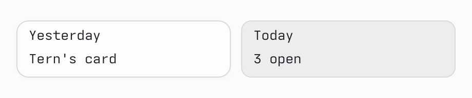
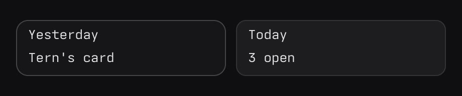
<figcaption>左侧是没有该 role 的卡片；右侧是 <code>todo.day</code> 卡片。</figcaption>
</figure>


### 紧凑表格

```css
.sf-block[data-role='lens.plugin.disk.du'] .sf-table {
	font-variant-numeric: tabular-nums;
}
/* .sf-tbl-h and .sf-tbl-c are inner parts: anchored to the lens, may change */
.sf-block[data-role='lens.plugin.disk.du'] .sf-tbl-h {
	height: 20px;
	line-height: 20px;
}
.sf-block[data-role='lens.plugin.disk.du'] .sf-tbl-c {
	padding-top: 0;
	padding-bottom: 0;
}
```

<figure class="tn-figure">
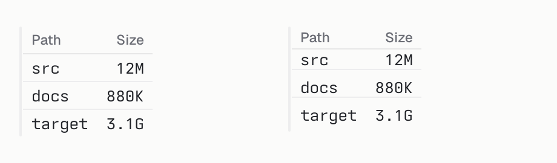
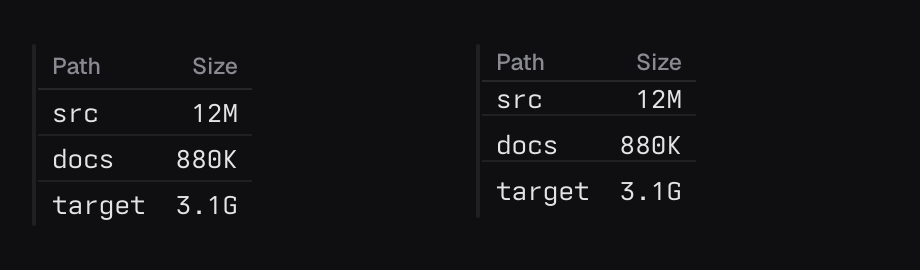
<figcaption>左侧是另一个 Lens 的表格；右侧是 <code>disk.du</code> Lens 的表格。</figcaption>
</figure>

### 更改视图中色调的颜色

`--tc` 由同一元素上的 `[data-tone]` 设置，因此可在此覆盖它，以设置你自己的节点样式：

```css
.sf-main[data-surface='plugin.ci.runs'] [data-role^='ci.'][data-tone='pending'] {
	--tc: light-dark(#0f8a8a, #3fd0c9);
}
```

<figure class="tn-figure">
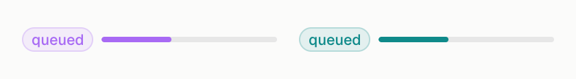
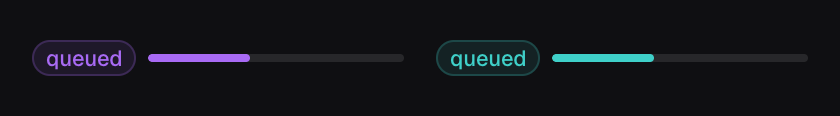
<figcaption>左侧是没有 <code>ci.</code> 角色的 <code>pending</code> 节点；右侧的节点带有该角色。</figcaption>
</figure>

### 自定义徽章样式

```lua
local ui = tern.ui

local badge = ui.node("badge", { text = "beta", tone = "accent", role = "todo.flag" })
```

```css
.sf-badge[data-role='todo.flag'] {
	height: 16px;
	padding: 0 5px;
	border-radius: 4px;
	font-family: var(--mono);
	text-transform: uppercase;
	color: white;
	background: var(--accent-fill);
	box-shadow: none;
}
```

<figure class="tn-figure">
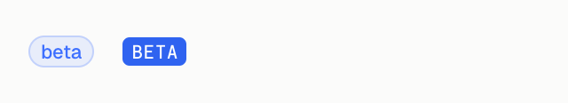
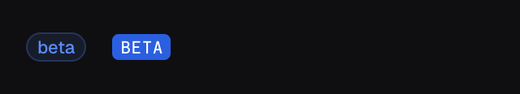
<figcaption>左侧是 <code>ui.badge("beta", "accent")</code>；右侧是 <code>todo.flag</code> 徽章。</figcaption>
</figure>

### 调暗已完成的清单项

`checklist` 项目行带有 `.st-<status>`（`pending`、`active`、`done`、`dropped`、`blocked`）；见[智能体、聊天和任务类型](../elements/work.md#checklist)。

```css
.sf-checklist[data-role='todo.steps'] .sf-ck-item.st-done {
	opacity: 0.5;
}
```

对于你自己的行（`list`/`item`），请自行标记：设置 `mark = "done"` 并定位 `[data-mark='done']`，这是稳定的挂钩。

```css
.sf-main[data-surface='plugin.todo.list'] .sf-item[data-mark='done'] .sf-t-del {
	opacity: 0.6;
}
```

<figure class="tn-figure">
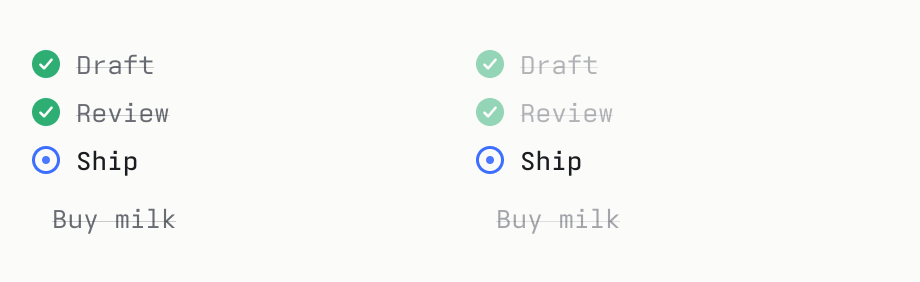
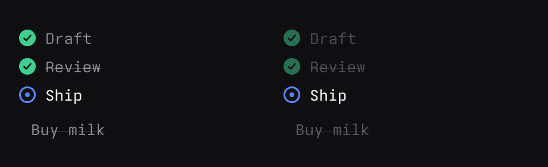
<figcaption>左侧为 Tern 默认样式；右侧为 <code>todo.steps</code> 清单，以及设置了 <code>mark = "done"</code> 的项目。</figcaption>
</figure>

### 根据状态设置 Lens 块样式

```css
.sf-block[data-role='lens.plugin.build.make'][data-state='running']::before {
	background: var(--accent);
}
.sf-block[data-role='lens.plugin.build.make'].failed .sf-block-body {
	background: rgb(from var(--bad) r g b/6%);
	border-radius: 6px;
}
```

<figure class="tn-figure">
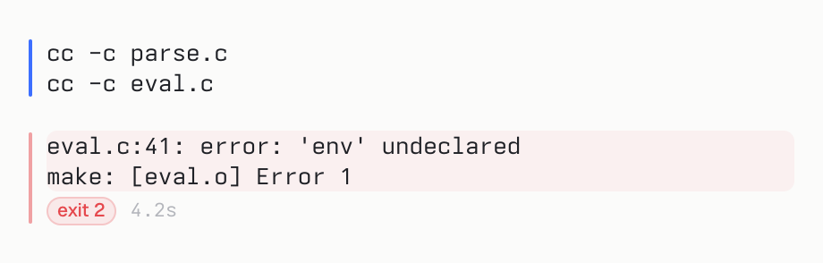
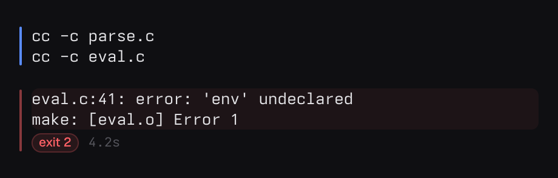
<figcaption>先是正在运行的块，接着是一个运行 4.2 s 后以状态 2 退出的块。</figcaption>
</figure>

### 在运行时切换样式表

`item` 行至少高一行加 6px（`min-height`），没有垂直内边距；紧凑样式表会去掉额外的 6px。

```lua
local compact = false

tern.command({
	id = "compact",
	title = "Toggle compact rows",
	run = function(_cx)
		compact = not compact
		tern.css("density", if compact
			then ".sf-main[data-surface='plugin.todo.list'] .sf-item { min-height: var(--sf-lh); }"
			else "")
	end,
})
```

## 调试样式

启动一个带有控制端点的窗口并向它发出查询（[调试](../guides/debugging.md#通过脚本驱动-window)）：

```sh
tern --control /tmp/tern-ctl.sock ~/src/my-plugin &
tern ctl --control /tmp/tern-ctl.sock css
tern ctl --control /tmp/tern-ctl.sock tree "[data-surface='plugin.todo.list'] [data-role='todo.day']"
```

- `css` 会按层叠顺序列出已安装的样式表。查找 `plugin:local:<id>:styles` 和你的 `tern.css` 名称，并确认它们排在 surface 样式表之后。
- `tree SEL` 会显示选择器匹配到的可见元素及其类和属性。没有匹配项表示选择器有误（通常是本应使用 `data-surface` 却写成了 `data-role`）。
- 解析错误会记录在日志中，显示为 `plugin style sheet has errors` 及样式表名称（[日志文件](../guides/debugging.md#日志文件)）。

当规则能够匹配但优先级不够时，请比较它与 Tern 针对同一元素的规则（见元素页面中的选择器），然后为你的规则添加一个稳定挂钩。
