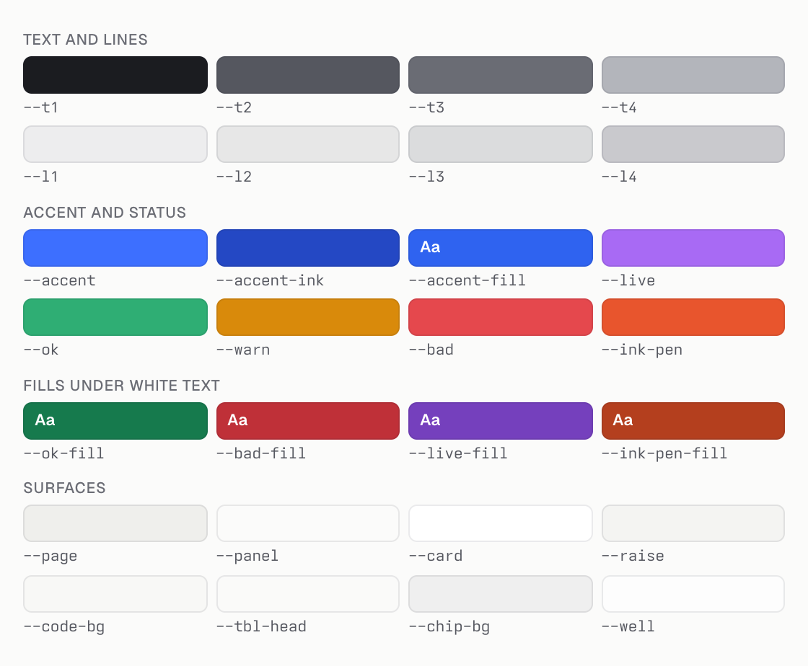
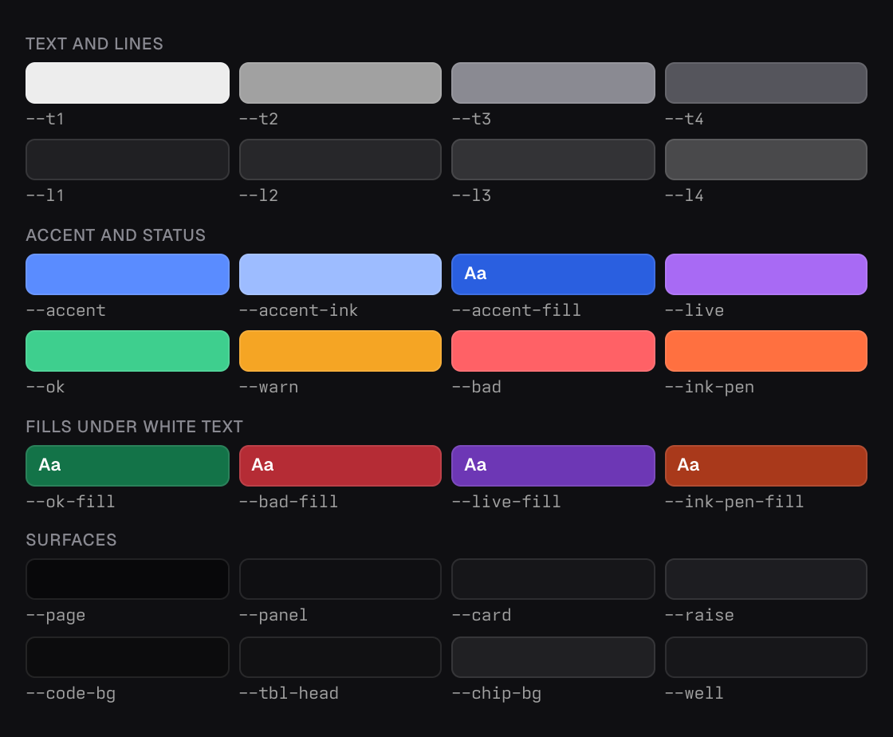
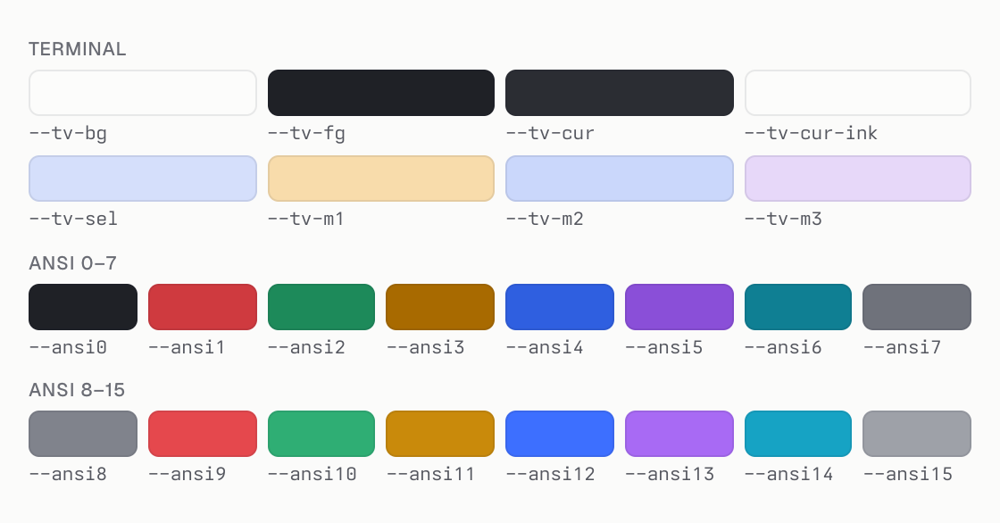
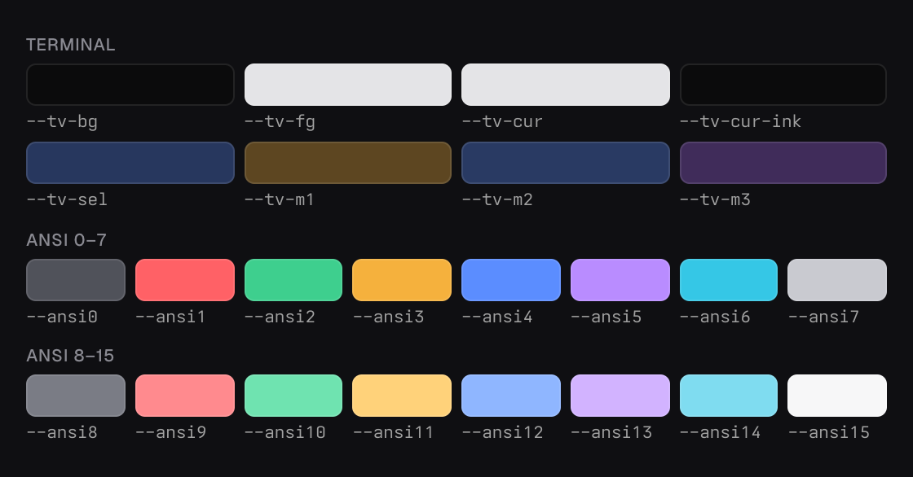
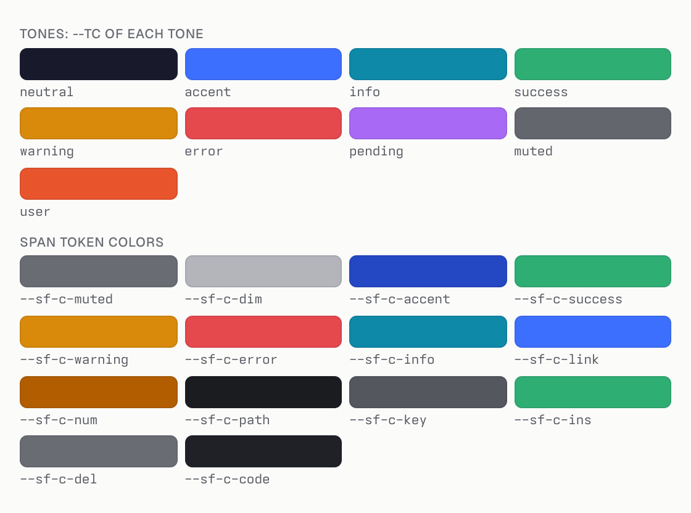
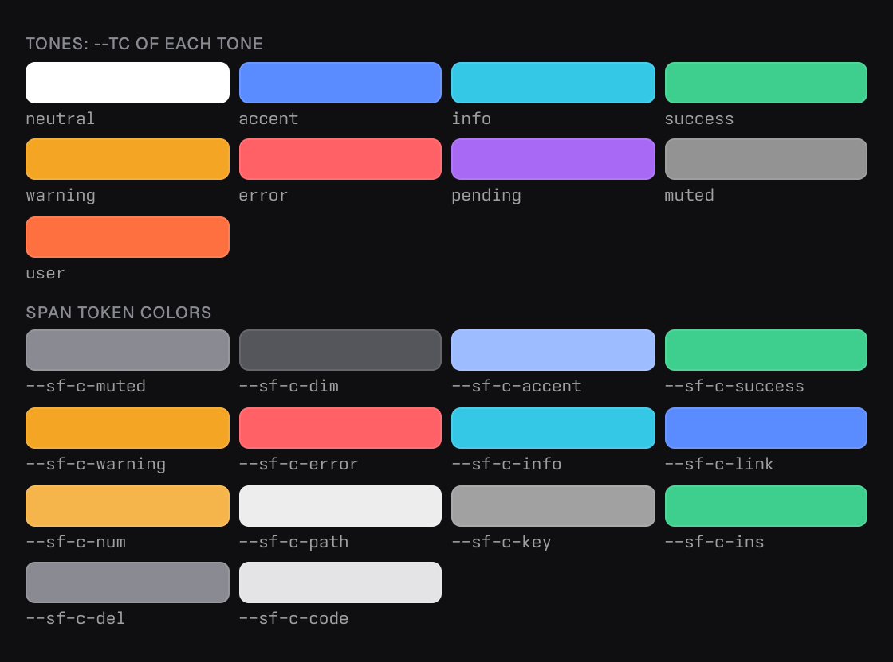
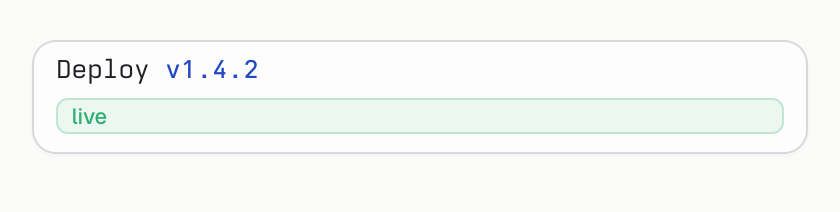
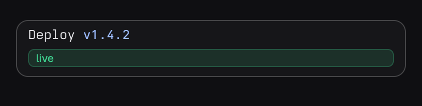

# CSS 变量

插件的样式表使用与 Tern 相同的配色。所有颜色、线条、圆角、字体和网格长度都应使用 CSS 自定义属性，而不是硬编码值。这样视图就能自动跟随用户的主题、浅色和深色外观、对比度与透明度设置以及字体大小。

本页按类别列出插件样式表可读取的所有自定义属性。每个属性都标明定义它的作用域以及可依赖程度。有关样式表的加载和层叠方式，请参阅[设置视图样式](index.md)。有关 Tern 支持的 CSS 语法（`var()`、`light-dark()`、相对颜色、`color-mix()`），请参阅[支持的 CSS](css.md)。

## 值的来源

变量由三个层级设置，每一层都会覆盖前一层：

1. **Kit 默认值。** `theme.css` 样式表在 `:root` 上定义设计令牌。`highlight.css` 添加 `--tk-*` 语法高亮颜色。`termview.css` 添加终端的 `--tv-*` 和 `--ansi*` 颜色。`surface.css` 添加 surface 色调和 span 颜色（`--sf-*`）。
2. **Tern 应用的主题。** 对于所选主题变体，Tern 会在根元素上以内联方式写入这些属性：`--ink`、`--t1`…`--t4`、`--accent`、`--accent-ink`、`--accent-fill`、`--a1`、`--a2`、`--grad-ink`、`--ok`、`--ok-fill`、`--bad`、`--bad-fill`、`--warn`、`--live`、`--live-fill`、`--card`、`--raise`、`--code-bg`、`--tbl-head`、`--tv-bg`、`--tv-fg`、`--tv-cur`、`--tv-cur-ink`、`--tv-sel-a`、`--tv-sel-b`、`--ansi0`…`--ansi15`、主题的 `--omp-<token>` 颜色，以及内部的 `--tn-*` 通道。随后，`html.tn-themed`（`themes.css`）会从这些值派生出 `--page`、`--panel`、`--l1`…`--l4`、`--ink2`…`--ink4`、`--chip-bg`、`--well-line`、`--pop-bg`、`--topbar-bg`、`--sf-neutral` 和 `--tv-sel`。用户的 [CSS 主题](../guides/themes.md#css-主题)会在所有这些规则之上叠加样式，每条主题声明都带有 `!important`，其顺序也排在插件添加的所有样式表之后。
3. **surface 视图。** 视图会在每个区域元素（`.sf-main`、`.sf-dock`、`.sf-layer`）上设置网格度量值 `--sf-zoom`、`--sf-fs`、`--sf-lh` 和 `--sf-cw`，以及制表符宽度 `--sf-tab`。

因此，下方表格中的 kit 值都是**默认值**。在 Tern 主题下，第 2 层的变量会使用该主题的颜色。变量名称不会改变，所以请读取名称，不要复制十六进制值。

## 浅色与深色

Kit 的 `:root` 设置 `color-scheme: light`，而 `[data-theme='dark']`（由 Tern 设置在根元素上）会设置 `color-scheme: dark`。大多数颜色令牌都写成 `light-dark(<light>, <dark>)`，因此每个令牌会根据当前显示的外观解析。令牌无需额外的深色模式规则。需要自行设置两种外观的颜色时，也按相同方式编写：

```css
.sf-card[data-role='plugin.deploy.summary'] {
	background: light-dark(rgb(from var(--accent) r g b/6%), rgb(from var(--accent) r g b/12%));
}
```

若要改用选择器指定深色外观，请使用 `[data-theme='dark'] .your-selector`。主题写入的颜色已经根据当前显示的变体解析（每种外观各一个值），因此第 2 层的变量是纯颜色，而非 `light-dark()` 配对值。

Kit 的深色模式采用扁平样式。`[data-theme='dark']` 会将 `--sheet-rim`、`--sheet-in` 和 `--sheet-drop` 替换为细线和阴影值，并将 `--cv-glow` 设为 `none`。

两个系统设置会使用 `!important` 覆盖令牌（`motion.css`）：

- `prefers-contrast: more` 会将 `--t1`…`--t4` 设为接近黑白的阶梯值，并加深 `--l1`…`--l3`。
- `prefers-reduced-transparency: reduce` 会使 `--page`、`--panel`、`--pop-bg`、`--xp-bg`、`--topbar-bg`、`--tile-a`、`--tile-b`、`--sheet-a` 和 `--sheet-b` 变为不透明。

由于这些覆盖通过变量实现，你的样式表读取这些令牌时也会自动跟随它们。

## 使用回退值读取变量

`var(--name, fallback)` 会在当前元素未定义 `--name` 时使用回退值。对于只存在于某些上下文中的变量，都应提供回退值：区域之外的网格度量值、上下文填充色，以及本页标记为内部的所有变量。

```css
/* the terminal font size inside a surface region, 12px elsewhere */
.sf-text[data-role='plugin.logs.line'] {
	font-size: var(--sf-fs, 12px);
}

/* a card tint if one is set, else the card background */
.sf-card[data-role='plugin.ci.state'] {
	background: var(--sf-tint-success, var(--sf-card-bg));
}
```

回退值可以嵌套。例如，Tern 自身的规则会这样设置区域文字颜色：`var(--tv-fg, var(--t1))`。

若要获得令牌的半透明版本，请使用相对颜色，不要另设一个变量：

```css
.sf-row[data-role='plugin.ci.failed'] {
	background: rgb(from var(--bad) r g b/10%);
	box-shadow: inset 2px 0 0 var(--bad);
}
```

## 稳定性

| 标记 | 含义 |
| --- | --- |
| **稳定** | 属于主题契约的一部分。每个主题都会设置它或从其他值派生它。可安全地从插件样式表中读取。 |
| **稳定，只读** | 可安全读取。Tern 会按区域或元素写入此值，因此你设置的值会被覆盖或不起作用。 |
| **上下文相关** | 仅在某些上下文中定义（特定元素、由你自行设置的变量）。读取时始终提供回退值。 |
| **内部** | Tern 自身界面或某种 kind 的渲染器使用的布局实现细节。列出这些变量是为了便于识别；它们可能在不同版本间改变或消失。 |

## Kit 令牌：文字与线条

在 `theme.css` 的 `:root` 上定义。以下是你最常用的令牌。

<figure class="tn-figure">


<figcaption>每个色块都是 surface 中的 <code>background: var(--name)</code>：Kit 的浅色和深色默认值。Tern 主题会替换第 2 层的值。</figcaption>
</figure>

| 变量 | 含义 | 浅色 / 深色默认值 | 主题 | 稳定性 |
| --- | --- | --- | --- | --- |
| `--t1` | 主要文字。 | `#1b1c20` / `#ededed` | 已设置（主题墨色） | 稳定 |
| `--t2` | 次要文字。 | `#55575f` / `#a1a1a1` | 已设置 | 稳定 |
| `--t3` | 元信息文字：标签、提示。 | `#6a6c74` / `#8a8a92` | 已设置 | 稳定 |
| `--t4` | 淡化文字：禁用项、占位符。 | `#b3b5bb` / `#55555c` | 已设置 | 稳定 |
| `--ink` | 主题的墨色（默认与 `--t1` 相同）。 | `#1b1c20` / `#ededed` | 已设置 | 稳定 |
| `--ink2` | 墨色，不透明度为 66%（Kit 的深色默认值为 70%）。 | 半透明墨色 | 从 `--ink` 派生 | 稳定 |
| `--ink3` | 墨色，不透明度为 44%（深色为 42%）。 | 半透明墨色 | 派生 | 稳定 |
| `--ink4` | 墨色，不透明度为 14%。 | 半透明墨色 | 派生 | 稳定 |
| `--l1` | 最淡的细线和填充色（悬停行、标签块）。 | 墨色的 6% / 白色的 7% | 派生（`--ink` 的 6%） | 稳定 |
| `--l2` | 细线、边框。 | 9% / 10% | 派生（9%） | 稳定 |
| `--l3` | 强边框。 | 14% / 15% | 派生（14%） | 稳定 |
| `--l4` | 最强线条。 | 22% / 24% | 派生（22%） | 稳定 |

`prefers-contrast: more` 会覆盖 `--t1`…`--t4` 和 `--l1`…`--l3`。

## Kit 令牌：强调色与状态色

| 变量 | 含义 | 浅色 / 深色默认值 | 主题 | 稳定性 |
| --- | --- | --- | --- | --- |
| `--accent` | 用于焦点环、色调、链接和选中标记的强调色。 | `#3d6fff` / `#5a8cff` | 已设置 | 稳定 |
| `--accent-ink` | 用作文字颜色的强调色（在表面上清晰可读）。 | `#2448c4` / `#9dbcff` | 已设置 | 稳定 |
| `--accent-fill` | 绘制在白色文字或字形下方的强调色（填充徽标、勾选标记）。两种外观下与 `#fff` 的对比度至少为 4.5:1。 | `#2f63f0` / `#2a5fe0` | 已设置 | 稳定 |
| `--a1`, `--a2` | 品牌渐变的两个色标。 | `#44cfff`, `#3b6cff` | 已设置 | 稳定 |
| `--grad` | `linear-gradient(135deg, var(--a1), var(--a2))`。 | — | 跟随 `--a1`/`--a2` | 稳定 |
| `--grad-ink` | 在 `--grad` 上清晰可读的文字颜色。 | `#05070b` | 已设置 | 稳定 |
| `--ok` | 成功。 | `#2fae74` / `#3ecf8e` | 已设置 | 稳定 |
| `--warn` | 警告。 | `#d98a0b` / `#f5a524` | 已设置 | 稳定 |
| `--bad` | 错误、破坏性操作。 | `#e5484d` / `#ff6166` | 已设置 | 稳定 |
| `--live` | 运行中、待处理、实时活动（紫色）。 | `#a86af4` | 已设置 | 稳定 |
| `--ok-fill` | 加深后的 `--ok`，可承载白色文字。 | `#167a4d` / `#137348` | 已设置（已校正对比度） | 稳定 |
| `--bad-fill` | 可承载白色文字的 `--bad`。 | `#bf3038` / `#b52c35` | 已设置 | 稳定 |
| `--live-fill` | 可承载白色文字的 `--live`。 | `#7540bd` / `#6d37b5` | 已设置 | 稳定 |
| `--ink-pen` | 橙色笔迹颜色（Tern 用于用户自己的消息）。 | `#e8552d` / `#ff7040` | 主题不设置 | 稳定 |
| `--ink-pen-fill` | 可承载白色文字的 `--ink-pen`。 | `#b43f1e` / `#a9391b` | 不设置 | 稳定 |

纯色用于文字、图标、焦点环和色调（`rgb(from var(--ok) r g b/12%)`）。`*-fill` 颜色仅用于承载白色文字的背景。

## Kit 令牌：表面与材质

| 变量 | 含义 | 浅色 / 深色默认值 | 主题 | 稳定性 |
| --- | --- | --- | --- | --- |
| `--page` | 面板后方的窗口背景。 | `#efefec` / `#08080a` | 从主题页面颜色派生；玻璃窗口中为半透明 | 稳定 |
| `--panel` | 面板背景。使用主题时为终端背景。 | `#fbfbfa` / `#0f0f12` | `var(--tv-bg)`（玻璃窗口中为半透明） | 稳定 |
| `--card` | 卡片背景。 | `#ffffff` / `#161619` | 已设置 | 稳定 |
| `--raise` | 凸起控件背景。 | `#f4f4f2` / `#1d1d21` | 已设置 | 稳定 |
| `--code-bg` | 代码块背景。 | `#f8f8f6` / `#0c0c0d` | 已设置 | 稳定 |
| `--tbl-head` | 表格表头背景。 | `#fafaf9` / `#111113` | 已设置（与 `--code-bg` 相同） | 稳定 |
| `--chip-bg` | 标签块和行内代码的填充色。 | 墨色的 5.5% / 白色的 7% | 派生 | 稳定 |
| `--pop-bg` | 弹出层和菜单背景。 | `rgba(255,255,255,.82)` / `rgba(35,35,39,.98)` | 从主题的弹出层颜色派生 | 稳定 |
| `--well` | 凹槽填充色。 | 白色的 62% / 白色的 3.5% | 不设置 | 稳定 |
| `--well-line` | 凹槽的细线。 | 墨色的 6.5% / 白色的 7.5% | 派生 | 稳定 |
| `--glass-hi` | 玻璃材质顶部高光。 | `#fff` / 白色的 5% | 不设置 | 稳定 |
| `--fog` | 不透明的柔和填充色。 | `#f3f4f7` / `#0f0f12` | 不设置 | 稳定 |
| `--dim` | 模态面板后方的遮罩。 | `rgba(244,244,241,.5)` / `rgba(0,0,0,.55)` | 不设置 | 稳定 |
| `--rail` | 导轨和引导线颜色。 | `rgb(96,120,178)` / `rgb(110,150,255)` | 不设置 | 稳定 |
| `--grid-dot` | 点阵网格颜色。 | 墨色的 10% / 白色的 6.5% | 不设置 | 稳定 |
| `--topbar-bg` | 应用顶部栏材质。 | 半透明页面色 | 派生 | 内部 |
| `--sheet-a`, `--sheet-b` | 面板背景的两个色标。 | 半透明白色 / `var(--card)` | 不设置 | 内部 |
| `--sheet-rim` | 面板边框渐变。 | 白色渐变 / 白色 9% 的细线 | 深色覆盖 | 内部 |
| `--sheet-in` | 面板内部高光（box-shadow）。 | — | 深色覆盖 | 内部 |
| `--sheet-drop` | 面板投影（box-shadow）。 | — | 深色覆盖 | 内部 |
| `--xp-bg` | 展开视图背景。 | — | 不设置 | 内部 |
| `--tile-a`, `--tile-b` | 图库图块背景色标。 | — | 不设置 | 内部 |
| `--cv-base`, `--cv-glow` | 画布底色及其环境光晕（深色模式下为 `none`）。 | — | 不设置 | 内部 |

## Kit 令牌：形状、字体、动效与布局

| 变量 | 含义 | 值 | 稳定性 |
| --- | --- | --- | --- |
| `--r-chip` | 标签块和标签的圆角。 | `6px` | 稳定 |
| `--r-ctl` | 控件（按钮、字段）的圆角。 | `8px` | 稳定 |
| `--r-card` | 卡片圆角。 | `12px` | 稳定 |
| `--r-panel` | 面板和层的圆角。 | `16px` | 稳定 |
| `--sans` | UI 字体栈。 | `'Geist', -apple-system, 'SF Pro Text', system-ui, sans-serif` | 稳定 |
| `--mono` | 等宽字体栈。 | `'Ioskeley Mono Term', ui-monospace, 'SF Mono', SFMono-Regular, Menlo, monospace` | 稳定 |
| `--hand` | 手写字体栈。 | `'Excalifont', 'Bradley Hand', 'Segoe Print', cursive` | 稳定 |
| `--ease` | 通用缓动。 | `cubic-bezier(0.2, 0.7, 0.2, 1)` | 稳定 |
| `--out` | 入场动画的缓出效果。 | `cubic-bezier(0.16, 1, 0.3, 1)` | 稳定 |
| `--top`, `--side` | Kit 应用外壳的顶部栏高度和侧栏宽度（`56px`、`244px`；视口宽度低于 1360px 时为 `224px`，`html.side-collapsed` 时为 `0px`）。 | — | 内部 |
| `--W`, `--H`, `--tw`, `--th`, `--CW`, `--CH` | Kit 图库与画布尺寸。 | — | 内部 |

Surface 区域会设置自己的字体。其 `font-family` 为 `var(--tv-font, var(--mono))`，字号为 `--sf-fs`，因此在等宽视图中，只有需要与终端字体区分的文字才使用 `--sans`。使用 `font: "sans"` 打开的 surface 区域（类名 `sf-sans`，参见 [Surface](../protocol/surfaces.md#打开与关闭)）则使用 `400 13px/18px var(--sans)`，机器字符串使用 `--mono`；在此类区域中，只对需要与 UI 字体区分的内容单独设置字体。

在 `prefers-reduced-motion: reduce` 下，Kit 会将所有动画和过渡时长设为 `0s`。缓动变量的值保持不变。

## 语法高亮令牌

在 `highlight.css` 的 `:root` 上定义。高亮代码（`code`、`diff` 和 `md` kinds）会用 `.tk-<name>` 类标记令牌，每个类都会读取相应变量。

| 变量 | 类 | 浅色 / 深色默认值 | 稳定性 |
| --- | --- | --- | --- |
| `--tk-comment` | `.tk-comment` | `var(--t3)` | 稳定 |
| `--tk-doc` | `.tk-doc` | `#35726b` / `#7bb9b0` | 稳定 |
| `--tk-keyword` | `.tk-keyword` | `#8a3fd6` / `#c29bff` | 稳定 |
| `--tk-function` | `.tk-function` | `#2448c4` / `#8fb6ff` | 稳定 |
| `--tk-macro` | `.tk-macro` | `#a52a9a` / `#f08ade` | 稳定 |
| `--tk-variable` | `.tk-variable` | `var(--t1)` | 稳定 |
| `--tk-property` | `.tk-property` | `#325a86` / `#a8d1ee` | 稳定 |
| `--tk-string` | `.tk-string` | `#1d7f52` / `#5fd39c` | 稳定 |
| `--tk-escape` | `.tk-escape` | `#055c3e` / `#a0f8c5` | 稳定 |
| `--tk-number` | `.tk-number` | `#b25e00` / `#f5b54a` | 稳定 |
| `--tk-constant` | `.tk-constant` | `#737007` / `#e0da69` | 稳定 |
| `--tk-type` | `.tk-type` | `#0b7894` / `#4fd2ee` | 稳定 |
| `--tk-tag` | `.tk-tag` | `#b63b32` / `#f8907f` | 稳定 |
| `--tk-heading` | `.tk-heading` | `#6744c5` / `#b6a5fd` | 稳定 |
| `--tk-link` | `.tk-link` | `#0070a6` / `#6fc1f6` | 稳定 |
| `--tk-operator` | `.tk-operator` | `#c2335f` / `#ff8db2` | 稳定 |
| `--tk-punct` | `.tk-punct` | `var(--t2)` | 稳定 |
| `--tk-inserted` | `.tk-inserted` | `var(--ok)` | 稳定 |
| `--tk-deleted` | `.tk-deleted` | `var(--bad)` | 稳定 |

若只想更改自己块中的高亮颜色，请在作用域选择器上设置变量：

```css
[data-surface='plugin.notes.main'] {
	--tk-keyword: var(--accent-ink);
	--tk-string: var(--ok);
}
```

## 终端令牌

在 `termview.css` 的 `:root` 上定义。主题会在根元素上覆盖它们。Surface 区域会读取这些变量来设置文字颜色和字体。视图中若有部分内容应呈现终端网格的外观，请使用这些变量。

| 变量 | 含义 | 浅色 / 深色默认值 | 主题 | 稳定性 |
| --- | --- | --- | --- | --- |
| `--tv-font` | 终端字体系列。 | `var(--mono)` | Tern 根据用户的字体设置，在 stage 和 peek 根元素上内联设置 | 稳定 |
| `--tv-bg` | 终端背景。 | `#fcfcfb` / `#0b0b0c` | 已设置 | 稳定 |
| `--tv-fg` | 终端前景色。 | `#1f2126` / `#e4e4e7` | 已设置 | 稳定 |
| `--tv-cur` | 光标颜色。 | `#2b2d33` / `#e4e4e7` | 已设置 | 稳定 |
| `--tv-cur-ink` | 光标下方的文字。 | `#fcfcfb` / `#0b0b0c` | 已设置 | 稳定 |
| `--tv-sel` | 选中内容的填充色。 | 强调色的 20% / 32% | 从主题的选中颜色派生（22% / 34%） | 稳定 |
| `--tv-sel-a`, `--tv-sel-b` | 选中区域渐层的顶部和底部色标。设置后会替代纯色的 `--tv-sel`。 | 未定义 | 已设置 | 上下文相关 |
| `--tv-m1` | 搜索匹配高亮（标记组 1）。 | 琥珀色的 42% / 34% | 不设置 | 稳定 |
| `--tv-m2` | 当前匹配项高亮（标记组 2）。 | 强调色的 26% / 34% | 跟随主题的 `--accent` | 稳定 |
| `--tv-m3` | 标记组 3。 | `--live` 的 24% / 32% | 跟随主题的 `--live` | 稳定 |
| `--ansi0` … `--ansi15` | 16 种 ANSI 颜色：0–7 为普通颜色（黑、红、绿、黄、蓝、品红、青、白），8–15 为亮色。 | Tern 自身的配色（`--ansi1` 为 `#cf3a3f` / `#ff6166`） | 根据主题设置 | 稳定 |
| `--tv-contrast` | 自动文字对比度校正的最低 WCAG 比率。 | 未定义 | 由“minimum contrast”选项设置 | 内部 |

ANSI 颜色采用主题的实际配色。若要使插件颜色与 Shell 程序打印的“红色”匹配，请使用 `var(--ansi1)`。

<figure class="tn-figure">


<figcaption><code>termview.css</code> 中 <code>--tv-*</code> 和 <code>--ansi*</code> 的默认值。使用 Tern 主题时，它们会采用主题颜色。</figcaption>
</figure>

Tern 会在终端元素 `.tv` 上以内联方式写入以下属性。它们仅在终端窗格内定义，因此读取时应提供回退值。

| 变量 | 含义 | 稳定性 |
| --- | --- | --- |
| `--tv-fs` | 终端字号，单位为 px。 | 内部 |
| `--tv-lh` | 终端行高，单位为 px。 | 内部 |
| `--tv-px`, `--tv-py` | 网格的水平和垂直内边距。 | 内部 |
| `--tv-aside` | 停靠在窗格右侧的面板（`prefs` kind）的宽度。在区域内需除以 `--sf-zoom`。 | 内部 |
| `--tv-dock-h` | 停靠面板在滚动回溯提示条上的高度。 | 内部 |

在 surface 内，应使用 `--sf-fs`、`--sf-lh` 和 `--sf-cw`，而不是 `--tv-fs`/`--tv-lh`。这些值以区域缩放后的 px 表示，并且保持精确。

## Surface 网格度量值

每当终端字体、UI 字号、单元格尺寸或制表符宽度变化时，视图都会在每个区域元素（`.sf-main`、`.sf-dock`、`.sf-layer`）上以内联方式设置这些值。它们会继承到每个节点。

| 变量 | 含义 | 稳定性 |
| --- | --- | --- |
| `--sf-fs` | 区域 px 中的终端字号。即区域的 `font-size`（回退值为 `12px`）。 | 稳定，只读 |
| `--sf-lh` | 区域行高：终端行高（单元格高度），或 sans 区域（`.sf-sans`）中的 `18px`。即区域的 `line-height`（回退值为 `17px`）。 | 稳定，只读 |
| `--sf-grid-lh` | 各区域中的终端行高；在 sans 区域中，mono kinds（`code`、`diff`、`ansi`、…）使用此值。 | 稳定，只读 |
| `--sf-cw` | 终端单元格宽度（网格字体的一个 `ch`）。 | 稳定，只读 |
| `--sf-zoom` | 区域的 CSS `zoom`（UI 字号 ÷ 13），是一个纯数值。宿主 px 长度需除以它。 | 稳定，只读 |
| `--sf-tab` | `code`、`diff` 和 Markdown 代码中的制表符列数：Tern 的 Tab 宽度设置，是供 `tab-size` 使用的纯数值。 | 稳定，只读 |

Tern 的样式表按 13px 字体绘制，每个区域按 UI 字号除以 13 的比例缩放（Settings › Appearance；UI 字号默认与终端字号相同，除非用户将其单独设置为其他值）。因此，样式表中的纯 px 会随视图周围的界面缩放。视图写入除以缩放比例后的终端度量值，缩放后便能在屏幕上保持精确：当两种字号一致时，`--sf-fs` 为 `13px`；`--sf-lh` 和 `--sf-cw` 则分别是相同设计单位中的单元格高度和宽度。文字需要与终端字号一致时使用 `--sf-fs`；长度必须与网格精确对齐时使用 `--sf-lh` 和 `--sf-cw`。Prop 的尺寸范围会编译为这些值：`"40ch"` 变为 `calc(40 * var(--sf-cw))`，`"10lines"` 变为 `calc(10 * var(--sf-lh))`。

```css
/* a gutter exactly six cells wide, a list exactly eight lines tall */
.sf-row[data-role='plugin.blame.line'] > :first-child {
	width: calc(6 * var(--sf-cw));
}
.sf-list[data-role='plugin.blame.commits'] {
	max-height: calc(8 * var(--sf-lh));
}
```

## Surface 间距与填充

在 `surface.css` 的 `:root` 上定义。

| 变量 | 含义 | 浅色 / 深色默认值 | 稳定性 |
| --- | --- | --- | --- |
| `--sf-block-gap` | `main` 中块与块之间的间距（`.sf-main` 是带有此间距的 flex 列）。 | `16px` | 稳定 |
| `--sf-inner-gap` | 单个块内各部分之间的间距（卡片的正文行）。 | `8px` | 稳定 |
| `--sf-card-bg` | 卡片背景（`.sf-card`）。 | 白色的 55% / 白色的 2.8% | 稳定 |
| `--sf-shade` | 淡色阴影填充（代码槽、卡片标题）。 | `--t1` 的 2.8% / 3% | 稳定 |

Tern 控制节点之间的间距，程序不会发送此值。若要更改你所在块中的间距，可在区域上覆盖这些值：

```css
.sf-main[data-surface='plugin.todo.board'] {
	--sf-block-gap: 10px;
	--cn-gap: 10px; /* the Console chat style */
}
```

使用 Console chat 样式时，`main` 会使用 `--cn-gap`（由 `.sf-chat-console` 在区域上设置）来安排块间距，而不是使用 `--sf-block-gap`，所以两个值都要设置。

## 色调颜色

在 `surface.css` 的 `:root` 上定义。

| 变量 | 色调 | 默认值 | 稳定性 |
| --- | --- | --- | --- |
| `--sf-ok` | `success` | `var(--ok)` | 稳定 |
| `--sf-warn` | `warning` | `var(--warn)` | 稳定 |
| `--sf-bad` | `error` | `var(--bad)` | 稳定 |
| `--sf-info` | `info` | `#0e89a8` / `#35c7e6` | 稳定 |
| `--sf-muted` | `muted` | `#64666e` / `#939393` | 稳定 |
| `--sf-neutral` | `neutral` | `#181a2c` / `#fff`；使用 Tern 主题时为 `var(--ink)` | 稳定 |
| `--sf-user` | `user` | `var(--ink-pen)` | 稳定 |
| `--sf-accent` | `accent` | 未定义（回退到 `--accent`） | 上下文相关 |

### 色调的解析方式

每个带有 `tone` prop 的节点都会获得 `data-tone="<tone>"`。在 `surface.css` 中，每种色调都会在对应元素上设置一个变量 `--tc`：

| `[data-tone]` | `--tc` |
| --- | --- |
| `neutral` | `var(--sf-neutral)` |
| `accent` | `var(--sf-accent, var(--accent))` |
| `info` | `var(--sf-info)` |
| `success` | `var(--sf-ok)` |
| `warning` | `var(--sf-warn)` |
| `error` | `var(--sf-bad)` |
| `pending` | `var(--live)` |
| `muted` | `var(--sf-muted)` |
| `user` | `var(--sf-user)` |

每个区域初始值均为 `--tc: var(--sf-neutral)`。能感知色调的 kinds 会使用 `--tc` 和由其生成的相对颜色绘制。例如，徽标使用 `color: var(--tc)`、`background: rgb(from var(--tc) r g b/10%)`，以及 `box-shadow: inset 0 0 0 1px rgb(from var(--tc) r g b/22%)`。你的样式表也可以采用相同做法，让规则跟随节点携带的色调：

```css
.sf-card[data-role='plugin.ci.job'] {
	border-left: 3px solid var(--tc);
	background: rgb(from var(--tc) r g b/6%);
}
```

若要在块中重设某一种色调，应覆盖其来源变量，而不是 `--tc`：

```css
[data-surface='plugin.ci.main'] {
	--sf-warn: var(--ansi3);
}
```

`--tc` 可以稳定读取。只有在没有 `data-tone` 的元素上才自行设置它，否则色调规则的特异性更高，会优先生效。

## Span 令牌颜色

在 `surface.css` 的 `:root` 上定义。Span 的样式令牌会转换为 `.sf-t-<token>` 类。每个有颜色的令牌都会读取一个 `--sf-c-<token>` 变量：它优先采用最近的 omp 令牌颜色（[主题令牌颜色](#主题令牌颜色)），若主题没有该颜色，则使用 Tern 自身的颜色：

| 变量 | 类 | 默认值 | 稳定性 |
| --- | --- | --- | --- |
| `--sf-c-muted` | `.sf-t-muted` | `--omp-muted`，否则为 `var(--t3)` | 稳定 |
| `--sf-c-dim` | `.sf-t-dim` | `--omp-dim`，否则为 `var(--t4)` | 稳定 |
| `--sf-c-accent` | `.sf-t-accent` | `--omp-accent`，否则为 `var(--accent-ink)` | 稳定 |
| `--sf-c-success` | `.sf-t-success` | `--omp-success`，否则为 `var(--ok)` | 稳定 |
| `--sf-c-warning` | `.sf-t-warning` | `--omp-warning`，否则为 `var(--warn)` | 稳定 |
| `--sf-c-error` | `.sf-t-error` | `--omp-error`，否则为 `var(--bad)` | 稳定 |
| `--sf-c-info` | `.sf-t-info` | `--omp-syntaxType`，否则为 `var(--sf-info)` | 稳定 |
| `--sf-c-link` | `.sf-t-link`、`.sf-link` | `--omp-mdLink`、`--omp-accent`，否则为 `var(--accent)` | 稳定 |
| `--sf-c-num` | `.sf-t-num` | `--omp-syntaxNumber`，否则为 `#b25e00` / `#f5b54a` | 稳定 |
| `--sf-c-path` | `.sf-t-path`（其中 `.dir` 部分使用 `--sf-c-muted`） | `--omp-statusLinePath`、`--omp-mdLinkUrl`，否则为 `var(--t1)` | 稳定 |
| `--sf-c-key` | `.sf-t-key` | `var(--t2)` | 稳定 |
| `--sf-c-ins` | `.sf-t-ins` | `--omp-toolDiffAdded`、`--omp-success`，否则为 `var(--ok)` | 稳定 |
| `--sf-c-del` | `.sf-t-del` | `--omp-toolDiffRemoved`、`--omp-error`，否则为 `var(--t3)` | 稳定 |
| `--sf-c-code` | `.sf-t-code` | `--omp-mdCode`，否则为 `currentColor` | 稳定 |

其他 span 令牌不使用颜色变量。`strong` 使用 `color: var(--t1)` 和字重 600。`em`、`mono`、`icon` 和 `hide` 只设置样式、等宽数字、字体或可见性。`mark` 使用 `--sf-mark-bg`，回退值为 `rgb(from var(--accent) r g b/16%)`。`typo` 使用 `--spelling-error-color` 绘制拼写错误点（回退值为 `#ff3b30`）。`code` 和 `key` 会添加 `--chip-bg`/`--l1` 填充。

<figure class="tn-figure">


<figcaption>上方：带有各个 <code>tone</code> 的 <code>el</code> 上的 <code>var(--tc)</code>。下方：<code>var(--sf-c-&lt;token&gt;)</code>；<code>--sf-c-code</code> 为 <code>currentColor</code>，即区域的文字颜色。</figcaption>
</figure>

接受颜色 `token` 的 kinds（图表系列、计量条部分、工作量）也以相同方式解析。语义令牌会变为 `var(--sf-c-<token>)`；omp 令牌会变为 `var(--omp-<token>, …)`，并以最近的语义令牌为回退值。因此，重新着色 `--sf-c-success` 也会重新着色 `token = "success"` 的计量条部分。

```css
/* make "muted" spans quieter only in this block */
[data-surface='plugin.logs.main'] {
	--sf-c-muted: var(--t4);
}
```

完整的 span 令牌类列表见[设置视图样式](index.md)。

### 主题令牌颜色

Tern 的主题是 omp 主题（[自定义主题](../guides/themes.md)），Tern 会在根元素上将 omp 的每个文字令牌对应的主题颜色设为 `--omp-<token>`：`--omp-mdHeading`、`--omp-syntaxKeyword`、`--omp-toolDiffAdded` 以及[文字与代码](../elements/text.md#程序-主题-token)中列出的其他名称，`…Bg` 填充色除外。每种颜色都已调整明度，以确保在终端背景、代码块和弹出层上清晰可读。主题中未包含的令牌不会定义，因此读取时始终要提供回退值。

这些颜色的用途与 omp 配色相同：使用 omp 令牌（`toolTitle`、`statusLineModel`）设置样式的 span 会优先读取自身变量，而非其语义类的变量；高亮代码会优先读取 `syntax*` 变量，而非 `--tk-*` 颜色；Markdown 则会读取 `mdHeading`、`mdLink`、`mdCode`、`mdQuote`、`mdQuoteBorder`、`mdListBullet`、`mdHr` 和 `mdCodeBlock`。

```css
/* a plugin's section titles in the theme's heading color */
[data-surface='plugin.ci.main'] .title {
	color: var(--omp-mdHeading, var(--t1));
}
```

## 上下文填充色

这些变量默认未定义。Tern 对卡片色调、选中项、标记和状态栏的规则会通过回退值读取它们，因此你可以自行在区域上定义这些变量。

| 变量 | 含义 | 稳定性 |
| --- | --- | --- |
| `--sf-tint-success` | `success` 卡片填充色，回退值为 `--sf-card-bg`。 | 上下文相关 |
| `--sf-tint-error` | `error` 卡片填充色。 | 上下文相关 |
| `--sf-tint-pending` | `pending` 卡片填充色。 | 上下文相关 |
| `--sf-tint-user` | `user` 卡片填充色。 | 上下文相关 |
| `--sf-tint-custom` | 自定义消息卡片的填充色。 | 上下文相关 |
| `--sf-tint-neutral` | 其他卡片的填充色。 | 上下文相关 |
| `--sf-tint-info` | `info` 卡片填充色。 | 上下文相关 |
| `--sf-sel` | 选中列表项的填充色（回退值：强调色的 10% / 16%）。 | 上下文相关 |
| `--sf-mark-bg` | `mark` span 的填充色。 | 上下文相关 |
| `--sf-status-bg` | 状态栏背景（回退值 `var(--page)`）。 | 上下文相关 |

例如：

```css
/* give a plugin's selected list rows and highlights a green wash */
[data-surface='plugin.todo.main'] {
	--sf-sel: rgb(from var(--ok) r g b/14%);
	--sf-mark-bg: rgb(from var(--ok) r g b/20%);
}
```

## 每元素变量

少数 kinds 会在自身元素上以内联方式写入变量。这些值由渲染器管理。列出它们是为了让你在针对相应 kind 的规则中读取。它们全部都是**内部**变量。

| 变量 | 设置于 | 含义 |
| --- | --- | --- |
| `--tc` | 任意 `[data-tone]` 元素，每个区域 | 节点的色调颜色（见[色调的解析方式](#色调的解析方式)）。可稳定读取。 |
| `--sf-gw` | `code`、`diff` | 行号槽宽度。 |
| `--ind`、`--ind-unit` | `diff` 行 | 缩进宽度和缩进单位，以 `--sf-cw` 为单位。 |
| `--sf-clamp` | 带预览的折叠 `card`/`section`（`.clamped`）、`tool` 正文 | 折叠高度，单位为 px。 |
| `--sf-clip` | `term` | 内嵌终端的裁剪高度。 |
| `--sf-depth` | `agent` | 嵌套深度，0–6。 |
| `--sf-meter` | `meter` | 值，范围为 0–1。仅当值已知时才写入（未知值会添加 `.unknown`）。 |
| `--sf-mt-gap` | `meter`（读取） | 轨道上标记周围的间距（回退值为 `14px`）。可自行设置。 |
| `--d` | `tree` 行 | 行深度（缩进 `calc(var(--d) * 14px)`）。 |
| `--sh-lo`、`--sh-mid`、`--sh-hi` | 带有 `palette` 的 `shimmer` | 低、中、高颜色，采用 `var(--sf-c-<token>)`。回退值为 `--t3`、`--t2`、`--t1`。 |
| `--sh-band` | `shimmer`、`fx = "shimmer"`（读取） | 扫掠光带的宽度（回退值为 `5em`，约十个字符）。可自行设置。 |
| `--chart-c` | `chart` | 根据其 `token` 获取的系列颜色（默认 `var(--accent)`）。 |
| `--v`、`--x`、`--at` | `chart` 条形图和热力图单元格 | 条形高度（0–1）、条形或列的索引、月份标签的列位置。 |
| `--pf-room` | `prefs` 菜单 | 打开菜单可用的空间，单位为 px。 |
| `--sf-spindle` | 旋转指示器 | `still` 会保持旋转指示器的静止帧。`.sf-still`、`.sf-paused`、`.sf-covered` 和减少动态效果设置都会设置此变量。 |
| `--spelling-error-color` | `.sf-t-typo`（读取） | 拼写错误点的颜色（回退值为 `#ff3b30`）。 |

## 示例

一个会跟随主题、节点色调和终端网格的状态徽标与卡片：

```lua
local ui = tern.ui

local function view(state)
	return {
		main = ui.card({ "Deploy ", ui.span(state.version, "accent") }, {
			ui.badge(state.ok and "live" or "failed", state.ok and "success" or "error"),
		}),
	}
end
```

```css
[data-surface^='plugin.deploy.'] .sf-badge {
	border-radius: var(--r-chip);
	background: light-dark(rgb(from var(--tc) r g b/8%), rgb(from var(--tc) r g b/14%));
	box-shadow: inset 0 0 0 1px rgb(from var(--tc) r g b/24%);
	padding: 0 var(--sf-cw);
}
[data-surface^='plugin.deploy.'] .sf-card {
	border-radius: var(--r-card);
	margin-bottom: calc(var(--sf-lh) / 2);
}
[data-surface^='plugin.deploy.'] .sf-t-accent {
	color: var(--accent-ink);
	font-weight: 600;
}
```

<figure class="tn-figure">


<figcaption>当 <code>state.version = "v1.4.2"</code> 且 <code>state.ok = true</code> 时的视图。</figcaption>
</figure>

一个采用终端外观并使用主题自身 ANSI 颜色的面板：

```css
.sf-col[data-role='plugin.logs.console'] {
	background: var(--tv-bg);
	color: var(--tv-fg);
	font-family: var(--tv-font, var(--mono));
	border: 1px solid var(--l2);
	border-radius: var(--r-ctl);
}
.sf-col[data-role='plugin.logs.console'] .sf-t-error {
	color: var(--ansi1);
}
.sf-col[data-role='plugin.logs.console'] .sf-t-warning {
	color: var(--ansi3);
}
```